# Hemomancy - Developer Reference

## Manipulation balance pass 2 (2026-10-10)

[§11 of the balance plan](MANIPULATION_BALANCE_PLAN.md#11-pass-2) records the second pass, its rulings and what was deferred. In short: one shared boss predicate and validation-before-payment for targeted spells; Blood Shot/Needle projectiles no longer read weapon enchantments; charged casts fizzle below 25% charge, scale their rewards by charge and are clamped to the hold the server observed; Crimson Mastery now covers every hand-computed damage term; Sanguine Surge and Last Wind regenerate 0.25 and 0.5 mL/tick per level; secondary tendencies can no longer weaken affinity; Synaptic patterns lock for 10 s after applying; vein strain scales with rank and Clotted/Dead sections raise cost or refuse casting; kills of unprofiled mobs no longer default to Animus. Animus was re-ranked (Mortar, Halo, Lattice, Summon Avatar and Avatar Arms to Mediocritas; Tempest and Avatar Complete to Magister), Sanguine Marionette and Sovereign Instinct moved to Ductilis, and every school gained tuning or a gap fill (Magnetism crush, Iron Choir volley, Eclipse Well bite and collapse, Living Circuit arcs, Thread Ripper general use, among others). Osseous Bloom now displays as **Crystalline Bloom**; its registry ID is unchanged. §8.1, §8.2, §8.5, §9, §10, §11 and the Drudge table below reflect these values.

## Manipulation balance pass (2026-10-09)

The [manipulation balance plan](MANIPULATION_BALANCE_PLAN.md) records the audit and what changed (§10). In short: player Blood Shot and Needle damage now uses explicit arrow bases scaled by Crimson Mastery; Sanguine Ward, Endless Hour, Funeral Bell, Prismatic Reproof and Glacial Grasp were rebalanced; the Blood Needle family is Ferric / Animus and Rebuke/Impressment are Ductilis / Animus; and six manipulations fill empty rank slots (Searing Lash, Cruor Javelin, Umbral Rend, Fruiting Contagion, Radiant Wake, Lodestone Collapse), each with bespoke geometry. `SchoolCombatEvents` now consumes Obscured and Lodestone, saved known manipulations adopt current registry metadata on sync, and Lux has a crude starter shard. §8.2 below reflects these values.

## Current source synchronization (2026-10-03)

This refresh compares the October 1 reference update (`a4ab49edb`, current HEAD) with the dirty checkout, and checks intervening commits since the September 19 broad coverage audit (`917aa74aa`). There are no committed changes after October 1. The [synchronization record](validation/REFERENCE_SYNC_2026-10-03.md) maps the history, corrections and verification limits; the September 19 index remains dated evidence.

The assignment ledger receives `EnumArchonPath` from the server. It distinguishes Apotheos pending from completed Apotheos, and treats either Apotheos or Silentium completion as finishing Blood Beneath Blood. A Silent player who has beaten Vesper but not yet drawn in his memory sees the absorption step; the bar counts 13 movements. Its overall progress denominator follows the visible assignment sections. This presentation does not award rank or ending proof. Qliphoth pome consumption rejects another player's fruit on both logical sides; degree lifecycle synchronization also sends the canonical communion count to restore the client display after reconnect/reset.

Scar Resonance is implemented in the shared Effigy/Brazier capacity. Each purchased level adds one slot to the D4/D5/D6+ base of 1/2/4, up to seven at D6+; purchasing it cannot bypass D4. Dynamic Scar Patterns and Effigy selection store up to seven scar IDs. The item artwork still renders at most four overlay quadrants; that visual limit does not reduce the saved loadout. The seven compact Effigy sockets leave Prepare unobstructed.

Scar templates and Somatic Loom previews resolve recipes from the current level's recipe manager. Scar and memory-weaving serializers no longer retain static recipe caches. A removed recipe, missing catalyst or incompatible committed recipe clears the Loom preview rather than showing stale output. The two synthetic distillation recipes are now GameTest resources only. Cardinal inscription assistance rejects dead/spectator players, and an empty-main-hand click cannot process a second predicted offhand support action. The Historical Record discovery hook follows the current `sanctified_rite` ID.

Packaged resource fixes cover NeoForge model loaders, complete Engram/Abocipher blockstates, corrected item texture references and generated item sprites, the Hemorath Rib atlas entry, font/animation metadata, and the ray shader's unused uniform. Naeglerophaeon geometry now lives in `assets/hemomancy/entity_geometry/` so the block/item model scanner does not parse it. Authoring archives remain in source but are excluded from runtime resources; the Jacquard license is packaged under `META-INF/licenses/hemomancy/`. `verifyPackagedClientResources` checks asset paths, PNG headers and exact license preservation and participates in `alphaCheck`. Custom machine/rite recipes use the vanilla `UNKNOWN` recipe-book category while retaining their own interfaces. Liber Immaculatus enables the washed search count through shared book presentation.

For pinned local JARs, sibling HutosLib source and minimal packaged installation, use [dependency provisioning](DEPENDENCY_PROVISIONING.md). For dated loaded-server, client, multiplayer and recovery evidence, use the [priority repair record](validation/PRIORITY_FINDINGS_2026_10_02.md), [shared centrifuge outputs](validation/CENTRIFUGE_SHARED_OUTPUTS_2026-10-03.md) and [whale feeding](validation/MNEMONIC_WHALE_FEEDING.md). Their passing focused runs do not establish a currently green full suite or complete natural Survival acceptance.

Cardinal Rite floors and Ichorian Sigils share `JsonResourceReloadListener` for JSON scanning, per-file diagnostics, and immutable reload publication. Their schema parsers and registries remain separate; malformed files are skipped, and each applied reload replaces the previous snapshot. The floor loader also keeps each definition's JSON; the `cardinal_rite_floor` channel of `DatapackSyncChannels` sends it to remote clients on login and datapack reload (one `DatapackSyncPacket` per channel, which also carries the blood profiles and blood injection responses), so blueprints, rite hints and formed-floor visuals work on dedicated servers. Integrated clients share the server registry and ignore the packet.

Recipe codec plumbing shares a registry-aware JSON bridge across Incubator, Memory Weaving, Scar, Armature Upgrade, Fungal Scar Cultivation, Blood Structure, and Cardinal Rite serializers. Nested codec errors propagate instead of silently omitting fields; legacy result forms remain supported. Run `./gradlew.bat runRecipeCodecGameTestServer` for the regression suite, also included in `alphaCheck`. See [recipe pipeline details](consolidation/recipe-pipelines.md).

## GameTest suite registration (2026-09-25)

`gradle/game-tests.gradle` owns focused server launchers and explicit combined-gate membership. `alphaCheck` now includes combat-order, owner-snapshot, distillation, registration, and Unstained-zone suites alongside its prior coverage. `verifyGameTestSuites` checks source namespaces and generators, inclusion decisions, exclusion reasons, and launcher configuration before verification or run preparation. Other focused suites remain explicitly opt-in, including fresh-world validation with its special seed/mixin setup. See `docs/TESTING.md` for the catalog contract and negative integration probes.

## Item inventory persistence (2026-09-25)

Living Syringe, Morphling Jar, and legacy Scar Binder handlers share `StackBackedItemHandler`. Existing `CUSTOM_DATA.Inventory` contents retain the `Items`, `Slot`, and `Size` format; loading keeps the item's configured capacity, and saving preserves unrelated custom data and item components. NeoForge's mutation callbacks track count changes and leave simulated or rejected transfers clean. `load()` explicitly replaces the cached inventory, including clearing it when the saved inventory is absent; `loadIfNotLoaded()` preserves pending edits after the first load. Transactions still call `save()`, and code changing a contained stack in place calls `setDirty()` before saving. The Syringe menu flushes after clicks and on close, matching the Jar and Binder. The obsolete Staff inventory, menu, screen, capability, and opening packet have been removed; existing Staff custom data is left untouched. All three handlers resolve the current server or connected client level's registries. Run `runItemInventoryGameTestServer` for the focused persistence suite; its namespace is also included in the server run used by `alphaCheck`.

## Working checkout documentation (2026-09-19)

The [working-tree coverage index](WORKTREE_REFERENCE_AUDIT_2026-09-19.md) accounts for the staged, unstaged, deleted, and visible untracked files in this checkout. It maps implementation, resources, tests, art, and local authoring changes to their reference sections. This is a source audit, not a release declaration or a fresh full-suite test result. The First Incursion brief and fresh prose drafts are editorial inputs; the Java, packaged resources, and generated structure define current behavior.

## Entity blood profiles and syringe requirements (2026-09-17)

Blood traits now come from `data/<entity namespace>/blood_profiles/<entity path>.json`, containing `tendencies`, `properties`, and `requires_living_syringe`. The original migration preserved all 87 previously listed entities' memberships. The current resources ship 153 profiles, with 87 restricted sources; the Ringmaster Pattern requires a Living Syringe like the Mnemonist Puppet it was split from. Chitinite and Chiton require a Living Syringe; Hemomancy Armadillo, Desiccant, Mortarbound and Naeglerophaeon permit ordinary vials. These are entity-profile rules, not a change to the separate nonblood Colloid specimen. `BloodProfileData` loads complete per-entity overrides and synchronizes server-owned definitions on login/reload. Sample displays, injection responses, centrifuges, and tendency affinity share this lookup; existing vial components and centrifuge yields are preserved. Loose sampling of restricted mobs and NPCs is rejected before collection. Consent-based professional donations use a held Living Syringe and retain donor provenance. See [format, migration, collection behavior, and validation](../wiki/Blood-Profiles.md).


## Clinical Blood Tools knowledge progression (2026-09-17)

The Vicar owns the Degree-1 bloodcraft lessons and grants Degree 2 after all four proofs are reported. The Alchemist offers First Draws as optional Degree-1 sampling work, then teaches Degree-2 microscopy, injection, Cabinet study, First Separation, and the first Ghastly Alembic distillation. First Separation and distillation together unlock Concentrated Blood; injection and completed sleep grant Degree 3. Existing reward IDs remain valid.

Leaving bed or being woken early does not settle Concentrated Blood or trigger a completed-sleep Chamber visit. The wake handler distinguishes the server's completed-night wake from the Leave Bed packet; both use the slow wake animation, so that animation flag alone is not proof of completed rest. Pending injection remains saved until a qualifying completed night.

`ClinicalBloodProgress` is a copy-on-death attachment accessed through `HemoCapabilityAccess.clinicalBlood`. It persists unique personally examined entity IDs, taught lessons, Cabinet craft/manual-transfer evidence, Hematic Iron acquisition, and NPC meetings. `ClinicalBloodKnowledge` validates teacher, distance, degree, path, and prerequisites before one-time rewards. Real successful microscope sessions record sources; duplicate specimens and traded identification do not substitute for personal examination. Previously identified specimens can be examined again to establish personal evidence, without changing their components.

The Cabinet lesson requires three sources and injection teaching. D2 field conversion requires a crafted Cabinet, a successful manual deposit and withdrawal, Hematic Iron Scraps, an Artificer meeting, and an Alchemist referral. D2 echo referral leads to D3 Mnemonist instruction for the Clairaudiograph and ordinary Wax Cylinder; Ambergris remains a specialty medium. No additional rank certification is imposed. Recipe-book awards, JEI visibility, Materials nodes, NPC quest attention, the assignment ledger, Liber entries, and advancement toasts follow the lessons. Vanilla manual crafting and shared machine operation are preserved; direct injection is gated by Borrowed Physiology (creative bypass).

See [Clinical Blood Tools](../wiki/Clinical-Blood-Tools.md) for player instructions and existing-save recovery. Source counting is per entity ID and survives relog/death; existing specimens are never rewritten to manufacture historical proof.


## Casting presentations (2026-09-16)

`CastingAnimationManager` sends transient, sequenced phase snapshots after successful server actions and for charge/channel lifecycle changes. `CastingClips` authors all 40 school/rank tracks; purpose and bespoke style resolve through `CastPresentation` outside saved manipulation data. The existing player model and item renderer apply separate first- and third-person tracks, while the cast outpouring (`client/render/outpouring/`, 2026-10-19) draws the caster's own blood. It leaves the manipulation's vascular section, shader veins spread from that section over skin and armour, the blood transforms by tendency, it scales with rank, and it leaves fading client-only marks. Nothing is drawn detached behind the caster. See [casting implementation, preview and validation](../wiki/Casting-Animations.md). At the target, every landed DIRECT school hit plays a short cast impact. Its shape follows the delivery (melee, projectile, area or tether) and its look follows the school; see [School combat presentation](../wiki/School-Combat.md#presentation-and-verification).

## Specimen machine screen styling (2026-09-15)

The Clairaudiograph and the shared Phlebotomist's Cabinet/Field Case screen reuse `VeinBackgroundRenderer` for their upper panels and `InventoryPanelTextures.BLOODY` for the player inventory, aligned to the menu's first player slot. Their slot borders, labels, selection highlights and Clairaudiograph buttons use the existing blood-red machine palette. Menu geometry and inventory transactions are unchanged.

## Phlebotomist's Field Case (2026-09-15)

`hemomancy:phlebotomists_field_case` is portable specimen storage with nine distinct component-identical specimen identities, at most 16 vials each (144 total). It shares defensive `SpecimenStack` values and `CabinetStorage` accounting with the stationary cabinet, but forbids the same identity occupying a second cell. Cabinet capacity, duplicate-cell routing, version-one save layout and hopper access remain unchanged. The Field Case has no item or block item-handler capability; access is manual through the placed menu only. Empty loose Blood Vials stack to 64; source-bearing samples remain single-item identities.

Carried contents use the persistent/networked `field_case_contents` component. Placement copies that snapshot into the block entity and consumes the source case on success; failed/canceled placement keeps it. Filled creative placement uses the NeoForge placement-event path before vanilla creative count restoration, so it moves rather than copies specimens. Invalid carried data refuses placement without truncation. Creative pick-block always makes an empty template.

Normal use opens the specimen GUI and rear-hinged lid. Empty-hand sneak-use packs only after all viewers leave and the lid finishes its closing interval. The result enters a free player slot or becomes one safely positioned item entity; removal happens only after delivery. If delivery fails, the source remains. If source ownership or removal fails after delivery, that delivery is rolled back. Conventional survival or creative breaking instead closes viewers, returns their cursors through normal server-menu cleanup, completes any in-progress transfer, and drops one filled case. Packing refuses re-entry and blocks stale menu actions. Transactions are serialized on the server thread, not crash-safe across separate world/player save files.

Occupied cases resist ordinary explosions and entity destruction, and pistons cannot move them. Dropped case items retain ordinary item-entity environmental/despawn behavior. No removal path intentionally spills virtual vials. Use six Leather, two Hematic Iron Scraps and one Phlebotomist's Cabinet in the shaped recipe; either glazing state is consumed without refund. The closed 3D item and animated placed model reuse existing materials and have editable Blockbench/exporter sources. See [Field Case guide](../wiki/Phlebotomists-Field-Case.md).

## Phlebotomist's Cabinet (2026-09-15)

`hemomancy:phlebotomists_cabinet` is stationary specimen storage with nine pigeonholes, each holding up to 64 component-identical full Blood Vials (576 total). `CabinetStorage` keeps a defensive one-count exemplar and a separate quantity. Equality includes all components, including names, source and the shared timestamp-free identification boolean. `BloodSampleData.isStorableSample` rejects new incomplete/malformed inputs but allows syntactically valid unresolved source IDs; loading preserves decodable old unreadable filled vials. Loose full vials remain unstackable, while empty Blood Vials stack to 64.

The menu uses legal one-vial read-only icon slots with separate count data and server-owned click handling. Either pickup button withdraws one; held compatible vials deposit one. Shift-click prefers matching capacity before empty cells and withdraws incrementally into available player slots. Virtual cells reject swap, throw, clone, drag-splitting and double-click collection. Ordinary player slots keep vanilla behavior. The restricted `IItemHandler` shares this storage on every face and extracts at most one vial per call. Comparator output is zero when empty, otherwise `1 + floor(14 * total / 576)`.

`FACING`, `OPEN` and `GLAZED` produce sixteen blockstates. The static bloodwood body and separate door meshes share one local coordinate frame. The client eases previous/current progress through a 100-degree hinge swing, displaying at most nine real vial exemplars. The opaque door hides them only once fully closed; glazing remains see-through. World snapshots contain display exemplars only; count changes dirty persistence and update menu/comparator state without resending the world model. Viewers are transient and reconciled against the active menu, life, connection and distance; the last viewer gets a five-tick closing delay.

Clear panes in `hemomancy:phlebotomists_cabinet_glazing` install glazing. Sneak-use of HutosLib's existing `KNAPPER_DIG` removes it without tool wear. Survival consumes/returns one pane; a full inventory returns it directly in front of the cabinet. Creative fitting consumes nothing and removal returns nothing. Glazing survives ordinary empty-block drops via vanilla `copy_state`; specimen data never belongs to the carried item. A nonempty cabinet refuses survival breaking and ordinary explosions; pistons cannot move it. Deliberate creative removal discards contents without spilling. Administrative/forced removal is outside that survival guarantee.

Craft with five Bloodwood Planks and four Hematic Iron Scraps. The Alchemist inquiry explains identity, controls, glazing and dismantling. Runtime models reuse authored Bloodwood/Hematic Iron textures, with an editable `.bbmodel` and deterministic exporter under `tools/oneoff/phlebotomists_cabinet.py`. The Cabinet recipe is taught in late D1 through clinical study; no creature rendering is added. See [player guide](../wiki/Phlebotomists-Cabinet.md) and [validation checklist](../wiki/Phlebotomists-Cabinet-Validation.md).

## Hematic Microscope (2026-09-15)

`hemomancy:hematic_microscope` is a craftable handheld instrument. Main-hand use with one filled offhand Blood Vial begins a 40-tick server examination. A synchronized two-hand animation seats the broad vial head in a recessed side socket and raises the eyepiece, mirrored for left-handed players. The first-person lens fades in over ticks 12-16; third person retains the held pose. A custom focusing loop plays only during first identification of readable samples. Holding longer preserves the slide, while release immediately closes the lens and stops audio, followed by six ticks of cosmetic withdrawal. Normal FOV is retained. Empty hands, empty vials and racks cannot start examination; malformed source data produces an inert murky view without deletion or identification.

`MicroscopeExamination` owns transient server sessions, with actual instrument/specimen references, an offhand component copy, and the current `BloodInjectionData` and `BloodProfileData` snapshots. Replacement by an identical stack still cancels. Release, death, spectator state, logout, invalid hands and definition reload invalidate the session. Successful completion writes the existing timestamp-free `blood_sample_identified` boolean once and synchronizes ordinary inventory state. It neither consumes blood nor changes potency nor invokes bestiary rewards.

The feature reuses `BloodSampleData` and Blood Vial injection predictions. Profiles read explicit property memberships from synchronized entity blood profiles independently of injection definitions; `hemomancy:fungal` remains a supported property. The GUI renders at most three canonical tendency layers and two sorted property motifs; all identified traits remain in the paged readout and tooltip. Animation seeds use source and all canonical trait IDs, never identification, player or time. Named 32 x 32 tendency/property PNGs reload normally and no visual composition cache survives frames. Client `microscope.reducedMotion` and `microscope.lowDensity` only alter presentation.

The registered item enters the existing creative-tab stream. The crafting recipe uses copper, iron, glass and leather. The Alchemist's Blood Vial and microscope inquiries explain the two-hand interaction and per-vial identification. Editable Blockbench and reproducible texture/model sources accompany the runtime assets. All screen decoration is PNG-backed, including the readout panel/border, dimming, progress track/fill and Ductilis links. Static colors and alpha come directly from those textures; Java retains layout, dynamic text, cell movement and progress clipping. The generator preserves existing GUI artwork unless `--reset-gui-textures` is explicitly supplied; `--model-only` rebuilds the standard, mirrored viewing, and Blockbench models without touching any textures. [Player guide](../wiki/Hematic-Microscope.md).

> **Last audited:** 2026-10-03 source/history-to-reference synchronization
> **Mod ID / package:** `hemomancy` / `com.vincenthuto.hemomancy`
> **Target:** Minecraft `1.21.1`, NeoForge `21.1.251`, Java `21`
> **Version:** `6.0.1-neoforge.1.21.1.0`

This is the canonical mechanics specification for Hemomancy. [LORE_REFERENCE.md](LORE_REFERENCE.md) and the settled rulings incorporated there are authoritative for narrative canon. When implementation or older notes disagree, gameplay, dialogue, inquiries, item text, and wiki pages must be corrected to match the docs. Code and data show implementation status; they do not overrule settled lore.

Hemomancy is a NeoForge blood magic mod built around the *quality* of blood manipulation rather than just quantity. Its public fiction frames blood magic as a sacred inheritance of the Hematic Order, while the deeper biological truth is fungal blood-memory/infection tied to a slow cosmic reproductive cycle. Keep that moral grayness intact: Harbingers are taboo and dangerous but not simple villains, and the Unstained are not simple heroes.

**Status legend:** `Implemented` means present in the current NeoForge 1.21.1 runtime path. `Partial` means a playable or compiled spine exists with explicit remaining work. `Dormant` means source/design is preserved but excluded or unregistered. `Planned` means design/lore intent without active runtime behavior.

**Phlegethontic Nether — implemented:** `hemomancy:phlegethontic_basin` is a TerraBlender Nether biome with procedural reservoirs, curved spillways, scab-lined raised courses, and basalt/blackstone/venous-stone supports. Overhead clearance uses overlapping, noise-shaped vaults and recedes before protected or biome boundaries to avoid flat rectangular excavations. The independent `hemomancy:phlegethontic_vein` feature reconstructs sealed low-Nether veins in each receiving chunk. Common restart settings control the Basin region's enablement and weight; existing chunks remain unchanged. Ichor applies three heat damage every ten ticks and Blood Loss I for sixty ticks, with independent thermal immunity and per-entity contact deduplication. Its 160-tick heartbeat strengthens currents for thirty ticks without changing fluid levels. Player currents use a clientbound horizontal impulse applied to current client velocity, preserving vertical movement instead of resending stale server fall velocity; delayed impulses are ignored outside ichor. Non-player current physics remain server-side. Ordinary bucket extraction is unavailable.

At Degree 5, the Alchemist offers an optional Phlegethontic Side commission. A filled Excoriated or Phlegethontic Bombardier blood vial in the main hand and five carried Escharian Scyphus items support a one-time report; other, empty, and unreadable samples do not. Sneak-use the Living Syringe to eject its rack, use that rack on an idle personally crafted Vial Centrifuge, then remove the filled vial without spinning. The commission and ledger teach this transfer; neither a loaded syringe nor its rack is the loose held proof. Microscope identification is optional. Reporting consumes neither the vial nor the plants and records completion after they leave inventory. The Alchemist can give an on-request bearing to a nearby Basin from the player's current or Overworld-aligned Nether coordinates. This commission does not gate Nether access or a degree, and the Alchemist's organic reading of the Basin remains an interpretation.

At Degree 6, the optional Vagrant Mind Side inquiry has two independent reports. Entering the interior of an actual Vagrant Mind in the End saves one shared discovery; observing nearby End chorus growth, a Choir Keeper, or a Myelin Borer saves separate biology evidence. The Mnemonist accepts the Mind visit as an account of organized memory, while the Alchemist requires both the visit and biology observation. Neither report consumes an item, demands a kill, grants an extra memory slot, or gates a degree. The Mnemonist can search for a Vagrant Mind candidate in the outer End on request. A focused server test uses seeded Mind discovery and actual End chorus observation; natural discovery, creature sighting, and live presentation remain unverified.

**Excoriated — implemented:** a 52-health, home-bound Basin guardian with a dedicated editable model, arterial arm-bow, piercing elevated volleys, telegraphed scalding breath, clotting away from ichor, and server-authoritative Recall Barb tethers. Sounding measures for twenty ticks; Sneak for twenty ticks severs the tether for one percent maximum active blood volume (capped at 100 mL) or one damage. Home/sentinel identity persist; combat links clear on reload. See [player mechanics](../wiki/Phlegethontic-Nether.md), the [in-place plan](phlegethontic-nether-worldgen/2026-09-12-phlegethontic-nether-worldgen.md), and [validation evidence and remaining checks](phlegethontic-nether-worldgen/VALIDATION.md). Extraction, fever, draughts, and Course of Phlegethon remain planned future content.

**Manipulation presentation:** physical schools retain the [visceral material pass](manipulation_work_plan/07-visceral-visuals.md). Lux now uses flowing white light, thin luminous beams and an open eye of light; Tenebris uses black liquid with torn smoky edges. Dedicated local shaders handle their bodies and transitions, with anchored flows for Suture and Blood Eclipse. White Verdict leaves a slightly thicker, two-second fading beam after release. Umbral Step keeps its smoke at the departure and arrival positions. All charged previews use their registered spell duration, matching the gauge and continuing through the final buildup. Gameplay, range indicators and particle budgets remain authoritative. See [Lux and Umbra flow visuals](manipulation_work_plan/08-lux-umbra-flow.md) for implementation and validation.

**Fire and Cold presentation:** Flammeus uses flame/smoke, molten-blood and thin-glass shaders. Congeatio uses dark cruor cores, pale powder, fractured surfaces and posed frost/vein overlays. Separate server cues cover bursts, sustained fields, block formation/breakup and target attachment, with observer refresh and removal. See [Flammeus and Congeatio materials](../wiki/Flammeus-Congeatio-Visuals.md).

**Animus and Mortem presentation:** Animus uses liquid crimson trails and circulating blood on existing sword and Avatar models. Mortem uses dried fissures, slow sludge, a hollow spectral Funeral Bell, and late fungal/spore accents. Bloom of Rot's contamination remains a visual consequence of its existing effects. Moving drains, status observers and cures have explicit cosmetic lifetimes. See [Animus and Mortem presentation](manipulation_work_plan/10-animus-mortem-visuals.md).

- **Escharian Scyphus and Overgrowth:** Scyphus is a hand-gatherable, waterloggable cup plant with an inventory item and attachment to all six sturdy block faces. Each occupied block holds one to five plants, accepts repeated placement up to five, drops its stored count, uses four authored small-cup models for counts one through four, and uses the original large cup for count five. Basin worldgen randomizes this count per plant position, replaces exposed natural stone with 10–30-block dark patches following walls and ceilings, and occasionally builds solid 3–4-block-wide, 2–3-block-tall ground piles. Only ground-pile boundaries use full rim blocks. Wall/ceiling plants cover 50–70% of backing cells. Ground piles cover all available dark top/side positions; white rim blocks reject both generated and manual Scyphus attachment. Every colony replaces surrounding terrain with a shallow infested venous stone foundation and an approximately two-block infested band, blending outward through mottled regular venous stone. Existing centre/rim IDs, Bombardier habitat, rarity, and ichor proximity remain; old large cups persist only in previously generated chunks.

**Phlegethontic Bombardier appearance and behavior:** the repaint uses charcoal-brown chitin, rusty-red wing markings and abdominal joints, and worn bone rims and tips on a 128×128 atlas. The dirty checkout also changes the nozzle and wing geometry/UVs, corrects the nozzle's pitch sign, and adjusts abdomen windup/fire poses. Idle, walking, grazing, and venting clips use complete loops; state changes blend over six ticks and walking fades in smoothly. Flame visuals use denser sampling near the nozzle. Natural spawning now checks for nearby growth within six horizontal and four vertical blocks rather than requiring growth directly beneath the feet, while retaining the Basin, difficulty, and collision checks. Territory anchoring uses the same nearby growth search. See `BombardierHabitat`, `BombardierFlameGeometry`, `BombardierAnimationBlend`, and their model/geometry/server tests. These changes are separate from the Deep Dark expansion.

**Saint presentation reconciliation:** The [October 26 model and material pass](validation/SAINT_MODEL_RECONCILIATION_2026_10_26.md) adds Hemorath's bone-rooted iron eruptions, Seraphae's open branching nerve wings, Putriciel's growing colonies and dripping olive rot, and Velorum's plain hood and knotted monastic cord. Stable animation joint identifiers are retained. Hemorath's pressure uses Animus rather than Mortem shading; Putriciel's cleansing flame is confined to the absolution window.

**Release readiness:** Public-alpha readiness, known limitations, and tester-path expectations are tracked in [PUBLIC_ALPHA_READINESS.md](PUBLIC_ALPHA_READINESS.md).

**Recently audited systems:** 2026-09-09 manipulation synchronization (99 active powers, family forms, acquisition/order behavior, paralysis and environmental conduction, Frozen Cruor, and the school-specific formation/dissolution renderer); 2026-10-03 source/history-to-reference synchronization (Blood Memory families/forms, Terrestrial Speculum and Rooted Vein, Blood Infusion, Avatar forms, Unstained phase gates, NPC progression sigils, Fungal Floor, and lore/reference consistency); plus the previously synchronized initiation sequence, Cardinal Rite lifecycle, worldgen defaults, major player systems, and WIP rollup.

<!-- Texture base paths from this docs/ file -->
<!-- Items:   ../src/main/resources/assets/hemomancy/textures/item/ -->
<!-- Blocks:  ../src/main/resources/assets/hemomancy/textures/block/ -->
<!-- Entity:  ../src/main/resources/assets/hemomancy/textures/entity/ -->
<!-- GUI:     ../src/main/resources/assets/hemomancy/textures/gui/ -->
<!-- Effects: ../src/main/resources/assets/hemomancy/textures/mob_effect/ -->
<!-- Armor:   ../src/main/resources/assets/hemomancy/textures/models/armor/ -->
<!-- MnA:     ../src/main/resources/assets/hemomancy/textures/mna/ -->


---

## Table of Contents

**Foundation**
1. [Getting Started](#1-getting-started)
2. [Core Architecture & Player Capabilities](#2-core-architecture--player-capabilities)
3. [Configuration](#3-configuration)
4. [Networking & Packets](#4-networking--packets)

**Paths & Progression**
5. [The Harbinger Path (Hematic Order)](#5-the-harbinger-path-hematic-order)
6. [The Unstained Path (Anti-Hemomancy)](#6-the-unstained-path-anti-hemomancy)
7. [Mutual Exclusion of Paths](#7-mutual-exclusion-of-paths)

**Hematic Body & Blood Systems**
8. [Blood Manipulations](#8-blood-manipulations)
9. [Blood Tendency (Kinship) System](#9-blood-tendency-kinship-system)
10. [Vascular System](#10-vascular-system)
11. [Skill Tree](#11-skill-tree)
12. [Bloodlines](#12-bloodlines)
13. [Scars & Spores](#13-scars--spores)
14. [Status Effects & Potions](#14-status-effects--potions)

**Unstained Systems**
15. [Unstained Systems](#15-unstained-systems)

**Companions, Summons & Automation**
16. [Morphlings](#16-morphlings)
17. [Puppeteering & Summons](#17-puppeteering--summons)
18. [Drudge System](#18-drudge-system)
19. [Direct Blood Routing & Servitors](#19-direct-blood-routing--servitors)

**Content Catalogs**
20. [Items & Materials](#20-items--materials)
21. [Tools & Weapons](#21-tools--weapons)
22. [Armor Sets](#22-armor-sets)
23. [Functional Blocks & Block Entities](#23-functional-blocks--block-entities)
24. [Decorative & Building Blocks](#24-decorative--building-blocks)
25. [Recipe Systems](#25-recipe-systems)
26. [Mob Entities](#26-mob-entities)
27. [Projectile & Blood Construct Entities](#27-projectile--blood-construct-entities)

**World, Client & Appendices**
28. [World Generation & Biomes](#28-world-generation--biomes)
29. [Structures](#29-structures)
30. [Villagers & Professions](#30-villagers--professions)
31. [GUIs & Overlays](#31-guis--overlays)
32. [Advancements](#32-advancements)
33. [Keybindings](#33-keybindings)
34. [Commands](#34-commands)
35. [Sound Events](#35-sound-events)
36. [Particle Types](#36-particle-types)
37. [Mod Compatibility](#37-mod-compatibility)
38. [Known WIP / Incomplete Systems](#38-known-wip--incomplete-systems)

---
## 1. Getting Started

1. **Find Gourd Seeds**  — obtained from breaking grass (advancement: *Strange Seeds*).
2. **Discover a Blood Temple** — a naturally generating structure containing the **Mortal Display** and its Harbinger Hermit keeper.
3. **Accept the Hermit's permission and touch the Mortal Display** — attaches the Charm of Vascularium, activates Degree 0, grants The First Awakening and the outpost waybill. Return for the Hermit's farewell and dissolution.
4. **Meet the Vicar** — choose removal of the unsettled charm or formal initiation. The 10-second initiation grants Degree 1, the Sanguine Conduit, core utilities, starter blood, and the assignment ledger. A Degree 5+ player who leads a bloodline they founded may instead use Blood Projection on an active, charm-bearing Degree 0 player to perform the same ceremony. Successful completion also joins the recruit to that bloodline. Damage, departure, or loss of the founder's eligibility cancels the ceremony without granting a degree or membership; an existing different bloodline is never overwritten.
5. **Complete the Vicar's first bloodcraft lessons** — absorb a total of 500 ml through Blood Absorption, condense a Sanguine Formation in a cauldron filled by Blood Projection, project Venous Stone, and use a blood-structure formation to craft either a Liber Sanguinium or Hematic Iron Block. Return to the Vicar for Degree 2. The lessons may be completed in any order; ask for recipe blueprints and hints during the assignment.
   The Alchemist also offers **First Draws** at Degree 1. This Side assignment gives five empty Blood Vials and records five successful samples across at least three common animal species. Undelivered vials remain an exact pending count in death-persistent player data, not an overflow drop. Living eligible players receive the remainder on login or the next one-second retry when room is available; Creative discard does not count as delivery. Old briefed saves without an explicit pending count do not receive replacement supplies. Keep the filled vials for the later Centrifuge lesson. A glass bottle and redstone dust craft a replacement Blood Vial. First Draws does not gate Degree 2.
6. **Complete the Alchemist's First Separation** — recover the enzyme from the assigned Centrifuge spin, report back for the syringe and vial rack, then complete and personally collect an ordinary Ghastly Alembic distillation as the next step of the same assignment. Ask the Alchemist for Concentrated Blood, inject it directly, and sleep to reach Degree 3.
7. **Obtain the Liber Sanguinium**  — the mod's guide book (entity model: ), crafted using a structure recipe (bookshelf + Sanguine Formation ). (advancement: *Liber Sanguinium*).
8. **Craft Befouling Ash**  — a key ingredient for blood structure recipes (advancement: *Ashen Beginnings*).

From here the player can pursue the **Harbinger Path** (blood magic) or eventually diverge to the **Unstained Path** (anti-blood purification).

In the Liber search field, Ctrl+A selects the query, Ctrl+C copies selected text, and Ctrl+V pastes at the cursor or replaces the selection. Cursor movement and selection keep the current search results intact.

Liber Sanguinium headings use the 20-unit blackletter face; its cover uses the 28-unit face when the title fits on one line. Bitmap font sheets are rasterized from the source outline at four times the GUI height. The reader reserves matching heading space in pagination and omits the heavy title shadow.

Entry titles and subtitles retain their font faces and scale their render down only when the full text exceeds the page width. Both occupy one line without wrapping or ellipsis; pagination reserves one title line and keeps the tighter subtitle spacing.

Entry headers (icon, chapter, title, subtitle, and rule) appear only on the entry's opening leaf. Continuation leaves start at the top text margin and use the reclaimed header space, including record overflow and notes. Different entries sharing a spread keep their own headers. Entry page numbers appear only in the footer near the fold.

After reaching Degree 1, the first Harbinger Vicar contacted grants or reissues the **Harbinger Assignment Ledger**. The opening Vicar chapter records four proofs, completed in any order: gain a total of **500 ml** through Blood Absorption; condense a **Sanguine Formation** in a cauldron they filled and collect it; project into ordinary stone to produce **Venous Stone**; and complete one blood-structure craft, either a **Liber Sanguinium** or **Hematic Iron Block**. The Vicar offers hints and on-request Mnemonic Blueprints for both structure recipes. Reporting all four proofs to the Vicar grants Degree 2 and, once only, **4 Hematic Iron Scraps**, **8 Befouling Ash Trails**, and **2 Sanguine Formations**. The Hermit Road remains an optional side route.

**Sanguine Condenser.** Bare blocks no longer condense formations. Blood Projection aimed at an empty vanilla cauldron (after the Cardinal rite and blood-structure handlers, before blood infusion) turns it into a stage-0 `sanguine_condenser`, the **Sanguine Cauldron**, owned by the projector, and fills it at the tile transfer rate; a full or rite-locked Condenser takes nothing ("The cauldron can hold no more."). Water, lava and powder-snow cauldrons are ignored, and ordinary stone still infuses to Venous Stone. The Condenser crystallizes formations on its own from its pool (`SanguineCondenserRules`): stage 0 holds 300 mL and 1 formation, spends 150 mL per 200 ticks and collapses 25% − 5% per owner `skill_sanguine_crystallization` level; the **Latticed** stage 1 holds 750 mL and 4, 125 mL per 120 ticks; the **Druse** stage 2 holds 1,500 mL and 8, 100 mL per 60 ticks with a 25% bonus formation. Stages 1–2 never collapse. Finished formations wait in the vessel; an empty hand (or a held formation) collects all that fit, counting only actual insertion. Hoppers beneath may extract them (the Condenser needs no support block); nothing can be inserted, and only projection fills it — blood routing and Thrall couriers refuse it. Absorption may drain it unless rite-locked. Personal collection records the station usage `condense` (and `condense_latticed` at stage 1+); the Vicar's D1 formation proof additionally requires that the collector projected into that Condenser. A stage-0 Condenser that is spent (no blood, formations or progress, not rite-locked) reverts to a vanilla cauldron, and breaking it drops a cauldron; stages 1–2 drop the Condenser with its stage. Stored blood is lost on breaking. Upgrades follow `docs/STATION_UPGRADES.md` (First Clotting at D3 on a Lesser Working floor, Druse Crystallization at D5 on a Greater one).

The D1 side assignment, **The Hermit Road**, tells the player to seek abandoned hermitage remnants and blood-stained stones in a similar state to their own first invitation. Natural Hermitage Remnants now generate as sparse surface rubble with venous stone, blackstone bricks, crimson flame accents, a placed Blood Stained Stone, and the `hermitage_remnant/first_invitation_stone` blood echo. Reading that echo grants the hidden `hermit_road_first_remnant` milestone; the player's first report to a Vicar records `hermit_road_reported` and grants four Befouling Ash Trails. It does not gate formal assignments or rank. The ledger is a separate guidebook-rendered item, not the dormant Field Notes item, and organizes entries as **Main**, **Side**, **Vocation**, and **Catalogue** work; optional groups begin collapsed and retain the existing card-collapse controls.

At Degree 2, the Harbinger Alchemist introduces **The First Separation**. Its ledger entry preserves the Centrifuge, personal Alembic recovery, Concentrated Blood, and completed-sleep steps as one Main sequence toward Degree 3. Degree 2 also adds optional side assignments and the background **Living Bestiary** catalogue. The Centrifuge portion uses a sample carried from First Draws or collected with the briefing vials: start a valid balanced separation and extract the enzyme tagged to that exact assignment spin. The Alchemist recognizes an already filled vial in inventory at briefing. Enzyme acquired elsewhere cannot complete the recovery step. This teaches blood sampling and separation without requiring full enzyme completion.

The two loose briefing vials are a separate one-time supply claim. An explicit issued flag and exact pending remainder survive death in `PlayerPersisted`; living eligible login/one-second retries count only actual insertion, without overflow drops or Creative-discard loss. Existing briefing alone does not infer replacement supplies. Purification or unlocked clarity must reject briefing before its advancement is recorded, preserving an eligible later reattempt. Supply delivery earns no collection, tool-reward or degree proof.

Completing the First Separation return grants a one-time sampling kit: a **Living Syringe** and a **Vial Rack** initialized with eight empty Blood Vials. The reward is claim-recorded, so repeated Alchemist dialogue cannot duplicate it. Exact undelivered stacks and components remain under `PlayerPersisted`, not as overflow drops. Living eligible players receive the remainder on login or a one-second retry when room is available; Creative discard and dead-player retries do not clear the pending reward. Partial delivery retries only the missing tool. Historical claimed saves without an explicit pending reward do not receive inferred replacements.

The distillation step requires one ordinary Ghastly Alembic recipe and personal extraction of its result. Both this proof and the First Separation return are required before the Alchemist will issue Concentrated Blood. Injection followed by completed sleep grants Degree 3. Body Answers, clinical fieldwork, Red Taxonomy, the Living Bestiary, and full enzyme mastery remain optional. The Alchemist gives two starter Specimen Jars when teaching the D2 Living Bestiary lesson, except to players who have already recorded a specimen or completed Red Taxonomy; that catalogue's later jar reward remains additional. A Chitinite is one supported jar-capture example, while rooted Red Taxonomy samples are handed in as items. The Alchemist also teaches Bloodwood from a vanilla Dead Bush: project 900 mL of active blood over one or more casts and leave replaceable space for the trunk and canopy. The former Initiate rite remains as a ceremonial recipe but no longer grants the third degree.

The D2 catalogue **The Red Taxonomy** is part of the collapsed **Alchemical Fieldwork** group. Bringing distinct samples such as Infected Fungus, Stinkhorn Fungus, Sarcodes, Bleeding Heart, Rafflesia, Devil's Tooth, or Puffball Fungus to the Alchemist grants hidden specimen records; the first unique submission immediately issues one empty Blood Vial for field sampling. Four distinct records complete `red_taxonomy_complete` and issue four Specimen Jars plus four additional empty Blood Vials. This catalogue is optional and does not gate rank.

The D2 Side assignment **The Overworld Gardens** separately records an actual visit to the Overworld Fungal Gardens biome, even before the Vicar's referral. The Alchemist then inspects one carried Infected Fungus and one Puffball Fungus, keeps neither, and records the report permanently. The accepted item tag contains those two plants from the biome's `small_infected_fungus` selector, with ordinary self-drop loot. Ghost Pipe belongs to forest/taiga placement and is not accepted as a local Gardens specimen. Holding plants alone does not count as biome discovery, and the separate fungal projection dimension cannot satisfy the visit. Existing completed reports remain valid. Live natural-generation pacing and dialogue/ledger presentation still need checking.

Spectator inspection does not record a new survey visit. Ordinary early visits still count at D0 without active blood or a referral; already saved visits/reports are not revoked. An unfinished restored visit can be reported to any nearby living Alchemist once D2/path eligibility and both carried specimens are satisfied, not only the original teacher.

The D3 Side assignment **The Reef Watch** asks for one observation recorded through a Voyager's work dialogue at an Overworld Erythrocoral Reef or inside an active Voyager vessel, then reported to a Vicar. The observation can precede the Vicar's referral and persists across player restoration. A spawned Voyager elsewhere cannot supply proof. Neither ambergris nor a whale kill is required. Before recording an observation, an eligible D3 player can ask a nearby Vicar in the Overworld for vessel coordinates. Chart work grants no observation or report, and reports a missing candidate rather than inventing a destination. A natural vessel encounter, durable D2 observation and matching native D3 bearing were checked in seed 42061002 with setup/travel assists. Normal D3 Vicar dialogue subsequently accepted that D2 observation, completed the Side ledger at 2/2 without advancing rank, and retained the report across a full client restart. The completed report was no longer offered afterward. Rank, teacher, footing, relocation and replacement ledger were supplied; quest proof was not. Unassisted travel pacing and multiplayer remain unverified.

Vessel chart requests now acknowledge immediately and inspect placement regions over server ticks using vanilla structure validation. Eight distinct requests are admitted, duplicates retain the existing job, and disconnect/server stop clear it. Delivery rechecks the player's active path, Overworld location, life and prior observation/report state. The default target requires one random-spread placement; unsupported charts return an unavailable message. Native replay acknowledged in about 5-7 ms and returned the known vessel after roughly 76 seconds while the world continued ticking. This replaces the prior 14.6-second all-at-once lookup, not the total search cost. Individual probes remain synchronous, so worst-case per-probe latency, other seeds, missing candidates and connected-player queue pressure still need validation.

The D4 Vocation step **First Culture** recognizes a valid enzyme taken from a Mycelial Lantern output, including work completed at D3. It uses the existing `first_culture_complete` advancement and does not require the player to catalogue that enzyme first. The Lantern itself is available at D3; the Alchemist's formal cultivation lesson begins at D4. **Morphling Handling** is a separate D4 Vocation step: show an Alchemist a Morphling Polyp captured in a Specimen Jar, or use an earlier Polyp Living Bestiary record. The Alchemist records the inspection without consuming the jar or specimen. Other ecology specimens do not count, and the Morphling Incubator remains D5. A placed-test Polyp capture, D3/wrong-teacher rejection, prior-record credit, and persisted completion passed in GameTest. The 2026-10-01 native supplied-encounter replay captured a Polyp through ordinary jar use, completed normal D4 inspection, retained its exact item payload through inspection/cold restart, and showed completed Vocation 2/2 alongside First Culture 1/1 without completing the Main. Natural Polyp encounters/acquisition, multiplayer and broader care remain unverified; Phase 8 records the excluded setup death and supplied protection/footing.

Holding research does not replace the Alchemist's current-degree teaching. Carried specimen recording/surrender and Red Taxonomy submission are appended alongside current lessons and unfinished early assignments. D4 cultivation/wild-Morphling teaching and later equipment subjects remain reachable while carrying a jar or flora; current vessel controls remain unchanged. Loaded D2-D8 factory checks passed for both inputs, and native D4 jar-held dialogue displayed the Lantern lesson. Other native combinations and multiplayer remain open.

Field materials converge into three repeatable lanes. Bleeding Heart and Sarcodes become **Bleeding Bulbs** for bloodcraft and diagnostics. Infected Fungus, Stinkhorn Fungus, and distilled Devil's Tooth become **Foul Paste** for ash and living infrastructure. Puffball Fungus and Rafflesia become **Spore Sacs** for tendency cultures and Hyphal Substrate. A fungal creature sample, including a Fungling, separates into Infected Fungus. Combining Foul Paste with a log makes **Infested Wood**; with empty space above it and local brightness 7 or lower, it periodically grows Infected Fungus, Hyphae, or Stinkhorn Fungus without replacing an occupied block.

The **Living Bestiary** is the creature-facing companion to Red Taxonomy rather than a replacement for it. Capturing Hemomancy ecology mobs in a **Specimen Jar** and bringing the filled jar to the Alchemist at Degree 2+ exposes two choices: record the specimen and keep the jar intact, or surrender the specimen for study. Bestiary progress persists on the player through `SpecimenBestiaryProgress` and currently records distinct ecology specimen ids plus any wild Morphling Polyp layer families discovered in captured polyps. Degree 2+ Harbingers can review the catalogue from the bottom-right Bestiary tab in the Harbinger Progress screen. Non-polyp surrendered ecology specimens grant an `enzyme_primer`; surrendered wild polyps are converted into matching wild-bound morphlings when the player chooses one of the polyp's stored layer families.

The second D2 side assignment, **The Eightfold Centrifuge**, proves mastery of the Living Syringe, blood sampling, and Vial Centrifuge loop. Once the player is an active Degree 2+ Harbinger, carrying any enzyme records that enzyme permanently without consuming it. Recording `vivacious_enzyme`, `fervent_enzyme`, `neurotic_enzyme`, `incandescent_enzyme`, `ruinous_enzyme`, `frigid_enzyme`, `ferric_enzyme`, and `umbral_enzyme` grants the hidden `enzyme_mastery_complete` milestone. The Harbinger Assignment Ledger displays Red Taxonomy progress as `x/4` and Eightfold Centrifuge progress as `x/8`.

The first enzyme now has an immediate workshop use. In a Brewing Stand, Vivacious makes Regeneration; Fervent makes Fire Resistance; Neurotic makes Swiftness; Incandescent makes Night Vision; Ruinous makes Poison; Frigid makes Slowness; Ferric makes Strength; and Umbral converts Night Vision into Invisibility. At Degree 3, that same enzyme can be combined with a Spore Sac and Hyphal Substrate into its matching reusable culture. Taking the first enzyme fruited by a Mycelial Lantern completes the optional **First Culture** milestone. The Lantern consumes 600 blood over 2,400 ticks and does not consume its culture.

The Degree-2 **Gourdvine Tap** is crafted from Infested Wood, Foul Paste, Gourd Slices, and copper. It generates 0.10, 0.20, 0.35, or 0.50 blood per tick at stages 0 through 3, stores up to 10,000 blood, and can fill an inserted Blood Gourd. Foul Paste and Spore Sacs advance it by one stage; any aligned enzyme advances it by two. Bone Meal no longer matures it. Blood Absorption can extract directly from its reservoir. A fully mature Tap replaces one Lantern cycle's 600-blood cost in 1,200 ticks, or 60 seconds, while the Lantern itself takes 2,400 ticks to fruit its enzyme.

**Sanguine Salve** is concentrated single-section care: one use restores 25 vascular health to the most damaged section. **Vascular Poultice** is distributed field care: one use restores 12 health to each of the two most damaged sections. The Poultice accepts only Vivacious, Frigid, or Ferric Enzyme as its documented stabilizing catalyst and yields one Poultice per Salve, so it trades concentrated repair for multi-section coverage rather than duplicating healing value.

At Degree 3, the Alchemist points the player to the Harbinger Mnemonist for **The Woven Vessel**. Asking about it or the Loom awards the blank `hematic_memory` recipe. It uses four `sanguine_formation`, four `blood_stained_stone`, and one `neurotic_enzyme`. Each Blood Stained Stone can be crafted from one Venous Stone, one Sanguine Formation, and one redstone dust, so a blank made entirely from crafted stones needs eight formations in total. A Hermitage Remnant still supplies one placed stone, but that Side expedition is optional. Chicken blood can be collected directly and centrifuged for Neurotic Enzyme; chicken also carries Animus, so some spins yield Vivacious Enzyme instead. Bringing the blank memory to the Mnemonist with a book, an ink sac, and three paper lets the Mnemonist index the vessel, grants hidden `mnemonist_woven_vessel_complete`, and rewards a Blood Shot Loom starter kit (one `bleeding_bulb` and three `vivacious_enzyme`). Completing a Blood Shot weave that the player can learn or already knows grants hidden `mnemonist_first_weave_complete`. The Harbinger Assignment Ledger displays this D3 assignment as three steps: hold a blank Hematic Memory, have the Mnemonist index it, then complete the first deliberate Loom weave.

The Mnemonist presents "How do I prepare a blank memory?" in Quest Work with a notice while the vessel has not been indexed. Opening the topic retains the recipe-teaching choice before the original material turn-in. General Loom teaching stays in Lore; indexing removes the starter-material offer without removing the Loom lesson.

Puppeteering is foreshadowed before this point through Blood Drunk Puppeteers, Enthralled Dolls, and Enthralling Filament, but practical summon binding now begins at Degree 3 after the Mnemonist has introduced deliberate memory preparation. This places puppeteering as the first field art where a shaped memory is given an external body rather than as a Degree 2 alchemical side system.

At Degree 4, the Vicar introduces **Masons Respite** and gives the player a `masons_respite_map` pointing toward the remote Cicatrix Hermitage. The **Cicatrix Anchorite**, commonly called the **Vein-Mason**, is not part of normal Harbinger outposts; they are an ascetic teacher for sympathetic scarring. The Harbinger Assignment Ledger displays this D4 assignment as four visible parts: find the Vein-Mason and receive a dynamic Scar Pattern stack tagged with the first tier-1 template for the player's strongest tendency, carve and burn the first Scar item, prepare a Mason's Effigy loadout pattern, then place that prepared pattern in a lit Iron Brazier and hold Blood Absorption to change the active scar loadout. Returning to the Anchorite after the fourth part grants a continuation kit: a second dynamic Scar Pattern stack keyed to the player's second-strongest tendency, one blank scar, its catalyst, and four Runic Motif Paper.

The Hematic Artificer / Redwright owns five optional living-equipment assignments. Each now begins with a briefing and advances through ordered inspection, field proof, and fitting steps. **The Worn Vow** (D2) covers Armature placement, the first Hematic Iron upgrade, a scrap-bearing inspection, and the full-set fitting. **The Three Answers** (D3) permanently records the first Barbed, Chitinite, or Prismatic family, sends that result to an Alchemist for its matching reagent, and requires the real set response before fitting. **Crimson Vestment** (D5) inspects the consecrated frame, refers the player to an Alchemist for Crimson Lacquer, then requires a Blood Lust direct-hit response. **The Assumed Limb** (D5) inspects the first Living Weapon Graft, issues a Blank Hematic Memory, requires a transformed Living Staff kill, and still ends after all seven base forms are known. **Weight of the Frame** (D7) records the first Silent Archon, Edacious, Sheolic, or Phantasmal lineage, issues its matching material, and requires that lineage's registered armor ability before fitting. These assignments do not gate Degree advancement or armor recipes.

At D2 the Artificer teaches Living Staff construction and basic use without moving its existing D1 blood-structure recipe gate. The Vicar then uses Rooted Vein to teach a Lesser Dominion floor (it changes the world), its Cardinal Focus, one Blood Rock brazier offering, four rite anchors, and staff activation. Neither lesson promotes the player or bypasses active-blood and recipe eligibility. The Alchemist teaches Pallid Vessel at D3, Crimson Vessel at D4, Ashen Vessel at D5, and Curved Horn at D6, all on Working floors. Pallid Vessel is the Working floor's first lesson: the same Lesser Working floor raises the Somatic Loom and the other Degree 3 machines as Working crafts (§25.1.1). Each rite lesson links to the same fill/equip/withdrawal page, including the held-specimen route. Later lessons name their required Bastion; the Horn also requires Hematic Iron Pillars. Empty a predecessor vessel before offering it: the upgrade rite consumes it rather than transferring its stored blood.

Gourds store a separate reserve, not extra personal capacity. Fill the Ghastly Alembic reservoir first, removing returned empty containers from its blood-output slot; then put a corked gourd in that slot to draw from the reservoir. Take it back and carry it or equip it through the Scarlet Vanity's gourd slot. Ordinary hand use opens/corks a carried vessel; Toggle Gourd Open/Closed (default H) controls the equipped vessel. While blood is active and personal blood is below capacity, an open vessel transfers up to its tier rate each tick: White 1,000 mL at 1 mL/tick, Red 1,800 at 3, Black 3,500 at 0.75, and Curved Horn 1,500 at 5. Corking stops withdrawal. The Horn is a faster burst, not a capacity increase. The crafting-table refill for each of these four vessels uses four Sanguine Formations in a cross around the vessel, adds 200 mL up to capacity, preserves its components/cork state, and does not mutate the input during result preview.

The visible return-ready advancement prompts now sit beside the hidden ledger milestones for NPC-handled Harbinger assignments: `first_separation_complete` for the Alchemist, `mnemonist_woven_vessel_finished` for the Mnemonist, `vein_mason_continuation_ready` for the Vein-Mason, Artificer lesson prompts for the one-time material rewards, and full-set Artificer fitting prompts for the cosmetic fitting rewards. These prompts use visible toasts but remain hidden in the advancement tree, giving the player a clear "return to the NPC" signal without changing the ledger's hidden-progress structure.

The Artificer issues four Hematic Iron Scrap and one Blank Hematic Memory at the relevant inspections. The Alchemist owns the D3 fork reagent and D5 Crimson Lacquer handoffs. D7 inspection issues Monolith Imbued Cloth, Fargone Proboscis, Fervent Husk, or Mnemonic Ambergris from the permanently recorded lineage. First-write branch data survives later upgrades and removes the old worn-armor inference that defaulted an unarmored player to Barbed. Legacy fork fittings recover their known family automatically; incomplete legacy players can identify a missing fork or D7 branch once. Full-set and full-arsenal rewards remain inert Living Staff fittings, with conditional replacement when an earned fitting is absent.

---

## 2. Core Architecture & Player Capabilities

### 2.1 Source-of-Truth Files

| Area | Current source of truth |
|---|---|
| Mod metadata, Minecraft/NeoForge/Java versions | `gradle.properties`, `build.gradle`, `src/main/resources/META-INF/neoforge.mods.toml` |
| Entrypoint and event-bus wiring | `src/main/java/com/vincenthuto/hemomancy/Hemomancy.java` |
| Registries | `src/main/java/com/vincenthuto/hemomancy/common/init/*Init.java` |
| Player/block/item state | `HemoAttachmentTypes`, `HemoCapabilityKeys`, `HemoCapabilityRegistrar`, `HemoCapabilityAccess`; owner sync through `PlayerStateSync`, earned item claims through `PendingDelivery`, session maps through `TransientServerStateEvents` |
| Networking | `common/network/PacketHandler.java` and packet classes implementing `CustomPacketPayload` |
| Generated client assets | `common/data/gen/DataGeneration.java` plus `src/generated/resources` |
| Runtime datapack content | `src/main/resources/data/hemomancy/**` |
| Optional integrations | `compat/**`, with MnA and Curios excluded from compilation until compatible NeoForge 1.21.1 deps exist |

### 2.2 Runtime Wiring

`Hemomancy.java` registers the main DeferredRegisters, config specs, capability registration, payload registration, creative-tab population, item-inquiry reload listener, and HutosLib book serializer setup. Keep NeoForge 1.21 APIs in new work: `net.neoforged.*`, `DeferredHolder`, attachments/capabilities, and payload-based networking.

`build.gradle` includes `../HutosLib` as a composite build through `settings.gradle`, uses local jars for TerraBlender and JEI (GeckoLib comes from Maven, `software.bernie.geckolib:geckolib-neoforge`), and excludes `compat/mna/**` and `compat/curios/**` from main compilation. `runData` runs the blockstate, item-model and Circus pavilion structure providers; language, recipes, tags and loot are authored by hand.

### 2.3 Player & Block State

All player-attached NeoForge attachments and exposed capabilities are registered through `HemoAttachmentTypes`, `HemoCapabilityKeys`, and `HemoCapabilityRegistrar`. The old provider-style capability-init pattern is not used on the current NeoForge 1.21.1 branch.

| Capability | Interface | Purpose |
|---|---|---|
| Blood Volume | `IBloodVolume` | Current/max blood, active state, bloodline link, trickle/auto-draw settings, direct-routing bloodline opt-in, blood debt tracking (Hemorath encounter) |
| Power Guardrails | `PowerGuardrailState` attachment | Internal player attachment for circulation window use, borrowed-blood reserve, and Last Rite armed source/shared cooldown. Access through `HemoCapabilityAccess.getPowerGuardrails`; no public capability key is exposed. |
| Will Ambush State | `WillAmbushState` attachment | Internal player attachment for Rogue Hemomancer Will ambush cooldowns, Fungal Whisper herald windows, and hidden hive-attention/ripeness pressure. Access through `HemoCapabilityAccess.getWillAmbushState`; no public capability key is exposed. |
| Known Still Arts | `IKnownStillArts` | Set of Still Arts granted by Our Lady / Unstained rites; selected art; synced via `KnownStillArtsServerPacket` |
| Known Summons | `IKnownSummons` | Permanently unlocked puppeteer summon shapes; synced via `KnownSummonsServerPacket` and refreshed on progress-screen open |
| Liber Knowledge | `IBookKnowledge` | Player-owned Liber Sanguinium / Liber Immaculatus unlock state, memo discovery, and entry visibility |
| Skill Progress | `SkillProgress` | Per-player Harbinger skill points and unlocked skill ids |
| Blood Tendency | `IBloodTendency` | 8-axis alignment scores (kinship with blood tendencies) |
| Vascular System | `IVascularSystem` | Health state of 7 vein sections |
| Known Manipulations | `IKnownManipulations` | Unlocked blood manipulations, selected manip, vein locations |
| Equipped Morphling | `IEquippedMorphling` | Currently equipped morphling for the Living Staff |
| Scars | `IScars` | Registry ids for known/active cerebral scars plus the single fungal scar `ItemStack` slot |
| Harbinger Equipment | `IHarbingerEquipmentItemHandler` | Inventory for gourd, charm, jar, and other non-scar Harbinger equipment |
| Initiatory Degree | `IInitiatoryDegree` | Harbinger rank (0–8) |
| Unstained Progress | `IUnstainedProgress` | Purification path state (purity, clarity, flags) |
| White Humor Volume | `IWhiteHumorVolume` | Unstained/pallid reservoir for purified lymph. Used by Pale Humor Flasks and Pallid Retort white humor storage. |
| Earthen Vein Location | `IEarthenVeinLoc` | Block capability for earthen vein blocks |
| Visceral Organs | `IVisceralOrgans` | Tracks extracted/modified organs (Spleen, Liver, Lungs, Kidneys, Heart) for the Visceral Mirror ritual system |

Block and item storage use the same attachment/capability style. Current block attachments cover blood volume, blood tendency, and white humor volume; item capabilities cover portable blood volume, registry-backed scar metadata, and non-scar Harbinger equipment metadata.

### 2.3a Power-System Guardrail Helpers (Audit Phase 1)

Shared governors from [POWER_SYSTEMS_AUDIT.md](POWER_SYSTEMS_AUDIT.md) §3.2, implemented as pure rules classes (`common/event/CirculationIncomeRules`, `LastRiteRules`, `BorrowedBloodRules`, `TriadAttributeCaps` — each with a main()-style test) plus thin adapters using the `PowerGuardrailState` player attachment:

| Helper | Adapter | Behavior |
|---|---|---|
| Unified blood-flow ledger | `BloodFlowLedger` / `BloodFlowSnapshot` | Server-authoritative mL/t accounting for player blood flow: recurring income and upkeep, and every blood payment. Entries record source id, label, category, requested rate, applied rate, circulation-limit state, and optional condition text; snapshots sync to the Scrying Diagnostics screen. |
| Blood payments | `BloodAccounting.pay(...)` / `payUpkeep(...)` | Every player blood cost: casts, items, living weapons, armour and morphling abilities, scar upkeep, puppet threads, stations, projection, rites, travel and hostile drains. Each payment names its source, records to the blood-flow ledger (a one-off payment shows for its tick, an upkeep at its interval), and syncs the player's blood. Each source keeps the rules it had before the ledger: some are Sanguine Reserve-protected (wounds, morphling and armour upkeep, organs, bloodline trickle, muscle memory, Sanguine Spinning, the Sporitic Thurible), the rest are not, and a one-off cost larger than the player's blood still empties it. Projection into a station goes through `ProjectedBloodSink`. |
| Circulation income cap | `BloodFlowLedger.applyCirculationIncome(...)` / `CirculationIncomeHelper.grant(...)` | External passive income such as Hematic Iron set regen, Sanguine Siphon, fungal scar income, Qliphoth Bloom, and cradle redistribution shares one bandwidth window scaled by degree + Capacity bonus. Player/body sources such as base regen, Sanguine Surge, Last Wind, and Mnemonic Candle stack directly. Active costs, kill rewards, weapon hits, manual draws, and structure feeding stay outside the passive mL/t ledger. |
| Unified max-blood ledger | `MaxBloodLedger` / `MaxBloodSnapshot` | Server-authoritative maximum blood capacity accounting for players. The current formula is `5000 + Capacity + Spleen + Eternal Covenant - scars`, clamped to at least 1 mL. Capacity, Spleen, and Eternal Covenant stack additively, while scar max-blood penalties subtract after bonuses; the snapshot syncs to Scrying Diagnostics for exact positive/negative capacity modifiers. |
| Unified manipulation cost ledger | `ManipulationCostLedger` / `ManipulationCostSnapshot` | Server-authoritative per-cast blood-cost accounting for the selected manipulation. Entries record source id, label, category, multiplier, and optional condition text; snapshots sync to Scrying Diagnostics so the player can see base cost, effective cost, discounts, surcharges, and blocking conditions. |
| Unified manipulation slot ledger | `ManipulationSlotLedger` / `ManipulationSlotSnapshot` | Server-authoritative active manipulation-slot capacity accounting. The current formula is `min(9, 3 + degree / 2 + Manip Slots skill)`, with base, degree, and skill contributions shown separately in Scrying Diagnostics; capped skill levels still feed the existing refund helper. |
| Last Rite group | `LastRiteHelper.arm / clearIfArmed / armForMorphling / canFire / consume` | One death-save per shared cooldown across Ink Mantle Reprieve, Last-Light Mantle, and Silent Archon refusal (ids `hemomancy:ink_mantle`, `hemomancy:last_light`, `hemomancy:silent_refusal`). Requests fire only when the requested id matches the most-recent eligible armed source and the shared cooldown has expired. |
| Borrowed-blood reserve | `BorrowedBloodReserve.deposit / drainToCover / get` | Blood Lust overkill lifesteal banks into a capped reserve on `PowerGuardrailState`; manipulation casts drain it only after non-blood gates such as alignment pass and only when the cast would otherwise fail for lack of blood. |
| Triad attribute caps | `TriadAttributeCaps.clampToughness / clampMoveSpeed` | Budget clamps for stacked toughness/speed across armor/morphling/scar layers; currently wired at the Chitinite toughness grant, other sites join per the guardrails plan. |

Config lives in the `guardrails` section of `HemoServerConfig` (`circulationEnabled`, `circulationBaseBandwidth`, `lastRiteEnabled`, `lastRiteSharedCooldownTicks`, `borrowedBloodEnabled`, `borrowedBloodCap`, ...). Single external sources are normally tuned to fit; stacked external sources reveal requested vs applied flow in diagnostics instead of silently hiding the cap.

The Scrying Diagnostics screen now displays synced blood-flow, max-blood, manipulation-cost, and manipulation-slot snapshots through three clickable tabs: **Blood**, **Manipulations**, and **Tendency**. The Blood tab groups Blood Volume, Blood Flow, and Vascular Health; Blood Flow shows positive mL/t, negative mL/t, net mL/t, circulation bandwidth used/cap/available, and per-source rows. Capped rows show requested/applied rates so stacking limits are visible instead of inferred from blood movement, and hovering the Blood Flow modifier area shows the full source breakdown. Blood Volume shows current reserve, computed maximum, net max modifier, and exact positive/negative max-blood modifier totals; hovering `Mods` lists the sources behind those modifiers. The Manipulations tab shows equipped manipulations against the server-computed slot cap and the selected manipulation's base -> effective blood cost; hovering those modifier rows lists the exact slot and cost sources. The Tendency tab shows dominant/latent tendencies, the full tendency profile, and rite readiness.

### 2.4 Data Generation & Focused Tests

`runData` writes into `src/generated/resources`, with `src/main/resources` taking precedence on duplicates. The active providers are `HemoBlockStateProvider`, `HemoItemModelProvider` (both skip anything with an authored file) and the server-side `CircusPavilionStructureProvider`. The never-registered recipe, tag, loot and language providers were deleted in consolidation step 13 (D-5); `DynastyCastlePieceProvider` is kept unregistered as a regeneration tool for the castle pieces.

Focused unit-style tests now exist under `src/test/java` for newer gameplay rules and serialization seams, including direct blood routing, blood container transfer, Mycelial Lantern automation, puppeteer summon trials, morphic nectar/primal morphlings, blood gourd tier stats, crude-memory model data, manipulation rank gates, known-manipulation grants, dialogue starter memory choice, loot data, building-block resource coverage, gourd presentation resources, Unstained weapon renderer resources, and overlay rendering rules. Use `./gradlew.bat build` for docs-adjacent safety checks only if code or generated data changes.

---

## 3. Configuration

Hemomancy registers active server, client, and common config specs through `HemoConfig`. `HemoServerConfig` and `HemoClientConfig` contain the active gameplay/client options; `HemoCommonConfig` holds the worldgen toggles and TerraBlender weights (`enablePelagicWorldgen` / `pelagicRegionWeight`, `enableOverworldFungalGardensRegion`, `enablePhlegethonticNetherRegion` / `phlegethonticNetherRegionWeight`, `enableCorticalDriftEndRegion` / `corticalDriftEndRegionWeight`); most require a restart and affect only new chunks. `HemoMnAConfig` remains in source as the conditional MnA config target, but it is dormant and not registered while MnA compat is excluded from compilation.

### 3.1 Server Config (`HemoServerConfig`)

**Blood Volume** (`blood_volume`):

| Key | Type | Default | Range | Description |
|-----|------|---------|-------|-------------|
| `bloodRegenEnabled` | Boolean | `true` | — | Whether passive blood regeneration is enabled |
| `bloodRegenRate` | Double | `1.0` | 0.1–100.0 | Blood restored per regen tick |
| `bloodRegenInterval` | Int | `20` | 1–1200 | Ticks between each regen tick (20 = 1 second) |
| `bloodDrainOnDamageEnabled` | Boolean | `true` | — | Whether taking damage drains blood |
| `bloodDrainPerDamage` | Double | `5.0` | 0.1–500.0 | Blood drained per point of damage |
| `bloodGainOnKillEnabled` | Boolean | `true` | — | Whether kills grant blood |
| `bloodGainPerKill` | Double | `25.0` | 1.0–1000.0 | Base blood gained per kill |
| `bloodGainBossMultiplier` | Double | `5.0` | 1.0–50.0 | Multiplier for boss entity kills |

**Blood Tendency** (`blood_tendency`):

| Key | Type | Default | Range | Description |
|-----|------|---------|-------|-------------|
| `tendencyShiftOnKillEnabled` | Boolean | `true` | — | Whether kills shift tendency alignment (kills only) |
| `tendencyShiftOnCastEnabled` | Boolean | `true` | — | Whether casting a manipulation shifts alignment toward its primary and secondary tendencies; independent of the kill toggle |
| `tendencyShiftAmount` | Double | `1.0` | 0.1–100.0 | Tendency gained per relevant kill |
| `tendencyShiftOnManipUse` | Double | `0.5` | 0.0–50.0 | Tendency gained when using a manipulation of that tendency |

**Vascular System** (`vascular_system`):

| Key | Type | Default | Range | Description |
|-----|------|---------|-------|-------------|
| `vascularDegradationOnDamageEnabled` | Boolean | `true` | — | Whether damage degrades vascular sections |
| `vascularDamagePerHit` | Double | `0.5` | 0.01–50.0 | Vascular health lost per damage point |
| `vascularDegradationOnManipEnabled` | Boolean | `true` | — | Whether manipulations strain vein sections |
| `vascularManipStrain` | Double | `1.0` | 0.01–50.0 | Multiplier on per-cast vascular strain; each cast strains its section by its rank value (Humilis/Mediocritas 1, Summa/Magister 2, Perfectus 3) times this |
| `vascularPassiveHealEnabled` | Boolean | `true` | — | Whether vascular sections heal over time |
| `vascularHealRate` | Double | `0.1` | 0.01–10.0 | Vascular health restored per heal tick |
| `vascularHealInterval` | Int | `100` | 1–6000 | Ticks between heal ticks |
| `vascularDebuffsEnabled` | Boolean | `true` | — | Whether damaged sections apply debuffs |

**Bloodline** (`bloodline`):

| Key | Type | Default | Range | Description |
|-----|------|---------|-------|-------------|
| `bloodlinePoolEnabled` | Boolean | `true` | — | Whether members contribute to shared pool |
| `bloodlinePoolContributionRate` | Double | *(see code)* | — | Blood per tick donated to pool |
| `bloodlinePoolContributionInterval` | Int | *(see code)* | — | Ticks between pool contributions |
| `bloodlinePoolMinBloodThreshold` | Double | *(see code)* | — | Minimum blood before donating stops |
| `bloodlineAutoDrawMaxRate` | Double | `2.0` | 0.1–100.0 | Max blood/tick auto-drawn from pool |
| `bloodlineHealEnabled` | Boolean | `true` | — | Whether nearby members heal each other |
| `bloodlineHealAmount` | Double | `1.0` | 0.1–20.0 | Health restored per heal tick |
| `bloodlineHealInterval` | Int | `40` | 1–6000 | Ticks between bloodline heal ticks |
| `bloodlineHealHealthThreshold` | Double | `0.5` | 0.05–1.0 | Health % below which healing activates |
| `bloodlineHealRange` | Double | `32.0` | 1.0–256.0 | Max distance for bloodline healing |

| `faneMaxStakeBudget` | Int | `12` | 3-64 | Maximum Hematic Stake anchors a Founding Fane can use after the base/member/NPC budget calculation |

**Morphling** (`morphling`):

| Key | Type | Default | Range | Description |
|-----|------|---------|-------|-------------|
| `morphlingPassiveDrainEnabled` | Boolean | `true` | — | Whether equipped morphlings drain blood |
| `morphlingDrainRate` | Double | `0.5` | 0.01–100.0 | Blood drained per drain tick |
| `morphlingDrainInterval` | Int | `60` | 1–6000 | Ticks between drain ticks |
| `fledglingBondBlood` | Double | `50.0` | 0.0–100000.0 | Upkeep blood required before Fledgling → Developing incubation |
| `developingBondBlood` | Double | `100.0` | 0.0–100000.0 | Upkeep blood required before Developing → Mature incubation |
| `matureBondBlood` | Double | `200.0` | 0.0–100000.0 | Upkeep blood required before Mature → Apex incubation |

**Rogue Hemomancer Wills** (`wills`):

| Key | Type | Default | Range | Description |
|-----|------|---------|-------|-------------|
| `willsEnabled` | Boolean | `true` | - | Enables ambient Rogue Will ambushes, anchors, rewards, and bend interactions |
| `ambushCheckIntervalTicks` | Int | `200` | 20-72000 | Per-player server tick cadence for ambush rolls |
| `baseChancePerCheck` | Double | `0.02` | 0.0-1.0 | Base chance before terrain, Blood Moon, Blood Drunkenness, herald, bloom, and hive-attention multipliers |
| `ambushCooldownTicks` | Int | `24000` | 0-240000 | Minimum ticks between successful ambushes per player |
| `maxActivePerPlayer` | Int | `3` | 1-32 | Nearby unclaimed Rogue Will cap around a target player |
| `maxActivePerDimension` | Int | `8` | 1-128 | Dimension-wide unclaimed Rogue Will cap |
| `terrainMultiplier` | Double | `3.0` | 0.0-16.0 | Chance multiplier for ripe terrain, darkness, or fungal pressure |
| `bloodMoonMultiplier` | Double | `2.0` | 0.0-16.0 | Chance multiplier while Blood Moon is active |
| `bloodDrunkennessMultiplierPerAmplifier` | Double | `0.5` | 0.0-8.0 | Additive chance multiplier per Blood Drunkenness amplifier level |
| `heraldMultiplier` | Double | `4.0` | 0.0-16.0 | Chance multiplier while a natural Fungal Whisper herald window is active |
| `anchorLifetimeTicks` | Int | `80` | 20-600 | Delay between anchor spawn and Will materialization |
| `falterBurstFraction` | Double | `0.25` | 0.05-1.0 | Fraction of max health one player must deal inside the burst window to make a Broken Will falter |
| `falterBurstWindowTicks` | Int | `80` | 20-400 | Burst-damage tracking window before pressure expires |
| `falterWindowTicks` | Int | `100` | 20-1200 | Broken Will bindable duration after a burst-triggered falter |
| `willAbsorptionProgressRequired` | Double | `100.0` | 1.0-10000.0 | Progress required to consume a faltering Broken Will after Blood Absorption latches |
| `willAbsorptionGraceTicks` | Int | `20` | 1-200 | Ticks an absorbing Will waits without an active absorption channel before escaping angry |
| `willAbsorptionEscapeHealthFraction` | Double | `0.4` | 0.0-1.0 | Minimum max-health fraction restored when an absorbing Will escapes |
| `willAbsorptionRageTicks` | Int | `160` | 1-2400 | Ticks an escaped Will resists immediate refaltering |
| `bendEnabled` | Boolean | `true` | - | Enables faltering-Will blood utility interactions, Commandeer, and backfire interactions |
| `commandeerEnabled` | Boolean | `true` | - | Enables Marionette Crossbar commandeering specifically |
| `claimedWillBonusCapSilentArchon` | Int | `1` | 0-8 | Extra claimed-Will cap for the Silent Archon edge |
| `puppeteerSpawnChance` | Double | `0.2` | 0.0-1.0 | Chance to replace the first Broken Will slot with a Blood Drunk Puppeteer archetype |
| `minDegree` | Int | `4` | 0-8 | Minimum Harbinger degree for ambient Will ambushes |

**Cast Outpouring** (`cast_outpouring`):

| Key | Type | Default | Range | Description |
|-----|------|---------|-------|-------------|
| `realEffectMinRank` | Int | `-1` | -1-4 | Lowest manipulation rank whose cast outpouring may change the world; `-1` keeps outpourings purely visual (every effect is a no-op today) |

### 3.2 Client Config (`HemoClientConfig`)

| Key | Type | Default | Range | Description |
|-----|------|---------|-------|-------------|
| `location` | Int | `0` | 0–3 | Blood Volume HUD position: 0=Top Left, 1=Top Right, 2=Bottom Left, 3=Bottom Right |

| `render_layers.renderBloodGourdLayer` | Boolean | `true` | true/false | Renders blood gourds and curved horns equipped in the gourd slot |
| `render_layers.renderVasculariumCharmLayer` | Boolean | `true` | true/false | Renders the Charm of Vascularium on the player model |
| `render_layers.renderMorphlingJarLayer` | Boolean | `true` | true/false | Renders equipped morphling jars on the player model |
| `render_layers.renderEquippedMorphlingLayer` | Boolean | `true` | true/false | Renders the equipped morphling on the player arm in third person |
| `render_layers.renderEquippedMorphlingHandLayer` | Boolean | `true` | true/false | Renders the equipped morphling on the player hand in first person |
| `render_layers.renderMorphlingMutationLayer` | Boolean | `true` | true/false | Renders morphling mutation overlays and model attachments |
| `world_rendering.renderBloodOrbRenderer` | Boolean | `true` | true/false | Renders the floating blood orb effect while holding a Sanguine Conduit; Sanguine Blob always renders its orb |
| `world_rendering.lowtideRuinStructureQuality` | Enum | `HIGH` | HIGH/LOW/OFF | Controls Mnemonic Lowtide Chamber ruin structure density. HIGH keeps the full OBJ ruin field, LOW uses fewer cached OBJ ruin clusters, and OFF hides the ruin structures while keeping the Lowtide sky, lake, and fog |

### 3.3 MnA Cross-Mod Config (`HemoMnAConfig`)

Preserved for MnA compat, but **not currently registered** because the MnA dependency and `Hemomancy.java` registration block are commented out on the NeoForge 1.21.1 branch. See §37.1 for the dormant compat status.

**Conversion** (`conversion`):

| Key | Default | Description |
|-----|---------|-------------|
| `manaToBloodRatio` | `5.0` | Blood per 1 mana consumed (Sanguine Transmutation) |
| `bloodToManaRatio` | `0.2` | Mana per 1 blood consumed (Sanguine Offering) |

**Blood Tithe** (`blood_tithe`):

| Key | Default | Description |
|-----|---------|-------------|
| `bloodTitheEnabled` | `true` | Enable Blood Tithe for Harbinger faction |
| `bloodTitheManaReduction` | `0.25` | % of mana cost converted to blood (0.0–1.0) |
| `bloodTitheBloodPerMana` | `5.0` | Blood drained per 1 mana replaced |

**Living Thread Armor** (`living_thread_armor`):

| Key | Default | Description |
|-----|---------|-------------|
| `setBonus3pcMaxMana` | `500.0` | Bonus max mana from 3-piece set |
| `setBonus3pcManaRegen` | `0.5` | Mana regen multiplier (+50%) from 3-piece set |

**Trapezohedron** (`trapezohedron`):

| Key | Default | Description |
|-----|---------|-------------|
| `effectRadius` | `8` | Broken Mana Trapezohedron aura radius (blocks) |

**Spell ↔ Manipulation Combos** (`spell_manip_combos`):

| Key | Default | Description |
|-----|---------|-------------|
| `comboSystemEnabled` | `true` | Enable the alternating combo system |
| `arcaneResonanceDuration` | `100` | Ticks of blood cost reduction after casting MnA blood spell |
| `arcaneResonanceBloodReduction` | `0.25` | % blood cost reduction during Arcane Resonance |
| `sanguineClarityDuration` | `100` | Ticks of mana cost reduction after using manipulation |
| `sanguineClarityManaReduction` | `0.20` | % mana cost reduction during Sanguine Clarity |

**Sanguilith** (`sanguilith`):

| Key | Default | Description |
|-----|---------|-------------|
| `healthPerMagnitude` | `10.0` | Bonus HP per magnitude above 1 |
| `maxSummons` | `2` | Max active Sanguliliths per player |

---

## 4. Networking & Packets

All packets are registered in `PacketHandler.registerChannels()` using the NeoForge 1.21 payload API. Each packet implements `CustomPacketPayload` with a static `TYPE` and `STREAM_CODEC`, then registers through `playToClient`, `playToServer`, or `playBidirectional`. Old channel constants are not used.

| Payload Area | Examples | Direction Pattern |
|--------------|----------|-------------------|
| Player state sync | Blood volume, blood tendency, vascular system, degree, Unstained progress, Liber knowledge | Mostly server → client |
| Manipulations and Still Arts | Selected manip/art, use key packets, cooldowns, vein teleport, avatar tracking | Client → server plus sync responses |
| Scars, binders, morphlings, summons | Scar inventories, gourd sync, morphling jar/staff actions, equipped morphling sync, known-summon sync | Bidirectional / mixed |
| Rites and machines | Cardinal rite activation/sync, crafting rings, centrifuge/loom buttons, SSC screen | Mixed |
| Dialogue and world events | NPC dialogue, Qliphoth blooms, Blood Moon, particles, structure placement | Mixed |

Notable packets:
- `PacketUnlockSkill` / `PacketSyncSkills` — Skill tree progression through payload registration in `PacketHandler`
- `PacketSyncActiveRites` — Cardinal rite boundary sync for client-side rendering
- `PacketSyncDegree` / `PacketSyncUnstainedProgress` — Path progression sync
- `KnownSummonsRequestPacket` / `KnownSummonsServerPacket` — Puppeteer summon unlock sync, refreshed on login/respawn/dimension change/screen open/unlock
- `PacketPuppeteersSpindleAction` — Server-side spindle selection packet. Clicking a learned shape immediately prepares it on the slotted owner-attuned Crossbar. Calling and recalling happen only after the player equips and uses the Crossbar in the field.
- `SyncTrackingAvatarPacket` — Blood Avatar visual state sync to all nearby players
- `SyncEquippedMorphlingPacket` — Living Staff equipped-morphling sync. The server refreshes the owning client and tracking players, including on `PlayerEvent.StartTracking`, so remote players see the correct morphling hand layer and mutation render layer in multiplayer.
- `OpenDialoguePacket` / `DialogueOptionPacket` — Full NPC dialogue system (Harbinger Hermit, Alchemist, Vicar, Mnemonist, Unstained Zealot, Acolyte, Fungal Whisper, Ancestral Communion)
- `PlaceStructurePacket` — Debug structure spawner

- `PacketSyncFaneBoundaries` - Founding Fane boundary sync. Each entry carries the fane heart bloodwell position, Hematic Stake anchor list, lobe radius, owner UUID, and viewer relation (`MEMBER`, `MUNDANE_OUTSIDER`, `OUTSIDER`, `RIVAL_ELDER`) for client-side Soft Envelope rendering.

Direct Blood Routing adds no dedicated payload. Link state persists in `BloodRoutingSavedData`, node visuals are server-tick/particle driven, and source drains reuse existing player volume sync (`BloodVolumeServerPacket`) after transfer.

---

## 5. The Harbinger Path (Hematic Order)

The default/primary progression. The player embraces hemomancy and rises through the ranks of a secret society called **The Hematic Order** (a.k.a. "The Harbingers").

### 5.1 Blood Volume

- **Interface:** `IBloodVolume`
- **Default:** 0 current / 5,000 max, `active = false`
- Activated by attaching the Charm of Vascularium from a Mortal Display with its own Hermit's permission (Degree 0).
- Blood is spent to cast manipulations and power rituals
- Maximum blood is resolved by `MaxBloodLedger`: `5000 + Capacity + Spleen + Eternal Covenant - scars`, clamped to at least 1 mL. Capacity adds +500 per level, Spleen adds +1000 per organ level, Eternal Covenant adds +500 once, and scar max-blood modifiers subtract after bonuses.
- Stored in Blood Gourds for portable use; equipped gourds receive overflow blood from valid blooded kills after the player is topped off
- Direct emergency restores (`blood_rock`, `bloody_flask`, `vitality_chalice`) apply **Blood Drunkenness** for 3 minutes, stacking to amplifier 3 and adding +15%/+30%/+45%/+60% manipulation blood cost; amplifier 3 also increases manipulation cooldowns by 25%
- Has **trickle donation** and **auto-draw** settings for Bloodline pool interaction
- Has a **blood routing opt-in** flag used by fane-only direct routing when a bloodline member allows their membership to authorize shared-pool machine links
- Has **Blood Debt Tracking** for the Hemorath saint encounter: `addDamage(amount)`, `addBloodSpend(amount)`, `consumeDebt()`, `getBloodDebt()`, `resetBloodDebt()` — debt accumulates from manipulation casts and direct damage during the Hemorath fight, then is collected on fight resolution

### 5.2 Initiatory Degrees

Progression through **Cardinal Rites** — multiblock blood rituals. Each rite advances the player to the next degree:

| Degree | Title | Cardinal Rite |
|--------|-------|---------------|
| 0 | Uninitiated | *(starting state)* |
| 1 | Neophyte of the Crimson Veil | Formal Vicar initiation (200 ticks) |
| 2 | Votary of the Hematic Covenant | Complete the four Vicar bloodcraft proofs and return to the Vicar |
| 3 | Initiate of the Incarnadine Fane | First Separation and Alembic distillation, then direct Concentrated Blood injection and completed sleep |
| 4 | Adept of the Sanguine Brotherhood | `sanguine_brotherhood` |
| 5 | Illuminatus of the Crimson Lodge | `illuminatus_rite` |
| 6 | Sanctified of the Bloodline Covenant | `sanctified_rite` |
| 7 | Archon of the Hematic Order | `archon_rite` |
| 8 | Apotheos of the Hematic Order, or Silentium of the Hematic Order | `apotheos_rite` for Apotheos; Silentium is reached by absorbing the Memory of Vesper *(requires Qliphoth Communion — gate enforced in `BloodCraftingKeyPressPacket` before rite start and re-checked in `CardinalRiteEvents` before completion, using the player's `IInitiatoryDegree` capability)* |

Cardinal Rites have:
- A blood cost
- A rite form (`CardinalRiteType`), which controls structure size, cast duration, and boundary behavior
- An explicit `required_degree` JSON field, interpreted as Initiatory Degree for Harbinger rites or Unstained stage for Unstained rites
- A multiblock pattern
- A `rankup` boolean on Harbinger degree-advancement rites, used by the Rites & Crafts tab to highlight degree rites with a slow red/gold name glow
- An item result
- A casting duration (tick-based, tracked via `ActiveCardinalRite`)
- Boundary enforcement (player must stay in range)
- Unwilling sacrifice processing

### 5.3 Cardinal Rite Casting Flow

The current shared lifecycle is coordinated by `HarbingerCardinalRiteEvents` and persisted in `ActiveCardinalRite`:

1. The caster prepares the rite's authored floor and places the **Cardinal Focus** at its center.
2. Lit braziers around the focus establish the recipe's tendency signature and offerings.
3. The caster seats the recipe's declared **medium** in the focus. Standard degree rites commonly plant and escrow the exact Living Staff stack; specialized rites may preserve a different medium, such as an owner-attuned Crossbar, while early initiation is handled through NPC dialogue and clinical progression.
4. Activation validates the matched multiblock, active blood for positive-degree Harbinger rites, explicit degree gate, rank-up redundancy, offerings, and the rite's floor/focus requirements. It also asks the rite's completion effect whether its result can take hold here (`CardinalRiteCompletionEffects.refusal`, stage `ACTIVATION`): a blocked Earthen Vein or Bloom, an obstructed Fane heart, an already-sealed Eternal Covenant, an active Blood Moon for the Eclipse, or a missing bloodline for Recall, Unbinding or Summons refuses the rite before anything is escrowed. A caster may carry only one rite across all dimensions. Inactive rejection happens before Staff escrow. The Unstained path retains its separate eligibility rules.
5. A central daemon emerges from the planted staff while anchors, sockets, and sigils assemble into the rite's landmark geometry. Planting the Living Staff also arms the caster for the ceremony (`CardinalRiteStaffEscrow.armProjectionHand`): Blood Projection becomes the selected manipulation and, if the main hand is empty or holds a conjured cell hand, a Blood Projection hand takes the staff's place. An item the caster is holding is never replaced. When the rite ends, the released staff returns straight into a cell hand still held in the main hand rather than to the first free inventory slot.
6. `ActiveCardinalRite` persists the caster, center, recipe, phase, boundary, committed medium, and spawned encounter state. Clients receive synchronized boundary, fog, sigil, and phase data.
7. During the ordeal, the caster must remain within the boundary and satisfy the recipe-specific encounter, wave, sacrifice, or offering conditions. Failure disperses the rite instead of granting its result.
8. Before the finale consumes anything, the rite re-runs its gates (degree, helpers, Apotheos and path, and the effect's `FINALE` refusal, which also covers transient needs such as Scarlet Summons members being online). A rite that cannot resolve waits in a still interval and retries every two seconds; the caster can resolve the problem or recall the rite. Nothing is consumed while it waits.
9. The offering procession: the daemon hovers over the planted staff while the floor draws each burning offering into it, one every 12 ticks, each taking 24 ticks to arrive. An offering leaves its brazier when its draw starts, so a tampered brazier still collapses the rite; each arrival swells the daemon. The daemon otherwise keeps one size: it forms over the staff at full size (its smoke rises into its shape rather than inflating), and culmination holds it at the size its offerings left it while they fade, then merges it into the caster; allies holding a station feel a lighter impact.
10. Completion performs a final server-side access check before granting progression. When the optional Reservoir sigil was awakened and the rite held together cleanly (instability under 25 and no broken anchor), the Reservoir returns half of the anchors' blood to the caster. Without it there is no completion debit and no refund.
11. Every ending goes through `CardinalRiteTermination`: rite-bound threats, station and succession escrow, NPC allies, the daemon and the planted Living Staff are released in one place. A caster who is offline or dead receives the staff through the recovery queue. Each ending is also broadcast as a rite beat (below).

#### Rite beats

`CardinalRiteEventPacket` carries the discrete moments of a Harbinger rite to nearby players (96 blocks): staff impact, each anchor filling, breaking or being repaired, consecration, sealing, sigil awakening, wave start (with its spawn points) and clearing, each drawn offering, culmination, and how the rite ended (completed, collapsed, broken or cancelled). The client keeps them in `CardinalRiteEventClientState`, along with a short-lived ghost of a rite that just ended, so the floor, boundary, fog and daemon can react on the exact tick and play out an ending after the rite stops syncing. Each beat has a `rite.*` sound event in `SoundInit`; these currently layer existing samples through `sounds.json` until bespoke audio exists. Unstained rites receive no blood-rite beats.

Each completed rite resolves with a culmination style: the recipe's `ceremony.culmination` when authored, `ascension` for rank rites, and otherwise the default of its purpose (below). Rites without a purpose (Unstained, legacy) keep the old fallback: `forging` for item rites, then the floor style.

#### Rite purposes

Every Harbinger rite declares a `purpose`, and the purpose decides its floor style and default culmination (`CardinalRitePurpose`):

| Purpose | Floor style | Default culmination | Meaning |
|---|---|---|---|
| `self` | Threshold | `ascension` | Degree up, or a power or body change in the caster |
| `world` | Dominion | `domain` | Changes the world: conjures an entity, alters the weather, makes something appear |
| `making` | Working | `forging` | Consumes components to make something new (Working crafts, station upgrades, vessels) |
| `bond` | Communion | `binding` | Acts on ties between people: bloodlines, covenants, shared pools |

The serializer rejects a Harbinger rite whose floor style does not match its purpose. `"special": true` lets a rite keep its purpose but name any floor. Apotheos (`self`), Bloom of the Qliphoth (`world`) and Ancestral Communion (`bond`) are special, and each is performed on its own special floor (below). Unstained rites carry no purpose. `CardinalRitePurposeDataTest` pins every rite's purpose, and `CardinalRiteLayeredRecipeDataTest` rejects two rites of one floor style that share an offering signature, medium and structure (a larger floor also accepts a smaller rite).

**World rite finales.** Most rites end with the daemon merging into the caster. A `world` rite sends it out into the world instead (`CardinalRiteDaemonFinale`, `WorldRiteFinalePath`). After gathering over the staff for the usual 40 ticks, it either:

- **strikes the sky** (`"world_finale": "sky"`): it shoots straight up, accelerating, and strikes 72 blocks above the staff (never past the build ceiling) on the impact tick. A red bloom flashes there, a shock ring spreads across the sky and its streak fades below. Players within 64 blocks feel a red screen flash (`SKY_STRUCK` beat, `rite.culmination`). Sanguine Eclipse and Pallid Shadow strike the sky.
- **slams the ground** (the default): it climbs 9 blocks, rears, and slams onto the Focus in an accelerating drop. Jagged cracks tear out across the floor in a snap, blaze red with a hot core and black char, cool over about three seconds, and leave black char that fades last. Embers and soot rise while they are hot, debris bursts at the slam, and players within 32 blocks are shaken (`GROUND_SLAMMED` beat, `rite.subject_thud` and `rite.culmination`). Every other world rite slams, including the Puppeteer trials.

The strike lands on the culmination's impact tick, as the rite takes effect. Only `world` rites may name a `world_finale`; the serializer rejects it elsewhere, and `WorldRiteFinaleDataTest` pins the two sky rites. The succession rites run their own ceremony and are unaffected.

#### Waves, instability and sacrifice

Wave count comes from `ceremony.wave_count` when authored, otherwise from the degree (D5 one, D6 three, D7+ four to six) and only when the rite has a wave pool. The deck deals the authored pool in shuffled passes, so a deck longer than its pool repeats every authored ordeal before any returns. Each wave first strikes a warning at its spawn points; its threats step out 20 ticks later. `covenant_pressure` presses 4 mL out of every anchor each second until the demanded Seal sigil is traced.

Instability now bites before it breaks the rite. At Strained (40+) the outermost protected anchor bleeds 1 mL a second; at Rupturing (70+) it bleeds 2 mL and rite-bound threats gain Strength and Speed. Missing a survive-wave deadline is announced. Structure failure follows the recipe's failure profile: a `safe_retry` rite only pushes the caster back.

Exsanguination is a sacrifice rite. From consecration until the daemon is sealed, a named (name-tagged), blooded creature inside the boundary is drained every half second: its blood fills the emptiest anchor first and counts toward the 200 mL the rite demands before its altar can be sealed. Players, allies, tamed animals, bosses and rite-bound threats are never taken.

#### Cardinal Rite floors

Floors live in `data/hemomancy/cardinal_rite_floor/`: four styles, each with minor (3×3), lesser (5×5), greater (7×7) and grand (9×9) tiers. A rite names its minimum floor, and any larger floor of the same style also satisfies it. Every tier's centre repeats the tier below, so a floor is upgraded by building outward around it.

| Style | Field stone | Accent (minor / lesser / greater / grand) | Rites |
|---|---|---|---|
| Threshold | Stone Bricks, including mossy, cracked and chiseled (`#hemomancy:cardinal_floor_threshold_stone`) | Hematic Iron Block cross: 4 / 8 / 12 / 16 | `self`: rank rites (Apotheos aside: it has its own special floor), Vascular Mending, Hematic Fortification, Crimson Beacon, Eternal Covenant, Sanguine Attunement, Chamber of Will |
| Dominion | Deepslate tiles, bricks or polished deepslate, with Polished Blackstone Bricks still accepted (`#hemomancy:cardinal_floor_dominion_stone`) | Chiseled Hematic Iron studs: 4 / 8 / 12 / 16 | `world`: Rooted Vein, Hungering Earth, Sanguine Fervor, Sanguine Eclipse, Sanguine Dominion, Pallid Shadow, Founding Fane, succession, Mnemonic Restoration, Puppeteer trials |
| Communion | Polished Venous Stone | Blood Wood Planks checker | `bond`: Bloodline Founding and Recall, Hematic Unbinding, Scarlet Summons, Covenant Vigil |
| Working | Polished Venous Stone Bricks | Bone Block cross and diagonal | `making`: Working crafts, station upgrades, the vessel rites, Horn of Culmination, Exsanguination |

**Special floors.** Three grand (9×9) floors belong to the special rites. A floor whose style is not one of the four purpose styles is special: its JSON must declare `"purpose"`, and only a `"special": true` rite of that purpose names it. `SpecialFloorDataTest` pins the three pairings, checks that every special floor declares a purpose, and keeps every grand floor's laid blocks distinct so no two can match the same Focus.

| Floor | Rite | Purpose | Laid pattern | Membrane |
|---|---|---|---|---|
| `apotheos_grand` (the Hush) | Rite of Apotheos | `self` | Polished Venous Stone, Chiseled Polished Venous Stone rings at distance 2 and 4 from the Focus, Hematic Iron Blocks on its four sides | The Apotheos Chamber of Will's funnel laid flat over its wall membrane: a dark slate-blue gradient ribbed in strands fanning from the Focus, with pale blue/pink scratch traces; pale white tendrils, about a quarter of them gold, run out of a pitch-black mouth almost straight and taper to a point with small hooked barbs, like the chamber ceiling's (no vessel web, laid squares or coloured strands); the brazier trench is cut slightly deeper than on other floors: scorched walls with sparse glowing strata and patchy ember cracks, lit from below, drop to a self-lit molten orange channel with a white-hot core, with an orange halo on the lip; it does not fill with blood; buckled bands rise out of the mouth, lit by the chamber portal's prism near it and a faint magenta past it, with violet fog between them, large pink motes thrown outward, the ceiling's black/white traces and slow green orbs. Its heart still beats at under half strength |
| `qliphoth_grand` (the inverted tree) | Bloom of the Qliphoth | `world` | Calcified Hyphae ground, Hyphae Block paths (trunk, three cross-paths, two outer pillars), nine Shroomlight husk nodes | Bruised violet-black with wine vessels and a spore-lilac glow; the nine husks swell on each beat and the edge creeps further onto the ground |
| `ancestral_grand` (the lineage) | Rite of Ancestral Communion | `bond` | Polished Venous Stone Bricks, a Blood Wood Plank border, a Mnemonic Ambergris ring at distance 2 and ambergris threads along the diagonals | Dark amber with ochre vessels and a honey glow. The membrane draws a circular pedigree fan instead of the laid square: four generation rings out from the Focus, each splitting every cell in two (4, 8, 16, 32 ancestors), with one slowly breathing amber bead per ancestor and flecks of remembered blood running outward along the lineage lines |

The styles are indices 4–6 in `CardinalRiteFloorVisualRules` and motifs in `cardinal_floor_membrane.fsh`; every renderer that resolves a palette by style follows automatically. A D7 Harbinger who built a standard grand floor for one of these rites builds its special floor instead; nothing in progress is lost, because the floor is checked at activation.

**Rite spaces.** When a Harbinger rite completes on a formed floor, the cube above that floor becomes a lasting **rite space** (`common/rite/zone/RiteSpace*`): x and z within the floor's half-width of the Focus, y from 1 to 2×half above it, the same cube braziers count in (the floor layer itself is not inside). The space records the Focus, dimension, owner, the completed rite's purpose, the floor and the rite. There is one per Focus; a later completed rite replaces it, so the latest purpose wins. It lasts as long as that same floor stays formed: the Focus's once-a-second floor check releases it when another floor (a larger tier included) or none is formed there, and removing the Focus block releases it. Unloading the chunk does not. Spaces are stored in the Overworld (`hemomancy_rite_spaces`) and synced to each player for their dimension (`RiteSpaceSyncPacket`), where fine motes in the floor's glow trace the cube's top rim and corner seams within 32 blocks, more often while the player holds something rite-bound. Unstained rites leave no space.

**Rite-bound things.** The tags `hemomancy:rite_bound/self`, `/world`, `/making`, `/bond` and `/any` on blocks, items and entity types mark things that work only inside a rite space of that purpose (`any`: every space). A player cannot set a rite-bound block down outside a matching space (dispensers, structures and commands are not stopped; the block is simply inert there), right-clicking one outside does nothing, a rite-bound item cannot be used unless its user stands in a matching space, and a rite-bound creature outside one unravels in a burst of blood cells after five seconds. Tooltips name the space a rite-bound item or block needs. `RiteBoundRules` decides admission; `RiteBoundEvents` enforces it. The first member is the **Sanguine Omen** block (`rite_bound/world`): its portent answers only inside a Dominion rite space. Nothing a player needs before their first completed rite may be rite-bound.

Harbinger floors never use copper. Copper is Unstained material, and unwaxed copper also counts as a White Humor witness and weathers out of the floor pattern. Dominion stays Overworld-buildable from D2.

A rite counts its braziers anywhere in the space above its floor (`CardinalRiteBrazierSpace`): an N×N×N cube for an N×N floor, the Focus at the centre of its bottom layer (a 7×7 floor reaches six blocks up). Two kinds of cell stay clear: the column over the Focus, where the staff stands and the daemon rises, and the floor-level cells where a ceremony anchor sore can open (`CardinalRiteRingTuning`). Rite matching counts every lit brazier with an offering in that space, however it is mounted. Its cells are read clockwise round the Focus from its left, then nearest, then lowest; succession rites read their donor, officiant and Ambergris offerings in that order, and their in-world role labels mark offered braziers by it.

The **Iron Brazier** has three mounts (`BrazierBlock.FACE`, vanilla `attach_face`; `BrazierMount`). Placed on a block's top it stands as before; on a block's side it becomes a sconce, its bowl a quarter-block lower on a hematic iron bracket arm and wall plate, spout facing out; under a block it hangs on four chains from a ceiling plate, its bowl 6/16 lower so its talons clear the ceiling. Placement follows the clicked face and falls back through the player's looking directions like a lantern. A sconce needs a sturdy wall face and a hanging brazier a ceiling that supports its centre; when that support goes it falls, dropping itself and spilling its offering. Older worlds load braziers as standing. Everything that reaches for the bowl asks `BrazierMount`: the floating offering, the fire and blood pool, embers and offering effects, the absorption rites, and the daemon, which drinks over a standing bowl, out in front of a sconce and below and beside a hanging bowl toward the Focus, never inside a wall or ceiling.

The floor's gash keeps its brazier spots (`CardinalRiteGashRules`): a circle a quarter-block inside the floor's edge, every floor cell it crosses except anchor-sore cells (4 on a minor floor, 12 on lesser, 20 on greater and grand), clockwise round the gash from the Focus's left. They are where the Structure Spawner lights up to six braziers (the most any rite takes), clear of where it raises a Working craft's structure at the front. `CardinalRiteBrazierSpaceTest`, `BrazierMountTest`, `BrazierMountGameTests`, `CardinalRiteFloorDesignDataTest` and `CardinalRiteGashRulesTest` pin the space, the mounts, the gash spots and that every floor's gash holds enough braziers for the rites it accepts.

A Cardinal Focus checks once a second for a formed floor. This check is visual only; rites still match their own station. When a floor forms, a style-tinted membrane spreads from the Focus over every floor block as one continuous surface: the iron cross, dominion seal, communion weave or working bus channels show as vessels. Each purpose reads differently: Threshold is an iron-dark scab crazed into plates, blood glowing in the cracks, with nested square doorway frames broken open by the cross and heartbeat pulses that close inward on the Focus; Dominion is a glossy black clot that mirrors the sky, under a turning seal of graduated rings and a band spelling "BY BLOOD THIS GROUND IS HELD" in Abocipher (sampled from the font atlas), with forking roots running out to claim the ground and a claim light sweeping round it like a dial hand; Communion keeps the warm capillary weave, where short engram words (WHAT, ONE, BLED, ALL, KEPT, SHARE, BLOOD, KIN, HELD, WE) glow up in deep reddish orange with a faint yellow halo, or in white at scattered spots and tilts, write themselves in rune by rune along a rippling curve, each rune leaning and bobbing on its own, drift a little while shown, then loosen and dissolve into light, each patch of floor on its own slow cycle so they surface in new places over time (smoothly filtered from the engram atlas built by tools/assets/build_engram_atlas.py); Working is lacquered violet-black hematic iron grown in swollen, softly warped scute-like plates with nodule rivets, cut with crimson conduits that run mostly at right angles, bend with the warp and swell and pinch like vessels that branch, dead-end at pads and feed four bus channels, with beads of blood running along them into the Focus. The main vessels are sunk into it, with shaded walls, a dark lip and a wet highlight. The settled edge wanders off the laid square behind a dark scab rim. It spills up to a block onto level, open ground and bites back in places. Over a drop, it droops down the exposed side face to a ragged, dripping hem instead of stopping at the edge. The membrane fits the floor the player laid. Its trench runs round the gash circle (`GashLoop.circle`) and swings out round the back of every standing brazier on it like a moat, so the brazier stands on the membrane inside it (bulging at most 1.2 blocks past the circle, onto the ground beyond the floor's edge where there is any). Under every brazier standing on the floor, on the gash or not, the membrane heaps up into a lumpy mound that swallows its dais and the foot of its stem, showing it is seated and accepted; sconces and hanging braziers leave the membrane alone. The trench only lies on sturdy, open ground, and pinches shut to a closed tip where a gap breaks it. Roots that wire off-floor braziers in (`FloorRimRules`, `GashLoop.rim`, `FloorMesh.Root`) are kept for later use but not drawn. The Focus mouth wears a fleshy pad: a ragged rim, rootlets over the floor, and a wet lip around a round clot opening. The basin and its medium stay visible through the opening. Vessel tendrils emerge from beneath it and race to each brazier socket. A writhing four-vessel braid seated in a raised mound is implemented but switched off (`SHOW_FOCUS_BRAID` in `CardinalFloorConsecrationRenderer`). Afterwards the floor carries a slow heartbeat, and a single continuous, round trench is carved along the floor's gash. A parallax shader gives it real apparent depth: its walls show a cut cross-section that darkens toward a blood floor: a band of whatever block the trench cuts through (stone reads as stone, dirt as dirt), with grain, stones and hanging roots, a thin glossy membrane, then layered muscle with severed vessel ends oozing short drips, and a vein that pulses with the heartbeat. Blood pooled on the trench floor laps raggedly up the walls rather than ending in a line. Capillaries creep from its crusted lips. The trench is carved by a glowing dig front that runs once around the loop, opening it from a bright seam to full width and depth. Breaking the floor plays the formation backwards: the dig front runs back and fills the trench in, brazier mounds sink, and the membrane draws back into the Focus behind its glowing edge. When a floor is replaced, for example by building a larger one, the old floor collapses first and the new one then spreads. A floor repaired mid-collapse grows back from where the collapse had reached. Floor definitions are synced to remote clients on login and datapack reload (`DatapackSyncPacket`, channel `cardinal_rite_floor`).

#### Rite of the Rooted Vein (Degree 2)

`cardinal_rite/rooted_vein` is a simple `world` rite on a Lesser Dominion floor requiring Degree 2, active blood, one `blood_rock` in a lit brazier, and a Living Staff. Its Focus medium slot must be empty; the four anchors each require 50 mL of projected blood, followed by projection into the daemon. It requires no helper, support sigil, or ordeal, and has no additional direct completion drain. Keep the block above the Focus clear: activation checks replaceability before Staff escrow, and completion checks it again before writing the result. The authored 400-tick ceremony replaces the Focus position with Venous Stone and grows a permanent Earthen Vein above it. The resulting vein can be stented with Iron Bars, named with a Name Tag, and used as a claimed endpoint by the Terrestrial Speculum. The D2 Vicar lesson teaches setup and conducting/recovery on two connected pages.

The **Terrestrial Speculum** has a dedicated 3D iron instrument model with split ivory-inlaid jaws, a crimson scrying sight, an adjustment screw, a wrapped grip, and a planting spike. Its authored material atlas is 8×8, with broad pixel shading on each material; matching editable Blockbench geometry ships beside the runtime model. The shared first-person planting renderer keeps upright item geometry in camera space, with the sight above the planting spike through windup, strike, and extraction. The third-person layer retains the roll required by player-model coordinates. Selecting a destroyed, unstented, temporary, or replaced destination removes that claim from saved player knowledge and immediately refreshes the open destination display. A removed legacy selected vein resets to blank. Removing the last destination closes selection and dismisses a temporary origin; an obstructed but otherwise valid vein remains known. The final transit check also prunes destinations destroyed after selection.

An active Harbinger rite can also be cancelled only by its caster. Holding Blood Absorption on the center focus/planted Living Staff channels an 80-tick recall and pauses normal rite progress: during the first 50 ticks the central daemon shrinks and is drawn back into the staff, then over 30 ticks the staff shrinks away while absorbed-blood particles travel to the caster's hand. An interruption resumes the rite and begins visual recovery; cached recall progress fades by one tick per two idle ticks, allowing a brief interruption to resume partway through. Successful cancellation clears rite-spawned threats and restores the exact escrowed Living Staff stack, but gives no rite result and refunds none of the spent blood, consumed offerings, or other committed costs. Untouched offerings remain in their braziers. Cancellation progress is transient (a reload interrupts it) and is included in `PacketSyncActiveRites` for client interpolation.

`BloodCraftingKeyPressPacket` validates the explicit `required_degree` before activation through `RecipeDegreeGates`, then performs the rank-up redundancy check. If a rite's `rankup` flag is true and the caster is already at or above the rank it grants, the server refuses to start the rite so players do not spend materials or time on redundant degree-up rituals. `CardinalRiteEvents` re-checks the same gate before completion so saved/active rites cannot finish after a player loses access. The same packet also accepts structure-spawner-placed rite structures by scanning the matched multiblock pattern rather than assuming the clicked block is the rite origin.

### 5.4 Harbinger NPC Dialogue System

Harbinger NPC types provide lore and gameplay hints through the `DialogueTree` framework. All dialogue trees are fully implemented and degree-gated.

**Progression attention sigils:** Within 48 blocks, a progression NPC with an enabled player-specific dialogue opportunity displays a full-bright, camera-facing sigil above its head. A **Notice** pulses gently; an **Urgent** opportunity spins and pulses more strongly. Harbinger NPCs use the crimson sigil and `unstained_*` NPCs use the pale variant. The server refreshes this per-player snapshot every 10 ticks and only sends it when the nearby marker set changes, so a sigil is a prompt to speak to that NPC, not a global quest marker.

**Harbinger Hermit** (`HarbingerHermitDialogueTrees`) — one-of-a-kind NPC found at the starting Blood Temple. Acts as the player's first guide.

| Degree State | Content |
|---|---|
| No blood (pre-initiation) | Offers lore about the Mortal Display, explains his duty as eternal keeper, presents the option to claim the heart and begin hemomancy |
| Degree 0 (uninitiated) | After heart attachment, directs the player to the Vicar and dissolves on farewell. No rite blueprint is granted. |
| Degree 1 Neophyte | Teaches absorption, projection, Venous Stone, and the first blood formation craft; supplies requested blueprints and grants Degree 2 on return |
| Degree 2 Votary | Directs the player to the Alchemist for First Separation, Ghastly Alembic distillation, and Concentrated Blood |
| Degree 3 Initiate | Points toward Sanguine Brotherhood rite |
| Degree 4 Adept | **Scar lore branch** — explains scars as literal mind-maps of new venous/neural pathways, Cerebral Scarring Station usage; hints toward Crimson Lodge |
| Degree 5 Illuminatus | Reveals Bloodline Covenant system; hints toward Bloodline Covenant rite |
| Degree 6 Sanctified | Final hint — points toward the Rite of the Hematic Order |
| Degree 7 Archon | Kneels before the player: "Archon of the Hematic Order. You are the blood incarnate." |
| Degree 8 Apotheos | Speechless reverence; final words from the keeper who was never given instructions beyond the seventh degree |

**Harbinger Alchemist** (`HarbingerAlchemistDialogueTrees`) — found at Harbinger Outposts. Focuses on machines and crafting systems; dismisses purifying players coldly.

| Degree | Content |
|---|---|
| Uninitiated | Politely refuses: machines require initiation |
| Neophyte | Introduces the Vial Centrifuge and blood tendency separation; overview of the Outpost machine chain |
| Votary | Explains the Ghastly Alembic and alchemical processing; the Centrifuge and Alembic are still floorless Blood Structures (recipes unlock by explicit degree/stage gates) |
| Initiate | Reveals the Somatic Loom and explains memory weaving |
| Adept | Introduces the Cerebral Scarring Station (surgical instrument) and Chisel Station (rune encoding) |
| Illuminatus | Reveals higher-degree Working crafts, including conduit-scale machinery and Morphling Incubator lore |
| Sanctified | Describes the "final synthesis" — all machines as one unified process |
| Archon | Defers to the player's mastery; "I have nothing left to teach" |
| Apotheos | Awe and vertigo: "I built machines to process blood. The machines were always pointing at something. I understand now." Reflects that the player was the product the machines were building toward |
| Purifying | Cold dismissal: "I have no time to teach someone who won't make use of my knowledge" |
| Clarity | Ignores the player entirely |

**Harbinger Vicar** (`HarbingerVicarDialogueTrees`) — found at Harbinger Outposts. Keeper of faction history and doctrine; delivers gravitas and hidden truths at high degrees.

At Degree 7 or later, active Qliphoth Pome empowerment unsettles the Vicar's greeting without removing ordinary services, valid unfinished lessons or the player's canonical ending acknowledgment. The reaction grants no degree or ending completion.

| Degree | Lore Branch |
|---|---|
| Uninitiated | Who the Harbingers are; purpose of the Outpost |
| Neophyte | The Hematic Covenant as a body of rites/wisdom; Votary degree hints |
| Votary | Eight blood tendencies — Animus, Ductilis, Ferric, Flammeus, Lux, Mortem, Tenebris, and Congeatio — and their role |
| Initiate | History of the **Incarnadine Fane**, founded by Archon Erythravane in the Second Age; **Saints lore branch** — the Saints were sealed away by their own people and the Order inherited and keeps the tombs; directs the player toward the sarcophagi and Hallowed Residuum extraction |
| Adept | History of the **Sanguine Brotherhood** — shared blood pools born from war necessity |
| Illuminatus | The **Crimson Lodge**: documented the link between hemomancy and the mycelial network; kept secret to be "arrived at independently"; **Founding Fane branch** — explains Sanguine Quintessence as the founding catalyst and clarifies that fane consecration is a separate rite performed at a chosen site; degree hint toward Bloodline Covenant rite |
| Sanctified | The **Hematic Order** as a state of being, not a rank; the blood "becomes indistinguishable from the blood of the world"; degree hint toward Archon rite |
| Archon | Hidden lore: *"The Hematic Order never had seven degrees. There have always been eight. The eighth degree is silence."* |
| Apotheos | Speechless reverence; the Covenant was "always meant to be outlived — it is a ladder; what you have become is what was always at the top of it" |
| Purifying | Stern warning; grieves the loss of blood power; urges return before path completes |

**Cicatrix Anchorite / Vein-Mason** (`HarbingerCicatrixAnchoriteDialogueTrees`) - found at the remote `masons_respite` hermitage rather than normal Harbinger Outposts. This NPC is an ascetic teacher for Degree 4+ scar practice. The Vicar's Adept branch grants a Masons Respite map, and the Anchorite's first lesson provides a dynamic Scar Pattern stack tagged with a tier-1 template based on the player's highest blood tendency, plus the blank scar/catalyst/knapper materials needed to carve the first scar at the Cerebral Scarring Station. Follow-up branches teach ordinary offering placement, lighting with Blood Projection, and held Blood Absorption to learn the scar. The Effigy lesson names the motif recipe and 500 mL-per-scar charge; the last lesson teaches the prepared-pattern offering and 50 mL commit. Sneaking retrieves offerings instead of burning them.

An Effigy with a pending motif retains its selected scars until preparation completes. Server selection requests cannot clear or replace that paid work. Partial charge and selection survive block-entity reload; resuming pays only the remaining blood. Completion clears pending state and makes selection editable again. This is not an ownership lock or a new degree gate.

Effigy removal drops its pending motif exactly once on the server, preserving the inserted one-item stack's components. Same-block state changes retain preparation. Removal clears pending blood without refund or advancement; ordinary block loot remains separate. Existing saved motifs recover their stored stack, but components discarded by older insertion code cannot be reconstructed.

Projected charge enforces the contributor's current cerebral-scar knowledge and active-scar capacity, matching insertion eligibility before spending blood. Unknown/unregistered/non-cerebral scars or an oversized loadout reject without altering escrow or awarding preparation. Another eligible player may resume shared work; only the completing practitioner receives preparation proof. No persistent Effigy ownership stamp is added, and Main commit remains separate.

The Liber's **The First Scar** page (`the_hematic_order/pages/scar_practice`) is registered for discovery and unlocks when the Anchorite's first-lesson advancement is earned. Knowledge lifecycle synchronization also restores this page for existing players with that lesson. D4 alone does not unlock it, and restoration supplies no kit, scar proof or degree.

**Harbinger Mnemonist** (`HarbingerMnemonistDialogueTrees`) - found at Harbinger Outposts. Patient, quietly unsettling mentor for blood-memory practice; focuses on crude memories, active manipulation slots, the Mnemonic Reliquary, and Somatic Loom memory weaving.

| Degree / State | Content |
|---|---|
| Degree 0 / uninitiated | Explains blood-memory as inheritance, but refuses practical manipulation teaching before formal Vicar initiation |
| Degree 1 Neophyte | Explains found crude memories, auto-equipped starter practices, and active manipulation slots; found shards remain usable |
| Degree 2 Votary | Offers the one-time directed crude-memory choice and introduces Thelemic preparation after First Separation |
| Degree 3 Initiate | Distinguishes Noetic and Thelemic expression, teaches the Mnemonic Reliquary as shared loadout management, and introduces the Enzymatic Scriptorium as optional equipment inscription |
| Degree 3+ Initiate and above | Explains the Somatic Loom as a move from scraped echoes to deliberate weaving and awards the blank Hematic Memory recipe when asked about the Loom or Woven Vessel |
| Degree 4 Adept | Deepens exact Loom recipe selection and Reliquary preparation without repeating the starter reward |
| Degree 5 Illuminatus | Teaches Dendritic Distributor named loadouts, 100 mL and 25 raw XP save/overwrite costs, and the Rite of the Eightfold Script; issues the Rubricator's Quill once the player has enchanted at a Scriptorium (see Station Upgrades) |
| Degree 7 Archon | Names the Rite of the Palimpsest for the same in-place Scriptorium; issues the Palimpsest Burin once the player has made a targeted enchant |
| Degree 5+ Illuminatus and above | Includes normal Harbinger recruit/expel options when the player has a valid bloodline |
| Purifying / Clarity | Will answer questions, but does not offer the starter crude-memory reward |

The one-time Mnemonist starter reward is tracked in persistent player data as `hemomancy.mnemonist_starter_memory_claimed`. Eligible Degree 2+ Harbingers choose exactly one item from `crude_memory_blood_shot`, `crude_memory_blood_rush`, or `crude_memory_deadly_gaze`. Degree 1 loot and already learned crude memories remain usable, and earlier starter claims stay claimed. The reward is an item, not direct learning; using the crude memory shard performs the actual teach/auto-equip flow. If the player already knows the chosen manipulation or the grant fails, the claimed flag is not set. Dialogue event IDs are `mnemonist_grant_crude_blood_shot`, `mnemonist_grant_crude_blood_rush`, and `mnemonist_grant_crude_deadly_gaze`.

The Scriptorium is a separate optional D3 equipment project, not a Woven Vessel requirement. Its base Working craft, on a Greater Working floor, raises an Enchanting Table, Sanguine Glass and Hematic Iron Blocks with a Ferric Binder medium, Enzyme Primer, Blood Crystal Shard and Lapis Block offerings, and 500 mL of blood. The Rite of the Eightfold Script at D5 and the Rite of the Palimpsest at D7 upgrade that same station in place. The Artificer allows exploratory Resonant Forge work at D3, teaches ordinary grinding and application at D4, adds practice at D6, and issues the Precision and Masterwork kits at D5 and D7. The Alchemist's D3 preparation topic acknowledges tinctures made during earlier D2 distillation and distinguishes Body Answers from Loom weaving; Condenser eligibility is D4 and Athanor D6.

#### Station Upgrades

For exact offerings, layouts, personal proof semantics, extension rules, refactor history, and validation limits, read [the shared station-upgrade contract](STATION_UPGRADES.md). It applies to future station upgrades as well as these four.

The authored Alembic, Centrifuge, Forge and Scriptorium upgrade lessons become visible in the filtered Liber when personal catalog eligibility is met, not when a free kit is claimed. Login and shared station sync restore earned pages; matching completed rites also teach them. Refinement/compounding accompanies Condenser eligibility, and binding/refilling accompanies Athanor eligibility. At D3 or later, the existing Mnemonist Scriptorium conversation unlocks its base construction/operation page through a nearby, living, server-validated teacher. Learning these instructions grants no kit, practice proof or degree. Armature teaching remains separate.

These dense instruction pages, along with First Scar, disable decorative over-text decals through the existing page presentation setting. The Fane theme still uses its authored stains elsewhere; no text, discovery gate or redaction requirement is removed.

**Creative exception:** Right-click the Ghastly Alembic, Resonant Forge, Hematic Armature, or Enzymatic Scriptorium with its matching upgrade item to install the item's tier immediately without consuming it. Tier-two items work directly on base stations, and lower-tier items never downgrade. The server bypasses progression, rite, blood, readiness, lock, and Alembic clearance restrictions while preserving the existing machine and its state. Linked parts redirect the same interaction. This does not award practice or kit claims; Survival/Adventure still require rites. Alembic fillers expand only with clear space, and obstructing blocks remain intact. Existing rites keep their escrow/lock and use normal recovery when the subject stage changes.

The Ghastly Alembic, Resonant Forge, Hematic Armature, and Enzymatic Scriptorium share one upgrade system (`common/tile/harbinger/crafting/upgrade/StationUpgradeCatalog`, `StationUpgradeRites`, `StationUpgradeProgress`). Each station has two upgrade tiers, stored in the block's `stage` blockstate (0 base, 1, 2).

Scriptorium models share one skeleton: a blood-wood lectern with the floating grimoire, and eight enzyme jars standing on radial hematic-iron arms in a horseshoe behind the desk, open toward the reader. Each jar drains through a translucent capillary down its post and along its arm into an iron hub on the stem; a back arm carries the merged feed to a riser behind the book. The base stage is a converted enchanting table: square blood-wood foot, plain iron fittings, stone-capped jars, a Blood Crystal Shard in an iron cup for denaturing, and a plain spout that drips over the grimoire's spine. Eightfold (rubrication) moves the lectern onto a stepped octagonal plinth ringed by eight emissive ground runes and a ruled red rubric on the desk, gives every jar a metering petcock with a lacquered lever and lacquer lids, and replaces the spout with a hematic-iron gooseneck holding a rubricator's quill whose glass barrel ends in a nib over the page. Palimpsest (scraping back) turns the riser into a bone-banded spine with a caged sanguine-glass mixing bulb at its base, adds bone collars to the jars and two curled bone rib pairs that hood the grimoire, hangs two layers of scraped vellum beneath the lower ribs with scratched glyphs that fade in and out, and tips the upper-left rib in an iron burin pointed at the page. All fittings avoid copper, brass and bronze; everything stays inside one block apart from the jar arc, runes and hood overhangs. While an enzyme dose is selected, `EnzymaticScriptoriumRenderer` sends beads of that enzyme's colour down its capillary, through the hub and up the riser into the spout or quill; fluid columns and selected meniscus glows sit inside the jars. `tools/model_export/export_scriptorium_upgrades.py` authors all three stages and the inventory model, the editable embedded-texture Blockbench sources under `models/block/bbmodel/`, and the generated `ScriptoriumGeometry` class (jar centres, fluid bounds, emissive rubric/palimpsest quads and per-stage feed paths), so baked geometry and renderer stay aligned. `preview_scriptorium_upgrades.py` validates export parity, the quarter-unit grid, legal rotations, one-texel-per-unit UVs, jar/renderer alignment, inventory parity and all facing/stage variants, then renders `build/model-previews/scriptorium_upgrades.png` and a feed-path overlay. Stage 2 uses `palimpsest_scriptorium`; the old `monolithic_scriptorium` model resource remains a parent alias. The preview uses a static book stand-in and omits live fluids, beads and glow animation; in-game visual acceptance remains separate.

The Resonant Forge is a 3-wide, 2-deep, 2-tall machine: the controller is the middle of the back row and the front row extends toward the worker, away from an upgrade rite's Focus. The hammer and grinder bays are two blocks tall in both rows; the basin column stays one block tall so its headroom is open. Forges placed with the older 3×1 footprint regain their front-row fillers on the next load wherever the cells are replaceable; an obstructed cell is left alone, and the upgrade rite still requires the complete footprint. The hammer bay is a treadle trip-hammer: the treadle turns the pattern cylinder, whose lands lift a helve that falls on the anvil. The middle is a quench trough, and the grinder bay is a worker-facing grindstone that drives the recording cylinder by bevel, layshaft and belt while a speaking cup carries the grind to a stylus cutting the wax. Inserted wax or ambergris cylinders are drawn as turning parts in both cradles. Base is a blood-wood and dark-oak workshop. Precision rebuilds the frames in hematic iron and adds a lead-screw stylus carriage that tracks across the wax with progress, a flyball governor, a hammer selector index and a basin float gauge. Masterwork keeps those and adds a bone phonograph horn, a bone-cradled rack of three ambergris master patterns, a caged heart that beats faster while the forge works, arteries to both bays, and crowned frames. Blood-forge fittings deliberately avoid copper, brass and bronze. Regenerate every stage, part and inventory model plus the editable `models/block/bbmodel/resonant_forge*.bbmodel` projects with `python tools/model_export/resonant_forge.py` (`--preview` writes `build/resonant_forge_preview.png`); `ResonantForgeRenderer` mirrors its pivots. Upgrade eligibility is unchanged.

The Vial Centrifuge joins the shared catalog/progress/rite system at D4/D6; see [STATION_UPGRADES.md](STATION_UPGRADES.md) for eligibility, offerings, and recovery. Primary and secondary fractions share the original eight output slots (10–17), merging matching items/components before filling empty slots. Legacy extra-bank contents retain their extraction credit and migrate through a persistent overflow recovery queue; clear the existing outputs to recover them before another spin. Each accepted batch persists its rolled primary/secondary output and powder, with atomic capacity validation and explicit blocked-completion retry. Quantity uses fractional rounding and stack limits. Only ordinary vials receive quantity/powder/fraction bonuses; Consecrated Syringes retain one residuum. Personal extraction records the processing stage, while existing First Separation recovery supplies basic eligibility. GUI progress and animated rotor speed follow the actual batch duration. The redesigned machine is a swing-bucket bench centrifuge. Eight buckets swing out over a splash bowl as the rotor gains speed, and loaded vials show filled, spent or Hallowed contents. A reservoir jar shows the stored blood, and a tray holds the iron powder. Base: hand-cranked blood-wood drum. Calibrated: iron body, flywheel, spindle flyball governor and a live bone-rimmed calibration dial. Fractionating: fractionating rotor, forked crosshead, layered paired receivers and a pulsing grafted spleen. `tools/model_export/vial_centrifuge.py` authors every body, part model, Blockbench project and stage/facing variant, and checks bucket swing clearance; see [STATION_UPGRADES.md](STATION_UPGRADES.md). The custom item renderer reads the saved stage, so a moved centrifuge keeps its visible body. Both upgrade kits now use their own native 16x16 item sprites: the Governor calibration dial and the Fractionating split-receiver assembly. Their pixel-grid sources and shared palette are in `tools/model_export/centrifuge_kit_sprites.json`, exported and checked by `export_centrifuge_kit_sprites.py`. Existing material textures are reused; the governor rises to about 25.5/16 blocks within a one-block horizontal footprint.

The base Alembic is a glass cucurbit in a sand-bath pan under a ghast-pale bone still head whose beak drips into a small receiving vial. The Condenser lengthens the finned beak into a hooped worm tub that taps into a receiver globe, with a return line back to the bath. Athanor raises the Condenser train 7/16 block onto an iron-clad firebox hearth with a fuel tower, rear bellows and a tub trestle. Its 39.5/16 × 26.5/16 × 38/16-block bounds occupy part of a rotated 3×3 footprint over three vertical layers. Linked fillers reserve only occupied cells, with collision and selection clipped to the model geometry. Saved-tier placement and upgrade preparation/completion require clear space; blocked expansion never replaces a neighbor. Breaking any linked part removes the station and its own fillers. Base and Condenser need an external heat source beneath the controller. Athanor provides permanent internal heat with no block below required and processes every distillation and advanced brewing recipe at 2x speed, with unchanged costs and yields. `python tools/model_export/ghastly_alembic.py` regenerates every stage model, the Blockbench projects, the glass texture and the collision/render geometry.

| Station | Tier | Degree | Given by | Upgrade item | Rite | Personal use required for claim and rite | Circuits | Unlocks |
|---|---|---|---|---|---|---|---|---|
| Ghastly Alembic | 1 Condenser | D4 | Alchemist | Hematic Condenser Kit | First Condensation (lesser) | take a distillation result | 2 × 50 mL | Advanced brewing (refine, compound); tank increases 1.5× from 5,000 to 7,500 mL |
| Ghastly Alembic | 2 Athanor | D6 | Alchemist | Sanguine Athanor Kit | Sanguine Athanor | take a refinement and a compound | 3 × 50 mL | Second catalyst slot; retains 7,500 mL tank; permanent internal heat; all recipes at 2x speed |
| Vial Centrifuge | 1 Calibrated Rotor | D4 | Alchemist | Centrifugal Governor Kit | Steady Separation | recover an ordinary balanced-spin result (First Separation counts) | 2 × 50 mL | 150-tick spins, +25% average primary quantity, 75% powder chance |
| Vial Centrifuge | 2 Fractionating Rotor | D6 | Alchemist | Fractionating Rotor Kit | Second Fraction | recover an ordinary result processed at stage 1+ | 3 × 50 mL | 100-tick spins, +50% average primary quantity, guaranteed powder, 50% second native fraction |
| Resonant Forge | 1 Precision | D5 | Artificer | Precision Governor Kit | True Groove | finish a grind and an application | 2 × 250 mL | Record a single enchantment or curse |
| Resonant Forge | 2 Masterwork | D7 | Artificer | Master Cam Kit | Enduring Pattern | finish a single-selection grind | 3 × 250 mL | Master patterns and stabilization |
| Hematic Armature | 1 Vicar-consecrated | D5 | Artificer | Armature Consecration Kit | Armature Consecration | complete an armor upgrade | 2 × 50 mL | D5–D6 armor recipes |
| Hematic Armature | 2 Monolithic | D7 | Sanguine Monolith | Monolithic Cornerstone | Monolithic Armature | complete an armor upgrade at a consecrated Armature | 3 × 50 mL | D7+ armor recipes |
| Enzymatic Scriptorium | 1 Eightfold | D5 | Mnemonist | Rubricator's Quill | Eightfold Script | perform an enchant | 2 × 50 mL | Targeted enchant, +1 level |
| Enzymatic Scriptorium | 2 Palimpsest | D7 | Mnemonist | Palimpsest Burin | Palimpsest | perform a targeted enchant | 3 × 50 mL | Targeted enchant, +2 levels |

- **Claiming and eligibility.** Claims and upgrade rites require active blood (`IBloodVolume.isActive()`), the listed degree, the listed personal machine use, and eligibility for every earlier upgrade of that station. Accepting a free kit is optional: crafted or gifted kits work once the acting player meets those requirements. Another player's kit or upgraded machine does not replace missing personal practice. Purifying and Clarity are not checked. The first claim gives the item once and unlocks its crafting recipe (recipe id = item id) for repeat crafts. Recipes remain craftable before a claim; unclaimed kits show a tooltip naming the teacher who can provide a free kit when eligible. A claim made with a full inventory is held and delivered later.
- **Rites.** Every upgrade rite is `greater` (the Alembic's first is `lesser`) and takes exactly six brazier offerings: the upgrade item plus five tier-appropriate items (see each `data/hemomancy/recipe/cardinal_rite/*.json`). Tier-1 rites use 4 anchors and 2 circuits; tier-2 rites use 8 anchors and 3 circuits. No sigils or ordeal waves, and failure is `safe_retry`. Each rite JSON declares its `"id"`, and `CardinalRiteProgressionPolicy` exempts these eight rites from the per-degree offering cap.
- **Safety.** Offerings are escrowed when the rite starts and returned through Cardinal recovery on any cancel, failure, or broken subject; the staff is returned too. Spent blood is not refunded. In-place completion preserves contents, blood, orientation, and relevant machine state; ordinary breaking has machine-specific contents behavior.
- **Persistence.** Breaking an upgraded station keeps its tier on the dropped item (`copy_state` of `stage`; the Resonant Forge's custom drop also carries it). Upgrade items are not refunded.
- **Legacy saves.** Old block-entity tiers are moved into the blockstate on the first tick. Old `advanced_brewing` / `resonant_forge` attachments and Armature claim flags migrate into `station_upgrades` at login, without re-issuing items and with recipes awarded. In-flight rites saved with `ALEMBIC_PROJECTION` resume as `STATION_PROJECTION`; old Scriptorium orb rites collapse safely, and `cardinal_rite/monolithic_script` is read as `cardinal_rite/palimpsest`.

**Hematic Artificer / Redwright** (`HarbingerArtificerDialogueTrees`) - found at Harbinger Outposts as a practical living-gear specialist. He is deliberately separate from the Alchemist and Mnemonist: the Alchemist teaches processing and machines, the Mnemonist teaches memories and manipulation practice, while the Artificer teaches armor and staff-forms as living equipment. He refuses purifying/Clarity players, refuses practical teaching before active blood, hints at Armature work at Degree 1, teaches Hematic Armature steps at Degree 2, explains Barbed/Chitinite/Prismatic armor forks at Degree 3, issues the Armature Consecration Kit once the player has worked the Armature (the claim also unlocks its crafting recipe) and explains Blood Lust work at Degree 5, then teaches Monolithic Cornerstone / Monolith Imbued Cloth / Silent Archon frame work at Degree 7. He also issues the Resonant Forge's Precision and Master kits (see Station Upgrades). If the player has a Living Staff bond, he also explains Living Weapon Grafts and the Rite of the Assumed Limb. His assignment branch now records the Worn Vow, Three Answers, Crimson Vestment, Weight of the Frame, and Assumed Limb milestones, granting only small one-time lesson nudges and cosmetic Living Staff fittings. No trades, recruitment option, new graft menu, or repeatable Armature quests are attached to this NPC.

**Harbinger Voyager** (`HarbingerVoyagerDialogueTrees`) - captain-scholar research NPC for active Harbinger voyager vessels. Always spawned by `ActiveHarbingerVoyagerNpcSpawner.spawnForActiveVessel(...)` when `ActiveHarbingerVoyagerVesselStructure` places a Survey Cog. Dialogue frames active expeditions as field laboratories and covenant survey craft, not raiders; branches cover uninitiated players, Harbingers, high-degree Lodge players, purifying players, and Clarity players. Item inquiry currently covers `salt_stained_voyager_log`, `erythrocoral_fragment`, `chalybeate_sclerite`, `mnemonic_ambergris`, and `spawn_egg_mnemonic_whale`.

**Harbinger Votary Wayfarer** (`HarbingerVotaryWayfarerDialogueTrees`) - junior Votary NPC for active vessels. `ActiveHarbingerVoyagerNpcSpawner` rolls `ActiveHarbingerVoyagerNpcRules.VOTARY_WAYFARER_CHANCE` for a 1-in-5 companion spawn beside the Voyager. Dialogue is deliberately less authoritative than the captain-scholar: curious, uneasy, observant, and present to deepen their knowledge of reefs, vents, and failed wreck covenants. No trade, quest, reward, or ordinary biome spawning exists in this slice.

**Item inquiry dialogue:** Detailed "ask about held item" responses are now data-driven through `ItemInquiryLoader`. Files live under `data/hemomancy/dialogue_inquiry/<npc_id>/<item_namespace>/<item_path>.json`; supported NPC IDs currently include `alchemist`, `vicar`, `mnemonist`, `artificer`, `zealot`, `guardian`, `voyager`, `votary_wayfarer`, and `monolith`. Entries may be simple line lists or ordered conditional branches using `min_degree`, `max_degree`, `min_purity`, and `max_purity`. Current authored count: 317 inquiry entries, including expanded Mnemonist coverage for full memories/scar patterns plus vanilla archive items, expanded Unstained role split between Zealot and Guardian inquiry tables, an Artificer living-gear table for Armature materials, Living Staff grafts, masks, and vanilla iron armor, and a Monolith late-game inquiry table now covering both Hemomancy and select vanilla relic blocks/items. The dialogue UI also uses dedicated 48x48 portrait textures for Harbinger and Unstained NPCs (`*_portrait.png`) instead of deriving portraits from the full entity texture.

### 5.5 Fungal Whisper Events

At higher degrees (4–7), the ancient fungal consciousness begins intruding into the player's mind. These are delivered via the `FungalWhisperDialogueTrees` + `FungalWhisperEvents` system — pop-up dialogues from the anonymous `???` speaker with the FUNGAL dialogue theme.

| Degree | Tone | Key Revelations |
|---|---|---|
| 4 Adept | Subliminal / barely perceptible | Itching blood, earthy smell, world-filaments flashing briefly — seeds of doubt only |
| 5 Illuminatus | Clearer intrusions | *"The blood you command... it was not always blood."* Hints of spores, hyphae beneath the surface; the crimson tide was a forest once |
| 6 Sanctified | Direct fungal revelations | *"The first Archons did not discover hemomancy. They were infected by it."* Erythromycelium as original organism; hemomancers as fruiting bodies of one mycelial web |
| 7 Archon | Full truth | *"You have reached the apex of what the infection permits."* The Hematic Order as a reproductive strategy; each degree a stage of sporulation; *"There is no Hematic Order. There never was."* |

Unsolicited fungal dialogue is stored in a pending inbox. Its chat notification offers **Listen when ready**; `/hemowhisper` opens the oldest pending message. Close the station, finish item use or the active rite, and allow recent combat to settle before listening. Opening another screen before the response arrives leaves the whisper pending. The inbox survives reconnect and death. Closing an unanswered revelation does not choose a path; the decision remains available.

Each degree has 3 variant whispers (indices 0–2) for variety. Some variants include branching "What was that?" / "Who are you?" follow-up nodes. A `whisper_truth_acknowledged` event fires when the Archon-tier truth is accepted.

At Archon (Degree 7), the ninth sequential owner-bound Pome from one Bloom completes Communion and grants the Fungal Spine. Periodic Fungal Whispers are not a prerequisite or a replacement grant; the first Spine projection must return before the response opens.

The Materials atlas teaches Seed, Bloom, Pome and Spine at D7, with its existing veiled D6 previews. Their acquisition traces follow Monolith -> Seed -> Bloom -> Pome -> Spine, not a Saint trial prerequisite. The Memory of Vesper's details additionally wait for witnessed revelation after the first projection returns. Atlas knowledge does not award items, choose a path or bypass server eligibility.

Pending First Draws and First Separation supplies/tools, the Communion Spine, Vesper Memory and first Mycophant Tendril wait through observational Dream and guided Chamber visits. Delivery resumes through their existing living-player retries after return/recovery, so restoring the entry inventory cannot discard a gift whose earned claim was cleared. Timed-chair, attuned and admin visits carry real inventory and still allow delivery. This changes delivery timing, not eligibility, proof, reward identity or historical replacement policy.

### 5.6 The Fungal Spine and The Realm Beyond

Completing Qliphoth Communion by eating the ninth pome from a single bloom grants the **Fungal Spine** before either endgame rite. Its first use starts a 2,400-tick consciousness projection: inventory and armor remain on the physical body but are inaccessible and invisible, damage and interaction are suppressed, and an accelerating red vignette ends in forced return. The post-return choice makes Pruning the route to the Degree-8 Silentium or unlocks the Degree-8 Rite of Apotheosis. After that first projection only an Apotheos travels to the Gardens in the body: `FungalProjectionRules.travelKind` refuses Spine and Podium travel for every other path before any blood is drawn, while returning from the Gardens is never gated.

**The Fungal Dimension:**
- A vast sphere of flesh, meat, and pulsing biology — the local "surface" of the fourth-dimensional Fungal Entity
- Enormous hyphae tendrils arc into the sky; bulb-nodes at their tips eventually break off like spores falling back toward the world
- The world and moon are visible in the sky, suggesting the space exists just above Earth
- The player has no physical body here — they are an astral/consciousness projection
- Everything here is hostile, even to an Archon
- Fungal Whispers occur almost constantly, nearly harassing in frequency
- The player keeps their Fungal Spine and can use it to return to the overworld
- Digging to the bottom of the space and "puncturing" the core severs the connection temporarily (ejecting the player)
- May contain **morphic pools** or podiums as place-based anchors, but the portable **Fungal Spine** is the primary player-owned travel key. See §5.9 for the Archon choice fork behaviour.

**Player Choice After the First Return:**
- The first visit is a two-minute consciousness projection. The player can move and run, but cannot access or use inventory, armor, attacks, blocks, or containers. The accelerating red vignette warns that forced return is approaching.
- After consciousness returns to the physical body, the revelation choice opens. Choosing silence creates a pending Silent route. Pruning then severs the owned Bloom and opens its wound; defeating both Vesper phases inside the owner-only Chamber arena leaves the player Degree 7 and `SILENT_PENDING` with the Memory of Vesper. Drawing that memory in through a lit Iron Brazier with the Living Staff (`SilentiumAscensionRules`) advances them to Degree 8 as **Silentium**, the Apotheos's equal. Armor death refusal, the claimed-Will bonus cap, and the reduced Commandeer cost check `HarbingerPathPermissions.isSilentium`, not the old choice string or pending refusal. Choosing the Eighth Degree creates a pending Apotheos route and permits the Rite of Apotheosis when Qliphoth Communion is complete.

### Mycophant Hunt and Morphic Nursery

- Degree-8 players on the `APOTHEOS` path accrue only living, non-Creative, non-Spectator time spent in `hemomancy:fungal_gardens`. The default hunt is 18,000 ticks (15 minutes), with cues beginning at 3, 7, and 11 minutes. Exposure pauses outside the dimension and persists in `IInitiatoryDegree`. The stalking uses no vanilla Darkness and no elder-guardian flash: whispers are her voice played for the player alone from about 12 blocks away in a random direction; from the watching stage each cue also creeps mycelium in from the edges of the view (`PacketMycophantIntro.WATCH`); in the last stage every other cue is a **glimpse** (`MycophantGlimpse`), a client-only body standing 20–27 blocks behind the player that sinks into the ground once they turn and see it (or after 12 s). Nothing is spawned on the server.
- At the limit, a 100-tick local root claim (the **capture**) holds the player in place while spore roots spiral in and climb around them, and their own view laces over with hyphae, pulls them to their knees and down, and closes their eyes (`PacketMycophantIntro.CAPTURE`; no Slowness or Darkness). The same per-player seed lays the same hyphae across the waking. The claim then transfers the solo owner to a 50x50 Morphic Nursery arena at the owner-bound `x=8192` Chamber band. `MycophantEncounterManager` owns arena creation, boss reconciliation, nonlethal failure, return, and rewards.
- Owned Mycophants keep 720 health, 20 armor and 16 attack. The Nursery (`MycophantNurseryLayout`, rebuilt on every entry inside the 50x50 barrier shell) is a round flesh hollow: a flat erythrocytic-mycelium floor at least 18 blocks in radius, a 4-block Morphic Nectar pool with a solid bed and a calcified-hyphae rim at its centre, six organic nectar puddles (never under the arrival point), infected-stem walls at about 21 blocks that curve up from a soft fillet into a low vault (crown 16 above the base), eight bone ribs up the walls and across the vault, an open oculus over the pool, shroomlights set into the walls and hanging from the vault (never below 10, clear of her rear), and fungal growth gathered at the foot of the walls. She rises in the pool facing away from the arrival point 11.5 blocks behind her. Her hitbox is 4.5 x 5.0; the generated model (`tools/model_export/mycophant.py`, `mycophant_anim.java`) is the locked Spawn Mother: a belly she is dragged on by four crab claws, a grasping hand and a feeding siphon, a slim beaked skull ringed by a frilled-lizard collar, an S-curved hump and a sac-cavity abdomen. `MycophantController` owns the drag, turn-rate-limited facing and every move's wind-up/active/recovery timeline (`MycophantControllerRules`); she never uses `NoAI`. She wades through nectar rather than floating in it (fluids neither lift nor push her), so she stands on the pool's floor and her 1.25-block step carries her over its rim.
- **The waking** (`MycophantIntroRules`, 190 ticks): the player arrives bound and opens their eyes in heavy blinks onto the capture's hyphae, lying in the nectar (a client-forced swimming pose), then kneeling (34) and standing (56) as the view rights itself (`PacketMycophantIntro`, `MycophantIntroClientState`, drawn by `MycophantMyceliumOverlay` as smooth tapered strands with branches and amber beads over a soft radial edge). The fibers pull taut, then snap one at a time from 75 with a jolt and a crack each. She tends a fungling with her back turned (rocking, the siphon feeding it), notices at 85 (the head snaps up, the tentacles freeze), pivots round on her claws from 95 over 24 ticks, and lets the fungling fall from her opened hand at 120; it dissolves in the nectar 9 ticks later. Control returns at 130. She draws back low before the roar, rears with a tremble, and settles forward into the stance the Rushing Embrace's wind-up starts from. She roars at 150, when the boss bar, the boss theme and vulnerability begin, and rushes at 190. Rematches play a 60-tick opening with no binding (roar at 20, rush at 60). A boss respawned after a reload uses the rematch opening.
- **Phase 1, the claim:** she answers where the player stands (`MycophantSelectionRules`, `MycophantPositionRules`): bands HUG (under 3.5 blocks), NEAR (to 7), MID (to 13) and FAR, and sectors FRONT (to 60° off her facing), FLANK (to 120°) and REAR. Every cell has at least two answers. She never repeats a move twice in a row, recent moves count for 0.4/0.6/0.8, and follow-ups chain at most two deep after a 6-tick link (4 in phase 2). Time spent kiting at MID/FAR over the last 200 ticks raises the embrace's weight from 8 to at most 40; time spent under her raises the Brood Settle's. The **Rushing Embrace** (wind-up 24, active 10, recovery 26; aim locks at commit) lunges up to 13 blocks and takes the player against the sac. A held player's meter fills over 5 s (1/100 per tick); four ordinary hits on her break free, and every hit also damages her. A blood manipulation or Primal Morphling ability breaks the hold at once when cast while held, or when it lands on her (the manipulation's own hit, or any hit within 20 ticks of the cast); one such break counts per hold. An embrace drives along its locked line only until it catches, and catches at most once. Breaking free staggers her for 40 ticks. A filled meter deals 10 damage, drains 10% of max blood and adds 15 nectar pressure, but never leaves the player below 4 health. Meter and siphon damage use `hemomancy:mycophant_claim`, which difficulty never scales, so the floor holds on Hard. Holds are kinds (`MycophantHoldKind`): the embrace's SAC hold is the only one with a meter and break rules; the held player's own client pins itself to the hold point (`MycophantHoldClientEvents`) and the server only snaps a client more than 1 block out of step (3.75 while being drawn in). Siphon Feed latches within 10 blocks, reels 0.06 blocks per tick and drains 1.5% of max blood (or 2 health, never lethal) per second plus 1 pressure; distance past 12 blocks, lost line of sight or 6 damage to her breaks it. Pluck throws the player toward the sac (4 damage). The **Rake String** rakes left and right (7 each, 6-block 80° cones) and, in its three-hit form, adds a delayed overhead slam 5.3 blocks ahead (12 in 3 blocks). The **Brood Settle** drops her belly on anyone under her (14 in 4.5 blocks, 40-tick recovery). The **Claw Pin** stabs and pins the player under her right claw for 20 ticks (6 damage, no meter, cannot be broken) and follows with the Pluck. The **Tail Lash** sweeps her rear 150° within 6 blocks (8, knockback; jumpable). The **Vent Bloom** leaves a 3-block spore cloud behind her for 6 s (1 damage and 1 pressure per second). The **Hand Sweep** is a low 120° arc 4–9 blocks out (9; feet 0.8 above the floor clear it) that can chain into the embrace. The **Siphon Spit** lobs three nectar globs (5 on a direct hit) that leave slowing, pressure-raising pools for 8 s. The **Spore Mortar** lobs three egg sacs (four in phase 2, five below 35%) whose landing rings show at least 14 ticks before they burst (6 in 2.5 blocks); in an owned fight one egg per volley roots as a two-block **brood tumor** (cap 6) that hatches a brood fungling after 20 s unless broken, and that blocks line of sight. **Nursing** feeds a brood fungling within 14 blocks for 80 ticks; unless it dies or she takes 8 damage first it becomes a grown brood (×1.8 size, 30 health, 8 bite, cap 2; its death makes her grieve 50 ticks). Brood Call spawns two brood funglings (cap 4) that herd the player toward her; Nectar Surge adds 10 pressure. Killing a brood fungling makes her grieve: a 30-tick stagger turned toward it.
- **The split** at half health (`MycophantSplitRules`, 80 ticks, untouchable): any hold is released. She hunches with her head bowed while the skull's seam opens in shudders, then the halves snap apart at tick 12 (the crack's sound and blood), overshoot and drop to hang off the sides of her head. The collar stays folded through the snap and flares as the Ebrietas pulp face swells forward through the gap. At tick 40 the pulp throbs, the player is pushed back and pressure is floored at 50. From tick 34 the hyphae wings bud coiled at the shoulders and unroll base first while their spars fan out. She lowers into her ordinary stance over the last 14 ticks, so phase 2 starts without a pose pop. Review with `-PmycophantReviewOnly=split,split_head,split_wings`. Pressure then rises 0.5 per second.
- **Phase 2, the joining:** the Fusion Embrace replaces the Rushing Embrace (22/12/26, a wider 3.4-block catch); its meter fills over 4 s, it takes five hits to break, and a broken fusion costs her a bonus 8% of max health on top of ordinary damage, dealt one tick after the break as `hemomancy:mycophant_refusal` (it bypasses her armor and the hurt cooldown, and leaves the cooldown of ordinary blows untouched). Wing Guard cuts frontal damage (within 70 degrees of her facing) to a fifth for 60 ticks; side or rear blows, or a cast that lands on her, break it, and a frontal blow on it draws an immediate Wing Sweep riposte. Wing Sweep strikes a 140-degree, 7-block arc (12 damage, heavy knockback) and can chain into the Pluck. Pulp Bloom adds 6 pressure within 7 blocks and veils the player's view with spores. The **Hyphae Lances** erupt along a 12-block line toward the player, one every 3 ticks after a 10-tick amber crack (10 damage and a toss; a second angled line below 35%). The **Lattice Net** lands on a 4-block circle after 16 ticks; anyone caught is slowed hard and cannot jump for 40 ticks, and the Fusion Embrace follows. The **Gaze of the Many Eyes** sweeps a beam 100° over 40 ticks after a 24-tick tell (3 damage and 1 pressure every 5 ticks); it is a block raycast to the player's body centre, so sheltering close behind a brood tumor blocks it. Phase 1's moves continue faster: the Rake String gains a fourth swing, the Siphon Spit fires five globs and the Tail Lash swings back and forth.
- **The Last Brood** (`MycophantLastBroodRules`, once per fight, the first time phase 2 drops below 25%): after a 30-tick tell she drags toward the pool, then pulls on the whole arena for up to 160 ticks while four binding tendrils run to anchors 6–9 blocks out. Through the pull she takes half damage and cannot fall below 5% of max health. Cutting all four (two hits each) tears the sac and she collapses for 80 ticks; outlasting the pull leaves her spent (a 30-tick stagger); being reeled in cocoons the player for 60 ticks, then releases them with 14 claim damage (never below 4 health), a 15% blood drain and 25 pressure.
- Pressure keeps its hazards at 30/60/85 and its cap of 100: Slowness I/II/III, and engulfing drown ticks of 2 damage per second. Escape relieves 10 (20 if empowered); a surge adds 10; a filled meter adds 15.
- **The yielding** (`MycophantYieldRules`, 120 ticks, no explosion and no death flip): her wings and collar fold, she lowers herself, offers the Tendril on her siphon (the hive names the player its heir by title at tick 40) and sinks 2.5 blocks into the nectar. Brood funglings dissolve. `completeVictory` then runs unchanged. An unowned, direct-summoned Mycophant runs the same controller without the waking or pressure, yields the same way and then drops its loot table.
- First victory grants the Mycophant Tendril, 180 experience points, and `mycophant_defeated`; repeats grant one Sanguine Quintessence, two-to-four Spore Sacs, and 180 experience points. Every victory records the succession: the persisted `hemomancy:mycophant_heir` flag and the hidden `hive_heir` challenge advancement. The first-hunt stalking state then remains complete.
- If the unique first Tendril cannot fit, its earned claim waits in `PlayerPersisted` rather than becoming a world drop. Login and once-per-second server retries deliver it when space opens on a living player, then clear the claim only after the inventory count increases. Dead-player ticks and Creative full-inventory discard retain the claim. The pending claim survives normal death cloning; old defeated saves do not infer a replacement claim.
- A shapeless Fruiting Lure costs one Sanguine Quintessence, one Spore Sac, one Hyphal Substrate, and one Infected Fungus. After first victory, soaking it in Morphic Nectar for 40 ticks starts a rematch and consumes exactly one lure. Ineligible attempts consume nothing.
- Failure expels the player alive to their Gardens return point and starts a 6,000 eligible-Gardens-tick cooldown. A failed first hunt claims again automatically when this reaches zero; a failed rematch requires another lure.
- Later visits are normal Spine travel and use the stored source dimension and exact return position.

> **Status: Implemented core loop.** The persisted projection timer, interaction suppression, forced return, post-return choice, severed-Bloom Vesper ordeal, Silentium ascension through the Memory of Vesper, and Apotheosis gate are implemented. Terrain population depth and broader dimension content remain WIP.

### 5.6a The Apotheos Body (Degree 8 Apotheos)

An Apotheos no longer eats. The rules live in `SporeLoadRules` and `ApotheosBodyRules`; the server side in `ApotheosBodyEvents` and `SporeLoadService`.

- **Hunger pin:** every tick food is held at 17, saturation and exhaustion at 0. Sprinting still works, natural regeneration (18+) never starts, and Chamber food restores are re-pinned the next tick. Symbiotic Metabolism no longer moves morphling upkeep onto hunger for an Apotheos; that share is paid in blood.
- **Refusals:** any item with the `FOOD` component is refused everywhere ("Your body refuses it."). Inside the Gardens (the dimension or the Overworld `fungal_gardens` biome, `FungalGardensPlaces.isInGardens`) vanilla potions and milk are refused too. The Morphic Tonic is never refused.
- **Spore load:** the `spore_load` attachment (0-100, not kept through death) gathers 2 per second in the Gardens dimension and 0.5 per second in the Overworld biome, nowhere else. It replaces the food bar on the HUD (`SporeLoadOverlay`, ten spore icons) and syncs through `PlayerStateSync`.
- **Burn Spores (key U):** spends 25 load to heal 6 health, with a 100-tick `PlayerCooldowns.SPORE_BURN` cooldown. Nothing is spent at full health, below 25 load, or while cooling.
- **Sinking into the mycelium:** inside the Gardens, crouching still on a `hemomancy:fungal_network_ground` block for 2 seconds starts regrowth of 2 health per second, for free. Stillness is judged from position tick to tick, so crouch-walking does not count; moving or standing resets it. A fungal block carried outside the Gardens does nothing.
- **Morphic Tonic** (`hemomancy:morphic_tonic`): throw a Bloody Jug into a morphic nectar pool (`recipe/morphic_nectar/bloody_jug_to_morphic_tonic.json`, 100 ticks). Drinking it removes every harmful effect and grants Regeneration I for 10 seconds. Anyone can drink it.
- Not yet built: spore load fuelling manipulations or blood, draining colonized facsimiles. (Hallowed-ground drain is built: see §5.6g.)

### 5.6b The Gardens' Network and Immune Response

Rules in `common/world/GardensNetworkRules`; session state in `GardensNetwork` (cleared and logged out through `TransientServerStateEvents`).

- **Footsteps:** in the Gardens dimension, a non-Apotheos player walking (not sneaking) on `fungal_network_ground` adds the distance walked. Every 8 blocks, at most once per 100 ticks, the network alarms: every targetless Gardens monster (`hemomancy:gardens_network_responders`, never a player's puppets) within 24 blocks turns on them; a teleport or a ride is not a footstep, with a crimson spore ring and an action-bar line.
- **Apotheos sense:** on an Apotheos's own client in the dimension, every living entity standing on the network within 32 blocks is outlined (`MixinApotheosSense` → `ApotheosSense`).
- **Puffballs** react only in the Gardens dimension, and never to creative players: an Apotheos absorbs one for +3 spore load; anyone else bursts it into Nausea (6 s) and Weakness (5 s). Either way the puffball is spent. Elsewhere they stay decorative.
- **Immune suspicion:** each credited cast in the dimension adds 2 (1 for an Apotheos); a non-Apotheos above 75% blood adds 0.25 per second; it decays 1 per 10 s and resets on leaving. At 12 the network summons 2-4 **Antibodies** (`hemomancy:antibody`) around the player, with at least 600 ticks between summons.
- **Antibody:** a small flying Y-shaped binder (10 health, 4 attack) that hunts only its summoner and dissolves after 60 s, when that player dies or leaves, or when they are over 64 blocks away; it can strike no one else, and it only forms in open air. No drops; spawn egg for testing (it binds to the nearest player).
- **Hunter fungi** (`hemomancy:hunter_fungus`): low four-legged stalkers (26 health, 5 attack) native to the dimension. They hunt any player who is not an Apotheos. When the network alarms, every targetless hunter within 64 blocks answers: within 16 it targets the player; further out it walks to where the footsteps were heard (remembered 600 ticks). They are also responders. Drop 1-2 Spore Sacs.

### 5.6c The Gardens' Terrain and Rendering Pools

Rules in `common/world/GardensTerrainRules` and `RenderingPoolRules`.

- **Cap bridges:** an Apotheos in the Gardens dimension who right-clicks a cap (`hemomancy:bridging_caps`: infected caps, fruiting or not) with an empty hand grows a `cap_bridge` from it along the clicked side (from the top or underside, the way they face): one top-half slab every 2 ticks, up to 16, into air only. Each segment withers 600 ticks after it grows, waiting 100 more while an Apotheos stands within 3 blocks. Anyone may stand on a bridge; a bridge cannot be extended from its end. No item, no drops.
- **Gills** (`fungal_gill`): hanging pale lamellae under caps and cave roofs (`gill_curtain` feature), needing a gill or a sturdy ceiling above. Open, they have no collision. A living, non-creative player who is not an Apotheos touching one is bitten (3 `gill_bite` damage, knocked back), and that gill and up to 24 joined to it snap shut into solid flesh; they reopen after 100 ticks, waiting while a stranger is within 2 blocks. Mobs never trigger them. They react wherever placed (an Apotheos-only curtain); drop themselves only to shears or Silk Touch.
- **Rendering pools:** Fringe pools of `rendering_bile` (meadows, isles, thicket, drifting mycelium; the morphic pool's basin, rimmed with calcified hyphae). An item thrown in by an Apotheos that matches a `hemomancy:rendering` recipe is broken down after its `render_time` (100 ticks); each item in the stack rolls each result's chance. Anything else (thrown by others, dropped on death, unowned) floats untouched. Recipes: spore sac → recycled enzyme; rotten flesh → vivacious (25%); bone → ruinous (25%) + 2 bone meal; spider eye → neurotic (50%); hematic iron scrap → ferric (50%); blaze powder → fervent (50%); packed ice → frigid (50%); glowstone dust → incandescent (25%); ink sac → umbral (25%).

### 5.6d The Heart-Node Sanctum (Apotheos)

The heart-node is an Apotheos's **personal Fane** in the Gardens: the heart of a Soft Envelope that Mycelial Synapses extend, the way a Consecrated Bloodwell and Hematic Stakes make a Founding Fane. Everything in it is the planter's alone: there are no members, allies or bloodline. It does not replace a Founding Fane; an Apotheos can hold both, and the two never share range, members, buffs or data (`HeartNodeFaneSeparationGuardrailTest`).

Rules and values in `common/world/HeartNodeRules`; geometry in `HeartNodeFootprint` on the shared `LobeEnvelope` helper (which `FaneFootprint` also uses); one `HeartNodeEntry` per owner in `HeartNodeSavedData` on the Gardens level; behaviour in `HeartNodeEvents`; client sync in `HeartNodeEnvelopeSync`.

- **Heart-node** (`heart_node`; shapeless: bleeding heart, 4 spore sacs, conscious mass): only an Apotheos can plant it, only in the Gardens dimension on network ground, and not where its heart lobe would touch another owner's envelope. One per player: planting another withers the first and forgets its synapses. Planting sets a forced respawn on the node; removing it clears that spawn (at once if the owner is online, else at their next login) and forgets its synapses. Only the owner breaks it (it drops itself); it is explosion-proof.
- **Envelope:** the heart lobe is radius 12 around the node; each synapse adds a radius-8 lobe (up to 6, a fixed budget). A synapse must chain by overlap to the heart or another synapse, and no lobe may touch another owner's envelope. Each lobe holds only 8 blocks above or below its own centre, so one envelope never claims a stacked cavern above or below. Distances run between block centres across the ground.
- **Mycelial Synapse** (`mycelial_synapse`; Blood Structure `blood_structure/mycelial_synapse`, D8, 120 blood, Sanguine Formation held, hit the hematic iron block; pattern: a Sporite Crystal against a hematic iron block on **any** face): the heart-node's Hematic Stake. Like the stake it takes a special path (`MycelialSynapseBlock.findFormation`), checked every feed tick before any blood is paid, each refusal with its own line (`block.hemomancy.mycelial_synapse.*`): `not_apotheos`, `not_in_gardens`, `no_heart` (no node of yours on this level), `budget` (6 already, counting synapses whose craft ring is still closing, so a feed started earlier can't overrun it), `foreign` (its lobe would touch another owner's envelope), `unconnected` (it would not chain to the heart or another of your synapses). When the ring closes it is checked again (`Formation.place`): the iron becomes the synapse pointing toward where the crystal stood (up on a floor, down from a ceiling, out from a wall), the crystal is consumed, the record is added and the envelope resyncs; a late refusal drops the iron and crystal instead (the blood is spent). A synapse has one owner and no members. It has a stalk-sized hitbox, light 4, and only the owner breaks it (strangers are kept off by envelope privacy; it is explosion-proof inside the envelope), which returns a hematic iron block and a Sporite Crystal, never blood. Its hidden item is only the recipe's face and cannot place one. **Withering:** breaking or replanting the node withers every synapse it held (`withered=true`: no light, no lobe, still drops its inputs); a synapse in an unloaded chunk withers when it next ticks, since each unwithered synapse checks its owner's record every 40 ticks. It never removes itself. **Cut-off:** removing a synapse forgets only that one; a synapse further out that loses its chain keeps working, as a Hematic Stake does. `HeartNodeFootprint.connectedSynapses()` reports which still chain back to the heart (for drawing link threads), and prunes nothing. The block entity keeps `owner` and `linkedHeart` and syncs both. Model: see **Set pieces** below.
- **Maturity:** the node rises from stage 0 to 3 over 3 minutes from planting (`MATURE_TICKS`), shown as the block state `stage` (a node saved before that catches its model up at its next 20-tick check). It grows nothing into the world. The ribs of the first build are gone; ribs already standing in old worlds stay as ordinary blocks the owner can break.
- **Owner benefit:** every 40 ticks the owner, alive, an Apotheos, in the Gardens and inside their own envelope, gets Regeneration I and spore load scaled by strength: +4 at the node, tapering to +2 at the far edge of the outermost synapse, nothing outside the envelope or its band. No one else gets anything, even standing on the heart.
- **Privacy:** inside any envelope that is not theirs, a non-creative player cannot break or place. A blast inside an envelope breaks none of its blocks. A piston moves blocks only within the envelope it stands in: nothing is pushed or pulled into or out of one.
- **Fruiting-body cache:** when an Apotheos dies inside their own envelope without keepInventory, their drops go into a `fruiting_body_cache` at the nearest free spot (within 8 blocks) of the death point. A death anywhere else drops normally; strangers never make a cache. The cache never despawns, cannot be broken outside Creative, and is immune to explosions, the Wither and the dragon; only the owner opens it (everything returns, overflow drops). No free spot: drops fall as usual.
- **Sync:** `HeartNodeEnvelopePacket` lists the envelopes within their widest reach plus 64 blocks of a Gardens player, each with its owner, node, synapses, settings, planting time, stage and the viewer's relation (`OWNER` or `STRANGER`). It is sent on entering the Gardens and whenever the list changes (checked every 10 ticks); leaving the Gardens sends an empty list. The client keeps it in `HeartNodeClientState`.
- **Saves:** a node saved before envelopes loads with no synapses, default settings and as fully grown; its owner, position and respawn are kept.
- **Heart-node screen** (`HeartNodeScreen`, opened by right-clicking the node; `HeartNodeService`): the owner sees a top-down map of the sanctum (heart and synapse lobes, the envelope's outline, threads from each synapse to the lobe it chains to, cut-off synapses greyed, waiting fruiting bodies and the player's own mote; hovering a synapse shows its coordinates, which way it grows and whether it still chains to the heart) and its state (stage and time to the next, synapses used of 6, widest reach, whether the owner's respawn is bound here, fruiting bodies waiting with their coordinates, the heart-lobe benefit and how much of it reaches where the player stands). A stranger is told the ground answers to someone else; a creative operator may open anyone's, read-only. `HeartNodeSavedData` records each owner's unopened caches (a cache opened or broken drops off the list; caches made before this was recorded are not listed).
- **Settings** (`HeartNodeSettings`, stored on the owner's entry and synced in the envelope packet as a bit set plus an intensity byte; bit order pinned by `HeartNodeSettingsTest`):

  | Setting | Default | What it does |
  | --- | --- | --- |
  | Spread | on | The ground layer of mycelium at all. |
  | Growth (intensity 0 to 4) | 2 (Felt) | Spread opacity and vein density, from Hint to Carpet. |
  | Edge | on | The fronds along the envelope's edge. |
  | Threads | on | The hyphal threads from the heart to each synapse. |
  | Pulse | on | The heartbeat wave through the spread. |
  | Spores | on | Spore motes drifting up from the spread. |
  | Strangers | off | Whether other players see the spread at all; when on, a dimmer version with no threads. |
  | Leave line | on | "You leave the sanctum." above the hotbar when the owner steps out of their envelope, at most once every 10 s (checked every 10 ticks). |

  **Settings never change rules:** benefits, privacy, the cache and the respawn read none of them, which is why the owner may set them from the client. The screen sends each change at once, at most every quarter second (`HeartNodeSettingsPacket`, accepted only from the node's owner within block reach of it), and the server resends the envelope to everyone near so the world follows. The spread, edge, threads, pulse and spores are drawn by the spread renderer below. Molting is not built (open design question).
- **The mycelial spread** (`HeartNodeSpreadRenderer`, shader `shaders/core/world/heart_node_spread.*`, per-corner values from the pure `HeartNodeSpreadGeometry`): the sanctum shows as a living mycelial layer creeping over the surfaces inside the envelope. There is no dome or wall; the sanctum ends where the growth stops. It is a felted mat of hyphae (pale bone-white and grey felt, deep crimson in the main strands, a faint glow in the veins only, lit by the world's light), near-solid within about 4 blocks of the heart and thinning to a lace of strands toward each lobe's edge. In the last 1.5 blocks the strands fray into frond tips that reach outward and stop on a ragged line (**Edge**; off, the mat just thins away). Floors carry the full layer, walls a ragged band up to 1.5 blocks above the floor below them, and ceilings with the floor within 3 blocks only hanging tips beside a wall. Carpets and snow layers carry it on top. Glass, leaves, fluids and the node and synapse blocks carry none. **Growth:** the heart's front creeps out from the node over the 3 minutes to maturity with a bright rim of fresh white hyphae; a newly raised synapse spreads its own lobe over 10 seconds; a withered or broken synapse's lobe recedes and greys over 3 seconds. **Threads:** a thicker crimson-cored hypha meanders along the ground from the lobe each connected synapse chains to (`chainedFrom`) to the synapse. **Pulse:** every 50 ticks a soft ring brightens the veins outward from the heart at 6 blocks a second, runs down each thread and flares at its synapse. Strands within about 2 blocks of the viewer's feet stir away from them. **Growth** (intensity) sets cover and vein width from Hint to Carpet; **Spores** sends up about three pale `sporitic_spore` motes a second from floor faces in the grown heart lobe near the camera. A **stranger** sees nothing unless **Strangers** is on, and then a desaturated layer at half strength with no threads and no flare. The client config `heartNodeSpread` (default on) turns every sanctum's spread off for that player. Faces are found once per chunk section and kept per sanctum (at most 6 sections built a frame, 64 kept), within 48 blocks of the camera; a section is found again every 100 ticks (staggered), when the envelope changes, and when the client hears of a block change in or beside it (`MixinClientLevel`). Each sanctum is one render type keyed by its owner (so two sanctums never pulse in step) and one draw; with no sanctum to draw the pass returns before allocating (`HeartNodeSpreadRendererTest`). It draws after translucent blocks, before the mausoleum ward and the rite visuals.
- **Set pieces** (generators `tools/model_export/heart_node.py`, `mycelial_synapse.py`, `fruiting_body_cache.py`, each with a `.bbmodel`; world textures at 16 px per block, plus greyed or withered copies the generators derive; hematic iron, bone, flesh and mycelium only; pinned by `HeartNodeSetPieceResourceTest`):
  - **Heart-node:** a fist-sized crimson heart half sunk in a knot of pale hyphal roots. Stage 0 is a bare heart in a seed knot; at 1 the roots splay over the floor and a little past the block, where the spread seems to come out of them; at 2 eight thin bone ribs rise round the heart, open at the crown; at 3 the cage closes under a crown knot and two capped fruiting bodies come up on the roots. The outline is the knot and the heart; only the knot stops a body. The node and the synapse are forced solid, so water or nectar flows round them instead of washing them away (`heartNodeAndSynapseHoldBackFluids`). `HeartNodeRenderer` draws the heart so it beats (`HeartNodeBeat`): a double thump locked to the spread's clock (`HeartNodeRules.HEARTBEAT_TICKS`, its first thump peaking as the pulse ring leaves the heart). It goes quick (twice a pulse) while the owner stands in the heart lobe, steady elsewhere in their envelope and slow (every other pulse) while they are away; a stranger always sees the slow beat. Each thump swells it and lifts its inner light, and sheds two or three blood cells and a faint crimson glow.
  - **Mycelial Synapse:** the iron drawn out into a fluted, collared spike sheathed in spiralling hyphae, ending in a Sporite Crystal bulb split into dendrite tips, a ring of roots gripping its base and running out across the face. Authored pointing up; the blockstate turns it like an end rod to all six facings. Withered: greyed iron, a dull crystal, dead brown roots. `MycelialSynapseRenderer` lights the bulb when the pulse reaches it, timed from the synapse's run along the threads and the pulse speed (the shader's own sum, `HeartNodeSpreadGeometry.flare`), for the owner only and only with Pulse on. A synapse the client sees go inert plays a short wither (its lit crystal shrinks into the dull one, grey spores lift); one already withered when its chunk loads just shows withered.
  - **Fruiting-body cache:** a squat pale gilled body on a rooted foot with bracket shelves round it, under a bulbous spotted cap split along a dark seam. The shapes of what it holds press out of the cap: a blade's hilt and pommel on one half, a helm's round on the other. `FruitingBodyCacheRenderer` draws the two cap halves breathing slowly.
- **Moments** (`HeartNodeMomentPacket` to players within 64 blocks, sent by `HeartNodeService.announce`; drawn by `HeartNodeMomentRenderer` from the world-effect dispatcher; protocol 25):
  - **Planted** (from `plant()`): roots punch out of the node as Gardens tendrils (the possession tendril brush, crimson), a ring of spores bursts over the ground, and the heart beats hard three times, each with blood cells and a heartbeat sound, over a wet deep thump and a fungal crackle. The spread's growth front starts from the node on its own clock.
  - **Withered** (from `HeartNodeBlock.onRemove`: replanted elsewhere or broken): the server removes the block at once (no delay, no item window; a replant drops nothing). Clients keep a ghost of the node's last frame (its stage's withered body and a heart that flushes red, greys and collapses inward) sinking into the ground over about a second, grey spores rise, and the whole spread recedes and greys with it (`HeartNodeClientState.wither`, kept even when the envelope packet dropped the sanctum first). Its synapses play their own small wither as above.
  - **Cache opened** (from `FruitingBodyCacheBlock`): the ghost's cap swings open about its hinges and the fungus sinks away, with a wet split and a puff of spores. Breaking a cache instead just spills it.
- Review: `heartNodeReviewClient` (`HeartNodeClientReview`) plants a node as an Apotheos in the Gardens and checks the packet relations, the stranger rules and the owner benefit, then (`SynapseScenes`) raises a floor, a wall and a ceiling synapse in a chain through the real feed and has a raise toward a neighbour's sanctum refused as foreign, then (`HeartNodeScreenScenes`) steps out for the leave line, opens the screen through the block and flips each toggle, checking the synced bits a quarter second later; then (`HeartNodeSpreadScenes`) captures the spread part grown, mature by day and in the dark, the synapse chain from above, intensity 0 and 4, a neighbour's sanctum as a stranger with Strangers off (nothing drawn) and on, and the ceiling synapse broken mid-recede; then (`HeartNodeSetPieceScenes`) each node stage up close, the heart at a thump and at rest, the floor synapse at its flare, a cache closed and splitting open, a planting frame by frame (which withers the first node and its synapses), the floor and wall synapses withered, and the new node withering frame by frame; screenshots to `build/heart-node-review/screenshots`. GameTests: `MycelialSynapseGameTests`, `HeartNodeScreenGameTests` (who the screen opens for, the snapshot, the settings packet's guards).

### 5.6e Silentium Possession

Rules in `common/capability/player/harbinger/possession/PossessionRules` and `SurrogateForm`; state in the `possession` attachment (copied on death); start and end in `PossessionService`; server rules in `PossessionEvents`.

- **Rite of Possession** (`cardinal_rite/possession_rite`, bond, `special`, on the borrowed **Qliphoth grand** floor, D8): the medium is a **Sanguine Quintessence** in the Focus, consumed on success. Refused unless the caster is a Silentium, not Mind Broken and not already possessing, with a **surrogate** in the rite space: an exact vanilla bat, enderman, blaze, iron golem, horse, donkey, wolf, spider or armor stand. The surrogate must be held by the caster's own **Blood Binding** (`SurrogateTethers`; the binder is kept in the mob's `surrogate_tether` attachment), checked at the start and at completion; an armor stand needs none, since it cannot wander (or take effects). Cast on a surrogate standing on a formed Qliphoth grand floor, the binding has no end: it lets go once the floor stops forming, or once a rite run on that Focus ends (`SurrogateTetherRules`, checked each second from the effect's tick). A binding that comes off forgets its caster, and a surrogate released after its possession is unbound. **Offerings** are optional and go in lit braziers (`optional_offerings`): the rite skips the usual exact brazier signature, and each listed offering takes the first lit brazier holding it (one brazier each; other braziers are ignored, never a refusal). The procession burns them, and completion reads what it absorbed: Mnemonic Ambergris (`concentration_regen`, Concentration regenerates 1 per 100 ticks), Hematic Iron Block (`shell`, 3-hit shell), Totem of Undying (`totem`, one refill instead of a break), Adipocere (`max_concentration`, +3 max Concentration). Items dropped on the floor do nothing. Every other rite keeps its exact signature (`CardinalRiteBrazierSignatureRules.assign`).
- **Possession:** the surrogate is stilled (no AI, invulnerable); a `possession_echo` (the caster's skin, a dark translucent shadow, no hitbox) stays at the rite; the inventory is saved and cleared (the donkey form keeps it; the armor-stand form wears the stand's gear); the caster lands in the Gardens and is drawn by everyone as the form's facsimile.
- **The body** (`PossessionBodyRules`, `PossessionClientEvents`): the player takes the form's hitbox and eye height on both sides (bat 0.5×0.9, enderman 0.6×2.9, blaze 0.6×1.8, golem 1.4×2.7, horse 1.4×1.6, donkey 1.4×1.5, wolf 0.6×0.85, spider 1.4×0.9, armor stand 0.5×1.975), so the tall and wide forms no longer fit everywhere. Each client keeps a stand-in facsimile per possessed player and ticks it, so the mob's own animation runs: walk cycles, the bat hanging when it stops pressed under a ceiling, the golem's arm swing on an attack or Slam, the horse rearing on an attack or a leap. Concentration is the body's health (a drained golem shows its cracks). Other players see the possessor's name over the body, by vanilla's team nameplate rules.
- **Spit** (blaze) throws a `crimson_fireball`: crimson embers, crimson fire on what it hits, and no flames on blocks (a possessed body does not build).
- **Possession wheel** (`PossessionWheelRules`, `PossessedRadialScreen`): while possessing, the manipulation wheel key opens the possession wheel instead. Inner ring: **Return** and **Still** (toggle: drops the body's movement input). Outer ring: the form's gifts. Centre: the body turning, its name and Concentration. Choices go to the server as `PossessionActionPacket` (checked: possessing, offered by the form, cooled); gift cooldowns, toggles and the return hold live in the `possession` attachment and sync in `PacketSyncPossession`. Manipulations, Absorption, Projection, muscle memories and armor-set abilities are refused server-side while possessing (letting a channel go is still allowed). Block, entity and item use stay locked.
- **Forms** (Concentration / body / wheel gifts, cooldown): bat 3, Echolocate (glow within 16, 5 s), Hover toggle; enderman 6, water drains, Step (24-block gaze teleport, 2 s); blaze 6, water drains, Spit (small fireball, 0.75 s), Hover toggle; iron golem 14, slow, weak jump, +1.5 knockback, Slam (3 s); horse 10, fast, high jump, Leap (2 s); donkey 8, slow, keeps inventory, no gifts; wolf 6, fast, Lunge (1.5 s); spider 6, Climb toggle (walls; sneak lets go); armor stand 8, wears the stand's gear, no gifts. Hover and Climb start on.
- **Concentration:** damage never reaches health; each hit costs 1 (2 if 6+ damage), the shell first. At 0 a totem refills once, else the caster is ejected. HUD: pips above the hotbar.
- **Return:** choose Return on the wheel and keep the body within 0.6 blocks for 2 s (the pips pulse; moving breaks the hold), or log out: back to the echo, surrogate released, saved inventory restored plus anything found (overflow drops at the echo); the armor stand's gear stays in the Gardens on a fresh stand. **Ejection** (Concentration 0, death, leaving the Gardens): the same, but the surrogate dies and the caster is **Mind Broken** (`mind_broken`, 6000 ticks): no cure (milk and totems do nothing), attack damage -2, Will ambush chance x2, a fungal whisper, and the rite is refused while it lasts.
- **Cinematics** (`PossessionSceneRules`, `PossessionSequences`, `PossessionScene`, `PossessionSceneRenderer`): beginning and ending are staged sequences of two scenes split by a cut, played through the boss scene director. **Departure** (110 ticks at the rite): the body fades into the echo, the rite's daemon flies through it into the surrogate, both dissolve into spores, the floor's tendrils close over them and take them down; the inventory, attachment and teleport happen only at the cut, so a logout or lethal blow before it leaves the caster at the rite untouched. **Arrival** (Gardens): tendrils seize a stilled scene facsimile, inject it, let go; at tick 72 it is removed and the player takes the body. **Broken return:** the body bursts and hyphae reabsorb it; at the rite the tendrils blast the daemon back into the echo (monolith shatter) and the caster is thrown back, Mind Broken (applied at the cut). **Clean return** (also the wheel's Return): the body collapses into goo; spores re-form the daemon, which drifts into the echo, and the caster re-manifests. The echo carries a synced `manifest` (0 shadow, 1 skin). The surrogate is hidden from the cut and settled (released or killed) at the return's settle tick. While staged the player cannot be hurt, held in place, and touches nothing; holding sneak skips (`PossessionSkipPacket`), which runs the remaining steps at once and ends in the same state. Logout, login recovery and void/kill damage end any sequence at once without scenes; a scene body left by a crash is removed when it loads, and a surrogate a crash left held is released at its caster's next login.

### 5.6f Possession Hazards, Adipocere and Visitation

- **Abhorrent Thought gaze** (`AbhorrentGazeRules`): every 20 ticks it drains 1 Concentration (the shell does not stop it) from each possessing player within 10 blocks it can see, with Darkness for 2 s and a heartbeat as the readable edge. **Grab:** its melee hit on a possessing player ejects them at once with Mind Broken for 12000 ticks. Players who are not possessing are unaffected.
- **Adipocere** (corpse wax, the middle wax tier between honeycomb and Mnemonic Ambergris): scraped from an Adipocere Crust in an old dungeon, stronghold or ancient city (below), scraped with an axe from an unharvested bog body (it regrows), 35% drop from bog revenants killed by a player, or distilled in the Ghastly Alembic from honeycomb with a Ruinous Enzyme catalyst. Burned in a lit brazier of the Rite of Possession it adds +3 max Concentration.
- **Adipocere Crust** (`adipocere_crust`): corpse wax on the interior walls of vanilla monster rooms, strongholds and ancient cities, never the mausoleums. Right-click with an empty hand or any tool scrapes it off for 1 adipocere (2 with an axe, which takes a point of durability); breaking it drops the crust itself. It does not regrow. Four adipocere in a 2x2 craft one crust for decor; it hangs on the sturdy wall it is placed against. `AdipocereCrustDecoration` places them once per chunk, the first time a chunk holding a site loads (queued, then run a few chunks per level tick), and records the chunk in `AdipocereCrustSavedData` so it is never decorated again. A site is a stronghold or ancient city start whose pieces touch the chunk, or a monster room, found by a spawner standing on cobblestone or mossy cobblestone (the room is a feature, not a structure). `AdipocereCrustRules`: a crust needs an air cell inside the site with a horizontal neighbour of `#hemomancy:adipocere_crust_walls` masonry that carries on above or below, under a roof within 8 blocks; only cells and walls in the chunk being decorated count. Expected crusts per site: monster room 2 (cap 3), stronghold chunk 0.35 and ancient city chunk 0.3 (cap 2 each), about twenty per stronghold and thirty per city, four per chunk at most, seeded from the world seed, chunk, host and site, scaled by `adipocere_crust.density` in the server config (0 turns it off). `adipocere_crust_validation` GameTests cover a vanilla stronghold corridor, a monster room, the once-only record and the scrape.
- **Rite of Visitation** (`cardinal_rite/visitation_rite`, bond, communion lesser, D8): an Apotheos only, from outside the Gardens. Carries them bodily into the Gardens, onto their heart-node if they have one (else the Spine landing), storing the Spine return point.

### 5.6g Saint Mausoleums: Complexes, Chapels, the Ring Door and Hallowed Ground

Generated by `tools/worldgen/mausoleum_complexes.py`; four structures `mausoleum_<saint>` (the `mausoleum` structure type) in one set `saint_mausoleums` (random spread 40/12). The original `mausoleum` structure stays disabled. Hemorath: badlands and savanna; Seraphae: meadow, cherry grove, flower forest, sunflower plains; Putriciel: swamp, mangrove swamp, dark forest; Velorum: snowy plains, snowy taiga, ice spikes, grove, snowy slopes.

- **Chain:** entrance, stairs, antechamber (barrels: `chests/mausoleum`), the ossuary descent (a vaulted stair seven blocks down between walls banded with bone), the crypt gallery (a vaulted nave between arcades, with aisles along six bays of sealed, broken and opened loculi; three opened ones hold `chests/mausoleum` barrels; the Saints' echo inscription on its south wall; off its north aisle, behind a hematic iron door opened by the button on its jamb and from inside by a pressure plate, a reliquary with the `chests/mausoleum_treasure` barrel on a plinth and the Brotherhood fragment inscription on its floor), then the **spiral** (two stacked pieces, `descent_turn_0`/`_1`: a three-wide stair round an open well five across, two full turns sixteen blocks down, over an ossuary pit, leaving through the wall under the way in), the threshold hall (a short vaulted passage; a polished venous stone strip across its floor marks the ward line), the **nave** (31 by 21, 16 tall: a vessel under a stepped barrel vault, arcades of eight piers, aisles with loculi, and a gallery over each aisle seven up, reached by a stair up each aisle; the ring door closes its far end), three **wings**, and the **chamber**. Running back the way the visitor came, the nave lies under the descent and the gallery and the chamber under the entrance: the Saint's life walked backwards, rest above and its beginning below. The nave is 33 below the entrance floor, the chamber 39.
- **Wings:** each Chapel is a wing of three pieces: an approach (two layouts per wing, weighted: a vaulted corridor with a niche either side, or an ossuary passage of loculi with one niche), its kind's trial hall and its kind's focus room. Slot 0 leaves at the nave's floor, slot 1 from its gallery, slot 2 down a flight of five into a crypt wing. Niches (ossuary, reliquary with a `chests/mausoleum` barrel, or a lit shrine) are optional; one that cannot fit falls back to a blind arch. The chamber (Track 4) is the complex's great room, 37 long, 27 wide and 17 tall. The ring door opens onto a processional that steps six down the long axis, so the first view is the tomb framed by two ranks of pillars. The hall's centre is a clear, flat 15 by 15 for the Saint's fight under a stepped barrel vault; arcades open onto lower vaulted aisles behind the pillars. Three steps rise to an apse under its own vault (a triumphal arch, then a conch round the tomb's head), and the 2 by 4 tomb lies on the top step on the centre line, foot toward the door, with open floor all round and its lid's side kept clear. Set-piece sockets are built in: plinths either side of the tomb's foot, a relic niche and two votive niches in the apse wall, an arched recess at each aisle's dais end, and an alcove in each aisle bay for the congregation (`CHAMBER_SOCKETS` in the generator; a theme fills them through a `chamber_sockets` hook, and Velorum's nave through `nave_sockets`). Velorum kneels its Frozen Devotees there, Putriciel lights Rot Pyres, Seraphae stands Dormant Containment Anchors and Hemorath keeps blood basins; the relic and votive niches wait for the theme tracks. Rooms are dressed through the generator's kit (base courses, pilasters, ribs, stepped vaults, arches, inlaid floors); Track 7 grows it.
- **Placement:** the entrance stands on the highest ground within 14 blocks of its centre (its floor replaces that ground's top block); a site whose ground there varies by more than 4 blocks is refused, so the entrance is never cut into a hillside.
- **Consecrated stone:** inside a Saint mausoleum survival players can neither break nor place blocks, and explosions and pistons move nothing. Every refusal strikes the ward (`WardStrikePacket`): a ring ripples out from the struck face, the face flashes (blows within a second brighten it, never the push), the stone tolls a low bell and glow motes fall from it.
- **Ward:** past the threshold line everything is warded. A hidden `ward_anchor` buried in the threshold hall's wall carries the ward for the client: `MausoleumStructure.afterPlace` writes into it the threshold slab and the boxes of the warded pieces (everything past the line) and of every hallowed piece. Its loaded anchors are indexed per level (`WardAnchors`). Below Degree 8 a survival or adventure player who touches the slab, or is found past it, is set down a block before the line (`MausoleumWardRules.pushBack`) with a flare on the slab and "The ward does not know you"; Creative and spectators pass. Within 12 blocks the warded stone carries a quiet, breathing glyph layer in the Saint's ward colour (`MausoleumWardRenderer`, `mausoleum_ward` shader), brightest at the crosshair; the slab shows as a faint sheet that brightens as a player nears it. While the hallowed ground burns an Apotheos (spore drain and damage unchanged), the ward's glyphs crawl over their body and it smokes.
- **Chapels** (`chapel_focus`, one D8 challenger at a time; leaving the wing, dying or a wrong answer resets with a short cooldown). Each trial plays across its wing: the generator writes the wing's marks into the focus (`Marks`: offsets authored with the focus facing north, a kind and an index), and the focus turns them with its facing. **Beholding** (begun at the focus: four witness steles down the hall flash in order, then walk back and stand against each in that order; one already stood at when the answer begins does not count), **Litany** (the litany stone by the hall's door shows its inscription, in Abocipher unless the reader is literate, to whoever comes up to it; six stands along the hall hold the six candidates; give the three it names, in its order, at the focus; the words are fixed per Chapel and there is a minute to answer; empty hands and unrelated items are ignored), **Downfall** (a gauntlet begun by stepping onto the gate at the hall's door: the first wave rises from its seals at once and each next one when the challenger, its predecessor down, comes up to its seals; three waves of three, hematic constructs, vexes, bog revenants or strays by Saint; the fall ends when the challenger reaches the focus; touching the focus instead points back to the gate), **Repose** (begun at the focus: stay still inside the inlaid ring in the hall's floor for 30 s while the pylons in its corners fire pulses that never take the last of a player's life; a Silentium's stillness counts double). Slots per Saint: Hemorath Beholding/Litany/Downfall; Seraphae Beholding/Downfall/Repose; Putriciel Litany/Downfall/Repose; Velorum Beholding/Litany/Repose. A completed Chapel stays lit. The marks stand on modelled set pieces the trial drives: a **Witness Stone** whose carved eye lights while the memory touches it (all stay open once the Beholding is complete), the two-tall **Litany Stone** with the Litany carved in Abocipher, **Offering Stands** each holding four of one candidate (use takes one, the same item given back returns one), **Downfall Seals** in the floor notched with the wave they answer, which seep blood while that wave is due, and three-tall **Pulse Pylons** whose charge ring winds up over the 30 ticks before each pulse (`ChapelRules.pylonCharge`). The trial pieces are unbreakable; none has an item.
- **Architecture (Track 7):** every room is built from the generator's architectural kit (`tools/worldgen/mausoleum/kit.py`), painted with its Saint's block family (base, wall and its variants, trim with stairs/slab/wall, accent, floor, inlay, vault): base courses, dado bands, pilasters with accent capitals, cornices, stepped barrel and cross vaults, arched doorways with keystones, free-standing pillars, niches and stepped daises. No exposed surface is a flat run of one block larger than 3 x 3, every doorway is arched, every room taller than five is vaulted. The entrance is kit-built too: a pavilion on a stepped stylobate (portico of two columns, lancet bays lit by sconces, a cross-vaulted hall and a stepped roof with a lamp at its apex) over a three-wide flight of stairs under a raking vault into a cross-vaulted antechamber; the old hand-built entrance NBTs stay only as reference. The Bone Brick family (§24.10) is available to the themes.
- **Dressing (Track 6):** every mausoleum light set in a wall is a **Reliquary Sconce** (hematic iron, a lacquered cup of bone oil, light 14); vault-crown lamps stay blocks. Loculus fronts are **Sealed Niches** (a bone-framed lacquer plate) and **Opened Niches** (the frame and a shelf lip over a barrel or remains in the recess). Velorum's congregation is **Frozen Devotees** (two tall; kneeling, bowed, reaching, prostrate or striding, frozen mid-step; the head forward or turned 45 degrees to its own left or right), not armor stands, and no mausoleum template carries entities. His Beholding witnesses are **Witness Devotees**: striding devotees, unbreakable like the witness stone, whose two halves light together; lit, the head turns toward the walk (`turn` left or right) and its eyes glint (light 7). The Chapel focus lights either kind of witness on a WITNESS mark. Each set piece's model comes from its generator in `tools/model_export/` (`frozen_devotee`, `witness_stone`, `litany_stone`, `offering_stand`, `pulse_pylon`, `spawn_mark`, `containment_anchor_block`, `rot_pyre`, `mausoleum_niche`, `reliquary_sconce`).
- **Hemorath's set pieces:** the **Reliquary Sconce** has a `flame` property: `pale` (the standard bone-oil flame, light 14, pale motes) or `crimson` (Hemorath's deep red flame with a hot crimson-orange core, light 12, crimson motes and sparks); the structure kit writes `pale` unless a theme asks otherwise. The **Blood Gutter** (`blood_gutter`) is a full floor block of deepslate tiles with a 6 px channel cut in it: lined in polished venous stone under a hematic iron lip, a runnel down its floor, and a grated sump at the centre. `north/east/south/west` join it like a pane to other gutters, to a Blood Basin and to a Venous Basin whose spout faces it; `fill` is 0 dry (dried residue), 1 stained (a dark tacky film, a pool in the sump), 2 half or 3 full (an animated blood surface). The **Venous Basin** (`venous_basin`, `facing` and the same `fill`) is a standing octagonal venous-stone bowl in two iron bands on a pedestal with a bone collar, a pouring spout on its facing side (it faces the player who places it). Both have items, drop themselves and are mined with a pickaxe; nothing in play changes their fill, the structures set it. The **Blood Basin** puzzle block keeps its behaviour and now has a modelled grand form (a broad banded bowl with lacquer panels, bone ribs and talons, always brimming). Models from `tools/model_export/blood_gutter.py`, `venous_basin.py` (both basins) and `reliquary_sconce.py`.
- **Putriciel's set pieces (Track 10):** his fire is always the Flammeus look (crimson, pink-white at the heart, black soot at the tips), never green; only the spore glow of his rotten bands is green. The **Rot Pyre** has a block entity whose renderer burns a Flammeus fire on its ember bed while `lit` (the `client/render/world/PyreFlames` recipe: the Iron Brazier's steady shader tongues without the blood pool, a central tongue ringed by six smaller ones over a crimson ground glow, a smoke card and rising licks, topping out at 13 px); the lit model's bed is crimson coals under black char, and the block throws crimson embers and soot (light 10). Unlit, it shows only cold char (dead coals and ash) and gives no light, flame or particles; the Putriciel fight toggles `lit`. The **Reliquary Sconce** `flame=smoulder` has no tongue: a low bed of Flammeus embers under char in its cup (light 7, crimson embers and soot). The **Pulse Pylon** `style=pyre` (the Ash Garden) is a bone pyre on a blackstone plinth: a crib of charred timbers round a char core, long bones stood against it under sinew lashings, a skull at the front and a basket of bones round an ember bed at the head, no charge ring. Its charge feeds a Flammeus fire on the bed that grows from a low flame at rest to a tall, hotter one at full charge; when the charge falls from full at a pulse, a ring of Flammeus fire sweeps out over the floor from the pylon's foot to the pulse's reach (`ChapelRules.PULSE_REACH`) in a second, charring to soot as it fades (drawn client-side by the renderer; tongues skip walls and open air). A Putriciel focus's Repose pulse throws crimson embers and soot instead of the pale glow. The **Litany Stone** `charred=true` is soot-blackened, spalled and flecked with ash, most lines burned to a black smear; the first and third lines are still cut clean enough to read. The **Spawn Mark** `style=ash` sinks the seal in a low heap of grey-black ash with charred bone bits; due, its cracks seep crimson and it throws embers and soot. The sconce's `pale` and `crimson`, the pylon's `venous` and `anchor`, the plain litany stone and the venous seal keep their old models byte for byte; each new variant paints its own atlas (`reliquary_sconce_smoulder`, `pulse_pylon_pyre`, `litany_stone_charred`, `spawn_mark_ash`).
- **Velorum's set pieces (Track 11, styles):** The **Offering Stand** `style=bowl` (the Rule) is a squat dark-deepslate refectory bowl standing straight on the table top below it (it sits at the bottom of its own cell), rime crusted over its rim and draped down its sides, short icicles under its wall's overhang, frost spilled round its foot and a skin of blue ice inside; the candidate rests on the ice at 4.25 px instead of the stand's dish at 13 (`OfferingStandRenderer`), and the bowl has its own, lower hit box. The **Pulse Pylon** `style=frost` (the Cell Row) is a frost pillar: a stepped deepslate-brick plinth under rimed deepslate-tile caps, rime drapes and icicles down its steps and four blue-ice shards breaking out of the top one; a packed-ice shaft veined in blue ice under two rimed collars hung with icicles; and a full-bright blue-white frost heart with a frost star on its front, between four deepslate posts under a rimed crown and an ice-spike finial, with ice spurs at ring height. Its charge ring is the pale blue-white `pulse_pylon_ring_frost`, picked by style like the anchor's. A Velorum focus's Repose pulse throws cold blue-white motes and fine frost that sinks and settles instead of the pale glow (no snowflakes). The stand and the other pylon styles keep their models byte for byte; each new variant paints its own atlas (`offering_stand_bowl`, `pulse_pylon_frost`).
- **Ring door:** one multiblock five wide and five tall in the nave's east wall (controller `ring_door` at its bottom centre, 24 fillers grown at runtime; model from `tools/model_export/ring_door.py`): a venous-stone slab in a hematic-iron frame, three concentric rings in a round well, each with a lacquer node at its top, a notch at its bottom and a blood channel. One node lights per completed Chapel (the door finds its Chapels and tomb within 64 blocks), outer ring first, and its ring turns over two seconds until its notch lies on the slab's seam. A Silentium with every node lit and 900 blood projects into it: blood runs from their hand into each ring in turn, 300 paid as each ring begins (`ring_door` source) and each channel filling over two seconds; then a pulse runs down the seam and the slab sinks through the threshold's slot over two seconds (`PROPER` is recorded as it starts to sink). If the projector leaves, dies or cannot pay a ring, the rings drain and nothing is recorded. For Hemorath the blood runs on along the floor into his chamber. An Apotheos shatters the door at any time: hyphae crack the slab for a second and a half, then it bursts (`FORCED`), and the tomb records the Chapel kinds skipped for the Saint fight. An opened door keeps its frame and the floor track; the passage is three wide and four tall. Opened doors stay open. Timings live in `RingDoorRules`.
- **Awakening:** the Saint reads its tomb's door record when it rises (`SaintEnrageRules`). A **forced** awakening (shattered door) enrages it: +30% attack damage, +15% speed, and each skipped Chapel lends its deed: Downfall +50% health, Repose +20% more speed, Beholding permanent Resistance, Litany permanent Regeneration. Its Hallowed Residuum drops as a **fragment** (`hallowed_residuum_fragment_<saint>`; three craft a whole residuum). An Apotheos who reaches the tomb without opening the door (pistons, machines) still wakes it enraged. A proper awakening (Silentium) fights as designed and drops the whole residuum. The record survives the Saint's return to its tomb. Per-Saint set pieces (Velorum's congregation joining either side, Hemorath's swelling) are not built.
- **Hallowed ground:** inside a Saint mausoleum an Apotheos loses 4 spore load per second, then takes 1 `hallowed_burn` damage per second once spores are gone. Silentium players and lower Harbingers are untouched.
- **Hemorath's complex (Track 8):** the Order's own house for him, painted in venous stone brick walls over polished venous base courses, Hematic Iron Plating trims (pilasters, cornices, ribs, the ring door's floor track), chiseled bone accents and bone-brick seals, deepslate-tile floors inlaid with polished venous stone, blackstone vaults; every sconce burns a crimson flame. Its motif is basins and channels: a **Blood Gutter** runs down the walk of each room from every level doorway (its connector leaves a gutter too), dry from the antechamber through the gallery, stained from the spiral to the nave and the level wing, dry in the upper wing, half full in the crypt wing and full at the Downfall's foot; the nave's runs into the ring door's track. **Venous Basins** stand by the descent's foot, the gallery's exit, the ring door's apron and either side of every trial hall's way in. Beholding (the Reliquary): the hall's walls are a gallery of sealed niches, two opened on an urn (`chests/mausoleum`). Litany (the Ration Hall): the candidates stand on iron, half-full basins between them. Downfall (the Draining Pit): Hemorath's own hall (`HALLS` in his theme), one long vault over four landings falling six in three flights, a basin either side of each landing (dry at the top, full at the foot) on a branch of the channel, each wave's two seals set in the channel; the focus stands in a ring of full channel. Chamber: the processional is one full gutter from the door over the landing and on from the stair foot into a dry round pit (radius 5) on the boss floor, a dry channel on to the dais steps, and four stained spokes through the arcades to the Saint's wells (`blood_basin`) in the aisle alcoves at x 15 and 19; full basins flank the tomb's foot, dry ones fill the other alcoves and the aisle ends, sealed niches close the relic niche and crimson sconces burn in the votive niches. Theme file `tools/worldgen/mausoleum/themes/hemorath.py`; review stops `hemorath_*`.
- **Hemorath's ambience (Track 8):** inside the hallowed pieces of Hemorath's complex (found client side through its loaded ward anchor) a heartbeat sounds in the stone (`mausoleum.hemorath.heartbeat`, the warden heartbeat at pitch 0.7), barely audible at the reliquary floor (volume 0.05, every 70 ticks) and plain in the pit (0.4, every 45 ticks, an eighth lower). Depth runs from the highest hallowed floor to the lowest and eases over about five seconds; the beat fades in and out over two seconds at the edge. Blood drips (`mausoleum.hemorath.drip`, pitched-down dripstone drips) fall a few blocks off, about every 11 seconds near the top and every 2.5 in the pit. Client only (`MausoleumAmbience`); tuning in `MausoleumAmbienceRules`.
- **Seraphae's complex (Track 9):** a containment, not a tomb, and never the Order's: her people built it because they could not kill her. Quartz-brick walls speckled with calcite, smooth-quartz trims and inlays, chiseled-quartz accents, polished-diorite floors with calcite runners, quartz vaults. Every wall light is a sea lantern recessed behind a diorite grille. Its motif is chains and overgrowth. Containment anchors stand in every hall (two to four by length, against the walls, clear of stairs and set pieces), each chained up to the vault and, from a hematic-iron collar four courses over the floor, straight across to the far wall in Hematic Iron Chain. Her growth deepens toward the chamber, the walk backwards from the last ward they built to the infirmary where it began: none in the entrance, Healed Quartz Bricks and Healed Calcite patches from the descent, Bone Outgrowths out of the patches (only out of reach over the floor, or down from the vault) from the threshold, patch hearts of Radiant Healed Quartz glowing from inside in the upper and crypt wings, and the most in the chamber. The nave's arcade piers and the chamber's rank pillars are swollen at mid-height (`kit.swollen_pillar`). Beholding (the Ward Walk): each witness stone is the headstone of a patient's bed carved in quartz (a smooth-quartz stair headboard and a slab foot); the two nearer the focus have grown into a healed lump with bone in it; anchors line the walls. Downfall (the Infirmary Row): beds head to the wall down both sides between the seals, and three snapped anchors lie along the way under torn chains (`containment_anchor_block` `snapped=true`, on both storeys: the pillar split and broken through high on the shaft, the head slid off the break and slumped on the stump, the east arm sheared off onto the ledge with its chain coiled round the plinth, the other chains torn to stubs and sprung links). Repose (the Still Ward): her own round hall (`HALLS`), a drum under a stepped dome, the still circle a calcite ring in a smooth-quartz field, the four pylons cut as anchors (`pulse_pylon` `style=anchor`: a chained, crowned calcite anchor three tall whose front carries a full-bright white-gold Lux lens instead of the crimson eye, its charge ring the white-gold `pulse_pylon_ring_anchor` at the same height) on the diagonals, chained to the dome. Chamber: the tomb lies under the largest anchor, hung from a collar in the apse crown (a chain, a collar head flared with iron, a quartz shaft and a chiseled knot at nine over the hall floor); the chains of the four anchors round the tomb (the dais flanks and two in the conch, x 33, zc+-4) rise and run along the knot's course to it. Those four are the fight's: they wake as `ContainmentAnchorEntity`s when she rises. Anchors close the aisles, beds lie in the aisle alcoves, the relic niche behind her head holds the first anchor they built, broken, and the votive niches have grown shut. Theme file `tools/worldgen/mausoleum/themes/seraphae.py`; review stops `seraphae_*`.
- **Seraphae's ambience (Track 9):** inside the hallowed pieces of Seraphae's complex a faint choir hums (`mausoleum.seraphae.choir`, the beacon hum looped at pitch 0.6, held on the listener so it never pans), volume 0.06 at the last ward rising to 0.2 in the infirmary and settling a little lower. Her containment anchors tick (`mausoleum.seraphae.anchor_tick`, a high chain clink or a low comparator click) at the lower half of a `containment_anchor_block` near the listener, about every 3.5 seconds near the top and every 1.5 in the infirmary; the client looks for anchors in a 17 x 7 x 17 box every 2 seconds and keeps the list. Same depth, fade and `MausoleumAmbience` / `MausoleumAmbienceRules` as Hemorath's.
- **Putriciel's complex (Track 10):** burned and rebuilt in cycles until they buried it, and never the Order's. Mud-brick walls and vaults with packed mud, mossy stone-brick trims, bases and floors, Packed Ash inlays, chiseled bone keystones and capitals, bone-brick seals, polished blackstone under the ring door. Its motif is rot and burn in bands: every hall alternates a charred band, where everything but the bone went black (the mud of the field and vault rough blackstone, the dressed stone and its stairs, slabs and walls polished blackstone brick, the floor ash and scorched brick, its crown lamps out, its sconces smouldering, a Rot Pyre against the wall where there is room) with an overgrown band (moss over the floor and the low courses, Hyphae patches, an Infected Cap fringe under the cornice, hanging roots from the vault, and Spore Shelves in place of the sconces, the only green light). The bands' edges are ragged (a cell either way by course) where they are 5 or wider. They are 8 wide in the descent and gallery, 7 in the spiral (which bands by course), the niches and the threshold, 6 in the nave and the level wing, 5 in the upper wing, 4 in the crypt wing and 3 in the chamber; the pavilion (its outer faces too), its stair and the antechamber are burned through, a pyre in each corner of the pavilion hall (walked backwards: the entrance is the last pyre, the chamber the first field he blessed). Bog bodies lie in every other place of the nave's vessel and in the chamber's alcoves and aisle ends; a pair of pyres flanks every trial hall's way in. Litany (the Burned Library): the side walls are shelving three courses tall, Charred Bookshelves fallen to ash in places where it burned and rotting bookshelves where it grew back; the litany stone is charred (`charred=true`); each stand stands in an ash bed with a fallen charred board or a bone beside it. Downfall (the Purge Corridors): each wave's seals are ash spawn marks (`style=ash`) in a burned section of ash (x 6-8, 12-14, 18-20); the rotten sections between them are floored with Sodden Mud Bricks (slow) under a mat of mangrove roots and hanging roots down to the third course. Repose (the Ash Garden): the pylons are pyres (`style=pyre`), the still circle is Packed Ash edged in blackstone brick, and the floor round it is beds of moss and rooted earth with charred stumps and bone heaps, clear of the walk in. Chamber (the first field): moss, rooted earth and mud over the hall floor and aisles (carpets and roots only outside the 15 x 15 boss floor), the dais steps and apse floor an island of mud brick, a Rot Pyre at each of its corners (the dais flanks and x 33, zc+-5), a spore shelf high on every rank pillar's hall face and a pyre at the aisle foot of every other pillar, the relic niche grown shut with hyphae under a spore shelf, spore shelves in the votive niches, the vault's keystones charred and its crown lamps out, so the room is lit by the pyres and the spore glow his fight turns between. Theme file `tools/worldgen/mausoleum/themes/putriciel.py`; review stops `putriciel_*`.
- **Putriciel's ambience (Track 10):** his halls alternate burned and rotten bands, and the bands are not stored, so the client reads them from the blocks near the listener: every 2 seconds it looks through a 17 x 7 x 17 box, inside the complex's hallowed pieces only, for blocks tagged `hemomancy:putriciel_burned` (rot pyres, packed ash, charred planks, logs and bookshelves, the blackstone family; a block with a `lit` switch that is off, a guttered pyre, does not count) and `hemomancy:putriciel_rotten` (moss and moss carpet, hanging roots, sodden mud bricks, spore shelves, infected caps, hyphae). Fire crackles (`mausoleum.putriciel.crackle`, campfire crackle or low fire ambience) at a burned block, about every 0.7 seconds in a wholly burned band; wet wood creaks (`mausoleum.putriciel.creak`, low mangrove-root and mud sounds) at a rotten block, about every 2.25 seconds in a wholly rotten band. A band is heard fully from 24 of its blocks in the look and thins below that; the band with fewer blocks keeps a fifth of its sound; both land at 0.35 / 0.3 volume beside the listener and fall to about a third at the look's edge. Every 30 seconds give or take 10 (first one 8 seconds in) a pyre flares far off (`mausoleum.putriciel.flare`, a low blaze shot, fire charge or fire hiss), placed 16 to 28 blocks away so it pans but not attenuated, at 0.1 volume from a rotten band to 0.25 from a burned one. Same fade and `MausoleumAmbience` / `MausoleumAmbienceRules`.
- **Velorum's complex (Track 11):** his own monastery, frozen around him, and never the Order's. Walked backwards: the entrance is the gate the last devotee closed (a devotee just inside the west door, turned back toward it, reaching), the chamber the cell where his stillness started. Polished-deepslate bases, deepslate-brick trims and vaults, deepslate-tile floors with Blue Ice inlays, Dark Lacquer for the furniture and cell fittings, under a wall field of packed ice. The frost thickens toward his cell: at the gate the monastery's tiles show through the ice in patches and only some ledges are rimed; the outer halls are packed ice; the deep wings colder; in the Cell Row and the chamber the ice is half blue. Rime crusts every exposed ledge (the Rimed Deepslate Brick family replaces trim with an open top, the pavilion roof included), Hanging Icicles hang from the vaults over head height (short clusters, and long two-cell icicles in the deeper halls), and Frozen Drips run down the pilasters' faces from under their capitals. Light is blue-white and low: every wall lamp is a Rime Lantern recessed into the stone (flush where the lamp was set into the wall, in the field behind where it hung in front), crown lamps too; only the nave, the one well-lit room, keeps sea lanterns, with a crown lamp over every bay and every other arcade keystone lit. The congregation is everywhere: devotees kneel, bow or lie against the walls of the halls, all facing east toward his cell (out from the wall in the niches and focus rooms), a quarter of them with their heads turned toward the walk; rows in the nave, a pair flanking every trial hall's way in. Beholding (the Procession): two files frozen mid-step down the hall, four of them the Witness Devotees on the marks. Litany (the Rule, his own hall): a refectory, the litany stone by the door, one lacquer table down the centre line, the six candidates in frozen bowls on it (`style=bowl`, the marks a course up on the board), devotees bowed at the table between the bowls with the walk either side and a lacquer dado on the walls. Repose (the Cell Row, his own hall): a corridor of monks' cells, three either side under lacquer lintels, each holding a devotee whose pose says whether it kept still (kneeling, prostrate) or was taken reaching for the door, one empty with a votive lantern; frost pylons (`style=frost`) in the partitions between the last cells; the still circle a Blue Ice ring before the arch at the row's end, his cell door. Chamber (his cell, the nave inverted): a row kneeling down each aisle's inner line toward the dais, seen through the arcades from the open floor; devotees in the aisle alcoves, two reaching on the dais flanks, four prostrate round the tomb on the apse floor, one kneeling toward the tomb in the relic niche and Rime Lanterns in the votive niches; the 15 x 15 boss floor and the threshold corridor stay clear of icicles, runoff and devotees. The fight's congregation thawing (devotee blocks waking as entities) is not built. Theme file `tools/worldgen/mausoleum/themes/velorum.py`; review stops `velorum_*`.
- **Velorum's ambience (Track 11):** near silence. Every 45 seconds give or take 15 (the first 12 seconds in) ice creaks somewhere in the walls (`mausoleum.velorum.creak`: a low glass step, a glass hit or an amethyst-cluster step, at pitch 0.55), placed 4 to 10 blocks off inside a hallowed piece, at 0.18 volume by the entrance rising to 0.28 by the chamber before the engine's distance falloff. While the local player stands inside a loaded Velorum ward's hallowed pieces, their own footsteps (a block `.step` sound from the players' source at their feet; other players' and mobs' steps are untouched) play at 0.35 of their volume and 0.8 of their pitch, caught on the client through `PlayLevelSoundEvent.AtPosition`. That stands in for a low-pass filter, which would need OpenAL's effects extension. Same fade and `MausoleumAmbience` / `MausoleumAmbienceRules`.

### 5.6h Recollections and the Canon Memories

- **Recollection cysts** (`recollection_cyst`, one Saint per cyst) grow rarely in the Gardens' Archive biomes (sporecrown thicket, hyphal spires, mycelial depths) on network ground. Touching one as an Apotheos or as a possessing Silentium yields that Saint's **Recollection** (`recollection_<saint>`) and the cyst withers; anyone else gets nothing. A possessing Silentium carries it home (items found in the Gardens come back).
- The four **Canon Memories** (Crimson Tithe, Unclosing Eye, Bloom of Rot, Endless Hour) are now woven at the Somatic Loom from the Saint's Hallowed Residuum **and** its Recollection, plus the tendency pair. The full rework of each Memory into a Saint's gift is still the user's design call.

### 5.7 The Founding Fane (Degree 5)

At **Degree 5 (Illuminatus)**, a Harbinger becomes eligible to perform the **Founding Fane ritual** - a distinct consecration ceremony separate from the `illuminatus_rite` rank-up. The rank-up rite admits the practitioner to the Crimson Lodge; the Founding Fane ritual anchors a chosen base as a bloodline-owned **Harbinger Fane**.

The fane is now modeled as a **Soft Envelope** instead of one fixed circular territory. Runtime checks go through `FaneFootprint`, which tracks the bloodline owner, one heart bloodwell position, Hematic Stake anchor positions, and any migrated legacy center data. Old center-only fanes load safely as heart-pending/migrated entries rather than crashing.

**Heart bloodwell:**
- The fane heart is the existing `consecrated_bloodwell`.
- Founding the fane requires performing the rite at a Consecrated Bloodwell and binds the founder's bloodline to that block position. The rite validates up front that the caster already belongs to a valid bloodline, so unaffiliated players cannot even begin the 40-second activation.
- Only one Consecrated Bloodwell may exist inside an active fane boundary. Extra placement is blocked when the footprint already has a heart.
- The bloodwell is a non-occluding modeled block so its open plinth corners do not cull supporting block faces. Its outline traces the plinth, heart column and basin.
- The bloodwell no longer owns a private 25,000 mL tank. It is a physical conduit to the bound bloodline's shared pool.
- Right-clicking the bloodwell opens the Bloodline Pool Monitor screen, whose right-hand Fane Layout panel maps the bloodline's fane from above (north up): the bloodwell's 40-block lobe, each Hematic Stake's 32-block lobe with the chain back to the bloodwell (a stake cut off by a removal shows grey but keeps holding), other fanes in sight as faint outlines, the viewer's position, stake count, widest reach and the strength where the viewer stands. It draws only the boundary data already synced to fanes within sight, so away from the fane it reports none in sight. Blood transfer is done through manipulations: Blood Projection contributes player blood directly into the shared bloodline pool, while Blood Absorption draws directly from that pool into the player.
- At D5 or higher, a living, non-spectator registered member earns their own **A Covenant Written in Place** proof by successfully depositing personal blood into that bloodline's usable heart while inside its Fane. Zero/full-pool deposits and nearby observers receive no proof. Existing members can use this route; founder migration and previously earned proof remain intact.
- Bloodwell absorption/projection requires the player to be a member of the bloodline bound to that heart, so outsiders cannot use the heart as a generic blood bank.
- Breaking the heart bloodwell collapses the active fane state until the leader places and reattunes a new bloodwell. The collapse also removes all saved Hematic Stake blocks associated with that bloodline.

**Hematic Stake anchors:**
- `hematic_stake` is a jagged hematic-metal spike block used as a visible anchor marker.
- Stakes are not craftable normal construction blocks. A bloodline progenitor manifests them at will by crouch-right-clicking a valid block face with an empty hand while in/adjacent to their own fane envelope.
- The block is passable, non-solid, light-friendly, and instant-mined; only the bloodline owner/progenitor authority may remove it.
- Stakes extend the Soft Envelope by adding overlapping/chained footprint lobes around the heart and existing anchors; disconnected placement fails.
- The default anchor budget is 3 stakes plus 1 per player member and recruited NPC type, capped by server config `bloodline.faneMaxStakeBudget` (default 12).
- Removing a stake unregisters it from the saved footprint. Breaking the heart bloodwell, reconsecrating the fane heart, or disbanding the bloodline removes all associated stakes.

**Fane-aware behavior:**
- Bloodline ledger actions, direct blood routing, recall/summon logic, Blood Moon sealing, and Consecrated Bloodwell use now check the shared footprint rather than the old center/radius test.
- Benefits taper by distance from the heart through `FaneFootprint.effectStrength(...)`: strongest near the bloodwell centerpiece and weaker toward outer stake lobes.
- Qualifying Harbingers inside the footprint receive fane buffs from `FoundingFaneEvents`; Blood Moon hostile knockback/damage also uses the footprint.
- Client visuals for fane boundaries and screen distortion are controlled by `world_rendering.renderFaneBoundary`, defaulting to `true`. The Bloodline Pool screen also has a per-player Fane Sight cycle: Veiled follows the config/relation rules, Mundane forces the muted mundane-outsider dome, Hidden suppresses dome and distortion rendering, and Revealed forces the intense outsider-red view for visible fanes.

**Boundary rendering and relations:**
- `PacketSyncFaneBoundaries` sends heart/stake envelope data to clients. The renderer draws full translucent sphere lobes for the heart and stakes, avoiding the earlier hemisphere silhouette.
- The full-sphere boundary pass is intentionally clearer and more visually present than the original subtle hemisphere veil. Earlier banding/segment artifacts were removed by avoiding overlapping sphere/spray strips where possible.
- Member view is a subtle warm-red shimmer.
- Mundane outsiders - players who are not Harbingers and have not begun the Unstained path - see a deeper red boundary than members, without the full hostile omen treatment.
- Initiated non-member Harbingers and Unstained players who have begun purity/clarity see the stronger hostile red/black outsider treatment.
- Degree-above-5 rival elders use the rival relation treatment.
- Op-only preview commands allow single-player testing of each relation: `/hemo fane preview member|mundane|outsider|rival|clear`.

**Bloodwell rendering:**
- The baked model is a heart font authored by `tools/model_export/consecrated_bloodwell.py`, which also writes its blockstate, item model and Blockbench project. Arterial roots spread from under a stepped venous-stone plinth. Four bone ribs bow round a flesh heart whose great vessels rise into a strapped hematic iron basin. Four fanged spouts cut the rim on the cardinal flats and pour into catch cups beside the plinth. It uses no copper, brass or silver.
- `ConsecratedBloodwellRenderer` draws a blood fountain on the heart when linked bloodline pool blood is present. The basin's standing blood uses the shared `blood_pool` shader (also the Iron Brazier's): a glossy, slowly turning surface whose level rises with the pool, with ripples ringing out from the jet that grow with pressure. A shallow pool stays translucent so the ostium shows through it. The level eases on the client between the once-a-second pool syncs, so the well rises and drains smoothly down to dry instead of stepping. The central jet, the fountain arcs and the spout spill into the catch cups run as living blood (`BloodStreams`, the Animus flow ribbon: liquid scrolling along each stream with a wet highlight), and the jet breaks into droplets at its crown. They write depth (`AnimusMortemRenderTypes.ANIMUS_DEPTH`) so nearby translucent water sorts behind them. The bloodwell block entity mirrors the bound pool's current/max values to clients for rendering only; it is not an independent storage container.
- The jet height, arc count, arc width, and particle density scale with linked pool fullness through the same pressure curve. The pool surface rises inside the basin with fullness, from just above the dried floor to just below the spout channels.
- Low-pressure arcs fall back into the pool; high-pressure arcs clear the rim. Above 60% pressure, the brimming pool runs along the four spout channels and pours into the catch cups, which throw blood-cell splashes.
- The main fountain streams are translucent ribbon geometry on `HemoRenderTypes.BLOODWELL_FOUNTAIN`; the small glow/blood flecks are real particle-engine effects using `AbsorbedBloodCellParticleFactory` and HutosLib `GlowParticleFactory`, not renderer-built crossed quads.
- The fountain renderer throttles particle spawning per bloodwell position and no longer pads stream segments into each other with overlap.

**Block blood endpoints:**
- `BlockBloodEndpoint` and `BlockBloodInteractions` provide the reusable hook for Blood Absorption / Blood Projection against blocks. Blood Projection first checks the looked-at block for direct world reactions such as feeding a vanilla Dead Bush into a Bloodwood tree, then asks endpoint blocks whether they can absorb/project blood before falling back to living-entity, blood-structure, or blood-reservoir behavior.
- Blood Absorption also works against blood reservoir block entities that Blood Projection can fill. When aimed at a reservoir, it removes blood from that reservoir, fills the player up to their personal capacity, sends reservoir updates, and syncs the player's blood volume.
- `ConsecratedBloodwellBlock` is the first endpoint implementation: absorption draws from the bound bloodline pool and projection contributes to it. Future blocks can implement the same contract for other "drawing blood out of a block" interactions without becoming blood tanks.
- A bound member's blood-tool click on the registered Bloodwell routes to item use without opening the pool menu or displaying the personal machine-mastery denial. Ordinary pool-menu access still requires personal Bloodwell mastery. D5 members earn covenant proof from a positive personal deposit inside the Fane, independently of founder credit.

> **Status: Partial.** The heart/stake footprint model, duplicate bloodwell prevention, heart collapse/reconsecration/disband stake cleanup, stake placement validation, progenitor stake manifestation, bloodline-gated bloodwell conduit use, dynamic block blood absorption/projection endpoints, footprint-based gameplay checks, packet sync, relation-aware full-sphere boundary rendering, bloodwell fountain rendering, and preview commands are implemented. Remaining WIP is final balance/art polish and broader in-game tuning.

Cardinal rite readiness distinguishes required awakened support sigils from optional preparations and counts helpers currently available at their stations. The anchor HUD reports blood currently held in anchors rather than cumulative blood spent. Anchor helpers transfer only the missing amount. The Reservoir currently replaces blood stolen by Bloodlickers; dry anchors caused by atmospheric decay still require repair.

During inscription, ordeal and still intervals, completed support markers continue to intercept Blood Projection without further payment. The current response shape does likewise until its wave ends. Holding Projection over a completed node must not invoke ordinary terrain crafting behind it; unrelated misses still permit ordinary Projection. Awakened shapes remain absent from unfinished-node rendering. Surface markers follow nearby solid terrain, so broken or uneven platforms can move the visible target away from the expected plane.

### 5.7a The Chamber of Will (practice before Degree 6 attunement)

At Degree 3, the Mnemonist can begin a one-time, two-minute guided glimpse through `ChamberVisitService`. It is observational: item pickup, tossing, and world interaction are restricted. Inventory rearrangement and crafting use temporary copies; return restores the original inventory and equipment. The service snapshots inventory and Hemomancy equipment, then restores them on return or interrupted recovery. Only a return from inside the Chamber records the guided lesson; the glimpse does not grant permanent attunement. A missing Chamber dimension leaves the lesson retryable. Entry requires an empty menu cursor, not empty hands. The Degree 4 lesson explains both chair entry controls and the existing 5/10/20-minute budgets at Degrees 3/4/5; Degree 5 adds support instruction, while the Degree 6 rite remains the independent attunement route.

Observational snapshots include personal crafting inputs and cursor components. Return clears visit copies before leaving the Chamber, then restores the saved originals after dimension transfer, because vanilla player removal clears its menu during that transfer. Outside-Chamber recovery closes any other menu before restoring the snapshots. Loaded-world fixtures exercise a real completed-sleep dream entry with nonempty crafting inputs and a named cursor, shortened timer expiry, and outside recovery with an open chest menu; these do not establish natural sleep timing, actual reconnect/crash recovery, or multiplayer acceptance.

Loaded guided fixtures additionally exercise actual guided entry with an empty cursor, pre-existing crafting inputs, and a named equipped gourd holding 123 mL. Normal return restores its reserve and records the guided lesson; outside recovery restores the reserve without completing the lesson. The four dream/guided restoration fixtures now wait for query-chunk loading, verify a visible item probe in each dimension, and require unchanged item-entity sets through five natural probe ticks. Temporary forcing keeps the otherwise empty Chamber ticking and is removed afterward if the fixture added it. This proves only the bounded loaded window; long-duration/unloaded-chunk drops, crash cleanup, and native inventory presentation remain separate acceptance work.

Dream and guided visit safety rejects inventory-screen THROW and outside PICKUP/QUICK_MOVE before removing the stack, including armor and offhand with a full backpack. Rejected cursor drops remain carried. Normal world-screen Q tosses immediately restore their removed stack before ordinary Staff form-change listeners; snapshots are still restored at return. The blood-formation key cannot spend blood or generate items in these observational modes. Timed chair visits retain ordinary dropping. Chair preflight rejects active visits/projections, already being inside the Chamber, and missing destinations before granting new binding. Assisted native checks cover guided countdown/protection/return, direct and completed-sleep chair entry, interrupted sleep, paired exit, starting budgets, and construction through cold reload. Wider recovery, independent D6 rite, multiplayer, and natural-survival acceptance remain separate checks in the progression packet.

Observational snapshots also preserve the personal crafting inputs and cursor at entry. Return and outside-dimension recovery clear visit cursor/grid contents before loading the originals, preventing a restored inventory item from surviving a second time in the menu. These transient snapshots are cleared with the visit and do not transfer as earned progress on death.

Earned Chamber chair binding, guided-lesson completion, and rite attunement survive death. Temporary visit mode, remaining time, seat references and observational inventory snapshots do not transfer to the replacement player. Missing attunement recovers from the actual Chamber rite attunement advancement; returning from a timed chair visit alone does not grant it.

At **Degree 6 (Sanctified)**, a Harbinger can perform the **Rite of the Chamber of Will** (`hemomancy:cardinal_rite/chamber_of_will`). This is a Grand, non-destructive cardinal rite with `required_degree: 6`, no result item, and a completion effect that sends the caster into their own chamber or returns them home if they are already inside it.

The Chamber of Will is not the Fungal Dimension. It is a stable psychic/vascular refuge grown inside the Harbinger's blood-memory: private, caster-only in V1, and intentionally positioned as the inward counterpart to the Degree 5 Founding Fane. The fane makes bloodline territory real in the world; the chamber gives the Sanctified a place to recover, prepare, and watch their own will become less private as late progression disturbs it.

**Runtime IDs and files:**
- Dimension key: `hemomancy:chamber_of_will`
- Dimension JSON: `data/hemomancy/dimension/chamber_of_will.json`
- Dimension type JSON: `data/hemomancy/dimension_type/chamber_of_will_type.json`
- Client effects key: `hemomancy:chamber_of_will`
- SavedData name: `chamber_of_will_data`
- Localized name: `The Chamber of Will`

**Room growth and bounds:**
- `ChamberOfWillManager` stores per-player chamber ids, return points, tier, sky theme, theme override, and highest physically built radius in overworld SavedData.
- Tier 0 starts at a 9x9 floor (`BASE_ROOM_RADIUS = 4`).
- Tier 1 is 13x13 (radius 6), tier 2 is 17x17 (radius 8), and tier 3 is 21x21 (radius 10).
- Progression refresh returns explicit tier/radius/theme changes. A radius increase while the owner is inside grows and synchronizes in that server tick; the 40-tick pass remains recovery for login, reload, missed events, and external edits.
- Expansion places only previously locked floor bands into air, leaves player blocks and fluids untouched, removes an old corner marker only while it is still the manager's Sporitic Crystal, and relocates the four markers to the expanded boundary. Physical floor growth is monotonic even if progression is later reduced for debugging.
- Room generation, placement bounds, movement clamping, safe return search, void rescue, dropped-item recovery, packet radius, and border aura sizing read the owner's current authoritative radius rather than separate hardcoded sizes.
- V1 is caster-only. Future rites that pull nearby players or mobs into the caster's chamber should build on an explicit owner/guest model instead of reusing the caster-only assumptions.

**Dynamic sky themes:**
The sky renderer now reads a `ChamberSkyTheme` through `ChamberSkyThemeRegistry`, so new themes can be added as data-shaped Java definitions without rewriting renderer logic. Each registered Chamber sky theme also owns a `ChamberThemeEffects` strategy, keeping theme-specific passes such as Qliphoth black holes or Silent Archon storm strata out of the dimension wrapper. Theme fields cover sky/cloud/noise textures, skybox/cloud/nebula colors, vascular/neural tints, pulse and motion multipliers, layer counts, and layer toggles.

| Progression State | Theme ID | Room Tier |
|---|---:|---:|
| Degree 6 | `hemomancy:will_default` | 0 |
| Degree 6 plus the Vein-Mason first-effigy loadout | `hemomancy:mnemonic_lowtide` | 1 |
| Degree 7 before Qliphoth Communion | `hemomancy:archon_revelation` | 1 |
| Active owned Qliphoth Bloom, Qliphoth pome progress, or Communion complete | `hemomancy:qliphoth_communion` | 2 |
| Silentium path | `hemomancy:silent_archon` | 3 |
| Degree 8 / Apotheos | `hemomancy:apotheos` | 3 |

The active state syncs to the client through `PacketSyncChamberOfWill`; missing or invalid theme ids fall back to `will_default`.

The reusable **Orb of Perspective** is crafted as `MEM / EBE / MEM`, where `M` is a Monolith Fragment, `E` is an Echo Shard, and `B` is a Blood Crystal Shard. Throwing the owner-bound, nonstacking Orb beyond the platform and below the Chamber floor cycles forward through only the owner's earned normal themes in the table order above. `vesper_fight` and `mycophant_nursery` are never Orb choices. The chosen override persists through reload; an ordinary override that is no longer eligible is cleared back to progression. Active Vesper or Mycophant ordeals reject the change, and every accepted or rejected activation returns the same component-bearing stack to inventory or, if full, beside the owner with normal pickup delay.

The Degree 8 / Apotheos slot now has its dedicated Chamber treatment with an **APOTHEOS floor funnel**, **APOTHEOS wall membrane**, and **APOTHEOS ceiling mass**. It still selects `hemomancy:apotheos` and keeps tier 3 room growth/debug override support, but the theme uses a dedicated `ApotheosChamberEffects` strategy instead of the previous empty renderer. The floor pass is renderer-only: a black/red procedural aperture below the refuge, built from a skybox-space annular funnel mesh and shader-driven concentric bands that expand outward from a dark center, suggesting the player has ascended through the Qliphoth black-hole endpoint. The wall pass is also renderer-only: a cylindrical dark blue-black fibrous membrane just outside the portal rim, with prominent rib/tendril side framing, thin connecting web ribbons, subtle pale pink-blue scratch traces, and a low red glow near the floor transition that fades upward into the ceiling handoff. The ceiling mass is renderer-only too: a rotating red/purple organic dome-bowl above the refuge, with procedural black/white tendril traces, deterministic hanging ribbon tendrils, yellow light-bloom treatment, yellow/green orb billboards, and a continuous glowing red rim anchored to the rendered wall-top handoff rather than physical blocks. The Apotheos treatment intentionally adds no collision, hazard, real dynamic light, packets, block placement, terrain, or reachable chamber structure, and the theme still disables the shared vascular/neural overlay layers, clouds, nebula, and membrane pulse.

The Mnemonic Lowtide progression slot is the first transitional disturbance between the default refuge state and later Archon/Qliphoth branches. It keeps the sky restrained, but now encloses the Chamber in translucent skybox-space curling membrane tunnels and thin memory-bubble hollows bordered by red and parchment-beige tendrils, with legible ambient hanging fibrous ceiling roots descending from the upper membrane and a darker red bulbous nodule and black-vein base layer behind those membranes. The same theme still renders a nearby but unreachable glossy black, red, and parchment-beige horizon tide below the blood-wood refuge, now broken by an OBJ-only flooded ruin field: smaller, darker far and distant beige/tan church-library model clusters, short towers, broken arches, domes, spires, muted stains, and softened reflections that sit back inside the lake view before the watery fog passes over them. Sparse floating torn parchment now moves through that background field as renderer-only ambience: textured, fibrous full sheets, strips, scraps, and water-worn folded pages drift closer than the flooded ruin silhouettes while others recede into the horizon tide, most water sheets skim or half-sink before the lake sheen passes over them, and fewer airborne sheets drift above the water with dark red-brown spell-script rows and a subtle wind-rippling vertex shader that suggest memory-script without becoming readable text. Individual ruin pieces vary their sink depth, pitch, and roll, with a tweakable red dimming gradient baked into their lower OBJ vertices and normal-based top and face lighting, so they read as crooked, drowned structures rather than upright buildings resting on the lake surface. The client config option `world_rendering.lowtideRuinStructureQuality` defaults to HIGH for the full ruin field, can be set to LOW for fewer cached OBJ clusters, or OFF to hide only the ruin structures. The nodule base, tunnel skybox, hanging ceiling-root layer, lower lake, floating torn parchment, and flooded ruin layer are renderer-only: they add no fluid, collision, hazard, movement rule, block structure, reachable island, item pickup, particle packet, or entity, ignore world-distance fog so the black/red/parchment forms remain legible at Chamber heights, and move with the Chamber sky rather than existing beneath the platform, so Lowtide reads as endless blood-memory pressing up around the player's private room rather than a fallable ocean.

The Qliphoth Communion sky uses dedicated dark red-purple-blue sky and mist textures with root-script/star-glyph overlays. While the owner consumes Qliphoth Pomes, the chamber sync also carries the pome count: pomes 1-8 each add a small red-black shader vortex in the sky, and the ninth collapses those into residual rings plus a massive zenith black hole. These black holes are shader quads that lens the theme sky texture rather than static black-hole PNGs.

The Silent Archon sky theme is visually distinct from the vascular/neural Chamber baseline: it uses cold gray noise/cloud textures, disables the biological overlay layers, and renders scattered black monolith pillars from the void toward the sky using the fog-aware Monolith surface shader family so distance still softens their depth. A Silent Archon-only depth pass now adds broad tilted storm-cloud strata, simpler distant monolith silhouettes behind the foreground pillars, and a lower stacked cloud deck. The Chamber dimension effects also tint Silent Archon fog toward pale blue-green, while visible pillar-base occlusion is handled by a dedicated procedural foreground storm-cloud bank built from many small layered cells, so nearby monolith bases are swallowed by thick storm masses rather than merely darkened by haze or crossed by flat wisps.

For visual testing, op/debug commands can override a player's chamber sky without changing their progression tier: `/hemo chamber theme cycle [player]`, `/hemo chamber theme next [player]`, `/hemo chamber theme previous [player]`, `/hemo chamber theme set <theme> [player]`, and `/hemo chamber theme reset [player]`. The accessible chamber radius can also be overridden with `/hemo chamber size set <radius> [player]` for radii 3 through 10, or returned to progression with `/hemo chamber size reset [player]`; expansion remains non-destructive and does not remove an already-built floor. Command cycling ignores player eligibility across the normal theme list; `set` also exposes the two encounter previews. The Orb is the progression-filtered player path. `reset` clears the override and returns the player to the progression-selected theme. Fight environments are separately command-selectable previews: `vesper_fight` and `mycophant_nursery`; each owns an independent effects module, while an active ordeal takes priority over ordinary chamber overrides.

> **Status: Implemented.** Core rename, dimension ids, SavedData, Degree 6 rite, caster-only enter/return travel, reliable same-tick monotonic tier-radius growth, radius-based safety checks, client sync, dynamic sky-theme registry, and the Orb of Perspective are implemented. The owner/guest and later Chamber rites remain deferred; this pass does not implement them.

### 5.8 The Saints System (outer halls Degree 3–4, Saint fights Degree 8)

At around **Degree 3–4**, the Harbinger Vicar and/or the player's own research direct them to seek out **ancient Saints** — Hemomancers from the world's deep past whose power grew so extraordinary that they were entombed rather than buried. In the generated complexes that sends them to the outer halls; the seal, Chapels, ring door and Saint chamber open only at Degree 8 (§5.6g).

**Structure:** Each Saint now has its own generating mausoleum complex (`mausoleum_<saint>`; see §5.6g). The original generic **Mausoleum** (`hemomancy:mausoleum`) stays in the data but does not generate: `has_structure/mausoleum` is empty. The intended chamber shape is:
1. An entrance with a locking mechanism that seals the player inside upon entry
2. The trial itself — a unique puzzle/survival challenge (blood slowly sapped throughout)
3. A gateway that opens only upon trial completion
4. An inner sarcophagus chamber with the saint's corpse

**Saint assignment:** Saints are not random. A sarcophagus keeps the Saint it was given. An unassigned sarcophagus is inert (it answers "No Saint rests in this sarcophagus.") until a **Saint relic** names its Saint; pressing a relic to the sarcophagus consumes it, names that Saint and wakes it.

| Relic | Shapeless recipe |
|---|---|
| Hemorath's Rib (`saint_relic_hemorath`) | Bone + Vivacious Enzyme + Ferric Enzyme |
| Seraphae's Bound Eye (`saint_relic_seraphae`) | Chain + Incandescent Enzyme + Neurotic Enzyme |
| Putriciel's Blighted Heart (`saint_relic_putriciel`) | Rotten Flesh + Ruinous Enzyme + Fervent Enzyme |
| Velorum's Frozen Tongue (`saint_relic_velorum`) | Ice + Frigid Enzyme + Umbral Enzyme |

**Extraction vs. Combat:**
- Saint Sarcophagi persist their saint type, corpus state, extraction attempts, and whether a peaceful sample was already yielded.
- A sarcophagus is consecrated by three 100-blood offerings poured into its bowl; the lid can then be slid off and the corpus sampled with an empty Blood Vial.
- If the player's **dominant blood tendency** is either of the Saint's two tendencies → one peaceful Consecrated Syringe extraction.
- If tendencies do not align → the saint rejects the player and awakens, beginning the saint-specific boss fight.
- Smearing **Foul Paste** on a sarcophagus deliberately triggers that saint's boss fight even after peaceful extraction.
- **No Saint can be killed.** Every encounter ends by returning the Saint to its tomb. The boss saves its tomb position and the original sarcophagus state, and the ending restores the sarcophagus there once: same Saint, Dormant, lid closed, unconsecrated, `sampleYielded` cleared. Chat reports "The sarcophagus closes over <Saint> once more." The endings are Hemorath's overload or health loss, Seraphae's full containment, Putriciel's fifth absolution and Velorum's defeat.
- **One reward roll.** `SaintTrialEntity` rolls the Saint's loot table `entities/<saint>` once per encounter, whatever the ending, and vanilla death loot does not roll a second time. Each table gives one matching Hallowed Residuum and 1–2 Sanguine Quintessence. Peaceful samples become Hallowed Residuum through the Vial Centrifuge.
- All four bosses, Seraphae included, extend `SaintTrialEntity`, which carries the shared rise, tomb return and reward roll. Seraphae's containment behaviour, timings, integrity, bar and save keys are unchanged.

**Sarcophagus model:** The Saint Sarcophagus is the size of a Saint lying down: two blocks wide and four long on a stepped brick plinth, about a block and a half tall to the gisant, with the foot end and offering bowl toward the player. Its chest is a block and a half wide and three long. It is centred on its main block, so it stands on 23 fillers (three cell columns, the side ones half full, two storeys, four cells long). It is a venous-stone chest tomb strapped in hematic iron, with four vein-tree lancet panels down each flank, a witnessing eye at the head and an inscribed plaque at the foot. The lid carries a hematic-iron gisant: a veiled Saint in a bone mask, holding a lacquered heart, with a skull at its feet. Inside, the shrouded corpus lies at a man's length (about 1.8 blocks) on a crimson pall, crowned with erythrocytic fruiting bodies, with its grave goods at its feet: a blood-wood casket, a folded vestment and a bone rosary. Textures stay at 16 px per block.
- Each offering raises the blood in the bowl by a third. Consecration lights the four corner cressets.
- Opening the tomb slides the lid east (in the tomb's own frame) and tips it over the rim. The corpus's veins then kindle: faint while Dormant, pulsing while Responsive, and fast while Awakened.
- When a Saint wakes it rises at the middle of the tomb's footprint, facing out of the foot end.
- `tools/model_export/saint_sarcophagus.py` authors the baked tomb, its moving parts and `SarcophagusGeometry`. That class holds the filler cells, the per-cell outlines the fillers share, and the particle and rise anchors. A block model stops at three cells, so every part is cut at the fourth: `SarcophagusBakedModel` bakes the head section into the tomb, and the renderer draws each moving part's foot and head sections. The item is the whole tomb at half scale. `--saint <name>` paints a Saint's palette variant once its theme track gives it colours.
- Palettes: Hemorath's tomb is dried venous stone and blue-black iron. Seraphae's is polished quartz (warm ivory, faint grey veins) on a calcite dais, its corner and lid straps aged bone jointed like fingers instead of iron (`STRAP` / `STRAP_JOINT`), its pall and stole pale lacquer, the gisant, bowl and cressets still hematic iron. Putriciel's chest is burned black and cracked into alligator char (`CHAR_CRACK`), dull with no ember, its cracks gone oxblood at the bottom; moss fills the carvings (`MOSS` / `MOSS_DEEP`: the flank panels' vein-trees and the foot of their fields, the foot plaque's inscription, some of the dais's mortar joints). His straps are sooty bone, the gisant blackened iron with crimson seams, the pall scorched oxblood, the linen ash-grey, his memory veins crimson to pink. Velorum's chest is deepslate gone black-blue under a crust of rime (`RIME` / `RIME_SHADE`: most of every upward face of the chest and lid, and a ragged fringe hanging from the top of its sides), its stone veined in cold blue, frost packed into the carvings where Putriciel has moss (`FROST` / `FROST_DEEP`). His fittings stay hematic iron, rimed pale; the pall and stole are the monastery's black lacquer, the linen frozen grey, the corpus frost-bitten blue and his memory veins blue to white. `SarcophagusPalettes` moves a tomb onto its Saint's atlas.

**Reward (two output types):** Each saint yields two things from their blood:
1. **Hallowed Residuum** (`hallowed_residuum_<saint>`) — extracted by processing a Consecrated Syringe in the Vial Centrifuge, or rolled once from the Saint's loot table when an encounter ends. It is the catalyst currency for the Somatic Loom's Canon Memory recipes.
2. **Canon Memory** (via Somatic Loom) — placing a blank Hematic Memory plus the saint's Hallowed Residuum catalyst, storing the paired enzyme requirements in the loom, projecting the recipe blood cost, and threading the engram's fragments home unlocks that saint's unique SUMMA-rank blood manipulation.

**Saint → Canon Memory → Fungal Scar Family (at-a-glance):**

| Saint | Tendencies | Somatic Loom Pattern | Canon Memory | Related Fungal Scar |
|-------|-----------|----------------------|--------------|----------------------|
| **Hemorath** | ANIMUS + FERRIC | `hallowed_residuum_hemorath` + `animus: 1`, `ferric: 1`, `blood: 100` | Crimson Tithe | Talaromyces Minus |
| **Seraphae** | LUX + DUCTILIS | `hallowed_residuum_seraphae` + `lux: 1`, `ductilis: 1`, `blood: 100` | Unclosing Eye | Noctifly Agaric / Antiphonomyces resonans / Oculiflora reticularis |
| **Putriciel** | MORTEM + FLAMMEUS | `hallowed_residuum_putriciel` + `flammeus: 1`, `mortem: 1`, `blood: 100` | Bloom of Rot | Putrivora resolvens / Saprovitta vestigium |
| **Velorum** | CONGEATIO + TENEBRIS | `hallowed_residuum_velorum` + `congeatio: 1`, `tenebris: 1`, `blood: 100` | Endless Hour | Cryostroma perdurans |

> The older saint-residuum + vanilla-catalyst incubator recipes for fungal scars have been replaced by Mycelial Crucible cultivation recipes. Hallowed Residuum still matters for Canon Memories and Saint rewards; scar growth now keys off the recipe tendency, blood cost, and aligned enzymes. The active fungal roster now has eight crucible-grown scars and no Incubator holdovers.

There are **four Saints** in total. None is randomly assigned; the canonical biographies, titles and endings are in `LORE_REFERENCE.md` §10.

#### Reconciled attack powers (2026-10-27)

The [Saint power pass](validation/SAINT_POWERS_2026_10_27.md) adds the marrow aura and leaking absorption, deterministic healing/overgrowth and nerve convulsions, a dedicated close-range cleansing interval, and movement-resisted stillness with interruptible concentration. This supersedes the original presentation-only balance statements below: rot novas no longer ignite, novas pause during absolution, and an eligible hit can interrupt Velorum before his ordinary resistance resumes. All four retain their shared tomb-return and one-reward lifecycle.

#### Second attack set (2026-10-27)

The [secondary attack pass](validation/SAINT_SECONDARY_ATTACKS_2026_10_27.md) adds Iron Rake and Marrow Rupture, Nerve Lance and Regrowth Knot, Spore Garden and Censer Sweep, and Frozen Advance and Shadow Cross. Their committed ground warnings share server hit footprints, with independent synced windup/release/recovery. Primary phase changes cancel queued secondary hits and their cues. Protocol 16 requires matching client/server builds.

#### Known Saints

| Saint (title card) | Trial Type | Boss Mechanic | Thematic Tendency |
|-------|-----------|---------------|------------------|
| **Hemorath** (The First Saint; phase card "The Vessel Empties") | Four-basin blood-filling puzzle (fill each basin to correct level, monsters spawn throughout; wrong levels set you back) | Hybrid blood-debt/overload fight. Blood magic spent near the active fight increases the player's debt while also feeding Hemorath's absorbed-blood meter; enough absorbed blood triggers an exsanguination collapse. He is exsanguinated, not killed, and reforms in time from his marrow. | ANIMUS + FERRIC (marrow that never stops making blood, iron in the bone) |
| **Seraphae** (The Chain Saint) | Light/containment trial room (WIP) | `SeraphaeEntity` (extends `SaintTrialEntity`): containment integrity mechanic. Fragments, anchors, and CONDENSING hits increase integrity until Seraphae's bound radiance is chained again; the fight is containment, not execution, because she cannot be killed. | LUX + DUCTILIS (white light in the vessels, gold impulses along the nerves) |
| **Putriciel** (The Befouled Saint; he in life, they now) | Absolution-window victory condition — players must deal damage during brief periodic absolution cycles (opens every 300 ticks, lasts 80 ticks); requires 5 successful absolution hits. Rot novas apply Wither; close cleansing pulses burn only during absolution. | `PutricielEntity`: `DATA_ABSOLVED` synched flag; `openAbsolutionWindow()` / `endAbsolutionWindow()` cycle; `hurt()` increments absolution counter during window; ordinary lethal damage outside the intended condition is clamped so the reward cannot be bypassed. The fifth absolution purifies them and they rest for a time; the rot always reclaims them. | MORTEM + FLAMMEUS (colonising rot, the purifier's cleansing fire) |
| **Velorum** (Saint of the Endless Hour) | Hit resistance — an eligible player hit interrupts stillness; subsequent hits gain brief Resistance I, creating attack-rhythm windows. Frost nova roots players. Veil of darkness blinds (Nausea for blood-active players). Silence drain strips blood from nearby Harbingers at low HP (≤25%). | `VelorumEntity`: `DATA_MARTYRDOM` synched flag; `fireFrostNova()`, `fireVeilOfDarkness()`, `fireSilenceDrain()` per-tick methods; Resistance in `hurt()`, with the synced visual/state cleared after the resistance window expires (the code still names this state `DATA_MARTYRDOM`; he is no longer framed as a martyr). Defeat returns him to his dormant state. | CONGEATIO + TENEBRIS (arrested circulation, sensory darkness) |

> **Release scope:** The entire Saints suite is post-release WIP. Hemorath's implemented prototype remains behind the same boundary as Seraphae, Putriciel, and Velorum. No Saint chamber generates naturally in the first release; encounter blocks, relics, residuum, Canon memories, and Hemorath's rib are exposed only through the WIP development surface. All four Saints are reserved for the first major post-release content update.

Velorum's model follows the shadow-and-frost concept with a full pale face veil, spiked halo, layered midnight robes, frost-edged mantle, draped chains, articulated skeletal claw, and three open crystal lanterns. `python tools/model_export/velorum.py --preview` regenerates the Java rig, portable embedded-texture `VelorumModel.bbmodel`, 512×512 base/glow atlases, and review images. `velorum_anim.java` resets each pose and uses `BossReplayClock` for the existing frost-nova, veil, and silence-drain countdowns, with a separate hit-resistance pose (`MARTYR` in code). The gripped staff, hanging sleeves, and claw icicles counter the arm rotations to remain vertical. `VelorumFrostGlowLayer` lights the lantern crystals and sparse frost glints. The renderer retains the shared Saint rise and a stable 1.0 scale. `VelorumVisualRules` and four per-entity clocks in `VelorumAnimState` drive independent frost, veil, silence and hit-resistance channels, including their shared tick at 800. The nova gathers for 24 ticks before its unchanged hit, releases through the claw and shoulders, and recovers; veil and silence have separate anticipations, and the hit-resistance bow layers beneath any active cast. The veil strips, mantle trains, chains and hanging lanterns have secondary motion. `VelorumRimeGeometry` combines faceted blue-black ice with Tenebris seams, posed lantern/claw attachments, real square AABB warnings (10.5/12.5 half-extents for the 10/12 block inflations), and inward debt-like silence trails only when blood is paid. Its dedicated `manipulation_rime` shader reuses Congeatio fissure/noise and the shared material vertex shader without recolouring other Congeatio effects. Explicit vanilla fight particles and visible status swirls are removed; original icon visibility is retained. Nova, veil, Resistance I and 200-point Silence mechanics keep their existing cadence, values and eligibility. Death bows into the robes, emits a 40-tick retiring frost/shadow cue, returns Velorum to his restored sarcophagus with the one shared Saint reward roll, and suppresses the vanilla mob-poof event. Dead bodies no longer emit arena attacks during removal. Endless Hour's effect is unchanged; its tendencies are now Congeatio/Tenebris. Protocol 11 appends `VELORUM_RIME`.

Putriciel's model uses a hollow crowned head, a ragged olive/ivory mantle, layered fungal colonies on the shoulders/back/hem, amber spore sacs, an articulated palm-up offering hand, and a gripped staff with hanging censers. `python tools/model_export/putriciel.py --preview` regenerates the Java rig, embedded-texture `PutricielModel.bbmodel`, 512×512 base/emissive atlases, and review images. `putriciel_anim.java` resets the pose each frame, swells the spore sacs, and animates the existing rot-nova, absolution-window, and absolution-hit states using the synced countdown through `BossReplayClock`. The staff stays upright and the offering palm stays level through these poses. `PutricielSporeGlowLayer` lights selected spore nodules and censer contents; the renderer retains the existing scale and shared Saint rise behavior. This is a presentation update to the existing MORTEM + FLAMMEUS encounter. Putriciel's fight presentation uses `PutricielVisualRules` and independent per-entity hit, nova and window clocks in `PutricielAnimState`. A 24-tick anticipation grows hyphae toward the body and swells individual sacs before the existing nova releases; the ground warning follows the block-centered 8/12-block damage AABB (8.5/12.5 half-extents), including its corners. Mortem fungal ribbons and spore caps layer with Flammeus ember cores through `PutricielOfferingGeometry` in the shared world dispatcher. Sacs, palm and censers use captured posed attachments. The open palm bears five offering nodes; completed absolutions light them, and hit recoil layers over the open-window pose; a separately synced nova-release countdown allows the release and recoil to overlap in either order. The renderer stays at 1.4 scale instead of pulsing the whole body. Nova damage, Wither duration/amplifier, crimson ignition, 300/80-tick window cycle and five-hit completion remain unchanged. Custom glow/cell accents replace vanilla nova, mycelium and happy-villager particles; Wither keeps its HUD icon without potion swirls. Normal death omits vanilla mob-poof event 60. Trial completion immediately rolls the one shared Saint reward, restores the sarcophagus and removes the body, while a 40-tick authored resting effect retires independently; further damage cannot duplicate the reward. Network protocol 10 appends `PUTRICIEL_OFFERING`.

Hemorath's model follows the skeletal iron-and-death concept: a hunched open rib cage, bowed head screened by pale and dried-crimson cords, long articulated bone hands, a rusted double halo, a gripped chained staff, and ragged ivory/crimson vestments pooling at his feet. `tools/model_export/hemorath.py --preview` regenerates the Java model, embedded-texture `HemorathModel.bbmodel`, 256×512 base and overload atlases, and review images. `hemorath_anim.java` poses the skeleton for the existing collapse, pulse, phase-two, and overload states using the synced visual countdown through `BossReplayClock`. The staff counters the arm rotations to stay upright, shoulder chains hang independently, and every frame restores the authored pose. `HemorathOverloadLayer` uses the fitted mask at `textures/entity/boss/hemorath/hemorath_overload.png`. The encounter mechanics and WIP release boundary remain unchanged. Hemorath's attack presentation uses `HemorathVisualRules` and per-entity replay clocks in `HemorathAnimState`: Collapse braces, raises the claw, snaps into impact and recovers; Empty Pulse compresses then releases; overload stops combat AI and clears any charge, then opens the individual ribs before the skeleton slumps into its robes. `HemorathReliquaryGeometry` combines physical Ferric chain links with flowing blood and Animus pressure shells. Debt tethers start at the posed claw and track the synced attack target; blood pressure follows the 3,000-point overload threshold. Persistent geometry remains visible on Minimal particles. The boss and both attack goals use `HemorathEffects` custom glow/cell accents instead of vanilla particles; normal death suppresses the inherited mob-poof event, and Hemophagy keeps its HUD icon without vanilla potion swirls. Existing damage, status duration, range, cooldowns, reward timing and the 60/30-goal-update Collapse windows are retained (120/60 world ticks under the alternate-tick scheduler); visual windups use world ticks and hold until the goal releases or stops. Protocol 9 appends `HEMORATH_RELIQUARY`.

Seraphae's model depicts a saintly female figure with a shaped bodice, full tattered ivory gown, long pale hair and veil, an open angular halo, and two open branching nerve wings with luminous axons and uneven dendrites. Iron cuffs, a waist restraint, bound wing roots, and hanging hollow chain links preserve her chained identity. A fitted 256×512 atlas and matching emissive mask place warm radiance in her eyes, vessels, halo inlays, and selected nerve channels while the cloth and iron remain unlit. Shoulder and outer-wing joints let the wings spread during FRACTURING and fold around her during CONDENSING; DISPERSED hides the model. Regenerate the Java model, embedded-texture `SeraphaeModel.bbmodel`, textures, and optional review images with `python tools/model_export/seraphae.py --preview`. This presentation update retains the existing containment encounter and WIP boundary. Seraphae's fight presentation uses `SeraphaeVisualRules` and a per-entity `SeraphaeAnimState`: anticipation, wing recoil, spreading, delayed feather waves, condensing restraint, and recovery share the existing synced phase countdown. `SeraphaeRadianceGeometry` draws Lux axon threads and gold nerve impulses at the posed wing tips, dispersed radiance wisps, lit anchor seals, and braided tethers ending at the posed wrists. These geometry cues remain visible with Minimal particles. `SeraphaeEffects` uses only authored HutosLib/Hemomancy glow accents for hits, capture, fracture, dispersal and victory; the boss, fragments and anchors emit no vanilla particles. The fragment renderer uses shader-drawn radiant shards in place of its opaque placeholder, and contained fragments retire without the inherited vanilla death-poof event. Anchor ownership is synced for correct client tether matching, retaining the existing `ParentSeraphae` save key. Network protocol 8 appends the `SERAPHAE_RELIQUARY` visual form; existing form ordinals and encounter timings, damage and integrity gains are retained. Full containment is now checked before passive decay, so an earned 100% meter can trigger the authored containment finale rather than dropping below the victory threshold first.

Seraphae's four Containment Anchors wake from her chamber (`SeraphaeAnchorRules`). On her first fight tick she takes the four nearest whole, unsnapped `containment_anchor_block`s within 8 blocks of her tomb across the floor and 4 up or down; ties go by height, then position. The chamber's four tomb anchors qualify. The aisle-end anchors, about 10.8 away, and the snapped anchors of the Infirmary Row stay asleep. Each fight anchor stands on its block's cell. The block's two storeys clear with a chain-and-seal flare from her (`SeraphaeEffects.wake`) and a charge sound. The anchor saves its block's position (`HomeAnchor`). When it goes for good (discarded or killed, but not unloaded), the dormant block stands again if both cells are still air. Every exit takes her anchors and fragments with her (`SeraphaeEntity.remove`): containment, a `/kill`, a discard. An anchor whose Seraphae is gone from the level discards itself after three 5-second checks with a player within 16 blocks. Any anchors the chamber lacks, and all four for a Seraphae outside a mausoleum, take the old ring 10 blocks round her at her height. `SeraphaeAnchorRulesTest` and `SaintEncounterGameTests.seraphaeWakesTheChambersBlockAnchorsAndRestoresThem` cover this.

Putriciel's phases change his chamber's light (`PutricielChamberLightingRules`). On his first fight tick he finds every `rot_pyre` and `spore_shelf` in the chamber's box, measured from his tomb along the way its foot faces (30 ahead, 6 behind, 13 to either side, 4 down, 12 up: the generated 37 x 17 x 27 chamber), or within 16 blocks of where he stands when he has no tomb. While he burns the pyres are lit and the shelves dim. When the absolution window opens the pyres gutter into soot and the shelves bloom green; when it closes the pyres flare back up in crimson and the shelves fade (`PutricielEffects.lightShift`). However he leaves the level (absolved, a `/kill`, a discard, or unloaded with the window open), the chamber is set back to burning. A light broken or replaced since the scan is left alone. `PutricielChamberLightingRulesTest` and `SaintEncounterGameTests.putricielsPhasesAlternateTheChambersPyresAndSporeShelves` cover this.

### 5.9 Qliphoth Communion (Degree 7 → 8 Prerequisites)

Qliphoth Communion is the multi-step prerequisite chain that unlocks the Rite of Apotheos. It is **fully implemented**. The five stages are:

**Stage 1 — Monolith Shatter**
An Archon (Degree 7) interacts with their **Sanguine Monolith** twice (`SHATTER_INTERACTION_THRESHOLD = 2`). On the second interaction the monolith explodes, drops a **Qliphoth Seed** (`hemomancy:qliphoth_seed`) and 5-8 **Monolith Fragments** (`hemomancy:monolith_fragment`), and fires `FungalWhisperDialogueTrees.postMonolithShatter()` — the Entity comments on what was hidden inside. Clients receive `ParticleBurstPacket` (`MONOLITH_SHATTER`); `SanguineMonolithShatterRenderer` renders black triangular shards plus a fast black core/shell orb blast from the monolith center.

The Qliphoth Seed item is now rendered as a small horizontal 3D ovoid through `QliphothSeedItemRenderer` instead of a flat sprite. Dropped seed stacks use the custom `EntityQliphothSeedItem` / `QliphothSeedItemEntityRenderer` path and pulse short radial HutosLib tendrils from entity-following anchors. Dropping it is purely visual; its rite use is as a medium seated in the Cardinal Focus.

**Stage 2 — Bloom of the Qliphoth Rite**
The player seats the Qliphoth Seed in the Cardinal Focus as the recipe-authored medium for the **Bloom of the Qliphoth** cardinal rite (Degree 7 Grand rite on its special `qliphoth_grand` floor, the inverted tree; its blood is paid through anchors, sigils and its covenant-pressure ordeal). The Focus locks it during the rite and consumes it only on successful completion. On completion `CardinalRiteEvents.completeBloomOfQliphoth()`:
- Places a `QliphothBloomBlock` (1×1×8 multiblock) at the rite center
- Registers the bloom in `QliphothBloomSavedData` (overworld SavedData) with owner UUID, center position, dimension, and 3-chunk radius
- Fires `FungalWhisperDialogueTrees.postBloom()`

The bloom and its invisible filler shell are protected from ordinary player breaking. `QliphothBloomEvents` cancels break attempts against the bloom or any filler attached to it, and `FillerBlock` does not forward filler removal into destroying a Qliphoth Bloom. The Silent route instead binds a temporary Living Sickle to the owned Bloom and opens it with a deliberate second cut.

**Stage 3 — Qliphoth Pome Drops (and Tree Growth)**
`QliphothBloomEvents.onLevelTick()` runs every 40 ticks. Each tick it may attempt `trySpawnPome()` for each bloom (1-in-80 chance). Each pome is tagged:
- `hemomancy:bloom_origin` (Long) — bloom center as `BlockPos.asLong()`
- `hemomancy:husk_index` (Int, 0–8) — ordinal index of the nine Qliphoth husks

The nine husks in order: *Nahemoth, Samael, Gamaliel, Harab Serapel, Golachab, Thagirion, A'arab Zaraq, Satariel, Ghagiel*. Each drop fires `FungalWhisperDialogueTrees.pomeDropped(huskIndex, offerMemo)` to the online bloom owner even if the Qliphoth Communion memo is already known; the memo capture option is only offered when appropriate. Pomes are invulnerable (fire/lava/void) and never despawn (`lifespan = Integer.MAX_VALUE`). A bloom produces exactly 9 pomes then ceases (`MAX_POMES_PER_BLOOM = 9` in `QliphothBloomSavedData`).

After each `incrementPomesDropped()` call, `CardinalRiteEvents.syncQliphothBlooms()` is called so the client receives the updated `pomesDropped` count and can advance the tree's visual growth stage. The tree progresses through 9 visual stages tied to the pome count (see rendering below).

**Tree Visual Growth Stages**

The `QliphothBloomRenderer` reads `bloom.getPomesDropped()` and passes it as a `stage` integer into each draw method. Stage helpers compute per-component fractions:

| Pomes Dropped (stage) | Trunk height | Root length | Branches | Sub-branches | Canopy floaters | Apex black-hole orb |
|---|---|---|---|---|---|---|
| 0 | 25% | 15% | — | — | — | — |
| 1 | 40% | 36% | — | — | — | — |
| 2 | 55% | 57% | — | — | — | — |
| 3 | 70% | 79% | — | — | — | — |
| 4 | 85% | 100% | — | — | — | — |
| 5 | 100% | 100% | — | — | — | — |
| 6 | 100% | 100% | 40% length | — | — | — |
| 7 | 100% | 100% | 70% length | ✔ | — | — |
| 8 | 100% | 100% | 100% | ✔ | ✔ | — |
| 9 | 100% | 100% | 100% | ✔ | ✔ | ✔ |

Implementation: `trunkHeightFrac(stage)`, `rootLengthFrac(stage)`, `branchLengthFrac(stage)` in `QliphothBloomRenderer`. The `pomesDropped` count is stored in `QliphothBloomClientData.BloomEntry` and synced via `PacketSyncQliphothBlooms`.

Renderer scope note: `QliphothBloomRenderer` remains the staged custom bloom/tree renderer. HutosLib tendrils are used for the Qliphoth Seed item/entity flourish and selected spell visuals, not as a wholesale replacement for the bloom's persistent trunk, root, branch, pome, or apex geometry.

**Stage 4 — Qliphoth Communion Achieved**
`QliphothPomeItem.trackCommunionProgress()` tracks per-bloom consumption in the player's `IInitiatoryDegree` capability (`pome_communion_progress`, keyed by bloom origin Long). When the ninth pome from a single bloom is consumed:
- `IInitiatoryDegree#setQliphothCommunionDone(true)` is set on the player
- `FungalWhisperDialogueTrees.qliphothCommunion()` fires the nine-shell completion whisper
- HUD pome progress is immediately synced with `PacketSyncPomeProgress`

Creative-spawned / untagged pomes do not have a real bloom origin, so they use a synthetic test origin and still advance the same capability path. Their husk message is inferred from the player's current total pome count before consumption, so creative testing still displays the correct `[huskname]` message for the next pome in order.

**Stage 5 — Rite of Apotheos Unlocked**
`BloodCraftingKeyPressPacket` (server-side rite activation) checks `IInitiatoryDegree#isQliphothCommunionDone()` before allowing the `apotheos_rite` to begin. `CardinalRiteEvents.completeRite()` repeats the same check before granting Degree 8, so old active rites or alternate completion paths cannot bypass the gate. If absent, the player receives: *"The Eighth Degree remains sealed. Consume all nine Qliphoth husks from a single bloom."* If present (and degree ≥ 7), the rite proceeds normally.

Degree rites at Degrees 5 and 6 may foreshadow the growth, but Degree 7 does not drop a Spine. Consuming the ninth pome from one bloom completes Qliphoth Communion and grants the Fungal Spine once; this happens before either endgame rite.

If the initial grant cannot fit, it remains pending until inventory space opens; it is not dropped into the world. Retry ticks require a living player and an actual carried Spine before marking delivery. Creative full-inventory discard and dead-player ticks retain the pending first claim through saved degree data and death cloning. An already-carried legacy Spine fulfills the claim without adding another. An owner who loses an already granted Spine can sneak-use the original living Bloom empty-handed after consuming its nine husks. Recovery requires that Bloom's lifecycle, completed Communion and inventory space, and refuses another claim while a Spine is carried. A replacement Bloom at the same coordinates does not inherit the claim. The undecided spent-Bloom hint names Gardens travel and empty-handed sneak-use in a short action-bar line.

**Stage 6 - Silent Refusal (Pruning, Vesper, then Degree-8 Silentium)**
After the first projection, choosing Silence records `SILENT_PENDING`. Striking the owned living Bloom with any of the seven base Living Weapon forms temporarily reshapes that weapon into the Living Sickle; a second deliberate cut on the same bound Bloom changes it to severed/portal-open. Only its owner can enter the separate 50x50 barrier-floor arena in the Chamber dimension. The fight spawns one owned Crowned Refusal, transfers the ordeal identity into the Evening Star phase, and prevents duplicate Vespers on retry. Death, logout, manual exit, or restart clears the active encounter but leaves the portal open. Verified phase-two victory grants Memory of Vesper exactly once and seals the severed Bloom as an inert trophy; the path stays `SILENT_PENDING`. Absorbing that memory through the Iron Brazier permanently grants `conjure_sickle` in the fixed interior radial ring and advances the player to Degree 8 with `SILENTIUM`, which changes the Chamber to the Silent theme and grants `degree_8_silentium`. Creative players may remove the trophy for administration.

The one-time Memory of Vesper waits for inventory space as an earned `PlayerPersisted` claim. Login and one-second server retries deliver only to a living player and clear only after an actual inventory count increase. Explicit pending claims from the older root-level flag migrate on login, retry or death before cloning; Creative discard and dead-player ticks cannot consume them. Victory/ending state alone does not infer a replacement claim. Memories already lost under the old behavior cannot be reconstructed safely.

The returned revelation warns before selection that neither answer completes its path: refusal requires the owned Bloom and both Vesper phases, while the eighth Degree requires the Rite of Apotheos. The Silence confirmation teaches the base-weapon/temporary-Sickle second cut and wound entry, and states that the Silence finishes only when Vesper's memory is drawn in. Existing pending whispers use the same translated line keys, so this clarification also appears in previously saved decisions.

Pruning handles only a living Bloom. Once the second cut opens the wound, ordinary use reaches the existing owner/path-checked portal even with the restored Living Weapon still held. Logout before that second cut restores the temporary form to its original Staff; reshape it and repeat the first cut to resume. The native held-weapon entry was verified, but that test player subsequently died: saved pending refusal and the open wound persisted, while recovery of the dropped inventory remains unverified.

**Key fields serialized inside the player's `IInitiatoryDegree` capability:**

| Key | Type | Meaning |
|-----|------|---------|
| `pome_communion_done` | Boolean | Communion completed; Apotheos rite now accessible |
| `pome_communion_progress` | CompoundTag | Per-bloom pome consumption counters (keys = bloom origin Long as String) |
| `pome_empowerment_expiry` | Long | Game-time tick when pome manipulation discount expires (0 = none) |
| `pome_total_consumed` | Int | Total pome counter for HUD display, capped at 9 |
| `archon_path` | Enum | `NONE`, `SILENT_PENDING`, `SILENTIUM`, `APOTHEOS_PENDING`, or `APOTHEOS`; canonical persisted route state. A Harbinger reset clears it with the Spine, the revelation and the Mycophant hunt (`resetEndgameState`) |
| `fungal_spine_granted` | Boolean | Ninth-pome Spine grant has occurred |
| `fungal_revelation_witnessed` | Boolean | First projection completed and the post-return choice was presented |

---

### 5.10 Endgame Bosses: Vesper and The Mycophant

The two new endgame bosses represent the fork after Archon revelation:

| Route | Boss | Entity IDs | Current status |
|---|---|---|---|
| Silent refusal (ends in Degree-8 Silentium) | **Vesper** | `hemomancy:vesper_crowned_refusal` -> `hemomancy:vesper_evening_star` | `Implemented`: entered through the Living Sickle cut and owner-bound Severed Qliphoth; retry, victory, reward, seal, and the Silentium ascension by memory absorption are wired. |
| Apotheos / fungal ascension | **The Mycophant** | `hemomancy:mycophant` | `Implemented`: entered by the fifteen-minute Gardens hunt (or a Fruiting Lure); the waking, two-phase claim/joining fight, split, yielding, succession and rewards are wired. |

**Vesper, The Crowned Refusal -> Vesper, The Evening Star**
- Represents the Archon who reaches the threshold and refuses to dissolve into the fungal reproductive cycle.
- Phase 1 (`VesperTheCrownedRefusalEntity`) is mapped from the old `XanthousKing` reference. It has no final loot and transitions on defeat into phase 2.
- Phase 2 (`VesperTheEveningStarEntity`) is mapped from the old `TrueXanthousKing` reference. It is the final kill; the ordeal manager grants Memory of Vesper once and seals the source Bloom only after verifying the owner and open portal.
- **Phase 1, the Crowned Refusal (Vesper riding his mount).** One controller (`VesperMountController`) owns the mount's movement, facing and move timeline; no vanilla goals compete for the body and the AI is never switched off. Every ground move is a `BossMoveTimeline` (wind-up, active, recovery) from `VesperMountControllerRules`: the aim tracks the target at a capped turn rate during the wind-up and locks at the commit tick, so committed lunges can be sidestepped. Higher-priority beats (a wound opening, wing growth) never cut an active swing: they queue, stagger a wind-up, or take over at recovery. A lost target lets a committed move play out, then the mount patrols the arena. Old saves that persisted `NoAI` load with it cleared.
- **Telegraphs.** Every ground move shows its wind-up in the authored suite (`VesperVisualEffects`): lanes for Royal Scuttle and the grab, a cone for Pincer Vice, rings for Brood Trample and the Carapace Aneurysm, a glowing marker on every Stinger Script spike point a full volley before it erupts, and strings lowering onto each puppet landing point before a muster. Each move also sounds at its first tick.
- **Flight (from 50% health).** Wing growth flares two pairs of veined wings. Sorties use velocity steering (`VesperFlightSteeringRules`): a capped turn rate, eased acceleration and arrival, and synced bank and pitch the mount and rider lean into. Circling follows banked arcs, the Tail Fusillade is a strafing run across the mark, the Diving Rend brakes with cupped wings and then commits to a straight, unsteered dive, and landings flare into a short skid.
- **Burrow.** Vesper tucks low and grips the mount's nape (his Crossbar hand lets go) and the mount plunges into the floor. A fissure trail (`VesperBurrowRules`, `VesperBurrow`) hunts the target for 10-15 seconds, surfacing in alternating strikes, each with its own stall-and-swell tell: **claw rakes** (armour-ignoring `hemomancy:vesper_rend`, 9) and **tail stings** (6, poison and blood loss). Then the trail falls silent, the ground rumbles (a rising camera shake for players standing over the arena) and the eruption point locks partway through the rumble. The mount bursts up beneath it for 22 damage and a hard launch, then needs about 3.5 seconds to gather itself. Every second Diving Rend drives on into the floor as a 5-7 second burrow. Underground the mount is invisible, unhittable and non-colliding; a reload mid-burrow surfaces it into recovery. On the ordeal floor the trail also tears a glowing crack (`VesperBurrowFissureRenderer`); elsewhere only the chip particles (blackstone-toned flakes and grit from the authored suite) carry it. A summoned Vesper outside the ordeal surfaces on the actual ground under the trail rather than at his spawn height.
- **Wounds (72%, 42%, 12% health).** Each threshold splits a wound open at its own place on the mount (`VesperWoundRules`): the carapace behind the throne, the throat seam, and under the tail base. The mount staggers and shrieks; scute plates hinge back from a pulsing blood core (`VesperWoundLayer`). Ordinary blows cannot hurt him while a wound is open, so the whole body says so: mount and rider wear an additive blood skin (`VesperWoundDrawLayer`, shader `entity/vesper_wound_draw`) whose vessels beat toward the wound and quicken as it drains, and nearby players get an action-bar hint to hold Blood Absorption on it. The player drains the wound by holding **Blood Absorption** on it (`VesperBloodAbsorptionInteractions`, owner-only in the ordeal): a visible blood stream runs to their hand or staff and feeds them a little blood. Hits on the wound keep it from scabbing and drain it only at a 10% fallback rate, so no build soft-locks; killing one of his puppets tears it by a quarter. A neglected wound scabs back, but never below half the progress reached. The mount fights back while wounded (`VesperWound`): it turns the wound away from a drainer standing at it, or answers with a bite, a tail sweep or a shake-off, each telegraphed. A full drain ruptures the wound and moves the health floor on; the third rupture starts the transition. Old saves with an exposed throne anchor load as an opened wound.
- **Puppet roster.** Vesper conducts seven shapes for the whole fight (`VesperPuppetRoster`): Veinwing Vulture, Marrow Spitter, Gorebound Hulk, Scarlet Mummer, Sanguine Hound, Cinder Bellows and Mnemonist Puppet. The Ringmaster Pattern is not his. A muster calls up to three of them (shapes never fielded first) on strings from his Crossbar (`PuppetStrings.descend`), with trial stats. His puppets hunt the ordeal owner while the owner is in the arena, turn back if they stray past it, and unspool a few seconds after their conductor is gone. A shape the player kills is struck for the rest of the fight; other deaths return it. Puppets that have been out for 20 seconds can be recalled to wait in the roster: he raises the Crossbar and casts three vein strings onto each one (`VesperRecallGeometry`, timed by `VesperRecallRules`). The strings hook its shoulders and draw taut for a second while it is slowed and ringed on the floor, which is the last chance to kill it and strike the shape. Then they haul it up and reel what is left of it into the Crossbar; ordeal resets and the end of phase 1 unspool any still out.
- **Phase 2, the Evening Star**, in three acts (`VesperEveningStarAct`, driven by `VesperEveningStarController`):
  - **Locked (100%-67%).** One weapon per stance for the full stance timer. Each weapon has a chained moveset of openers (some with a gap-closer), follow-ups and a finisher whose poses link (`VesperChainGraph`), so strings flow instead of resetting to idle; links within a string recover in 3 ticks, finishers fully. Between beats he casts one of his stance school's fight manipulations.
  - **Open (67%-33%).** A follow-up may hand the string to another school whose move starts in the same pose: his weapon and school morph mid-string. He casts authored cross-school synergy chains (`VesperSynergyChains`), such as Sanguine Magnetism into Synaptic Jolt or Glacial Grasp into Exsanguinate.
  - **Sickles (33%-0).** The dual Living Sickles run as strings (`VesperSickleRules`): Reaping (two to five alternating reaps), Hook & Reel (a catch stays on the line and reels the target into a reel-spin, a launching rise, or a pass-through cut from behind; a cancelled move lets the line go; a raised shield is ripped aside; enough damage or sprinting away snaps the tether and staggers him), Gallows Wheel (two tethers sweep around him at waist height), cyclone and pounce families with feints, crescent volleys (fans, staggers, low skimmers to jump, a crescent that returns), and Anchor Hook to slingshot out of corners. Spins speed up and bleed out and carry their momentum into the next move. Below 10%, once, he performs **Harvest** and then stands spent for three seconds.
  - Stance changes no longer freeze him: the morph plays over his next strike.
- **Manipulations.** `VesperManipulationCaster` lets him cast any fight manipulation. Those with a shared entity cast use it; the rest are Vesper-side boss versions that fire the manipulation's own authored visual form with a matching effect. Heals, summons, utilities, weapon conjures, extra-heart passives and death-cheats are excluded. Wills are unaffected. See the coverage table below.
- **Borrowed attacks.** Every roster shape the player failed to kill in phase 1 (still out, recalled, or never called) gives the Evening Star one borrowed attack (`VesperBorrowedAttacks`), flashed as puppet sigils at his awakening: the Hulk's thread yank into a slam, the Spitter's marrow volley and caustic pools, the Vulture's leap and dive, the Mummer's bursting decoys, the Hound's Blood Curs, the Bellows' ember breath, and the Mnemonist's lash replaying the biggest recent hit he took. They slot between strings, rarer in the Sickle act, each on a 15-second cooldown.
- **Render path.** The mount is generated (`tools/model_export/vesper_mount.py` + `vesper_mount_anim.java` -> `VesperMountModel`, `vesper_mount.png`): a new head and neck, six four-segment legs on a procedural tripod gait, grasping claw arms, a six-segment tail, a throne on a raised dais, scutes the Carapace Aneurysm blows off and regrows, and two pairs of translucent veined wings (`VesperMountWingMembraneLayer`). It is painted as an overgrown morphling, a blood organism grown over an insect. Its armour is overlapping scutes: umber-maroon plates stretched along each limb, with worn pale free margins and shadowed roots. The seams between them stay dark until the organism swells through them as raw, veined flesh. It has a ribbed pale underbelly, wet sinew joints and blood-washed bone. Only Vesper's throne keeps its lacquer. A large Hermit's bottle gourd is slung across the throne's back, and the shattered green morphling jar the organism grew out of sits at the throne's right rear, its tissue rooting into the throne and the thorax. Both clear the carapace wound. The wound plates are the model's own painted `wound_scute`, chitin outside and veined tissue underneath. Vesper himself keeps his Blockbench model, seated by `VesperRiderLayer` and posed in Java (`VesperRiderMotion`); only his transformation clip remains keyframed. The Evening Star's new moves are posed procedurally (`VesperEveningStarMotion`). Review everything with `./gradlew.bat runVesperReviewClient` (open the `VesperReview` save after startup).
- Implemented reward: `memory_of_vesper`, a rare fire-resistant material rendered as a pome-like memory with the Monolith Fragment shader. It is placed directly in an Iron Brazier and absorbed through Living Staff Blood Absorption; completion awakens Vesper's memory, upgrades the staff focus, and permanently grants the Mortem-aligned `conjure_sickle` form in the radial's interior ring.

#### Vesper manipulation coverage

`VesperManipulationCoverage` lists every registered manipulation; `VesperManipulationCoverageTest` keeps it complete.

| Manipulation | Evening Star use | School | Effect / reason |
|---|---|---|---|
| `venous_travel` | Boss version | Ductilis | blink, `TELEPORT` visual |
| `blood_shot` | Shared entity cast | Animus |  |
| `guided_blood_shot` | Boss version | Animus | strike, `ANIMUS_IMPACT` visual, 6.0 dmg |
| `hematic_mortar` | Boss version | Animus | area, `ANIMUS_IMPACT` visual, 7.0 dmg |
| `sanguine_halo` | Boss version | Animus | projectile fan, `ANIMUS_CONJURE` visual, 4.0 dmg |
| `blood_binding` | Boss version | Animus | debuff, `THREAD` visual |
| `lingering_blood_binding` | Boss version | Animus | debuff, `THREAD` visual |
| `chain_blood_binding` | Boss version | Animus | pull, `THREAD` visual, 4.0 dmg |
| `sanguine_marionette` | Excluded | - | needs a player's sustained aim to steer its victim |
| `blood_lattice` | Boss version | Animus | debuff, `THREAD` visual |
| `deadly_gaze` | Shared entity cast | Ductilis |  |
| `hematic_rebuke` | Boss version | Ductilis | push, `COMMAND` visual, 6.0 dmg |
| `hematic_riposte` | Boss version | Animus | strike, `RIPOSTE_STRIKE` visual, 9.0 dmg |
| `hematic_impressment` | Excluded | - | commands other creatures; Vesper commands his own puppets |
| `blood_needle` | Shared entity cast | Ferric |  |
| `blood_needle_fan` | Boss version | Ferric | projectile fan, `FAN_CHARGE` visual, 4.0 dmg |
| `blood_needle_lance` | Boss version | Ferric | line, `LANCE_CHARGE` visual, 9.0 dmg |
| `blood_cloud` | Shared entity cast | Animus |  |
| `expansive_blood_cloud` | Boss version | Animus | area, `CLOUD` visual, 5.0 dmg |
| `pursuing_blood_cloud` | Boss version | Animus | poison, `CLOUD` visual, 4.0 dmg |
| `sanguine_tempest` | Boss version | Animus | area, `CLOUD` visual, 8.0 dmg |
| `blood_rush` | Boss version | Animus | self buff, `RUSH` visual |
| `blood_aneurysm` | Shared entity cast | Animus |  |
| `vital_effusion` | Excluded | - | heals; healing himself would undo the player's damage |
| `ferric_transmutation` | Excluded | - | transmutes materials; no fight effect |
| `activation_potential` | Shared entity cast | Ductilis |  |
| `synaptic_jolt` | Shared entity cast | Ductilis |  |
| `conductive_mark` | Shared entity cast | Ductilis |  |
| `sanguine_ward` | Boss version | Ductilis | self buff, `WARD` visual |
| `hemolymphal_pulse` | Shared entity cast | Ductilis |  |
| `blood_absorption` | Excluded | - | the player's channel; his wounds and defeat answer it instead |
| `blood_projection` | Excluded | - | fills vessels and stations; no fight effect |
| `summon_thrall` | Excluded | - | summons a thrall; his summons are his puppet roster |
| `crimson_flame_conjuration` | Shared entity cast | Flammeus |  |
| `sanguine_mending` | Excluded | - | heals; healing himself would undo the player's damage |
| `hemosynthesis` | Excluded | - | heals; healing himself would undo the player's damage |
| `blood_lamp` | Excluded | - | a light utility |
| `hematic_flare` | Shared entity cast | Lux |  |
| `crimson_harvest` | Excluded | - | a harvesting utility |
| `glacial_grasp` | Shared entity cast | Congeatio |  |
| `sanguine_excavation` | Excluded | - | a digging utility |
| `vascular_dowsing` | Excluded | - | a detection utility |
| `ferric_resonance` | Excluded | - | a detection utility |
| `iron_retort` | Shared entity cast | Ferric |  |
| `ironhearted` | Excluded | - | grants extra Iron Hearts; would pad his health bar |
| `sanguine_magnetism` | Shared entity cast | Ferric |  |
| `ferric_rampart` | Boss version | Ductilis | wall, `FERRIC_CONJURE` visual |
| `ferric_spikes` | Boss version | Ductilis | spikes, `FERRIC_IMPACT` visual |
| `pyretic_forge` | Shared entity cast | Flammeus |  |
| `umbral_step` | Boss version | Tenebris | blink, `UMBRA_ARRIVAL` visual |
| `crimson_sight` | Excluded | - | a vision utility |
| `prismatic_reproof` | Shared entity cast | Lux |  |
| `hematic_beacon` | Shared entity cast | Lux |  |
| `lumen_suture` | Excluded | - | heals; healing himself would undo the player's damage |
| `vital_reservoir` | Excluded | - | stores blood; no fight effect |
| `cryogenic_pulse` | Shared entity cast | Congeatio |  |
| `glacial_circulation` | Boss version | Congeatio | self buff, `FROZEN_VEINS` visual |
| `glacial_bastion` | Boss version | Congeatio | wall, `ICE` visual |
| `glacial_rampart` | Shared entity cast | Congeatio |  |
| `osseous_bloom` | Boss version | Congeatio | area, `BONE` visual, 8.0 dmg |
| `sanguine_ignition` | Shared entity cast | Flammeus |  |
| `vitric_combustion` | Shared entity cast | Flammeus |  |
| `cauterizing_rebuke` | Boss version | Flammeus | burn, `CAUTERIZE` visual, 6.0 dmg |
| `scalding_updraft` | Shared entity cast | Flammeus |  |
| `soaring_updraft` | Boss version | Flammeus | launch, `UPDRAFT` visual, 4.0 dmg |
| `suspended_updraft` | Boss version | Flammeus | launch, `UPDRAFT` visual, 2.0 dmg |
| `expulsive_updraft` | Boss version | Flammeus | push, `UPDRAFT` visual, 5.0 dmg |
| `void_shroud` | Shared entity cast | Tenebris |  |
| `gloam_laceration` | Shared entity cast | Tenebris |  |
| `blood_eclipse` | Shared entity cast | Tenebris |  |
| `black_veil_covenant` | Excluded | - | binds a covenant between allies |
| `umbral_reversal` | Boss version | Tenebris | swap, `UMBRA_SLASH` visual |
| `blood_eclipse_mantle` | Boss version | Tenebris | self buff, `VEIL` visual |
| `hemorrhage` | Shared entity cast | Mortem |  |
| `lignum_mortis` | Excluded | - | grows wood; a building utility |
| `canopy_mortis` | Excluded | - | grows a canopy; a building utility |
| `worked_lignum` | Excluded | - | shapes wood; a building utility |
| `exsanguinate` | Shared entity cast | Mortem |  |
| `insatiable_hunger` | Shared entity cast | Mortem |  |
| `grave_debt` | Shared entity cast | Mortem |  |
| `blackhearted` | Excluded | - | converts wither harm into healing; would pad his health bar |
| `crimson_coronation` | Boss version | Animus | self buff, `CROWN` visual |
| `sovereign_instinct` | Boss version | Ductilis | line, `SOVEREIGN_LASH` visual, 8.0 dmg |
| `axonal_transduction` | Excluded | - | routes the player's own nerves; no entity version |
| `living_circuit` | Boss version | Ductilis | strike, `CIRCUIT` visual, 7.0 dmg |
| `synaptic_storm` | Boss version | Ductilis | area, `NERVE_PULSE` visual, 9.0 dmg |
| `white_verdict` | Boss version | Lux | strike, `WHITE_VERDICT` visual, 12.0 dmg |
| `vigil_of_glass` | Boss version | Lux | area, `GLASS` visual, 7.0 dmg |
| `furnace_veins` | Boss version | Flammeus | self buff, `FURNACE` visual |
| `phoenix_debt` | Excluded | - | cheats death; would let him skip his defeat |
| `absolute_stillness` | Boss version | Congeatio | freeze, `STILLNESS` visual |
| `rimebound_sentence` | Boss version | Congeatio | freeze, `RIMEBOUND` visual, 6.0 dmg |
| `hematic_ballast` | Boss version | Ferric | strike, `FERRIC_IMPACT` visual, 8.0 dmg |
| `iron_choir` | Boss version | Ferric | area, `CHOIR` visual, 7.0 dmg |
| `funeral_bell` | Boss version | Mortem | push, `BELL` visual, 7.0 dmg |
| `carrion_communion` | Excluded | - | feeds on corpses; the arena has none |
| `penumbral_drift` | Boss version | Tenebris | blink, `UMBRA_MIST` visual |
| `eclipse_well` | Boss version | Tenebris | pull, `WELL` visual, 5.0 dmg |
| `searing_lash` | Boss version | Flammeus | line, `SEARING_LASH` visual, 8.0 dmg |
| `cruor_javelin` | Boss version | Congeatio | line, `CRUOR_JAVELIN` visual, 10.0 dmg |
| `fruiting_contagion` | Boss version | Mortem | poison, `CONTAGION` visual, 4.0 dmg |
| `umbral_rend` | Boss version | Tenebris | strike, `UMBRAL_REND` visual, 9.0 dmg |
| `radiant_wake` | Boss version | Lux | line, `RADIANT_WAKE` visual, 8.0 dmg |
| `lodestone_collapse` | Boss version | Ferric | pull, `LODESTONE_COLLAPSE` visual, 8.0 dmg |
| `thread_ripper` | Boss version | Ductilis | unravel, `THREAD` visual |
| `crimson_tithe` | Boss version | Mortem | drain, `TITHE_COLLECT` visual, 6.0 dmg |
| `unclosing_eye` | Shared entity cast | Lux |  |
| `bloom_of_rot` | Shared entity cast | Mortem |  |
| `endless_hour` | Boss version | Congeatio | debuff, `HOUR` visual |
| `summon_avatar` | Excluded | - | summons a blood avatar; his summons are his puppet roster |
| `summon_avatar_arms` | Excluded | - | summons a blood avatar; his summons are his puppet roster |
| `summon_avatar_armor` | Excluded | - | summons a blood avatar; his summons are his puppet roster |
| `summon_avatar_legs` | Excluded | - | summons a blood avatar; his summons are his puppet roster |
| `summon_avatar_complete` | Excluded | - | summons a blood avatar; his summons are his puppet roster |
| `conjure_blade` | Excluded | - | a weapon form; his own weapons already morph between these |
| `conjure_axe` | Excluded | - | a weapon form; his own weapons already morph between these |
| `conjure_spear` | Excluded | - | a weapon form; his own weapons already morph between these |
| `conjure_claws` | Excluded | - | a weapon form; his own weapons already morph between these |
| `conjure_crossbow` | Excluded | - | a weapon form; his own weapons already morph between these |
| `conjure_torch` | Excluded | - | a weapon form; his own weapons already morph between these |
| `conjure_flail` | Excluded | - | a weapon form; his own weapons already morph between these |
| `conjure_sickle` | Excluded | - | a weapon form; his own weapons already morph between these |
| `conjure_staff` | Excluded | - | a weapon form; his own weapons already morph between these |

**The Mycophant**
- The Spawn Mother: the hivemind's brood cultivator, mother of every Erythromycelium strain, and the Apotheos path's gate and key. She absorbs whoever transcends to breed new strains, and tends every life her infection made. Surviving her claim proves the player the hive's heir. A genderless brood-mother: motherly, never sexual or feminine ("she" in text).
- Model: generated by `tools/model_export/mycophant.py` with `mycophant_anim.java` (never hand-edit `MycophantModel`), transcribed from the locked blockout `tools/model_export/reference/spawn-mother-v8.html`; 2x render, 16 px per block. Big forms only: plating, seams, fungus and veins are painted. Layers: `MycophantGlowLayer` (eyes, pulp, sacs, vents, siphon mouth) and `MycophantSacLayer` (the translucent gestation sac shell). Phase 2 is geometry, not a texture swap: the split skull, the pulp face and the hyphae wings.
- Fight: `MycophantController`, `MycophantMoves` and the pure `Mycophant*Rules` classes; see the Nursery section above. Focal effects use the Hemomancy suite (`BossTelegraphs`, HutosLib tendrils, `sendClawSlash`, `MycophantSiphonTetherGeometry`); there are no vanilla particles on her.
- Implemented reward: `mycophant_tendril`, a `VasculariumCharmItem` subclass that fits the Charm of Vascularium slot. Owned victories deliver it through the pending claim; the loot table `data/hemomancy/loot_table/entities/mycophant.json` drops it only from an unowned, direct-summoned Mycophant. While equipped it renders as the equipped charm stack and adds a full-body red/orange/yellow fungalization layer with the fungal Morphling head replacement.
- Review: `./gradlew.bat runMycophantReviewClient` (see `docs/TESTING.md`).

**Implementation anchors:** `EntityInit` registers all three entity types and attributes; `ClientEvents.renderEntities` registers renderers; `EndgameBossActions` contains the shared combat helpers; `EndgameBossCombatRules` contains the tested cadence/threshold rules; `EndgameBossMusicHandler` handles client-side looping music.

---

### 5.11 Boss Presentation: Bar Frames and Openings

Every boss bar is drawn in a frame of its own instead of the plain vanilla bar. The frame unfurls when the bar appears,
keeps a lit chip of the health just lost before it drains, marks the boss's phase thresholds with notches, and changes
look when the boss changes phase (the Mycophant's collar parts when she joins, Vesper's scutes crack at each wound, the
Naeglerophaeon's arcs recolour with its stage, Hemorath's iron tarnishes as the vessel empties).

| Boss | Opening |
|---|---|
| The Mycophant | The waking in the Nursery under a letterbox, her name over the roar; the rematch is a short shot round her turn. |
| Annetta Knowles | Harbinger route: a 3-second shot from over her shoulder to her face as she arms herself; untouchable meanwhile. |
| The Stained Priestess | A low shot at the pool rising with her, her name on the scream. |
| The Latent Infection | The player's own view while Annetta drinks, then a shot of the tear; its name once it stands. |
| Naeglerophaeon | 3.5 seconds gathering out of its synaptic node, untouchable, before it hunts. |
| Vesper, the Crowned Refusal | A 4-second arrival: a long look down the arena, then the mount rears; untouchable meanwhile. |
| The Saints | A 3-second rise out of the broken sarcophagus, untouchable, the bar shown once it stands. |

Phase changes get a short card (letterbox and name, no camera): Annetta breaking, the Mycophant joining, the
Naeglerophaeon conducting, Vesper unbecoming in the cocoon and named the Evening Star as it bursts, and Hemorath's
vessel emptying. Holding Sneak for a second skips a scene's presentation; the player stays held only while the server
still binds them (the Mycophant waking before control returns). The client config's `boss_presentation` section
turns off the frames, the cinematic camera or the shake. A reconnect respawn never replays an opening, a reload
mid-opening carries on where it was, and a Mycophant rematch plays only its short form.

## 6. The Unstained Path (Anti-Hemomancy)

The divergent/opposing path. The player abandons blood magic in pursuit of purification and enlightenment, guided by **Unstained Zealot** NPCs and the silent patronage of **Our Lady of Still Waters**.

### 6.1 Our Lady of Still Waters — Patron of the Unstained

The Unstained revere a mysterious figure known only as **Our Lady of Still Waters** (sometimes whispered as *"The Lady of the Forgotten Waters"* or *"She Who Absolves"*). She is described in Unstained scripture as:

- A **tall woman** with **white hair** that cascades like flowing water
- Clad in **white robes** that shimmer faintly with silver thread
- Eyes of **liquid silver** that see through all deception and corruption
- Skin of **pale blue**, as though touched by the still waters

Her origins are unknown — some Unstained texts suggest she is a being from before the fungal infection that birthed hemomancy, a guardian spirit of purity who was driven into hiding when blood magic first took root. Others believe she is a manifestation of the world's immune response to the alien fungus, a living antibody in humanoid form.

**Connection to the Lethean Poppies:**
The **Lethean Poppies** that grow across the world are said to bloom wherever Our Lady once walked. The dew they produce — **Lethean Dew** — carries her essence: the power of forgetting. Just as the mythological River Lethe washed away memories, the lethean poppies help players *forget* their blood manipulations, severing the ties that bind them to hemomancy. The Unstained believe that harvesting and refining these poppies is a sacred act of devotion to their patron.

**Tears of Silthmere** are distilled from Lethean Dew at an Altar of Cleansing, concentrating Our Lady's blessing into a single potent draught. When offered at her altar, these tears trigger a one-time purification from the Lady herself.

**The Pallid Icon** began as a historically unique devotional relic recovered from the bottom of a forgotten river. Later Unstained reproduced its posture as consecrated copies, which is why the ordinary item can exist more than once. The game does not distinguish the original with a separate item, tag, or stronger mechanic; the distinction is historical lore only.

### 6.2 Unstained NPC Dialogue System

Two Unstained NPC types guide the player through the purification journey. All dialogue trees are fully implemented.

**Unstained Zealot** (`ZealotDialogueTrees`) — recruiter; the NPC who first offers the path.

| Player State | Dialogue Branch |
|---|---|
| No blood at all | Dismisses gently: "You bear no mark of the crimson arts." |
| Active blood, Degree 0-1 | Full plea with concerned sadness: the Church treats early infection as something that can still be healed |
| Active blood, Degree 2-4 | Full plea with increasing caution: the Zealot still offers help, but questions the player's motives and attachment to the Covenant |
| Active blood, Degree 5 (Illuminatus) | Full plea with hesitant disdain: aid is still offered, but the Church assumes the request may be manipulation or regret arriving late |
| Active blood, Degree 6+ | Refuses recruitment; the Church believes the stain has rooted too deeply for ordinary hemolytic cure |
| Active blood, Degree 0-5 (plea) | Explains the hemolytic rites, offers craft-hemolytic info branch, `zealot_accept_purification` / `zealot_accept_church` / `zealot_reject_help` outcomes |
| Already on purification path — Corrupted | "Continue your work at the podium, and the stain shall lift." |
| Purity 25–49 (Tainted) | Verdigris Aura info branch |
| Purity 50–74 (Cleansing) | Altar of Cleansing info branch |
| Purity 75–99 (Absolved) | Clarity Rite info branch |
| Clarity unlocked | Silver Ward info branch |
| Enlightened | Final reverence: the journey complete |

**Unstained Acolyte** (`AcolyteDialogueTrees`) — found at Unstained temples; provides stage-aware guidance and tasks.

| Stage | Dialogue Content |
|---|---|
| Not on path | Gentle introduction to the Unstained way; "Who are you?" branch |
| Corrupted (0–24) | Explains how to purify; gives task: gather Ghost Pipe (`acolyte_task_gather_ghost_pipe`) |
| Tainted (25–49) | **Our Lady of Still Waters lore** (3 lines about the Lady's nature); tasks: wreath offering / hemolytic offering |
| Cleansing (50–74) | **Silver Veil lore** (inner layer of purity shielding the soul); task: consecration |
| Absolved (75–99) | Explains the Clarity path (3-line clarity branch) |
| Purified (100, pre-Clarity) | Explains how to unlock Clarity |
| Clarity phase | Silver Ward lore; task: chalice offering (`acolyte_task_chalice`) |
| Enlightened | Ultimate reverence: "The Lady weeps for joy." |

### 6.3 Entry Requirements

- Standard path: the player claims a Blood Temple heart, attaches the Charm of Vascularium to activate blood control, then later finds an Unstained Church seeking cure or healing
- Unstained Zealots can offer ordinary purification at any Harbinger degree until the player actually founds a bloodline. Degree alone never closes the route.
- Founding a bloodline closes ordinary cure because the founder has integrated the infection into other lives. A founder cannot use Annetta's Unstained purification route; defeating the infection unleashed by her fatal Harbinger encounter unlocks the exceptional Severed Covenant rite. Completing it disbands the founder's bloodline and reopens cure.
- The Zealot directs the player to suppress the infection with **Hemolytic Solution** at an **Unstained Podium**, then perform the **Rite of Lethean Baptism**.

### 6.4 Phase 1: Purity (0–100)

Prepared by using Hemolytic Solution at the Unstained Podium, then initiated by the Rite of Lethean Baptism:
- The podium records that the infection is suppressed; it does not itself begin Purity.
- The first successful Baptism sets `begunPurification = true`, grants 5.0 starting purity, and gives the canonical Absolution Dagger.

As purity rises, blood magic becomes increasingly penalized:

| Stage | Purity ≥ | Blood Magic Penalty |
|-------|----------|---------------------|
| Corrupted | 0 | None (1.0× cost) |
| Tainted | 25 | +10% cost (1.10×) |
| Cleansing | 50 | +25% cost (1.25×) |
| Absolved | 75 | +50% cost (1.50×) |
| Purified | 100 | **Completely blocked** |

- **Verdigris Aura** is the early defense and scales linearly with `purity / 100`.

#### Purity Sources

**Combat:**

| Source | Purity Gained | Condition |
|--------|---------------|-----------|
| **Killing a Hemomancy mob** | +2.0 | Any entity tagged `hemomancy_mob` |
| **Killing an Undead mob** | +0.5 | Any MobType.UNDEAD (zombies, skeletons, phantoms, etc.) |
| **Killing a Hostile mob** | +0.25 | Any other MobCategory.MONSTER |
| **Flawless kill bonus** | +0.5 extra | Added to any kill reward if player hasn't taken damage in last 5 seconds |

**Survival & Exploration:**

| Source | Purity Gained | Condition |
|--------|---------------|-----------|
| **Hemolytic Solution on Podium** | 0 | One-time infection suppression required before Lethean Baptism |
| **Tears of Silthmere on Altar of Cleansing** | +25.0 | One-time blessing from Our Lady of Still Waters |
| **Lethean Poppy Wreath on Altar** | +5.0 | Repeatable offering at the Altar of Cleansing |
| **Completing an Advancement** | +1.5 | Any advancement (boss kills, exploration, progression) |
| **Picking up XP orbs** | +0.1 | Requires active **Hemolysis** effect |
| **Sleeping through the night** | +3.0 | Requires active **Hemolysis** effect; natural wake only |
| **Hemolysis effect tick** | +0.01/tick | Passive gain while Hemolysis is active (very slow) |

**Farming & Mercy:**

| Source | Purity Gained | Condition |
|--------|---------------|-----------|
| **Breeding animals** | +0.3 | Creating life — any successful breeding |
| **Planting crops/saplings/flowers** | +0.05 | Placing a block tagged as crop, sapling, or flower |
| **Healing a tamed animal** | +0.2 | When a tamed pet heals (feeding a wolf, etc.) |
| **Natural self-healing (no blood)** | +0.1 | Healing 2+ hearts with blood volume empty or inactive |

**Restraint & Discipline:**

| Source | Purity Gained | Condition |
|--------|---------------|-----------|
| **Blood magic abstinence** | +0.5 | Every 5 minutes without using any blood manipulation |
| **Empty blood renunciation** | +0.15/min | Blood volume is zero or inactive (abandoned hemomancy) |

*Kill rewards are not gated by Hemolysis — any player on the Unstained path earns purity from kills. XP and sleep rewards require the Hemolysis effect. Abstinence timer resets whenever a blood manipulation is used.*

### 6.5 Phase 2: Clarity (0–100)

Prepared after reaching Purified (purity = 100) by using **Consecrated Copper** at the Unstained Podium, then unlocked by the **Rite of Clarity Ascension**:
- The podium records clarity preparation; it does not itself unlock Clarity.
- The rite sets `clarityUnlocked = true` and permanently disables blood magic (`BloodVolume.active = false`).

| Stage | Clarity ≥ |
|-------|-----------|
| Awakened | 0 |
| Discerning | 25 |
| Vigilant | 50 |
| Resolute | 75 |
| Enlightened | 100 |

- **Silver Ward** is the advanced defense and scales linearly with `clarity / 100`.
- Clarity gradually changes preserved biology. With `c = clamp(clarity, 0, 100) / 100`:
  - Instant Health and potion Regeneration healing are multiplied by `1 - 0.75c` (25% response at Enlightened).
  - Poison damage is multiplied by `1 - 0.75c` (25% damage at Enlightened).
  - Food exhaustion is multiplied by `1 - 0.65c` (35% exhaustion at Enlightened).
- These modifiers require `clarityUnlocked`; Purity alone does not alter food, poison, Regeneration, or healing-potion mechanics. Unrelated healing and damage sources are unchanged.
- Reaching 100 clarity = **Enlightenment**, the final state

### 6.6 Unstained Progression Level (`getPlayerUnstainedLevel`)

To gate Unstained cardinal rites the same way Harbinger degree gates Harbinger rites, the full purity → clarity path is divided into **8 numbered levels** by `HemoCapabilityAccess.getPlayerUnstainedLevel(Player)`:

| Level | Milestone | Condition |
|-------|-----------|-----------|
| 0 | Not begun | `!hasBegunPurification()` |
| 1 | Begun | `hasBegunPurification()`, purity < 25 |
| 2 | Tainted | purity ≥ 25 |
| 3 | Cleansing | purity ≥ 50 |
| 4 | Absolved | purity ≥ 75 |
| 5 | Purified | `isPurified()` (purity ≥ 100) |
| 6 | Discerning | clarity ≥ 25 |
| 7 | Vigilant | clarity ≥ 50 |
| 8 | Enlightened | `isEnlightened()` (clarity ≥ 100) |

These levels are compared against each Unstained recipe's explicit `required_degree` value through `RecipeDegreeGates`. The field intentionally mirrors Harbinger degree gates for shared tooling, but Unstained recipes are cataloged separately from Harbinger Blood Structure and Cardinal Rite recipes in §15.

### 6.7 Fully Purified Biological Traits — Implementation Boundary

The lore sheet's Fully Purified traits remain canonical direction, but they are not all runtime claims. Current implementation status is:

| Trait | Runtime status |
|---|---|
| Permanent blood-magic lockout after Clarity | **Implemented** — blood is deactivated and remaining Harbinger progression is stripped when Clarity is confirmed. |
| Reduced potion healing, poison damage, and food exhaustion as Clarity rises | **Implemented** — these are the current gradual biological changes described in §6.5. |
| Coma/bloodless transition and awakening | **Planned / narrative only** — no discrete runtime transition handler. |
| Halted normal aging | **Canonical lore only** — Minecraft has no ordinary player-aging system to alter. |
| Illness-sensing presence | **Planned** — no dedicated detection mechanic. |
| Healing touch | **Planned** — no Fully Purified touch-heal mechanic. |
| Passive plant growth | **Planned** — no Fully Purified growth aura. |

Do not present the planned traits as current player powers until their handlers, feedback, and progression gates exist.

---

## 7. Mutual Exclusion of Paths

The two paths are **mutually exclusive**. Resets are handled by `PathMutualExclusionHelper`:
- **Beginning Purity** (Lethean Baptism after podium suppression) starts the escalating blood-magic penalties; Harbinger progression is not stripped until Clarity is confirmed
- **Completing a Harbinger degree rite** → resets all Unstained progress (purity → 0, clarity → 0, clarityUnlocked → false, begunPurification → false, **all KnownStillArts cleared**)
- **Unlocking Clarity** (Clarity Ascension after Consecrated Copper preparation) calls `enforceHarbingerResetOnClarity()`; any remaining Harbinger progression is stripped when clarity is confirmed
- Message: *"Your purification has been undone by the blood rite."* / *"The Hematic Order falls silent within you."*

The runtime gates are phase-specific rather than one immediate blanket lockout:

| Unstained phase | May gain Harbinger progression | May use known blood powers | Harbinger progression gate |
|---|---|---|---|
| Outsider / Novitiate | Yes | Yes | Open |
| Purifying / Cure Ready | No | Yes | Blocked |
| Cleansed Unpledged / Pledged | No | No | Blocked |

This is why beginning purification does not erase an existing loadout, while completing Clarity does. The purification rites themselves retain their explicit exception routes so the player can finish the path they began.

---

## 8. Blood Manipulations

Blood manipulations are abilities fueled by blood. Lore-wise, they are dormant memories everyone has access to. They can now be learned through two paths: crude memory shards for early, weak starter echoes, and full **Blood Memory** items for the refined midgame-and-later memory-weaving path.

### September 2026 casting corrections

The [acquisition pass](manipulation_work_plan/03-acquisition-results.md) verifies all eleven manipulation families, keeps loaded crossbow ammunition through staff restoration/reload, and gives a physical Thread Ripper memory if Liberation's direct grant is rejected. Base cast, upkeep, reactive and staff-switch prices are distinguished in the existing UI; item attack costs remain separate. The [90-recipe ledger](manipulation_work_plan/03-memory-recipe-ledger.md) includes blank and lantern costs. Final repricing awaits combat tuning; survival acquisition and full graft/reward routes retain live acceptance checks.

[Work area 2 results](manipulation_work_plan/02-targeting-and-casting-results.md) records M08–M12's targeting, payment and passive rules. Aimed rays stop at collision geometry; nearest-victim powers require visibility but still search around the caster. The audited hostile payloads exclude allies, owned/allied summons and PvP-disabled players. Existing area pulses retain their area geometry. Circuit requires allied recipients; Suture falls back to self. Predictable invalid actions validate before blood/cooldown/mastery bookkeeping; exact-cost payment is allowed without a hidden 1 mL reserve. Blackhearted, Sovereign and Phoenix require active blood, an enabled equipped passive and their registered alignment; Sovereign reuses the command manager for five seconds of redirection.

The 9 September presentation pass extends that work with a shared formation, established-state, and dissolution lifecycle for manipulation visuals. Physical schools gather visible blood into the final material, persistent effects refresh rather than restart, and explicit stops or lost sources dissolve without resurrecting stale cues. School bodies and boundary rings remain visible on Minimal particles; secondary motes obey the existing particle cap and distance settings. Lux/Tenebris, Flammeus/Congeatio, Animus/Mortem, and Ferric/Ductilis now have distinct shader-backed material languages while keeping gameplay geometry, server authority, and exact range indicators separate from cosmetics.

### 8.1 Manipulation Properties

Each manipulation has:
- **Name** — registry ID
- **Blood cost** — drained from the player's blood volume (modified by Efficiency skill, purity penalty, and Blood Drunkenness)
- **XP cost** — additional experience cost
- **Alignment level** — required tendency alignment
- **Type** — `QUICK`, `CHARGED`, `PASSIVE`, or `CONTINUOUS`
- **Rank** — `HUMILIS`, `MEDIOCRITAS`, `SUMMA`, `MAGISTER`, `PERFECTUS`
- **Tendency** — the primary blood tendency used for unlocks, tree placement, rendering color, and organization
- **Secondary tendency** — optional mixed affinity used for tendency gain, detail-panel display, and combat damage composition
- **Vein Section** — which vein section takes strain when cast
- **Cooldown** — tick-based cooldown between uses
- **ManipLevel** — manipulations level up with use

Shared degree gates for manipulation ranks are centralized in `ManipulationRankGates` and used by full Blood Memory items, crude memory shards, and the manipulation progress UI:

| Rank | Required Initiatory Degree |
|------|----------------------------|
| `HUMILIS` | 0 |
| `MEDIOCRITAS` | 1 |
| `SUMMA` | 3 |
| `MAGISTER` | 5 |
| `PERFECTUS` | 6 |

Secondary tendencies do not change a manipulation's required alignment, tree cluster, primary color, Dynamic Use match, or Sporitic Thurible cost/cooldown affinity. On cast, the primary tendency gains the configured manipulation-use amount and the secondary tendency, when present, gains half that amount. For direct manipulation damage and Living Staff weapon-form combat, mixed-tendency damage is composition-based rather than additive: pure manipulations use the full primary affinity multiplier, while mixed manipulations use the better of the full primary multiplier or the 75% primary / 25% secondary blend (`TendencyAffinityRules`). A secondary tendency can lift a matchup but never weakens it.

Manipulation types are input contracts: **Quick** fires once on key press; **Charged** gains strength while held, fires each time it fills, and normally fires its partial charge on release with proportional blood cost; **Passive** toggles criteria-driven effects on or off; **Continuous** starts on press, pays its registered blood cost for an immediate pulse and each subsequent one-second pulse, and starts its cooldown when released or interrupted. Ironhearted is the deliberate charged exception: releasing before 40 ticks fails before blood, effect, mastery, or cooldown and leaves no partial Iron Heart.

Charged casts since balance pass 2 (`ManipulationCastingRules`, `ManipulationChargeClock`):

- **Charge floor.** A release below 25% charge fizzles before payment with "Not enough charge". Quick, Continuous and Passive manipulations ignore the floor; spells that already require a full charge (Hematic Mortar, Blood Needle Lance, Ironhearted, Thread Ripper) are unchanged.
- **Rewards follow the charge.** Alignment gain and skill-point payout scale with the released charge fraction, and a cast below half charge earns no manipulation-mastery use and does not count toward the manipulation-use milestones.
- **Server-observed charge.** The charge clock starts when the server receives the first charge update (`CastingChargePacket`, held 1) for the selected manipulation. The server credits at most the hold it observed since then plus a tolerance of max(2 ticks, 15% of the observed hold), so ordinary tick-rate jitter does not strip a full charge. A key-down older than twice the required charge plus 20 ticks is stale and counts as none, so a key-down left behind by a refused cast cannot credit a much later release. A release with no live key-down is ignored silently; holding through a long cooldown therefore needs a fresh press.

### 8.2 Registered Manipulations

`ManipulationInit` currently registers 123 blood manipulations: 108 active entries and 15 retired compatibility IDs. The catalog below tracks every active entry and its developer-facing gameplay role. The Tendency column lists the primary tendency, then the secondary where one is assigned; the Tendencies tab detail panel shows both.

Twelve active families containing 28 deeper forms share one `ManipLevel`: learning a form preserves the family's highest level and XP, while a deeper form requires the stated family-mastery stage. Forms are distinct registered manipulations and Blood Memory items, not replacements for the baseline form.

| Name | Cost | Type | Rank | Tendency | Vein Section | Cooldown | Description |
|------|------|------|------|----------|-------------|----------|-------------|
| `blood_shot` | 100 | Quick | Humilis | Animus | Head | 10t | Fires a single blood shot along the look direction for 5 damage (arrow base 1.0 at speed 4.5, scaled by Crimson Mastery) |
| `guided_blood_shot` | 140 | Quick | Humilis | Animus | Head | 20t | Blood Shot form (mastery 1); steers toward the creature nearest the aim |
| `hematic_mortar` | 200 | Charged (40t) | Mediocritas | Animus | Head | 60t | Blood Shot form (mastery 3); requires a full charge; lobs one heavy blood shot that bursts for 6 at the centre falling to 3 at the 4-block edge, scaled by Crimson Mastery |
| `sanguine_halo` | 220 | Quick | Mediocritas | Animus | Head | 120t | Blood Shot form (mastery 4); suspends five shots that seek nearby hostiles one at a time: monsters, mobs targeting the caster, or players the caster may harm. Passive animals, pets and villagers are ignored |
| `blood_binding` | 125 | Quick | Humilis | Animus / Ductilis | Legs | 60t | Roots an aimed non-allied target within 8 blocks for 6 seconds; bosses are bound for half duration, and solid blood tendrils tether the target to the caster before retracting on release or death |
| `lingering_blood_binding` | 165 | Quick | Humilis | Animus / Ductilis | Legs | 80t | Blood Binding form (mastery 1); forms a longer-lived binding around one creature |
| `chain_blood_binding` | 225 | Quick | Humilis | Animus / Ductilis | Legs | 100t | Blood Binding form (mastery 2); chains a shorter 80t (4 s) binding from the first victim into nearby creatures; bosses are bound for half |
| `blood_lattice` | 275 | Quick | Mediocritas | Animus / Ductilis | Legs | 140t | Blood Binding form (mastery 4); spreads a binding lattice through a packed group |
| `deadly_gaze` | 100 | Charged (40t) | Humilis | Ductilis / Tenebris | Head | 20t | Charge extends its aimed reach and lift; a full charge interrupts the target before a delayed bloodborne slam scaled by Crimson Mastery. Visuals: a nerve eye opens along the aim (`GAZE_CHARGE`), nerve tendrils seize and tether the target (`GAZE_GRIP`), and the slam bursts into ink (`GAZE_SLAM`) |
| `hematic_rebuke` | 225 | Quick | Mediocritas | Ductilis / Animus | Head | 100t | Sends a command down a blood-bearing mob's nerves: it is briefly Disrupted (interrupting its current action), then drops its target and flees for 8 seconds; players, bosses, bloodless constructs, and mobs above 80 max health are immune |
| `hematic_riposte` | 60 | Quick | Mediocritas | Animus / Ductilis | Arms | 40t (10t after a parry) | Tap to grow a clawed blood-arm from the back that sweeps over a shoulder and slaps across the front. For 9 ticks after the cast, frontal (±100° of body facing) direct melee hits are cancelled, the attacker is knocked back and paralysed (30t mobs, 12t players; bosses are only knocked back), and hostile projectiles are swatted sideways with their owner unchanged. Hits from behind, explosions, thorns, magic and invulnerability-bypassing damage are not parried. Any parry in a cast caps the remaining cooldown at 10t once; a whiff keeps the full 40t. Cancels at NORMAL priority, so Sanguine Ward and Iron Hearts are not spent |
| `hematic_impressment` | 500 | Quick | Summa | Ductilis / Animus | Head | 200t | Briefly Disrupts one eligible mob, then impresses it into defending the caster and allies for 15–30 seconds; stronger bodies shed the command sooner and replacing it releases the prior mob |
| `sanguine_marionette` | 50/s | Continuous | Humilis | Ductilis / Animus | Legs | 120t on stop | Hematic Rebuke form (mastery 2; Impressment is mastery 3). Channels a mobile blood tether on one eligible blood-bearing mob (at most 80 max health) for up to 8 seconds: aim at an enemy to order an attack, or at reachable ground to move it. Casting it on a Blood-Bound creature releases the binding and takes the body |
| `blood_needle` | 100 | Charged (20t) | Humilis | Ferric / Animus | Head | 10t | Hardens blood into iron barbs; charge scales the volley from 1 needle to the randomized 10–20 spread, each needle dealing 2–4 (arrow base 0.4, scaled by Crimson Mastery) |
| `blood_needle_fan` | 140 | Charged | Humilis | Ferric / Animus | Head | 20t | Blood Needle form (mastery 1); scatters up to 24 needles of ~3 damage across a wider area |
| `blood_needle_lance` | 150 | Charged | Humilis | Ferric / Animus | Head | 25t | Blood Needle form (mastery 2); a full charge forges three barbed iron needles of 6 damage that each pierce three bodies and pin non-boss targets (Slowness III, 1s) |
| `blood_rush` | 100 | Quick | Humilis | Animus / Flammeus | Body | 160t | Surges the caster forward and grants Blood Rush I for 8 seconds: +20% movement speed, +10% attack speed and 0.5 HP healed per second; no longer summons a Wretched Will |
| `blood_cloud` | 300 | Quick | Summa | Animus / Mortem | Head | 40t | Launches a Blood Cloud Carrier projectile that deploys a 1.25-block cloud for 5 seconds. Creatures beneath take 2 damage per hit, scaled by the caster's Crimson Mastery fixed at cast. A cloud's first contact with each creature is a direct hit that builds Sanguine Pressure once; later hits are periodic damage only |
| `expansive_blood_cloud` | 375 | Quick | Summa | Animus / Mortem | Head | 60t | Blood Cloud form (mastery 1); a radius-4 cloud that blankets a wider area for 6 seconds |
| `pursuing_blood_cloud` | 425 | Quick | Summa | Animus / Mortem | Head | 80t | Blood Cloud form (mastery 2); a compact 2-block cloud that follows the nearest harmable creature within 12 blocks for 8 seconds |
| `sanguine_tempest` | 600 | Quick | Magister | Animus / Ductilis | Head | 120t | Blood Cloud form (mastery 4); a stationary 3-block storm cloud for 8 seconds that strikes the nearest creature beneath it with blood lightning each second for 4 damage (scaled by Crimson Mastery) without igniting the world |
| `blood_aneurysm` | 400 | Charged (40t) | Summa | Animus / Mortem | Body | 40t | Targets the nearest visible hostile within 10 blocks (a monster, a mob targeting the caster, or a player the caster may harm) and fails before payment without one; charge scales its 8 direct damage, 3 splash damage, and launch force within the 4-block burst. Consumes Sanguine Pressure for 2 extra damage per level, scaled by charge |
| `vital_effusion` | 350 | Quick | Humilis | Animus / Ductilis | Body | 60t | Bonemeal-accelerates growable blocks near the targeted surface in a small area; fails before payment when nothing there can grow |
| `activation_potential` | 200 | Charged (30t) | Mediocritas | Ductilis | Body | 30t | Charge scales up to 5 damage against every valid entity within the fixed 5-block lightning field |
| `sanguine_ward` | 40/s | Continuous | Mediocritas | Ductilis / Ferric | Body | 20t on stop | Forms a six-point damage ward; later channel pulses restore one point up to six, and the pool expires if the channel stops refreshing it. A ward recast within 100t of lapsing resumes its depleted pool (+1) instead of starting a fresh six. A direct attacker whose hit the ward absorbs is jolted and briefly stalled |
| `hemolymphal_pulse` | 175 | Quick | Humilis | Ductilis / Animus | Head | 200t | Reveals blood-bearing bodies the caster could harm within 24 blocks (Glowing, 15 s) and primes wounded ones (at or below half health) with Conductive Mark. The caster, allies, pets and bloodless bodies are ignored |
| `synaptic_jolt` | 150 | Quick | Humilis | Ductilis | Head | 25t | Short-range lightning nerve shock at the nearest aimed target within 7 blocks (scales with Sanguine Reach): 3 magic damage that Disrupts it (a 10-tick interruption, no movement slow), with HutosLib lightning visuals. With no target it can energize an aimed conductor |
| `conductive_mark` | 150 | Quick | Mediocritas | Ductilis / Ferric | Head | 50t | Marks a target for 240t; later Ductilis, Lux, Ferric, or living-weapon hits from any player arc to up to 3 nearby enemies with a short per-target throttle |
| `conjure_blade` | 250 hot-swap | Quick (Living Staff Form) | Mediocritas | Animus | Arms | — | Reshapes a held Living Staff into a Living Blade; cost reduced by Weapons Master |
| `conjure_axe` | 250 hot-swap | Quick (Living Staff Form) | Mediocritas | Ferric | Arms | — | Reshapes a held Living Staff into a Living Axe; cost reduced by Weapons Master |
| `conjure_spear` | 250 hot-swap | Quick (Living Staff Form) | Mediocritas | Lux | Arms | — | Reshapes a held Living Staff into a Living Spear; cost reduced by Weapons Master |
| `conjure_claws` | 250 hot-swap | Quick (Living Staff Form) | Mediocritas | Tenebris | Arms | — | Reshapes a held Living Staff into Living Baghnakh claws; cost reduced by Weapons Master |
| `conjure_crossbow` | 250 hot-swap | Quick (Living Staff Form) | Mediocritas | Ductilis | Arms | — | Reshapes a held Living Staff into a Living Crossbow; cost reduced by Weapons Master |
| `conjure_torch` | 250 hot-swap | Quick (Living Staff Form) | Mediocritas | Flammeus | Arms | — | Reshapes a held Living Staff into a Living Torch; ignites struck targets; cost reduced by Weapons Master |
| `conjure_flail` | 250 hot-swap | Quick (Living Staff Form) | Mediocritas | Congeatio | Arms | — | Reshapes a held Living Staff into a Living Flail; slows struck targets and uses a physics-rendered chain model; cost reduced by Weapons Master |
| `conjure_sickle` | 250 hot-swap | Quick (Vesper Inheritance) | Perfectus | Mortem | Arms | Vesper memory awakened | Reshapes the staff into the two-mode Living Sickle; fixed to the radial interior ring and does not count as one of the seven graft forms |
| `conjure_staff` | 1000 | Quick (Conjuration) | Mediocritas | Ferric | Arms | 40t | Conjures a Living Staff into empty main hand after the first Living Staff blood-structure craft unlocks the staff bond |
| `blood_absorption` | 1000 | Quick (Conjuration) | Mediocritas | Ferric | Arms | 40t | Conjures a Blood Absorption tool into empty main hand |
| `blood_projection` | 1000 | Quick (Conjuration) | Mediocritas | Ferric | Arms | 40t | Conjures a Blood Projection launcher into empty main hand |
| `summon_avatar` | 75 | Passive | Mediocritas | Animus | Body | — | Blood Avatar baseline; manifests around the caster's own body (no separate entity), and its visual state is synchronized to tracking players |
| `summon_avatar_arms` | 125 | Passive | Mediocritas | Animus | Body | — | Blood Avatar form (mastery 1); manifests striking arms that shelter the caster |
| `summon_avatar_armor` | 175 | Passive | Summa | Animus | Body | — | Blood Avatar form (mastery 2); manifests an armored torso and striking arms |
| `summon_avatar_legs` | 250 | Passive | Summa | Animus | Body | — | Blood Avatar form (mastery 3); adds movement and step height |
| `summon_avatar_complete` | 400 | Passive | Magister | Animus | Body | — | Blood Avatar form (mastery 4); manifests its greatest protection, strength, and speed |
| `crimson_flame_conjuration` | 150 | Quick | Humilis | Flammeus / Animus | Arms | 15t | Places Crimson Flames on the targeted block face (range 16, scales with Sanguine Reach). Respects build permission (adventure mode, spawn protection, world border); a miss, an unreplaceable target or a forbidden block fails before payment |
| `hematic_flare` | 125 | Quick | Humilis | Lux / Flammeus | Head | 30t | Single-target Lux ray at the nearest visible creature along the aim within 16 blocks: 3 magic damage and Illuminated for a reveal window extended by Bright-Eyed. Fails before payment with no target |
| `prismatic_reproof` | 325 | Quick | Mediocritas | Lux / Ferric | Head | 50t | Cone of refracted Lux: 4 magic damage, doubled to 8 against Illuminated targets (consuming the state) |
| `hematic_beacon` | 350 | Quick | Mediocritas | Lux / Animus | Body | 160t | Creates an aimed 8-second rally zone that pulses at once and then each second: allied players heal 0.4 and gain brief Resistance I, and every creature or player inside that the caster may harm is Illuminated. It grants no Regeneration |
| `lumen_suture` | 250 | Quick | Mediocritas | Lux / Ductilis | Arms | 120t | Supports the nearest wounded allied player within 12 blocks, falling back to the caster: heals 1 heart, grants Absorption I for 10 seconds, and clears Blindness, Wither, Necrosis and Obscured |
| `pyretic_forge` | 150 | Quick | Humilis | Flammeus / Ferric | Body | 30t | Smelts held items in-hand using blood heat (base 8 items, scales with Crimson Mastery) |
| `sanguine_ignition` | 125 | Quick | Humilis | Flammeus / Animus | Body | 25t | AoE fire pulse in 5-block radius: 1 heart of fire damage and Searing on each target, then 2 seconds of fire unless the target is wet, still holds Rime, is fire-immune or has Fire Resistance |
| `scalding_updraft` | 225 | Quick | Humilis | Flammeus / Ductilis | Legs | 80t | Superheats air underfoot to launch the caster upward/forward, grants brief Slow Falling, and scorches enemies within 4 blocks for 1.5 fire damage (scaled by Crimson Mastery). Every Updraft form needs footing (ground, water or a ladder) and fails before payment in mid-air |
| `soaring_updraft` | 300 | Quick | Humilis | Flammeus / Ductilis | Legs | 100t | Scalding Updraft form (mastery 1); launches faster and higher while carrying forward momentum |
| `suspended_updraft` | 350 | Quick | Mediocritas | Flammeus / Ductilis | Legs | 120t | Scalding Updraft form (mastery 2); pauses in brief levitation before Slow Falling |
| `expulsive_updraft` | 450 | Quick | Mediocritas | Flammeus / Ductilis | Legs | 140t | Scalding Updraft form (mastery 3); a lower launch (0.6 instead of 1.1) whose burst deals 3 fire damage (scaled by Crimson Mastery) in radius 4, sears for 3 seconds and throws non-allied creatures outward |
| `cauterizing_rebuke` | 150 | Quick | Mediocritas | Flammeus / Animus | Body | 90t | Purges Poison, Wither, Necrosis and Blood Loss; each removed ailment costs the caster 1 health before granting brief Absorption. Every cast then flares at hostiles within 4 blocks for 3 fire damage (scaled by Crimson Mastery) and 3 seconds of Searing, without setting them alight |
| `vitric_combustion` | 350 | Charged (60t) | Summa | Flammeus | Body | 60t | Long-range targeted blood explosion; charge scales its 8 damage, 1–4 block base radius, and knockback; Searing on targets adds 1–4 detonation damage |
| `glacial_grasp` | 125 | Quick | Humilis | Congeatio / Tenebris | Arms | 20t | Projects an aimed freezing route: targets in its path that are wet from water or rain gain two Rime levels and nearby source water becomes temporary Frozen Cruor (where the caster may build); dry targets in the path take 2 freeze damage and one Rime level |
| `cryogenic_pulse` | 150 | Quick | Humilis | Congeatio / Flammeus | Body | 30t | AoE cryo burst in 5-block radius: 3 freeze damage and Rime |
| `glacial_rampart` | 350 | Quick | Mediocritas | Congeatio / Ferric | Arms | 50t | Projects a temporary 3-wide x 3-high Frozen Cruor wall for 12 seconds; crouch-casting instead raises the former Bastion shell around the caster for the same time. Fails before payment with no surface; respects build permission |
| `osseous_bloom` | 600 | Quick | Summa | Congeatio / Mortem | Body | 60t | Displayed as **Crystalline Bloom** (the registry ID is unchanged). Crystallisation burst in 6-block radius: deals 25% of each target's **current** HP as freeze damage (bosses capped at 12) and applies Rime. Scales with Crimson Mastery. Fails before payment if no enemy is in reach. Best as an opener, not a finisher. |
| `sanguine_mending` | 150/s | Continuous | Humilis | Ferric / Animus | Arms | 30t on stop | Repairs the damaged held item by 50 durability immediately and per held second |
| `hemorrhage` | 75 | Quick | Humilis | Mortem / Animus | Arms | 20t | Ruptures the closest living entity within 8 blocks with Blood Loss II for 12 seconds and seeds Necrosis in the wound, priming Carrion Communion and Funeral Bell |
| `lignum_mortis` | 100/s | Continuous | Humilis | Mortem / Animus | Arms | 20t on stop | Threads blood through connected wood and fungus, then dismantles the marked blocks on release |
| `canopy_mortis` | 125/s | Continuous | Humilis | Mortem / Animus | Arms | 30t on stop | Lignum Mortis form (mastery 1); carries through touching leaves without harvesting the canopy |
| `worked_lignum` | 175/s | Continuous | Mediocritas | Mortem / Animus | Arms | 40t on stop | Lignum Mortis form (mastery 3); extends the effect into tagged worked wood materials |
| `insatiable_hunger` | 225 | Quick | Humilis | Mortem / Animus | Body | 70t | Bites the target for 2 magic damage (scaled by Crimson Mastery; a direct Mortem hit that seeds Necrosis), then debuffs it for 220t: healing is reduced to 25%, and affected players who finish food gain Hunger II plus exhaustion. Fails before payment with no target |
| `grave_debt` | 325 | Quick | Mediocritas | Mortem / Animus | Heart | 75t | Marks a target for 180t; crossing 25% health causes one damaging burst (scaled by Crimson Mastery), while death refunds blood to the original caster. Fails before payment with no target |
| `blackhearted` | 0 | Passive | Magister | Mortem / Animus | Heart | — | While toggled active, converts 65% of Wither damage into half as much healing and equal Necrotic Saturation. At 12 saturation it ruptures for 6 magic damage and enters a 70-second refractory period. |
| `exsanguinate` | 300 | Quick | Mediocritas | Mortem / Ductilis | Arms | 50t | Executes a weakened target (≤30% HP) within 10 blocks: deals 1.5× their current HP as damage and restores 250 blood to the caster on a kill. Against bosses the drain is capped at 12 × Crimson Mastery, after tendency affinity, so they cannot be executed outright |
| `void_shroud` | 100 | Quick | Humilis | Tenebris / Mortem | Body | 20t | **Dash-stealth** — grants Veiled, Speed II and Night Vision for 5 seconds. Pairs with `umbral_step` (shroud first, then teleport through shadow). |
| `gloam_laceration` | 175 | Quick | Humilis | Tenebris / Mortem | Arms | 35t | Short ambush slash at the nearest target in a 7-block cone: 3.5 magic damage, +2.5 from Invisibility (including an un-Illuminated Veil) or darkness; Illumination strips the bonus. Blood Loss lands only on harmable targets actually hit. Renders a three-stroke claw ribbon rather than generic glow motes |
| `blood_eclipse` | 300 | Quick | Mediocritas | Tenebris / Lux | Head | 45t | Forward cone attack (18 blocks, 30° half-angle): 3 shadow damage and Obscured; sets up Umbral Rend |
| `black_veil_covenant` | 425 | Quick | Mediocritas | Tenebris / Mortem | Body | 900t | Raises 30 seconds of synthetic darkness in an 8-block radius and briefly Obscures everyone caught inside at the cast; while the caster stands inside their own veil they gain Resistance II and Fire Resistance at the cost of Weakness. Cannot be recast while the caster's veil stands |
| `umbral_reversal` | 375 | Quick | Mediocritas | Tenebris / Animus | Legs | 100t | Slips 2–8 blocks backward into a safe dark space (natural or synthetic darkness) and Obscures harmable creatures left within 4 blocks of the origin for 4 seconds. Fails before payment with no valid point |
| `vascular_dowsing` | 75/s | Continuous | Humilis | Ferric / Lux | Arms | 40t on stop | Scans nearby ore blocks immediately and per held second, revealing up to 24 with ore-colored markers |
| `iron_retort` | 250 | Quick | Mediocritas | Ferric / Ductilis | Body | 80t | Brief 60t guard: the first direct living attacker has damage halved and takes thorns-style metal retaliation scaled by Crimson Mastery |
| `ironhearted` | 300 | Charged (40t) | Magister | Ferric / Animus | Heart | 40t | Requires a complete 40-tick charge before payment; adds 4 HP to the temporary Iron Heart pool, up to its current cap, and begins the next charge while held |
| `sanguine_magnetism` | 450 | Quick | Summa | Ferric / Ductilis | Body | 140t | Summons a magnetic iron pillar for 120t; hostile mobs in range are pulled inward and pinned near the pillar. When a player's pillar expires it slams every enemy it pulled within 3 blocks for 4 damage (6 if Lodestoned), scaled by Crimson Mastery, as a direct Ferric hit that applies Lodestone and can shatter three-level Rime |
| `ferric_rampart` | 350 | Quick | Summa | Ferric / Ductilis | Body | 140t | Sanguine Magnetism form (mastery 1); raises a supported cardinal wall five blocks wide, three high, and 0.375 blocks thick for 200t (10 s). It blocks bodies; the caster's and allies' projectiles pass through, and all other projectiles are destroyed |
| `ferric_spikes` | 450 | Quick | Summa | Ferric / Ductilis | Body | 140t | Sanguine Magnetism form (mastery 2); raises five supported blades for 120t, blocking movement and dealing 3.5 Ferric damage (scaled by the Crimson Mastery captured at cast) on contact, applying Lodestone, at most once per 10t per target |
| `umbral_step` | 300 | Quick | Mediocritas | Tenebris / Ductilis | Legs | 40t | Teleports to the targeted block (range 24, scales with Sanguine Reach) — destination must be dark (light ≤ 7) |
| `crimson_tithe` | 100 | Quick | Summa | Animus / Ferric | Heart | 100t | **Canon Memory (Hemorath)** — issues up to 500 blood into the shared Borrowed Blood reserve for 30 seconds; unused blood is reclaimed, while spent blood is collected automatically at double value and deals 6 magic damage |
| `unclosing_eye` | 350 | Quick | Summa | Lux / Ductilis | Head | 120t | **Canon Memory (Seraphae)** — for 30 seconds repeatedly strips Invisibility and refreshes Glowing within 32 blocks while exposing the caster and granting Night Vision |
| `bloom_of_rot` | 500 | Quick | Summa | Mortem / Flammeus | Body | 80t | **Canon Memory (Putriciel)** — 8-block AoE: deals 3 magic damage (scaled by Crimson Mastery) and applies 10 seconds of Necrosis to every creature the caster may harm; the caster also receives Poison I (5s). |
| `endless_hour` | 600 | Quick | Summa | Congeatio / Tenebris | Body | 200t | **Canon Memory (Velorum)** — for 10s health cannot fall below one point: any damage that would be lethal is held as debt and repaid in full as one dedicated `hemomancy:endless_hour_debt` hit when the hour expires or the caster leaves. The debt ignores armor, effects, enchantments, absorption and the Sheolic Bastion stance, but a Totem of Undying or Phoenix Debt can still answer it. Grants no other mitigation. |
| `crimson_coronation` | 600 | Charged (80t) | Perfectus | Animus | Head | 120t | Forms 1–8 retaliatory Blood Needle lances for 20 seconds; each incoming living attacker consumes one lance. Lance damage scales with Crimson Mastery. Cannot be recast while the crown still holds lances |
| `sovereign_instinct` | 450/trigger | Passive | Magister | Ductilis / Animus | Head | 600t internal | When struck while targeted by at least four blood-bearing mobs, turns the commandable ones (80 max health or less, not bosses) against each other for 5 seconds; bosses instead gain Sanguine Pressure, and larger bodies are unaffected. Its tree node sits under Hematic Rebuke |
| `synaptic_storm` | 900 | Charged (60t) | Perfectus | Ductilis | Head | 100t | Chains through 1–8 visible enemies from the previous endpoint; charge scales damage (also scaled by Crimson Mastery) and 10–60t paralysis, players cap at 20t, bosses receive reduced movement disruption, and conductive endpoints extend hops from 5 to 8 blocks |
| `axonal_transduction` | 150/trigger | Passive | Perfectus | Ductilis | Head | — | Enabled passive: touching a connected Synaptic Node draws the player into its nerves for signal travel; see the Axonal Transduction entry in §28.5 (Cortical Drift) for the full travel rules |
| `living_circuit` | 100/s | Continuous | Magister | Ductilis | Body | 80t on stop | Grants Speed II and Haste II to the nearest three allied players and arms their next melee hit with Conductive Mark; with no ally in reach it runs through the caster. Each pulse also arcs from every linked body (or the caster, when solo) to the nearest visible hostile within 4 blocks for 2 damage, scaled by Crimson Mastery; the arc is a reaction and applies no school state |
| `white_verdict` | 800 | Charged (60t) | Perfectus | Lux | Head | 100t | Piercing 8–24 block beam whose width and damage scale with charge: 3 + 9 × charge (12 at full charge), scaled by Crimson Mastery. It deals ×1.5 against a target already Illuminated or concealed, consuming that Illumination without reapplying it |
| `furnace_veins` | 150/s | Continuous | Magister | Flammeus | Body | 100t on stop | Five-block heat field damages enemies with Searing (tick damage scaled by Crimson Mastery), clears allied fire/freezing, and melts Frosted Ice or temporary Frozen Cruor where the caster may build |
| `phoenix_debt` | 1200/trigger | Passive | Perfectus | Flammeus | Heart | 6000t internal + shared Last Rite | Arms `hemomancy:phoenix_debt` in the shared Last Rite system; it shows ready and triggers only while the caster holds blood at least equal to its current effective price and its Heart section is not DEAD. On a valid lethal hit it pays once, leaves 1 health, cleanses harmful effects, and erupts for 8 damage (scaled by Crimson Mastery) within 5 blocks |
| `absolute_stillness` | 300/s | Continuous | Perfectus | Congeatio | Body | 160t on stop | Six-block stillness field: slows hostile projectiles every tick, extinguishes fire on the caster and enemies, and drives one Rime level into each enemy per pulse. Enemies already at three Rime take 1.5 freeze damage (scaled by Crimson Mastery) each pulse. Bosses receive no special treatment |
| `rimebound_sentence` | 750 | Charged (70t) | Magister | Congeatio | Arms | 120t | Charge scales freeze damage (4 + 8 × charge, 12 at full charge, scaled by Crimson Mastery) and 20–120t confinement; ordinary targets receive a temporary Frozen Cruor cage while bosses receive slowing only. Fails before payment with no aimed target |
| `iron_choir` | 250/s | Continuous | Magister | Ferric | Body | 100t on stop | Refreshes Resistance I and intercepts up to three hostile projectiles per paid pulse, returning 4 magic damage (scaled by Crimson Mastery) to each living owner. Each pulse also fires one blood needle (about 3 damage, scaled by Crimson Mastery) at the nearest visible hostile within 10 blocks |
| `funeral_bell` | 1000 | Charged (80t) | Perfectus | Mortem | Heart | 160t | Sounds an expanding 4–10 block pulse for 7 damage plus 2 per Wither, Poison, Blood Loss, Insatiable Hunger or Grave Debt on the target (all scaled by charge and Crimson Mastery); all but Grave Debt are spent. Stored Necrosis debt detonates on top at face value; a partial charge cashes in only that fraction of the debt, and the rest still releases when Necrosis expires |
| `carrion_communion` | 220/s | Continuous | Magister | Mortem | Body | 120t on stop | Drains up to four enemies bearing Necrosis, Wither, Poison, Blood Loss, Insatiable Hunger, or Grave Debt for 2 damage each pulse (scaled by Crimson Mastery) and heals half the damage drained; stops when no eligible target remains |
| `penumbral_drift` | 75/s | Continuous | Magister | Tenebris | Legs | 60t on stop | Refreshes Veiled and Speed II and clears nearby mob detection. Attacking ends the drift, but that first blow, melee swings included, deals 1.5× damage and leaves the victim Obscured |
| `eclipse_well` | 900 | Charged (80t) | Perfectus | Tenebris | Head | 140t | Creates a 2–7 block darkness well for 40–200t that pulls enemies inward and keeps them Obscured; every second it deals 1.5 periodic damage (scaled by Crimson Mastery) to Obscured enemies inside. A fully charged well collapses when it ends and scatters every non-boss hostile within 2 blocks of its centre up to 8 blocks away, as a chorus fruit would |
| `thread_ripper` | 35 | Charged (30t) | Summa | Ductilis / Tenebris | Head | 240t | Requires a full charge; severs an aimed Circus captive, unravels a weakened hostile puppet summon, or disrupts a healthier one for 25% max health and 100t of command silence. It also unravels, at any health, a Vex or a summoned or bound creature (Blood Thralls, Drudges and other Hemomancy summons) owned by someone the caster may harm; an unravelled Drudge drops its equipped Blood Memory. Tamed animals and mounts are never unravelled. Protects bosses, performers, trial summons, the caster's summons, and allies |
| `cruor_javelin` | 200 | Quick | Mediocritas | Congeatio / Ferric | Arms | 25t | Hurls a frozen-cruor shaft at one aimed target within 16 blocks: 4 freeze damage and two Rime levels, or three against a target wet from water or rain. Fails before payment with no target |
| `fruiting_contagion` | 400 | Quick | Summa | Mortem / Animus | Body | 80t | Every enemy within 10 blocks already carrying Necrosis takes 3 damage and Wither I (4s), and spreads Necrosis to other enemies within 4 blocks of it. Fails before payment if no carrier is in range |
| `searing_lash` | 225 | Quick | Mediocritas | Flammeus / Animus | Arms | 30t | Whip of boiling blood against one aimed target within 12 blocks: 4 damage, six seconds of Searing (enough for Vitric Combustion's full +4 detonation) and 3 seconds of fire. Fails before payment with no target |
| `umbral_rend` | 450 | Quick | Summa | Tenebris / Mortem | Arms | 80t | Tears every Obscured enemy in a 14-block forward cone (up to six): 5 damage plus 4 from consuming Obscured, and Blood Loss. Fails before payment if nothing ahead is Obscured |
| `radiant_wake` | 120/s | Continuous | Magister | Lux | Legs | 80t on stop | While held, a falling caster glides along their gaze (fall capped at 0.08 blocks/tick). Each pulse heals the caster and allied players within 7 blocks by 1, deals 1 Lux damage (scaled by Crimson Mastery) to enemies within 7 blocks that are already Illuminated, then Illuminates enemies |
| `lodestone_collapse` | 900 | Charged (70t) | Perfectus | Ferric | Body | 140t | Magnetises a point up to 16 blocks ahead; enemies within 3–7 blocks with a clear line from the point are dragged in and crushed for 3–10 (walls shield). Lodestone adds up to 4 (consumed), three-level Rime adds the Ferric shatter bonus, and a full charge pins with Slowness IV |

#### Blood Avatar Manifestation

Only one known, equipped Avatar form may be active. Activating it pays its listed passive blood cost immediately and every 20 ticks; it earns one manipulation-use step every 100 ticks. The form dismisses on death, logout, a lost/unequipped form, failed upkeep, or the Cleansed Unpledged/Pledged blood-power lockout. Its damage reduction does not apply to void, `/kill` or starvation damage (anything tagged `bypasses_invulnerability`, plus starvation). Its visual state is synchronized to tracking players, including the first-person transition and held-item placement.

| Form | Damage reduction | Active attributes |
|---|---:|---|
| `summon_avatar` | 25% | Baseline protective manifestation only |
| `summon_avatar_arms` | 25% | +4 attack damage, +0.5 attack knockback, +1.5 block reach, +1 entity reach |
| `summon_avatar_armor` | 45% | +4 attack damage, +0.5 attack knockback, +1.5 block reach, +1 entity reach |
| `summon_avatar_legs` | 45% | Armor attributes, +20% movement speed, +0.5 step height, +20% jump strength |
| `summon_avatar_complete` | 65% | +8 attack damage, +1 attack knockback, +35% movement speed, +0.75 step height, +35% jump strength, +4.5 block reach, +3 entity reach, +100% scale |

The current combat-gap additions are **Synaptic Jolt**, **Conductive Mark**, **Insatiable Hunger**, **Grave Debt**, **Iron Retort**, **Sanguine Magnetism**, **Ferric Rampart**, and **Ferric Spikes**. `ManipulationStatusEvents` owns cross-cutting mark, hunger, debt, guard, and observer cleanup behavior. Ironhearted and Blackhearted keep the same layout as every other manipulation: `ferric/IronheartedRules` + `IronheartedEvents` own the Iron Heart pool, expiry and death reset, `mortem/BlackheartedRules` + `BlackheartedEvents` own Wither conversion, saturation and rupture, and `ManipulationReactiveEvents.onHeartDamage` (LOWEST) runs Blackhearted then Ironhearted against incoming damage and owns their `PacketSyncManipulationHearts` sync. Their HUD is `IronheartedOverlay`, `BlackheartedOverlay` and the shared `ManipulationChargeOverlay`. Offensive Ductilis casts may energize summoned iron, face-connected water, or blocks in `hemomancy:ductilis_conductors`; a network is limited to 256 loaded nodes within 12 blocks, lasts 40t, revalidates every 10t, and hits no more than three touching eligible targets per pulse. Conduction does not mutate blocks, fluids, redstone, copper oxidation, or ownership/PvP protections.

Balance pass 2 cross-cutting rules (see [§11 of the balance plan](MANIPULATION_BALANCE_PLAN.md#11-pass-2)):

- **One boss predicate.** `ManipulationReactiveEvents.isBoss` covers the Ender Dragon, Wither, Warden, Elder Guardian, anything tagged `c:bosses` and Hemomancy's own bosses. Every boss cap and immunity above (Crystalline Bloom, Exsanguinate, Binding, Sovereign Instinct, Thread Ripper, the Eclipse Well collapse) reads it.
- **Validation before payment.** Hemorrhage, Grave Debt, Insatiable Hunger, Blood Aneurysm, Vital Effusion, Rimebound Sentence, Glacial Rampart, Osseous (Crystalline) Bloom and the Updraft family refuse in `canPerformAction` with an action-bar message and spend no blood or cooldown when they have nothing to act on. Crimson Coronation and Black Veil Covenant refuse while their crown or veil is still active.
- **Manipulation projectiles ignore weapon enchantments.** Player- and Will-cast Blood Shots and Needles no longer gain Sharpness, Piercing or other enchantments from the held weapon; the held weapon still lends its tendency.
- **Build permission.** Crimson Flame Conjuration, Glacial Rampart, Glacial Grasp water freezing, Furnace Veins melting and Lignum harvesting respect adventure mode, spawn protection and the world border (`ManipulationCombatHelper.mayAlter`).
- **Crimson Mastery coverage.** Damage a manipulation computes by hand is multiplied by Crimson Mastery exactly once; Blood Cloud fixes the caster's multiplier when the cloud is cast. Lingering state damage (Searing, Blood Loss, Necrosis release) stays flat by design.
- **Binding holds players.** A bound player's zeroed velocity is now sent to their client, so Blood Binding roots players as well as mobs.

#### Retired Manipulations

These registry IDs remain for old save compatibility, but their memories are hidden, inert, non-lootable, non-recipeable, absent from the manipulation tree, and scrubbed out of equipped slots/loadouts during sync. `blood_lamp` is covered by the Lantern Tick helmet, `vital_reservoir` is a future rite candidate, and `hemosynthesis` plus `sanguine_excavation` are future morphling ability candidates. Glacial Rampart and Black Veil Covenant absorb the useful parts of the earlier retired defensive casts. Blood Thralls remain available through the Blood Thrall Effigy, which inherits the old manipulation memory-weaving ingredients without teaching a manipulation.

| Retired ID | Previous role | Replacement direction |
|------------|---------------|-----------------------|
| `blood_lamp` | Blood-made cave light | Lantern Tick helmet |
| `crimson_harvest` | Area crop bonemeal | Removed from player manipulations; `vital_effusion` remains the growth spell |
| `hemosynthesis` | Blood-to-food conversion | Future morphling ability |
| `vital_reservoir` | XP-to-blood conversion | Future rite candidate |
| `sanguine_excavation` | Flood-fill mining | Future morphling ability |
| `ferric_resonance` | Short generic Haste/Strength/Resistance buff | Ferric equipment, enzymes, and authored status sources |
| `glacial_bastion` | Ice shell around the caster | Crouch-cast `glacial_rampart` |
| `blood_eclipse_mantle` | Resistance and Fire Resistance with Weakness | Standing inside the caster's own `black_veil_covenant` |
| `crimson_sight` | Long Night Vision plus broad Glowing sweep | `hematic_flare` for immediate reveal and `unclosing_eye` for sustained concealment suppression |
| `glacial_circulation` | Long generic Fire Resistance with Slowness | Potions, armor, scars, Black Veil Covenant, and Phoenix Debt already own fire survival |
| `ferric_transmutation` | Long Strength II plus Sanguine Siphon II bundle | Ferric enzymes and equipment own Strength; Sanguine Siphon and Deadman's Purse own blood feeding |
| `vigil_of_glass` | Automatic distant-projectile reduction and reveal | `iron_choir`, projectile-resistant equipment, and Lux scar/skill defenses |
| `hematic_ballast` | Automatic knockback suppression | Nerves of Steel, equipment attributes, scars, and morphling knockback resistance |
| `summon_thrall` | Two-step manipulation for a blood-routing worker | Blood Thrall Effigy, now directly woven from the retired manipulation's recipe inputs |
| `venous_travel` | Teleport between claimed Earthen Veins | Terrestrial Speculum, a reusable Degree 2 tool |

#### 8.2.1 Living Staff Rework Summary

The Artificer's D2 lesson preserves the D1 formation recipe. Completing that formation earns the Staff bond and teaches Conjure Staff; selecting it with an empty hand recalls the Staff. Held utility use requires Blood Absorption or Blood Projection to be the shared selected Noetic memory. A selected Thelemic memory cannot retain the previous utility through the legacy Noetic selector. Other Staff interactions, including Loom strand handling and Cardinal activation, retain their own checks.

The Living Staff is now the central living-weapon platform rather than a parallel conjured tool. The seven base `conjure_*` forms are learned through grafts. `conjure_sickle` is a separate Vesper inheritance taught only when his Memory is absorbed; selecting any form while holding a Living Staff reshapes it and stores the original staff stack in custom item data. Switching forms restores the stored staff first, then applies the new form.

Each living weapon form now has its own primary gameplay tendency, giving tendency-specialized players a reason to favor a matching form: blade is Animus, axe is Mortem, spear is Lux, claws are Tenebris, crossbow is Ductilis, torch is Flammeus, and flail is Congeatio. Staff forms also carry the selected form manipulation's secondary tendency in item custom data, so transformed-staff combat can use the same 75/25 mixed-affinity damage rule as direct manipulation damage. The Manipulations tab treats `conjure_staff` as a soft parent for these forms: each weapon appears in its own tendency tree, while a soft staff connection still communicates that the form can only be used through the Living Staff.

Base form acquisition now uses Living Weapon Grafts instead of normal visible Living Weapon Memory recipes. A form-aligned behavior unlocks the matching graft recipe; the player crafts one `living_weapon_graft` stack with form component data, places it in an Iron Brazier, then channels Living Staff Blood Absorption through the brazier for the Rite of the Assumed Limb. Completion consumes the graft and grants the existing `conjure_*` manipulation through the same memory grant helper used by legacy memory items. Equip, loadout, radial selection, hot-swap, and revert behavior remain unchanged. The Hematic Artificer / Redwright explains this loop once the player has a Living Staff bond; the brazier and graft code still own the actual rite.

Hot-swapping into a staff weapon form costs 250mL by default. `Weapons Master` has 4 levels and reduces that cost by 50mL per level, down to a 50mL minimum. Running out of blood while using a transformed staff weapon causes it to recoil back into the stored Living Staff instead of breaking into a separate living weapon.

Use-manipulation key behavior is a toggle when the selected manipulation still matches the active transformed weapon. Example: selected `conjure_spear` + held Living Spear form -> tap use-manipulation key to restore the Living Staff; tap again with `conjure_spear` still selected to reshape back into the spear.

Inventory guardrails are intentional. A player may carry only one Living Staff/living weapon family item at a time, including the temporary or permanent `living_sickle`. Living arsenal items cannot be placed into container items, and server-side inventory/menu hooks remove duplicates and pull living arsenal items back out of non-player inventories. Casting `conjure_staff` with an empty hand recovers an existing staff/transformed staff from the player's inventory when possible, purging duplicates in the process.

#### 8.2.2 Manipulation Visual Layer

The visual system is server-cued and client-rendered. `ManipulationVisuals` and the dedicated flow/conduction payloads describe short-lived cosmetic state; the manipulation classes still own gameplay, targeting, damage, block placement, and payment. The client tracks formation, refresh, established display, stop, dissolution, and short remnants without allowing an expired or explicitly stopped effect to return. Moving entity anchors are resolved on ticks and interpolated between frames. World changes clear all transient state.

Physical schools use shared visceral boundary rings and blood-formation geometry. Animus resolves into circulating liquid blood; Mortem into dried fissures, sludge, spectral forms, and limited fungal contamination; Ferric into rigid wet iron; Ductilis into thin electrical ribbons and impulses; Flammeus into flame, smoke, molten blood, and sanguine glass; Congeatio into dark cruor, pale frost, powder, and fractured edges. Lux uses white flowing light, beams, and the open Eye, while Tenebris uses shallow liquid darkness and eroded smoke. Core spell bodies and exact gameplay boundaries remain visible with Minimal particles; optional motes, mist, fragments, and residue respect client particle settings, budgets, and distance limits.

`HemomancyTendrilEffects` remains the Hemomancy-side helper for reusable HutosLib tendril anchors, and HutosLib lightning remains the strike-path layer for electrical casts. Seeds are derived from caster UUID, world time, target/entity ids, block positions, and local indices so effects repeat coherently without every cast being identical. New local shaders and geometry turn those paths into school-specific surfaces rather than changing the network's gameplay.

Current presets and integrations:

| Preset / Call | Used By | Visual Contract |
|---------------|---------|-----------------|
| `sutureConfig(...)` / `lumenSuture(...)` | `LumenSutureManip` | Soft blended golden-white suture from caster center to target center |
| `voidConfig(...)` / `bloodEclipse(...)` | `BloodEclipseManip` | High-contrast black/violet snap tendrils from caster to cone-hit targets |
| `voidSurfaceConfig(...)` / `blackVeil(...)` | `BlackVeilCovenantManip` | Surface-mode void tendrils crawling outward from the veil center toward the boundary |
| `bloodDrainConfig(...)` / `hemorrhage(...)` | `HemorrhageManip` | Red-black drain tendril from caster to afflicted target |
| `bloodDrainConfig(...)` / `exsanguinate(...)` | `ExsanguinateManip` | Red-black drain tendril from target back into caster on execution |
| `boneConfig(...)` / `osseousBloom(...)` | `OsseousBloomManip` | Pale bone tendrils erupting from the caster toward affected feet anchors |
| `iceConfig(...)` / `glacialGrasp(...)` | `GlacialGraspManip` | Pale ice tendrils from the frozen center point to affected block positions |

High-contrast effects such as void, blood drain, and seed roots use `blendColors(false)` so the outer glow/sheath draws first and the dark core draws last. Softer healing, bone, and ice looks keep blended colors. Avoid adding tendril spawning to `BlockEntityRenderer.render(...)`; server-side manipulation actions should spawn once per cast, while client-only entity flourishes must be explicitly throttled.

Frozen structures use `hemomancy:frozen_cruor`, an IceBlock-derived temporary red/crimson blood-ice material, instead of disguising manipulation-made structures as vanilla Packed or Frosted Ice. Glacial Grasp water conversion, both Glacial Rampart modes, Rimebound Sentence cages, and supported entity-cast cold structures use `TemporaryIceManager`, refresh the cruor surface cue, and remove only the managed Frozen Cruor when their absolute expiry is reached. This does not convert ordinary environmental ice into Frozen Cruor.

### 8.3 Memory Learning and Early Starter Flow

Full Blood Memory items (`BloodMemoryItem`) teach a manipulation only when the player meets that manipulation rank's shared degree gate. The player burns the memory in a lit Iron Brazier and absorbs it with Blood Absorption; a form memory also requires its family-mastery stage. They remain the deliberate, refined path for advanced `HUMILIS`, remaining `MEDIOCRITAS`, `SUMMA`, saint canon memories, scar-catalyst alternatives, and later ranks.

Creative mode has an explicit testing shortcut: right-clicking a valid Blood Memory teaches it immediately without consuming the item or requiring active blood, degree, or family mastery. Invalid, already-known, and retired memories are still rejected or reported. A successful grant auto-equips into an open slot but never replaces an authored equipped entry. Survival learning and its brazier, absorption, degree, family, and consumption rules are unchanged.

Crude memory shards (`CrudeMemoryShardItem`) are the early "scraped echo" path. They do not require the Mnemonic Reliquary: using one teaches the manipulation, auto-equips it into the first empty equipped-manipulation slot, and syncs `KnownManipulationServerPacket`. If all active slots are full, the crude memory still teaches the manipulation but never replaces the player's existing loadout.

The Mnemonic Reliquary and Z-key radial both resolve normal manipulations from the saved `equippedManipNames` order. They retain the original known-list index used by selection packets, exclude fixed mechanical and retired entries from the normal ring, and no longer reorder a player's authored loadout by discovery order. The Reliquary marks known family baselines that can open a hold-to-choose variation control.

Selected manipulations have a thin animated vein border along their radial slice, in either ring. The perimeter is a rounded, closed ribbon with shared join vertices, following the Lux strands' tangent-based joins; curved branches attach directly to it and taper to faded tips. A narrow feathered glow softens the core. Cooldown uses a red slice fill and hover countdown independently, so a selected, cooling manipulation displays both. Vein quads use the same GUI-facing winding as the radial wedges; reversing it causes back-face culling to discard the border. The optional `gradlew.bat -I src/test/radial-vein-review.init.gradle radialVeinRenderReview` check rasterizes the emitted vein mesh in a hidden OpenGL context and compares visible pixels with culling enabled and disabled.

Once learned, `conjure_staff` is a fixed utility alongside Blood Absorption and Blood Projection. It cannot be dememorized at the Reliquary, consumes no memorized slot, survives loadout changes, and remains selectable in the radial's utility section. Learning the Living Staff bond is still required. Conjuring any of these three utilities omits the Ferric formation strands, pale/gold glow, and generic activation accent. Projection and Absorption retain their item-use visuals when transferring blood.

Charge previews sample growth each render frame: the caster uses local held charge, observers interpolate the four-tick updates, and aim follows the interpolated caster pose with geometry clipping. Crimson Coronation grows each successive sword from zero. Sanguine Halo renders its orbit from synchronized phase and slot data around the interpolated owner; server timing still controls release and damage. Generic manipulation activation particles originate at the caster's body, and Void Shroud's veil follows the caster.

Vicar initiation grants the two core utility manipulations at Degree 1 and auto-equips them if slots are open:

| Manipulation | Role |
|--------------|------|
| `blood_absorption` | Utility tool conjuration for early blood collection |
| `blood_projection` | Utility launcher/projection practice |

Existing Degree 1+ Harbinger saves are backfilled on login if they lack either utility manipulation.

Current crude memory shard items:

| Item | Manipulation | Lane |
|------|--------------|------|
| `crude_memory_blood_shot` | `blood_shot` | Starter Animus |
| `crude_memory_blood_rush` | `blood_rush` | Starter Animus |
| `crude_memory_deadly_gaze` | `deadly_gaze` | Ductilis starter |
| `crude_memory_sanguine_mending` | `sanguine_mending` | Ferric starter |
| `crude_memory_hemorrhage` | `hemorrhage` | Mortem starter |
| `crude_memory_glacial_grasp` | `glacial_grasp` | Congeatio starter |
| `crude_memory_sanguine_ignition` | `sanguine_ignition` | Flammeus starter |
| `crude_memory_void_shroud` | `void_shroud` | Tenebris starter |
| `crude_memory_hematic_flare` | `hematic_flare` | Lux starter |

Harbinger outpost loot now favors these crude starter memories in early danger/exploration rewards instead of over-granting full memory items. Since balance pass 2 its memory pool also holds four full memories at weight 2 each, giving the thinner schools a loot route: Prismatic Reproof and Lumen Suture (Lux), Searing Lash (Flammeus) and Cruor Javelin (Congeatio). The Mnemonic Reliquary is the Degree 3 deliberate loadout-management tool, and the Somatic Loom remains the Degree 3 refined memory-weaving station.

#### Unified Hematic Memory Runtime

Manipulation input follows `getSelectedMemoryRef()`, not the retained legacy Noetic selection. A Thelemic entry uses a single press toggle; holding or releasing does not send a Noetic charge/channel request. Shared selection changes reset held input and interrupt the prior Noetic channel or charge presentation. Positive server charge previews require a Noetic selection; zero-duration cleanup still retires that player's prior canonical charge form after unequipping or losing activation eligibility.

Tinctures draw blood from the Ghastly Alembic's stored reservoir. Put Sanguine Formation in the main input and the matching enzyme in the catalyst slot. Put an empty Cured Clay Flask or Jug in the existing lower-right container input. At base or Condenser, a flask batch costs 2,500 mL and takes 200 ticks, yielding three doses; a jug costs 5,000 mL and takes 300 ticks, yielding six. Athanor halves those times to 100 and 150 ticks while keeping the costs and yields. Each batch consumes one formation, enzyme, and empty vessel. Fill the tank by projection or by placing a Bloody Flask/Jug in that same container input; move the returned empty vessel from the adjacent output back into the input to package a tincture. Valid tincture packaging is reserved while blood, heat, or output space is unavailable. Tinctures generate no blood byproduct, and rejected batches consume nothing. The separate tincture-blood slot has been removed; Catalyst 2 is now slot 5, available only at Athanor. Saved contents of the retired slot are preserved for recovery when opening/breaking the station.

The shared memory-entry abstraction classifies conventional manipulation entries as **Noetic** and bodily tincture entries as **Thelemic** through runtime-only `HematicMemoryExpression`. This metadata is not serialized. Legacy manipulation slot strings and `muscle_memory:<id>` Thelemic loadout keys remain the save/network contract.

Thelemic state keeps six distinct facts: learned knowledge, reserve, shared-capacity equipment, active vascular-section response, useful trigger, and ten-second overexertion arming. Learned knowledge survives death. Reserve, active/cooldown/empowered state, and arming do not. Legacy `Primed` NBT is read into reserve. One dose adds five minutes up to thirty minutes. Flasks hold three doses and require a 2,500-blood Bloody Flask; jugs hold six and require a 5,000-blood Bloody Jug. The final dose returns the matching cured vessel.

All eight Thelemic Memories share the normal radial with Noetic Memories. A full-color tincture icon means reserve is present; grayscale means empty. Inactive slices are neutral, active slices pulse slowly, armed slices pulse faster and brighter, and vascular damage adds fine, dense, or dead/blackened cracks. Dead sections block activation. The edge meter and tooltip report exact reserve, expression, section, blood cost, strain, and blocking reason. Normal manipulation-use toggles the selected Thelemic Memory; sneak-use arms its next valid trigger. A valid armed trigger attempts 2x blood and 2.5x strain, falls back to the ordinary response if enhanced payment cannot be completed, and consumes arming only after payment commits.

Body Answers begins after First Separation. Its briefing gives Sanguine Formation, Fervent Enzyme, and a Bloody Flask and teaches the Sanguine Fists flask formula. Drinking it completes the assignment and teaches all eight flask formulas, the Cured Clay Jug, and all eight jug formulas. Completing The Woven Vessel awards that catalogue when missing and teaches the Reliquary without teaching a Thelemic Memory or granting reserve. Recipe knowledge controls formula visibility; it does not impose per-player authorization on a shared Alembic.

The Reliquary shows known Noetic and Thelemic Memories together, groups them by tendency, and equips both through one shared capacity. Full early capacity prompts an Alchemist referral; the Mnemonist's Degree 3 lesson, The Woven Vessel, or opening a placed Reliquary at Degree 3 records the teaching. The Dendritic Distributor stores mixed keys, mixed previews, and the selected entry at Degree 5. Applying a pattern deactivates any running Thelemic Memory omitted from it. Save/overwrite remains 100 blood plus 25 raw XP, with existing slot-capacity rules.

Conductive Mark is the first dual-recognition Noetic formula. Degree 3 plus the Ductilis/Neurotic enzyme record or Degree 3 plus a completed first weave awards one shared recognition advancement and exposes the existing `memory_weaving/memory_conductive_mark` recipe. No duplicate item, recipe, currency, or power is created.

Somatic Loom memory weaving is now an in-world ritual rather than a passive slot check. A valid recipe begins with one blank `hematic_memory`, one or more catalyst candidates, stored enzyme reservoirs inside the loom, and a recipe-specific `blood` cost. Blank Hematic Memories are prepared from `sanguine_formation`, `blood_stained_stone`, and `neurotic_enzyme`: a piece of the practitioner, a piece of recorded history, and a piece of living nervous tissue. Once the exact recipe is ready, the loom glows in its awaiting-blood phase; the player projects blood into it, which spins the enzymes from their vials onto the pirns; then the memory's engram unfurls on the ground around the loom and the weaver threads its fragments home with a Living Staff (Engram Weaving, §25.7). Empty-hand use explicitly cycles catalyst-matched outputs and shows their costs and learning requirements. Enzyme stock never changes the selected output. Blood payment locks the recipe and catalysts. Crouch-use cancels a paid weave without returning spent blood; its thread returns to the vials and unspent inputs remain. Saved weaves restore their recipe ID and commitments, or pause if the recipe is missing or changed. See §25.7 for the recipe schema and ritual flow.

Continued Projection into a valid paid weave returns without another charge or repeated Staff instructions. Empty-hand use still explains strand handling, and a missing or changed saved recipe still reports its recovery pause. Full woven memories are learned through a lit Iron Brazier and Blood Absorption, not direct Survival item use; crude starter shards retain their direct-use learning path.

Three formerly unreachable active branches have direct Loom sources: Vital Effusion uses a Bleeding Bulb, one Animus enzyme, and 100 blood; Hemolymphal Pulse uses a Vascular Status Gauge, one Ductilis enzyme, and 125 blood; Vascular Dowsing uses a Compass, one Ferric enzyme, and 150 blood. Ferric Resonance is now retired and its Loom source has been removed.

### 8.4 Manipulation Tree

Manipulations are organized in a visual **Manipulation Tree**, displayed on the **Tendencies** tab of the Harbinger progress screen (Degree 3+). Entries are defined in `ManipulationTreeInit` with parent-child relationships; those links are display-only ("Relates to") and never gate learning. Each tendency's authored cluster is placed in its own 45° sector around the tendency star. Each node shows whether the player has learned it.

### 8.5 Synaptic Memory Loadouts

The **Dendritic Distributor** is now the Degree 5 Synaptic Loadout station rather than the Harbinger progress-screen entry point. A blood-active Degree 5+ player within interaction range can save the currently equipped Noetic and Thelemic Memories as a named mnemonic pattern, apply a saved pattern, rename it, or overwrite it. Saving and overwriting cost **100 blood + 25 raw XP** after validation; applying and renaming are free.

The station is a living neuron: a fascicle rises from a ganglion plexus into a soma ringed by a seven-lobed synaptic membrane, with one dendrite and Mnemonic Ambergris bouton per remembered-pattern slot. A myelinated selector axon leaves the soma's hematic iron clamp and rests on the bouton of the pattern last applied or saved at that block. That bouton glows yellow-white while impulses run out to it. The selection is stored on the block entity, synced to every viewer and kept across reloads. Rename and refused actions leave it in place, and the screen opens on that slot. Geometry is authored in `tools/model_export/dendritic_distributor.py`; `DendriticDistributorRenderer` turns the selector, lit bouton and impulse part models.

Applying a pattern starts a 10-second apply lockout ("Synaptic patterns are still settling (X.Xs).") and puts every manipulation the pattern newly equips on a 2-second cooldown; passive toggles, Blood Avatar forms and Living Staff weapon forms are exempt from that cooldown. The lockout is session state: it clears on logout and on server restart.

Save and overwrite include only memories the player has learned, for both Noetic IDs and Thelemic keys. Stale equipped data cannot save an unlearned Thelemic memory. If filtering leaves no custom memory, the existing pattern, blood and XP remain unchanged. Apply validates every saved memory against current knowledge and shared capacity before changing equipment.

When Apply stops omitted running Thelemic memories, it immediately synchronizes the changed muscle state to the player and tracking clients. This also covers stopping the last running memory, when no active reserve remains to trigger periodic synchronization. Reserves are retained; unchanged repeat Apply does not send another muscle-state update.

Loadouts persist on `IKnownManipulations` as `ManipulationLoadout` records containing a display name, ordered Noetic IDs and `muscle_memory:` Thelemic keys, and a preferred selected memory. Fixed mechanical manipulations (`blood_absorption`, `blood_projection`, `conjure_staff`) are intentionally excluded from saved lists and restored by the existing equip normalization path. Players start with **3** remembered patterns. The Degree 5 `skill_synaptic_memory` skill has 4 levels and adds one remembered slot per level, for a maximum of **7**. The screen requires a second click to confirm overwrite; the first click does not spend blood or XP.

Active equipped manipulation capacity is separate from saved loadout storage and is resolved by `ManipulationSlotLedger`: `min(9, 3 + degree / 2 + skill_manip_slots.currentLevel)`. The Scrying Podium's Known Memories diagnostics show the current equipped count against this cap, and hovering the slot modifier row lists the base, degree, and skill contributions plus any capped-off requested slots.

---

## 9. Blood Tendency (Kinship) System

The player has alignment scores across **8 blood tendencies**. These represent the player's affinity with different aspects of blood magic and determine which manipulations they can effectively use.

| Tendency | Concepts | Particle Color | Enzyme Item |
|----------|----------|---------------|-------------|
| **Animus** | Life, living flow, projectiles, blood avatars and living tools | Red (255,0,0) |  Vivacious Enzyme |
| **Flammeus** | Fire, Heat, The Nether | Orange (255,100,0) |  Fervent Enzyme |
| **Ductilis** | Lightning, nerves, command and puppetry, conduction | Yellow (255,255,0) |  Neurotic Enzyme |
| **Lux** | Light, exposure, mending, radiant flight | White (255,255,255) |  Incandescent Enzyme |
| **Mortem** | Death, Decay, Withering | Dark Green (0,58,0) | 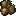 Ruinous Enzyme |
| **Congeatio** | Cold, Ice, Water | Blue (0,100,255) |  Frigid Enzyme |
| **Ferric** | Iron, barbs and needles, solidity, magnetism | Gray (53,53,53) |  Ferric Enzyme |
| **Tenebris** | Darkness, Stealth, The End | Purple (70,0,110) |  Umbral Enzyme |

**Gaining alignment.** Casting a manipulation shifts alignment toward its primary tendency by `tendencyShiftOnManipUse` and toward its secondary by half that; a charged cast scales the gain by its released charge. `tendencyShiftOnCastEnabled` gates casting gains and `tendencyShiftOnKillEnabled` gates kill gains only. A kill shifts alignment by `tendencyShiftAmount` according to `BloodTendencyEvents`' class rules. A blood-bearing mob that no rule claims splits that shift evenly across the tendencies in its [blood profile](../wiki/Blood-Profiles.md) (a Ravager now feeds Ferric, for example); a mob with neither a rule nor a profile gives nothing. There is no Animus default.

Enzymes are obtained by sampling living creatures with loose **Blood Vials** or the rack-fed **Living Syringe**, then processing balanced pairs in a **Vial Centrifuge**. Each completed spin also stores 250 mL of reclaimable blood in the machine.

Loose filled Blood Vials also support optional **injection**: hold use for 16 ticks to receive up to three short responses, then retain one empty vial. Transfusion Saturation blocks another injection for 400 ticks. Creative use retains the sample and still applies saturation. Unidentified blood works; the shared per-vial identification component controls whether tooltips reveal the selected effects. Missing or malformed sources remain filled and inert. Racks never inject. The custom injection pose raises the vial and stabs its pointed end into the matching thigh, mirrored by physical arm in first and third person. Confirmed completion synchronizes the thigh blood-cell/tendency burst and original puncture sound, followed by eight cosmetic recovery ticks with no added gameplay lockout. Cancellation produces no impact; Cardinal Rite planting retains presentation priority. See [Injectable Blood Vials](../wiki/Injectable-Blood-Vials.md) for response mappings, datapack format, provisional tuning, and companion-feature boundaries.

The Somatic Loom stores enzymes internally as dye-like tendency reservoirs measured in spans of thread. Each enzyme dissolves into three spans, and each tendency's vial holds 192 spans (64 enzymes); inserted enzymes cannot be recovered. The stock is a revolving resource: every step a lane of the engram takes holds a span of its colour, the spans are spent only when the memory crystallizes, and cutting a lane back or cancelling returns them. Payment checks the payer's own engram's reference cost and reserves it, so a paid weave can always be finished; vials may be topped up mid-weave.

---

## 10. Vascular System

The player's vascular system has **5 sections** (`EnumVeinSections`) that take strain from manipulation use and damage:

| Section | Enum Value |
|---------|-----------|
| Head | `HEAD` |
| Arms | `ARMS` |
| Heart | `HEART` |
| Body | `BODY` |
| Legs | `LEGS` |

- Sections degrade through health states when strained (healthy → stressed → clotted → dead)
- Each cast strains the manipulation's section by its rank: Humilis 1, Mediocritas 1, Summa 2, Magister 2, Perfectus 3, times `vascularManipStrain`
- A **CLOTTED** section makes manipulations routed through it cost 25% more blood (the "Clotted vein" cost-ledger line)
- A **DEAD** section refuses its manipulations before payment, as it already refuses muscle memories ("Your <section> veins are dead; nothing flows to shape.")
- Degraded sections apply debuffs
- Sections heal passively when the player is well-fed
- The **Vascular Status Gauge** item and **VascularViewScreen** let the player inspect their vein health

---

## 11. Skill Tree

Opened from the **Sanguine Conduit** item/block. The Harbinger suite has six tabs: four along the top and two (from Degree 2) at the bottom right.

- **Skills** — panning/zoomable blood skill tree, with a surface layer (Degrees 0–4) and a deep layer (Degrees 5–8).
- **Tendencies** (Degree 3+) — the manipulation tree and the scar tree on one radial canvas: each tendency's hand-authored manipulation cluster sits in its own 45° sector, and that tendency's scars continue outward along the sector axis (tiers 65 px apart; scar labels show from 95% zoom). Includes the wrapped manipulation detail inspector and scar detail presentation.
- **Rites & Crafts** — one recipe-map canvas for every Harbinger rite, Working craft, floorless Blood Structure, ritual floor and Ichorian sigil (`RitesAndCraftsTabController`). Families run round the map in **purpose groups**, each tinted with its floor style's glow and spanned by a thin arc beyond the rim: **Floorless** (Floorless Crafts), **Self** (Order, Body/Will, Threshold Floors), **World** (Domain/World, Fane, Qliphoth, Puppetry, Trials, Dominion Floors), **Making** (Vessel, Apparatus, Stations, Ritual Infrastructure, Constructs/Effigies, Station Upgrades, Working Floors), **Bond** (Bloodline, Ancestral, Communion Floors) and **Reference** (Ichorian Sigils). A special floor sits in the floors family of its purpose. The filter control cycles purpose groups. Selecting a rite, floor or sigil opens the rite inspector (with clipped/draggable sigil previews and diamond-shaped floor nodes); selecting a floorless structure or Working craft opens the compact crafting inspector with its structure on its bed. Floors and sigils sit on the ring of the earliest degree at which a rite or craft uses them; their tooltips read "First used at Degree N". `HarbingerRecipeMapDefinitions` authors the families and their groups; `RecipeMapPurposeGroupDataTest` pins every shipped rite to its purpose group. The Unstained suite keeps its separate Rites and Crafting stage lists.

On the Rites & Crafts map the surface layer rings Degrees 0–4 at radii 170/220/270/320/370 and the deep layer rings Degrees 5–8 at 220/270/320/370: the merged map carries about twenty families, and the inner radii could not seat the five Degree 1 floorless crafts beside them. Nodes in one cell sit at least 40 px apart and split into two staggered rows only when one row cannot fit the cell's sector. Sector widths are computed per layer. Links whose parent is on the other layer are drawn as a stub from the hub.
- **Materials** — a panning/zoomable atlas catalogue of progression-relevant items and blocks. Harbinger and Unstained share the atlas controller but use path-specific cosmetic buckets laid out as hand-placed family clusters. Explicit material-parent links determine vein traces; locked future materials remain hidden except for the immediate next-tier veiled nodes.
- **Summons** (Degree 2+, bottom right) — Puppeteering shapes and claimed Wills grouped by degree, including locked/known/trial state, skill-adjusted statistics, and a guarded client entity preview.
- **Bestiary** (Degree 2+, bottom right) — the Living Bestiary catalogue and specimen-discovery view.

**Layout rule.** Rites & Crafts is a generated compass map: the hub is where the path starts, the ring is the unlock degree, the sector is the family, and families keep to their purpose group, with sector widths sized to their contents; family labels sit outside the rim and degree labels in a reserved gap. Skills, Tendencies and the Materials atlas keep hand-authored positions (edited in `tools/skill_tree_editor`). Short links are drawn nearly straight; trace curvature and sway scale with link length. Each tree (and the Materials atlas) opens centred on its hub, zoomed (between 50% and 100%) to fit everything up to the player's next degree; Home returns to that view.

Shared map selection preserves the user's current pan and zoom instead of silently recentering. Rites & Crafts also retains recent-selection history, filtering, and explicit back/forward navigation.

Skills cost **skill points** (earned from using manipulations) and many require a **minimum initiatory degree**:

Skill definitions are Java-owned. `SkillPointInit` keeps the public static fields and branch registration order, while editable declarations live in `common/init/skills/*SkillBranch.java` between `// <skill-editor branch="...">` markers. The browser tool in `tools/skill_tree_editor` reads those Java branch files directly, ignores the old `data/hemomancy/skilltrees` JSON folder, and previews Java/lang diffs before applying changes.

| Skill | ID | Max Lvl | SP Cost | Req. Degree | Effect | Parent |
|-------|----|---------|---------|-------------|--------|--------|
| Base | 0 | 1 | — | — | Root node, unlocked by default | — |
| Deep Base | 38 | 1 | 1 | 5 | Late-path anchor used by deep Harbinger branches | — |
| Capacity | 1 | 5 | 1 | — | +500 max blood volume per level | Base |
| Efficiency | 2 | 5 | 1 | — | -8% manipulation cost per level (multiplicative, ~34% at max) | Base |
| Manip Slots | 14 | 5 | 2 | 1 | +1 active manipulation slot per level | Base |
| Synaptic Memory | 40 | 4 | 3 | 5 | +1 remembered Synaptic Loadout slot per level; raises Dendritic Distributor loadout storage from 3 to 7 | Manip Slots + Deep Base |
| Living Conduit | 21 | 3 | 2 | 1 | Living Staff absorption target cap and absorption range increase per level | Manip Slots |
| Last Wind | 3 | 3 | 2 | 2 | +0.5 mL/tick (10 mL/s) blood regen per level when below 10% blood | Capacity |
| Sanguine Surge | 7 | 3 | 2 | 2 | +0.25 mL/tick (5 mL/s) passive blood regen per level | Capacity |
| Dynamic Use | 4 | 3 | 2 | 2 | Cost discount: manipulations whose primary tendency is your strongest cost ÷ (1 + 10% per level) | Efficiency |
| Hemostasis | 6 | 3 | 2 | 2 | -10% blood lost when taking damage per level | Efficiency |
| Vascular Draw | 22 | 3 | 2 | 2 | Living Staff absorption amount and block/reservoir draw rate increase per level | Living Conduit |
| Dragging Siphon | 41 | 1 | 2 | 2 | Allows slow movement while channeling Blood Absorption | Vascular Draw |
| Mobile Conduit | 42 | 3 | 2 | 3 | Reduces Blood Absorption movement slowdown per level | Dragging Siphon |
| Blood Tolerance | 43 | 5 | 2 | 3 | Delays living-target absorption strain thresholds per level | Dragging Siphon |
| Quickened Draw | 45 | 1 | 2 | 3 | First Blood Absorption living-target pulse frequency upgrade | Vascular Draw |
| Hungry Pulse | 46 | 1 | 3 | 4 | Second Blood Absorption living-target pulse frequency upgrade | Quickened Draw |
| Feeding Frenzy | 5 | 3 | 3 | 3 | +25% blood gained from kills | Last Wind |
| Iron Will | 10 | 3 | 3 | 3 | 10% damage reduction per level when blood < 15% | Last Wind |
| Crimson Projection | 23 | 3 | 3 | 3 | Living Staff structure feed and blood vessel feed rates increase per level | Living Conduit |
| Weapons Master | 39 | 4 | 2 | 4 | -50mL Living Staff weapon hot-swap cost per level (250mL -> 50mL) | Crimson Projection + Vascular Draw |
| Persistent Arsenal | 50 | 1 | 3 | 3 | Toggleable. Living Weapon forms remain shaped when you leave their hotbar slot | Crimson Projection |
| Unbound Siphon | 44 | 1 | 4 | 5 | Removes Blood Absorption movement penalties | Mobile Conduit + Deep Base |
| Arterial Cadence | 47 | 1 | 4 | 5 | Final Blood Absorption living-target pulse frequency upgrade | Hungry Pulse + Deep Base |
| Hematic Focus | 24 | 3 | 3 | 5 | Broad Living Staff focus: absorption cap/range/amount and projection rates improve per level | Crimson Projection + Vascular Draw + Deep Base |
| Vesper's Refusal | 25 | 3 | 4 | 7 | Amplifies awakened Vesper memory on the Living Staff; inert until Vesper's memory is awakened | Hematic Focus |
| Blood Flow | 11 | 5 | 2 | 3 | -5% manipulation cooldowns per level | Hemostasis |
| Coagulation | 12 | 3 | 3 | 4 | +15% chance to block incoming bleed effects | Hemostasis |
| Automatic Coagulation | 57 | 1 | 3 | 3 | Toggleable. Spend blood over time to suppress active bleeding | Hemostasis |
| Crimson Wake | 59 | 1 | 3 | 4 | Toggleable. While badly wounded, sprinting leaves a brief slowing and revealing blood wake | Last Wind |
| Crimson Mastery | 8 | 3 | 3 | 4 | +15% manipulation damage/effectiveness per level; lingering state damage (Searing, Blood Loss, Necrosis release) stays flat | Dynamic Use |
| Quick Caster | 73 | 1 | 2 | 2 | Toggleable. Selecting a QUICK manipulation from the radial or cycle key casts it at once, including reselecting the current one. CHARGED, CONTINUOUS, PASSIVE, muscle memories, staff weapon forms and conjurations still wait for the cast key; a cooling, paralysed or blood-blocked selection is only selected | Dynamic Use |
| Vital Link | 9 | 3 | 4 | 5 | +10% chance to heal on dealing manipulation damage | Feeding Frenzy |
| Sanguine Reach | 13 | 3 | 3 | 5 | +15% range for ranged blood manipulations | Crimson Mastery |
| Scar Affinity | 15 | 3 | 3 | 4 | Opens the mind to cerebral scarring; +10% scar effect potency per level | Crimson Mastery |
| Scar Resonance | 16 | 3 | 3 | 4 | The bond between scar and blood deepens; +1 equippable scar slot per level | Scar Affinity |
| Scar Mastery | 17 | 3 | 4 | 5 | Scarred pathways fully colonised; scar effects last 20% longer per level | Scar Resonance |

Skill bonuses are computed in `SkillPointHelper`.

`skill_synaptic_memory` is wired through `SynapticLoadoutSlotHelper` and `SynapticLoadoutActionPacket`: it expands remembered Dendritic Distributor loadout slots from the base 3 to the maximum 7.

**Skill Wiring Status** (which skills are actually hooked into gameplay events):

Capacity is now resolved by `MaxBloodLedger` through `BloodVolumeEvents`: each level contributes +500 max blood to the additive formula `5000 + Capacity + Spleen + Eternal Covenant - scars`.

| Skill | Wired? | Where Called |
|-------|--------|-------------|
| Capacity | Yes | `MaxBloodLedger` via `BloodVolumeEvents` -- contributes +500 max blood per level to the additive player capacity formula |
| Efficiency | ✅ Yes | `ManipulationCostLedger` via `BloodManipulation.performAction()` -- multiplies manipulation blood cost |
| Deep Base | ✅ Yes | `SkillPointInit` / branch definitions — degree-gated anchor for deeper progression paths |
| Manip Slots | ✅ Yes | `ManipulationSlotLedger` via `ManipSlotHelper` -- expands active manipulation slot count |
| Living Conduit | ✅ Yes | `LivingStaffFocusProfile` / `LivingStaffFocusRules` — increases Living Staff absorption target cap and range |
| Last Wind | ✅ Yes | `BloodVolumeEvents` — passive blood regen when below 10% threshold |
| Dynamic Use | ✅ Yes | `ManipulationCostLedger` via `BloodManipulation.performAction()` -- divides effective blood cost by multiplier when tendency matches |
| Quick Caster | ✅ Yes | `UpdateCurrentManipPacket` / `ChangeSelectedManipPacket` -> `UseManipKeyPacket.castOnSelect`, gated by `QuickCasterRules`; the cast runs the ordinary R-key server path with all cost, degree and cooldown checks |
| Feeding Frenzy | ✅ Yes | `BloodVolumeEvents` — multiplies blood gained from kills |
| Hemostasis | ✅ Yes | `BloodVolumeEvents` — multiplies blood drained when taking damage |
| Vascular Draw | ✅ Yes | `LivingStaffFocusProfile` / `LivingStaffFocusRules` — increases Living Staff absorption amount and block/reservoir draw rate |
| Dragging Siphon | ✅ Yes | `BloodAbsorptionChannelRules` / Blood Absorption item paths — unlocks slow movement while channeling |
| Mobile Conduit | ✅ Yes | `BloodAbsorptionChannelRules` / Blood Absorption item paths — reduces channel movement slowdown |
| Blood Tolerance | ✅ Yes | `BloodAbsorptionChannelRules` / Blood Absorption item paths — delays weakness, nausea, and blood poisoning strain tiers |
| Quickened Draw | ✅ Yes | `BloodAbsorptionChannelRules` / Blood Absorption item paths — improves living-target pulse interval |
| Hungry Pulse | ✅ Yes | `BloodAbsorptionChannelRules` / Blood Absorption item paths — improves living-target pulse interval |
| Crimson Projection | ✅ Yes | `LivingStaffFocusProfile` / `LivingStaffFocusRules` — increases Living Staff projection/feed rates |
| Weapons Master | ✅ Yes | `LivingStaffWeaponFormHelper` / `LivingStaffWeaponFormRules` — reduces Living Staff weapon hot-swap cost by 50mL per level |
| Unbound Siphon | ✅ Yes | `BloodAbsorptionChannelRules` / Blood Absorption item paths — removes channel movement penalties |
| Arterial Cadence | ✅ Yes | `BloodAbsorptionChannelRules` / Blood Absorption item paths — reaches the mature living-target pulse interval |
| Hematic Focus | ✅ Yes | `LivingStaffFocusProfile` / `LivingStaffFocusRules` — improves staff focus channels: absorption cap/range/amount and projection rates |
| Vesper's Refusal | ✅ Yes | `LivingStaffFocusProfile` / `LivingStaffFocusRules` — only applies when Vesper memory is awakened; improves staff target cap, range, absorption amount, and projection rates |
| Sanguine Surge | ✅ Yes | `BloodVolumeEvents` — adds passive blood regen per tick |
| Crimson Mastery | ✅ Yes | `SkillPointHelper.getCrimsonMasteryMultiplier` — multiplies hand-computed manipulation damage once (including Blood Shot/Needle bases and the Blood Cloud multiplier fixed at cast), and `PyreticForgeManip` items smelted per cast |
| Vital Link | ✅ Yes | `KnownManipulationEvents` — chance to heal player on dealing manipulation damage |
| Iron Will | ✅ Yes | `BloodVolumeEvents.onPlayerDamaged` — reduces incoming damage by `getIronWillMultiplier()` when blood is below `getIronWillThreshold()` (default 15% of max blood) |
| Blood Flow | ✅ Yes | `BloodManipulation` — multiplies effective cooldown of manipulations |
| Coagulation | ✅ Yes | `BloodLossEffect` — chance to block incoming bleed effect ticks |
| Sanguine Reach | ✅ Yes | `BloodLampManip`, `CrimsonFlameConjurationManip`, `UmbralStepManip`, `SanguineExcavationManip` — scales range |
| Scar Affinity | ✅ Yes | `HarbingerEquipmentEntityEventHandler.checkScarSynergy` multiplies scar synergy attribute modifiers by `getScarAffinityMultiplier()`; modifiers are removed and re-added every 20 ticks so level changes take effect immediately |
| Scar Resonance | Yes | `ScarBrazierRite.getMaxActiveScars` adds purchased resonance slots to degree capacity; the Effigy shares this limit and both paths retain the D4 prerequisite |
| Scar Mastery | ✅ Yes | `ScarDefinition.onPlayerAttack`, `onPlayerDefend`, `onPlayerKill`, `applyTierThreeTickEffect` multiply triggered effect durations by `getScarMasteryDurationMultiplier()` |

---

## 12. Bloodlines

A multiplayer social system where players form blood-bound groups.

- **Creation:** Use an **Unsigned Ancestral Ledger** — first use signs and creates a bloodline named after the leader
- **Joining:** Another player uses the same signed ledger to join
- **Shared Pool:** Each member contributes 5,000 blood to a communal pool
- **Trickle Donation:** Optionally auto-donate blood to the shared pool at a configurable rate
- **Auto-Draw:** Optionally auto-draw from the shared pool when personal blood falls below a threshold
- **Direct Routing Contribution:** Fane-only routing can draw from the shared pool when the linked player enables bloodline mode. The current implementation requires the linked player to be the bloodline leader or to have their routing opt-in enabled before the pool is used.
- **Member Expulsion:** Bloodline progenitors can expel member players through `BloodlinePoolScreen` (server-validated via `PacketKickBloodlinePlayer`)
- **Ledger Actions:** Summoning recruited NPCs, recalling to the lodge, setting the recall point and disbanding all come from the ledger screen. The server runs them only while the player holds the Unsigned Ancestral Ledger in either hand (`PacketLedgerAction`).
- **Bloodline Chat:** Messages to the bloodline are capped at 256 characters and 3 per sender every 5 seconds. Extra messages are dropped and the sender sees a short notice (`BloodlineChatRateLimit`).
- **Harbinger NPC Recruitment:** Degree 5+ players with a valid bloodline can recruit outpost Harbingers through dialogue. Current recruitable NPCs are Vicar, Alchemist, and Mnemonist. Recruited NPCs are phantom bloodline members: they do not appear as online players but add 1,000 maximum shared blood each.
- **Recruitment Limits:** A bloodline may contain only one recruited NPC of each entity type and only one recruited NPC from each Harbinger Outpost. `Bloodline` persists NPC UUIDs, entity type ids, and outpost keys; `DialogueEventHandler` enforces both limits when `recruit_harbinger` fires.
- **Ordinary Recruit Death:** An uncancelled server death removes the recruit's membership and profession/outpost reservations, clears its rite reserve/Bloodspent entry, reduces shared capacity, and clamps the pool. A legitimate replacement can then fill the freed slot. Unloading or removing an entity without death does not release membership. Succession residents use their separate remnant lifecycle; missing historical UUIDs are not automatically treated as dead.
- **Outpost Identity:** `HarbingerOutpostStructure.afterPlace()` stamps spawned Vicar/Alchemist/Mnemonist entities with a persistent outpost key through `HarbingerRecruitmentRules`. Older or manually unstamped NPCs fall back to a `StructureManager#getStructureWithPieceAt` lookup for `hemomancy:harbinger_outpost` when interacted with on the server.
- **NPC Expulsion:** Expelling a recruited NPC removes that NPC's UUID, type, and outpost key from the bloodline, freeing both the type slot and the outpost slot. The entity's own persistent outpost tag remains, so the same outpost identity can be rediscovered if the NPC is recruited again later.
- **Persistence:** Bloodline data is stored in world-level `BloodlineSavedData`
- **Monitoring:** The **Bloodline Pool Monitor** item shows pool status; the **BloodlinePoolScreen** provides a player-facing ritual GUI with shared/personal blood renderers, bloodline pool controls, and the client-side Fane Sight visibility cycle, and a top-down Fane Layout map of the bloodwell, stakes and chain

Recruitment dialogue uses mutually exclusive pledge/release options: an NPC already in the player's bloodline shows the release line, while an unrecruited NPC shows the pledge line only if both the type and outpost recruitment limits allow it. Holding an item no longer replaces the whole NPC dialogue tree; `DialogueItemInquiryNodes` rewrites each NPC's existing `item_hint` node so the item inquiry option can coexist with normal conversation and recruitment. The Alchemist's Degree 5+ menus expose the root item inquiry option directly.

Implementation anchors: `Bloodline`, `BloodlineSavedData`, `HarbingerRecruitmentRules`, `DialogueEventHandler`, `DialogueItemInquiryNodes`, `HarbingerOutpostStructure`, `HarbingerVicarEntity`, `HarbingerAlchemistEntity`, `HarbingerMnemonistEntity`, and `HarbingerRecruitmentDialogueSourceTest`.

---

## 13. Scars & Spores

### 13.1 Scars

Scars are now registry-backed player state. Cerebral scar items crafted at the **Cerebral Scarring Station** point at registered `ScarDefinition` entries; the player `SCARS` capability stores known and active cerebral scar registry ids. Scar crafting requires **Initiatory Degree 4 (Adept)** minimum.

The Degree 4 Vein-Mason assignment now provides the first guided scar lesson. After the Vicar sends the player to **Masons Respite**, the Cicatrix Anchorite gives one dynamic Scar Pattern tagged with the tier-1 template for the player's strongest blood tendency, plus a blank scar, the matching catalyst, and a Hematic Iron Knapper if needed. Hidden internal milestones still record the finer events, but the ledger presents four player-facing parts: finding the Vein-Mason, carving and burning the first Scar item, preparing the first Mason's Effigy loadout pattern, and burning that prepared pattern to commit the active scar loadout. The post-completion Anchorite reward is a continuation kit containing a dynamic Scar Pattern tagged for the player's second-strongest tendency, one blank scar, the matching catalyst, and four Runic Motif Paper.

Scars are organized in **three tiers** by `deepenAmount`, which describes how strongly they shift tendency alignment. The current NeoForge branch gives standard scars real passive/combat effects through `ScarDefinition`: attribute modifiers, persistent effects, blood upkeep, max-blood modifiers, and event hooks for attack/defense/kill/tick behavior. `ItemScar` is a carrier/pointer item, similar to `BloodMemoryItem`; the definition owns the behavior.

The **Iron Brazier** uses its shared offering lifecycle for all three scar burns. Place one item in an empty Brazier with ordinary use, light it with Blood Projection for 50 mL if unlit, then hold Blood Absorption on the lit offering through the 60-tick channel. Sneaking retrieves the offering; it is not a direct burn shortcut. Burning a cerebral **Scar item** from the Cerebral Scarring Station costs 100 mL and adds its registry id to the player's known cerebral scar list. Burning an Effigy-prepared **Scar Pattern** costs 50 mL and replaces the active cerebral scar ids with its selected known ids; it cannot teach an unknown scar. Burning blank **Runic Motif Paper** costs 50 mL and clears active cerebral scars without removing known scars or touching the fungal slot. Degree 4, active blood, sufficient reserve, known cerebral ids, and capacity are checked before absorption progress. Interrupting the channel does not consume the offering or grant a proof; successful completion consumes it and leaves the Brazier unlit.

The **Mason's Effigy** attunes selected scars the player already knows. Opening the menu receives a server-authored snapshot of the player's known and currently active cerebral scars, so the active sockets immediately mirror the player's current loadout even before later capability sync packets arrive. Right-clicking the Effigy with **Runic Motif Paper** places the blank motif above the block as a pending ritual. The player feeds that motif with Blood Projection from hand or staff; when it has received **500 ml per selected scar**, the Effigy bursts with red omen particles and ejects the completed dynamic Scar Pattern item into the world. Base active capacity is gated by degree: Degree 4 = 1 active scar, Degree 5 = 2, Degree 6+ = 4. Scar Resonance adds one slot per purchased level (up to three), shared by preparation and activation; it never bypasses Degree 4.

The D4 Main proof requires the committing player to have personally completed Effigy preparation. Templates and gifted loadouts can still activate known scars at the ordinary 50 mL cost, but cannot supply that personal practice or unlock continuation by themselves. This is a player milestone check, not an owner stamp on traded patterns. Existing earned Main proofs are preserved. The Liber's **The First Scar** page teaches the complete cycle and keeps fungal implantation separate.

Fungal scars remain a separate physical `ItemStack` slot in the same `SCARS` capability and are not changed by cerebral loadout burning. `ScarType` and `HarbingerEquipmentType` remain separate systems: scars are not Harbinger equipment slots, and Harbinger equipment is not stored as cerebral scar ids.

**Tier 1 Scars (deepenAmount = 1) — Basic, available at Degree 4:**

| Scar | Tendency | Effect |
|------|----------|--------|
|  Mind Spike | Ductilis | Legacy override scar / mind spike slot behavior |
|  Scar of the Heart | Animus | +2 Max Health |
|  Scar of the Pyre | Flammeus | +1 Attack Damage, -1 Armor |
|  Scar of the Feral | Ductilis | +5% Attack Speed, -1 Armor |
|  Scar of the Halo | Lux | +1 Armor Toughness, -5% Movement Speed; blinds attackers |
|  Scar of Blight | Mortem | +1 Attack Damage; poison backtracks onto wearer after kills |
|  Scar of Rime | Congeatio | +5% Movement Speed, -5% Attack Speed; slows struck foes |
|  Scar of the Thorn | Ferric | +1 Armor, -5% Movement Speed; reflects 1 thorns damage |
|  Scar of the Shade | Tenebris | +5% Movement Speed, -1 Attack Damage; invisibility in darkness |

**Tier 2 Scars (deepenAmount = 2) — Advanced, available at Degree 4:**

| Scar | Tendency | Effect |
|------|----------|--------|
| Scar of Marrow | Animus | +4 Max Health, -5% Movement Speed; heals wearer on kill |
| Scar of Sol | Flammeus | +2 Attack Damage, -2 Armor; briefly ignites attackers |
| Scar of Flux | Ductilis | +10% Attack Speed, -2 Armor; grants Haste on kill |
| Scar of the Veil | Lux | +2 Armor Toughness, -10% Movement Speed; blinds + marks attackers with Glowing |
| Scar of Withering | Mortem | +2 Attack Damage, -2 Max Health; poisons struck foes |
| Scar of the Glacier | Congeatio | +10% Movement Speed, -10% Attack Speed; slows struck and nearby foes |
| Scar of the Anvil | Ferric | +2 Armor, +1 Armor Toughness, -10% Movement Speed; reflects 2 thorns damage |
| Scar of the Moon | Tenebris | +10% Movement Speed, -2 Attack Damage; invisibility in darkness and when struck in darkness |

**Tier 3 Scars (deepenAmount = 3) — Expert, available at Degree 5 (planned: move gate to Degree 6):**

| Scar | Tendency | Effect |
|------|----------|--------|
| Scar of the Phoenix | Animus | +6 Max Health, -10% Movement Speed; heals on kill and regenerates when gravely wounded |
| Scar of the Corona | Flammeus | +3 Attack Damage, +0.3 Knockback Resistance, -3 Armor; ignites attackers |
| Scar of the Chimera | Ductilis | +15% Attack Speed, -3 Armor, -4 Max Health; Haste/Speed/Strength on kill |
| Scar of Transcendence | Lux | +2 Armor Toughness, -15% Movement Speed; blinds/marks attackers and grants Resistance in bright light |
| Scar of Oblivion | Mortem | +3 Attack Damage, -4 Max Health; withers struck foes |
| Scar of Descendence | Congeatio | +15% Movement Speed, -15% Attack Speed, -2 Attack Damage; slows struck/nearby foes and grants slow fall |
| Scar of the Crucible | Ferric | +3 Armor, +2 Armor Toughness, -15% Movement Speed, -5% Attack Speed; reflects 3 thorns damage |
| Scar of the Eye | Tenebris | +15% Movement Speed, -3 Attack Damage; invisibility in darkness and when struck |

> **Scar Mechanic:** Standard scar items extend `ItemScar`, but active behavior resolves through `ScarInit` and the `SCARS` capability's active cerebral ids. The active Animus tier-3 scar is `scar_phoenix`; the old unregistered Ichor scar resource stub has been removed from recipes, models, and lang.

The **Scar Pattern** is now one dynamic item, `scar_pattern`, whose custom data stores up to seven scar registry ids. Single-id stacks act as Cerebral Scarring Station templates, and multi-id stacks produced by the Mason's Effigy act as loadout tools for the Iron Brazier scar interaction. The Scar Station pattern slot accepts only Scar Pattern stacks and, when a stack contains multiple scar ids, displays all available templates as a selectable scrolling list. Template recipes live under `data/hemomancy/recipe/scar_template/` and produce the single dynamic item with the relevant `ScarIds` custom data. The scar-pattern item renderer draws up to four selected scar overlays on the motif in a 2x2 dynamic arrangement. These overlays render directly from scar overlay textures, rotate around the pattern's Z axis, and have tuned first-person, third-person, GUI, and ground transforms so the motif remains readable in hand, inventory, and dropped-item views.

### 13.2 Functional Fungal Scars (Scar-type items)

Special fungal scar items with active effects extend `ItemFungalScar`, render as rotating 3D scar items on the player, have rare rarity/foil visuals, and occupy the dedicated fungal scar `ItemStack` slot in the `SCARS` capability (`ScarType.FUNGAL`, slot 0). The current implementation uses the **Mycelial Crucible**, not the Morphling Incubator, and the old four-scar incubator plan has been superseded.

The consolidated fungal-scar roster is eight crucible-grown identities. The legacy removed scar ids migrate on login/tick to the nearest survivor and do not retain removed per-stack custom data:

| Item | Tendency | Active Effect |
|------|----------|---------------|
|  Noctifly Agaric | Animus | Grants the `fungal_elytra` effect while equipped; glide support is maintained by `HarbingerEquipmentEntityEventHandler.onGlideTick()` |
|  Rhizovitta Communis | Animus | While grounded in a fungal network, sustains a guarded scar-channel blood trickle and refunds a small share of successful blood-manipulation cost |
|  Talaromyces Minus | Ferric | Enables shift-mining ore vein mining through `VeinMinerHelper`; it no longer grants Haste |
|  Oculiflora Reticularis | Tenebris | Client-local network sight only: reveals equipped scar state, synced Qliphoth bloom data, nearby entities, and nearby morphic nectar/fluid signals |

The remaining advanced scars use the same live event-handler surface:

| Item | Tendency | Active Effect | Cultivation Cost |
|------|----------|---------------|------------------|
| **Saprovitta vestigium** | Flammeus | **Feeding Wake** - movement leaves a brief damaging blood-fungal trail (1.5 magic damage pulses every 6 ticks while moving) | 1,200 blood / 1,200 ticks / 2,000 enzyme power |
| **Antiphonomyces resonans** | Ductilis | **Crawling Choir** - 20% chance for a successful blood manipulation to echo-cast at no extra blood cost | 2,400 blood / 2,400 ticks / 3,000 enzyme power |
| **Putrivora resolvens** | Mortem | **Affliction Digestion** - poison, wither, hunger, and blood-loss effects tick down faster and feed back limited guarded scar-channel blood recovery | 2,400 blood / 2,400 ticks / 3,000 enzyme power |
| **Cryostroma perdurans** | Congeatio | **Conservative Resilience** - stillness ramps passive vascular recovery without reviving the removed death-save behavior | 2,400 blood / 2,400 ticks / 3,000 enzyme power |

**Mycelial Crucible recipe format** (`data/hemomancy/recipe/fungal_scar/*.json`):
```json
{
  "type": "hemomancy:fungal_scar_cultivation",
  "tendency": "LUX",
  "blood_cost_phase1": 2400,
  "phase1_duration": 2400,
  "maturation_threshold": 3000,
  "immature_result": { "id": "hemomancy:immature_fungal_scar" },
  "result": { "id": "hemomancy:oculiflora_reticularis" }
}
```

### 13.3 Spore Cultures (Enzyme Fruiting)

Aligned spores are now functional reusable culture items for the **Mycelial Lantern** enzyme-fruiting loop. Each is registered as an uncommon item that stacks to 16 and is crafted shapelessly from the matching enzyme + `spore_sac` + `hyphal_substrate`. The culture remains in the Lantern while blood is converted into the matching enzyme output.

One culture exists for each enzyme/tendency vocabulary pair:
 Vivacious,
 Fervent,
 Neurotic,
 Incandescent,
 Ruinous,
 Frigid,
 Ferric,
 Umbral.

The JSON recipes live at `data/hemomancy/recipe/<spore_id>.json`, e.g. `vivacious_spores.json` combines `vivacious_enzyme`, `spore_sac`, and `hyphal_substrate` into `vivacious_spores`.

The same aligned spores are also consumed as **Sporitic Thurible** catalysts (see §21.5). In that tool one spore lights the thurible for 6,000 ticks (5 minutes), stores `SporeId`, `BurnTicks`, `MaxBurnTicks`, and `BurnEndGameTime` in `DataComponents.CUSTOM_DATA`, and colors both the GUI burn bar and the emitted `sporitic_spore` cloud by the mapped tendency. Burn time is computed from the stored end tick instead of decrementing stack NBT every tick, so the hotbar item does not replay vanilla stack-change pop animation while burning. The current catalyst mappings are:

| Spore | Tendency | Secondary hostile effect | Particle / bar color |
|---|---|---|---|
| `vivacious_spores` | `ANIMUS` | Weakness | `0xB83A4B` |
| `fervent_spores` | `FLAMMEUS` | Brief fire | `0xD86A2C` |
| `neurotic_spores` | `DUCTILIS` | Neural Overload | `0x68D6D7` |
| `incandescent_spores` | `LUX` | Glowing | `0xF4D66E` |
| `ruinous_spores` | `MORTEM` | Longer Wither | `0x5C3A77` |
| `frigid_spores` | `CONGEATIO` | Slowness | `0x74A9C8` |
| `ferric_spores` | `FERRIC` | Mining Fatigue | `0xA76A37` |
| `umbral_spores` | `TENEBRIS` | Blindness | `0x3A254A` |

### 13.4 Mycelial Crucible & Immature Fungal Scar Cultures

The **Mycelial Crucible** (`MycelialCrucibleBlockEntity`) is the current fungal-scar cultivation station. It has 8 slots:

- Center (slot 0): finished fungal scar seed for Phase 1, or `immature_fungal_scar` for Phase 2
- Enzyme slots (1–4): aligned `EnzymeItem` / `RecycledEnzymeItem`; only matching tendency contributes
- Output (5): immature culture or finished scar
- Blood input (6): Bloody Flask or Blood Gourd
- Flask output (7): empty/cured flask return

When placed, the crucible reserves a rotating 3x2x1 footprint: the main block is the lower center, with filler blocks on both lower sides and across the upper row. Its width follows the block's horizontal facing.

**Phase 1 — Implantation:** The center scar plus aligned enzymes start a timed cultivation run. The crucible deducts the recipe's flat blood cost, then drains 1.5 blood/tick for the recipe duration. On completion it consumes the center/enzymes and outputs the single consolidated `immature_fungal_scar`.

**Phase 2 — Maturation:** The immature culture stores `Tendency`, `MatureThreshold`, `MatureProgress`, and `TargetScarId` in `DataComponents.CUSTOM_DATA`. Feeding aligned enzymes advances `MatureProgress`; when progress reaches the threshold, the crucible converts it into the target `ItemFungalScar`. Progress is preserved on the item stack, and blood shortages pause the process rather than resetting it.

`Hyphal Substrate` is registered as a supporting crafting ingredient, and `immature_fungal_scar` uses one model/texture with dynamic translated names such as `item.hemomancy.immature_scar.oculiflora_reticularis`.

> **Design status:** The extractor / harvested Fungal Gardens scar plan has been replaced for now by crucible cultivation. The deeper Apotheos-tier fungal scar concept remains open-ended design space, but the implemented fourth scar family is already live through `ItemFungalScar` + `MycelialCrucible`.

---

## 14. Status Effects & Potions

Most crafted status effects have a corresponding potion, splash potion, lingering potion, and tipped arrow variant. Some runtime-only effects are applied directly by gameplay systems instead.

| Effect | Category | Color | Notable Mechanic |
|--------|----------|-------|-----------------|
|  **Blood Binding** | Harmful | Dark red | Immobilizes target |
|  **Blood Drunkenness** | Harmful | 0x6E0E1C | Foreign-blood backlash from direct emergency blood restores. Lasts 3 minutes per use, stacks to amplifier 3, increases manipulation blood cost by +15%/+30%/+45%/+60%, and at amplifier 3 also increases manipulation cooldowns by 25%. Runtime-applied only; no potion recipe. |
|  **Blood Loss** | Harmful | Red | -15% movement speed |
|  **Blood Rush** | Beneficial | Red | +20% move speed, +10% attack speed per level; heals 0.5 HP each second while wounded. The `blood_rush` manipulation applies level I for 8 seconds |
|  **Paralysis** | Harmful | 0xF0DE5C | Synaptic Storm's dedicated nerve lock. Blocks voluntary movement, jumping, attacks, item use, mounted jump release, and non-passive casting; interrupts held channels while preserving camera control, gravity, damage, and automatic defensive passives. Players cap at 20t, ordinary mobs retain the 10-60t charge scale, bosses receive reduced movement disruption, and a 20t recovery window prevents immediate full re-lock. Runtime-applied only. |
|  **Conductive Mark** | Harmful | 0xE8D84A | Marks a preferred discharge target. Valid Ductilis, Lux, Ferric, and living-weapon hits can arc onward under shared hit accounting; removal is explicitly synchronized for observers. Runtime-applied only. |
|  **Insatiable Hunger** | Harmful | 0x35651F | Reduces healing to 25%; affected players who finish food receive Hunger II and exhaustion. Counts as an affliction for Funeral Bell (which spends it) and Carrion Communion. Runtime-applied only. |
|  **Grave Debt** | Harmful | 0x3A4F24 | Arms one low-health burst and returns blood to the original caster if the marked target dies. Runtime-applied only. |
|  **Iron Retort** | Beneficial | 0x9A9A94 | Brief guard consumed by the first direct living attacker; halves that hit and returns metal retaliation. Runtime-applied only. |
|  **Hemolysis** | Neutral | Pink | Blood destruction effect |
|  **Hematic Strain** | Harmful | 0x660000 | Inner Trial debuff; reduces max health by 40% while active. |
|  **Hemophagy** | Harmful | 0x4B0000 | Hemorath's Empty Pulse debuff; healing reduction is enforced through `HemorathEntity` heal handling. |
|  **Noctifly Agaric** (Fungal Elytra) | Beneficial | — | Grants elytra flight  |
|  **Sanguine Fertility** | Beneficial | 0xCC3344 | Fertility/growth effect |
|  **Arachnid Anastomosis** | Beneficial | 0x8B0000 | Spider-vein healing |
|  **Mycorrhizal Mending** | Beneficial | 0x7B4F2A | Fungal regeneration |
|  **Sanguine Siphon** | Beneficial | 0x8B0000 | Blood drain on hit |
|  **Chitinous Bulwark** | Beneficial | 0x556B2F | +4 armor toughness |
|  **Serpentine Guile** | Beneficial | 0x2E8B57 | +15% move speed, +10% attack speed |
|  **Verminous Aura** | Beneficial | 0x4A3728 | Pest-based area effect |
|  **Echoic Perception** | Beneficial | — | Bat morphling effect — nearby entities glow (radius scales with amplifier) |
|  **Luminous Dissipation** | Beneficial | — | Cuttlefish morphling effect — knockback resistance |
|  **Hemorrhagic Venom** | Beneficial | — | Tick morphling effect — AoE damage aura to nearby hostiles |
|  **Spined Barricade** | Beneficial | — | Urchin morphling effect — passive thorns + armor bonus |
|  **Venomous Resilience** | Beneficial | 0x336B87 | Centipede morphling effect — poison immunity + speed. |
|  **Burrower's Instinct** | Beneficial | — | Mole morphling effect — mining speed + underground regen/night vision |
|  **Deadman's Purse Morphling** | Beneficial | 0xB21F35 | Current Deadman's Purse strain identity passive. |
|  **Gravecap Morphling** | Beneficial | 0xB52A64 | Current Gravecap strain identity passive. |
|  **Witch's Ear Morphling** | Beneficial | 0x7F3A9A | Current Witch's Ear strain identity passive. |
|  **Lumenlace Morphling** | Beneficial | 0x2F79C7 | Current Lumenlace strain identity passive. |
|  **Bootlace Morphling** | Beneficial | 0x7E2AC7 | Current Bootlace strain identity passive. |
|  **Irontooth Morphling** | Beneficial | 0xA57A5A | Current Irontooth strain identity passive. |
|  **Emberfang Morphling** | Beneficial | 0xE34A2F | Emberfang identity passive; Hotheaded supplies contextual heat-scaled attributes at Developing and above. |
|  **Winter Shroud Morphling** | Beneficial | 0x76C9FF | Winter Shroud identity passive; Cold-Blooded progresses from environmental resistance to powder-snow traversal and cold immunity. |
|  **Arcane Resonance** | Beneficial | 0x8800AA | MnA combo marker — next blood manipulation costs less blood (granted by blood-affinity MnA spells) |
|  **Sanguine Clarity** | Beneficial | 0xAA0022 | MnA combo marker — next MnA spell costs less mana (granted by using blood manipulations) |
|  **Marked by Canon** | Harmful | 0x8B0000 | Saint sarcophagus rejection mark; lowers extraction odds, slows movement, and can damage high-amplifier trespassers. |
|  **Neural Overload** | Harmful | 0x7DF9FF | Neurotic enzyme disruption; slows the body and escalates into nausea and weakness at higher amplifier levels. |
|  **Mnemonic Whispers** | Beneficial | 0x7A5C91 | Brewed from Awkward Potion + Mnemonic Ambergris. Lasts 60 seconds and reduces the cooldown started by successful blood manipulations by 25% (`0.75×`) through `BloodManipulation.startCooldown`. |
|  **Mnemonic Screams** | Harmful | 0x3F102B | Anti-abuse backlash. If a player starts drinking another Mnemonic Whispers potion while Whispers is already active, the finish-drink handler removes Whispers and applies Screams for 60 seconds. While active, blood manipulations cost 50% more blood (`1.5×`). Runtime-applied only; no potion recipe. |
|  **Sporitic Resonance** | Beneficial | Catalyst-tinted | Granted by a lit Sporitic Thurible aura. Matching-tendency manipulations cost 15% less blood and receive 10% shorter cooldown while the resonance state is active; nonmatching manipulations receive no bonus and multiple thuribles do not stack. |
|  **Morphic Strain** | Harmful | Fungal green | Primal morphling drawback. Modest max-health and movement-speed reduction after successful Primal powers. |
|  **Silver Ward** | Beneficial | 0xC0C0C0 | Unstained protection; grants armor/knockback resistance and reduces damage from hemomancy-coded threats. |
|  **Verdigris Aura** | Beneficial | 0x4A8B6F | Early Unstained Purity field; weakens and slows hemomancy-tagged mobs with oxidized-copper resonance. |

**Potion and icon notes:**
- `potion_of_mnemonic_whispers` is registered in `EffectInit.POTION_TYPES`; normal vanilla conversion produces splash, lingering, and tipped-arrow variants with language entries.
- Mnemonic Whispers is brewed in `EffectInit.registerEnzymeBrewingRecipes(RegisterBrewingRecipesEvent)` from `Potions.AWKWARD` + `ItemInit.mnemonic_ambergris`.
- Re-drinking protection is handled by `EffectInit.onMnemonicPotionDrinkStart` and `EffectInit.onMnemonicPotionDrinkFinish`, using a short-lived per-player marker so the first Whispers drink is not punished after its own effect is applied.
- Effect icons live under `src/main/resources/assets/hemomancy/textures/mob_effect/`; every registered mob effect has an exact-ID 16x16 RGBA PNG there.

---

## 15. Unstained Systems

This section collects the reusable anti-hemomancy systems. The Unstained path section explains how a player enters and advances through Purity/Clarity; this section tracks the powers, rites, purification mechanics, client surfaces, and data anchors that support that path.

### 15.1 Still Arts

Still Arts are the Clarity-phase counterpart to Blood Manipulations, but they are not crafted Hematic Memories. They are granted by Our Lady of Still Waters and by Unstained rites as the player's silvery vital humor becomes stable enough to carry them.

Implementation spine:
- Registry: `StillArtInit.STILL_ARTS` (`hemomancy:still_arts`)
- Art definition: `common/unstained/stillarts/StillArt`
- Player state: `IKnownStillArts` / `KnownStillArts`, exposed through `HemoCapabilityAccess.getKnownStillArts(player)`
- Sync and use packets: `KnownStillArtsServerPacket`, `UpdateSelectedStillArtPacket`, `UseStillArtKeyPacket`
- Client selection: `RadialChooseStillArtScreen`, opened from the existing charm/radial key after Clarity is unlocked

Current basic Still Arts:

| Art | Required Clarity Stage | Role |
|-----|------------------------|------|
| Silver Rebuke | Awakened | Short-range pale knockback and slowing rebuke |
| Lethean Mute | Awakened | Silences hostile bodies through weakness and confusion |
| Still Pulse | Discerning | Brief defensive stillness and area slowing |
| Pale Diagnosis | Discerning | Reveals nearby suspicious or afflicted bodies |
| Memory Shear | Vigilant | Cuts a monster's immediate hostile fixation and disorients it |
| Absolving Step | Vigilant | Purging step that clears fire, poison, and wither while lunging forward |
| Quietus Bell | Resolute | Protective bell pulse that weakens surrounding hostiles |
| Autoimmune Edge | Enlightened | Dangerous pale backlash against nearby living bodies |

The Rite of Clarity Ascension, after Consecrated Copper preparation at the Unstained Podium, directly grants **Silver Rebuke** as the first Still Art. The remaining arts are granted by advancements through `StillArtRewardTable`:

| Advancement | Clarity Stage | Arts Granted |
|---|---|---|
| `hemomancy/clarity_awakened` | AWAKENED | Silver Rebuke, Lethean Mute |
| `hemomancy/discerning` | DISCERNING | Still Pulse, Pale Diagnosis |
| `hemomancy/vigilant` | VIGILANT | Memory Shear, Absolving Step |
| `hemomancy/resolute_stage` | RESOLUTE | Quietus Bell |
| `hemomancy/enlightened_seeker` | ENLIGHTENED | Autoimmune Edge |

On login, `playerLoggedIn` calls `grantEligibleArts()` to backfill any arts the player should already have based on current `IUnstainedProgress` clarity. The radial selection screen (`RadialChooseStillArtScreen`) is opened from the existing charm/radial key once Clarity is unlocked.

**Still Art presentation.** A successful Still Art plays an Unstained casting animation in both views. After `action.cast(...)` succeeds, `StillArt.performAction` calls `CastingAnimationManager.releaseStillArt`, which sends one RELEASE `CastingAnimationPacket` on the `CastLane.UNSTAINED` lane to the caster and trackers; refusals (unknown art, cooldown, clarity too low, or an action block: Paralysis, Disrupted or axonal travel) send nothing. The packet carries the art's required clarity stage, which picks one of five stage tracks (`StillArtTracks`: Awakened moves the main arm only, later stages both arms, Enlightened stands perfectly still), and its `StillArtEnding`, which works as the Unstained aim layer: Rebuke (Silver Rebuke, Autoimmune Edge), Hush (Lethean Mute, Quietus Bell), Stillness (Still Pulse, and `StillArt.BLANK`), Sight (Pale Diagnosis), Shear (Memory Shear), Step (Absolving Step) and Intercession (Pale Intercession). Releases are slow (8 to 12 ticks) and settle over 14 to 24 ticks to stillness; accents are a pale hand ring and, from Discerning, a still-water ring at the feet, both on the `LUX` material with no blood tint, and the arts' own motes use `HemoParticleData.glow`. The ending is presentation only and never touches gameplay or saved data. See `wiki/Casting-Animations.md`.

### 15.2 Unstained Cardinal Rites

All Unstained rites have `bloodCost: 0` — they draw from purity/clarity rather than the blood reservoir.

**Purity-Phase Rites (levels 0–5):**

| Rite | File | Rite Form | Required Stage | Effect |
|------|------|-----------|----------------|--------|
| Rite of Lethean Baptism | `lethean_baptism` | Minor | 0 | Begins the Unstained path; sets `begunPurification = true`, grants starting purity |
| Rite of Still Waters | `still_waters` | Minor | 1 (Begun) | Creates a 5-min zone (16 block radius) reducing magic damage by 30% |
| Rite of Pale Consecration | `pale_consecration` | Lesser | 2 (Tainted) | 10-min zone that sears and slows hostile mobs entering the consecrated ground |
| Rite of the Silver Veil | `silver_veil` | Lesser | 2 (Tainted) | Grants Silver Ward effect (30 min, amplifier 1) to the caster |
| Rite of Silthmere's Remembrance | `silthmeres_remembrance` | Greater | 5 (Purified) | Invokes Silthmere, a liturgical title of Our Lady; bursts +5 purity and refreshes Verdigris Aura for all Unstained within 32 blocks |
| Rite of the Lethean Tide | `lethean_tide` | Greater | 3 (Cleansing) | Forcibly ends an active Blood Moon; grants the caster +10 purity |
| Rite of Clarity Ascension | `clarity_ascension` | Greater | 5 (Purified) | Unlocks the clarity phase (`clarityUnlocked = true`); requires full purity enforced in handler |
| Rite of the Closed Vein | `closed_vein` | Minor | 5 (Purified) | Reusable, non-breaking rite; clears Blood Loss, grants Silver Ward, slows nearby hostiles, and grants Lethean Mute after Clarity |
| Rite of the Lethe Covenant | `lethe_covenant` | Grand | 8 (Enlightened) | Establishes a Lethe Covenant domain: 5 chunks, 30 min. Halves spawns, shields Silver Ward from bleed, passively grows purity for Unstained inside |
| Rite of Lethean Judgment | `lethean_judgment` | Grand | 8 (Enlightened) | Offensive: applies Hemolysis (amp 2, 30 s) and disrupts vascular system of all blood-active players within 16 blocks |

**Clarity-Phase Rites (levels 6–8):**

| Rite | File | Rite Form | Required Stage | Effect |
|------|------|-----------|----------------|--------|
| Rite of the Silver Dawn | `silver_dawn` | Greater | 6 (Discerning) | Converts blood-faction blocks to cleansed equivalents in 8-block radius; grants Verdigris Aura (amp 2, 10 min) and +5 clarity |
| Rite of Antiseptic Ground | `antiseptic_ground` | Lesser | 6 (Discerning) | Reusable, non-breaking rite; creates a 15-min antiseptic ground zone and grants Still Pulse + Pale Diagnosis |
| Rite of Glass Lungs | `glass_lungs` | Lesser | 7 (Vigilant) | Reusable, non-breaking rite; clears poison/wither/fire, grants clean breath and slow falling, and grants Memory Shear + Absolving Step |
| Rite of the Pale Vigil | `pale_vigil` | Greater | 7 (Vigilant) | Bursts +10 clarity, Silver Ward (amp 2, 30 min), and Verdigris Aura (amp 2, 30 min) to all clarity-bearing Unstained within 40 blocks. Grants `ADV_VIGILANT`. |
| Rite of Moon-Washed Copper | `moon_washed_copper` | Greater | 7 (Vigilant) | Reusable, non-breaking rite; grants Verdigris Aura/Silver Ward, +5 clarity (+10 at night), Quietus Bell, and Autoimmune Edge if Enlightened |
| Rite of the Lethean Font | `lethean_font` | Grand | 8 (Enlightened) | Pinnacle Unstained rite. Opens a Lethe Covenant domain spanning 8 chunks for 1 hour. Bursts +20 clarity, Silver Ward (amp 3), and Verdigris Aura (amp 3) for 1 hour to all clarity-bearers within 50 blocks. Grants `ADV_ENLIGHTENED_SEEKER`, whose first completion awards the Vestment of the Final Molt. |

### 15.3 Unstained Crafting & Recipe Data

Unstained crafting is kept apart from the Harbinger Blood Structure/Cardinal Rite catalogs even when it reuses the same serializer or pattern-matching helper. The player-facing gates, resources, and fiction belong to the Purity/Clarity path rather than blood reservoir progression.

| Recipe lane | Data/type | Gate | Notes |
|---|---|---|---|
| Unstained Blood Structure recipes | `data/hemomancy/recipe/blood_structure/` entries with `unstained: true` | `HemoCapabilityAccess.getPlayerUnstainedLevel(player)` via `RecipeDegreeGates` | Examples include `unstained_pillar.json` (Glowstone Dust on Hematic Iron Block -> Unstained Podium, stage 1) and `pallid_retort.json` (Pale Distillate on Cauldron -> Pallid Retort, stage 2, `bloodCost: 0`). |
| Unstained Cardinal Rites | `data/hemomancy/recipe/cardinal_rite/` | numbered Unstained stage 0-8 | See §15.2. These rites set `bloodCost: 0` and spend purity/clarity semantics instead of blood. |
| White Humor Purification | `data/hemomancy/recipe/white_humor_purification/`, `white_humor_purification` | physical White Humor pool charges | See §15.4. Dropped items transform while submerged in charged White Humor sources. |
| Pallid Retort distillation | `data/hemomancy/recipe/distillation/` entries with `pallid: true` | Pallid Retort station access | Includes Ghost Pipe -> Pale Distillate, Lethean Dew/Brew, Hemolytic Solution, Consecrated Copper Ingot, Pale Silver, Pallid Infusion, and still-water draughts. |
| Unstained vanilla crafting | `data/hemomancy/recipe/` shaped/shapeless recipes | material/tool progression | Includes Lethean Chalice, Lethean Poppy Wreath, Pale Distillate, Tears of Silthmere, Cleansed Stone, Pallid Lantern, Pale Silver blocks/items, Hemolytic Plating, Unstained armor/tools, Verdigris Censer, Pallid Icon, and Tome of the Unstained. |

### 15.4 White Humor Purification

White Humor Purification is an Unstained in-world recipe system handled by `WhiteHumorPurificationRecipe`, `WhiteHumorPurificationEvents`, and persisted pool charge data in `WhiteHumorPoolSavedData`.

The player creates a pool by using a **Pale Humor Flask** on a replaceable block. This places a `white_humor` source block, returns an empty cured clay flask when not in creative mode, and resets that source to **32 purification charges**. Dropped item entities sitting in White Humor check for `hemomancy:white_humor_purification` recipes. Matching stacks keep extended lifetime while submerged, accumulate purification progress, then transform once their recipe's `transform_time` is reached and a charged source block is found within a 2-block search radius.

Each transformed item consumes one source charge. Large stacks are split by the nearest source's remaining charges: the transformed result entity is spawned, the original stack shrinks by the transformed count, and the source is removed when its charges are spent. If no charged source is available, progress holds at completion until one is available.

Clean Unstained witness blocks within 4 blocks accelerate the process. Bloomed Lethean Poppies count as 2 progress bonus; white/light gray/gray candles and unwaxed copper/cut copper/stairs/slabs count as 1. Every 80 item ticks, one participating witness may absorb the shed taint: Lethean Poppies become dormant, candles darken toward black, and copper advances one oxidation step.

| Input | Output | Transform Time |
|---|---|---|
| Blood Crystal Shard | Cleansed Blood Crystal Shard | 300 ticks |
| Consecrated Copper Ingot | Pale Silver Ingot | 600 ticks |
| Venous Stone | Cleansed Stone | 240 ticks |
| Infested Venous Stone | Cleansed Stone | 260 ticks |
| Sanguine Glass | Cleansed Sanguine Glass | 240 ticks |
| Sanguine Pane | Cleansed Sanguine Pane | 240 ticks |

The Liber Immaculatus documents this diegetically under `books/liberimmaculatus/sacred_tools/pages/white_humor_purification.json`. JEI displays the recipe category as **White Humor Purification** and notes that each source purifies 32 items.

### 15.5 Unstained HUD

Unstained players see a dedicated top-right reliquary orb overlay (`UnstainedGaugeOverlay`). It only renders once `hasBegunPurification()` is true.

The overlay is built from **layered PNG textures** in `assets/hemomancy/textures/gui/unstained_overlay/`:

| Layer | Count | Purpose |
|-------|-------|---------|
| `orb_purity_0` – `orb_purity_20` | 21 frames | Orb fill color — washes from blood-red (0) toward silver-white (20) as purity rises |
| `halo_0` – `halo_10` | 11 frames | Glow halo around the diamond frame; appears at full purity, intensifies with clarity |
| `diamond_clarity_0` – `diamond_clarity_10` | 11 frames | Faceted diamond frame — brightens through 11 clarity stages |
| `diamond_purified` | 1 | Static frame used when purity is complete but clarity not yet unlocked |
| `pips_purity_0` – `pips_purity_4` | 5 frames | Angular purity stage pips along the bottom V of the diamond frame |
| `pips_clarity_0` – `pips_clarity_4` | 5 frames | Same pip geometry, verdigris-colored for the clarity phase |

Animated fluid fills the interior of the orb (circle geometry using inverse binary search for constant-area fill):
- A **meniscus line** with a sine-wave animation renders at the fluid surface; amplitude is reduced as the orb fills
- **Blood particle sprites** rise through the fluid while purity < 100%; they fade out as purity increases
- The fluid color transitions from blood-red to white across the purity range
- When `clarityUnlocked = true` the orb shows full white fill and the halo+diamond tracks the clarity step instead

Text rendered to the right of the orb:
- Stage title (e.g. "Cleansing") — color lerps from red to pale white as purity rises; verdigris when clarity is active
- Percentage line (e.g. "Purity 54%")

The overlay sits in the top-right corner (`screenWidth - 34, centerY = 54`). Position is not configurable (right-side only).

**Self-Reflection Mirror (Progress tab).** `UnstainedProgressScreen` draws the path as one left-to-right line laid out by the pure `UnstainedProgressLayout`: Lethean Baptism, the five purity stages (Corrupted → Purified), the three bridge rites (Closed Vein → Consecrated Copper → Clarity Ascension), then the five clarity stages (Awakened → Enlightened). Rites are smaller diamonds between stages; the bridge rites read as veiled until Purified, and clarity stages appear once clarity is unlocked. Observances appear as pips under the stage at which each becomes available, coloured by claimed/accepted/available/locked state, and the milestones sidebar lists them in the same earn order. The view opens fitted to the viewport (zoom 0.5–1.0); when the path is wider, it slides to keep the next step in view, and opening the sidebar refits into the space beside it. Outsider, novitiate and cleansed-unpledged players see guidance text instead of the path; a novitiate with all five vows is told the next step.

### 15.6 Unstained Materials, Facilities, and Data Anchors

Unstained implementation crosses several catalogs, so this section is the system map rather than a duplicate item/block list.

| Area | Primary anchors |
|---|---|
| Player state | `IUnstainedProgress`, `IKnownStillArts`, `IWhiteHumorVolume`, `HemoCapabilityAccess.getPlayerUnstainedLevel(player)` |
| Entry and progression blocks | `UnstainedPodiumBlockEntity`, `AltarOfCleansingBlockEntity`, `PallidRetortBlockEntity` |
| Purifying resources | Hemolytic Solution, Lethean Dew, Lethean Brew, Tears of Silthmere, Pale Humor Flask, Pale Distillate, Consecrated Copper, Pale Silver, Pallid Infusion |
| Cleansed building palette | Cleansed Blood Crystal, Cleansed Stone, Cleansed Sanguine Glass/Pane, Pallid Lantern, Pale Silver Bells, oxidized copper, white/gray candles, Lethean Poppy witness blocks |
| Unstained NPC/world anchors | Unstained Church, Unstained Zealot, Unstained Acolyte, Unstained Guardian, Our Lady whisper dialogue, Pale Intercession (`spectral_companion` compatibility ID) |
| Data paths | `data/hemomancy/recipe/blood_structure/` (`unstained: true` entries), `data/hemomancy/recipe/cardinal_rite/`, `data/hemomancy/recipe/white_humor_purification/`, `data/hemomancy/recipe/distillation/` (`pallid: true` entries), `data/hemomancy/books/liberimmaculatus/`, `data/hemomancy/dialogue_inquiry/zealot/`, `data/hemomancy/dialogue_inquiry/guardian/` |
| Client surfaces | `UnstainedGaugeOverlay`, `UnstainedProgressScreen`, `RadialChooseStillArtScreen`, `StillArtCooldownOverlay`, `WhiteHumorBarWidget`, `UnstainedRiteBoundaryRenderer` |

Keep Harbinger and Unstained systems mutually exclusive: completing a Harbinger degree rite clears Unstained progress and known Still Arts, while Clarity disables blood magic and strips remaining Harbinger degree state.

---

## 16. Morphlings

Symbiotic parasites derived from the fungal infection. They provide the Living Staff with different attack/ability modes.

### 16.1 Types

| Morphling | Item Class | Preferred / Secondary Tendency | Signature | Developing → Mature → Apex → Primal |
|-----------|-----------|-------------------------------|-----------|----------------------------------------|
|  Deadman's Purse | `DeadmansPurseMorphlingItem` | Animus / Congeatio | Deadman's Purse Morphling | Feed Banking → Blood Transfusion → Overkill Banking → Hemophage Covenant |
|  Gravecap | `GravecapMorphlingItem` | Mortem / Animus | Gravecap Morphling | Sporulation → Mycorrhizal Network → Cordyceps Burst → Primal Mycorrhiza |
|  Witch's Ear | `WitchsEarMorphlingItem` | Ductilis / Tenebris | Witch's Ear Morphling | Echoic Perception → Lighthearted / Membrane Glide → Night-State Pursuit → Echothesis |
|  Lumenlace | `LumenlaceMorphlingItem` | Lux / Ductilis | Lumenlace Morphling | Sepia Wake → Low-Light Camouflage → Ink Mantle Reprieve → Last-Light Mantle |
|  Bootlace | `BootlaceMorphlingItem` | Tenebris / Lux | Bootlace Morphling | Wall Climbing → Silk Tether → Web Nest → Web of Red Thread |
|  Irontooth | `IrontoothMorphlingItem` | Ferric / Mortem | Irontooth Morphling | Burrow Sense → Earthen Bulwark → Seismic Slam → Deep Tremor Sense |
|  Emberfang | `EmberfangMorphlingItem` | Flammeus / Ductilis | Emberfang Morphling | Hotheaded / Venom Strike → Constrict → Ambush Predator → Sovereign Venom |
|  Winter Shroud | `WinterShroudMorphlingItem` | Congeatio / Ferric | Winter Shroud Morphling | Cold-Blooded I / Cryptobiotic Hide → Cold-Blooded II / Cold Cleanse → Cold-Blooded III / Tun Molt → Cryptobiosis |

### 16.2 Cultivation

- Start with a **Morphling Polyp**  (base form)
- Players can obtain their first Morphling Polyp from rare layered wild polyps: black slime-like morphling larva that spawn across the Overworld with up to three biome-shaped appendage layers hinting at the morphling lines they can become.
- Wild Morphling Polyps sink through water and settle on the seabed, drifting or pursuing targets horizontally instead of swimming upward. They can survive underwater and retain their hopping movement on land.
- Degree 2+ players can also capture wild Morphling Polyps in **Specimen Jars** and bring them to the Alchemist's Living Bestiary. Recording a captured polyp logs its layer families; surrendering it converts one stored layer into a matching wild-bound morphling item.
- Wild-bound morphlings are immediately equipable and start at Developing maturity, but their stack carries `WildBound` and cannot mature past Developing. They must first absorb the Developing-stage blood quota while equipped; their next successful **Morphling Incubator** cycle clears `WildBound` and advances them to Mature.
- Incubate in a **Morphling Incubator** block with enzymes to grow into specific morphling types
- Store morphlings in a **Morphling Jar**  (6 slots, Uncommon rarity). The jar now opens one unified container screen: the six real inventory slots sit in two side columns around the animated bouncing morphling display, and clicking a swimming morphling equips or unequips it without leaving the inventory view.
- The **Living Staff** cycles through equipped morphlings and changes its topper model accordingly

### 16.3 Maturity System

**Current implementation note:** Morphlings have six code-facing states: the `Unfed` baseline plus five earned maturity levels, `Fledgling -> Developing -> Mature -> Apex -> Primal`. Every Incubator feeding advances at most one stage. Unfed can enter its first incubation immediately; Fledgling, Developing, and Mature Morphlings must respectively absorb 50, 100, and 200 blood through successful equipped upkeep before the next incubation. Excess enzyme inputs remain in the Incubator. Blood progress resets on advancement and cannot be banked across stages. If passive Morphling upkeep is disabled, the blood-bond gate is bypassed to prevent a progression lock. **Primal** remains a nectar-only capstone backed by `Primalized`.

Each morphling has a **maturity level** (0–5) that determines its power and which reactive abilities it has:

| Maturity | Name | Description |
|----------|------|-------------|
| 0 | Unfed | Baseline state before successful feeding |
| 1 | Fledgling | Signature/passive effect only |
| 2 | Developing | First reactive ability unlocked (typically a triggered defensive response) |
| 3 | Mature | Second reactive ability unlocked (more powerful utility/combat mechanic) |
| 4 | Apex | Third reactive ability unlocked (powerful signature ability with longer cooldown) |
| 5 | Primal | Nectar-transformed Apex form. Unlocks a late-game active or loop-defining capstone power. |

Each morphling type has a **preferred tendency** and **secondary tendency**. These affinities determine effective enzyme power; the Incubator consumes the smallest sufficient subset for the next single stage and leaves unneeded inputs in place. The passive effect's amplifier scales with maturity level.

### 16.3.1 Primal Morphlings

Primal morphlings are the true fourth player-facing capstone above Apex. To primalize a morphling, throw an **Apex** morphling item into a pool of **Morphic Nectar** while a nearby/throwing `ServerPlayer` has completed **Apotheos** (`IInitiatoryDegree >= 8`). The special Primal transform path runs before normal Morphic Nectar recipes. It refuses non-Apex morphlings, already-Primal morphlings, and players below Apotheos degree 8.

The transform preserves the item stack's morphling identity, existing custom data, feedings/enzyme power, cooldowns, and nectar mutation marker. Primal powers intentionally fill late-game gameplay roles rather than acting as simple numeric upgrades. Existing Apex powers still count Primal morphlings as Apex-or-better for compatibility.

Successful Primal powers apply **Morphic Strain** as the main fungal drawback alongside blood cost and cooldown. Morphic Strain is lighter than Hematic Strain: it modestly reduces max health and movement speed, uses fungal visual feedback, and is capped before it becomes a hard lockout.

| Morphling | Primal Role | Primal Power |
|---|---|---|
| Deadman's Purse | Blood economy overdrive | **Hemophage Covenant** links nearby bloodline allies; linked damage returns capped healing/blood to the owner or bloodline pool. |
| Gravecap | Corpse ecology / fungal resource engine | **Primal Mycorrhiza** seeds temporary communion patches from elite kills, healing allies, weakening hostiles, and rarely converting remains into fungal scar or morphic crafting resources. Cradle mode emits a sanctuary pulse. |
| Witch's Ear | Recon / night raid planning | **Echothesis** reveals blood signatures through terrain, pings important targets, and empowers a short darkness combat window. |
| Lumenlace | Rare reset / luminous rescue | **Last-Light Mantle** cleanses debuffs, prevents death, and disorients nearby hostiles at a heavy cost and long cooldown. |
| Bootlace | Terrain control / vertical lair | **Web of Red Thread** pulls, roots, or movement-tethers targets and supports temporary traversal lines. |
| Irontooth | Excavation / domain utility | **Deep Tremor Sense** maps life, nectar, and tunneling threats and can release an underground shockwave. |
| Emberfang | Priority-target assassination | **Sovereign Venom** marks one target so repeated hits escalate its venom state. |
| Winter Shroud | Survival / cleansing escape | **Cryptobiosis** provides a Primal Last Rite survival state after the strain's cleanse and molt progression. |

### 16.3.2 Morphic Nectar Mutation Display

Any item transformed through Morphic Nectar receives the `MorphicNectarMutated` stack marker via `MorphicNectarMutationRules.markMutated`. Mutated items gain a tooltip line (`Morphic Nectar-mutated`) and a client-side inventory decorator. Generic nectar-mutated items use a dark organic green frame. Primal morphlings use a stronger red/green/yellow animated tendril overlay rendered procedurally over the item slot.

The Primal decorator is intentionally not a static frame: it uses a small set of animated, high-resolution procedural tendrils drawn with the GUI render type so the item reads as actively writhing while staying legible at inventory scale. The current tuning uses 5 tendrils, 42 curve samples, 3 layered passes, a 1.25 px body width, and trimmed endpoints to avoid a filled-in slot mask.

### 16.4 Morphling Cradle

The **Morphling Cradle** (`MorphlingCradleBlockEntity`) is an owner-bound support station for hosting a single morphling item outside the staff.

- Supports **floor / wall / ceiling** placement (`AttachFace` + `FACING` state)
- Only the bound owner can swap/remove the hosted morphling
- Applies hosted morphling support effects to the owner and valid bloodline members in range
- Uses staged upkeep/action blood costs, with fallback draw from owner bloodline pool when enabled
- Can leech nearby valid hostile targets into a cradle blood buffer and redistribute that blood to nearby cradles / owner blood volume
- Recognizes Primal maturity (`level 5`) but only cradle-suitable strains can be hosted while Primal: Gravecap, Deadman's Purse, Winter Shroud, Bootlace, and Irontooth.

### 16.5 Client Mutation Rendering

Equipped morphlings can now alter the player model through the client-only morphling mutation layer in addition to their gameplay effects. The active runtime path is:

- `MorphlingMutationRegistry` maps morphling items to `MorphlingVisualMutation` definitions.
- `MorphlingMutationLayer` redraws the animated player silhouette with the configured tint, pulse, emissive mode, or energy-swirl texture.
- `MorphlingModelAttachment` optionally renders extra model geometry parented to the animated humanoid `HEAD`, `BODY`, `ARMS`, or `LEGS` sections. `ARMS` and `LEGS` render once on each matching limb.
- `render_layers.renderMorphlingMutationLayer=false` disables both the glow/tint pass and the model attachment pass.

The glow/tint alpha still scales by maturity and pulse. Simple model attachments render with `AttachmentRenderType.CUTOUT_NO_CULL` by default so mostly opaque atlases with transparent empty space avoid translucent depth-sorting artifacts. Per-attachment render type can be changed with `SimpleBodyAttachment.renderType(...)`; available simple modes are `CUTOUT_NO_CULL`, `CUTOUT`, `SOLID`, `TRANSLUCENT`, and `TRANSLUCENT_EMISSIVE`. Call `SimpleBodyAttachment.fadeWithOverlay()` only for intentionally translucent/spectral attachments; if a fading attachment uses a non-alpha render type, the simple renderer automatically submits it through a translucent render type for that frame.

Geometry now grows by maturity instead of appearing at full size immediately. The visual mapping is: `Unfed`/`Fledgling` = tint only, `Developing` = small protrusions, `Mature` = larger visible organism, `Apex` = full authored attachment silhouette, and `Primal` = oversized or replacement anatomy. `SimpleBodyAttachment.visibleFrom(...)` controls the first visible maturity, and `SimpleBodyAttachment.growthScale(...)` controls the scale ramp through full and Primal maturity.

Call `SimpleBodyAttachment.hideAttachedPart()` or `hideAttachedPartAt(...)` when an attachment is meant to replace its parent part. Gravecap's interim fungal head is visible from `Developing`, reaches its normal silhouette at `Apex`, and hides/replaces the vanilla player head only at `Primal`. `MorphlingPlayerPartVisibility` hides requested vanilla humanoid parts during `RenderPlayerEvent.Pre` and restores them during `RenderPlayerEvent.Post`, so replacement parts do not permanently affect later render layers. The active hidden-part set is also applied to `HumanoidArmorLayer#setPartVisibility` via the client mixin `MixinHumanoidArmorLayer`, which keeps helmets, chestplates, leggings, boots, and compatible humanoid custom armor models coherent with replacement heads/limbs. `MixinPlayerItemInHandLayer` suppresses third-person held-item rendering for hidden arms and suppresses the spyglass head render case when the head is hidden. Simple `ARMS`/`LEGS` attachment models are authored on the positive-X limb side and mirrored onto the opposite limb by the renderer.

Multiplayer sync relies on the existing equipped-morphling capability and `SyncEquippedMorphlingPacket`. `EquippedMorphlingEvents` syncs the owner and nearby tracking players, and also refreshes state when another player starts tracking the morphling owner. This is the path that lets other clients see the same mutation overlay, hidden limb/head state, and model attachment.

Current registered mutation attachments:

| Morphling | Attachment anchor | Model / texture | Notes |
|---|---|---|---|
| Witch's Ear | `HEAD` | `MorphlingBatHeadAttachmentModel` / `textures/models/morphling/bat_head_attachment.png` | Interim ear/crest silhouette inherited from the retired Bat prototype |
| Bootlace | `BODY` | `MorphlingSpiderBodyAttachmentModel` / `textures/models/morphling/spider_body_attachment.png` | Interim torso web/leg silhouette inherited from Spider |
| Gravecap | `HEAD` | `MorphlingFungalHeadModel` / `textures/models/morphling/fungal_head.png` | Fungal head; grows from Developing and hides the vanilla head at Primal |
| Deadman's Purse | `ARMS` | `MorphlingLeechArmAttachmentModel` / `textures/models/morphling/leech_arm_attachment.png` | Interim paired arm clusters inherited from Leeches |
| Emberfang | `LEGS` | `MorphlingSerpentLegAttachmentModel` / `textures/models/morphling/serpent_leg_attachment.png` | Interim paired leg coils inherited from Serpent |
| Lumenlace | `HEAD` | `MorphlingCuttlefishHeadAttachmentModel` / `textures/models/morphling/cuttlefish_head_attachment.png` | Interim pearly mantle silhouette inherited from Cuttlefish; historical saved strain data migrates to the Lumenlace ID |
| Winter Shroud | `BODY` | `MorphlingCentipedeBodyAttachmentModel` / `textures/models/morphling/centipede_body_attachment.png` | Interim segmented body silhouette inherited from Centipede |
| Irontooth | `ARMS` | `MorphlingMoleArmAttachmentModel` / `textures/models/morphling/mole_arm_attachment.png` | Interim digging-arm silhouette inherited from Mole |

All eight canonical Morphling strains have registered mutation attachments. Lower maturity still keeps the biology mostly as tint/glow, with attachment geometry appearing from Developing onward and scaling into Mature/Apex/Primal silhouettes.

### 16.6 Puppet Interference

An equipped Morphling detects any valid active same-owner shaped puppet or Commandeered Will in the owner's dimension. While at least one qualifies, final Morphling blood upkeep is multiplied by **1.25** through the existing Blood Flow Ledger. The multiplier is boolean rather than per-puppet, ends as soon as the last qualifying tether disappears, and does not increase bonding blood, maturity, husbandry, borrowed blood, or Thelemic reserve progress. Trial summons, foreign or unowned bodies, dead or unloaded bodies, stale owner sessions, and cross-dimension bodies do not qualify. The HUD reports `Distracted — 125% blood upkeep` while active.

Java model sources live under `src/main/java/com/vincenthuto/hemomancy/client/model/entity/summon/`. Editable Blockbench examples live under `src/main/resources/assets/hemomancy/models/entity/bbmodel/morphling/`, with matching PNG atlases under `textures/models/morphling/`.

The helper script `tools/model_export/java_model_to_bbmodel.mjs` can regenerate the morphling `.bbmodel` examples with:

```powershell
node tools/model_export/java_model_to_bbmodel.mjs --set=morphling
node tools/model_export/java_model_to_bbmodel.mjs --set=morphling --check
```

It also supports direct Java model conversion, including drag-and-drop style paths in PowerShell:

```powershell
node tools/model_export/java_model_to_bbmodel.mjs "C:\path\DroppedModel.java" --texture textures/entity/my_texture.png
```

---

## 17. Puppeteering & Summons

The puppeteer summon system is a Harbinger-side control-tool path rather than another blood manipulation category.

- **Progression role:** Degree 2 only foreshadows the art through Blood Drunk Puppeteer encounters and Enthralling Filament. Practical puppeteering starts at Degree 3, after the Mnemonist's memory-preparation lesson, so the system reads as memory externalized into a controlled body. Degree 4 deepens the path with heavier summons, and Degree 5 introduces the memory-replay specialist.
- **Control tool:** `marionette_crossbar` / **Marionette Crossbar**. It stores a stable crossbar UUID, permanent owner attunement, prepared summon name, charge, skill-scaled capacity, persistent command mode, and an optional Guard anchor. A fresh Crossbar permanently attunes to the first player who right-clicks with it; that first use only performs attunement. Base capacity is 256; Bound Command adds 32 per level. Subsequent tap air-use calls or recalls the prepared shape. Hold air-use for 10 ticks (0.5 seconds) to open a text-only command radial: its inner ring selects **Follow**, **Guard**, **Hunt**, and **Passive** for every shaped body or Commandeered Will on that exact Crossbar. Follow stays with the puppeteer and attacks hostiles within 12 blocks; Hunt searches the full tether range. Attacking a hostile with the Crossbar in the main hand temporarily focuses those bodies regardless of their persistent mode; focus accepts Minecraft's full hostile `Enemy` category, never players or friendly bound bodies, and drops outside tether range. The item bar is always visible and displays charge rather than durability.

Held appearance (client visuals only): the Crossbar renders as a 3D bone-and-brass marionette control with five living-vein strings (head, two hand strings and two foot strings). With no puppet out it hangs still. While this Crossbar's bodies are out (matched by synced owner and Crossbar id), the bar bobs and rolls, walks its foot bar against its hand bar, and its veins pulse. Melee swings, Cinder Bellows breaths and Marrow Juggler knives tug it, and calls or recalls lift it and snap it down.

In third person, each body's control thread leaves a fixed string knot on the drawn bar, assigned in entity-id order. First person keeps the hand-estimate anchor. Vesper's held Crossbar uses the same model, and his puppets match on owner alone. Rebuild the model, atlas and BBModel with `tools/circus/build_marionette_crossbar.py`; `tools/circus/preview_marionette_crossbar.py` renders the poses.
- **Field transposition:** Shape preparation remains a Spindle-only action until the one-rank Degree 5 skill **Skein Transposition**, a sibling of Thread Economy requiring Far Tether. Once learned, the radial gains an outer ring containing all seven ordinary artificial shapes. Selecting another learned, affordable, capacity-valid shape atomically creates one replacement, spends its ordinary adjusted call charge, recalls only bodies on that exact Crossbar matching the formerly prepared shape, and commits the replacement shape. Bodies of other shapes and Commandeered Wills remain. Any failed validation or entity insertion preserves charge, preparation, and every old body. Sneak-use does not cycle shapes.
- **Field winding:** The one-rank Degree 5 skill **Sanguine Spinning**, requiring Far Tether, can be toggled from the Puppeteering tree. While enabled, an owner-attuned Crossbar held in the main hand, or otherwise the offhand, gains 1 thread charge every 20 ticks at a cost of exactly 10 blood. Full, unattuned, foreign, and inventory-only Crossbars are ignored. This automatic tool spending respects Sanguine Reserve's 15% floor and creates no physical Enthralling Filament.
- **Station:** `puppeteers_spindle` / **Puppeteer's Spindle**. It is a persistent block entity with two menu slots: a crossbar slot and a thread feeder slot. Conversion is **1 item = 8 thread charge**, and the persistent internal buffer holds 512 charge. A slotted Crossbar automatically draws from that buffer up to its owner-scaled capacity. Clicking a learned puppet row immediately prepares that shape on the Crossbar; there are no separate Attune or Prepare buttons. The Spindle also defensively attunes a fresh slotted Crossbar to the interacting player, but never overwrites a foreign owner and never calls a summon. The player removes the prepared Crossbar and performs the call in the field.
- **Spindle rendering/UI:** The placed spindle stores horizontal facing, faces the placing player, and renders through `PuppeteersSpindleRenderer` / `PuppeteersSpindleModel` with a custom item renderer instead of appearing as a venous stone brick cube. The model is a Saxony spinning wheel grown from the body: cured-wood bench on femur legs, a striated-muscle wheel on finger-bone spokes around a beating heart hub, clawed bone flyer and bobbin of sanguine thread, a fibre-dressed vertebral distaff, and a treadle/footman/crank linkage solved each frame; thread and heart veins carry an emissive layer. Geometry, atlas (`textures/entity/model_puppeteers_spindle.png` + `_glow`), Blockbench project and `PuppeteersSpindleMesh` are generated by `tools/model_export/puppeteers_spindle.py` (`--preview` writes turnaround renders to `build/`). Its screen uses a vein-pattern background, styled slot frames, crossbar/thread meters, a directly clickable summon list, and themed tooltips.
- **Unlock economy:** Seven Puppetry Cardinal Ordeals share the reusable Dominion Lesser floor. An owner-attuned Crossbar is seated as a preserved Cardinal Focus medium, a Living Staff starts the ceremony, and puppet-specific brazier offerings distinguish the ordeals. Blood and offerings commit only after successful manifestation; later failure grants nothing and does not refund them, while the Crossbar remains untouched.
- **Artificial-body lifecycle:** The Gorebound Hulk and Mnemonist Puppet reuse Zombie navigation and animation only. They are constructed puppet bodies rather than undead: neither burns in daylight, becomes a Drowned, spawns as a baby, picks up loot, nor rolls or retains ordinary Zombie equipment. Both use ground melee pursuit once the shared Crossbar controller assigns a target. The Mnemonist's stored-damage replay also operates while it is an unbound trial form, rather than being restricted to the bound version.
- **Charge economy and tether:** Summoning spends the definition's call charge; each active body independently requests its upkeep from the matching equipped Crossbar on a persistent one-minute deadline. Each bound summon renders a red tether back to its owner. If the matching Crossbar is not equipped in either hand, the summon and tether flicker/fade for a base 100 ticks (5 seconds), extended one second per Bound Command level. Re-equipping stabilizes it; failing to do so unravels that body. Insufficient upkeep unravels only the starved summon. Crossing dimensions, dying/respawning, or ending the owner session deliberately severs all affected bodies rather than preserving or teleporting them between worlds; a session token also severs bodies that were unloaded when the boundary occurred. Owner-bound bodies are persistence-required and exempt from Peaceful's automatic hostile removal, so vanilla despawn cannot bypass upkeep or recall; unbound trial forms retain hostile trial semantics.
- **Arrival and departure (`PuppetStrings`):** puppets never pop in or out. A Crossbar call or swap, a Cardinal trial manifestation and a Circus stage body each arrive with `PUPPET_DESCEND`: vein strings drop from above, the body is lowered in over 14 ticks while sinew knits up it, then the strings fray away. Departures unspool instead of discarding the body:
  - **Which exits:** recall, swap, the end of the missing-Crossbar countdown, every unravel cause (dimension, session, cap, starvation), an absent or mismatched owner, a missing Crossbar id, trial puppets cleared with their rite, and Circus stage bodies.
  - **The shell:** for `PuppetStringsRules.UNSPOOL_TICKS` (12) the body has no AI or gravity, is invulnerable, has its own tick cancelled and is skipped by every active-puppet count. Taut strings haul it up 1.6 blocks as it shrinks, twists and peels into sinew, and a flash covers the rest before removal.
  - **State and visuals:** the countdown lives in persistent data, so it survives a save. Visual timing never gates gameplay. Death and Peaceful despawn are unchanged.
- **Morphling interference:** With an equipped Morphling, every qualifying same-owner shaped puppet or Commandeered Will operates at **75%** of its ordinary skill-adjusted tether range and pays `ceil(post–Thread Economy upkeep × 1.5)` at its existing one-minute transaction. Payment remains atomic; failure uses the ordinary unravel path and grants nothing. Successful modified payment refreshes the equipped Morphling's existing fed timer without granting bonding, maturity, husbandry, borrowed blood, or Thelemic reserve progress. Multiple puppets each pay their own surcharge but do not stack the range or Morphling blood multiplier. Gnawed tethers render with dark intermittent gaps, the Crossbar reports `Gnawed — 75% range, 150% upkeep`, and contextual Summons values show the effective range and upkeep. Summon/call cost, capacity, health, damage, and active caps are unchanged.
- **Anti-stockpile rule:** active summon cap is calculated from the player's `skill_puppet_skein` level and checks active bound summons by owner, not by crossbar. Carrying extra crossbars cannot exceed the learned cap. Silent Archon's configured bonus expands the combined cap for **claimed Wills only**; learned artificial shapes still obey the ordinary shaped-body cap, so claiming a Will first cannot consume an unused shaped slot and shapes cannot occupy Will-only bonus slots. If an older unloaded body returns after a replacement filled the cap, loaded tethers are reconciled deterministically by original binding time and overflow bodies unravel.
- **Skills:** `skill_puppet_skein` increases the player-wide active cap; `skill_living_sinew` increases health/damage; `skill_far_tether` adds 8 blocks of tether range per level; `skill_thread_economy` reduces call/upkeep charge by 5% per level to a 70% floor; `skill_bound_command` adds 32 capacity, 4 tether-range blocks, and 20 ticks of unequipped grace per level; and toggleable Degree 6 **High-Strung** accelerates melee puppets, extends command range, and raises both Thread and blood upkeep, with recoil when a strained puppet dies.
- **Harbinger UI:** `HarbingerProgressScreen` includes a `SUMMONS` tab. It groups summons by degree, shows degree-locked, recipe-locked, trial-required, and known states, reports base and skill-modified stats, and creates a client-only preview entity for the selected summon. Preview render failures fall back to an icon/text placeholder rather than crashing the screen.
- **Puppet appearance:** All seven registered shapes have dedicated geometry and UV-fitted pixel-art atlases, with embedded textures in their editable Blockbench files. The Ringmaster Pattern has its own `ringmaster_pattern` entity type, conductor model, regalia texture, and sparse command-thread glow; a Ringmaster saved under the older shared `mnemonist_puppet` type converts on its first server tick, keeping owner, Crossbar, session and stats. Preview entities retain their selected summon name so this distinction also appears in the Summons tab. Blood Curs share the Hound mesh with a brighter blood-only texture variant; bone and iron retain their authored colors. All eight rigs use whole-pixel geometry on 128px atlases with at most twelve colors and no per-face outlines. The Cinder Bellows adds a sparse ember glow that banks at rest and flares through the breath. The Mnemonist's three to five spool threads are not model cubes: `MnemonistThreadLayer` draws them each frame as tapered HutosLib tendril tubes with a faint pulsing glow, animated by travelling curvature waves that react to walking, attacks, hurt and death (the Ringmaster Pattern keeps its own command threads). Control threads from the owner's Crossbar hand, Vesper, or a Blood Drunk Puppeteer to each body are tapered Animus strands, the same surface as the Hematic Command tether, with a bead of blood riding out along them; an equipped Morphling chews gaps that crawl along the thread. Asset authoring and validation are documented in `tools/oneoff/PUPPET_ASSETS.md`.

Each degree grant and login recovery awards both the corresponding component crafting recipe and Cardinal Ordeal recipe. Trial bosses reuse the summon definitions as unbound hostile versions with default boss tuning: 1.5x health, 1.25x damage, no owner/crossbar upkeep, no active-summon cap accounting, and unlock credit only when the active rite's caster, summon name, and tracked entity UUID all match the death event.

Current summon definitions:

| Summon | Degree | Role | Base HP | Base Damage | Call Charge | Charge/min | Trial Blood |
|---|---:|---|---:|---:|---:|---:|---:|
| `veinwing_vulture` | 3 | Fast flying striker | 14 | 4 | 28 | 18/min | 500 |
| `marrow_spitter` | 3 | Hovering three-dagger juggler | 22 | 5 | 38 | 12/min | 750 |
| `gorebound_hulk` | 4 | Slow heavy bruiser | 55 | 9 | 56 | 8/min | 1100 |
| `scarlet_mummer` | 4 | Attention controller | 24 | 3 | 48 | 14/min | 900 |
| `sanguine_hound` | 4 | Pursuit harrier | 30 | 6 | 44 | 15/min | 850 |
| `cinder_bellows` | 4 | Telegraphing fire cone | 30 | 4 | 48 | 16/min | 900 |
| `mnemonist_puppet` | 5 | Memory echo specialist | 26 | 3 | 64 | 16/min | 1400 |

`marrow_spitter` retains its Skeleton-based save and registry identity as the Marrow Juggler. It never burns in sunlight or equips a bow. Three non-pickable daggers follow a 35-tick volley, share the former Blood Shot's rounded velocity-based impact budget, and retain Blood Loss. Armor still mitigates each separate strike. Friendly bodies, Blood Curs and teacher demonstrations are excluded. Its hunched crimson robe, three masks, six arms and three animated juggling knives distinguish it from a skeleton. Both bound and trial forms retain the hovering orbit rather than pursuing with melee.

`mnemonist_puppet` is the bounded V1 memory-replay summon. It records up to six recent damage memories against its current target, drops stale memories after 160 ticks, and every 40 ticks can replay one as reduced, capped magic damage as crimson threads lash from its spool to the target (the `MNEMONIC_REPLAY` Animus visual) with red/pale Hemomancy glows. Replay damage is marked so it cannot record itself, and the implementation intentionally avoids full action replay. Only the Mnemonist shape replays: the Ringmaster Pattern Conductor never records or replays memories. Damage capture checks the server's tracked live Mnemonists rather than searching the world on every hit.

`scarlet_mummer` draws hostile attention and survives through evasive movement rather than adding another damage role. `sanguine_hound` is a fast pursuit body that ruptures below 40% health into three to five short-lived Blood Curs. Those curs inherit pursuit ownership only: they consume no Crossbar capacity or upkeep, do not persist, and grant no refund when they expire.

### 17.1 Circus Integration Boundary

The Crimson Troupe (Circus) is the primary Puppeteering teaching sub-faction, adjacent to the Brined Court. It reuses the Marionette Crossbar, Puppeteer's Spindle, summon definitions, Cardinal Ordeals, command radial, Living Staff forms, and shared summon lifecycle. It must not introduce a second summon registry, ownership capability, upkeep currency, command surface, or progression ladder.

The school teaches seven ordinary artificial bodies through personal instruction, existing Cardinal Ordeals and server-observed practicals. `cinder_bellows` adds a Degree 4 coiled fire-breathing body; `marrow_spitter` retains its IDs as the Marrow Juggler. `scarlet_mummer` remains the attention-control anchor. Scarlet Serpents and Prism Cuttles remain natural animals whose warning displays and chromatophores inform Circus presentation; they are not faction agents or additional artificial summon definitions. Two jarred Prism Cuttles in the pavilion make that influence visible without moving their ecology into the Circus.

The physical Circus pavilion is a world-generated location rather than a runtime event that can overwrite an established player build. Its placement must reject wet, obstructed, or sharply uneven footprints. Layered presentation is viewer-specific, but collision, hostile entities, rewards, discovery, and progression remain server-authoritative.

At Degree 4, the Vicar refers curious players to the Mnemonist, who already offers the Scarlet Waybill and the Circus introduction. Finding the pavilion completes the optional Side ledger entry, including when the visit predates the referral. It does not require either finale or affect the next degree.

Circus location observation and passive acclimation require a living, non-spectator player inside a registered pavilion piece. Ordinary early discovery remains valid at D0 with inactive blood. Dead or spectator ticks retain previously earned discovery/acclimation without adding either and synchronize perception as outside; they do not reset routes, challenges or completed outcomes.

The playable pavilion route now uses per-player acclimation (0-1000), warning-and-confirmed Succession or Liberation, one route repair before completion, four controlled-real acts, and a site-global first-completion claim. Its shared Ringmaster finale moves through rafters, carousel, and descent. Succession nonlethally downs the troupe and captures the Ringmaster office as a low-damage Conductor pattern. Liberation uses Thread Ripper on the three captives, who are specifically the three failed initiates bound atop the carousel horses; each severed rider exposes one anchor, and breaking all three leaves the carousel and pavilion in persistent ruin before the lethal descent. Both routes award the cosmetic Ringmaster's Topper.

The Side Assignment Ledger tracks An Empty Ring, seven faculty practicals, The Wrong Audience, The Missing Understudy and repeat guest acts. Instruction requires active blood, the shape's degree and a nearby living professor outside combat. Existing known shapes retain use and satisfy instruction, while practical and reward flags remain separate. Guest payment is four Enthralling Filaments once per Minecraft day, with exact saved overflow. Rehearsal targets are local, temporary and give no loot or XP. Safe stage demonstrations have no player owner or trial identity and bypass combat, upkeep and active-cap reconciliation.

New camps are 25x25 with five faculty variants, spacing 24/separation 8. New pavilions use a 65x65 compound; saved legacy templates remain available. Placement validates the chosen rotation's entire dry and unobstructed footprint. Normal Waybill use locates the next eligible untaught professor; sneak-use searches for an unfinished pavilion. New faculty do not join the old four-performer finale requirements. Both existing endings, their rewards and the lethal captive outcome remain unchanged. See [the detailed school contract](circus/03-puppetry-and-circus-mechanics.md).

Pavilion generation checks the selected stub's allowed biome before validating its footprint, avoiding full terrain scans for ocean candidates. Widely separated footprint points reject unsuitable sites before the complete interior scan, which shares vanilla noise interpolation between neighboring columns. Each column supplies surface height, ocean-floor height and clearance. The full dry-ground, height, slope and obstruction gates remain in place. The ocean-travel and vanilla locate profiles and validation evidence are recorded in [PELAGIC_WORLDGEN.md](PELAGIC_WORLDGEN.md).

Faculty appearance: Strongman, Beast Tamer, Threadkeeper and Retired Understudy use dedicated humanoid models on `CircusFacultyModel`, each with two accent variants. During SETUP/PERFORM the Threadkeeper inspects a ledger as its spindle turns, the Understudy lowers a half-mask, the Strongman presses a barbell and the Beast Tamer cracks a whip. These are client visuals only.

Performer threads: every Circus performer and faculty member strings its puppets from its right hand with the same Animus thread players use. This covers teaching demonstration bodies and the Enthralled Dolls raised when a performer is attacked. Demonstration bodies sync their teacher as owner; existing saved bodies are backfilled on their next stage tick. Their cancelled tick still bypasses ownership, upkeep and combat. Because they now have an owner, they no longer despawn in Peaceful.

The five teaching camps use red-and-ivory A-frame canvas tents with peaked roofs and open entrances toward the practice yard. Separate tent decks join a narrow boardwalk, worn dirt paths and practice courts with clipped corners. Lantern posts, benches and specialty props furnish the camp: aerial rigging, knife targets, Strongman weights and masks, fire practice supplies, or the Understudy's books and records. Faculty, Spindles and existing clue blocks keep their original positions. The updated camps appear in newly generated chunks; already placed camps retain their original blocks.

Cinder Bellows: D4, 30 HP, base attack 4, speed .24, call 48, upkeep 16/minute; frame ordeal 900 mL Dominion Lesser. Its 20/40/40-tick cycle produces four two-base-damage fire pulses in a five-block, sixty-degree cone, with obstruction and ally checks and no terrain ignition. The Marrow Juggler shares the previous rounded projectile impact over three sequential daggers every 35 ticks, retaining Blood Loss. The Hulk retains its strength and adds a strike wind-up.

The Bellows presentation uses an eleven-joint coil that curls behind a rising S-curved trunk; pale belly scutes run unbroken to the sternum and the free tail tip lifts and curls. Four pairs of ribs wrap the flanks around two pleated bellows lobes that inflate on the draw. The skull has a brow ridge, cheekbones, snout and hinged jaw; a crimson ruff, a wick torch and bent elbows complete the Fire Breather's puppet. It rears back and hauls its elbows back while inhaling, then lunges the neck forward, opens the jaw and pumps its arms through the breath, with the head countering the lunge so the mouth stays aimed down the cone. A sparse ember glow (eyes, lung folds, throat, coil cracks and torch) banks at rest and flares with the breath. The breath itself is drawn client-side with the Flammeus thermal flames (a directed jet of licks that burn out into smoke), with banked wisps at the mouth during the inhale; the server syncs the breath pitch so the drawn cone matches the damage cone. Travel curvature propagates through the tail while its underside remains grounded. Rebuild only these model assets with `tools/circus/build_cinder_bellows.py`; `tools/circus/preview_cinder_bellows.py --serve` opens an authoring preview with idle, slither and breath poses. Native-client appearance remains unverified.

The Juggler presentation uses a hunched torso and hood carrying angled laughing, mourning and blank masks. All six arms have connected shoulders, elbows, wrists and fingers; three whole knives arc between the actual bent hands, with staggered catch times. Separate robe panels and a central sash sway over a split, ragged hem. Its repainted 128px crimson, ivory and iron atlas is embedded in the editable Blockbench source. Rebuild these assets alone with `tools/circus/build_marrow_juggler.py`; `tools/circus/preview_marrow_juggler.py --serve` supplies a textured comparison with travel and scrubbed juggling poses. This revision preserves the existing summon identity, attack cadence and damage. Native-client appearance remains unverified.

The Hulk presentation uses a tapered waist beneath a broad, hunched chest with sloped traps, separate pectorals and back muscles. Its skull, jaw, shoulders, elbows, wrists, fingers, hips, knees and boots belong to connected parent chains. The existing synchronized ten-tick strike counter eases both fists upward; the existing swing animation lowers them and recovers the stance. Walking bends the knees and compensates the boot angle. Clotted muscle shading, stitches, ivory wraps and black iron fittings share a 128px atlas embedded in the Blockbench source. `tools/circus/build_gorebound_hulk.py` rebuilds only this rig and atlas; `tools/circus/preview_gorebound_hulk.py --serve` supplies idle, walk and strike authoring poses. Native-client appearance remains unverified; summon identity, stats and attack timing are unchanged.

### 17.2 Rogue Hemomancer Wills

Rogue Hemomancer Wills are late-Harbinger ambushers keyed to the player's blood tendency rather than ordinary biome spawns. The system uses one data-driven `will` entity with two origins: **Broken** Wills use fixed tier stats forever, while **Sent** Wills snapshot scaled stats from the target player when spawned. Wills cast their curated school kits through `WillManipulationCaster`, `ManipulationCastContext`, and the `EntityCastableManipulation` path, so their combat uses mob-safe versions of the same projectile, fire, ice, light, death, and shadow manipulation fantasies the player uses. `DrudgeAction` and `MobManipCaster` remain Drudge infrastructure only.

Broken Wills cycle through their kit with occasional stutters, selling incomplete former-Harbinger muscle memory. Sent Wills use a small priority controller instead: they prefer mobility at range, defensive casts when injured, close-range pressure when the target is inside melee space, and finishers or burst casts when the target is vulnerable.

Lux and Tenebris Will kits now mirror the player's improved combat style verbs. Lux Wills open with `hematic_flare`, then escalate into `prismatic_reproof`, `hematic_beacon`, and `unclosing_eye`; Tenebris Wills keep `void_shroud` and `umbral_step`, but add `gloam_laceration` before the wider `blood_eclipse` cone. Tendency weapon/manipulation counter checks special-case Wills by their synced school, so Lux attacks dynamically oppose Tenebris-school Wills and Tenebris attacks dynamically oppose Lux-school Wills instead of relying only on static entity-type tags.

Wills also spawn with visible, non-drop living weapons through `WillEquipmentRules`. Tier-I Broken Wills carry a `living_staff`; Tier-II+ Broken Wills and all Sent Wills carry tendency weapons: Animus blade, Flammeus torch, Ductilis crossbow, Lux spear, Mortem sickle, Congeatio flail, Ferric axe and Tenebris baghnakh. `WillWeaponController` supplies mob-safe weapon pressure without invoking player inventory or blood-volume hooks: torches burn, flails slow, crossbows fire blood bolts, claws/bladework bleed, Ferric Wills guard and knock back, and school weapons reinforce the Will's combat identity.

Ambient ambushes are driven by `WillAmbushDirector` and `WillAmbushState`. Eligible active-blood Harbingers at the configured minimum degree roll on a cooldown, with chance multipliers from ripe/dark terrain, Qliphoth bloom ownership, Blood Moon, Blood Drunkenness, Fungal Whisper herald windows, and hidden hive attention. Founding Fanes, the Chamber of Will, and placed Harbinger Outpost pieces are sanctuary exclusions through `WillSanctuaryRules`.

Successful ambushes spawn a `will_anchor` first. All nearby players receive a short sound/overlay cue through `WillPresenceCuePacket`. Oculiflora carriers get the stronger counterplay: `WillAnchorRenderer` renders the pre-materialization anchor only when `OculifloraReticularisItem.networkSightActive(localPlayer)` is true. After the anchor lifetime expires, it materializes the composed group and may replace the first Broken slot with a `blood_drunk_puppeteer`, making the Puppeteer part of the Will archetype without replacing its existing combat identity.

Wills dissolve instead of using ordinary corpse loot. Dissolve rewards are school-keyed through `WillCombatRules.lootFor`: the matching representative enzyme always drops, and Broken Wills have a small `faded_memory` chance. Sent Will dissolution increments hidden hive attention on the targeted player only; no Apotheos or progression gate is attached to that pressure in this stage.

Broken Wills enter their short bindable falter window when one player deals enough burst damage: by default, 25% of max health within 80 ticks. Non-player damage does not build pressure, mixed players do not pool pressure, and the meter resets when the burst window expires or a different player takes over. Sent Wills never falter. Blood Absorption does not affect Wills by default, but channeling it near a faltering Broken Will resolves Absorb: the channel latches the Will into `ABSORBING`, freezes AI/casting/weapon pressure, and advances a separate absorption-progress meter instead of draining health. Bare Blood Absorption advances the struggle steadily; Living Staff absorption advances faster and scales through Vascular Draw, Hematic Focus, awakened Vesper memory, and Vesper's Refusal. Completing the staged struggle immediately consumes and removes the Will: it grants +3 alignment toward its school, rolls the absorption enzyme/faded-memory reward chance at that moment, emits the final black-glow pulse, and does not enter a second dissolve phase or use ordinary dissolve loot. If the channel is dropped past the grace window, the Will snaps back to `MATERIALIZED` in controlled rage: it restores to at least 40% max health, targets the absorber, suppresses immediate refaltering, and resumes pressure. This Will-specific absorption draw uses small black glow motes pulled toward the active hand or staff instead of the normal blood-cell siphon particles, with a second spiral of the Will's school-colored motes wrapping inward along the same pull; the Will shell flickers during `ABSORBING` as the channel approaches completion. Blood Projection aimed at a faltering Broken Will resolves the new Redirect-as-banishment path: it spends projection blood, bursts the Will into a particle cloud, subtracts 3 alignment from that school, and dissolves it without turning it into a temporary ally. Right-click behavior is now reserved for **Commandeer** with an owner-attuned Marionette Crossbar; an unattuned or foreign Crossbar is rejected before falter/backfire resolution. Commandeer spends 56 Crossbar charge (28 for a Silent Archon), clears the Will's former target, counts the claimed Will against the player-wide puppeteer cap, and gives that body a base 16-charge-per-minute upkeep before Thread Economy. It then follows the same equipped-Crossbar grace, hostile focus, per-body starvation, persistence, Peaceful exemption, and dimension-severance rules as shaped summons. Silent Archon players also receive the configured `claimedWillBonusCapSilentArchon` bonus, whose extra slots are reserved for claimed Wills.

Legacy summon/test entities (`enthralled_doll`, `wretched_will`, and `blood_thrall`) remain mechanically unchanged by this pass.

---

## 18. Drudge System

**Status:** `WIP — post-alpha`. The implementation is retained for development and later expansion work, but Drudges are not part of the first-release gameplay promise. The Drudge Electrode, Drudge Submission Device, and Semi-Sentient Construct are isolated in the Hemomancy WIP creative tab and the SSC is omitted from the core Materials Atlas. The persistent entity, birthing/refill loop, memory execution spine, direct-routing tender behavior, rogue-state rules, and interaction controls remain available for testing.

The Drudge is a persistent, player-owned semi-organic construct that holds a single **Blood Memory** (`BloodManipulation`) and executes it autonomously within a leash radius anchored to a **Semi-Sentient Construct (SSC)** block. Unlike the Blood Thrall (a transient courier), the Drudge is a long-term servant that "learns a job" and keeps doing it.

### Entity: `DrudgeEntity`

- **Class:** `common/entity/npc/DrudgeEntity`
- **Registry ID:** `hemomancy:drudge`
- **Extends:** `PathfinderMob implements OwnableEntity`

**Synched data (server→client):**
| Field | Type | Purpose |
|-------|------|---------|
| `DATA_OWNER_UUID` | `Optional<UUID>` | UUID of the Harbinger who birthed this Drudge |
| `DATA_HOME_POS` | `Optional<BlockPos>` | World position of the bound SSC |
| `DATA_BLOOD_CHARGE` | `float` | Current internal blood reserve (0–3 000 mL) |
| `DATA_IS_ROGUE` | `boolean` | Whether the Drudge has turned hostile |
| `DATA_PASSIVE_MODE` | `boolean` | Passive = auto-fires; Commanded = electrode-only |

**Attributes:**
- Health: 20 HP, Speed: 0.22, Armor: 4, Attack: 3, Follow Range: 32

**Blood economy:** The Drudge has an internal blood pool (`bloodCharge`, max 3 000 mL). The SSC refills it at 50 mL/tick when the Drudge is within 3 blocks of the SSC. The Drudge does **not** draw from the player's `IBloodVolume` cap in real time.

**Direct routing tender behavior:** Drudges near their SSC scan nearby saved Suture links every 40 ticks and can feed linked machines through `DrudgeTenderSource`. A successful tender action spends 20 internal blood charge, respects the linked source contract and target request, and does not create blood or act as bulk storage.

**Action cost:** Each manipulation fires at `cost × DRUDGE_ACTION_COST_MULTIPLIER` (default 1.5×) and a cooldown of `cooldown × DRUDGE_COOLDOWN_MULTIPLIER` (default 2×).

### AI Goal Stack

| Priority | Goal | Condition |
|----------|------|-----------|
| 1 | `DrudgeReturnToSSCGoal` | Blood charge below threshold OR outside leash range |
| 2 | `DrudgeExecuteMemoryGoal` | Has memory + sufficient charge + (Passive or electrode signal) |
| 3 | `MeleeAttackGoal` | Rogue mode only |
| 4 | `WaterAvoidingRandomStrollGoal` | Not rogue, within leash range |
| 5 | `RandomLookAroundGoal` | Always |

### Drudge Memory Behavior

`DrudgeExecuteMemoryGoal` dispatches the installed manipulation's registered `DrudgeAction` from `ManipulationInit`. Actions use the Drudge's current block position as the work origin and `drudgeWorkRadius` as the search radius. Blood charge and cooldown are only consumed when the action returns `true`; unsupported or unregistered actions do not fire.

| Manipulation | Drudge behavior |
|--------------|-----------------|
| `venous_travel` | Retired legacy ID; unsupported by Drudges |
| `blood_shot` | Ranged strike vs the nearest hostile: 1.5× the Drudge's attack damage |
| `deadly_gaze` | Lifts, grips and heavily strikes the nearest hostile for 2× the Drudge's attack damage |
| `summon_avatar` | Unsupported; cannot be used by Drudges |
| `blood_needle` | Needle volley vs the nearest hostile: five hits of 0.4× the Drudge's attack damage |
| `blood_cloud` | Builds Sanguine Pressure (3 s) in hostiles within half the work radius |
| `blood_rush` | Speed boost: Speed II for 10 seconds to the Drudge and nearby player allies |
| `hematic_riposte` | Unsupported; the parry needs a player's timing |
| `blood_aneurysm` | Ruptures hostiles within half the work radius for the Drudge's attack damage |
| `vital_effusion` | Bonemeal-accelerates growable blocks in a 5×3×5 area around the Drudge |
| `activation_potential` | Shocks hostiles within 5 blocks of the Drudge: Disrupted and 3 magic damage each |
| `synaptic_jolt` | Interrupts and staggers the nearest hostile within 7 blocks: lightning jolt and 3 damage |
| `conductive_mark` | Marks the nearest hostile within 14 blocks for conductive arcs |
| `sanguine_ward` | Grants Resistance I for 10 seconds to players in the work radius |
| `hemolymphal_pulse` | Reveals nearby hostiles (`Monster`s only) with Glowing for 15 s |
| `conjure_blade` | Unsupported; cannot be used by Drudges |
| `conjure_axe` | Unsupported; cannot be used by Drudges |
| `conjure_spear` | Unsupported; cannot be used by Drudges |
| `conjure_claws` | Unsupported; cannot be used by Drudges |
| `conjure_crossbow` | Unsupported; cannot be used by Drudges |
| `conjure_torch` | Unsupported; cannot be used by Drudges |
| `conjure_flail` | Unsupported; cannot be used by Drudges |
| `conjure_sickle` | Unsupported; Vesper inheritance cannot be used by Drudges |
| `conjure_staff` | Unsupported; cannot be used by Drudges |
| `blood_absorption` | Unsupported; cannot be used by Drudges |
| `blood_projection` | Unsupported; cannot be used by Drudges |
| `crimson_flame_conjuration` | Sears the nearest hostile (Searing, 6 s) |
| `sanguine_mending` | Repairs up to 100 durability on the most-damaged armor piece of the nearest player ally |
| `hematic_flare` | Illuminates and damages the nearest hostile: 3 magic damage and Illuminated (9 s) |
| `prismatic_reproof` | Prismatic strike: 2 magic damage to every hostile in the work radius |
| `hematic_beacon` | Marks hostiles and steadies nearby allies: Regeneration I and Resistance I (8 s) to players, Illuminated (12 s) on hostiles |
| `lumen_suture` | Grants the nearest player ally absorption (Absorption II, 15 s) and clears Blindness and Obscured |
| `glacial_grasp` | Builds Rime and damages the nearest hostile: 1.5× the Drudge's attack damage as freeze damage |
| `vascular_dowsing` | Unsupported; cannot be used by Drudges |
| `ferric_resonance` | Unsupported; cannot be used by Drudges |
| `iron_retort` | Brief retaliatory iron guard: the Drudge's next direct living attacker is punished |
| `sanguine_magnetism` | Raises a magnetic iron pillar that traps hostiles, anchored at the nearest hostile; pulls hostile mobs only, with no expiry slam |
| `ferric_rampart` | Unsupported; a player-shaped iron cover |
| `ferric_spikes` | Unsupported; a player-shaped iron barrier |
| `pyretic_forge` | Burns all hostiles in the work radius: 3 fire damage and Searing (10 s) |
| `umbral_step` | Teleports the Drudge to a random dark valid spot within the work radius |
| `cryogenic_pulse` | Builds Rime (5 s) on hostiles in the work radius |
| `glacial_bastion` | Raises a temporary ring of packed ice around the Drudge |
| `glacial_rampart` | Raises a temporary Frozen Cruor wall in front of the Drudge |
| `osseous_bloom` | No Drudge action registered; does not fire |
| `sanguine_ignition` | Sets the nearest hostile on fire: 2 fire damage and Searing (8 s) |
| `vitric_combustion` | Heavy fire damage to all hostiles in the work radius: 2× the Drudge's attack damage and Searing (12 s) |
| `cauterizing_rebuke` | Cleanses Poison, Wither and Necrosis from the Drudge, then sears nearby hostiles (2 fire damage, Searing 5 s) |
| `scalding_updraft` | Launches the Drudge upward on hot air |
| `void_shroud` | Veils the Drudge (30 s) until it attacks |
| `gloam_laceration` | Slashes the nearest hostile from darkness: 3.5 magic damage, 6 while the Drudge is invisible or in darkness, plus Blood Loss (7 s) on a landed hit |
| `blood_eclipse` | Obscures and damages hostiles near the Drudge: 1.2× its attack damage and Obscured (5 s) |
| `hemorrhage` | Afflicts the nearest hostile with Necrosis (5 s) |
| `insatiable_hunger` | Curses the nearest hostile with anti-healing hunger (Insatiable Hunger, 11 s) |
| `grave_debt` | Marks the nearest hostile to burst at low health, crediting the Drudge's owner |
| `exsanguinate` | Drains the nearest hostile for 20% of its max health as magic damage and heals the Drudge for half |
| `crimson_tithe` | Unsupported; cannot be used by Drudges |
| `unclosing_eye` | Illuminates every nearby creature for 60 seconds |
| `bloom_of_rot` | Afflicts hostiles in the work radius with Necrosis (5 s) |
| `endless_hour` | Grants the Drudge a brief absorption ward (Absorption I, 10 s) |

Every other active manipulation registers `DrudgeAction.DRUDGE_UNSUPPORTED` and never fires from a Drudge. Hostile-targeting actions pick `Monster`s only.

### Rogue State

A Drudge goes Rogue when:
1. Blood charge reaches 0 and it cannot reach its SSC within `DRUDGE_ROGUE_TIMEOUT_TICKS` (default 200 ticks = 10 s).
2. It drifts more than `leashRadius + 6` blocks from its SSC home.

In Rogue state: targets players (priority) then monsters; the equipped memory is **dropped on death** so it is not lost.

### Interaction Summary

| Action | Result |
|--------|--------|
| Right-click Drudge (empty hand) | Toggle Passive/Commanded mode + status readout |
| Right-click Drudge (with Blood Memory) | Install the memory |
| Shift+right-click Drudge (empty hand) | Retrieve installed memory |
| DSD shift+right-click on Drudge | Dissolve the Drudge, refund 1 500 mL to player |
| Drudge Electrode (ON mode) + attack swing | Send "fire now" signal to all owned Drudges within 16 blocks |
| Drudge Electrode (ON mode) + right-click SSC | Birth a new Drudge (degree gate + 3 000 mL cost) |

### Acquisition: Birthing via SSC + Electrode

1. Place an SSC with blood available.
2. Hold the Drudge Electrode in ON mode and right-click the SSC.
3. Degree gate: player must be Illuminatus (Degree ≥ 3, configurable).
4. Blood cost: 3 000 mL drained from player.
5. SSC cap: max 3 Drudges per SSC (configurable). Attempt beyond cap returns a flavour message.
6. Spawns a Drudge at the SSC position, bound to it, at half charge.

### SSC as Hub: `SemiSentientConstructBlockEntity`

The SSC now implements `IBloodReservoir` so it can hold its own blood volume (max 30 000 mL, refillable by Dendritic Distributors or other sources). Every 10 ticks it scans for nearby Drudges whose `homePos` matches its position and refills their `bloodCharge` at 50 mL per tick-scan (= 500 mL per second at 20 TPS).

Right-clicking the SSC with an empty hand now displays the status of all bound Drudges and the SSC's own blood level.

### Config Keys (`HemoServerConfig`, section `drudge`)

| Key | Default | Description |
|-----|---------|-------------|
| `drudgeLeashRadius` | 24 | Max blocks from SSC before Drudge returns |
| `drudgeMaxPerSSC` | 3 | Max Drudges per SSC |
| `drudgeBirthCost` | 3000.0 | mL cost to birth a Drudge |
| `drudgeRogueTimeoutTicks` | 200 | Ticks stuck before going Rogue |
| `drudgeActionCostMultiplier` | 1.5 | Blood cost multiplier for Drudge actions |
| `drudgeCooldownMultiplier` | 2 | Cooldown multiplier for Drudge actions |
| `drudgeRequiredDegree` | 3 | Minimum degree to birth a Drudge |
| `drudgeWorkRadius` | 12 | Radius (blocks) for target scanning |

### Textures

Located in `assets/hemomancy/textures/entity/drudge/`:
- `model_drudge_grey.png` — Default (tame) texture
- `model_drudge_red.png` — Rogue texture (applied when `isRogue() == true`)
- Additional palette variants: purple, green, yellow, blue, brown (available for future use)

### Items Involved

| Item | Role |
|------|------|
| `drudge_electrode` (`DrudgeElectrodeItem`) | ON mode + SSC click = birth; ON mode + swing = signal |
| `dsd` (`DSDItem`) | Shift+right-click Drudge = dissolve + 1 500 mL refund |
| Blood Memory items (`BloodMemoryItem`) | Install into Drudge to assign its task |

---

## 19. Direct Blood Routing & Servitors

Direct Blood Routing is the no-basin automation model for blood-fed machines. It intentionally avoids a NeoForge blood fluid, external pipe compatibility, and new bulk blood storage blocks. Links persist owner, mode, bloodline permission, and target working reserve in `BloodRoutingSavedData`; they do not persist blood.

**Core routing API:**
- `IBloodSourceContract` models a permitted source contract that can validate ownership, range, and maximum draw rate.
- Current release source contracts are `EquippedGourdSource`, `LinkedPlayerSource`, `BloodlineSource`, and `ThrallCourierSource`; `DrudgeTenderSource` is retained as post-alpha WIP.
- `IBloodRoutingTarget` lets a machine request only current recipe demand or a capped working reserve.
- `BloodRoutingHelper` performs pull-based transfer, source priority, safety floors, bloodline checks, and target sync.
- Existing `IBloodReservoir` block entities remain valid targets. If a block entity does not implement `IBloodRoutingTarget`, routing fills only toward `BloodRoutingRules.DEFAULT_WORKING_RESERVE` (600 blood), not the whole reservoir.

**Hematic Suture Needle:**
- Registry item: `hematic_suture_needle`; class: `HematicSutureNeedleItem`.
- Degree 3+ can bind a blood-capable block entity or a `HematicSutureNodeBlockEntity` to the player in nearby mode.
- Sneak-use on the player's own bound link cycles modes: nearby -> fane -> fane + bloodline -> nearby. Fane mode requires Degree 5 and the link position to be inside the owner's Founding Fane footprint.
- Sneak-use in air toggles the player's `IBloodVolume#isBloodRoutingOptInEnabled()` flag for bloodline routing permission.

**Source priority and limits:**
- Nearby links require the bound player to be online, alive, active in `IBloodVolume`, Degree 3+, in the same level, and within `BloodRoutingHelper.NEARBY_RANGE` (16 blocks).
- Fane links require Degree 5+ and a link position inside the owner's Founding Fane.
- Routing ticks every 10 ticks with a default pass budget of 100 blood (`DEFAULT_MAX_RATE_PER_TICK` 10 x interval).
- Source order is: open equipped Blood Gourd first (scar slot, main hand, then offhand, using that gourd's tier transfer rate), then owner blood at up to 80 blood per pass while staying above the 50% safety floor, then optional bloodline pool at up to 60 blood per pass.
- Bloodline draw only works in fane mode with bloodline mode enabled. The linked player must belong to a valid bloodline, the shared pool must contain blood, and the linked player must be the bloodline leader or have their routing opt-in enabled.

**Hematic Suture Node:**
- Registry block: `hematic_suture_node`; block entity: `HematicSutureNodeBlockEntity`.
- Optional visible anchor for longer or clearer fane infrastructure. Machines can still be bound directly for simple setups.
- Holds no blood capability and no persistent reservoir; it emits subtle red dust routing particles when it moves blood.
- Every routing interval it attempts to feed adjacent linked targets from the same saved link budget.

**Servitor behavior:**
- `BloodThrallEntity` can bind a direct-routing source/node, physically carry a capped amount of blood, and deposit into a destination reservoir. It draws through the same linked source contracts, so it cannot duplicate blood or bypass safety limits.
- **Post-alpha WIP:** `DrudgeTenderSource` lets Drudges near their Semi-Sentient Construct tend nearby linked machines. A Drudge scans saved Suture links around its SSC, spends internal charge only when routing succeeds, and does not generate or bulk-store blood for machines.

---

## 20. Items & Materials

### 20.1 Key Materials

| Item | Purpose |
|------|---------|
|  Sanguine Formation | Catalyst for blood structure recipes. Condensed in a Sanguine Condenser: project blood into an empty cauldron and collect what it sets (bare blocks no longer make formations). |
|  Befouling Ash /  Smouldering Ash /  Virid Salis | Ash trails for rituals and recipes; Virid Salis is the Unstained-aligned green salt-ash |
|  Active Befouling /  Active Smouldering Ash | Active versions of ash trails |
|  Hematic Iron Scrap | Blood-infused iron alloy ingredient |
|  Hematic Iron Powder | Distilled from Chalybeate Sclerite in the Ghastly Alembic |
| Barbed Splinter | Shared Barbed Urchin / Vampire Squid reagent (`calcified_blood_spine`) folded into Aculeate Vitriol for the D3 Barbed armor fork in the Hematic Armature. |
|  Crimson Lacquer | Crimson Lodge coating made from Hematic Iron Powder, Blood Crystal Shard, and Sanguine Salve; upgrades Barbed, Chitinite, or Prismatic armor into Blood Lust in the Hematic Armature. |
|  Monolith Imbued Cloth | Archon-tier cloth made from Monolith Fragment, Enthralling Filament, and white wool; reforges Blood Lust into Silent Archon Vestments for players who made the silent Archon choice. |
|  Chalybeate Sclerite | Ferric deep-ocean material nonlethally knapped from retracted Chalybeate Snails with any HutosLib `ItemKnapper`. Distills to Hematic Iron Powder and can substitute for Ferric Enzyme in the Ferric Spores recipe. |
|  Toxicognath | Venom-Rib Centipede fang organ used in Aculeate Vitriol. |
|  Fargone Proboscis | Blood-moon mosquito feeding lance dropped by Fargones. |
|  Telson | Desiccant scorpion stinger and venom bulb used in Aculeate Vitriol; the living organ swells red when feeding. |
|  Queen's Physogastrism | Chthonian Queen swollen brood organ used in Sclerotic Oleum. |
|  Chromatophores | Prism Cuttle pigment sacs used in Chromatic Sublimate. |
|  Sclerotic Oleum | Chitinite hardening quench oil made from Chitinous Husk, Chalybeate Sclerite, and Queen's Physogastrism; upgrades Hematic Iron into Chitinite armor in the Armature. |
|  Aculeate Vitriol | Barbed retaliatory corrosive infusion made from Toxicognath, Telson, and Calcified Blood Spine; upgrades Hematic Iron into Barbed armor in the Armature. |
|  Chromatic Sublimate | Prismatic control-sheen coating made from Serpent Scale, Enthralling Filament, and Chromatophores; upgrades Hematic Iron into Prismatic armor in the Armature. |
|  Venous Pinion | Shared feather from Venous Striders and Osteophage Vultures used to craft the Venous Strider Sabatons and tie their emergency slow-fall brace to these birds' balancing flight feathers. |
|  Erythrocoral Fragment | Vivacious warm-ocean fungal-coral material, best harvested from Erythrocoral fans/tendrils with shears. Combines with Spore Sac and Hyphal Substrate into Vivacious Spores, or distills back into a low-yield Spore Sac. |
|  Salt-Stained Voyager Log | Non-progression lore salvage from Harbinger Voyager Wrecks. Vicar, Mnemonist, and Alchemist item inquiry entries frame the wrecks as failed field research and covenant tragedy rather than simple villain evidence. |
|  Consecrated Copper Ingot | Anti-blood copper, used in Unstained path |
|  Hemolytic Solution | Anti-blood enzyme solution, starts the Unstained path |
|  Hemolytic Plating | Silver-based anti-blood plating |
|  Neutralizing Gasket | Anti-blood component |
|  Foul Paste | Crafting ingredient |
|  Blood Rock | Crafting ingredient |
|  Sanguine Conduit | Crafting ingredient / covenant anchor. **Block form gated behind Degree 5 (Illuminatus).** Right-clicking a surface places the block only when `IInitiatoryDegree.getDegreeNumber() >= 5`; below that degree the item shows the locked placement message and fails placement. In-air right-click opens the Harbinger skill tree at any degree. **Right-clicking the placed block also opens the Harbinger skill tree.** The placed block has a minimal `SanguineConduitBlockEntity` whose BER (`SanguineConduitBlockRenderer`) draws a slow, dim pulsing crimson ring expanding outward — a quiet mark of covenant presence. It intentionally does not spawn HutosLib tendrils from its renderer. Registered in `ItemInit` as `ItemSanguineConduit`, which extends `BlockItem` for `BlockInit.sanguine_conduit`; `BlockInit.shouldSkipAutoBlockItem()` skips the placed block so no duplicate generic `BlockItem` overwrites the custom item on reload. Tooltip changes at Degree 5 to reveal the planting mechanic. |
|  Sanguine Quintessence | Rare Harbinger catalyst produced by the Exsanguination cardinal rite. Used as the Cardinal Focus medium for Founding Fane and as a crafting or brazier ingredient in several Puppetry Cardinal Ordeals. |
|  Serpent Scale | Drops from Scarlet Serpents in desert/badlands, swamp, and jungle biome families; used for serpent utility items such as Constrictor Cords and Scale Grip |
|  Swollen /  Dried Leech | Mob drops |
|  Chitinous Husk | Mob drop |
|  Enthralling Filament | Mob drop, Somatic Loom material, puppeteer fuel, and living-line material. Degree 2 players can encounter and save it before practical puppeteering opens at Degree 3. The Puppeteer's Spindle converts each item into 8 charge inside its 512-charge buffer, then transfers charge into slotted owner-attuned Crossbars up to their Bound Command-scaled capacity. |
|  Bleeding Bulb | Primary bleeding-heart plant ingredient; normal loot, recipes, and plant acquisition use this item. |
|  Spore Sac | Fungal ingredient |
|  Hyphal Substrate | Mycelial Crucible support ingredient for fungal scar cultivation |
|  Blood Crystal Shard /  Cleansed Blood Crystal Shard | Crystal materials |
|  Vivianite Cluster | Mineral material |
|  Gourd Seeds | Plantable, grows gourds |
|  Dried Gourd | Gourd processing product |
| Dormant tendency mob drops | Desiccated Membrane, Molten Scab, Void Ichor, Frozen Clot, Abyssal Ichor, and Nerve Bundle are commented out with their placeholder tendency mobs. Their former recipe hooks have been removed or rerouted to spores, Enthralling Filament, or existing core materials. |
|  Mnemonic Ambergris | Collected without harming Mnemonic Whales through bottle sampling, natural shedding, or feeding: each squid, glow squid, or Prism Cuttle killed by a whale immediately drops exactly one above its back, independent of the sampling cooldown. Used as a lit brazier offering for the Mnemonist Puppet Ordeal, as reef-memory ambience, as a Mnemonic Whispers brewing input, in Mnemonic Candle crafting, and in Ossuary Clock / Humoral Barometer recipes. |

**Phase 1 utility additions:** `blood_chum` is a throwable bait mass crafted from Bleeding Bulb, cod, and rotten flesh; throwing it into water temporarily chums that area, reducing fishing bite wait time for hooks in the radius without improving loot quality. Active chum patches emit red dust flecks and bubbles so the fishing area remains visible after the initial splash. `ossuary_clock` is a no-GUI two-block-tall grandfather-clock-style placeable block made from bones, a clock, and Mnemonic Ambergris; it places as one continuous 1x2x1 model facing the player (a blood-wood longcase on bone knuckle feet with a skull plaque, vertebra columns, a glazed door over an ambergris-bobbed bone pendulum, and a bone chapter dial under a blood-moon lunette) and right-clicking either half reports the current time band and moon phase. `humoral_barometer` is a no-GUI wall-mounted block made from copper, glass, Bleeding Bulb, and Mnemonic Ambergris; it is modelled as a blood-wood banjo barometer with a quartered humour dial (sanguine, choleric, melancholic, phlegmatic) behind a hematic iron bezel and needle, and a blood column fed from a Bleeding Bulb up the neck. Right-click reports rain/thunder state and active Blood Moon remaining duration, but does not predict future random Blood Moons.

**Phase 2 world/ritual additions:** Active Harbingers can grow Bloodwood directly by aiming Blood Projection at a vanilla Dead Bush. The bush stores projected blood at its position; once it has drunk 900 blood and the tree volume is clear, it immediately becomes a jagged Bloodwood tree using `blood_wood_log` and `blood_wood_leaves`. There is intentionally no sapling, seed, or intermediate block path. `mnemonic_candle` is crafted from Mnemonic Ambergris, a vanilla candle, and Enthralling Filament wrapping. It is modelled as a marbled ambergris pillar bound in two filament bands, standing with a spent stub in a hematic iron drip dish; the lit state adds a full-bright crimson-cored flame and molten pool (smoke rises from the flame tip; there is no separate flame particle). When lit, nearby active Harbingers receive `mnemonic_candle_aura`; the aura adds +1.5 blood/tick passive regeneration while not full and reduces started manipulation cooldowns by 10% (`0.90x`).

**Phase 3 serpent utility additions:** `constrictor_cord` is a throwable Serpent Scale utility that applies short Blood Binding plus the `constricted` marker, rooting targets without damage. Boss targets receive half duration. `scale_grip` is a single-use token that consumes itself on death to preserve one non-Scale-Grip main-inventory stack for respawn when `keepInventory` is false.

**Phase 4 traversal utility addition:** `tendon_line` is a reusable biological climbing line crafted from Enthralling Filament, Chitinous Husk, Bleeding Bulb, and Serpent Scale. Right-clicking a sturdy block face within 18 blocks stores an anchor; right-clicking air while anchored pulls the player toward it with controlled climbing motion rather than a hookshot launch. While held with a valid anchor, a red tendon tether renders from the player to the anchor. Sneak-right-click clears the anchor. The line detaches if the anchor becomes invalid, the player changes dimension, moves beyond 24 blocks, or reaches the anchor.

**Phase 5 diagnostic utility addition:** `curor_lens` is a reusable held-up diagnostic instrument crafted from a Scrying Dish, glass, copper, Bleeding Bulb, and Blood Crystal Shard. Holding right-click raises the 3D lens with a spyglass-style use pose and renders a translucent curor overlay. The overlay raycasts living entities up to 16 blocks and displays client-visible health, blood volume, bloodline mark, dominant tendency, and scar information when those systems are readable.

### 20.2 Blood Storage Items

| Item | Role | Capacity | Flow | Kill Siphon | Passive |
|------|------|----------|------|-------------|---------|
|  Bloody Flask | Cheap infusion | 2,500 | Instant use | None | Blood Drunkenness |
|  Bloody Jug | Cheap infusion | 5,000 | Instant use | None | Blood Drunkenness |
|  Blood Gourd White | Steady Vessel | 1,000 | 1.0 ml/tick | 75% | None |
|  Blood Gourd Red | Combat Siphon | 1,800 | 3.0 ml/tick | 125% | None |
|  Blood Gourd Black | Deep Reservoir | 3,500 | 0.75 ml/tick | 100% | None |
|  Curved Horn | Burst Vessel | 1,500 | 5.0 ml/tick | 50% | None |
|  Hemorath Rib | Living Marrow | 5,000 | 2.5 ml/tick | 125% | +0.25 ml/tick |
|  Bloody Vial | Sample container | N/A | Syringe/rack use | None | Centrifuge workflow |
|  Vial Rack | Sample rack | 8 vials | Syringe/rack use | None | Centrifuge workflow |

Direct blood restores are emergency infusions: they restore blood immediately, apply a 60-tick use cooldown, and build Blood Drunkenness. Completed Vicar initiation grants four Bloody Flasks once per character, using a persistent claim advancement; full inventories receive the supply at the Vicar. One flask pays for the first Absorption and Projection casts including the first drunkenness penalty, two more can fill the 5000-ml vessel, and the fourth can be retained for recovery. The initiation message teaches centrifuge sampling and reservoir absorption as repeatable income. Natural first-machine and first-memory timing remains under acceptance. Sampled Bloody Vials and Vial Racks remain extraction/centrifuge containers and are not drinkable infusion fuel. Blood Gourds avoid the mismatch penalty because their reserve is bonded through the equipped gourd/scar slot rather than carried as loose foreign blood.

Acquisition: Venous Stone has a rare 2.5% global loot modifier chance to shed a `blood_rock` when mined. Bloody Jugs have a rare 2% killed-by-player global loot modifier chance from the curated `hemomancy:bloody_jug_drop_candidates` entity tag, currently blood-drunk puppeteers, crimson does, cruor fiends, hemojellies, hemolymphopoda, thirsters, and venous striders.

> **Blood Gourd 3D models (open/closed):**
>
> | White | Red | Black | Curved Horn |
> |---|---|---|---|
> |   | 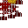 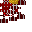 |  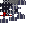 |   |

### 20.3 Memory Items

| Item | Purpose |
|------|---------|
|  Hematic Memory | Base blank memory item, crafted from Sanguine Formation, Blood Stained Stone, and Neurotic Enzyme |
|  Lethean Dew | Pale reagent awarded by early Observances or condensed from bottled source water with nearby Ghost Pipe in a Stillwater Condenser |
|  Lethean Brew | Cursed clay jar from the River Lethe — enables forgetting memories |
|  Fervent Husk | Memory processing ingredient |
|  Blood Stained Stone | Craft each from Venous Stone, a Sanguine Formation and redstone, or find one in a Hermitage Remnant. A blank memory needs four; the Materials atlas explains this route. |
| Blood Memory (per manipulation) | One for each registered manipulation — using it teaches the player |
| Crude Memory Shards | Early starter memories that teach and auto-equip weak manipulations without needing the Mnemonic Reliquary; current set covers `blood_shot`, `blood_rush`, `deadly_gaze`, `sanguine_mending`, `hemorrhage`, `glacial_grasp`, `sanguine_ignition`, `void_shroud`, and `hematic_flare` |
| **Mnemonic Blueprint** | Blank blueprints can be imprinted from unlocked Crafting or Rites map entries. Filled blueprints target either a Cardinal Rite or Blood Structure, open the matching read-only detail screen, and can anchor a client-side top-face construction projection with missing-block progress. Filled stacks are singular; sneak-use clears the active projection. The Hermit's farewell directs the player to the Vicar; it does not supply a rite blueprint. |
| **Mnemonic Folio** | Portable 30-slot (10×3) container that accepts Mnemonic Blueprints only and opens `MnemonicFolioScreen`. |
| Living Weapon Grafts | Dynamic `living_weapon_graft` stacks carry a form component; the Iron Brazier + Living Staff Blood Absorption rite consumes the graft and teaches the matching Living Staff weapon-form manipulation |
| Legacy Living Weapon Memories | `memory_living_blade`, `memory_living_axe`, `memory_living_spear`, `memory_living_claws`, `memory_living_crossbow`, `memory_living_torch`, and `memory_living_flail` keep their IDs and use behavior for old saves/inventories, but their normal survival recipes are removed |
| **Canon Memory: Crimson Tithe** | Saint manipulation memory (Hemorath) — obtained through the Somatic Loom ritual with Hallowed Residuum of Hemorath, paired stored enzymes, and projected blood |
| **Canon Memory: Unclosing Eye** | Saint manipulation memory (Seraphae) — obtained through the Somatic Loom ritual with Hallowed Residuum of Seraphae, paired stored enzymes, and projected blood |
| **Canon Memory: Bloom of Rot** | Saint manipulation memory (Putriciel) — obtained through the Somatic Loom ritual with Hallowed Residuum of Putriciel, paired stored enzymes, and projected blood |
| **Canon Memory: Endless Hour** | Saint manipulation memory (Velorum) — obtained through the Somatic Loom ritual with Hallowed Residuum of Velorum, paired stored enzymes, and projected blood |

Living weapon graft recipes keep the same catalyst identities but wrap them in a crafted ritual offering instead of a direct memory item. The recipe is unlocked by a capped form-aligned behavior signal, then crafted directly as a componentized `living_weapon_graft` stack. The graft is placed in an Iron Brazier and absorbed with a Living Staff using Blood Absorption; success consumes the graft and teaches the normal manipulation.

| Graft form | Teaches | Catalyst | Enzyme/material pair | Rite |
|------------|---------|----------|----------------------|------|
| Blade Graft | `conjure_blade` | `hematic_iron_powder` | `vivacious_enzyme` + `hematic_memory` + `sanguine_formation` | Rite of the Assumed Limb |
| Axe Graft | `conjure_axe` | `chalybeate_sclerite` | `ferric_enzyme` + `hematic_memory` + `sanguine_formation` | Rite of the Assumed Limb |
| Spear Graft | `conjure_spear` | `calcified_blood_spine` | `incandescent_enzyme` + `hematic_memory` + `sanguine_formation` | Rite of the Assumed Limb |
| Claw Graft | `conjure_claws` | `chitinous_husk` | `umbral_enzyme` + `hematic_memory` + `sanguine_formation` | Rite of the Assumed Limb |
| Crossbow Graft | `conjure_crossbow` | `puppeteering_thread` | `neurotic_enzyme` + `hematic_memory` + `sanguine_formation` | Rite of the Assumed Limb |
| Torch Graft | `conjure_torch` | `fervent_spores` | `fervent_enzyme` + `hematic_memory` + `sanguine_formation` | Rite of the Assumed Limb |
| Flail Graft | `conjure_flail` | `frigid_spores` | `frigid_enzyme` + `hematic_memory` + `sanguine_formation` | Rite of the Assumed Limb |

Focused combat memory weaving additions for Lux and Tenebris:

| Memory | Teaches | Catalyst Pattern | Enzyme Requirements | Ritual Blood |
|--------|---------|------------------|---------------------|--------------|
| `memory_hematic_flare` | `hematic_flare` | `glow_ink_sac` | `lux: 1`, `flammeus: 1` | 100 |
| `memory_gloam_laceration` | `gloam_laceration` | `phantom_membrane` | `tenebris: 1`, `mortem: 1` | 100 |

**Memory Textures Gallery:**

> **Note:** Memory items use a 2-layer model system — the base `hematic_memory.png` is overlaid with a unique per-manipulation overlay from `textures/item/memories/memory_*_overlay.png`.

| | | | |
|---|---|---|---|
|  Blood Shot |  Deadly Gaze |  Blood Needle |  Blood Rush |
|  Blood Cloud |  Blood Aneurysm |  Activation Potential |  Sanguine Ward |
|  Venous Travel *(retired)* |  Sanguine Alloy *(retired; item id: memory_ferric_transmutation)* |  Living Blade |  Blood Absorption |
|  Living Axe |  Living Spear |  Living Claws |  Living Crossbow |
|  Living Torch |  Living Flail |  Hematic Flare |  Gloam Laceration |
|  Blood Projection |  Summon Avatar |  Crimson Flame Conjuration |  Blood Lamp |
|  Crimson Sight |  Crimson Harvest |  Hemosynthesis |  Pyretic Forge |
|  Vital Effusion |  Hemolymphal Pulse |  Vascular Dowsing |  Ferric Resonance |
|  Glacial Grasp |  Sanguine Mending |  Vital Reservoir |  Sanguine Excavation |
|  Umbral Step |  Summon Thrall |  Cryogenic Pulse |  Glacial Bastion |
|  Sanguine Ignition |  Vitric Combustion |  Void Shroud |  Blood Eclipse |
|  Hemorrhage |  Exsanguinate |  Glacial Circulation |  Crystalline Bloom (`osseous_bloom`) |
|  Hematic Riposte | | | |

**Saint Canon Memory Overlays (placeholder art — unique textures pending):**

| | | | |
|---|---|---|---|
|  Crimson Tithe |  Unclosing Eye |  Bloom of Rot |  Endless Hour |

> **Memory Overlay System:** Memory items use a layered model system: the base Hematic Memory texture is composited with per-memory overlays from `textures/item/memories/memory_*_overlay.png`. Active memories, including Glacial Circulation and Osseous Bloom, have item JSONs and overlay PNGs wired through this system.

### 20.4 Diagnostic Items

| Item | Purpose |
|------|---------|
|  Vascular Status Gauge | Inspect vein section health |
|  Bloodline Pool Monitor | View bloodline shared pool status |
|  Self Reflection Mirror | Scar-related inspection |

### 20.5 Miscellaneous

| Item | Purpose |
|------|---------|
|  Charm of Vascularium | Enables blood manipulations; retained through player death and removable only from a validated Scarlet Vanity equipment menu; its player render layer displays the item stack when equipped |
| **Mycophant Tendril** | Mycophant boss drop and Charm of Vascularium slot variant. Extends `VasculariumCharmItem`, opens the usual manipulation radial because it is still charm-compatible, and triggers `MycophantTendrilFungalizationLayer` for the full-body fungalized appearance. |
|  Liber Sanguinium | Guide book |
| **Virtual Field Notes** | Pending memo discoveries remain stored on the player in Hemomancy's synchronized knowledge. HutosLib owns the inventory Field Notes button and displays it only when a loaded discovery-book provider opts in; HutosLib alone has no badge. The former Field Notes item and path-specific field inks are retired; dictation unlocks normal pages in Liber Sanguinium or Liber Immaculatus without requiring a separate notebook stack. |
| **Legacy Field Notes / Hematic Field Ink / Pale Field Ink** | Retired and unregistered. Old-stack migration feeds compatible discoveries into the player's virtual pending-memo queue; no current recipe, refill, or ordinary gameplay role remains. |
|  Unsigned Ancestral Ledger | Creates/joins bloodlines |
| **Hematic Suture Needle** | Direct blood routing tool. Degree 3+ binds blood-capable machines or Hematic Suture Nodes to the player; sneak-use on a bound link cycles nearby/fane/bloodline modes, and sneak-use in air toggles the player's bloodline routing opt-in. |
|  Engram Stamp | Engram-related tool. Right-click on a solid surface (face-sturdy from above, empty block above) to place an engram block; right-click on an existing engram block to cycle its character. Consumes 1 durability per use. |
| **Scratch-Engraving (no stamp)** | Emergency / early-game method. Hold a sharp shard — `hemomancy:vivianite_cluster`, `minecraft:flint`, `minecraft:quartz`, or `hutoslib:obsidian_flakes` — in the main hand and right-click any solid surface (face-sturdy from above, empty block above). Places a random-character engram block at the cost of **1 heart (2 HP)** of generic damage. Creative players receive the engram without taking damage. Handled by `ScratchEngramHandler` (`@EventBusSubscriber` on `PlayerInteractEvent.RightClickBlock`). |
|  Vivianite Scalpel | Vivianite-based tool |
|  Fungal Spine | Fungal tool item (unstackable, Uncommon) |
| **Qliphoth Seed** | Dropped by the Sanguine Monolith when shattered by a Degree-7 Archon (two interactions). Custom item/entity path through `QliphothSeedItem`, `EntityQliphothSeedItem`, `QliphothSeedItemRenderer`, and `QliphothSeedItemEntityRenderer`: inventory/hand renders use a small horizontally elongated 3D ovoid, while dropped stacks pulse black-red radial HutosLib tendrils. Used as the Cardinal Focus medium for the **Bloom of the Qliphoth** rite. One-time per monolith. |
| **Monolith Fragment** | Stackable late-game shard dropped in groups of 5-8 when a Degree-7 Archon shatters the Sanguine Monolith. Custom item renderer uses the `hemomancy:item/monolith_fragment` shader for morphing black low-poly facets with pulsing red fracture light. Carried fragments burden Apotheos players with periodic Darkness (a Silentium is not burdened), preserving the shard as a rejection-tier/Archon-adjacent catalyst space rather than an Apotheos reward. |
| **Qliphoth Pome** | Edible fruit dropped by the Qliphoth Bloom tree over time (9 total per bloom lifecycle). Each pome tagged with `hemomancy:bloom_origin` + `hemomancy:husk_index` (0–8). On consumption, emits a player-centered black pulse via `ParticleBurstPacket` (`POME_PULSE`), grants +300 blood, Regeneration II (12 s), Darkness (7 s), and 25% manip cost reduction (3 min). Consuming all nine from one bloom sets `hemomancy:qliphoth_communion = true` and fires the Communion whisper. See §5.9. |
|  Sanguine Salve | Heals 25 blood on use |
|  Cleansing Hemolymph | Blue vial shared by Hemolymphopoda and Ice Fish |
|  Structure Spawner | Development-tab, creative-only item for spawning structures. Both opening the tool and its server placement packet reject non-creative players, and the server also requires operator permission and the spawner in hand, so it does nothing in a single-player world created without cheats. The list opens with **Rite Floors**: every Cardinal Rite floor, in all four styles and tiers, spawns whole around the player with its foundation, Cardinal Focus and a lit, empty Iron Brazier on every socket, ready for any rite or Working craft (`PlaceStructurePacket.placeRiteFloor`). The rest is grouped by required degree. `[Structure]` floorless Blood Structures spawn as built. `[Rite]` rites spawn on their floor with the medium seated and the offerings lit in their braziers. A `[Craft]` (Working craft) spawns only its structure; shift-click it to also raise its Working floor, with the medium seated, the offerings lit in their braziers and the structure on the bed south of the Focus, ready to craft (`PlaceStructurePacket.spawn`). |
|  Recycled Enzyme | Generic enzyme fallback |
|  Debug Showcase | Development-tab, creative-only item (`DebugShowcaseItem`) — right-click to spawn a complete showcase area containing every Hemomancy feature organized into 4 sections: (1) All items in labeled chests, (2) All blocks placed on platforms, (3) All mob entities in fenced pens, (4) All blood structures and cardinal rites as placed patterns. Blood Structure recipes also receive one nearby, loaded, lit Iron Brazier per required offering item. |
| Structure Scanner | Development-tab, creative-only structure capture/export tool. |
| Chamber of Will Teleporter | Development-tab progression bypass used for chamber testing. Normal progression enters through the Degree 6 Rite of the Chamber of Will. |

### 20.6 Unstained Materials (Our Lady of Still Waters)

| Item | Purpose |
|------|---------|
| Tears of Silthmere | Distilled from Lethean Dew — used at the Altar of Cleansing for a one-time purity boost (+25) |
|  Lethean Poppy Wreath | Woven from Lethean Poppies — repeatable altar offering (+5 purity) and wall-mounted Unstained decoration |
|  Silver Chalice | A ritual vessel of the Unstained — offered at the Altar of Cleansing for clarity (+5) |
| Pale Silver Bell | Handheld Unstained support equipment. Use grants short Silver Ward and weakens/slows nearby hostiles. |
| Lethean Chalice | Reusable still-water vessel. Use clears one harmful effect, extinguishes fire, grants brief regeneration, and adds Verdigris Aura after Clarity. |
| Verdigris Censer | Reusable oxidized-copper support tool. Use grants Verdigris Aura and marks nearby monsters or blood-active bodies with Glowing + Weakness. |
| Pale Humor Flask | Bottled White Humor from the Pallid Retort. Drink to replenish an active Unstained white humor reservoir, use with an Unstained weapon in the off hand to coat it with hemolytic charge, or pour into the world to create a finite White Humor source pool for purification recipes. |
| Tome of the Unstained | A book of Unstained scripture describing Our Lady of Still Waters and the path of purification |
| Icon of Our Lady | A rare relic depicting Our Lady of Still Waters — carved from pale silver, grants her protection |
|  Pale Silver Ingot | A refined metal sacred to the Unstained, used in crafting Unstained equipment |
| The Pale Distillate | Concentrated essence from Lethean Poppies, a crafting ingredient for Unstained recipes |
|  Virid Salis | Verdigris-colored salt-ash used as the Unstained counterpart to ritual ash trails. **Harvested** by right-clicking any unwaxed oxidized/weathered/exposed copper block (plain, cut, stairs, or slab) with a vanilla brush — strips one oxidation step, drops 1 Virid Salis, costs 1 brush durability. Handled by `CopperBrushingHandler`. **Living source:** Verdigris Moths (`hemomancy:verdigris_moth`) spawn at night in forests and cold biomes; they rarely shed Virid Salis while flying and can be gently brushed on a long cooldown for 1 Virid Salis. Their death loot table is empty, so killing them is intentionally a poor source. **Warding effect**: when placed as a trail (`hemomancy:virid_salis_trail`), any `Monster` mob that walks across it takes 1 magic damage per second (`ViridSalisTrailHandler`). Blood constructs and blood-type mobs (`IBloodConstruct`, `HematicConstructEntity`, `CruorFiendEntity`, `FrozenClotEntity`, `BloodDrunkPuppeteerEntity`, `ThirsterEntity`, `AbyssalSiphonEntity`, `LeechEntity`, `VenousStriderEntity`) take 2 magic damage per second and receive Slowness II for 3 seconds. **Player effect**: Harbinger players at Initiatory Degree 5 (Perfected) or higher take 1 magic damage per second and receive Slowness I for 3 seconds when crossing the trail. |

### 20.7 Food Items

| Item | Purpose |
|------|---------|
|  Gourd Slice | Edible gourd food item |
|  Gourd Stew | Stew crafted from gourd and other ingredients |
| Roasted Gourd Seeds | Smelted/smoked/campfire-cooked gourd seeds (3 cooking methods) |

### 20.8 Organ Echo Items

Produced by the **Visceral Mirror** ritual (requires Degree 3+). Spectral imprints of the player's organs — bound to the player (dissolve if placed in non-player inventory), only one per organ type can exist at a time. Organ "Tier" indicates risk level and degree requirement for extraction:

| Item | Organ | Tier | Notes |
|------|-------|------|-------|
| Echo of Spleen | `SPLEEN` | 3 | Governs blood volume and filtration |
| Echo of Liver | `LIVER` | 3 | Metabolizes toxins and purifies the blood |
| Echo of Lungs | `LUNGS` | 3 | Oxygenates blood and sustains vital rhythm |
| Echo of Kidneys | `KIDNEYS` | 3 | Filters impurities and maintains humoral balance |
| Echo of Heart | `HEART` | 4 | The seat of circulation and will — highest risk, requires Degree 4+ |

> **Status split:** Organ extraction through the Visceral Mirror and all per-organ gameplay effects are implemented in `VisceralOrgansEvents`: **Spleen** contributes +1000 max blood per organ level through `MaxBloodLedger`; **Liver** removes Poison (level 2+) and Wither (level 3+); **Lungs** grants Water Breathing while underwater; **Kidneys** grants Regeneration with a Blood Moon overclock; **Heart** grants capped Resistance, Wither immunity at level 3, and drains blood while active. The historical organ-specific Iron Brazier reagent mapping is retained only as design/migration context and is not an active acquisition route.

> **Current WIP gate:** the Iron Brazier organ-reagent/echo upgrade route is disabled. Iron Braziers now use their block entity slot for a single rite offering item instead.

> **Max-blood note:** Spleen no longer writes player max blood independently from the organ tick. It contributes +1000 max blood per organ level to `MaxBloodLedger`, which stacks it additively with Capacity and Eternal Covenant before subtracting scar penalties.

### 20.9 Banner Patterns

-  **Heart Pattern** — Vascularium Crest
-  **Veins Pattern** — Vein Border; crafted from paper, string, and Hematic Iron Scrap

---

## 21. Tools & Weapons

### 21.1 Tool Tiers

| Tier | Enum |
|------|------|
| Hematic Iron | `HEMATIC_IRON` |
| Living | `LIVING` |

### 21.2 Living Tools (Blood-powered)

All are single-stack, use the `LIVING` tool tier. The Living Staff is the preferred long-term interface for living weapons and blood utility, while the bare Blood Absorption / Blood Projection items remain fallback conjured hand tools.

| Weapon | Class | Notes |
|--------|-------|-------|
| Living Blade | `LivingBladeItem` | Blood-feeding sword (25 base dmg, +3 speed) |
| Living Axe | `LivingAxeItem` | Ferric (secondary Animus). One-second recovery and synchronized overhead swing; ordinary hits apply Lodestone. A successful vanilla critical that reaches the ground beneath its victim magnetises that spot into a six-second Lodestone field (`LivingAxeLodestoneFields`). Once per second, the field deals 1 Ferric damage within 2.5 blocks, applies Lodestone and drags enemies toward its centre (reduced by knockback resistance, never past the centre). A same-owner critical over an overlapping field refreshes it without an extra pulse. The field draws through its own `LodestoneFieldGeometry` (`LODESTONE_FIELD`): a forged lodestone, a ring of iron teeth, arched flux lines carrying iron filings, and a rim-to-core ripple on every pulse. Unleashed healing, blood cost and area attacks remain. The Living Sickle is the only Mortem Living weapon. |
| Living Spear | `LivingSpearItem` | Stores up to 30 successful damage against targets at local brightness 10+ or already Illuminated. Charge persists on the item and drives a white Lux glint. The next successful fully cooled strike spends a full meter on a spherical five-block Lux burst for 8 damage and 200 ticks of Illumination, including the primary victim. |
| Living Baghnakh | `LivingBaghnakhItem` | Blood-feeding Tenebris claws; holding attack repeats strikes when the cooldown is ready. With a claw in each hand, clicks and held-attack repeats alternate the striking arm in first and third person, synchronized through the vanilla swing packet. Hits use Gloam Laceration's current Umbral material: three staggered black cuts with violet cores. Each burst has a random rotation shared by all three cuts and synchronized to observers; the angle stays fixed as the marks fade. Sickle and Vesper retain their separate legacy claw visuals. |
| Living Torch | `LivingTorchItem` | Flammeus staff weapon form; ignites struck targets. Channeled breath projects moving shader flames across the 28-degree half-angle and seven-block range, with pink hot cores, crimson bodies, black tips, and outward blood cells. |
| Living Flail | `LivingFlailItem` | Congeatio staff weapon form; slows struck targets and uses a physics-rendered chain/head model |
| Living Staff | `LivingStaffItem` | Channels morphlings, blood magic, and living weapon forms. First blood-structure craft unlocks the player Living Staff bond and `conjure_staff`; absorption/projection power now reads from Living Conduit, Vascular Draw, Crimson Projection, and the Blood Absorption channel/cadence skills, while Weapons Master reduces weapon-form hot-swap cost. |
| Memory of Vesper | `MemoryOfVesperItem` | Vesper Evening Star drop. Place it directly in an Iron Brazier and complete the Living Staff Blood Absorption rite to permanently awaken Vesper's memory in player staff progress instead of crafting a separate or stack-bound weapon. Right-clicking the memory itself now only guides the player to that rite. |
| Living Syringe | `LivingSyringeItem` | Extracts blood vials from mobs into a loaded Vial Rack (Shift to eject rack) |
| Living Crossbow | `LivingCrossbowItem` | Successful Blood Bolt impacts chain to at most three new visible, non-allied targets within five blocks of each hop, for 75%, 50%, and 25% of calculated impact damage. Ordinary ammunition is unchanged. |
| Sanguis Lancea | `SanguisLanceaItem` | Throwable blood lance (25 base dmg) |
| Annetta's Sanguis Lancea | `AnnettasSanguisLanceaItem` | Epic Harbinger-route Annetta drop. Held/item rendering uses `AnnettasSanguisLanceaItemRenderer`, `AnnettasSanguisLanceaModel`, `model_annettas_sanguis_lancea.png`, and a crimson glint overlay; the thrown form still uses the shared `SanguisLanceaEntity`/renderer path. |
|  Blood Absorption | `BloodAbsorptionItem` | Conjured blood-absorbing tool; checks `BlockBloodEndpoint` targets before living-entity absorption, and fades faltering Broken Wills without ordinary mob drain |
|  Blood Projection | `BloodProjectionItem` | Conjured blood projection tool; can banish looked-at faltering Broken Wills before checking `BlockBloodEndpoint` targets and legacy structure/tile transfer |

**Attack strokes.** The Living Arsenal melee weapons replace vanilla's hand swing with keyframed strokes in `LivingWeaponPlayerPose` (per-segment easing from `SwingCurve`). They drive the first-person hand and the third-person arm, torso and free arm. Every stroke starts and ends at the resting grip, and blows accelerate into contact. Torso twist follows vanilla's convention: the weapon shoulder draws back on the wind-up and turns through the blow. Swing lengths are set in `MixinLivingEntity` and keep vanilla haste/fatigue scaling. Living Axe (20 ticks): it lifts and hangs, then an accelerating chop bites with a short shudder, and a wrench pulls it free. Living Blade (10): consecutive swings alternate a high forehand cut down across the body with a low, rising backhand to the outside; a pause of 1.5 seconds resets to the forehand. Living Spear (10): it draws back along the shaft, then drives straight out with a corkscrew while the free hand guides it. Sanguis Lancea and Annetta's Lancea (12): a raised overhand drive. Living Torch (10): a short draw, a lunging jab, and a flick of the crown. This replaces the old jab layered over vanilla's swing. Living Baghnakh (7): rakes alternate inward and outward, per hand when dual-wielded. Living Flail (18): the handle stirs the head overhead, then lashes it down with a shudder. Living Sickle (9 in Short Reap, 14 in Blood Hook): it reaches out wide, then hooks inward across the body while drawing the cut back. The Living Staff, Crossbow, Pistol and utility tools keep their existing motions. `SwingComboTracker` counts strokes per player and arm on the client.

**Living Sickle model.** The sickle is proportioned after a forged European sickle, not a short scythe. The handle points straight at the centre of the blade's circle, and a narrow tang leaves a bone ferrule. A broad heel then sweeps out to one side, the blade arcs over the top, and the point hooks just past the apex, back across the handle's line. It tapers evenly from heel to point, with a ribbed crimson spine, red vein flecks and a broad bone-white honed band along the whole inner curve. The sinew grip swells toward the hand and necks in under a clotted flesh mushroom-cap pommel. `python tools/model_export/living_sickle.py` regenerates `LivingSickleModel`, `model_living_sickle.png` and the Blockbench project with its texture embedded, and `--preview` writes `build/living_sickle_preview.png`. In first- and third-person hands, the renderer turns the sickle 180 degrees about its handle so the honed inner curve faces the target, not the wielder. The hand grip, texture path, held scale and crimson glint are unchanged, so Vesper, the staff morph and the hook projectile draw the same model. The inventory pose in `living_sickle.json` shows the blade flat-on, with the pommel at bottom right and the crescent sweeping up and over to the left.

#### 21.2.1 Living Staff Weapon Forms

The Living Staff can inherit living weapons as temporary forms rather than creating separate inventory items. `LivingStaffWeaponFormHelper` stores the original staff stack under `HemomancyStoredLivingStaff` and marks the active form with `HemomancyStaffWeaponForm`. The transformed item is still a normal living weapon item for combat behavior, but it remains logically tied to the staff.

| Form Manipulation | Active Item | Notes |
|-------------------|-------------|-------|
| `conjure_blade` | `living_blade` | Animus living blade form; retains living tool blood-failure recoil |
| `conjure_axe` | `living_axe` | Ferric living axe form |
| `conjure_spear` | `living_spear` | Lux living spear form |
| `conjure_claws` | `living_baghnakh` | Tenebris living claw form; paired claws alternate arms on clicks and cooldown-paced held attacks, and struck enemies flash with three randomly rotated Umbral cuts |
| `conjure_crossbow` | `living_crossbow` | Ductilis living crossbow form; Blood Bolt firing can recoil to staff if blood runs out |
| `conjure_torch` | `living_torch` | Flammeus living torch form; ignites struck targets |
| `conjure_flail` | `living_flail` | Congeatio living flail form; slows struck targets and renders with a damped physics chain patterned after the Sporitic Thurible |
| `conjure_sickle` | `living_sickle` | Perfectus Mortem inheritance; Shift + Use switches between fast Short Reap strikes with an 80-tick radial spin and an 18-block Blood Hook throw that wounds and pulls targets on a blood tendril |

Selecting a staff weapon form through manipulation cycling/radial selection applies that form if the Living Staff is held. Selecting a non-staff-weapon manipulation restores a transformed weapon back into the stored staff. Pressing the use-manipulation key while the selected staff weapon form matches the held transformed item toggles back to staff; pressing it again reshapes back into the selected weapon.

Hot-swap cost is handled by `LivingStaffWeaponFormRules`: 250mL base, reduced by 50mL per `Weapons Master` level, minimum 50mL at level 4. Reverting a transformed weapon back to staff is not a new hot-swap and does not charge the form cost.

#### 21.2.2 Living Arsenal Guardrails

`LivingArsenalInventoryGuard` keeps the living arsenal from becoming clutter or duplication fuel. This Living arsenal guard is deliberately server-backed:

- Only one living arsenal item may remain in the player's inventory at a time; the guard includes `living_sickle` without adding it to the seven graft-form enum.
- Living staff/weapon items cannot fit inside container items, and server container hooks pull them back out of non-player inventories.
- If `conjure_staff` is cast with an empty hand and a staff or transformed staff is already somewhere in the player's inventory, the guard recovers it into the main hand and removes duplicates.
- Transformed weapons stored outside the selected hotbar slot are normalized back into a Living Staff during inventory sanitation.

#### 21.2.3 Staff Blood Utility Rates

Bare Blood Absorption now acts as the fallback hand tool against one target within 5 blocks. When aimed at a block implementing `BlockBloodEndpoint`, it asks that block to provide blood before falling back to blood reservoir extraction, faltering Broken Will absorption, and then living-entity targeting; the Consecrated Bloodwell uses this to draw directly from the bound bloodline pool. Living-entity absorption is pulsed instead of every tick: the base cadence is every 10 ticks, improving through Quickened Draw, Hungry Pulse, and Arterial Cadence to every 4 ticks. Living Staff absorption uses the selected `blood_absorption` manipulation while holding the staff, starts at 4mL per target per pulse, and has a base target cap of 2 and base range of 6 blocks. It checks the same block endpoint / blood reservoir path before faltering Broken Wills and nearby living targets, and outperforms bare absorption once multiple targets are available.

While actively channeling Blood Absorption, the player is rooted in place by default. Dragging Siphon unlocks slow movement, Mobile Conduit reduces the slowdown, and Unbound Siphon removes the movement penalty. Drawing from blocks, reservoirs, bloodwells, and faltering Wills does not build strain. Draining living mobs builds Blood Absorption strain on the player: sustained overuse escalates through Weakness, Nausea, and a short Wither effect representing blood poisoning. Blood Tolerance delays those strain thresholds, and strain decays when the channel is held without successfully draining a living target. Blood Absorption target selection and absorbed-cell particles ignore players, bloodless entities, Wills, armor stands, and Hemomancy NPCs.

Hematic Acclimation limits repeated ordinary living-mob drains from both bare Blood Absorption and the Living Staff. Each player tracks a separate exposure pool for each entity registry type. Exposure decays linearly by 0.25 mL per tick: below 750 mL the drain remains at 100%, from 750 to below 1250 mL it deals and yields 50%, from 1250 to below 1500 mL it deals and yields 25%, and at 1500 mL it deals and yields nothing. Only health actually removed is added to exposure, and a saturated target remains selected even though that pulse has no effect. Block endpoints, reservoirs, bloodwells, Cardinal Rite channels, faltering Wills, and Vesper absorption do not use these exposure pools.

Staff focus scaling is centralized in `LivingStaffFocusRules`:

| Source | Staff Effect |
|--------|--------------|
| Living Conduit | +1 target cap and +1.5 block absorption range per level |
| Vascular Draw | +0.75 absorption per target and +75 tile transfer per level |
| Crimson Projection | +3 structure feed and +75 blood reservoir transfer per level |
| Hematic Focus | +1 target cap, +0.75 range, +0.25 absorption, +1.5 structure feed, +35 tile transfer per level |
| Vesper memory awakened | +1 target cap, +1.5 range, +0.5 absorption, +3 structure feed, +75 tile transfer |
| Vesper's Refusal | Only while Vesper memory is awakened: +1 target cap, +0.75 range, +0.25 absorption, +2 structure feed, +50 tile transfer per level |

Blood Projection is now server-authoritative through `BloodProjectionItem.projectFromEntity`. Projection first checks for a looked-at faltering Broken Will to banish, then checks `BlockBloodEndpoint` on the looked-at block before falling back to blood-structure feeding, Somatic Loom ritual charging, and `IBloodReservoir` transfer. The Consecrated Bloodwell endpoint contributes directly to the bound bloodline pool instead of filling a local reservoir buffer. Reservoir transfer uses `BloodVolumeTransferRules` so larger staff transfer chunks clamp to available source blood and target capacity before draining.

> *Note: Living tools (blade, axe, spear, staff, syringe, crossbow, lancea, baghnakh) use 3D entity models rather than flat item textures — see `src/main/resources/assets/hemomancy/textures/entity/` for their model textures:*
>
>  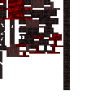 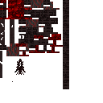

### 21.3 Hematic Iron Weapons

| Weapon | Notes |
|--------|-------|
|  Hematic Iron Sword | Standard sword tier |
|  Hematic Iron Knapper | Specialized knapping tool (42 dmg) |

### 21.4 Other Weapons

| Weapon | Notes |
|--------|-------|
| Barbed Blade | Sword-class, Living tier, +3 speed, +25 dmg |
| Chitinite Mace | Sword-class, Living tier |
|  Blood Bolt | Ammo for Living Crossbow |
|  Blood Thrall Effigy | Summons a Blood Thrall creature (stackable to 16) |

### 21.5 Harbinger Support Tools

| Tool | Class | Notes |
|------|-------|-------|
| **Hearty Compass** (`hearty_compass`) | `HeartyCompassItem` | Degree 2 Harbinger memory tool. Player death writes a copy-on-death last-death attachment storing dimension, packed block position, and time. Its custom item renderer rotates the compass needle toward the remembered same-dimension death point, and while held it pulses a short HutosLib red tendril from the player's hand in that direction; use reports the remembered coordinates and dimension. |
| **Memory Thread** (`memory_thread`) | `MemoryThreadItem` | Degree 2 route recorder. Use toggles recording, sneak-use clears the stack memory, and selected active stacks record up to 96 route points in `DataComponents.CUSTOM_DATA`. Rendering is an ephemeral red world-space thread through recent route points plus a held lead line; no permanent blocks are placed. |
| **Void Eye Organ** (`void_eye_organ`) | `VoidEyeOrganItem` | Degree 3 single-use blood-cost utility crafted from Umbral Spores, Sanguine Formation, and Eye of Ender. Use opens the player's Ender Chest with a 35 blood cost, then consumes the organ for non-creative players. |
| **Witness Organ** (`witness_organ`) | `WitnessOrganBlock` / `WitnessOrganBlockEntity` | Degree 3 placed note-memory organ. Nearby note blocks within 8 blocks record into the organ as players play them, capped at 16 notes. Right-click plays the stored sequence once from the organ; sneak-right-click clears the sequence. V1 intentionally narrows "sound blocks" to note blocks. |
| **Vein Spider** (`vein_spider`) | `VeinSpiderItem` | Degree 4 biological logistics item. One stack owns one same-dimension inventory link, selected by right-clicking two NeoForge item-handler blocks within 256 blocks. Server ticks transfer one item every second only while both endpoints are loaded and the carrying player has active blood to pay the per-transfer cost. Transfers probe all block sides before the null-side fallback so sided inventories work, and successful moves send a short client-only red ghost spider courier carrying the moved item between endpoints. |
| **Husk Effigies** (`zombie_husk_effigy`, `desert_husk_effigy`, `spider_husk_effigy`) | `HuskEffigyItem` | Degree 3 proto-puppet consumables. Each item rehydrates into a short-lived allied zombie, husk, or spider distraction with persistent owner/expiry tags. Effigies reject their owner as a target, prevent owner damage as a backstop, and render with a red control-glow overlay. The v1 system is deliberately fixed to these three shells rather than a capture-any-mob pipeline. |
| **Sporitic Thurible** (`sporitic_thurible`) | `SporiticThuribleItem` | Degree 4 offhand Harbinger thurible. Right-clicking with the thurible in the offhand and a valid aligned spore in the main hand lights it if the player has active blood magic and Initiatory Degree >= 4. Lighting consumes one spore, stores lit/spore/burn state in custom data, and grants 6,000 ticks of burn time. Right-click while lit extinguishes it. While lit it drains `4 + 12 * swingIntensity` blood per second, emits spore-colored particles, and every 40 ticks applies a `2.5 + 2.5 * swingIntensity` aura. Nearby active Harbingers receive Sporitic Resonance keyed to the burned spore tendency; nearby `Monster` targets receive brief Blood Loss, Wither, and the spore secondary effect. The vanilla item bar is used as a catalyst burn meter, is tinted by the active spore, and computes remaining time from `BurnEndGameTime` rather than per-tick NBT rewrites. The custom held renderer also draws the active catalyst as a small full-bright spore item inside the bobbing thurible head. |

Rendering is intentionally not sprite-only. First person uses `SporiticThuribleItemRenderer`; third person hides the vanilla held item through `MixinPlayerItemInHandLayer` and renders `SporiticThuribleLayer` from the offhand. `SporiticThuribleRenderHelper` simulates a damped client-side bob and renders articulated chain links along a curved tangent path. Gameplay intensity remains server-derived from movement/yaw/swing data; client physics is visual only.

---

## 22. Armor Sets

Harbinger armor progression is centered on the **Hematic Armature** (`hematic_armature`) and the data-driven `hemomancy:armature_upgrade` recipe type. The Armature has no player-facing GUI: right-click with a reagent inserts one item into the next empty bowl, crouch/right-click withdraws the most recently filled bowl first, and blood containers fill the overhead 8,000-blood reservoir. Walking onto the block mounts the player to a hidden `ArmatureRestraintEntity`; while mounted, the Armature scans the player's worn armor in helmet, chest, legs, boots order and upgrades any piece that can consume any inserted bowl reagent. Bowl stacks are capped at 1 item, crafting takes 100 ticks per item, partial completion is allowed, and successful upgrades emit burning bowl particles plus a crimson player burst.

The Hematic Artificer / Redwright is the in-world teacher for this progression. He explains the worn-armor ritual steps, the D3 fork identities, the Armature Consecration Kit and its replacement recipe, and the Monolithic Cornerstone, but the `HematicArmatureBlockEntity` and data recipes remain the mechanical authority.

| Degree | Base worn armor | Armature reagent | Blood per piece | Result |
|--------|-----------------|------------------|-----------------|--------|
| D2 | Vanilla iron armor | Hematic Iron Scrap | 250 | Hematic Iron |
| D3 | Hematic Iron | Aculeate Vitriol | 500 | Barbed |
| D3 | Hematic Iron | Sclerotic Oleum | 500 | Chitinite |
| D3 | Hematic Iron | Chromatic Sublimate | 500 | Prismatic |
| D5 | Barbed, Chitinite, or Prismatic | Crimson Lacquer | 1,200 | Blood Lust, with cosmetic lineage stack data (`barbed`, `chitinite`, or `prismatic`) |
| D5-D6 | Matching Blood Lust helmet lineage | Tengu Mask (Barbed) / Lodestone Faceplate (Chitinite) / Grinning Mask (Prismatic) | 350-500 | Specialized Blood Lust mask variant |
| Post-release | Any Blood Lust helmet lineage | Velorum Mask | 500 | Universal Blood Lust mask variant |
| D7 Monolithic Armature | Blood Lust | Fargone Proboscis | 1,800 | Edacious Bloodlust |
| D7 Monolithic Armature | Blood Lust | Fervent Husk | 1,800 | Sheolic Bloodlust |
| D7 Monolithic Armature | Blood Lust | Mnemonic Ambergris | 1,800 | Phantasmal Bloodlust |
| D8 Silentium | Blood Lust, Edacious, Sheolic, or Phantasmal Bloodlust | Monolith Imbued Cloth | 2,000 | Silent Archon Vestments; available only once the Silent route is finalized by absorbing Vesper's memory |

Direct shaped recipes for Hematic Iron, Barbed, Chitinite, and Prismatic armor are intentionally removed; weapons, shields, and reagent components remain regular crafting where present.

### 22.1 Hematic Iron Armor

Standard blood-infused iron armor set (fire resistant):
-  Helm,  Chestplate,  Leggings,  Boots
- **Stats:** Defense 3/6/8/3 (20 total), Toughness 3.0, KB Resist 0.1, Durability ×37, Enchantability 15
- **Repair:** Hematic Iron Scrap
- **Set Bonus (4 pieces):** Passive blood regeneration — +2 blood/second while wearing full set

> Armor model: 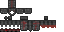 

### 22.2 Blood Lust Armor

Crimson Lodge combat vestment upgraded from any D3 armor fork:
-  Helm (no mask),  Helm (Tengu mask),  Helm (Grinning mask),  Helm (Lodestone faceplate),  Helm (Velorum mask)
-  Chestplate,  Leggings,  Boots
- Mask items:  Tengu Mask,  Grinning Mask,  Lodestone Faceplate,  Velorum Mask. These are Armature helmet upgrades, not separate set identities.
- **Lineage:** Blood Lust pieces preserve `hemomancy:lineage = "barbed"`, `"chitinite"`, or `"prismatic"`. A matching four-piece set keeps a half-strength version of its fork trait; mixed and legacy untagged sets keep only Blood Lust lifesteal. The model also carries that lineage through full Chitinite plating, half Barbed plating, or bare Prismatic plating over the same living red base.
- **Mask modifiers:** Tengu fits only Barbed-lineage helms and applies Blood Loss on hit; Lodestone fits only Chitinite-lineage helms and grants brief Absorption; Grinning fits only Prismatic-lineage helms and grants brief Speed. Velorum is a universal Saint-drop mask reserved for post-release expansion and keeps its small blood-income bonus.
- **Final ascensions:** A Monolithic Armature can upgrade any Blood Lust lineage into Edacious, Sheolic, or Phantasmal Bloodlust. Each final set uses one material across all four slots: Fargone Proboscis, Fervent Husk, or Mnemonic Ambergris respectively. Silent Archon remains a separate, story-gated route using Monolith Imbued Cloth, and it can reforge ordinary Blood Lust or any piece from those three final sets.
- **Armor-born active abilities:** Full final Bloodlust sets register armor set abilities that appear as a third inner wedge in the manipulation radial menu beside Blood Absorption and Blood Projection. The wedge is hidden unless the complete four-piece set is worn, displays the set helmet as its icon, shows an ability-specific tooltip instead of the helmet item tooltip, tints red with a live tooltip countdown while recharging, and sends only the ability id to the server. Server activation rechecks the full set, cooldown, blood cost, and ability-specific validation before applying any effect.
- **Edacious Bloodburst:** Full Edacious Bloodlust grants slow creative-style hematic flight and unlocks `hemomancy:edacious_bloodburst`, a blood-cost radial burst that fires barbed blood needles outward and applies Blood Loss, Hunger, and Wither.
- **Sheolic Bastion Stance:** Full Sheolic Bloodlust grants fall, fire, and lava damage immunity with persistent Fire Resistance. Attackers suffer Crimson Retribution through magic fire-themed damage, crimson spore particles, and Crimson Flames placement when possible. Its radial ability `hemomancy:sheolic_bastion_stance` roots the player, suppresses movement/flying, and negates incoming damage for a short duration; selecting it again cancels the stance. Sneak-selecting the same wedge toggles **Searing Contact**, causing deliberate melee attacks to ignite their target while the full set remains equipped.
- **Phantasmal Step:** Full Phantasmal Bloodlust enhances the existing Umbral Step manipulation instead of granting a duplicate teleport. If the player already knows and uses Umbral Step, the complete set lets Umbral Step ignore the darkness and manipulation-cooldown checks while preserving its normal line-of-sight targeting, range, and blood cost. When struck, the set can blind and outline the attacker, then displace them roughly eight blocks away if a safe landing position exists. The landing must fit the attacker's whole body and be reachable without passing through a solid block, and inside the Vesper ordeal arena or the Mycophant Nursery it must stay within the barrier walls, so bosses and arena mobs can never be shoved out of their arena.
- **Masquerade of the Forgotten:** Full Phantasmal Bloodlust unlocks `hemomancy:masquerade_of_the_forgotten` in the armor radial wedge with the Phantasmal Bloodlust Helmet icon. Activation is server-authoritative, costs 250 blood, has a 60-second cooldown, and spawns eight `phantasmal_echo` decoys for 10 seconds. Echoes mix aggressive, fleeing, circling, and mirroring behavior, deal low `hemomancy:phantasmal_echo` magic damage, and vanish when struck in a smoke burst that blinds, nauseates, slows, and briefly forces hostile mobs to reconsider their target. Natural expiration dissolves quietly without the full blinding burst.
- **Stats:** Defense 3/6/8/3 (20 total), Toughness 3.0, KB Resist 0.1, Durability ×37, Enchantability 15
- **Repair:** Hematic Iron Scrap
- **Set Bonus (4 pieces):** Lifesteal — 10% of direct melee damage dealt heals the player. Masks add minor modifiers only.

> Armor model: 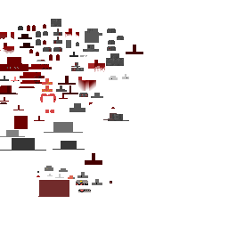 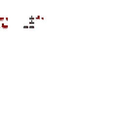
>
> Runtime rendering uses `BloodLustArmorModel` for standard Blood Lust piecewise 3D armor renders. Edacious, Sheolic, and Phantasmal Bloodlust now have independent cloned armor model classes and texture atlases seeded from Barbed, Chitinite, and Prismatic respectively, so future model/texture passes can edit the final lineages directly. Mask variants still route through the custom armor model layer and item textures above. Inventory, hand, frame, and dropped item stacks route through `ModelBackedArmorItemRenderer` instead of flat generated sprites.

### 22.3 Barbed Armor

Retaliatory coastal-venom armor blending Barbed Urchin spines, Venom Rib Centipede poison, and Desiccant scorpion stings:
-  Helm,  Chestplate,  Leggings,  Boots
- Barbed Shield 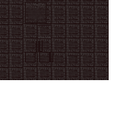
- **Stats:** Defense 3/6/8/3 (20 total), Toughness 3.0, KB Resist 0.1, Durability ×37, Enchantability 15
- **Preparation:** Aculeate Vitriol, brewed from Toxicognath, Telson, and Calcified Blood Spine.
- **Repair:** Calcified Blood Spine
- **Set Bonus (4 pieces):** Thorns — attackers take 2 damage and receive Blood Loss effect (3 seconds)

> Armor model:  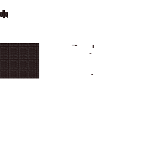
>
> Item stacks use the same model-backed 3D renderer as the worn armor.

### 22.4 Chitinite Armor

Ferric bastion armor blending Chitinite plating, Chthonian termite mandibles, and Chalybeate Snail living-mineral sclerites:
-  Helm,  Chestplate,  Leggings,  Boots
- Chitinite Shield 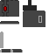
- Chitinite Arm Banner (dyeable, 16 colors); crafted with a progression-gated Chitinite Fitting, Chitinous Husks, and a stick
- **Stats:** Defense 3/6/8/3 (20 total), Toughness 3.0, KB Resist 0.1, Durability ×37, Enchantability 15
- **Preparation:** Sclerotic Oleum, tempered from Chitinous Husk, Chalybeate Sclerite, and Queen's Physogastrism.
- **Repair:** Chitinous Husk
- **Set Bonus (4 pieces):** +2.0 Armor Toughness (via attribute modifier) and 25% projectile damage reduction

> Armor model: 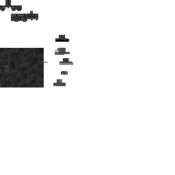 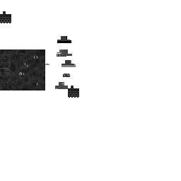
>
> Item stacks use the same model-backed 3D renderer as the worn armor.

### 22.5 Prismatic Armor

Flash-evasion armor blending Scarlet Serpent hood scales, Blood Drunk Puppeteer red-gold spectacle, and Prism Cuttle chromatophores:
-  Helm,  Chestplate,  Leggings,  Boots
- **Stats:** Defense 3/6/8/3 (20 total), Toughness 3.0, KB Resist 0.1, Durability x37, Enchantability 15
- **Preparation:** Chromatic Sublimate, sublimated from Serpent Scale, Enthralling Filament, and Chromatophores.
- **Repair:** Serpent Scale
- **Set Bonus (4 pieces):** Prismatic flash - when hit by a living attacker, briefly grants Speed and blinds, nauseates, and outlines the attacker plus nearby hostile mobs. The flash has an 8-second cooldown.
- **Pelagic Motion:** A full Prismatic set grants 35% faster swimming through the native swim-speed attribute. The same bonus also applies to full Phantasmal Bloodlust.

> Armor model: 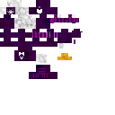 
>
> Current resources use a Blood Drunk Puppeteer-derived split armor model with blue-purple 128px armor texture atlases that preserve the yellow accents.

### 22.6 Unstained Armor

Anti-blood zealot armor (for the Unstained path):
-  Helm,  Chestplate,  Leggings,  Boots
- **Model:** white lacquered plate over white robes, pale silver trim and patinated copper fittings. Glass Helm: a caged clear-glass dome over a silver gorget, copper censer vents at the ears, a breathing grille, rebreather intakes at the nape and a crescent finial. Chestplate: cuirass inlaid with the Lady's crescent cradling a tear, layered pauldrons, plated vambraces, a back-mounted rebreather (twin still-water canisters and a copper-salt scrubber on a silver frame, corrugated hoses looping up into the helm's intakes) and a white cape whose lower half swings below the canisters. Leggings: linen sash with a still-water vial, front/back tabards that swing clear of the legs, cuisses and poleyns. Boots: greaves and laminated sabatons. Generated by `tools/model_export/unstained_armor.py`.
-  **Vestment of the Final Molt:** pinnacle Enlightened reward chestpiece. Uses the Unstained armor tier for set-bonus counting, with a luna moth vestment: a wound-silk cocoon hood with fur ruff and feathered antennae (lowered to a collar roll when a helmet is worn), celadon fore- and hindwings with lilac costa and still-water eyespots, swallowtail tails and small sleeve wings that sway with breath and stride. Generated by `tools/model_export/vestment_of_the_final_molt.py`.
- **Stats:** Defense 3/6/8/3 (20 total), Toughness 3.0, KB Resist 0.1, Durability ×37, Enchantability 15
- **Repair:** Consecrated Copper Ingot
- **Set Bonus (4 pieces):** Immunity to Blood Loss and Hemolysis effects (auto-removed on tick)

> Armor model: 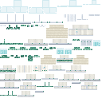 
>
> Item stacks use the same model-backed 3D renderer as the worn armor.

Unstained weapon items render through 3D custom item models. `unstained_warhammer`, `silthmere_glaive`, `absolution_dagger`, and `annettas_absolution_dagger` use `builtin/entity` item model JSONs, and `client/item/ItemClientExtensions` routes them to their respective `UnstainedWarhammerItemRenderer`, `SilthmereGlaiveItemRenderer`, and `AbsolutionDaggerItemRenderer`. Model layers are registered in `LayerEvents`. The palette is white, pale silver and patinated copper, with faint still-water glass: no blood red. The warhammer's striking head is a tiered pale-silver bell laid across the haft. It has a verdigris waist band, an engraved sound bow and a flared mouth with a dark throat and a protruding clapper. A hanging loop forms the back peen, and a crescent finial cradles a glass moon. The haft is white lacquer bound with spiral silver wire, with copper ferrules, riveted langets, a linen grip, a votive ribbon and an engraved pommel. The Silthmere Glaive's broad crescent blade has a convex honed edge and a thick spine, and its point hooks back over the shaft like a waning moon. An engraved fuller follows the curve, and a small back hook remains. A glowing Tear of Silthmere is set at the root above a copper collar and socket, with a hanging ribbon. The long lacquered shaft has two linen grips and a copper-and-silver butt spike. Both daggers share a faceted stiletto with a raised, faintly glowing hemolytic channel, crescent quillons with copper tips, a glass lunar boss on the guard, a wrapped grip and a disc pommel. Annetta's Absolution Dagger uses its own atlas: a grip wrapped in her braided auburn hair, nail-keratin quillon tips and a tooth-ivory pommel. It also shows a hanging braid strung with a pulled tooth, which the issued dagger hides. Each renderer draws its `textures/entity/unstained_weapons/*` atlas and then an additive `_glow` layer for the glass and channel inlays. The Unstained Shield remains a baked JSON item model with a 128x128 texture. It has a polished rim with engraved ticks and eight copper rivets, a still-water field of concentric ripples, a raised verdigris boss ring and a glass crescent-moon boss, plus a ringed back with linen grip padding. `python tools/model_export/unstained_weapons.py` regenerates the Java meshes, atlases, glow layers, Annetta variant and shield model, and `--preview` writes `build/unstained_weapons_preview.png`. The script prints the `java_model_to_bbmodel.mjs` commands for the Blockbench projects. `UnstainedWeaponRendererResourceTest` guards the custom renderer/model wiring.

Their attack animations replace the vanilla hand swing and pose the player's arm, torso and free arm in third person. They are keyframed in `UnstainedWeaponPlayerPose` with per-segment easing (`SwingCurve`). Strikes accelerate into contact, wind-ups and recoveries start and stop at rest, and every channel returns to the resting grip, so swings never hold or snap. Both Absolution Dagger variants use a nine-tick chink-in-the-armour thrust. A low coil points the blade down while the free hand rises as a guard. The thrust then accelerates up and outward under the guard, landing about a third of the way in, and the blade twists about its own axis in the gap before recovering. The Silthmere Glaive uses a sixteen-tick horizontal cut. The torso and blade coil to the outer side, the cut sweeps across a broad flat fan, fastest as it passes the front, and follows through as the free arm counter-swings for balance. The Unstained Warhammer now has its own twenty-two-tick pose instead of the Living Axe's. The free hand joins the haft for a two-handed overhead lift. The hammer hangs briefly at the apex, then slams down, accelerating into an impact about nine ticks in. The bell rebounds, and in first person a short damped shudder runs through the haft. A free arm with something in its hand keeps most of its own pose. The vanilla swing packet synchronizes the active hand, and haste/fatigue scale these durations. Left-handed players and offhand swings use mirrored poses. Weapon damage, reach, cleave, coating, and purity effects still come from the existing combat hooks.

### 22.7 Crown of Sacred Marrow

Special artifact helmet (`MarrowCrownArmorItem`), uses `MARROW_CROWN` tier.
- **Stats:** Same as Hematic Iron (Defense 3/6/8/3, Toughness 3.0, KB Resist 0.1)
- **Repair:** Hematic Iron Scrap
- **Artifact Bonus:** +10% melee damage (via attribute modifier) when blood volume is above 50%

> **Note:** All armor sets share identical base stat distributions (equivalent to Netherite-tier defense/toughness) but each has a unique set bonus implemented in `ArmorSetBonusHandler`. The Marrow Crown is an artifact helmet with its own standalone bonus that doesn't require a full set.

### 22.8 Silent Archon Vestments and One-Off Pieces

**Silent Archon Vestments** are Silentium (D8) survivor-duelist vestments made by reforging Blood Lust armor with Monolith Imbued Cloth after the Silent route is finalized by Pruning, victory over both Vesper phases and absorbing Vesper's memory. Their full-set bonus now makes the wearer functionally incorporeal against physical force: melee strikes, projectiles, explosions, fall impacts, wall impact, falling blocks, and in-wall pressure pass through for no damage. The tradeoff is equally severe: a Silent Archon cannot deal mundane physical damage while wearing the full set, so normal melee weapons, bows, and ordinary projectiles are suppressed. Blood manipulations, Hemomancy projectiles, and living weapons remain valid offense. Their old death-refusal safety net remains as a separate last resort against damage outside that incorporeal envelope, refusing lethal damage once per 12,000-tick cooldown by spending 3,000 player blood, leaving the player barely alive and applying Resistance briefly plus harsh Weakness, Slowness, Mining Fatigue, and Darkness recovery debuffs. The bonus belongs to the Silentium and excludes Apotheos players. Runtime rendering uses `SilentArchonArmorModel`, the robe-derived `silent_archon_layer_1/2.png` armor textures, and a semi-translucent Monolith Fragment shader overlay when worn; with the complete set equipped, the base player body renders as a monolith core beneath the translucent Silent Archon armor. Inventory, hand, frame, and dropped item stacks use the same custom 3D armor-piece renderer instead of flat generated sprites.

**Silent Severance:** the full Silent Archon set registers `hemomancy:silent_archon_severance` as its armor-born radial combat ability. It appears in the manipulation radial with the Silent Archon Veil icon, costs blood, and releases a short-range monolith-shatter silence burst with red-black Qliphoth Seed-style tendrils blasting outward from the player instead of vanilla soul/portal particles. The burst deals non-physical magic damage and applies **Monolithic Dislocation** instead of a conventional debuff stack. While Monolithic Dislocation lasts, the victim is temporarily intangible: incoming damage is negated except for blood manipulations and living weapons, and the dislocated entity cannot deal damage. Affected living entities render with a thin translucent monolith shell, using a charged-creeper-style model wrap with the same black-and-red monolith shader language as Silent Archon visuals; an in-render fallback draws the shell before the model transform is popped if a renderer misses the normal layer pass.

**Silent Slipping:** the full Silent Archon set now triggers Silent Slipping through a creative-flight-style double-tap jump input instead of the manipulation radial. The client only detects the double-tap jump and sends a toggle request; the server remains authoritative for full-set validation, blood cost, cooldown, duration, active-state cancellation, and safe exit. When accepted, the player enters a short no-physics state, gains slow flight, passes through blocks, and is placed at a nearby safe position when the state ends or is manually cancelled. The no-physics state is reinforced at the movement collision boundary so vanilla player tick resets cannot restore solid-block collision while Silent Slipping is active. Instead of portal specks, the state emits small shard-only pulses from the monolith shatter renderer on activation/release and whenever the slipping player crosses into or out of solid collision.

**Why choose the Silent path:** it ends in Silentium, a Degree-8 rank equal to Apotheos, and is intentionally not a weaker or foolish refusal of Apotheos. Lore-wise, it is the Archon witnessing the fungal truth and answering with silence, exile, and willpower rather than surrender to hive-mind dissolution. The shattered Monolith imagery represents the player becoming their own permanent will, carrying blood magic forward by discipline strong enough to resist the fungal source. Gameplay-wise, it preserves replayability and player choice: some players want endgame blood-magic mastery, monolith gear, and refusal-themed power without turning their character into a fully fungal body-modification endpoint.

**Why the Order still survives:** the silence also patches the recruitment paradox. The source of the silence is intentionally ambiguous: it may be self-imposed, traumatic, or the hive mind's last spiteful constraint, but no one who has seen the full truth can simply speak it aloud as a warning. Most Harbingers never reach Degree 5, and Degree 6+ practitioners are already rare enough to be saintlike. Silent Archons leave with the truth trapped behind refusal, while Apotheos-aligned beings no longer resemble or behave like ordinary Harbingers. Lower-degree recruiters therefore continue the Order without receiving a clear warning from the few who reached the end.

Future visual direction: the robe silhouette may lean toward Gael's armor from Dark Souls 3, especially the battered pilgrim-knight layering, heavy cloak mass, and worn endgame duelist feel.

One-off armor pieces intentionally use distinct material holders so they break full-set bonuses:
- **Hemolymphopoda Headpiece:** existing D3 aquatic/organic helmet.
- **Lantern Tick Helmet:** rare underground arthropod helmet dropped by Lantern Ticks. It renders as a large latched tick on the wearer's head and maintains a temporary moving light source around the wearer until removed.
- **Crown of Sacred Marrow:** D5/D6 artifact helmet with high-blood melee bonus.
- **Venous Strider Sabatons:** D3/D4 one-off boots crafted from Venous Pinions dropped by Venous Striders and Osteophage Vultures; reduce projectile/fall damage and brace long falls. Uses the imported Fortress armor model/texture for worn and item-stack 3D boot renders.
- **Covenant Mantle:** D6 chest piece tied to bloodline covenant play; spends wearer blood to grant nearby initiated allies brief resistance. Uses the imported cultist leader armor model/texture for worn and item-stack 3D chest renders.

---

## 23. Functional Blocks & Block Entities

| Block                                | BlockEntity                                | Purpose                                                                                                                                                                                                                                                                                                                                                                                                                                                                                                                                                                                                                                                              |
|--------------------------------------|--------------------------------------------|----------------------------------------------------------------------------------------------------------------------------------------------------------------------------------------------------------------------------------------------------------------------------------------------------------------------------------------------------------------------------------------------------------------------------------------------------------------------------------------------------------------------------------------------------------------------------------------------------------------------------------------------------------------------|
| **Mortal Display**                   | `MortalDisplayBlockEntity`                 | Attaches the Charm of Vascularium and activates Degree 0 after permission from this temple's Hermit; grants the outpost waybill.  |
| **Scrying Podium**                   | `ScryingPodiumBlockEntity`                 | Blood-reflection podium, Hemopothecary workstation, and **Advanced diagnostic station**. Normal right-click opens the Sanguine Diagnosis screen with player-facing diagnostics split into clickable **Blood**, **Manipulations**, and **Tendency** tabs. Blood Volume shows computed max blood plus exact positive/negative max-blood modifier totals, with a `Mods` hover tooltip listing each source. Blood Flow shows positive, negative, and net mL/t, circulation bandwidth used/cap/available, scrollable per-source requested/applied rows, and a hover tooltip for the full active source breakdown. The Manipulations tab shows carried/equipped manipulations, the server-computed equipped slot cap, and the selected manipulation's base -> effective blood cost, with hover tooltips for slot and cost modifiers. The Tendency tab shows dominant/latent tendencies, the full tendency profile, and rite readiness. Shift-right-click still converts it back into an Unstained Podium and drops the Scrying Dish.                                                                                                                                                                       |
| **Scarlet Vanity**                   | `ScarletVanityBlockEntity`                 | Degree-3 Working craft on a minor Working floor: its frame (now with a Chiseled Hematic Iron heart) is fed 300 mL with a Sanguine Formation medium. Opens the Harbinger equipment screen for equipping the Charm of Vascularium, Blood Gourd, Morphling Jar, and Living Staff fitting. Existing block-entity and equipment save data remain unchanged. The red vanity model has a central blood-reflection bowl, while `ScarletVanityRenderer` displays equipped items flat on the tabletop. |
| **Somatic Loom**                     | `SomaticLoomBlockEntity`                   | Degree 3 refined memory-weaving station. Stores up to 192 spans of thread (64 enzymes) per tendency, accepts one blank Hematic Memory plus a list of catalyst candidates, enters an editable dark-red awaiting-blood glow when an exact recipe is ready, then runs Engram Weaving (§25.7): payment unfurls the payer's own engram, an {8/3} star of empty vessels sunk in living flesh draped over the ground around the loom, and the weaver threads each engram fragment home to the loom with a Living Staff while the echo of a past Harbinger above the warp remembers the memory beat by beat. Its baked model (`tools/model_export/somatic_loom.py`) is a nerve-warp floor loom: hematic iron side frames on bone claw feet, a pale nerve-fibre warp from a nerve-bundle warp roll through two heddle shafts and an underslung reed, and a woven tapestry over the breast beam onto a cranked cloth roll. The heddles hang from a bone castle and its nerve ganglion, with veins running down the uprights, and are corded to two treadles. The fell glows under the floating memory. Each pirn hangs over a glass vial of its enzyme: the vial shows stored stock as liquid and the pirn shows the spans the engram's lanes hold. The ritual state is drawn on the loom itself rather than as floating rings. Vials fill by stored stock (square-root height, so a weave's few enzymes still show), and the reservoir fills the upright veins. A chosen weave tints its share of the warp in each required tendency's colour, and a share whose enzyme is short gutters dark. Projected blood pulses up the veins into the ganglion, which beats faster as the charge rises; the result hovers above it. Each fragment threaded home lights its tendency's warp and lays a band at the fell. Catalysts lie on the fresh cloth. `SomaticLoomGeometry` (generated) holds the anchors; `SomaticLoomEffectRules` holds the thread shares, fills, heartbeat and the echo's look per stage. Upgrades through the shared station system: the Ganglionic stage (D5, `ganglionic_harness`) grows the ganglion and its nerve feelers, which let the weaver hear a fragment from anywhere on the engram, lengthens the staff's trace reach to 8 blocks, widens the engram and weaves Magister memories; the Cortical stage (D6, `cortical_crown`) crowns the castle with cortex, myelinates the warp, raises the echo to full stature, raises a dome of the weaver's own Chamber of Will sky around the weave (a stencil portal: the world beyond the dome's 13-block radius becomes that Chamber while everything inside stays real), and weaves Perfectus memories. A base loom's echo is small, grey and stutters. The engram, its glyphs, intrusions, bolts, hazards and weaving bursts use the `engram_sigil` core shader and Hemomancy/HutosLib particles, not vanilla ones.                                                                                                                                                                                                                                                     |
| **Puppeteer's Spindle**              | `PuppeteersSpindleBlockEntity`             | Harbinger preparation station. Two-slot container: slot 0 accepts a `marionette_crossbar`, slot 1 accepts `puppeteering_thread`. Each Thread becomes 8 charge in a persistent 512-charge buffer, and the slotted Crossbar auto-fills to its owner-scaled capacity. Clicking a learned shape immediately prepares it; no separate action buttons are used, and the Spindle never calls bodies. The placed block stores horizontal facing, faces the placer, and renders through `PuppeteersSpindleRenderer` / `PuppeteersSpindleModel` plus a custom block item renderer. |
| **Hematic Armature**                 | `HematicArmatureBlockEntity`               | Standing ritual armor-upgrade machine with no player-facing GUI. Right-click inserts held reagents into the four one-item bowl slots in insertion order, crouch/right-click withdraws the most recent bowl item first, and blood containers fill the 8,000-blood reservoir. Walking onto the block mounts the player to a hidden `ArmatureRestraintEntity`; while restrained, worn armor upgrades in helmet/chest/legs/boots order through `hemomancy:armature_upgrade` recipes. Any bowl reagent can satisfy any matching worn armor piece. Crafting takes 100 ticks per item, allows partial completion, and emits windup/completion particles. The block has three persistent visual/recipe tiers (blockstate `stage`): the base Armature Rack handles normal pre-Lodge recipes; the Rite of Armature Consecration (Armature Consecration Kit, D5) upgrades it for D5-D6 recipes such as Blood Lust armor; the Rite of the Monolithic Armature (Monolithic Cornerstone, D7) requires the consecrated tier and upgrades it for D7+ recipes such as Silent Archon Vestments. Holding a kit on the block only explains that a rite is required. Breaking an upgraded Armature keeps its tier on the dropped item; the kit and Cornerstone are not refunded. The Artificer issues one free kit, and the Monolith one free Cornerstone; each claim unlocks a crafting recipe (the kit keeps the legacy `vicars_consecration_kit` item ID). See Station Upgrades. Each tier is a baked model authored by `tools/model_export/hematic_armature.py`: a frame five cells wide and five tall, with the head/chest stands two cells out and the legs/feet stands one cell out in front. The base is a blood-wood rack with tendon-bound wrist cuffs; Consecrated adds iron plating, restraint chains, swaying banners, candles and a shoulder yoke; Monolithic adds the blackstone cornerstone, sanguine heart reservoir and a calcified spine behind the subject. The controller's block model holds the central frame; `HematicArmatureRenderer` draws the bowl wings, upper frame, banners, heart glass, side-vial/heart blood levels and bowl items, and the item renderer draws the saved stage. Filler cells and their per-cell outlines/collision come from the generated `ArmatureGeometry`; the subject's two-cell column keeps an outline but no collision. |
| **Vial Centrifuge**                  | `VialCentrifugeBlockEntity`                | Spins balanced sampled Blood Vials into tendency enzymes, returns emptied vials, and adds 250 mL of blood to its reservoir per completed spin. Blood Absorption reclaims the stored blood. Uses the 3D stand model (`CentrifugeStandModel`), custom block entity renderer (`VialCentrifugeRenderer`), and `VialCentrifugeBlockItem` with custom item renderer. Accepts **Vial Rack** right-click bulk inserts and reports the exact startup failure when it cannot spin.  |
| **ghastly_alembic**                  | `GhastlyAlembicBlockEntity`                | Squeezes items to extract blood (requires fire below). Has 4 slots: Input (slot 0), Flask (slot 1, fills Cured Clay Flasks into Bloody Flasks), Result (slot 2), and **Catalyst (slot 3)** — an optional catalyst ingredient that modifies or enhances the recipe output. Hopper access: top → input, bottom → result, sides → flask + catalyst. Renders via custom `GhastlyAlembicRenderer` (3D entity model `GhastlyAlembicModel`, facing-aware)   .                                                                                                                           |
> **Ghastly Alembic gourd filling:** The separate blood/container output slot (slot 4, not recipe result slot 2) accepts Blood Gourds. Clear returned empty containers before inserting the gourd. The block entity transfers up to 100 mL per tick from its reservoir into the gourd's stack-backed blood volume, capped by the remaining blood and vessel space.
> **Ghastly Alembic blood seep:** On each configured leak interval, the alembic scans venous stone variants or bone blocks in the surrounding 3x3 floor below it, skipping the center tile occupied by the alembic itself. It first places a fresh age-0 Blood Crystal in the first valid open space on top of a trigger tile; only if no placement is possible does it scan existing upward-facing Blood Crystals on those trigger tiles and grow the first immature one. If neither placement nor growth can occur, no blood is drained and the next interval starts a fresh search.

| **Cerebral Scarring Station**        | `ScarStationBlockEntity`                   | Crafts scars from patterns and blanks                                                                                                                                                                                                                                                                                                                                                                                                                                                                                                                                               |
| **Mason's Effigy**                   | `MasonsEffigyBlockEntity`                  | Cerebral scar loadout preparation block. Its menu lists the player's known scars, seeds active sockets from a server-authored opening snapshot, and stores up to seven selected scar ids on the block. Right-clicking with Runic Motif Paper places a visible pending motif above the model; Blood Projection from hand or staff charges that motif at 500 blood per selected scar, then ejects a dynamic prepared Scar Pattern item with red omen particles. The screen uses the fungal inventory-panel texture, item-like scar slots, a helmetless player head/body preview, venous background art, and a compact scar-pattern prepare icon. |
| **Iron Brazier scar interaction**    | `ScarBrazierRite`                           | Shared offering/held Blood Absorption channel with three burn paths. Ordinary use inserts one offering; Blood Projection lights it for 50 mL, and sneaking retrieves it. The 60-tick channel checks eligibility before progress and consumes the offering only on success, leaving the Brazier unlit. Burning a cerebral `ItemScar` costs 100 blood, requires Degree 4, consumes the item, and adds the scar definition id to the player's known cerebral scars. Burning a prepared `ItemScarPattern` costs 50 blood, requires Degree 4, validates all ids are known cerebral scars and within the player's active capacity, then replaces the active cerebral scar loadout. Burning blank Runic Motif Paper costs the same loadout blood and clears all active cerebral scars while preserving known scars and the fungal scar item slot. |
| **Morphling Incubator**              | `MorphlingIncubatorBlockEntity`            | Grows Morphling Polyps into specific morphling types with enzymes. Has 8 slots: Center/polyp (slot 0), 4 enzyme/catalyst slots (1–4), Output (slot 5), Blood Flask/Gourd input (slot 6), and Empty Flask output (slot 7). Craft time: 200 ticks base; enzyme feeding: 100 + 60 per item. Blood cost: 0.5/tick. Bloody Flask transfer is clamped to available player blood capacity (prevents overfill blocking). Uses `IncubatorRecipe` system with 13 recipes (one per morphling type). JEI-integrated. Its baked model (`tools/model_export/morphling_incubator.py`) is a strapped glass brood tank on a warmed plinth under a bone ribcage lid; `MorphlingIncubatorRenderer` fills the tank with blood to the stored level, floats the centre item under the umbilical cord, and orbits the catalysts. 
| **Mycelial Crucible**                | `MycelialCrucibleBlockEntity`              | Cultivates fungal scars through `FungalScarCultivationRecipe`. Has 8 slots: center scar/immature culture, 4 aligned enzyme slots, output, blood flask/gourd input, and empty flask output. Phase 1 drains the recipe's flat blood cost plus 1.5/tick to produce the consolidated `immature_fungal_scar`; Phase 2 feeds aligned enzymes into the culture's custom-data progress until it matures into its stored target scar. Its baked model (`tools/model_export/mycelial_crucible.py`) sets the culture basin under a grafted erythrocytic fruiting body between a hyphal culture vat and a blood cistern; `MycelialCrucibleRenderer` draws the swirling pool, fills the cistern to the stored blood, and turns the centre item above the pool. See §13.4. |
| **Mycelial Lantern**                 | `MycelialLanternBlockEntity`               | Degree 3 passive enzyme-fruiting machine. A 1x2x1 multiblock (main block below, `filler_block` above) made as a Degree 3 Working craft. Slots: reusable spore culture (0), blood input for Bloody Flasks/Blood Gourds (1), enzyme output (2), empty flask output (3). Uses a 4,000 blood internal reservoir; each default recipe takes 2,400 ticks at 0.25 blood/tick (600 total) for 1 matching enzyme. Progress pauses without reset when blood or output space is unavailable. Automation: top inserts culture, sides insert blood containers, bottom extracts enzyme/empty containers; culture is not auto-extracted. Its baked model (`tools/model_export/mycelial_lantern.py`) is a blood-fed glass cloche: an iron-hooped blood-wood crock with a front sight glass, a mycelium bed of glowing fruiting bodies, and a stepped bell in a hematic iron lantern cage. The body bakes cutout and the bell a separate translucent `mycelial_lantern_glass` layer. `MycelialLanternRenderer` turns the culture/output item above the bed's flesh wick and fills the sight glass to the stored blood (as of the last block sync). Blockbench source: `assets/hemomancy/models/block/bbmodel/mycelial_lantern.bbmodel`. |
| **Morphling Cradle**                 | `MorphlingCradleBlockEntity`               | Owner-bound morphling support cradle. Hosts one morphling, runs staged aura/leech logic, and can route blood through internal buffer / owner / bloodline fallback. Supports floor, wall, and ceiling placement. Rendered with custom block entity + item renderers (`MorphlingCradleRenderer`, `MorphlingCradleItemRenderer`). |
| **Specimen Jar**                     | `SpecimenJarBlockEntity`                   | Vivianite glass and Hematic Iron containment jar for Hemomancy specimens. Empty jars place normally and face the placer. Right-clicking a capturable Hemomancy creature with an empty jar stores that exact entity's NBT in the jar item and removes the live mob. Filled jars place with the specimen displayed inside by `SpecimenJarRenderer` / `SpecimenJarItemRenderer`, rotated with the jar's horizontal facing and animated via the renderer's client-only entity copy. Shift-right-clicking a placed jar picks it back up without releasing the specimen; breaking a filled jar releases the stored entity and drops an empty jar. Captured mobs remain persistent after release, including occupants of older saved jars. Capturable scope is data-driven by `data/hemomancy/tags/entity_type/specimen_jar_capturable.json` and now covers the older special captures plus Hemomancy ecology mobs such as Barbed Urchin, Chalybeate Snail, Blood Lantern Jelly, Prism Cuttle, Desiccant, Hematic Burrower, Lantern Tick, Morphling Polyp, Hemojelly, Crimson Doe, Scarlet Serpent, Tooth Pecks, Venous Strider, Verdigris Moth, Chitinite, Fervent Chitinite, Hemolymphopoda, Venom-Rib Centipede, Chiton, Pyrosome, Pelagic Herring, Siphonophore, Bloody-Belly Comb Jelly, Hagfish, Vampire Squid, Ice Fish, and Osteophage Vulture. Filled ecology jars can be submitted to the Alchemist's Living Bestiary; wild polyp jars preserve `MorphlingLayers` for layer-specific morphling conversion. |
| **Fungal Podium**                    | `FungalPodiumBlockEntity`                  | Alternate access point for the Fungal Spine travel helper. Degree 7 and the ninth-pome Spine grant are required; costs 500 blood. The first visit is a persisted two-minute projection with forced return, followed by the revelation choice in the physical body. Later travel restores the exact stored source dimension and coordinates. See §5.6, §5.9. |
| **Sanguine Monolith** (*The Crimson Lodestone*) | `SanguineMonolithBlockEntity` | 1×2 multiblock (base + filler above) available to Degree 5+ players. Provides degree-gated guidance (degrees 4–7) via `SanguineMonolithDialogueTrees`. The dialogue speaker is displayed as **"The Crimson Lodestone"** (`hemomancy.monolith.lodestone_name`). Each degree includes a `what_are_you` branch that progressively discloses the Monolith's nature: a sealed incubation vessel containing a dormant mycelial fragment built by the Crimson Lodge. At Degree 7 the player can press further for the pre-shatter warning (`press_again` node). At Degree 7 an Archon may choose **Press further**, read the warning, then choose **Press further** again to shatter it. Ordinary reopening does not shatter the block. The cornerstone is a separate once-only claim. Shattering renders black shards plus a black orb blast client-side, drops a **Qliphoth Seed** plus 5-8 **Monolith Fragments**, and queues `FungalWhisperDialogueTrees.postMonolithShatter()`. The first step of Qliphoth Communion. Custom animated model (`SanguineMonolithModel`). See §5.9 and LORE_REFERENCE §6.5a. |
| **Qliphoth Bloom**                   | `QliphothBloomBlockEntity`                 | 1×1×8 multiblock tree (base + 7 filler blocks) placed by the Bloom of the Qliphoth rite. Stores owner UUID and chunk radius. Effects (Regeneration I, +5 blood/tick) are tick-driven via `QliphothBloomEvents`. Slowly drops 9 Qliphoth Pomes over its lifecycle, with owner whisper alerts on each drop. Player breaking remains canceled; a `SILENT_PENDING` owner instead reshapes a base Living Weapon into the bound temporary Living Sickle and opens the Vesper wound with a second cut. The bloom keeps its custom staged `QliphothBloomRenderer`. See §5.9. |
| **Fungal Implantation Pylon**        | `FungalImplantationPylonBlockEntity`       | Degree-4 Working craft on a lesser Working floor: its fungal frame is fed 1,200 mL with a Hyphal Substrate medium. Installs, replaces, or removes exactly one cultivated fungal scar through the existing fungal capability slot; it grants no additional slot and preserves existing block-entity/player save data.  |
| **Dendritic Distributor**            | `DendriticDistributorBlockEntity`          | Degree 5 Synaptic Loadout station. Opens `SynapticLoadoutScreen`, where blood-active Degree 5+ players save, rename, overwrite, and apply mixed Noetic/Thelemic mnemonic patterns. Base storage is 3 patterns; `skill_synaptic_memory` adds one slot per level up to 7. Save/overwrite costs 100 blood and 25 raw XP; apply/rename are free. Fixed mechanical manipulations remain automatic and are not stored. Applying a pattern deactivates omitted active Thelemic Memories and restores either expression as the selected entry. |
| **Consecrated Bloodwell**            | *(see block/entity class)*                 | Degree 5 Founding Fane heart and bloodline-pool conduit. The Founding Fane rite binds one bloodwell position to the owner's bloodline; only one bloodwell may exist inside an active fane footprint, and breaking the heart collapses the active fane until reattuned while removing all associated stakes. Right-click opens the Bloodline Pool Monitor screen. Blood Projection contributes directly from the player to the shared bloodline pool, and Blood Absorption draws directly from that pool into the player; both require membership in the bound bloodline. The block entity only syncs linked pool fullness for the renderer. Modeled as a generator-authored heart font (flesh heart in bone ribs under a spouted iron basin) with a fullness-scaled blood fountain, rising pool, spout overflow and real blood/glow particles; block properties use `noOcclusion()` so supporting blocks remain visible under its non-full model. |
| **Heart-Node**                       | `HeartNodeBlockEntity`                     | An Apotheos's personal Fane in the Gardens (§5.6d). Modeled as a generator-authored fungal heart: a crimson heart half sunk in a knot of hyphal roots that splay past the block, bone ribs that rise and close into a cage as it matures (block state `stage` 0 to 3, one model each), capped fruiting bodies once grown. The renderer draws the heart beating on the spread's clock, quicker while its owner is near. Planting and withering each play a short moment for nearby players; a withered node leaves a client ghost, never a block. |
| **Mycelial Synapse**                 | `MycelialSynapseBlockEntity`               | The heart-node's Hematic Stake (§5.6d). Modeled as a generator-authored fluted hematic-iron spike sheathed in hyphae under a Sporite Crystal bulb with dendrite tips, roots gripping the face it grew from; six facings and a withered variant (grey iron, dull crystal, brown roots). Its bulb flares as the heart-node's pulse reaches it. |
| **Fruiting Body** (cache)            | `FruitingBodyCacheBlockEntity`             | Holds a dead Apotheos's gear inside their own envelope (§5.6d). Modeled as a generator-authored squat gilled fungus with bracket shelves and a spotted cap split along a seam, the hilt and helm it holds pressing through; the cap breathes while closed and splits open on the owner's use. No item. |
| **Hematic Stake**                    | -                                          | Jagged hematic-metal spike block used as a Founding Fane anchor. It is manifested by the bloodline progenitor with crouch + empty-hand right-click rather than crafted. Placement is accepted only when the stake connects to the existing Soft Envelope by overlap/chaining and the bloodline is under its stake budget. Stakes are passable, non-solid, light-friendly, instant-mined by the owner/progenitor, and removed automatically when the heart breaks, the fane is reconsecrated, or the bloodline is disbanded. |
| **Non-Euclidean Hallway**            | `NonEuclideanHallwayBlockEntity`           | Creative/WIP prototype block (`hemomancy:non_euclidean_hallway`) for testing a player-only folded hallway. It is a single shallow controller for a 3x3 doorway, with default real depth 2 blocks and perceived length 32 blocks. It does not create a pocket dimension, load screen, hidden hallway, or intentional teleport; active players have the hallway-forward movement component compressed while vanilla collision is redirected to synthetic folded-space floor, ceiling, and side-wall shapes. The controller block itself remains passable so entry through the aperture is not blocked. Live opposite-exit world projection is disabled: a nested `LevelRenderer.renderLevel(...)` pass corrupted unrelated world rendering such as clouds and custom models. Interactions, block picking, breaking, and placing are suppressed while inside. Debug tools such as F3, commands, minimaps, or observers can reveal the compressed physical depth, and mobs/items/projectiles/multiplayer observer parity are not production-supported. |
| **Unstained Podium**                 | `UnstainedPodiumBlockEntity`               | Preparation station for the Unstained path. **Hemolytic Solution** suppresses the infection and enables Lethean Baptism; it does not itself begin Purity. **Consecrated Copper Ingot** at full Purity prepares Clarity Ascension; it does not itself unlock Clarity. **Hemolytic Plating** adds Clarity after Ascension. **Empty hand** reports current state. A bloodline founder is refused unless Annetta's exception has enabled and completed Severed Covenant. |
| **Altar of Cleansing**               | `AltarOfCleansingBlockEntity`              | Sacred altar of Our Lady of Still Waters — grants one-time purity boost with Tears of Silthmere; accepts Lethean Poppy Wreaths and Silver Chalices for repeatable offerings                                                                                                                                                                                                                                                                                                                                                                                                                                                                                                     |
| **Semi-Sentient Construct**          | `SemiSentientConstructBlockEntity`         | Blood construct-related block and Drudge home anchor; nearby Drudges can tend linked direct-routing machines around their SSC without creating blood                                                                                                                                                                                                                                                                                                                                                                                                                                                                                                                 |
| **Hematic Suture Node**              | `HematicSutureNodeBlockEntity`             | Optional direct-routing anchor. Stores its link in `BloodRoutingSavedData`, holds no persistent blood/reservoir, emits red routing particles, and routes adjacent linked machines from the bound source contract                                                                                                                                                                                                                                                                                                                                                                                                                                                       |
| **Earthen Vein**                     | `EarthenVeinBlockEntity`                   | Claimable location marker. A player stents a permanent vein with Iron Bars and may name it; the Terrestrial Speculum manifests one temporary owned vein for up to 600 ticks and opens travel to the player's stented destinations. Projected-blood costs are 500/1,000/2,000/3,000 mL at horizontal distances up to 256/1,024/4,096/beyond 4,096 blocks, or 4,000 mL across dimensions. Ruptured destinations are removed on selection, including their open display markers. 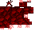                                                                                                                                                                                                                                                                                                                                                                                  |
| **Iron Brazier**                     | `IronBrazierBlockEntity`                   | Decorative/functional brazier. Right-click with an item to store one offering stack item, sneak-right-click to retrieve it, and project 50 ml of blood into the brazier with Blood Projection or a Living Staff to light it. Holding projection pours the 50 ml into the bowl at 2.5 ml per tick (about a second): the blood visibly rises over the coals, rippling where the stream lands, and the fire takes once the bowl is full. Stopping early leaves the part-filled bowl unlit, and later projection tops it up. Holding Blood Absorption on a lit brazier with no offering drains the bowl at the same pace while the fire burns lower, and puts it out once the bowl is dry; the drawn blood is not returned. The bowl's level (`PooledBlood` on `IronBrazierBlockEntity`) is synced to clients and settles when the fire changes by other means: lighting by placement or a rite fills it, and a finished craft or water burns it dry (`BrazierBloodInteractionRules`). Blood structure recipes can consume nearby lit brazier offerings without counting the braziers as structure outline blocks; completed crafts consume only the item and return the brazier to unlit. Living Weapon Grafts can also be placed as the offering and absorbed through Living Staff Blood Absorption; the Rite of the Assumed Limb consumes base-form grafts only when the matching `conjure_*` memory is granted. `memory_of_vesper` can also be placed directly and is consumed only when the existing Vesper staff memory is awakened. The previous organ echo reagent route is disabled while the organ system remains WIP. The model is a rite chalice that follows its blood-structure recipe (iron block, iron pillar, venous stone) and carries no bone. An octagonal hematic iron dais with a venous-stone inlay carries a hematic iron pillar with a vein up its front. A stepped iron bowl holds a coal bed, and blood drips down its diagonals. Four iron talons cradle the floating offering, and the front lip carries an iron pour-gutter. Lit braziers add a full-bright ember bed. The fire above it is not baked: `IronBrazierRenderer` calls `BrazierFlames`, which fills the bowl with a pool of blood (`blood_pool` shader: slow convection marbling, a deep glow under the fire, the flame mirrored on its glossy surface, bubbles that swell and pop, and a meniscus at the wall; it covers the coals and embers). Steady, camera-facing tongues burn on it in the thermal flame shader (`manipulation_flame`, run at a slower pace through `ThermalRenderTypes.STEADY_FLAME`); they keep their places and only breathe slowly. A thin soot plume rises above them, and rising Flammeus licks (`ThermalParticles.lick`) feed them every few ticks while the brazier is in view. Sanguine flames (phase 2) burn taller in the shader's hotter torch palette and simmer the blood harder. The generator still authors the hot-cored crimson fire strip, now written as `crimson_fire` and burned by the Crimson Flames fire block. Lit braziers also shed small HutosLib embers off the blood's surface and dark-glow soot above the flames; there is no white hot-core spark, since the shader tongues carry the fire's core. Brazier embers use `HemoParticleData.emberSpark`, because the older `ember` helper hands HutosLib its scale and alpha swapped, which made a large ember flash at full alpha for its first frame. Extinguishing them gives a soot-and-ember collapse, and item absorption flares crimson embers; nearby players also see the absorbed item streamed to the channelling hand. No vanilla particles are used. Memory, Scar and Living Weapon Graft absorption share one `BrazierRite` pipeline (`common/rite/brazier`), and every rite takes offerings through `IronBrazierBlockEntity.consumeForRite`. `python tools/model_export/iron_brazier.py` regenerates the body, the `_lit` and `_sanguine` parts, the ritual-phase multipart blockstate, the item model and the Blockbench project (`--preview` writes `build/iron_brazier_preview.png`). `BrazierBlock`'s outline follows the dais, stem and bowl.                                                                                                                                                                                                 |
| **Suspended Blood Crystal**          | `SuspendedBloodCrystalBlockEntity`         | Floating blood crystal display                                                                                                                                                                                                                                                                                                                                                                                                                                                                                                                                             |
| **Suspended Cleansed Blood Crystal** | `SuspendedCleansedBloodCrystalBlockEntity` | Floating cleansed blood crystal display (purified variant with random time offset animation)                                                                                                                                                                                                                                                                                                                                                                                                                                                                      |
| **Suspended Vivianite**              | `SuspendedVivianiteBlockEntity`            | Floating vivianite display                                                                                                                                                                                                                                                                                                                                                                                                                                                                                                                                                     |
| **Mnemonic Reliquary**               | `MnemonicReliquaryBlockEntity`             | Functional Degree 3 mixed-memory loadout station and screen. The gabled blood-wood casket is a baked block model from `tools/model_export/mnemonic_reliquary.py`. When opened, `MnemonicReliquaryRenderer` swings the lid back on its rear hinge and lifts the preserved relic off its cushion as its memory veins kindle. The open count and lid angle are synchronized. It groups known Noetic and Thelemic Memories by tendency, displays expression and Thelemic vascular section, and equips both through the shared capacity. It teaches no powers; referral, Mnemonist discussion, Woven Vessel fallback, and placed-block existing-world fallback record the lesson.  |
| **Dictation Table (HutosLib)** | `hutoslib:dictation_table` | Craftable shared book stand: place any HutosLib guide, click to read, sneak-click to retrieve. Drops its stored book on removal. HutosLib alone supplies no field-note provider or dictation costs. Other mods opt into `FieldNotes.Provider`; Hemomancy permits dictation only at its Escritoire. Legacy `hemomancy:dictation_table` blocks retain their stored-book NBT and behave as reading stands; their drops and conversion recipe yield the HutosLib table. |
| **Harbinger Escritoire** | `harbinger_escritoire` | Crafted from a HutosLib Dictation Table, blood wood planks, and an iron ingot. Holds any guide for reading. Applicable pending Liber notes cause a subtle, player-specific red pulse; normal interaction dictates them using the existing Sanguinum blood formula or Immaculatus XP cost. Insufficient resources retain the notes; incompatible or exhausted notes fall back to reading. Sneak-click retrieves the book. Shape and waterlogging are preserved. |
| **Humane Idol**                      | `HumaneIdolBlockEntity`                    | Idol block                                                                                                                                                                                                                                                                                                                                                                                                                                                                                                                                                                                                                                                           |
| **Serpentine Idol**                  | `SerpentineIdolBlockEntity`                | Idol block                                                                                                                                                                                                                                                                                                                                                                                                                                                                                                                                                                                                                                                           |
| **Engram Block**                     | —                                          | Translucent engram. Emits redstone comparator signal 15 when lit (LIT=true), 0 when unlit. `hasAnalogOutputSignal()` returns true.                                                                                                                                                                                                                                                                                                                                                                                                                                                                                                                                   |
| **Filler Block**                     | `FillerBlockEntity`                        | Indestructible filler for multiblocks                                                                                                                                                                                                                                                                                                                                                                                                                                                                                                                                                                                                                                |
| **Bog Body**                         | —                                          | Decorative translucent body block                                                                                                                                                                                                                                                                                                                                                                                                                                                                                                                                                                                                                                    |
| **Visceral Mirror**                  | `VisceralMirrorBlockEntity`                | Ritualistic mirror for organ extraction — gaze into your reflection to extract and modify organs (Spleen, Liver, Lungs, Kidneys, Heart). Requires degree 3+. Cycle organs (right-click) → confirm extraction (sneak right-click). Produces Organ Echo items.                                                                                                                                                                                                                                                                                                                                                                                                            |

---

## 24. Decorative & Building Blocks

### 24.1 Venous Stone Family

A full block family with variants:

| | | |
|---|---|---|
|  Venous Stone |  Polished Venous Stone |  Polished Venous Stone Bricks |
|  Chiseled Polished |  Cracked Bricks |  Gilded Venous Stone |
|  Infested Venous Stone | | |

- Venous Stone, Slab, Stairs, Wall
- Polished Venous Stone, Slab, Stairs, Wall (six blocks make six walls, or one at the stonecutter)
- Polished Venous Stone Bricks, Slab, Stairs, Wall
- Chiseled Polished Venous Stone
- Cracked Polished Venous Stone Bricks
- Gilded Venous Stone
- Infested Venous Stone

### 24.2 Hematic Iron Family

| | | | |
|---|---|---|---|
|  Hematic Iron Block |  Hematic Iron Pillar |  Chiseled Hematic Iron |
|  Hematic Iron Bars |  Hematic Iron Chain | 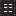 Hematic Iron Trapdoor |
|  Hematic Iron Plating | | |

- Hematic Iron Block
- Hematic Iron Pillar (rotatable)
- Chiseled Hematic Iron Block
- Hematic Iron Plating, Stairs, Slab, Wall: riveted plates in two offset courses with a faint red bed joint, the trim stone of Hemorath's mausoleum (pilasters, cornices, arch stones, base courses). Two Hematic Iron Blocks side by side make two plating; the stonecutter cuts one plating from one block. Stairs, slab and wall follow the vanilla brick recipes and the stonecutter. Hematic-iron strength and metal sound, mined with any pickaxe. The texture comes from `tools/model_export/hematic_iron_plating.py`.
- Hematic Iron Bars (vanilla iron-bars behavior, cutout render layer)
- Hematic Iron Chain (vanilla chain behavior, axis placement, cutout render layer)
- Hematic Iron Door (vanilla iron-door behavior, redstone-opened)
- Hematic Iron Trapdoor (vanilla iron-trapdoor behavior, redstone-opened)

### 24.3 Anti-Blood / Unstained

-  Hemolytic Plating Block
- Cleansed Stone — pale, smooth stone found in Unstained temples
- Pallid Lantern — softly glowing lantern sacred to Our Lady of Still Waters
- Virid Salis Trail — green Unstained salt-ash trail block placed by `hemomancy:virid_salis` / `hemomancy:virid_salis_trail`

- Pallid Silver Chain - pale-silver vanilla-chain variant for Unstained hanging decor
- Pale Silver Bars - pale-silver vanilla-bars variant for Unstained churches and cells
- Pale Silver Bells - vanilla-bell-style Unstained ritual bell with floor, wall, between-wall, and ceiling attachments

The alpha building pass intentionally favors vanilla behavior for compatibility: chains use `ChainBlock`, bars use `IronBarsBlock`, walls use `WallBlock`, and hematic iron door/trapdoor use the vanilla iron block set behavior. Recipes, loot tables, blockstates, item models, pickaxe mineability, and cutout render layers are present for the new fixture blocks. `BuildingBlockResourceCoverageTest` guards the expected resource files for the current alpha fixture set.

### 24.4 Glass & Panes

| | | | |
|---|---|---|---|
|  Sanguine Glass |  Sanguine Pane |  Vivianite Glass |  Vivianite Pane |
|  Cleansed Sanguine Glass |  Cleansed Sanguine Pane | | |

### 24.5 Wood & Organic

| | | |
|---|---|---|
|  Blood Wood Log |  Blood Wood Leaves |  Blood Wood Planks |  Conscious Mass |

- Blood Wood Log (rotatable pillar)
- Blood Wood Leaves (direct Blood Projection growth from Dead Bushes)
- Blood Wood Planks
- Conscious Mass (wart-block sound)

### 24.6 Fungal / Plant Blocks

| | | | |
|---|---|---|---|
|  Hyphae |  Hyphae Block |  Infected Stem |  Infected Cap |
|  Fruiting Infected Cap |  Erythrocytic Dirt |  Erythrocytic Mycelium |  Bleeding Heart |
|  Infected Fungus |  Stinkhorn Fungus |  Lethean Poppy | |

- Hyphae (cross-block, replaceable — crafts into Spore Sac)
- Hyphae Block
- Infected Stem
- Infected Cap / Fruiting Infected Cap
- Erythrocytic Dirt
- Erythrocytic Mycelium (spreads, random ticks)
- Bleeding Heart (flower, Absorption effect — crafts Bleeding Bulb, brews Potion of Sanguine Siphon)
- Infected Fungus (flower, Confusion effect — ghastly_alembic → Foul Paste, brews Potion of Mycorrhizal Mending, incubator catalyst for Fungal Morphling)
- Stinkhorn Fungus (Confusion effect — ghastly_alembic → Foul Paste, brews Potion of Blood Binding)
- Puffball Fungus (Saturation effect, **Unstained** — ghastly_alembic → Spore Sac, incubator catalyst for Fungal Morphling)
- Lethean Poppy (Regeneration effect, random ticks, **Unstained** — ghastly_alembic → Lethean Dew, crafts Lethean Poppy Wreath)
- Ghost Pipe (myco-heterotrophic, Night Vision effect, **Unstained** — ghastly_alembic → The Pale Distillate)
- Sarcodes (myco-heterotrophic, Regeneration effect — ghastly_alembic → Bleeding Bulb, brews Potion of Blood Rush)
- Rafflesia (parasitic, Confusion effect — ghastly_alembic → Spore Sac, brews Potion of Hemolysis)

All applicable flowers have **potted** variants.

### 24.7 Gourd

| | |
|---|---|
|  Gourd |  Gourd Stem |

- Gourd (pumpkin-like, grows from stem)
- Gourd Stem / Attached Gourd Stem

The mature `hemomancy:gourd` still uses vanilla pumpkin/melon-style ground growth through `StemBlock` and `AttachedStemBlock`, but its visible model is intentionally smaller than a pumpkin: a low cocoa-pod-like gourd centered near the ground, with small edge connector pads so attached stems meet the fruit visually from any horizontal side. `GourdBlock` supplies compact selection and collision shapes (`3,0,4` to `13,7,12`) for the main pod body, while the stem blocks render on the cutout layer. `BlockInit.attached_gourd_stem` must pass the custom stem key before the fruit key to `AttachedStemBlock`, so breaking the grown fruit restores an age-7 `gourd_stem` instead of turning the stem into another gourd. `GourdPresentationResourceTest` guards against accidentally reverting the asset back to a full cube/pumpkin column or losing stem cutout/connector/cleanup coverage.

### 24.8 Ash Trails

| | | | | |
|---|---|---|---|---|
|  Smouldering Ash |  Active Smouldering |  Befouling Ash |  Active Befouling |  Virid Salis |

- Smouldering Ash Trail / Active Smouldering Ash Trail
- Befouling Ash Trail / Active Befouling Ash Trail
- Virid Salis Trail (Unstained-aligned; currently no active variant)

The four Harbinger ash trails share one wire-shape base (`AshTrailBlock`). They connect like redstone dust but carry no redstone signal; neighbouring redstone power only brightens their embers (`HemoParticleData.emberSpark`). Smouldering trails glow at light 4; Befouling trails survive without support; Active trails drop themselves when unsupported.

### 24.9 Misc

-  Crimson Flames (special fire block)
- Blood Crystal (modeled block)

### 24.10 Bone Brick Family

| | | |
|---|---|---|
|  Bone Bricks | 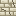 Cracked Bone Bricks |  Chiseled Bone Bricks |

Ossuary masonry cut from bone, for the mausoleum walls (Putriciel and Hemorath themes). Bone Bricks, Cracked Bone Bricks, Chiseled Bone Bricks, Bone Brick Stairs, Bone Brick Slab and Bone Brick Wall. Four Bone Blocks make four bricks in a 2x2; stairs, slab and wall follow the vanilla brick recipes and the stonecutter; two slabs stack into the chiseled block; smelting bricks cracks them. Bone-block strength and sound, mined with any pickaxe. Textures come from `tools/model_export/bone_brick_family.py`.

### 24.11 Healed Stone (Seraphae)

| | | |
|---|---|---|
|  Healed Quartz Bricks |  Healed Calcite |  Radiant Healed Quartz (glow layer) |

Stone that Seraphae's healing reached and grew, found only in her mausoleum; no recipes. Each of the three stones has three growth layouts on the same stone, and the blockstate picks one at random per position (never rotated, so the bricks stay upright), so a grown patch does not repeat.

- Healed Quartz Bricks: quartz bricks in vanilla's layout with pale pink-ivory scar pads knit over their joints and a few fine pale capillaries, so a patch reads as the same quartz-brick wall, grown. Quartz strength (0.8), stone sound.
- Healed Calcite: vanilla-toned calcite swollen with the same scar tissue in soft lumps. Calcite strength (0.75) and sound.
- Radiant Healed Quartz: the healed bricks grown further, the growth's middle glowing warm white to pale gold from inside. Light 12. Its model is two layers: the stone cube (cut away where the growth glows) over an inset cube drawn full-bright (`shade: false`, block and sky light 15).
- Bone Outgrowth (`bone_outgrowth`): five tapered, bent bone spurs with knuckled joints on a healed collar. Placed like an amethyst cluster: `facing` (all six) is the way the spurs point and it needs a sturdy face behind them; `waterlogged`. A small hit box that hides nothing behind it, bone-block sound, strength 1. Drops one or two bones, itself with Silk Touch.

The three stones drop themselves. All four need a pickaxe and are in the creative tab. Textures and models come from `tools/model_export/seraphae_growth.py`.

### 24.12 Burned and Rotten Materials (Putriciel)

| | | | |
|---|---|---|---|
|  Packed Ash |  Charred Planks |  Charred Log | 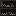 Charred Bookshelf |
|  Sodden Mud Bricks | | | |

What Putriciel's mausoleum is built of: every hall alternates a charred band with an overgrown one. The fire is long out, so nothing here glows except the spore shelf's gills.

- Packed Ash (`packed_ash`): compacted grey-black ash with char flecks and pale bone grit, for ash floors, inlays and the Ash Garden's circle. Three layouts, each turned four ways at random per position. Soul-soil sound, strength 0.6, shovel.
- Charred Planks (`charred_planks`), Charred Plank Stairs and Charred Plank Slab: black char split by alligator checks, the wood showing dull brown-grey in the cracks. Charred Log (`charred_log`, `axis`) is the beam: deep-checked bark and a burned end grain; one log makes four planks, and the stairs and slab follow the vanilla wood recipes. Wood sound, strength 2, axe.
- Charred Bookshelf (`charred_bookshelf`): the Burned Library's shelves, burned half to ash (char stumps, ash heaps, a few scorched spines); its ends are charred planks. No enchanting power. Drops one to three charcoal, itself with Silk Touch. Axe.
- Sodden Mud Bricks (`sodden_mud_bricks`): the walls' mud brick gone soft and wet, darker and glossier than vanilla's, with moss and rootlets in the joints. Three moss layouts, never turned. The slow floor of the rotten bands: 14 px collision like vanilla mud (you sink in) and soul-sand speed (0.4). Mud sound, strength 1, shovel.
- Spore Shelf (`spore_shelf`): a modelled cluster of bracket-fungus caps stepping out of a wall, ochre-grey zoned tops, gills underneath and a few spore motes. `facing` (four horizontal) is the way the caps grow, and it needs a sturdy face behind them; no collision, a small hit box. The gills and motes are drawn full-bright in a faint green and the block gives light 5; `bloom=true` (set by Putriciel's fight during its absolution window) swaps in brighter gills and gives light 11. Drifts a few green spores, more in bloom. Fungus sound, axe, drops itself.

All drop themselves unless noted and are in the creative tab. Textures, models and the spore shelf's Blockbench project come from `tools/model_export/putriciel_materials.py`.

### 24.13 Frozen Monastery Materials (Velorum)

| | | | |
|---|---|---|---|
|  Rimed Deepslate Bricks (side) |  Rimed Deepslate Bricks (top) |  Rime Lantern (core) |  Dark Lacquer Planks |

Velorum's monastery, frozen around him: deepslate trim crusted with rime, blue-white light behind ice, icicles from the vaults, frozen runoff down the pilasters and the dark lacquered wood of its furniture and cell fittings. Nothing here melts.

- Rimed Deepslate Bricks (`rimed_deepslate_bricks`), Rimed Deepslate Brick Stairs, Slab and Wall: deepslate bricks in vanilla's layout and greys under a rime crust: small crystal grains lit from the upper left, blue in the creases, a few white glints. The top face is all crust; the side faces carry a fringe of it along their top two or three rows with a few short ice ticks below. The trim of every exposed ledge (cornices, dados, imposts, gallery ledges). Three layouts; the cube and the slab pick one at random per position and turn it four ways. Stairs, slab and wall have their own elements so the fringe sits at the top edge of every exposed ledge (a stair's step and riser each get one; upside-down stairs keep theirs on top); their undersides are vanilla deepslate bricks. Deepslate-brick strength and sound, pickaxe. Eight deepslate bricks round a snowball make eight; stairs, slab and wall follow the vanilla brick recipes and the stonecutter.
- Rime Lantern (`rime_lantern`): a full block of clear ice, rime creeping in unevenly from its edges, over a pale blue-white core inset 2 px and drawn full-bright (`shade: false`, block and sky light 15). Light 11. The recessed light set into walls behind the ice. Translucent; glass sound, strength 0.5, pickaxe; never melts. Drops itself. A sea lantern in a plus of four ice makes one.
- Hanging Icicle (`hanging_icicle`): modelled icicles in translucent pale ice hanging from the underside of the block above. `length`: `short` is a cluster of four or five icicles ending in its cell; `base` is the thick upper cell of a two-cell icicle (a central shaft and two or three small ones) and `tip` its tapering lower cell. Short and base need a sturdy face above; a tip needs a base above and breaks when it loses it. Placing one under a short cluster makes it a tip and the cluster its base. Two layouts per length, each turned four ways; the shaft is centred, so any base meets any tip. No collision, a small hit box. Glass sound, strength 0.5, pickaxe. Drops only with Silk Touch, like ice.
- Frozen Drip (`frozen_drip`): runoff frozen down a wall face, a thin film under 1 px proud with ribbons standing 1.5-3 px proud. `facing` (four horizontal) is the side it faces into the room; it hangs on the face behind, which must be sturdy. `end=false` is a continuous sheet whose ribbons line up with the cells above and below; `end=true` is the lowest cell, where the film gives out and the ribbons taper into beads and a short icicle. A drip placed under another of the same facing turns the one above into sheet; one left over air ends. Two layouts each. No collision, glass sound, strength 0.5, pickaxe. Drops only with Silk Touch.
- Dark Lacquer Planks (`dark_lacquer_planks`), Dark Lacquer Plank Stairs and Dark Lacquer Plank Slab: near-black lacquered boards with fine grain, a faint oxblood sheen and one small hematic-iron nail head a block. Eight dark oak planks round a black dye make eight; stairs and slab follow the vanilla wood recipes. Wood sound, strength 2, axe. Like charred planks, they are in no planks or wooden tags.

All are in the creative tab. Textures, models, blockstates and the icicle and drip Blockbench projects come from `tools/model_export/velorum_materials.py`.

---

## 25. Recipe Systems

This section tracks shared recipe infrastructure and Harbinger-facing recipe catalogs. Unstained Still Arts, Cardinal Rites, White Humor purification, and Unstained structure recipes live in §15 so those lanes stay separate from the blood-magic path.

**Shared and Harbinger-facing recipe types:**

| Recipe Type | Serializer | Station | Purpose |
|-------------|-----------|---------|---------|
| `scar_recipe` | `ScarRecipeSerializer` | Cerebral Scarring Station | Crafting scars |
| `distillation_recipe` | `DistillationRecipeSerializer` | Ghastly Alembic / Pallid Retort | Shared distillation serializer. Ghastly Alembic is the Harbinger station; `pallid: true` routes to the Pallid Retort and is cataloged with Unstained crafting in §15.3. |
| `recaller_recipe_type` | `RecallerRecipeSerializer` | Visceral Recaller | Creating Hematic Memories |
| `memory_weaving` | `MemoryWeavingRecipeSerializer` | Somatic Loom | Refined Hematic Memory crafting. Recipes require a blank memory vessel, a `catalysts` list, integer stored-enzyme requirements, projected ritual blood, and Engram Weaving (the engram's true fragments threaded home). The `enzymes` amounts are fragment counts; the spans actually spent depend on the weaver's route. The loom's upgrade stage limits which memory ranks it can weave. |
| `incubator_recipe_type` | `IncubatorRecipeSerializer` | Morphling Incubator | Growing Morphling Polyps into the eight canonical strains using enzyme catalysts (8 recipe JSONs). JEI-integrated via `IncubatorRecipeCategory`. Fungal scar crafting has moved out to the Mycelial Crucible. |
| `fungal_scar_cultivation` | `FungalScarCultivationSerializer` | Mycelial Crucible | Two-phase fungal scar cultivation. Phase 1 produces `immature_fungal_scar`; Phase 2 matures the culture with aligned enzymes into one of 8 finished `ItemFungalScar` variants. |
| `enzyme_fruiting` | `EnzymeFruitingRecipeSerializer` | Mycelial Lantern | Reusable aligned spore culture + blood -> matching enzyme. Defaults: 2,400 ticks, 0.25 blood/tick, 600 total blood, output count 1; JSON-tunable per recipe. |
| `armature_upgrade` | `ArmatureUpgradeRecipeSerializer` | Hematic Armature | Data-driven worn-armor upgrades. JSONs declare required degree, armor slot, valid worn base item(s), bowl reagent, blood cost, result item, optional stack data output, and optional persistent-data gate. |
| `blood_infusion` | `BloodInfusionRecipeSerializer` | Blood Projection | Gradually feeds blood into an eligible world block, then removes it and drops the recipe's result block item. |
| `blood_structure_recipe` | `BloodStructureRecipeSerializer` | In-world structure | Harbinger structure crafting; Unstained entries that share the serializer are cataloged in §15.3. |
| `cardinal_rite_recipe` | `CardinalRiteRecipeSerializer` | Multiblock | Harbinger Cardinal Rites for degree advancement and blood utility rites; Unstained rites are cataloged in §15.2. |
| Morphling Jar Upgrade | `CopyMorphlingJarRecipe.Serializer` | Crafting | Upgrading morphling jars |
| Blood Gourd Upgrade | `CopyBloodGourdRecipe.Serializer` | Crafting | Upgrading blood gourds |
| Blood Gourd Fill | `FillBloodGourdRecipe.Serializer` | Crafting | Filling gourds with blood |
| Vial Rack | Vanilla shaped recipe | Crafting | 8 Bloody Vials + Hematic Iron Scrap → Vial Rack |

Alpha building fixtures are regular vanilla shaped recipes under `data/hemomancy/recipe/`: Hematic Iron Scrap / Pale Silver Ingot / Venous Stone variants craft chains, bars, walls, and hematic iron door/trapdoor fixtures.

**Unstained recipe lanes:**

| Lane | Data/type | System reference |
|---|---|---|
| Unstained structure recipes | `blood_structure_recipe` entries with `unstained: true` | §15.3 |
| Unstained Cardinal Rites | `cardinal_rite_recipe` entries with `bloodCost: 0` and Unstained `required_degree` gates | §15.2 |
| White Humor Purification | `white_humor_purification`, physical White Humor pools | §15.4 |
| Pallid Retort distillation | `distillation_recipe` entries with `pallid: true` | §15.3 |
| Unstained material/tool crafting | vanilla shaped/shapeless recipes under `data/hemomancy/recipe/` | §15.3 |

Current datapack paths use the 1.21 singular directory names already present in this repository.

**Shared / Harbinger data paths:**

| Content | Path |
|---|---|
| Main recipes | `src/main/resources/data/hemomancy/recipe/` |
| Harbinger Blood Structure recipes | `src/main/resources/data/hemomancy/recipe/blood_structure/` |
| Harbinger Cardinal Rites | `src/main/resources/data/hemomancy/recipe/cardinal_rite/` |
| Memory weaving recipes | `src/main/resources/data/hemomancy/recipe/memory_weaving/` |
| Puppeteer Cardinal Ordeals | `src/main/resources/data/hemomancy/recipe/cardinal_rite/puppeteer_trial_*.json` |
| Enzyme fruiting | `src/main/resources/data/hemomancy/recipe/enzyme_fruiting/` |
| Armature upgrades | `src/main/resources/data/hemomancy/recipe/armature_upgrade/` |
| Blood infusions | `src/main/resources/data/hemomancy/recipe/blood_infusion/` |
| Block loot tables | `src/main/resources/data/hemomancy/loot_table/blocks/` |
| Entity loot | `src/main/resources/data/hemomancy/loot_table/entities/` |
| Item inquiry dialogue | `src/main/resources/data/hemomancy/dialogue_inquiry/<npc>/<namespace>/<item>.json` |

**Unstained data paths:**

| Content | Path |
|---|---|
| Unstained Blood Structure entries | `src/main/resources/data/hemomancy/recipe/blood_structure/` (`unstained: true`) |
| Unstained Cardinal Rites | `src/main/resources/data/hemomancy/recipe/cardinal_rite/` |
| White Humor purification | `src/main/resources/data/hemomancy/recipe/white_humor_purification/` |
| Pallid Retort distillation | `src/main/resources/data/hemomancy/recipe/distillation/` (`pallid: true`) |
| Liber Immaculatus book data | `src/main/resources/data/hemomancy/books/liberimmaculatus/` |
| Zealot and Guardian inquiry dialogue | `src/main/resources/data/hemomancy/dialogue_inquiry/<npc>/<namespace>/<item>.json` |

### 25.1 Harbinger Blood Structure Crafting (the floorless tier)

An in-world system for early and commonly repeated crafts. Build the structure, hold its catalyst in your offhand, and hold Blood Projection on the structure until its blood cost is fed; the structure collapses into the result. No floor, Focus or brazier is involved. Blood Structures take no brazier offerings, and the serializer rejects an `offerings` field: offerings belong to Cardinal Rites. Machines, stations and constructs are Working crafts instead (§25.1.1).

Harbinger Blood Structure crafting is introduced through the Vicar's first bloodcraft proofs. Each Harbinger JSON carries `required_degree`; `RecipeDegreeGates` compares that value against the player's Initiatory Degree. Blood cost is only the resource cost. Unstained structure recipes that share the serializer are cataloged in §15.3. `WorkingCraftRosterDataTest` pins the floorless roster, so adding a floorless recipe is a deliberate edit.

The Liber Sanguinium's Rites & Crafts tab lists floorless structures (the Floorless group) and Working crafts (the Making group) on the same map as the rites, through `CraftingMapRecipe`. JEI lists the floorless tier in its Blood Structures category and every Harbinger rite in a category for its purpose: Threshold Rites, Dominion Rites, Working Rites & Crafts (Working crafts, vessels, the Horn, station upgrades and Exsanguination) and Communion Rites. Hematic Succession and Mnemonic Restoration keep their own Succession category. A rite's JEI preview shows its Working subject, else its required structure, else its floor. The debug Structure Spawner lists whole rite floors first, then groups recipes by required degree and marks Working crafts `[Craft]`; shift-clicking a craft spawns its full Working setup.

| Recipe | Required Degree | Blood Cost | Catalyst (offhand) | Result |
|--------|-----------------|-----------|--------------------|--------|
| Dried Gourd | 0 | 150 | Gourd Seeds | Dried Gourd |
| Hematic Iron Block | 1 | 50 | Ink Sac | Hematic Iron Block |
| Liber Sanguinium | 1 | 100 | Sanguine Formation | Liber Sanguinium |
| Living Staff | 1 | 150 | Sanguine Formation | Living Staff |
| Iron Brazier | 1 | 100 | Smouldering Ash Trail | Iron Brazier |
| Vial Centrifuge | 1 | 150 | Ferric Binder | Vial Centrifuge |
| Ghastly Alembic | 2 | 100 | Sanguine Formation | Ghastly Alembic |
| Hematic Stake | 5 | 100 | Sanguine Formation | Hematic Stake (planted in place) |
| Mycelial Synapse | 8 | 120 | Sanguine Formation | Mycelial Synapse (raised in place; crystal on any face of the iron; Apotheos, Gardens only, see §5.6d) |

> Harbinger recipes are in `data/hemomancy/recipe/blood_structure/`. Each recipe defines a multiblock `pattern` with `key` mapping characters to blocks, plus `heldItem`, `hitBlock`, `bloodCost`, `required_degree`, and `result`. Unstained entries in the same folder use `unstained: true` and are documented in §15.3. The Consecrated Bloodwell has no structure recipe: only the Rite of the Founding Fane manifests it.
> A floorless craft breaks its structure into Hemomancy blood cells and plays `rite.complete`.

### 25.1.1 Working crafts

Machines, stations and constructs are made on the Working floor. A Working craft is a `making` Cardinal Rite under `data/hemomancy/recipe/cardinal_rite/working/` whose `subject` is the structure to build. Its old Blood Structure fields map as follows: `pattern` and `key` become `subject.pattern` and `subject.key`; `bloodCost` becomes `subject.feed`; the offhand catalyst becomes the `medium`, seated in the Focus and consumed on success; offerings become the `brazier_signature`. The rite's own `bloodCost` is 0. Old `blood_structure/<machine>` ids and Mnemonic Blueprints remap to their Working craft (`LegacyBloodStructureIds`); a blueprint for the retired Consecrated Bloodwell structure resolves to the Founding Fane.

**The bed.** The subject stands anywhere on the floor's upper layer that leaves the Focus clear, in any horizontal rotation, at most three blocks tall (`WorkingCraftBed`): up to one block from the Focus on a 3×3 floor, two on a 5×5, three on a 7×7, four on a 9×9. Any such footprint lies wholly on one side of the Focus, so each side's bed spans the floor's whole width (wide × deep, outward from the Focus): minor 3×1, lesser 5×2, greater 7×3, grand 9×4. Each craft names the smallest Working tier whose bed fits it, and larger Working floors also work. The serializer rejects a subject that does not fit, a purpose other than `making`, a floor that is not Working, anchors, or a rite `bloodCost`. When the floor, medium and offerings answer a craft but its subject does not rest on the floor (it floats, overhangs the floor's edge or covers the Focus), the Focus says it cannot find the subject (`CardinalRiteStationMatcher.Status.NO_SUBJECT`).

**The ceremony.** Seat the medium, light the braziers and plant the Living Staff. When the rite is activated, the offerings are taken into escrow (`RiteOfferingEscrow`, shared with station upgrades) and the subject's blocks are recorded; the medium stays seated in the Focus until completion. The rite starts in `SUBJECT_FEEDING`: hold Blood Projection on any subject block. A miss elsewhere on the craft's floor takes nothing; projection past the floor's footprint is left to its own use (`WorkingCraftBed.withinFloor`). The Working floor's membrane climbs the structure as it fills, and the projection beam lands on the climbing fill line. Reaching the feed seals the rite; the daemon draws the escrowed offerings in, and the forging culmination removes the structure into the floor and drops the result on the Focus. Completion grants the "crafted" stat that machine access checks, the first-bloodcraft and Living Staff hooks, and counts as a rite for the one-time rite milestones. There are no anchors, sigils, waves or helpers, and failure is `safe_retry`.

**Safety.** Recall, collapse, or a broken or changed subject block returns the escrowed offerings and staff through the Cardinal recovery queue and leaves the structure standing; blood already fed is spent. A damaged floor or an absent caster pauses the craft. Completion settles once, so a restart cannot remove the structure twice or drop two results. The Cardinal Focus also records the craft it settled, in the chunk that lost the structure (`CardinalFocusBlockEntity.settledCraft`): rite data reloaded from before a crash then cannot return offerings or drop a second result. Completion refuses a craft whose escrow is no longer held. Projecting into a built Working frame outside a rite explains how to perform it, and from which degree, instead of condensing a Sanguine Formation; projecting into a structure whose craft is already running only says so. `WorkingCraftGameTests.noWorkingStructureHidesAFloorlessOne` keeps every Working structure free of floorless patterns. Rites never consume a recorded Wax Cylinder: a cylinder offering must be blank.

| Craft | Degree | Floor | Medium | Feed (mL) | Brazier offerings |
|---|---:|---|---|---:|---|
| Resonant Forge | 3 | minor | Ferric Binder | 500 | Wax Cylinder (blank) |
| Scarlet Vanity | 3 | minor | Sanguine Formation | 300 | Dried Gourd, Leather |
| Somatic Loom | 3 | lesser | Sanguine Formation | 150 | String, Neurotic Enzyme |
| Mycelial Lantern | 3 | lesser | Ferric Binder | 2,500 | Brown Mushroom, Glowstone Dust |
| Fungal Implantation Pylon | 4 | lesser | Hyphal Substrate | 1,200 | Neurotic Spores, Bone Meal |
| Sporitic Thurible | 4 | lesser | Spore Sac | 1,000 | Chain, Brown Mushroom |
| Enzymatic Scriptorium | 3 | greater | Ferric Binder | 500 | Enzyme Primer, Blood Crystal Shard, Lapis Block |
| Mnemonic Reliquary | 3 | greater | Sanguine Formation | 75 | Book |
| Somnolent Seat (Warp Chair) | 3 | greater | Sanguine Formation | 250 | Blood Crystal ×2, Ender Pearl ×2 |
| Semi-Sentient Construct | 3 | greater | Befouling Ash Trail | 250 | Rotten Flesh, Bone |
| Mason's Effigy | 4 | greater | Runic Motif Paper | 150 | any flower ×2 |
| Mind Spike | 4 | greater | Sanguine Formation | 500 | Neurotic Enzyme, Amethyst Shard |
| Cerebral Scarring Station | 4 | greater | Sanguine Formation | 100 | Flint, Iron Ingot |
| Visceral Mirror | 4 | greater | Sanguine Formation | 200 | Ink Sac, Quartz |
| Dendritic Distributor | 5 | greater | Sanguine Formation | 500 | Tendon Line, Ferric Binder |
| Morphling Incubator | 5 | greater | Morphling Polyp | 200 | Swollen Leech, Slime Ball |
| Vacant Effigy | 5 | greater | Sanguine Formation | 250 | Armor Stand, Blood Stained Stone |
| Sanguine Monolith | 6 | greater | Sanguine Formation | 175 | Sanguine Quintessence, Echo Shard |
| Covenant Throne | 6 | greater | Sanguine Formation | 8,000 | Sanguine Quintessence, Blood Crystal, Crying Obsidian |
| Sanguine Vigil (Vascular Effigy) | 6 | grand | Sanguine Formation | 6,500 | Vascular Poultice, Tendon Line, Sanguine Quintessence |

The Somatic Loom's frame was trimmed to a 3×2 footprint and the Semi-Sentient Construct redrawn to 3×3×2. Patterns that used Copper Blocks now use Chiseled Hematic Iron, because Harbinger floors never carry copper. Working crafts may carry up to six offerings at any degree (`WorkingCraftRecipeRules.MAX_OFFERINGS`), like station upgrades. The Mnemonic Reliquary craft also waits for the Mnemonist's Degree 3 lesson, as its old structure did (`RecipeDegreeGates.needsReliquaryLesson`).

> **Covenant Throne:** Degree 6 Bloodline Covenant machinery. Only the active bloodline Progenitor can bind to it. Sitting on the throne sets a forced return point at the block in front of the throne, facing back toward it; using the throne again while seated triggers the Covenant Trance if the cooldown and blood cost checks pass.
> **Mycelial Lantern:** `cardinal_rite/working/mycelial_lantern.json` is a Degree 3 lesser Working craft fed 2,500 mL with a Ferric Binder medium; its frame is Sanguine Glass, brown mushroom blocks, Hematic Iron, Polished Venous Stone and Chiseled Hematic Iron.
> **Sporitic Thurible:** `cardinal_rite/working/sporitic_thurible.json` is a Degree 4 lesser Working craft fed 1,000 mL with a Spore Sac medium; its frame is Chain, Iron Bars, Chiseled Hematic Iron, brown mushroom blocks and a Hematic Iron Block.

**Visuals.** The rite sync carries the subject's blocks and fill. `WorkingCraftSwallowRenderer` draws the structure warp shell cut at a ragged, bright fill line (the `FillLine` uniform of `blood_structure_warp`), and pulses once on the seal. `WorkingCraftSwallowGeometry` grows a tentacle up each corner of the structure to the Hematic Riposte standard on the blood school's `ANIMUS` material: a translucent sheath, three opaque sinew strands braided round a writhing spine (`WorkingCraftSwallowRules.tentacleSpine`), a pale core, and a clotted tip hooked over the edge at the fill line, beating with the floor. In the offering procession the daemon does not wait over the staff: it swoops to each lit brazier in turn and breaks its offering where it sits: pulled up out of the bowl, the offering swells and shudders, then breaks with the vanilla item-break crumbs and sound while its blood streams into the daemon, which swells with each (`WorkingCraftDaemonPath`, `CardinalRiteOfferingDissolveRenderer`, `OFFERING_DISSOLVED` beat). Escrowed offerings stay visible in their braziers until then, as display copies that cannot be matched or taken (`IronBrazierBlockEntity.showEscrowed`); a brazier forgets one once its rite no longer exists. In the culmination it dives into the structure's heart and shrinks inside it; the structure then darkens to clotted blood, throbs, sweats dark blood cells and beats like a heart. On completion the floor grips the structure, shudders it and yanks it under in an accelerating pull that lands with a thud (`rite.subject_thud`), a ring of blood and a short camera shake for players within 16 blocks. Any other ending drains the shell back down. Sounds: `rite.subject_rise`, `rite.subject_sink`, `rite.subject_thud`.

### 25.1.2 Puppeteer Cardinal Ordeals

Puppeteer summon unlocks are ordinary layered Cardinal Rites under `data/hemomancy/recipe/cardinal_rite/`. Their optional `puppeteer_trial: { "summon": "..." }` metadata selects the registered summon definition, while `consume_medium_on_success: false` preserves the complete Marionette Crossbar stack. Serializer validation requires a layered Harbinger rite, a Crossbar medium, and Living Staff ceremony.

All seven ordeals use `dominion_lesser`, no upper structure, no anchors or waves, and no fight timer. The caster lights the exact brazier offering signature, seats an owner-attuned Crossbar that controls no active bodies, and plants a Living Staff. After staff impact, the station is revalidated and the hostile is added before blood or offerings are committed. Spawn failure therefore consumes nothing. Once manifested, cancellation, caster loss, structure failure, Peaceful removal, or a missing tracked entity collapses the rite, removes the hostile, and grants nothing; committed blood and offerings are not refunded.

| Cardinal Rite | Degree | Blood | Lit Brazier Offerings | Atmosphere |
|---|---:|---:|---|---|
| `cardinal_rite/puppeteer_trial_veinwing_vulture` | 3 | 500 mL | Veinwing Harness | Faint fog |
| `cardinal_rite/puppeteer_trial_marrow_spitter` | 3 | 750 mL | Marrow Spitter Carriage | Faint fog |
| `cardinal_rite/puppeteer_trial_gorebound_hulk` | 4 | 1,100 mL | Gorebound Yoke; Sanguine Quintessence | Dense fog |
| `cardinal_rite/puppeteer_trial_scarlet_mummer` | 4 | 900 mL | Scarlet Gorget | Dense fog |
| `cardinal_rite/puppeteer_trial_sanguine_hound` | 4 | 850 mL | Sanguine Hound Bridle | Dense fog |
| `cardinal_rite/puppeteer_trial_cinder_bellows` | 4 | 900 mL | Cinder Bellows Frame | Dense fog |
| `cardinal_rite/puppeteer_trial_mnemonist_puppet` | 5 | 1,400 mL | Mnemonist Cradle; Mnemonic Ambergris; Memory Thread | Storm fog and lightning |

`PuppeteerTrialRiteController` tracks the manifested entity UUID, crossbar UUID, summon name, health progress, and a short missing-entity grace. Death only marks the matching active rite defeated. Normal culmination then revalidates the station and exact seated Crossbar, grants and synchronizes the known shape once, restores the escrowed Living Staff, and leaves the Crossbar ready for shift-extraction. `PuppeteerSummonTrialEvents.awardOrdealRecipes` grants each eligible component recipe and ordeal recipe from degree-grant and login recovery paths.

Operators can test summon knowledge directly with `/hemo summons list [player]`, `/hemo summons add <summon|all> [player]`, `/hemo summons remove <summon|all> [player]`, and `/hemo summons clear [player]`. Shape arguments tab-complete the six registered definition names, and every mutation synchronizes the target player's known-summon attachment immediately.

Known manipulations can be tested with `/hemo manipulations list [player]`, `/hemo manipulations add <manipulation|all> [player]`, `/hemo manipulations remove <manipulation|all> [player]`, and `/hemo manipulations clear [player]`. Manipulation arguments tab-complete every active registered manipulation plus `all`; retired manipulations are excluded. Removing or clearing knowledge also resets any affected selection and equipped loadout entries, then synchronizes both knowledge and manipulation diagnostics immediately.

### 25.2 Harbinger Cardinal Rite Recipes

Early initiation follows the Hermit, Vicar, and Alchemist sequence below.
For subsequent Cardinal Rites, ceremony JSON is explicit and the
serializer enforces degree ceilings for anchors, support sockets, required sigils,
offerings, waves, helpers, activation focus, atmosphere, and failure severity.
Recipes may remain simpler than their degree permits.

Initiation no longer uses Cardinal Rites. With the temple Hermit's permission,
right-clicking the Mortal Display attaches the charm and activates Degree 0.
The Hermit's farewell ends in dissolution; each temple has one heir. The waybill
is given at the display. Formal Vicar initiation lasts 200 ticks and grants
Degree 1, the Sanguine Conduit, Blood Absorption/Projection, and starter blood.
Before commitment the Vicar can remove the unsettled charm; another temple can
begin a fresh initiation. Four Vicar bloodcraft proofs and a return to the Vicar
grant Degree 2. First Separation rewards the living syringe and vial rack; its
completed return and an ordinary Ghastly Alembic distillation unlock Concentrated
Blood from the Alchemist. Direct leg injection and completed sleep grant Degree 3.
Degree 2+ rites use the Living Staff (`living_staff`); Unstained rites retain
Blood Craft key activation. Vascular Mending and Sanguine Attunement now require
Degree 2 and a Living Staff.

Interactive Harbinger rites carry `bloodCost: 0`; their blood is paid visibly
through anchors, inscription, repairs, helpers, and rite-specific effects rather
than through a hidden completion drain, including Apotheos.

During Consecration, every authored anchor opens as a sore in the consecrated floor (`floor.AnchorSores`, drawn by the membrane shader's sore mode): a ragged pit you can see down into, its raw walls falling away into darkness, ringed by a swollen, inflamed lip that throbs on the floor's heartbeat (hardest while the sore is empty) with capillaries creeping out into the membrane. Projected blood rises visibly inside it, easing up the walls until it brims and glows. A broken anchor's sore bruises purple-black and its lip tears. Once an anchor is full, its Sanguine orb seats itself half-sunk in the brimming pool, and a small jet of blood stands over it (`CardinalRiteAnchorJetRenderer`), spurting on the heartbeat and shedding a crown of droplets back into the sore; the moment it fills, the jet shoots up tall. Anchor positions no longer use server particle markers; per-anchor blood and damage are synced with the rite. Every pair of adjacent filled anchors then reveals its connecting arc over one second, growing equally from both socket edges until the two fronts meet at the midpoint; opposite anchors do not create a disconnected arc. Once complete, each socket-clipped arc leaves the same faint recessed blood stain beneath the boundary line, allowing a fully completed ring to read as one embedded channel. The meeting point emits a short seal pulse with a quiet heartbeat and wet electrical charge, followed by a compact blood bolus that travels outward along the new line toward both anchors. Damaged sockets twitch and deform in proportion to their instability so threatened anchors telegraph failure before their section breaks. The boundary mesh and its generated anchor markers share the altar's low ground-surface plane. A shader-driven bank of rolling black and blood-red fog follows the complete outer footprint of every active Harbinger rite from activation through completion or collapse. Intermittent black-sheathed, purple-cored bolts use HutosLib's shared lightning implementation to arc laterally from cloud to cloud within that bank. The fog and its lightning do not apply to Unstained rites and can be disabled together with the client `renderCardinalRiteFog` option. A filled boundary anchor replaces its prompt with a persistent red, glowing Sanguine Formation-like blob. Instability is divided evenly across all authored anchors: the next threatened anchor and its outgoing ring portion flicker as their band fills, then the portion breaks and its anchor remains as a black-glowing blob. A full 50 ml projected repair restores one tier-scaled instability band. Degree 3+ Harbinger rites also render the engulfing black/red Fane exterior beyond the ritual boundary, while smaller rites omit it. Ichorian sigil nodes resolve to the highest nearby block surface for both particles and interaction instead of remaining fixed to the recipe layer. Each completed sigil node becomes the same living 3D blob in the sigil's authored color, and correctly completed consecutive nodes draw matching core/glow connections so only the successfully traced portion of the shape is shown. When its final node is fed, the completed shape peels away from the surface, rotates upright, and persists as an `awakened_ichorian_sigil` entity until the rite ends. Its flight expresses its function while remaining inside its assigned ritual radius: Reservoir hangs low and breathes inward and outward; Bastion dashes between perimeter watch-posts; Hematic Lattice maintains a steady woven circulation; Mnemonic traces a searching figure-eight; Suture stitches a looping seam; Shunt darts through rapid redirections; Seal holds a close, quiet orbit around the ritual heart; Cage glides between angular containment corners; and Lens scans from a high elliptical path. Client movement updates interpolate over their packet window, keeping even deliberate watch-post and corner transitions fluid rather than teleporting between server positions.

The double helix of blood cells around the planted staff is drawn client-side from each synced rite (`CardinalRiteHelixEffects`): it rises with progress, thins through culmination, culls past 48 blocks, and turns pale silver-teal for Unstained rites. The server no longer sends helix particles. The old `rite_pillar` particle was retired; ascension culminations draw their own pillar geometry.

**Rite beats on the boundary.** Rings, sockets and the floor all react to the rite's beats (§5.3). Ring cores are shaded as vessels with an additive bloom pass that beats with the floor heartbeat, and their colours lean toward the floor style's palette. A filling anchor sends a bead round its socket and a bolus along its arcs; a broken anchor bursts into bruised fragments over a dark stain; a repaired one knits shut. Wave start dims the rings while warning bolts strike each spawn point from the fog, which parts there before the threats step out; clearing, consecration, sealing and sigil awakening flash the rings. Endings play out after the rite stops syncing: a collapsed or broken rite tears its rings apart chunk by chunk, bursts its sockets, melts the planted staff and surges the fog; a completed rite contracts its rings into the Focus; a cancelled one fades. The dome always sinks into the floor rather than vanishing. A client that joins mid-rite sees existing seals already formed, without replaying their sounds, and the planted staff wears its owner's fitting.

**The world stage.** A Harbinger rite also changes the world around it, one step per milestone: each anchor ring filled for the first time, each station circuit, the seal (or a puppeteer trial manifesting), the offering procession and culmination (`CardinalRiteEscalation`; succession steps with its five cues instead). The stage is saved with the rite, never falls when instability drains an anchor, and is synced with its total. Each step is announced by an `ESCALATION` beat and the `rite.escalate` sound. Clients ease toward the stage (`RiteWorldState`) and draw it in layers, with every threshold in `RiteWorldMath`:

- From the first step: the fog leans toward the floor's blood colour and closes in, the brazier trench fills, braziers grow and lean toward the Focus, and a drone starts.
- From a third of the way: veined membrane creeps past the floor's edge over the ground, and the floor's heartbeat is heard.
- From halfway: a vortex of cloud gathers high over the Focus, and the braziers burn sanguine. Storm rites throw lightning from it.
- From three quarters: blood rains inside the boundary and the trench spills over.
- At culmination: the sky wound opens into a red eye.

Strain shows in the world too: the fog closes further, braziers gutter, the creep bruises and pulls back, the wound's core stutters and the sound bed drops in pitch. A completion closes the wound in a flash and lets the creep sink; a collapse tears the creep back and brings the wound down in lightning; a cancellation fades everything. Nothing in the world is edited: it is all drawn on the client and gone when the rite ends.

**Rings wake one phase at a time.** A Harbinger rite started from its Focus opens only ring 0 in Consecration (`CardinalRiteRingRules`, `ActiveCardinalRite.configureRings`). Rings are ranked by their authored `ring` value, innermost first. Each later ring wakes as the sealed rite enters an opener: station projection, each ordeal wave, each still interval between waves, then the offering procession. One ring wakes per opener, and every ring still asleep wakes at the last. A rite with no openers wakes its later rings on entering Inscription, and the seal waits for them. The phase a ring wakes in cannot end while that ring hungers: the wave will not clear, the still interval will not finish, the last station circuit will not hand off and the procession will not move into culmination. Each anchor asks a quarter more blood than the ring inside it: 50, 63, 75, 88, 100, 113, 125 and 138 mL by rank. Sleeping anchors take no blood, cannot be drained or broken and add no instability; they show as small closed scars in the floor. A woken ring sends a `RING_OPENED` beat with the `rite.ring_open` sting and blood-cell bursts from its sores. Its sores tear open, its jets flare, the floor shocks and the world stage surges, all harder for deeper rings (`RingOpeningMath`). The owner hears "The Nth ring wakes" in the action bar, and `hemomancy.rite.problem.ring_hungers` counts its empty sores. A ring waking is not a world-stage step; filling it for the first time is. Rites saved before ring gating keep every ring open at 50 mL; puppeteer trials, succession and Unstained rites are not gated.

**The rite panel.** The top-of-screen panel is off by default (client config `world_rendering.cardinalRiteHud`: `OFF` or `FULL`). With it off, the rite's owner gets one action-bar line when a phase begins (`hemomancy.rite.guide.*`) and one for each new problem (`hemomancy.rite.problem.*`: a sleeping required sigil, missing allies, the wrong medium, a broken sore, an owed sacrifice, a held finale). The server sends problems as translatable keys. During inscription, each required support socket whose sigil still sleeps shows a thin, pulsing blood thread.

**The daemon** (`HumanitySpriteRenderer`) is a volume of red smoke ray-marched inside a box by one shader (`cardinal_daemon_haze`; `DaemonHaze`, `DaemonHazeQueue`): the Humanity sprite's round head on a teardrop body with rounded shoulders, widest at the chest and tapering to a point, round from every side. Swirling 3D noise drifts up through it and its lower third breaks into rising wisps; its core is dense, it is lit from above and shadows itself, an ember breathes inside it, and a shell of black soot outlines it. Three eyes like the Sanguine Monolith's look out of a dark face on the front of its head and turn with it (a larger centre eye, two smaller side eyes tilted outward; almond lids, red irises with slowly turning spokes, dark pupils and white glints), fading as the head turns away; they blink rarely, flicker while it is recalled, and flare as the rite's world stage rises. It rises out of the staff from the bottom up at its full size and opens its eyes last. It thins as Blood Absorption draws it back. The client glides it between the server's updates and poses it from how it actually moves (`DaemonFlight`): hovering, it stands upright, bobs and sways; as it picks up speed it swings over to lie along its path head first, diving or climbing with it, its eyes looking level along its heading, while its tail stretches out behind, coils and fans into a loose wake and its smoke flows back over it in streaks. It flashes, tinted, as it swallows each offering (the item drifts into its chest and dissolves). A camera inside the volume looks out through its smoke. While it is abroad, black and red haze curls off the crook of its planted staff (`cardinal_staff_haze`): it glows deep red close to the crook and darkens to soot as it climbs, staying around the staff rather than reaching for the daemon.

Specific Harbinger cardinal rite recipes include degree advancement rites (section 5.2) plus blood-path utility rites. Progression access now comes from each recipe JSON's explicit `required_degree`; the `minor`/`lesser`/`greater`/`grand` `CardinalRiteType` remains as a ritual form that controls size, cast time, and boundary behavior.

`RecipeDegreeGates` is the shared helper for Blood Structures and Cardinal Rites. This section covers rite recipes that compare `required_degree` against `IInitiatoryDegree`; Unstained rites compare the same field against `getPlayerUnstainedLevel` and are cataloged in §15.2. The Rites tab groups recipes by required degree/stage rather than by rite form.

Cardinal rite patterns now follow a function-first visual pass: Harbinger rites favor organic veins, ribs, roots, vessels, covenant knots, wounds, and fungal growth, while Unstained rites keep cleaner font, chapel, ward, clamp, lens, and tribunal shapes. This pass intentionally changed only multiblock `pattern` arrays; costs, gates, results, rank-up flags, Unstained flags, and completion behavior stayed stable. Pattern rows are authored top-to-bottom inside each aisle; the last row of each aisle is the ground/bottom layer. Any Engram Block, Befouling Ash Trail, Virid Salis Trail, or similar fragile surface decoration used above ground level must have a non-fragile support block directly underneath it in the same pattern column.

**Degree Advancement Rites:** These recipe JSONs set `"rankup": true`, which lets client UI and tooling distinguish degree rites from utility rites. The rank-up target is inferred from the rite ID so a player who already has that degree or higher cannot start a redundant rank-up rite.

| Rite | Blood Cost | Rite Form | Required Degree | Degree -> | Description |
|------|-----------|-----------|-----------------|----------|-------------|


| Rite of the Sanguine Brotherhood | 0 (visible ceremony blood) | Lesser | 3 | 3 -> 4 | Four-anchor Lesser rank rite |
| Rite of the Crimson Lodge | 0 (visible ceremony blood) | Greater | 4 | 4 -> 5 | First required support sigil; admits the practitioner as Illuminatus but does **not** consecrate a Fane |
| Rite of the Bloodline Covenant | 0 (visible ceremony blood) | Greater | 5 | 5 -> 6 | Two-ring ordeal admitting the practitioner to the Bloodline Covenant |
| Rite of the Hematic Order | 0 (visible ceremony blood) | Grand | 6 | 6 -> 7 | Twelve-anchor Grand ordeal with one required helper |
| Rite of Apotheos | 0 (visible ceremony blood) | Grand | 7 | 7 -> 8 | Final ascension beyond Archon; requires completed Qliphoth Communion |

**Utility Rites:**

Utility rite `required_degree` values are authored per recipe rather than inferred
from form. The production catalog is validated as a whole against the degree
ceilings. Material-result rites retain their real output; effect-only rites no
longer emit placeholder items.

| Rite | Blood Cost | Rite Form | Description |
|------|-----------|-----------|-------------|
| **Incarnadine Fane** | 0 + ceremony | Lesser | Optional Degree-2 Living Staff ceremony with one iron nugget offering; does not grant Degree 3 |
| **Bloodline Founding** | 0 + ceremony | Lesser | Creates a new bloodline and produces its presigned Ancestral Ledger |
| **Bloodline Recall** | 0 + ceremony | Lesser | Reconjures a signed ledger from an existing bloodline |
| **Vascular Mending** | 0 + ceremony | Lesser | One Glistering Melon Slice offering; fully heals all seven vascular sections |
| **Hematic Fortification** | 0 + ceremony | Lesser | Permanently reduces vascular and manipulation strain by 15% |
| **Hematic Unbinding** | 0 + ceremony | Greater | Two-performance irreversible confirmation dissolves the leader's bloodline |
| **Crimson Beacon** | 0 + ceremony | Lesser | One Compass offering; records or relocates the caster's death waypoint |
| **Hungering Earth** | 0 + ceremony | Lesser | Converts nearby terrain into blood-touched stone and ash |
| **Rooted Vein** | 0 + ceremony | Lesser | Degree-2 Living Staff rite that turns its Focus into Venous Stone and grows a permanent Earthen Vein |
| **Exsanguination** | 0 + ceremony | Lesser | The sacrifice rite: a named creature bleeds 200 mL into its anchors before the altar seals; produces Sanguine Quintessence |
| **Sanguine Attunement** | 0 + ceremony | Minor | Resets blood tendency alignments |
| **Scarlet Summons** | 0 + ceremony/effect | Greater | Teleports online bloodline members; shared-pool cost scales per member |
| **Sanguine Dominion** | 0 + ceremony | Greater | Establishes or relocates one owner-bound Blood Domain; manipulations cost the owner 25% less inside it, and its edge shows as a slow dark-red vein when nearby |
| **Eternal Covenant** | 0 + ceremony | Greater | Permanently expands maximum blood volume once |
| **Covenant Vigil** | 0 + ceremony | Greater | Requires one helper; all assigned survivors gain ten minutes of Resistance and Regeneration |
| **Pallid Shadow** | 0 + ceremony | Grand | With PvP and target safeguards, strips real Unstained progress from the nearest valid player |
| **Ancestral Communion** | 0 + ceremony | Grand | Advances through five persistent sequential fungal-lore dialogues |
| **Bloom of the Qliphoth** | 0 + ceremony | Grand | Uses a Qliphoth Seed seated as the Cardinal Focus medium to summon a persistent 1x1x8 bloom |

### 25.3 Enzyme Fruiting Recipes

`data/hemomancy/recipe/enzyme_fruiting/*.json` defines Mycelial Lantern fruiting recipes. Each recipe names a reusable `culture` ingredient, an output `result`, a `duration`, and `blood_per_tick`.

Default tuning for the eight enzyme recipes is 2,400 ticks, 0.25 blood/tick, 600 total blood, and 1 matching enzyme output. The spore culture item is not consumed; the machine only consumes blood and time. Progress is preserved while paused for insufficient blood or blocked output.

Implemented outputs: `vivacious_enzyme`, `fervent_enzyme`, `neurotic_enzyme`, `incandescent_enzyme`, `ruinous_enzyme`, `frigid_enzyme`, `ferric_enzyme`, and `umbral_enzyme`.

### 25.4 Plant & Fungi Recipes

Plants and fungi found in hemomancy biomes serve as ingredients across multiple crafting systems:

**ghastly_alembic Processing:**

| Input | Output | Count | Cook Time |
|-------|--------|-------|-----------|
| Infected Fungus | Foul Paste | 2 | 100 |
| Stinkhorn Fungus | Foul Paste | 2 | 100 |
| Devil's Tooth | Foul Paste | 2 | 100 |
| Ghost Pipe | The Pale Distillate | 1 | 150 |
| Sarcodes | Bleeding Bulb | 2 | 120 |
| Rafflesia | Spore Sac | 2 | 120 |
| Puffball Fungus | Spore Sac | 2 | 120 |
| Lethean Poppy | Lethean Dew | 2 | 150 |

**Crafting Recipes:**

| Recipe | Type | Ingredients | Output |
|--------|------|-------------|--------|
| Lethean Poppy Wreath | Shapeless | 4× Lethean Poppy + String | 1 |
| The Pale Distillate | Shapeless | Lethean Dew + Consecrated Copper Ingot | 1 |
| Tears of Silthmere | Shapeless | The Pale Distillate + Silver Chalice | 1 |
| Pale Silver Ingot | Shapeless | Consecrated Copper Ingot + The Pale Distillate | 1 |
| Spore Sac | Shapeless | Puffball Fungus + Hyphae | 2 |
| Foul Paste (fungi) | Shapeless | Infected Fungus + Stinkhorn Fungus + Bone Meal | 3 |
| Infested Wood | Shapeless | Any log + Foul Paste | 1 |
| Befouling Ash | Smelting | Foul Paste | 1 |
| Smouldering Ash | Shapeless | Hematic Iron Powder + Blaze Powder + Gunpowder | 3 |

**Brewing Recipes (Awkward Potion + Ingredient -> Potion):**

Only blood-faction plants brew into hemomancy potions. Unstained plants (Puffball Fungus, Lethean Poppy, Ghost Pipe) deliberately do not brew blood-positive effects — their uses are in ghastly_alembic processing and Unstained crafting chains.
Mnemonic Ambergris is the non-plant exception: it carries reef-memory chemistry rather than tendency enzyme chemistry and brews Mnemonic Whispers.

| Ingredient | Result Potion | Notes |
|------------|---------------|-------|
| Bleeding Heart | Potion of Sanguine Siphon | Blood-faction plant route |
| Infected Fungus | Potion of Mycorrhizal Mending | Blood-faction fungus route |
| Stinkhorn Fungus | Potion of Blood Binding | Blood-faction fungus route |
| Rafflesia | Potion of Hemolysis | Blood-faction plant route |
| Sarcodes | Potion of Blood Rush | Blood-faction plant route |
| Mnemonic Ambergris | Potion of Mnemonic Whispers | 60-second manipulation cooldown reducer. Drinking another while Whispers is already active removes Whispers and applies Mnemonic Screams instead. |

**Enzyme Brewing Alternatives (Awkward Potion + Enzyme -> Vanilla Potion):**

Enzyme brewing provides alternate reagent paths for vanilla potion effects after the player has a brewing stand and Nether Wart access. These recipes spend enzyme items as tendency-flavored biological reagents and do not create enzyme duplication loops.

| Enzyme Ingredient | Result Potion |
|-------------------|---------------|
| Vivacious Enzyme | Potion of Regeneration |
| Fervent Enzyme | Potion of Fire Resistance |
| Neurotic Enzyme | Potion of Swiftness |
| Incandescent Enzyme | Potion of Night Vision |
| Ruinous Enzyme | Potion of Poison |
| Frigid Enzyme | Potion of Slowness |
| Ferric Enzyme | Potion of Strength |
| Umbral Enzyme + Potion of Night Vision | Potion of Invisibility |

### 25.5 Food Recipes

| Recipe | Type | Notes |
|--------|------|-------|
| Gourd Slice | Crafting | Sliced from gourd block |
| Gourd Stew | Crafting | Stew from gourd + ingredients |
| Roasted Gourd Seeds | Smelting | Gourd seeds in furnace |
| Roasted Gourd Seeds | Smoking | Gourd seeds in smoker |
| Roasted Gourd Seeds | Campfire Cooking | Gourd seeds on campfire |

### 25.6 Faction-Associated Block Palettes (Planning Guardrail)

When drafting new ritual patterns and recipe structures, use faction palettes to avoid repeatedly reusing the same Hemomancy-only block combinations.

| Faction Theme | Vanilla Block Palette (Primary Picks) | Other-Mod / External Palette (When Available) | Pattern Guidance |
|---|---|---|---|
| **Harbinger** | Deepslate Bricks, Polished Basalt, Red Nether Bricks, Iron Bars, Red Stained Glass, Dark Oak | MnA arcane/rune-stone families, engraved occult stone variants | Keep Hematic Iron and Engram blocks as focal accents rather than the entire structure |
| **Fungal** | Mushroom Stem, Brown/Red Mushroom Blocks, Moss, Rooted Dirt, Mud Bricks, Nether Wart Block | MnA nature/verdant stone families, fungal/mycelial block sets from installed mods | Always pair infected blocks with at least two non-Hemomancy organic blocks |
| **Unstained** | Smooth Quartz, Quartz Bricks, Calcite, Diorite, Oxidized/Waxed Copper, White Stained Glass | MnA sanctified/light stone variants, chapel/shrine materials from installed mods | Favor clean, mineral, and water-adjacent palettes; blood-reactive blocks stay minimal |
| **Chitinite / Arthropod** | Dripstone, Pointed Dripstone, Tuff Bricks, Polished Blackstone Bricks, Packed Mud | Earthy/chitin-like carved stone sets, hive/amber/chitin sets from installed mods | Blend shell-like mineral textures with chitin cues; avoid all-blood-block patterns |
| **Neutral / Common Folk** | Stone Bricks, Cobblestone, Andesite, Oak Planks, Bricks, Lanterns | Non-occult builder sets from worldgen/structure mods | Use as baseline for transitional or non-faction ritual spaces |

**Recipe/Rite Planning Rules:**
- Include at least one Vanilla primary block and one non-Hemomancy block in every new ritual multiblock.
- Do not reuse the same core `hitBlock` family across multiple adjacent rite tiers unless intentionally signaling a direct progression upgrade.
- If a Hemomancy-exclusive block is mandatory for function, diversify the surrounding pattern with faction-appropriate Vanilla blocks.

### 25.7 Somatic Loom Memory Weaving Recipes

Memory weaving recipes live under `src/main/resources/data/hemomancy/recipe/memory_weaving/` with JSON type `hemomancy:memory_weaving`. The recipe data describes the memory pattern; the placed loom supplies the blank memory vessel, stored enzyme reservoirs, projected blood, and the in-world witnessed weave.

Current authored schema:

```json
{
  "type": "hemomancy:memory_weaving",
  "catalysts": [
    { "item": "minecraft:blue_ice" }
  ],
  "enzymes": {
    "animus": 0,
    "flammeus": 0,
    "ductilis": 0,
    "lux": 0,
    "mortem": 0,
    "congeatio": 2,
    "ferric": 0,
    "tenebris": 0
  },
  "blood": 100,
  "result": "hemomancy:memory_cryogenic_pulse",
  "count": 1
}
```

Recipe rules:
- The loom always requires one blank `hematic_memory` in its memory input before weaving.
- `catalysts` is a list/array of one or more ingredient definitions. Any ordinary held item can be inserted as a candidate catalyst; exact recipe matching decides validity later. The serializer retains legacy single-`ingredient` and boolean-tendency fallbacks, but new authored data should use `catalysts` and `enzymes`.
- `enzymes` accepts any unique combination of the eight tendencies. Each tendency amount is an integer from 0 to 8: how many engram fragments of that colour the memory recalls. A requirement of 2 recalls two fragments, each threaded home (or plied into its own colour's lane).
- The Somatic Loom stores up to 192 spans per tendency; each inserted enzyme becomes 3 spans and cannot be recovered. A shortest lane (tip, notch, inner node, loom) is 3 spans, so an efficient unplied engram costs the recipe's enzyme count; plying can cost less, wandering more.
- The result's rank must fit the loom's stage: a base loom weaves Humilis to Summa, a Ganglionic loom (D5 Rite of the Ganglionic Weave) adds Magister, a Cortical loom (D6 Rite of the Cortical Weave) adds Perfectus. A held-back selection answers "It needs a Ganglionic/Cortical Loom" and is never swapped for another output. Non-memory results count as Humilis. See `docs/STATION_UPGRADES.md` (Somatic Loom stages).
- `blood` is the recipe-specific projected blood cost. During Blood Moons the loom applies the existing 25% ritual blood discount from `SomaticLoomBlockEntity.startRitual()`.

Ritual flow (Engram Weaving):
1. Insert the blank Hematic Memory and catalyst candidates. Inputs remain editable until the weave is paid.
2. When the catalyst list exactly matches a recipe, the block enters `PHASE_AWAITING_BLOOD`, glows dark red, and prompts blood projection. Editing the memory/catalysts during this phase clears partial `ritualBloodCharged` and recalculates the recipe.
3. Blood Projection / Living Staff use passes through to item behavior, then charges `ritualBloodCharged` only while the loom has an exact recipe-ready state. Before any blood is taken the payer's own engram is generated (seeded by world seed, recipe and payer: `EngramBoardGenerator`) and its reference cost checked against the vials; a short colour is named and no blood moves.
4. Payment enters `PHASE_WEAVING` and the payer becomes the weaver. **The engram unfurls**: an {8/3} star (`EngramSigilGeometry`: 8 tips, 8 notches at 0.541 of the tip radius, an inner octagon at 0.414, 56 edges including the outer ring arcs and 8 spokes into the loom's faces) spreads as living skin over the real ground around the loom, tip radius 5 / 5.75 / 6.5 blocks by stage. One engram fragment stands on a tip (or a notch on crowded or Perfectus engrams) for each enzyme unit, as one of the 36 Engram glyphs in its tendency's colour.
5. **Threading.** With a Living Staff the weaver presses a fragment (or a lane's head) to take its lane, then holds and sweeps along the star's lines; each node the aim crosses extends the lane (a fast sweep fills the nodes passed along one straight line), sweeping back retracts, and a press next to the head extends one step. Sneak-use cuts a lane back to a node, or clears it from its fragment. Aim is the eye ray on the ground the engram drapes over (or the loom floor's plane over gaps), snapped to the nearest node; reach 5.5 blocks (8 on a Ganglionic or Cortical loom). The server reads the weaver's look each use tick; no packet carries aim. While tracing the staff opens no blood channel. Only the weaver threads.
6. **Rules** (`EngramWeaveRules`): a node holds one colour; a lane may end on a lane of its own colour and be carried home by it (plying), but never cross another. Scars block every lane. From Summa, valves (membranes) pass only their tint, and the loom's faces are keyed: face `f` takes tendency `(f - rotation) mod 8` in `EnumBloodTendency` order (Animus, Flammeus, Ductilis, Lux, Mortem, Congeatio, Ferric, Tenebris, the progress screen's star), each inner socket's rim glowing in its face's colour and the Animus face ringed pale. From Magister, grey fragments must pass a prism of their true colour before they can ply or enter a face. Each edge holds one span of the lane's colour; a lane will not extend past the vial's stock.
7. **Listening and intrusions.** Resting the gaze on a fragment with a staff in hand for half a second plays its beat on the echo: a true fragment replays this memory's real `EchoCasts` cast, small and dim; an intrusion (a false fragment from a failed Harbinger's memory, from Mediocritas) replays a different memory of its tendency and its glyph and pool beat between the loom's heartbeats. Ganglionic feelers hear any fragment on the engram (16 blocks). If anyone else in the weaver's bloodline has woven the memory (`EngramRecollections`), its intrusions show as grey husks. Threading an intrusion home snaps its lane and costs by rank: Mediocritas burns its spans from the vials' surplus over the reserve (blood pays 5 mL a span for any shortfall); Summa and Magister build fungal pressure, and at 3 a free node off the reference path scars over (or a new intrusion rises on a free tip) and grey-green rot creeps in from the rim; Perfectus raises an Intruding Memory (`FrayedThreadEntity`) at the fragment that winds up for 20 ticks, strikes once with its tendency's kit and unravels.
8. **Completion.** When every true fragment is home with each colour's exact count, the true lanes' spans are spent and the loom enters `PHASE_CLIMAX`: over 60 ticks the lanes lift off the ground into the loom while the skin withdraws, the echo grows whole, turns to the weaver, casts once more in the school's colour, takes the vessel and sinks into the fell; then the loom consumes the catalysts and blank, spawns the result, and records the memory in `EngramRecollections`.
9. **Pausing, never failing.** No weave can kill: every intrusion's harm stops at 4 health and blacks the weaver out (`WeaveDamageEvents`), pausing the weave. If the weaver dies, logs out, leaves the 12-block ritual area or blacks out, the engram freezes with its lanes; it resumes on return. Crouch-using the loom cancels: the blood is lost, the thread is not. Saves from the witnessed weave or the older orb rite return their spun enzyme to the vials as spans and recall a fresh engram for whoever takes up the weave, topping the vials up to its reference; legacy loose threads unravel when they load.

Client rendering notes: `SomaticLoomRenderer` keeps drawing while the block is off screen and calls `EngramSigilRenderer` before turning to the loom's facing. The engram's skin, lanes and node caps are one core shader (`shaders/core/world/engram_sigil`, three layers) on a terrain-draped mesh (`EngramSigilMesh`: each column's surface from a block above the loom's floor to three below, with ragged drapes over every step down). The skin spreads from the loom with a glowing hem, its star sunk as empty channels that pulse pale memory toward the loom; sockets hold hungry embers; lanes are vessels of ichor with peristaltic boluses; fragments are pools under floating glyph cards (`EngramGlyphs`) rooted by HutosLib tendrils; scars are dead clots, valves sphincters, prisms faceted irises. `EngramAimClient` drops a HitGlow spark on the exact aimed point and rings the aimed node (red where the held lane cannot go). Beats (landing, snapping, refusal, scarring, cutting) play once per client from the engram's synced log (`EngramBeatEffects`); a landing also plays the memory's cast on the echo. `SomaticLoomEcho` stands dim and torn until fragments land, then grows whole. Every manipulation's real cast replays through `EchoCasts`; only the 15 retired memories in `src/test/resources/echo_cast_pending.txt` keep the school-gesture fallback.

#### 25.7.1 Reconnected Active Branch Recipes

| Memory | Catalyst Pattern | Enzyme Requirements | Blood | Unlocks Manipulation |
|--------|------------------|---------------------|-------|---------------------|
| `memory_vital_effusion` | `bleeding_bulb` | `animus: 1` | 100 | Vital Effusion |
| `memory_hemolymphal_pulse` | `vascular_status_gauge` | `ductilis: 1` | 125 | Hemolymphal Pulse |
| `memory_vascular_dowsing` | `minecraft:compass` | `ferric: 1` | 150 | Vascular Dowsing |
| `memory_ferric_resonance` | `minecraft:amethyst_shard` | `ferric: 2` | 250 | Ferric Resonance |
| `memory_ironhearted` | `minecraft:iron_block` | `ferric: 2`, `animus: 1` | 300 | Ironhearted |
| `memory_blackhearted` | `minecraft:wither_rose` | `mortem: 2`, `animus: 1` | 300 | Blackhearted |
| `memory_hematic_riposte` | `minecraft:armadillo_scute` | `animus: 1`, `ductilis: 1` | 100 | Hematic Riposte |

#### 25.7.2 Saint Canon Memory Recipes (Somatic Loom)

Each of the four saints yields a Canon Memory through the Somatic Loom: one blank Hematic Memory, one Hallowed Residuum catalyst, the paired enzyme thread, 100 projected blood, then Engram Weaving. Every Canon Memory takes its Saint's tendency pair.

| Canon Memory | Catalyst Pattern | Enzyme Requirements | Blood | Unlocks Manipulation |
|-------------|------------------|---------------------|-------|---------------------|
| `memory_crimson_tithe` | `hallowed_residuum_hemorath` | `animus: 1`, `ferric: 1` | 100 | Crimson Tithe (SUMMA, ANIMUS / FERRIC) |
| `memory_unclosing_eye` | `hallowed_residuum_seraphae` | `lux: 1`, `ductilis: 1` | 100 | Unclosing Eye (SUMMA, LUX / DUCTILIS) |
| `memory_bloom_of_rot` | `hallowed_residuum_putriciel` | `mortem: 1`, `flammeus: 1` | 100 | Bloom of Rot (SUMMA, MORTEM / FLAMMEUS) |
| `memory_endless_hour` | `hallowed_residuum_velorum` | `congeatio: 1`, `tenebris: 1` | 100 | Endless Hour (SUMMA, CONGEATIO / TENEBRIS) |

> These are SUMMA-rank manipulations — the most costly and powerful tier. They are imprinted rather than learned; no blood cost reduction from Dynamic Use applies.

#### 25.7.3 Scar-Catalyst Memory Recipes (Somatic Loom)

Five scar items can serve as Somatic Loom catalyst patterns, providing an alternative path to certain memories. These are distinct from the standard routes and are intended as mid-game rewards for players who have invested in the scar system:

| Memory | Scar Catalyst Pattern | Enzyme Requirements | Blood | Notes |
|--------|----------------------|---------------------|-------|-------|
| `memory_blood_rush` | `scar_heart` | `animus: 1`, `lux: 1` | 100 | Heart-scar resonance variant; pushes blood through willpower alone |
| `memory_umbral_step` | `scar_shade` | `tenebris: 1` | 50 | Shade-scar variant; same tendency as ender-eye route, different catalyst |
| `memory_hemorrhage` | `scar_thorn` | `mortem: 1`, `ferric: 1` | 100 | Thorn scar pierces — the wound follows the scar |
| `memory_blood_eclipse` | `scar_moon` | `congeatio: 1`, `tenebris: 1` | 100 | Moon scar harmonizes with the eclipse; overlapping tendency with fermented spider eye route |
| `memory_sanguine_ignition` | `scar_phoenix` | `animus: 1`, `flammeus: 1` | 100 | Phoenix scar kindles blood into flame; requires two tendencies vs the standard single-tendency fire_charge route |

> Recipes live in `data/hemomancy/recipe/memory_weaving/memory_*_scarred.json`. The loom's matcher checks the exact catalyst list and integer enzyme requirements, so scar-catalyst and standard-catalyst routes for the same memory coexist without conflict.

### 25.8 Hallowed Residuum Extraction (Vial Centrifuge)

Processing a **Consecrated Syringe** (tagged with a saint type) in the **Vial Centrifuge** yields the corresponding Hallowed Residuum. The syringe is obtained by using an empty Blood Vial on a consecrated Saint Sarcophagus.

| Consecrated Syringe Tag | Output |
|------------------------|--------|
| `HEMORATH` | Hallowed Residuum of Hemorath |
| `SERAPHAE` | Hallowed Residuum of Seraphae |
| `PUTRICIEL` | Hallowed Residuum of Putriciel |
| `VELORUM` | Hallowed Residuum of Velorum |

### 25.9 Blood Infusion

Blood Infusion is a data-driven Blood Projection route, not a Blood Structure. A `blood_infusion` recipe names one input block, a positive finite `blood_cost`, and one result block. The target must have no block entity. While the player feeds it with Blood Projection, progress is shared at that dimension and block position, synchronizes to nearby clients, and times out if feeding stops. Infusion draws two separate overlays. While the player feeds the block, only veins show on its faces (`blood_infusion_veins`, the cast outpouring's vessel web): arteries and capillaries creep slowly out from wherever the projection is striking, beating outward, and wrap over the block's edges as progress climbs. The strike point is a sore (a swollen, writhing rim around a wet raw centre, ringed by bruising) that grows with progress; it follows the player's aim (the server sends the current hit each feed tick and the client glides toward it), while the vessel web stays fixed to the block. The overlay is also drawn on the exposed faces of solid blocks next to the infused one, so a sore struck near an edge carries over the border whole while the veins and bruising fade a few pixels past it. At completion the veins go dark for about a second; the blood melt shell then swallows the block just before it breaks (`BloodInfusionRules.COLLAPSE_TICKS`) and melts into a puddle after the break. The Abocipher/blood-cell spiral and the collapsing boundary ring are reserved for multi-block Blood Structure crafts; Lignum Mortis keeps the plain overlay. At completion, the input block is removed and the result is dropped as an item; it is not silently placed back into the world.

The current datapack entries are `blood_infusion/venous_stone.json`: **Stone + 50 blood -> Venous Stone**, and `blood_infusion/sanguine_glass.json`: **Glass + 50 blood -> Sanguine Glass** (the shaped shard/ash recipe remains the bulk route). Additional entries can use the same route without a new station or serializer.

---

## 26. Mob Entities

> **Design Note — Arthropods as Natural Hemomancers:** In the Hemomancy worldbuilding, arthropods and crustaceans are treated as nature's own blood mages. They do not use blood magic consciously, but the same forces that let Hemomancers harden blood into iron or spin it into chitin are expressed instinctively across the insect and crustacean kingdoms (urchins growing blood spines, Chthonians growing iron mandibles, Chitinites growing hematic-iron shells, etc.). This informs the mod's use of these creatures as source material for crafting and the Morphling system.

### 26.1 Hostile / Monster Mobs

| Entity | Texture | Category | Notes |
|--------|---------|----------|-------|
| **Fargone** | 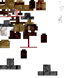 | Monster | Mosquito-like blood monster; saved/synchronized Scout, Attendant, Guard, Elder and Reclaimed variants share the same base combat attributes. Dynasty Castle templates place authored variant populations. |
| **Thirster** | 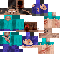 | Monster | Blood-thirsting mob |
| **Abhorrent Thought** | | Monster | Large (1.5×3.25), eldritch thought entity |
| **Facsimiles** (Bat, Enderman, Blaze, Golem, Horse, Donkey, Wolf, Spider) | | Ambient / Monster / Creature | The Fungal Gardens' warped copies of Earth creatures (`hemomancy:facsimile_*`, `common/entity/mob/facsimile`). Each subclasses its vanilla mob and renders the vanilla model and texture at runtime, plus a generated fungal growth overlay (`textures/entity/facsimile/*_growth.png`) and seeded per-part scales (`FacsimileDeformationRules`). None can be tamed, ridden, fed, bred or given a chest; the enderman never moves blocks; the golem only fights back. Spawn only in the seven dimension biomes (via `tools/worldgen/fungal_gardens_worldgen.py`). The bat, horse, donkey, wolf and golem facsimiles spawn in the Gardens' dark and off grass; the enderman, blaze and spider follow monster light rules (block light 11 or less). None breeds or yields a foal from a spawn egg, the blaze is fire immune, and a facsimile spider never arrives carrying a rider. Drop 0-2 Spore Sacs to a player. Possession (§5.6e) borrows these bodies. The blaze and golem wear the hive's own skins (`tools/model_export/facsimile_crimson_textures.py`): a charred crimson blaze that smoulders crimson embers instead of smoke, burns crimson when charged and throws `crimson_fireball`s (which leave crimson flames only where mob griefing allows); a hematic-iron golem (red-black plates, lacquer seams, bone rivets) whose cracks show crimson. |
| **Erythromycelium Eruptus** | 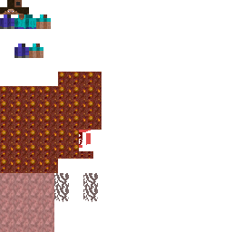 | Monster | Large fungal eruption mob (1.5×3.0) |
| **Blood Drunk Puppeteer** | 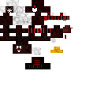 | Monster | Human-sized, controls dolls |
| **Enthralled Doll** |  | Monster | Small (0.5×0.5), controlled by puppeteer |
| **Chthonian** |  | Monster | Iron-mandible termite creature — actively chews through wood blocks and wooden tools in the area. Spawns in Chthonian Termite Mounds (Savanna biome). Part of the "arthropods as natural hemomancers" theme (they produce hematic iron shells biologically). |
| **Chthonian Queen** |  | Monster | Boss variant of Chthonian; exactly 1 spawns per Termite Mound. Associated with gold (royal). The only gold-connected creature in the mod. |
| **Lump of Thought** | 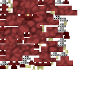 | Monster | Sentient thought blob |
| **Morphling Polyp** (mob) | 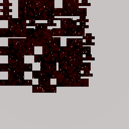 | Monster | Rare black slime-like wild morphling larva. Natural spawns receive up to three biome-shaped layers (fungal, aquatic, cave, desert, forest, or open-land hints) and provide the player's first Morphling Polyp item. |
| **Desiccant** | 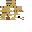 | Monster | Low desert scorpion blood-drainer. Spawns in dry hot biomes such as deserts, badlands, and savannas, and drops Telson for Aculeate Vitriol. Its sting animates the raised tail and red-swollen telson, inflicts Hunger and Blood Loss, and immediately saps 250 ml from active-blood players. |
| **Dormant tendency placeholder mobs** | | Monster | Cruor Fiend, Void Drinker, Frozen Clot, Abyssal Siphon, and Synapse Hound remain commented out. Myelin Borer is active in the Cortical Drift. |
| **Brined Votary** | 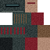 | Monster | Structure-only drowned Harbinger remnant placed by Harbinger Voyager Wrecks. Slow aquatic humanoid in corroded diving/ritual gear; wakes only at close range, is persistent when structure-placed, and has modest loot. |
| **Lantern Tick** | 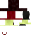 | Monster | Rare underground parasite in cave biomes. It glows as a lure when no player is nearby, leaps at close players, latches onto their head, and periodically drains active blood volume; if no active blood pool is available, it deals small fallback damage. Drops the Lantern Tick Helmet. |

### 26.2 Creature / Ambient Mobs

| Entity | Texture | Category | Notes |
|--------|---------|----------|-------|
| **Choir Keeper** | 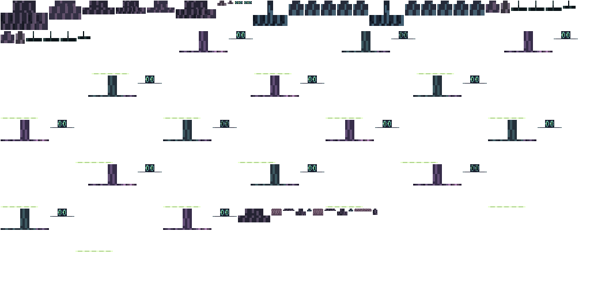 | Ambient | End owl–peacock hybrid with a broad feathered head, paired facial discs, forward-facing eyes, short hooked beak, ear tufts and a compact feathered neck. Retains its fifteen Eye-of-Ender tail feathers, animated fan display and flight poses. Editable source: `models/entity/bbmodel/ChoirKeeperModel.bbmodel`; regenerate the Java model and runtime atlas with `tools/model_export/export_choir_keeper_java.py`. |
| **Leech** | 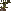 | Creature | Small (0.4×0.1) blood-sucking leech |
| **Fungling** |  | Creature | Friendly fungal creature |
| **Chitinite** | 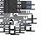 | Creature | Iron-shelled Isopod insect (1.0×0.3) |
| **Fervent Chitinite** | 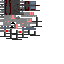 | Creature | Fire variant of Chitinite |
| **Hemolymphopoda** |  | Ambient | Small (0.9×0.3), Horseshoe crab drops Cleansing Hemolymph |
| **Hematic Burrower** | 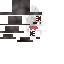 | Creature | Mole-like Hematic Field counterpart found in shallow, dark caves under forest-like biomes. It flees nearby living mobs; sustained pursuit triggers a particle-only dig-away despawn with a rare coal/raw copper/raw iron escape drop and no real block damage. Editable source: `assets/hemomancy/models/entity/bbmodel/HematicBurrowerModel.bbmodel`. |
| **Ice Fish** | 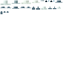 | Water Ambient | Passive pale, broad-headed schooling fish in Cold Ocean, Deep Cold Ocean, Frozen Ocean, Deep Frozen Ocean, Frozen River and submerged Ice Spikes pools. Native water placement requires two clear water cells and has no sea-level restriction; packs of 3–5 (weight 12), schools of up to six, 6 HP. Drops exactly one existing Cleansing Hemolymph, matching Hemolymphopoda. Tendency-free aquatic blood permits ordinary sampling, reflecting its naturally pure Unstained lore. Specimen Jar and Living Bestiary support; no separate bucket or unique reagent. Editable rig: `models/entity/bbmodel/IceFish.bbmodel`; exporter: `tools/model_export/ice_fish.py`. |
| **Vampire Squid** |  | Water Ambient | Small webbed cephalopod swimming in Carrion and Hydrothermal Depths only (Y-53 through Y-6); smooth body orientation toward actual three-dimensional swimming, eight connected curling arms with inward barbs, a 60-tick defensive cloak/retreat and 100-tick cooldown. Player kills yield 1–2 shared Barbed Splinters (`calcified_blood_spine`) plus Looting. Tenebris blood with the aquatic property; ordinary syringe, Specimen Jar and Living Bestiary support. Editable source: `models/entity/bbmodel/pelagic/vampire_squid.bbmodel`; exporter: `tools/model_export/vampire_squid.py`. |
| **Osteophage Vulture** | 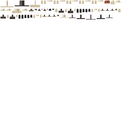 | Ambient | Skeletal bearded vulture in Soul Sand Valleys, naturally spawning singly (weight 2, reduced from 8) only near an unoccupied, unobstructed bone-block perch. Reserves fossil roosts, pursues loose bone items within 20 blocks, eats one at a time after pickup delay, heals 2 HP and returns for a 120-tick feeding rest. Otherwise hunts skeleton-family mobs through repeated climbing/swooping passes (6 damage, 24-tick strike cooldown), then scavenges their bones. Passive toward players; 16 HP. Choir Keeper-style collision-checked climbing/side routes and perch recovery; loaded chunks only. Player kills yield 1–2 shared Venous Pinions plus Looting. Mortem blood, ordinary sampling, Specimen Jar and Living Bestiary support. Editable rig: `models/entity/bbmodel/Osteophage.bbmodel`; exporter: `tools/model_export/osteophage.py`. |
| **Barbed Urchin** | 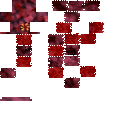 | Water Ambient | Underwater iron-barbed urchin |
| **Chalybeate Snail** | 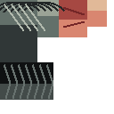 | Water Ambient | Slow vent-field grazer with defensive retraction. Immune to magma-block damage, which does not trigger retraction. Naturally spawns around mineral/magma support in Hydrothermal Depths, with sparse Carrion visitors. Legacy `DeepOceanVentFeature` habitats still receive their generated persistent 2-5 clusters; no chunk-load population refill is added. Retracted, off-cooldown snails can be nonlethally harvested with any HutosLib `ItemKnapper` for Chalybeate Sclerites. |
| **Prism Cuttle** |  | Water Ambient | Primarily a Twilight gully animal, retaining established warm-ocean habitats and sparse reef visitors; samples nearby block colors into synced camouflage variants. Approaching non-creative, non-spectator players trigger a bright defensive flash, particles, brief Blindness/Nausea, and a flee cooldown. Editable source: `assets/hemomancy/models/entity/bbmodel/PrismCuttleModel.bbmodel`. |
| **Crimson Doe** | | Creature | Blood-touched deer. Spawns on solid bright ground in plains/forest/meadow-style Overworld biomes and on solid ground in no-skylight Fungal Gardens biomes. |
| **Scarlet Serpent** |  | Creature | Territorial cobra-like wildlife in desert/badlands, swamp, and jungle biome families. Flares its hood near non-creative, non-spectator players at 8 blocks, then strikes within 5 blocks. Desert/badlands spawns use the redder texture variant, swamp/mangrove swamp spawns use the darker brown variant, and jungle spawns use the base black/red/yellow texture. Melee hits apply Poison I (100t) and Blood Binding (60t). Drops `serpent_scale` (1-2 plus Looting bonus). Its editable Blockbench source is `assets/hemomancy/models/entity/bbmodel/ScarletSerpentModel.bbmodel`. Neurotic/Fervent-aligned for sampling, but not included in `hemomancy_mob` so Unstained purity systems do not treat ordinary territorial wildlife as a factional blood-mob kill. |
| **Venom-Rib Centipede** |  | Monster | Rare damp-temperate armored arthropod with segmented body and leg animation rules inspired by Scarlet Serpent's linked-body approach. It preferentially hunts arthropods and can menace nearby players; melee hits apply venom/Poison and Blood Binding. Ferric-aligned and specimen-jar capturable. Editable source: `assets/hemomancy/models/entity/bbmodel/VenomRibCentipedeModel.bbmodel`. |
| **Hemojelly** | | Ambient | Surface-floating aquatic blood jelly; submerged tendrils capture small fish |
| **Venous Strider** | | Creature | Vein-walking strider. Spawns on solid bright ground in mushroom/swamp Overworld biomes and on solid ground in no-skylight Fungal Gardens / Fungal Isles / Hemorrhagic Plateau biomes. |

**Ice Fish validation (2026-10-06):** `runIceFishGameTestServer` passes six loaded checks covering the six biome spawn tables, aquatic/capture tags and spawn egg, tendency-free profile, cold/warm/dry/obstructed placement, an elevated Ice Spikes pool, shared hemolymph loot, swimming/schooling and bucket-safe jar round trips with Living Bestiary eligibility. Fifteen focused unit tests pass for resources, jar sizing and blood profiles. Native client captures were inspected for the fish, school, captured specimen and a sealed dry-land control (`build/pelagic-client/screenshots/ecology-34` through `ecology-37`). Display copies use the swimming pose; real beached fish retain the land tilt. `assemble verifyPackagedClientResources` passes and the built jar includes the new entity, mesh, model, renderer and runtime resources. Natural spawn frequency and multiplayer were not playtested.

**Osteophage validation (2026-10-06):** `runOsteophageGameTestServer` passes ten loaded checks covering the modified valley spawn table, biome/bone/clearance gates, bone feeding and healing, pickup delay and food priority, skeleton kills and actual bone scavenging, repeated hunting passes, player passivity, pinion loot, broken perches and saved return routes over obstacles. Native Nether client fixtures were inspected for perched, flying, active hunting, perched-jar and flying-jar views (`build/pelagic-client/screenshots/osteophage-*.png`); the rig remains connected and jar poses fit. `assemble verifyPackagedClientResources` passes. The full unit suite passes 2,460 of 2,463 tests; its three existing failures concern invalid UTF-8 in `docs/TESTING.md` and an old Morphling report rename. Natural spawn frequency, multiplayer and cold-world reloads were not playtested.

### 26.3 NPC / Summons / Player-controlled

| Entity | Texture | Category | Notes |
|--------|---------|----------|-------|
| **Blood Thrall** |  | Creature | Small (0.6×0.7), summoned blood transport creature. Can bind direct-routing sources/nodes, carry a capped amount, and deposit into target reservoirs without duplicating source blood. |
| **Blood Drunk Puppeteer** |  | Monster | Uncommon biome-gated hostile in dark/spooky, swamp, old-growth, and fungal biomes; uses solid-ground mob placement rather than vanilla darkness-only monster placement so it remains findable as a signature wild encounter. Summons four bonded Enthralled Dolls, keeps distance while commanding them, drops Enthralling Filament, and is a bloody-jug drop candidate |
| **Enthralled Doll** | | Monster | Puppeteer-bound melee minion. Summoned dolls inherit and pursue their puppeteer's target, render red puppet strings back to the puppeteer, and vanish without loot if the owner is gone |
| **Unstained Zealot** | 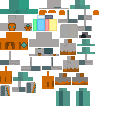 | Creature | NPC that guides Unstained path entry |
| **Unstained Guardian** | | Creature | NPC that guards Unstained sacred sites |
| **Unstained Acolyte** | | Creature | NPC acolyte of the Unstained faction |
| **Harbinger Hermit** | | Creature | NPC Harbinger recluse; full degree 0-7 dialogue (`HarbingerHermitDialogueTrees`). Directs the player to the Vicar on farewell, then plays the ritual farewell death animation: crimson chest rays, irregular dissolve holes through the body, and ash-colored dust. Invulnerable until player chooses "Farewell" option. |
| **Harbinger Alchemist** | | Creature | NPC machine expert found at Harbinger Outposts; full degree 0–7 dialogue (`HarbingerAlchemistDialogueTrees`). Teaches crafting stations, dismisses purifying players. |
| **Hematic Artificer / Redwright** | 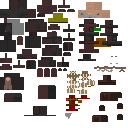 | Creature | NPC living-gear specialist found at Harbinger Outposts; degree-gated dialogue (`HarbingerArtificerDialogueTrees`). Teaches Hematic Armature use, armor forks, Blood Lust/Consecration/Cornerstone progression, and Living Staff graft/brazier practice when the player has a Living Staff bond. V1 has no trades or recruitment option. |
| **Harbinger Vicar** | | Creature | NPC doctrine keeper found at Harbinger Outposts; full degree 0–7 dialogue (`HarbingerVicarDialogueTrees`). Delivers faction history lore; reveals secret "8th degree" at Archon. |
| **Harbinger Mnemonist** | 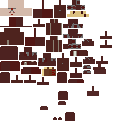 | Creature | NPC blood-memory mentor found at Harbinger Outposts; full degree-gated dialogue (`HarbingerMnemonistDialogueTrees`). Teaches crude memories, active manipulation slots, the Mnemonic Reliquary, and Somatic Loom progression. Gives eligible Degree 2+ Harbingers one starter crude memory item; purifying/Clarity players may inquire but cannot claim. |
| **Harbinger Voyager** |  | Creature | Active-vessel captain-scholar NPC; dialogue-only research leader for reef, vent, and wreck survey expeditions. Always placed by active-vessel spawn helper on Survey Cog structures. |
| **Harbinger Votary Wayfarer** | 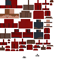 | Creature | Active-vessel junior Votary NPC with a 1-in-5 companion spawn rule. Dialogue-only observer learning from the Voyager; no trades, quests, rewards, or ordinary spawning. |
| **Vesper, The Crowned Refusal** | 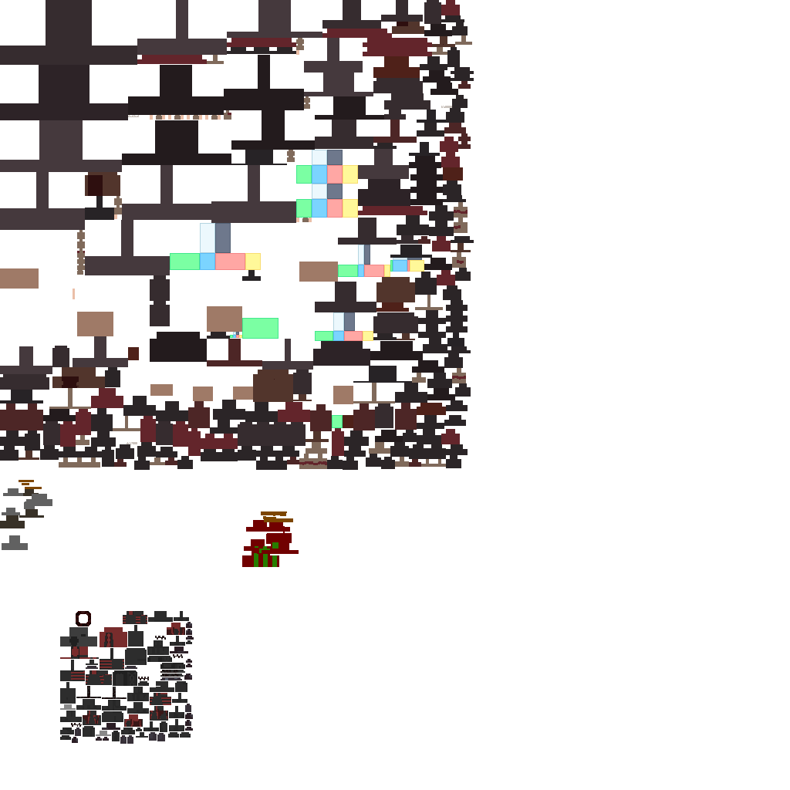 | Boss | Silent-refusal ordeal phase 1, entity ID `hemomancy:vesper_crowned_refusal`. Pruning an owned Bloom while `SILENT_PENDING` severs it into a portal to an isolated, owner-only 50x50 Chamber arena. Stats: 520 HP, 0.16 speed, 1.0 knockback resistance. Boss bar: RED. Abilities include hostile targeting, low-health cadence scaling, blood-orb missiles, grip/spike hazards, Morphling Polyp add pressure, and shield-disabling melee hits. On defeat it transfers ordeal ownership into `hemomancy:vesper_evening_star` and drops no final loot. |
| **Vesper, The Evening Star** | 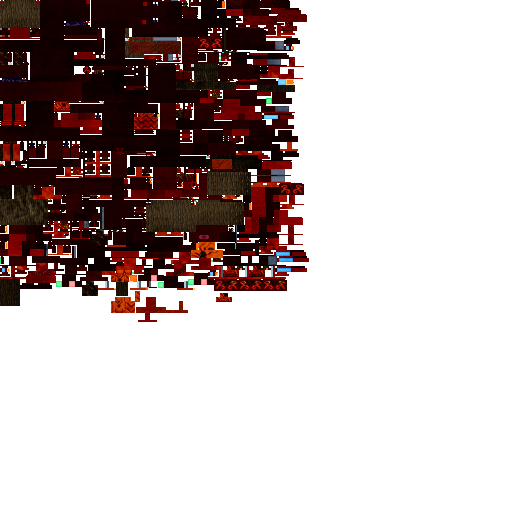 | Boss | Silent-refusal ordeal phase 2, entity ID `hemomancy:vesper_evening_star`. Stats: 640 HP, 0.22 speed, 1.0 knockback resistance. Boss bar: RED. Keeps the Vesper missile/grip/spike/add-pressure kit with stronger final-phase pressure, delayed death spectacle, copied Vesper boss music, and `VesperEveningStarLinesLayer` emissive line rendering below half health. Verified owner victory records `SILENT_ARCHON`, seals the severed Bloom as a trophy, and grants `memory_of_vesper` once. Death, logout, manual exit, and restart abandon only the active fight so the open wound remains retryable. |
| **The Mycophant** | 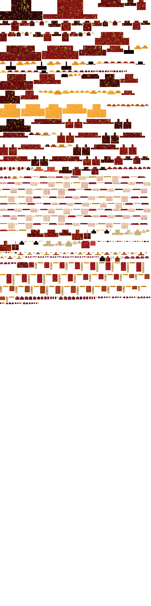 | Boss | The Spawn Mother, endgame Apotheos boss, entity ID `hemomancy:mycophant`. A generated model dragged on its belly by four crab claws, with a grasping hand, a feeding siphon, a beaked skull in a frilled-lizard collar and a sac-laden abdomen; at half health the skull splits over an Ebrietas pulp face and hyphae wings grow. Stats: 720 HP, 20 armor, 16 attack, 1.15 knockback resistance. Boss bar: YELLOW, with nectar pressure. Moves: Rushing/Fusion Embrace holds, Siphon Feed, Pluck, Claw Rake, Brood Call with herding brood funglings, Nectar Surge, Wing Guard, Wing Sweep and Pulp Bloom. Fire immune; copied Mycophant music and sounds. Ends in a yielding, not an explosion. Owned victories pay out through the pending Tendril claim; an unowned one drops `mycophant_tendril`. |
| **Annetta Knowles (The Stained Priestess)** | | Boss / NPC | Separate Unstained boss arc with a full two-route encounter, implemented in `entity/boss/annetta/`. She spawns in COWERING state inside a `BrokenChurchStructure` (see §29), unaware that she is infected. `AnnettaKnowlesEntity` states: **COWERING**, **PHASE_ONE**, **BREAKING**, **PURGING**, **CURED_SUPPORT**, **RESOLVED**; it syncs an `action` + `actionTick` and a `sceneTick`; the model reads them through client clocks (`actionTime`/`sceneTime`) that advance on client ticks and resync when the server disagrees, so animations never stutter on packet timing. Idle look goals run only while she is calm, so they never tug her head off her foe mid-fight. Both routes start from dialogue (`AnnettaDialogueTrees.coweringJar` / `offerDraught`, events `annetta_unseal_jar` / `annetta_offer_draught`, routed by `DialogueEventHandler` to `handleDialogueChoice`, which re-checks the jar/Draught and eligibility).<br><br>**Harbinger route**: unsealing the Tooth Pecks jar latches a tick to her neck (she screams). **Phase 1** is frantic: `AnnettaEncounterRules.choose` picks a three-strike dagger combo, a Still-arts dash, a hemolytic bolt, a shield guard (frontal damage x0.2) or the silver aura by distance and recent hurt. Between moves she circles her foe in a committed strafe (changing direction every 2-4 seconds) and closes when far. A blow blocked by the guard is deflected (a still-water ward ring) and answered by a **shield bash** (`SHIELD_BASH_TICKS` 16, hit on tick 7: 4 damage, heavy knockback, Slowness II). Her dagger is held reversed; each combo cut steps in and lands with a pale flash and thrown blood, and the blade leaves a still-water trail sampled from its real path (`AnnettaHeldItemLayer`). The Unstained Shield is strapped across her left forearm rather than hung from the hand. Cooldowns shorten as she weakens; she shouts fragments to nearby players. Hits and dashes knock lasting `AnnettaPoolEntity` pools out of her (infected blood: Blood Loss; humor: slows and stings blood-active players; capped per encounter). She cannot die in Phase 1: damage leaves her at 1 HP until **both** 2400 ticks and 50 damage have passed, then the **break** plays (`AnnettaEncounterRules` beats): stagger, shield dropped as an unpickable prop, her free hand finds the tick, last words, her left hand closes over her right on the hilt (`GRIP` 28) and holds the point out at arm's length turned back at herself, both fists yank it into the tick (`STAB` 40), the tick swells against the blade while her head bulges and throbs (`breakSwell`), then it pops (`BURST` 54): blood, ichor, hair and skin blow out of her head, her arms are flung open and a torn neck stump remains, pumping blood in weakening spurts; a headless sway, the dagger dropped, a fall face-down, and a reanimation pool that grows under her while a blood-creep layer climbs her body; at 314 ticks she is replaced by the Stained Priestess rising from the same spot.<br><br>**Unstained route**: offering the Draught spawns the Latent Infection hidden inside her (spending the Draught only if it could be placed); the **purge** plays: she drinks, convulses while the red drains from her hair (texture switch at half drain), the infection tears out of her back and rises behind her, she drops to her knees and stands as the **ally**: invulnerable, keeps near the purifier and circles the infection at range, edging in when her blade is ready; heals nearby players every 60 ticks (gathering still water at her breast and opening it toward them), casts still-water lances (6 damage + Slowness), steps in for two dagger cuts and slips back out, and slips away across the floor (a Still-arts dash) when it gets too close; she calls out. Destroying the infection resolves her; the resolved tree has follow-up questions. |
| **Stained Priestess (`StainedPriestessEntity`)** | | Boss | Phase 2 of the Harbinger-route Annetta encounter. Stats: 420 HP, 12 ATK, 0.32 SPD, 0.9 KB resist, 10 armor; red NOTCHED_12 bar. A flight state machine (`PriestessCombatRules`, synced `mode`/`modeTick`/`action`/`wing`/`flying`): **EMERGING** (90 ticks, invulnerable: pushes up out of the pool, kneels, stands while the tendril wings and head grow in; the lancea is drawn from the pool at tick 62) then **TAKEOFF** and **HOVER** (orbits the target about 6.5 blocks out and 4.5 up, clamped under any roof by a headroom raycast; volleys of two blood bolts and a bursting spore bolt (`InfectedBoltEntity`), and the **javelin**: 40 action ticks, coiled back with the lancea over her shoulder while blood is drawn into it, thrown on tick 16 as a `StainedLanceEntity` (12 damage, slight arc, leads a moving target; below half health she throws a fan of three), which plants itself where it strikes and wakes a thorn eruption, then comes apart and streams back while a new lancea grows in her hand from tick 28), **SWOOP** (rises and locks on, dives couched behind the spear through the target for 14 damage, a throw and a thorn burst where they were run through, then climbs; may land), **PLUMMET** (climbs over the target, hangs with the spear reversed while an ichor ring closes on the spot, then drops feet first: 14 damage within 3.2 blocks, a major eruption under her and a ring of eight thorn eruptions; she is left kneeling with the spear sunk for 22 ticks, then fights on foot), **LANDED** (walks in for a 62-tick spear combo: a lunging two-handed thrust along the shaft (tick 11, 11 damage, 4.8 reach), a full spinning reap that cuts everything within 4.6 blocks (tick 26, 9 damage), and a leap that lands short of the target and drives the spear into the floor (tick 46, 12 damage) to send a line of seven thorn eruptions running out at them) and **SHIELD** (taken 24+ damage recently: wings wrap her, damage x0.2, projectiles deflected) followed by **WIND_BLAST** (wings flung open: 8-block cone, knockback, Nausea and Poison). Thorn eruptions (`PriestessEruptionEntity`) crack the floor red for a tell of `ERUPTION_TELL` ticks, then burst into thorned tendrils that hurt and throw whoever stands on them (major ones jolt nearby cameras through `PriestessImpactClientEvents`). Melee and swoop hits drain 300 blood from blood-active players. Her wing pose follows the synced mode (folded walking, spread flying, shield). Drops: `annettas_sanguis_lancea` + hematic_iron_scrap x4; a founder killer unlocks Severed Covenant. |
| **Latent Annetta Infection (`LatentAnnettaInfectionEntity`)** | | Boss | Final challenge of the Unstained-route Annetta encounter. Stats: 360 HP, 10 ATK, 0.27 SPD, 0.85 KB resist, 8 armor; white NOTCHED_10 bar. Spawned hidden at the start of the purge (invisible and invulnerable), it rises from the floor as the purge tears it out of her (`LatentCombatRules.EMERGE_HIDDEN` = the purge TEAR beat). It slithers after players (never targets Annetta normally) and chooses by distance: **claw rake** (two arcs, 7 each), **spear thrust** (lunge, 12 in a 6-block line), **whip lash** (the coiled vessel arm uncoils for a 7-block sweep, 9 + Blood Loss), **infection bloom** (rears back; 6-block spore burst, 5 + Nausea + Slowness) and **root eruption** (telegraphed under a distant target; 8 + Slowness III and a lift). Every so often it lashes at Annetta instead, staggering her. On death it marks its linked Annetta RESOLVED. Drops: `annettas_absolution_dagger` + pale_silver_ingot x3. Hitbox 1.6 x 4.5 (fits church doorways); about five blocks tall on screen. |
| **Our Lady's Manifestation** | | Misc | Pale Intercession's one-per-player veiled defender. It lasts 60 seconds, recalls on recast, interposes against confirmed threats, strikes for 6 owner-attributed damage with Slowness I, and loses duration instead of health when attacked. Registry ID remains `hemomancy:spectral_companion`. |
| **Sanguilith** | | Misc (MnA, dormant) | Large (1.5×3.25), blood-themed summoned monster from the dormant MnA compat source. `ComponentSummonSanguilith` summons an ownable, duration-limited melee attacker with a max of 4 nearby. Authored in `MnAPluginEntityInit` with custom `SanguilithModel` and `SanguilithRenderer`, but not compiled/registered while MnA compat is excluded on the current NeoForge 1.21.1 branch. |

### 26.4 Entity Tags

Blood tendencies and the fungal property are defined in [entity blood profiles](../wiki/Blood-Profiles.md), replacing the former tendency/fungal membership tags. Unrelated entity tags remain in use. Chalybeate Snails, Hematic Burrowers, and Venom-Rib Centipedes are Ferric-aligned and included in `specimen_jar_capturable`; Blood Lantern Jellies are Vivacious-aligned and also specimen-jar capturable. Prism Cuttles are Neurotic-aligned and specimen-jar capturable. Scarlet Serpents are Neurotic/Fervent-aligned, reflecting serpent morphling affinity without adding them to `hemomancy_mob`.

### 26.5 Spawn Placements

Registered in `EntityInit.commonSetup`:
- Scarlet Serpent -> `ON_GROUND`
- Barbed Urchin → `IN_WATER`
- Hemolymphopoda → `ON_GROUND`
- Hematic Burrower -> `ON_GROUND`, shallow-cave placement under forest-like biome tags with low light and sky occlusion checks
- Fervent Chitinite -> `ON_GROUND`, Nether placement under `fervent_chitinite_nether_spawnlist`, currently centered on Basalt Deltas
- Prism Cuttle -> `IN_WATER`, warm/lukewarm ocean biome tag only
- Venom-Rib Centipede -> `ON_GROUND`, rare damp temperate biome tag with low-light ground checks
- Fargone → `ON_GROUND` (monster rules)
- Desiccant -> `ON_GROUND`, dry hot biome tag with sand, red sand, sandstone, red sandstone, and terracotta surface checks
- Abhorrent Thought → `ON_GROUND` (monster rules)
- Dormant tendency placeholder mobs -> disabled/commented out: Cruor Fiend, Void Drinker, Frozen Clot, Abyssal Siphon, and Synapse Hound. Myelin Borer is active in the Cortical Drift.
- Vesper phase 1, Vesper phase 2, and The Mycophant intentionally have no natural spawn placement. Vesper is entered through the owner-bound Severed Qliphoth ordeal; The Mycophant through the Gardens hunt or a Fruiting Lure. A direct summon runs the same fight without the waking or nectar pressure.
- Crimson Doe → `ON_GROUND`
- Hemojelly → `IN_WATER`, at temperate/warm marine surfaces
- Osteophage Vulture → `NO_RESTRICTIONS`, Soul Sand Valley biome tag and a clear, free bone-block perch within eight blocks
- Venous Strider → `ON_GROUND`
- Chalybeate Snail -> natural vent-associated Hydrothermal spawning with sparse Carrion visitors; `DeepOceanVentFeature` also places one-time persistent clusters during new Hydrothermal chunk generation
- Blood Lantern Jelly -> `IN_WATER`, ordinary ambient spawning only through the Erythrocoral Reef biome
- Mnemonic Whale -> `IN_WATER`, rare deep-water creature spawning only through the Erythrocoral Reef biome
- Brined Votary -> no ordinary biome spawn placement; spawned persistently by `HarbingerVoyagerWreckStructure`

### 26.6 Entity Loot Tables

> **Status: Implemented in resources.** Entity drops are hand-authored JSON now. The disabled `HemoEntityLootProvider` generator remains stale/commented, but the live loot tables are the JSON files under `src/main/resources/data/hemomancy/loot_table/entities/` (1.21 singular `loot_table` path). Current count: **44 entity loot tables**. Standard material-bearing mobs now guarantee at least one base drop of their associated material on valid kills, and all looting bonuses use the 1.21 `minecraft:enchanted_count_increase` function rather than the removed `minecraft:looting_enchant` id.

Notable implemented drop families:

| Entity / Family | Drop Theme |
|-----------------|------------|
| Chitinite / Fervent Chitinite / Chthonian / Chthonian Queen | Chitinous Husk, with Chthonian Queen also rolling Ferric Enzyme |
| Leech / Blood aquatic or arthropod mobs | Blood/hemolymph materials such as Swollen Leech or Cleansing Hemolymph |
| Fargone / Thirster / Abhorrent Thought / Lump of Thought / Morphling Polyp | Sanguine Formation / fungal ingredients depending on mob; Fargones also drop Fargone Proboscis; Morphling Polyps drop the base Morphling Polyp item and can roll a small layer-hint item from their active appendages |
| Desiccant | Telson, the scorpion stinger and bulb used in Aculeate Vitriol; the mob's sting inflicts Blood Loss and drains 250 ml from active-blood players |
| Blood Drunk Puppeteer / Enthralled Doll | Enthralling Filament from the puppeteer; puppeteer-summoned dolls are support minions and do not create extra loot |
| Chalybeate Snail | Killing gives only a rare small Hematic Iron Scrap fallback; reliable Chalybeate Sclerites come from knapper harvesting while retracted |
| Hematic Burrower | Ordinary death loot is clay-only; the rare coal/raw copper/raw iron reward is emitted only during the panic dig-away escape behavior |
| Blood Lantern Jelly | Empty/no meaningful combat drops; its value is ambient reef life and specimen preservation |
| Prism Cuttle | Small glow-ink fallback; intended value is observation, specimen capture, and its defensive flash ecology |
| Osteophage Vulture | Player kills drop 1–2 Venous Pinions plus Looting; the same material used by Venous Striders |
| Venous Strider | Vivacious Spores plus Venous Pinions for crafting Venous Strider Sabatons |
| Venom-Rib Centipede | Spider-eye fallback from a dangerous damp-biome predator; venom pressure and bug predation are the primary encounter identity |
| Lantern Tick | Drops the Lantern Tick Helmet; encounter value is the latch parasite behavior and mobile-light artifact, not material farming |
| Mnemonic Whale | Empty/no meaningful whale-death drops. Hunts submerged squid (including glow squid) and Prism Cuttles within 16 blocks, anywhere it lives. Each whale bite that kills eligible prey immediately drops one Mnemonic Ambergris above the whale; failed hits, dead prey and other killers yield none. Feeding has no production cooldown and preserves ordinary prey loot. Bottle sampling and random shedding retain their separate shared 6,000-tick cooldown. Supply leashed squid or place and break occupied specimen jars to release cuttles; keep the whale alive. |
| Brined Votary | Minimal salvage only: rare paper/book/scrap/spore material. It is a tragic wreck guardian, not a farming target. |
| Saint entities | One shared roll per encounter from `entities/<saint>` (`hemorath`, `seraphae`, `putriciel`, `velorum`; `hemorath.json` replaced `hollow_vessel.json`): one Hallowed Residuum plus 1–2 Sanguine Quintessence, whatever the ending |
| Other boss entities | Direct/special boss rewards are handled in entity code or matching loot JSON depending on encounter |

Do not re-enable `HemoEntityLootProvider` unless the current JSON values are first ported back into the provider.

---

## 27. Projectile & Blood Construct Entities

### 27.1 Blood Constructs

Extend `BloodConstructEntity` (a `PathfinderMob` implementing `IBloodConstruct`). They are summoned by the player and have a limited lifetime (`deathTicks`):

| Entity | Notes |
|--------|-------|
| Blood Cloud (`CloudEntityBlood`) | Area-of-effect blood cloud |
| 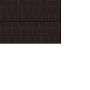 Iron Pillar (`EntityIronPillar`) | 0.75×2.8 iron construct |
| 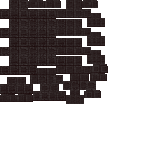 Iron Wall (`EntityIronWall`) | **Dormant future encounter state.** Registry-backed for existing-world compatibility, but intentionally has no active caller until its later boss-mechanic role is authored. |
| 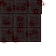 Iron Spike (`EntityIronSpike`) | 1.4×1.5 iron spike trap |
| 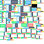 Wretched Will (`EntityWretchedWill`) | Will-based construct |

### 27.2 Projectiles

| Entity | Texture | Notes |
|--------|---------|-------|
| Directed Blood Orb | | High tracking range (150), main blood projectile |
| Tracking Blood Orb | | Homing blood orb |
| Blood Cloud Carrier | | Delivers blood clouds |
| Tracking Serpent | 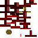 | Homing snake projectile |
| Tracking Pests | | Homing pest swarm |
| Blood Bolt |  | Crossbow ammo entity |
| Blood Needle |  | Small fast projectile |
| Blood Bullet |  | Pistol-type projectile |
| Blood Shot |  | Shotgun-style spread |
| Sanguis Lancea |  | Thrown spear entity |
| Dark Arrow | | Dark-themed arrow |

### 27.3 Item Entities

| Entity | Notes |
|--------|-------|
| Flying Charm | The Charm of Vascularium flying to the player |
| Morphling Polyp Item | Dropped morphling polyp pickup |
| Qliphoth Seed Item | Custom dropped-item entity (`EntityQliphothSeedItem`) rendered by `QliphothSeedItemEntityRenderer`. The seed body reuses `QliphothSeedItemRenderer.renderSeedBody(...)`, and throttled client-only HutosLib tendrils radiate from entity-following anchors so roots spread around the dropped item instead of locking to one world axis. |

---

## 28. World Generation & Biomes

### 28.1 Custom Biomes (via TerraBlender)

| Biome | Key | Temperature | Precipitation | Notes |
|-------|-----|-------------|---------------|-------|
| **Fungal Gardens** | `fungal_gardens` | 0.9 | None | Overworld TerraBlender infection zone (replaces some swamps/jungles); not part of the dimension |
| **Mycelial Meadows** | `mycelial_meadows` | 0.9 | None | Dimension lowland heart: gently rolling mycelium, morphic pools, sparse canopy, funglings |
| **Fungal Isles** | `fungal_isles` | 0.9 | None | Fungal sea (sea level 20) with steep blob islands; Thirsters and urchins |
| **Sporecrown Thicket** | `sporecrown_thicket` | 1.2 | None | Humid overgrown hills (relief grows with humidity), dense canopy, hostile spawns (Eruptus, Chthonian, Fargone), crimson particles, dark red fog |
| **Hyphal Spires** | `hyphal_spires` | 0.9 | None | Forest of tapering calcified-hyphae spires (high positive weirdness); sporite glints, no canopy |
| **Drifting Mycelium** | `drifting_mycelium` | 0.7 | None | Low ground beneath floating mycelium islands (about y 80-145; high negative weirdness) with hyphae undersides |
| **Mycelial Depths** | `mycelial_depths` | 0.5 | None | Winding gorge network along weirdness zero; dry conscious-mass floor at y 28, ribbed calcified walls, Spore Nexus Towers, always foggy |
| **Hemorrhagic Plateau** | `hemorrhagic_plateau` | 2.5 | None | Dry crust highland; flat mesas near y 100 with calcified strata escarpments where erosion is high; Spore Nexus Towers |
| **Rockpool Shore** | `rockpool_shore` | 0.65 | Rain | Jointed stone benches, irregular enclosed tide pools and occasional stacks |
| **Erythrocoral Reef** | `erythrocoral_reef` | 0.95 | Rain | Warm shelf lobes and coral channels, retained reef fauna and red-violet water |
| **Pelagic Ocean** | `pelagic_ocean` | 0.65 | Rain | Open upper water over deep basins and sparse elongated seamounts |
| **Twilight Ocean** | `twilight_ocean` | 0.65 | Rain | Y13–33 water layer; scalloped tuff/calcite shoulders and curved gullies |
| **Midnight Ocean** | `midnight_ocean` | 0.65 | Rain | Y-8–12 water layer; deepslate canyons, tributaries and wet alcoves |
| **Carrion Depths** | `carrion_depths` | 0.65 | Rain | Y-30–-9 water layer; clay/gravel fans, silt hollows and sparse static bone ribs |
| **Hydrothermal Depths** | `hydrothermal_depths` | 0.65 | Rain | Y-53–-31 water layer; quiet abyssal plains and sparse aligned mineral chimneys |

The Fungal Gardens dimension uses a datapack `multi_noise` biome source in `data/hemomancy/dimension/fungal_gardens.json`. Biome placement and terrain read the same climate density functions (`worldgen/density_function/fungal/continents`, `erosion`, `ridges`, `humidity`, `temperature`), so a biome border is also a change in the land. The noise router exposes those functions as its climate fields, and every terrain mask is a spline of them with its midpoint on the matching biome boundary. The seven dimension biomes tile continentalness, weirdness and humidity without overlap: **Fungal Isles** (low continentalness) is the fungal sea at sea level 20, with steep blob islands from a dedicated island noise; **Mycelial Meadows** (dry lowland) is gently rolling ground; **Sporecrown Thicket** (humid) gains relief with humidity and reads as overgrown hills; **Hemorrhagic Plateau** (dry inland) is a crust highland that lifts into flat mesas with calcified strata escarpments where erosion is high; **Mycelial Depths** follows the weirdness zero line as a winding gorge network with a dry floor at y 28 and ribbed walls; **Hyphal Spires** (high positive weirdness) is a forest of tapering calcified spires from a column noise; **Drifting Mycelium** (high negative weirdness) is low ground under floating mycelium islands between about y 80 and 145. `fungal_gardens` itself is the Overworld TerraBlender biome and is not part of the dimension, so Overworld-only structures no longer leak in and Dynasty Castles stay out of Overworld swamps. `tools/worldgen/fungal_gardens_worldgen.py` generates the density functions, noises, router, surface rule, biome placement and per-biome feature/spawn lists; edit it and re-run instead of hand-editing that JSON. `./gradlew.bat runFungalGardensValidationServer` samples the seeded generator without placing chunks, writes `build/fungal-gardens-validation/fungal-gardens-validation/` (`biome_map.png`, `slice.png`, `stats.txt`) and asserts each biome's terrain signature. The dimension holds alien life only: its biomes carry no vanilla bats, mooshrooms or ghasts. Spine arrival searches outward for broad dry ground, skipping floating islands, needle-thin spire tips and the sea. `morphic_pool` is a fungal dimension surface feature shared across the fungal dimension biomes; it gets two placement attempts per chunk in the same feature step as the other visible fungal terrain features, scans around the ocean-floor heightmap for actual fungal terrain, and carves shallow morphic nectar basins through the dimension's fungal surface palette, including `mycelium_erythrocytic_dirt`. The shared `fungal_floor` feature gives every fungal-dimension biome a low, irregular living floor where air sits above Hemorrhagic Crust: one to three blocks of Erythrocytic Dirt, capped in blended patches of Calcified Hyphae, Mycelium Erythrocytic Dirt, or Erythrocytic Mycelium. The dimension is carved by datapack configured carvers (`fungal_cave`, `fungal_cave_large`, `fungal_canyon`); the two cave carvers use the registered `hemomancy:dry_fungal_cave` carver, which keeps vanilla-style cave branching but widens and densifies it into frequent spaghetti/Swiss-cheese tunnels while only applying strict fluid-adjacency protection near sea level, preventing exposed underwater air scars without overwhelming chunk generation. `fungal_canyon` is kept rare and deep. `#minecraft:overworld_carver_replaceables` is extended with the dimension's custom fungal stone/surface blocks. The dimension is visually dim: `dimension_type/fungal_gardens.json` uses low ambient light, the dimension biome fog colors are darkened, Mycelial Depths always uses near fog, and `FungalSkyBoxRenderer` tints the spore skybox down so the custom Earth, moon, and star field remain readable without washing out the realm. Its fungal biomes use End music (`minecraft:music.end`) with cave mood ambience rather than Nether ambient loops or additions. Sky-reaching hyphae tendrils are intentionally common; each tendril now chooses a varied endpoint height, with many stopping in the lower or middle sky and only rare strands approaching the ceiling, so the horizon reads as an uneven alien mycelial forest instead of a uniform set of build-limit cables. Open ground is broken up by `venous_ridge`, a sparse low surface feature that lays smoother organic ribs of infested stone, hyphae, conscious mass, and hemorrhagic crust across dry fungal terrain; some runs begin partially embedded and rise through the ground like exposed roots. Canopy mushrooms stay in the meadows, isles, thicket and drifting ground; the spires, gorges and plateau keep their own silhouettes. The optional Overworld Fungal Gardens TerraBlender region is now `FungalGardensOverworldRegion` and is **enabled by default** behind `worldgen.enableOverworldFungalGardensRegion`; the reef region is registered separately.

Pelagic terrain deepens newly generated Overworld oceans while keeping sea level 63 and the existing world height. `PelagicOverworldRegion` places Rockpool Shore in selected beach/stony-shore slots, Erythrocoral Reef in warm/lukewarm shelf slots, and Pelagic Ocean in selected deep-ocean slots. Runtime density and aquifer wrappers form the seabed across vanilla ocean climates, with gently rolling deep plains, troughs around Y-54, raised vent-field mounds with 1–5 irregularly spaced chimneys and an intact bedrock foundation. Vertical biome selection gives the water column four depth habitats and keeps underlying cave biomes. The reef retains stable coral footholds, its existing fauna, and Voyager wreck/vessel tags. In new chunks, reef shelves and Rockpool Shore blend floor heights and shaping strength into neighboring ocean and vanilla coastal terrain using smoothed biome coverage instead of a hard boundary switch; saved terrain is not rebuilt. Hematic Algal Crust renders with four position-selected rotations, including existing placed patches. The ecological population pass adds Chitons and wet algal crust on shore, tidepool anemones beside Hemolymphopoda, fast schools of 6–10 Pelagic Herring and hollow Pyrosomes in open water (Pyrosomes have an independent native cap of eight so other aquatic creatures cannot block their population), Siphonophores alongside Twilight cuttles, Bloody-Belly Comb Jellies beside Midnight lanterns, Hagfish and Bone Worm colonies at Carrion fossils, Giant Tube Worm colonies beside naturally spawning vent snails, and Vampire Squids swimming above the floor in both deep layers. Comb Jellies and Vampire Squids smoothly lean into their actual swimming direction, including climbs, dives and retreats, and ease upright when still; specimen displays remain neutral. Home populations have sparse neighboring visitors. All seven new animals support specimen jars, Living Bestiary recording/surrender and biological blood profiles; the four growths are sheared, placeable specimens. See [PELAGIC_ECOLOGY.md](PELAGIC_ECOLOGY.md) for the roster, collection and compatibility.

Bone Worm and Giant Tube Worm colonies store a `worms` blockstate from 2 to 5. One colony item places two worms; each additional item adds one, up to five. Sneaking bypasses stacking. Shears return the one to four invested colony items and preserve water and support. Giant Tube Worms keep both halves synchronized: adding to either half preserves their two-block height and retraction, and shearing either half returns the invested items once for the whole colony. Bone Worms require bone support; Giant Tube Worms require submerged mineral support near magma. Natural fossil and vent colonies vary deterministically across the four sizes; older blocks without the property load with two worms.

`worldgen.enablePelagicWorldgen` defaults to true; `worldgen.pelagicRegionWeight` defaults to 2. Both require a restart. Disabling the expansion restores the previous TerraBlender reef-region placement for future chunks. Normal, Large Biomes and Amplified Overworld settings are supported; foreign biome geology and other dimensions retain their own terrain. Existing chunks are not regenerated, so explored-world borders can show elevation seams. With Pelagic hooks active, `/locate biome` searches for the four depth habitats use a vertical stride of at most 16 blocks so vanilla's 64-block intervals cannot skip a whole depth band. Search radius and terrain are unchanged. Ocean monuments are anchored to the deeper floor and keep their parent/room elevations when reconstructed after loading. See [PELAGIC_WORLDGEN.md](PELAGIC_WORLDGEN.md) for terrain and validation details.

Pelagic generation caches columns and surface biomes in bounded tiles per worker, retains reef/shore blend nodes across neighboring chunk revisits, and skips ocean biome sampling where both terrain influence bands are inactive. Density, aquifer and carver paths use the cached column directly. This avoids per-block coordinate hashing and repeated coastal neighborhood scans while retaining the existing terrain and biome calculations. See the worldgen reference for performance validation.

> **Custom environment textures:**
>
> | | | | |
> |---|---|---|---|
> |  Sun |  Moon |  Clouds |  Blood Moon Phases |

### 28.1.1 Blood Moons

Blood Moons are a world event distinct from normal nights, with their own moon texture phases (`blood_moon_phases.png`) and a client-side vein/tendril sky overlay.

**Frequency:** Natural trigger checks once per night at tick 12542 and currently has a **1-in-7 chance** to start a 11900-tick Blood Moon. A command can force one for testing; the **Rite of the Sanguine Eclipse** (Greater rite, Degree 3+) also manually triggers one — see §25.2 Harbinger Cardinal Rite Recipes.

**Effects while active:**
- Harbingers / active Hemomancers: **Strength II and Night Vision**
- Non-blood-magic players: **Weakness I** + **passive blood drain** (50 blood per effect interval, ~every 2 s) while their blood is active — the tide pulls at the uninitiated
- Thirsters and Fargones spawn near players within the Blood Moon encounter cap via direct Blood Moon event spawns, not biome spawn lists; placement allows open night sky and non-colliding ground clutter, avoids bright block-lit areas, checks full mob clearance, and only counts successful world insertion
- **Somatic Loom** ritual blood cost reduced by **25%** during a Blood Moon (applied in `SomaticLoomBlockEntity.startRitual()`; parallel to the manipulation discount in `BloodManipulation`)
- **Founding Fane** barrier: hostile mobs (non-player `Monster`) that enter a consecrated fane footprint during a Blood Moon take 4 magic damage and are knocked outward every effect interval (handled in `FoundingFaneEvents.onLevelTick()`).
- **Kidneys** organ (if extracted): regeneration amplifier increases by +1 during a Blood Moon (overclocked filtration under pressure) — see §20.8 Organ Echo Items
- Clients render the red Blood Moon phase texture and the `BloodMoonVeinSkyRenderer` tendril overlay when `PacketSyncBloodMoon` marks the event active; the RGB-only Blood Moon phase sheet is drawn additively so its black background texels do not appear as a visible square at dawn/dusk

**Lore significance:** A Blood Moon is a fungal surge. Its red lunar face, fungal-vein sky overlay, Harbinger empowerment, Loom discount, and fungal spawning express the Entity pressing into the world. Pale and Unstained effects are Our Lady's containment response, and Lethean Tide ends the event by strengthening that response. See [LORE_REFERENCE.md](LORE_REFERENCE.md) §9 for the full cosmological explanation.

> **Status: Implemented.** `BloodMoonEvents` handles natural trigger, commands, gameplay effects, mob spawning, and client sync. Blood drain for uninitiated, loom discount, and fane mob-sealing are all implemented. Ritual trigger via the **Rite of the Sanguine Eclipse** is implemented.

### 28.2 World Features

| Feature | Notes |
|---------|-------|
| Big Mushgloom | Large mushroom variant |
| Canopy Mushroom / Brown & Red Canopy | Tree-like mushroom features |
| Small Infected Mushroom | Small scattered fungi |
| Fungus Feature | Generic fungal feature |
| Hyphae Feature | Ground-level hyphae spread |
| Fungal Floor | Shared fungal-dimension low floor over Hemorrhagic Crust: 1-3 layers of Erythrocytic Dirt with blended calcified-hyphae/mycelial caps |
| Hyphae Tendril | Vertical tendril features |
| Bog Body Feature | Generates bog body blocks |
| Deep Ocean Vent Feature | Rare code-generated basalt/magma hydrothermal vent field in deep ocean biome tag; spawns persistent Chalybeate Snails and provides atmosphere/hazards rather than direct ore nodes |
| Erythrocoral Reef Feature | Code-generated warm-ocean reef cluster feature using Erythrocoral blocks plus restrained Hemomancy accents; validates deeper submerged stable floors to avoid floating/surface-adjacent coral |

### 28.3 Configured/Placed Features

Managed via `ConfiguredFeatureInit` and `PlacedFeatureInit`:
- `HYPHAE_TENDRIL`, `VENOUS_RIDGE`, `HUGE_FUNGUS`, `SMALL_INFECTED_FUNGUS`
- `PLACED_INFESTED_VENOUS_STONE_BLOB`, `PLACED_MYCELIUM_BLOB`
- `PLACED_CANOPY_MUSHROOMS_DENSE`, `PLACED_CANOPY_MUSHROOMS_SPARSE`
- `PATCH_HYPHAE`, `BLEEDING_HEARTS`, `STINK_HORNS`
- `DEEP_OCEAN_VENT` / `deep_ocean_vent`: placed with `RarityFilter.onAverageOnceEvery(96)`, `HEIGHTMAP_OCEAN_FLOOR`, and a `surface_structures` biome modifier against `#hemomancy:deep_ocean_vent_spawnlist` (`deep_ocean`, `deep_cold_ocean`, `deep_lukewarm_ocean`)
- `ERYTHROCORAL_REEF` / `erythrocoral_reef`: placed directly inside `hemomancy:erythrocoral_reef` with `CountPlacement.of(9)`, `HEIGHTMAP_OCEAN_FLOOR`, and biome filtering. It is not added to vanilla warm oceans through a biome modifier.

### 28.4 Bog Body Encounters

**Bog Revenant**

- Swamp-associated undead tied directly to **Bog Body** world content and the broader Harbinger burial / ossuary motif.
- Naturally added to the same biome tag used by the **Bog Body Feature** (`#hemomancy:bog_body_spawnlist`), currently covering vanilla swamp-type biomes used by that feature.
- Also has a **rare triggered spawn** when a player breaks a **Bog Body** block, representing a waterlogged corpse or disturbed burial remnant reanimating on-site.
- Combat role is intentionally simple: a **zombie-like melee attacker** with straightforward pressure rather than boss-style mechanics.
- Common drop: **Rotten Flesh**.
- Rare drop: **Vivianite Cluster**, reinforcing the connection between bog interment, mineral staining, and Bog Body harvesting.
- Presentation uses a custom Bog Revenant model/renderer but deliberately reads as a shambling, low-complexity swamp undead.

> **Status: Implemented.** Registered in `EntityInit` / `ItemInit`, rendered through `BogRevenantRenderer`, spawned by biome modifier `add_bog_revenant.json`, can ambush players from `BogBodyBlock.playerDestroy(...)`, and uses the entity loot table `data/hemomancy/loot_table/entities/bog_revenant.json`.

### 28.5 Cortical Drift (End Biome)

**`hemomancy:cortical_drift`** is a TerraBlender End biome registered through `terrablender.api.EndBiomeRegistry` in `BiomeInit.commonSetup`, gated by the restart-required `HemoCommonConfig.ENABLE_CORTICAL_DRIFT_END_REGION` (default `true`) and weighted by `CORTICAL_DRIFT_END_REGION_WEIGHT` (default 2, range 1-100). It registers only into the **island** End category (the mostly empty small_end_islands zones), and deliberately **not** highlands, midlands, or edge: continental terrain would read as reskinned vanilla End, and the edge ring borders the dragon arena. Its islands are built by `CorticalArchipelagoFeature` (below); where vanilla terrain does show through, the biome's distinct look comes entirely from `CorticalDriftSurfaceRuleData`, an `END`-category TerraBlender surface rule that reskins the floor to `myelin_sheath`, the band under it to `axonal_slate` with `ganglion_matter` seams keyed to `Noises.SURFACE`, and the deep strata to `neural_tissue`.

**Block palette** — ten blocks registered through `BlockInit`, used as a structural material vocabulary rather than decoration:

| Block | Role |
|---|---|
| `neural_tissue` | Deep black bulk stone; deep strata and cable-anchor masses |
| `axonal_slate` | Deep blue banded stratum directly under the crust |
| `myelin_sheath` | White/bone surface crust |
| `ganglion_matter` | Yellow seam block, light level 6; anchor cores and the surface-rule seam band |
| `cortical_folds` | Ridged gyri skin; used only on the Vagrant Mind's exterior |
| `nerve_fiber` | Thin `RotatedPillarBlock` cable segment, no occlusion |
| `nerve_bundle` | Thick multi-strand `RotatedPillarBlock` cable segment, no occlusion |
| `synaptic_node` | White junction block, light level 10; the bright points at every branch and bridge terminus, and a member of `#hemomancy:ductilis_conductors` |
| `dura_membrane` | Translucent skin, no occlusion; stretched over cavity mouths |
| `dendrite_growth` | Small instant-break cross-model surface decoration |

**The Vagrant Mind** — a procedural End structure, roughly 150-250 blocks across. `VagrantMindGeometry` unions 10-16 seeded cerebral ellipsoids with paired cerebellar lobes and a two-part descending brainstem as a metaball field (`field()`/`isShell()`), hollowed to a shell. The tighter posterior lobes have a visible median sulcus and crosswise folia; the narrow brainstem extends farther below them. A gently wandering sagittal seam (`isFissure()`) is rendered as intact `neural_tissue` between the exterior `cortical_folds`. This preserves the hemispheric division without cutting a straight air trench into the hollow cavity. Its placement envelope is a guarded 256x256x256 box: the random cerebral spread is constrained so tested shell geometry never touches an envelope face, preventing the flat chunk-like slices caused by the former undersized 240x160x240 box. Structure starts are no longer rejected by terrain-height scans, restoring the configured random-spread frequency and keeping `/locate` free of large footprint searches. Instead, each `VagrantMindPiece` clears only intersecting vanilla `end_stone` inside `VagrantMindGeometry.clearsTerrain()`, a lower-threshold expansion of the same joined cerebral, cerebellar, and brainstem metaball silhouette used for the shell. The organ is placed after that pass, leaving irregular natural-terrain lips around its anatomy without a box-shaped deletion and without erasing custom or authored structure blocks. The hollow interior is enterable: `VagrantMindFiberWeb` strings `nerve_fiber`/`nerve_bundle` between anchor points on the inner shell via `VoxelBresenhamIterator` paths with midpoint droop, and drops a `synaptic_node` at every branch point. As an End structure it uses `"terrain_adaptation": "none"` and an absolute `start_height` rather than heightmap projection, since End islands float and there is nothing to project onto.

**Archipelago and bridge network** — `CorticalArchipelagoFeature` (`hemomancy:cortical_archipelago`, no biome filter in its placed feature) derives its centres from the actual `vagrant_mind` random-spread structure grid. The `add_cortical_archipelago` biome modifier invokes it in every `#minecraft:is_end` chunk while the feature's own candidate check permits output only around a qualifying Cortical Drift Mind. This lets a single orbit cross biome borders without its islands or cables being sliced at chunk edges; direct registration in the Cortical Drift biome JSON is intentionally omitted so those chunks do not run it twice. It emits no arbitrary free-standing island region: every generated system is keyed to a qualifying Mind candidate. `CorticalArchipelagoPlan` lays out 22-32 small floating islands in two broken orbital bands, 155-195 and 240-280 blocks from the Mind, with a shared gentle vertical tilt and 3-5 ganglion/synaptic hubs between the rings. Island shape still comes from `CorticalIslandShape` (myelin top, axonal slate crust, neural tissue core, ganglion veins, tapered underside with stalactite spikes), and footprints over vanilla End terrain are rejected. `CorticalNetworkPlan.connect` links island and hub centres (MST plus extra edges); cables run rim to rim over open void with a parabolic sag, fibers as one strand and bundles as three braided strands, rooted in small neural-tissue anchors capped by a `synaptic_node`. Chunks inspect every nearby Mind whose orbit could intersect them and write only inside their own bounds, so the rings remain seamless across chunk, biome, and placement-cell boundaries.

**Nerve lightning** — `CorticalArcManager` is a server-side `LevelTickEvent.Post` subscriber that checks twice per second for every non-spectating player in the End, regardless of the exact biome under the player. This is proximity-gated rather than biome-gated because both the Vagrant Mind and its orbital bridges intentionally cross biome borders. Each pass scans only loaded chunk sections within 72 blocks (palette-rejecting sections with no `synaptic_node` before touching individual blocks), retains up to 24 nodes, and fires up to three `LightningTesterSpawner.spawn` arcs between pairs as far as 128 blocks apart. It uses the HutosLib `LightningTestConfig` bolt backend, tinted violet-white (`0xE8C77BFF` outer / `0xFFF2E6FF` inner). Cortical pulses deliberately do not send a `NerveLinkPacket`: that packet renders through the straight yellow Ductilis ribbon material and would duplicate the purple bolt. Per `AGENTS.md`, this stays on the authored lightning toolkit rather than vanilla particle clouds.

**Ferric Ductilis synergy** — `synaptic_node` is listed in `data/hemomancy/tags/block/ductilis_conductors.json`, so Storm and other conduction manipulations chain natively along the bridge network and through the Vagrant Mind's interior web with no new mechanics; the biome functions as the school's endgame home turf.

**Known limitations to track:** the block textures are currently procedural placeholders generated by `tools/texture_gen/cortical_drift_textures.py`, pending hand-drawn replacements; and, as above, nerve bridges are region-local rather than biome-global.

**Myelin Borer** — the Drift's fiber crawler and its only configured natural monster. `MyelinBorerEntity` follows exposed perches on adjacent blocks in `data/hemomancy/tags/block/cortical_crawlable.json` (`nerve_fiber`, `nerve_bundle`, `synaptic_node`), including rising and diagonal runs. Its segments contract in a traveling wave while crawling. Gravity is suppressed only while it has a valid cable perch; a small knock pulls it back to the same run. At a broken route it charges into a red-gold Ductilis lightning ball, blinks up to six blocks to another clear cable perch, and reforms there. The blink has a cooldown and never loads a new chunk or lands in a block. Away from the network it falls normally. Mood timing lives in `MyelinBorerMovementRules`.

Its behaviour is one synced `agitation` counter. At zero it is TENDING: `MendFiberGoal` seeks a gap — air flanked by network blocks on exactly one opposing pair, per `FiberGapRules` — and after 40 ticks extrudes a `nerve_fiber` with the axis of the run. Because only genuine gaps qualify, a Borer cannot spin cable out into open void. Any provocation sets agitation to `AGITATION_TICKS` (600, thirty seconds), after which it decays back to zero. Breaking a `cortical_crawlable` block, hurting a Borer, or killing one alerts Borers within 16 blocks; a player who caused the event becomes their target. While agitated, a Borer hunts that player first, biting with stacking `neural_overload`. With no target it BORES: `BoreFiberGoal` chews a `nerve_fiber` or `nerve_bundle` only when the resulting one-block cut is repairable, destroying it after 60 ticks. A calm Borer clears its attack target and resumes mending.

**`synaptic_node` is never a bore target.** Hubs and anchors always survive, so the network's topology stays recoverable: the damage is cut cables, not an erased biome, and calm Borers repair it afterwards. This is asserted by a GameTest.

Borers are the Cortical Drift's only configured monster, spawning from `cortical_drift.json` at weight 8 (1-2 per pack). Natural spawn placement requires a cable directly below and clear space above. Each newly generated Vagrant Mind also places a few persistent residents on the middle of its interior web, away from its shell. Chewing sends red Hemomancy glows and block fragments away from the fiber; repairing gathers pale gold glows into the gap. They drop 1-2 `ganglion_cluster`, which crafts back into a `synaptic_node` block (four clusters around a `myelin_sheath`) — since `synaptic_node` is a ductilis conductor, that lets players extend the conduction network themselves.

**Naeglerophaeon** — one structure-owned miniboss per Vagrant Mind, awakened only by completing a Survival/Adventure break of its **Dormant Ganglion** (`dormant_ganglion`) in non-Peaceful difficulty. Approaching the Mind, ordinary mining, cutting nerves, and killing Myelin Borers do not awaken it. The itemless, uncraftable knot replaces the interior lattice node nearest the Mind origin (coordinate ties are stable), has no drops, resists explosions/pistons, and uses four hand-authored 16x16 animation frames with restrained HutosLib glows. Within eight blocks, an action-bar warning explains activation. Only the breaker receives the opening cinematic through `BossScenes.playTo`; the existing server intro window and shared combat remain. Cancelled breaks, Creative removal, blocked emergence, and failed entity insertion cannot commit an attempt; Peaceful/failed starts restore the knot with feedback.

`VagrantMindEncounterData` retains active UUID/last position and permanent defeat by Mind origin, adding the knot, consecutive-empty timestamp, Overload-destroyed nodes, and pending restoration. A living Survival/Adventure player anywhere inside the structure envelope plus 16 blocks keeps the arena occupied. After 600 consecutive empty server ticks, the resident is discarded without loot or victory, captures/attacks clear, and the knot returns; the next deliberate activation starts at full health. Only nodes destroyed by that abandoned attempt are restored, only into air. Player construction and other mining survive. Recovery stays pending across unloaded chunks without forcing them loaded, and stale UUIDs are rejected before boss AI. Existing active identities and defeated records remain valid; untouched old Minds backfill one intact interior node in the same deterministic order. A removed preferred node is skipped, unloaded earlier candidates are awaited, and unrelated blocks are never overwritten.

The boss swims freely through the organ and fights in two phases, then a final Overload stage. Death, logout, dimension change, invalid targets, and boss removal release the victim. It has 150 health, 4 armor and ganglion loot. It is never a biome spawn.

The resident is a free-swimming axonal predator: a 2.2-block maroon core with seven luminous ganglia, twelve 12-block ivory tendrils, 3.5-block translucent red root membranes, and a 30-block crimson capture tail. Short-tendril nodes sit at 4/8/12 blocks; three disjoint deterministic pulse slots cap concurrent pulses at three and emit bounded HutosLib tip sparks. The long tail has steady lights. Shared arc-length curves drive geometry and node placement; bounded client movement history supplies trailing lag. Near geometry is capped at 4,000 quads with LOD at 32/64 blocks and 34-block culling expansion. The native editable atlas remains 64 by 64.

The boss patrols loaded Mind interior space on flying navigation. It seeks combat orbits of 8-12 blocks (6-10 in phase two) that periodically reverse direction, and reroutes when progress stalls. It keeps drifting during recovery and volleys, and stays still only for aimed windups. Taking 10 damage within 40 ticks triggers a short collision-checked sideways dart. Move choice lives in `NaeglerophaeonCombatRules`, with priority lash → capture → nova → lunge → conduction → volley → lightning. A fresh boss opens with capture and lightning: lunge, volley, conduction and nova start on 100-200-tick opening cooldowns.

- **Lightning:** 20-tick windup, 16-block range, four damage, 90/60-tick cooldown, and a visibility check at release.
- **Capture:** 20-tick windup and 12-block range. The long tail then reels the victim over 100 ticks with collision-aware movement; ten blocked ticks release the hold. A multipart gripping weak point shares victim-relative coordinates with the visible wrap. Eight actual damage to it or the core interrupts the hold, and the grip forwards damage to the core. Every 20 reel ticks, the hold drains one indirect-magic damage and heals the boss 2 (3 in phase two). Arrival deals eight damage before mitigation and knocks the victim away. Capture has a 200/160-tick cooldown. No paralysis or return teleport is applied.
- **Propulsive lunge (6-20 blocks):** a 14-tick flare telegraphs a locked dash line. Then 8 ticks at 1.6 blocks/tick: six damage plus knockback, once per player per dash. Terrain stops the dash and stuns the boss for an extra 20 ticks. Phase two chains a second lunge.
- **Tendril lash (≤5 blocks):** 10-tick coil, then a starburst sweep. Five damage, outward knockback and 60 ticks of Neural Overload to players in line of sight within five blocks.
- **Tip-spark volley (8-24 blocks):** 3 sparks (5 in phase two), 6 ticks apart. Each aims where the target stood when it fired, resolves 6 ticks later for 2.5 damage, and is stopped by terrain.
- **Conduction:** after a 15-tick charge, the boss strikes a synaptic node within 10 blocks of the target. Charge spreads two cells per tick along up to 40 connected fiber, bundle and node cells (`AxonalTravelPath.neighbors`). Each pulse deals four damage once to each player within 1.5 blocks of a charged cell.
- **Core nova (phase two, or two players within 8 blocks):** 30-tick charge, then a ring expanding to 10 blocks over 10 ticks. Seven damage, blocked by terrain between core and player.
- **Nerve blink:** used regularly in phase two; in phase one only after 60 ticks without line of sight or three stalled reroutes. The boss dives into a visible synaptic node within 12 blocks and travels invisible and invulnerable at 32 blocks/s. It emerges beside a node 12-28 blocks from the target that has line of sight to it; the destination arcs 10 ticks before arrival. Arrival readies a lunge or volley. Bosses without loaded nodes never blink.

Phase, server phase clock, victim ID, relative capture origin, enraged/drained state and the lunge/dive vector are synchronized. Active holds, dives, sparks and conduction pulses do not survive save/reload.

**Phase two (≤50%):** a 40-tick invulnerable transition releases any hold and sends one conduction pulse from every synaptic node within 16 blocks. The boss bar turns purple and the core light takes a violet tint. Cooldowns and recovery shorten (40 → 25 ticks).

**Fiber cuts:** a player breaking a nerve fiber or bundle within 96 blocks no longer frees a victim or pulls the boss away. After a 10-tick telegraph, the boss zaps the cutter for four damage plus 100 ticks of Neural Overload (≤32 blocks, line of sight). Then it mends a repairable gap within 24 blocks remotely, or queues it for out-of-combat repair. Retaliation has a 40-tick cooldown; cuts made during it are only queued. Borer-chewed gaps keep the idle repair behavior.

**Overload (≤10%) and Drained:** no single hit can skip the finale; damage that would cross 15 health stops there. The boss releases any hold and paths to the centroid of its Mind's synaptic nodes, which are persisted with the encounter. If it can't arrive within 100 ticks, it blinks to the node nearest the centre. Facing straight up, its tendrils invert like a wind-turned umbrella while the tail hangs and writhes. Every 30 ticks (paused while no player is within 64 blocks), a blast travels 8 ticks to one remaining loaded node of that Mind and destroys it without drops. Each broken node releases 2-6 homing sparks (14 live at most): 0.26 blocks/tick, slower than a sprint, with a limited turn rate. They deal three damage and are stopped by terrain. During Overload, health cannot fall below 1% (1.5); bypass-invulnerability damage such as `/kill` or the void still applies. Once no reachable node remains, the boss becomes **Drained**: desaturated, unlit, harmless and killable. It drifts slowly between burned node sites and twitches at each one. Overload and Drained persist across reload. A defeated Mind loses its generated synaptic nodes, so its Axonal Transduction routes need crafted replacement nodes; fibers and bundles remain.

**Axonal Transduction** — Naeglerophaeon drops one `naeglerophaeon_ganglion` regardless of Looting. Weaving the ganglion beside a blank Hematic Memory in the Somatic Loom requires four Ductilis (Neurotic) enzymes, 600 mL blood and a Cortical Loom (PERFECTUS memories need the D6 Cortical stage), yielding `memory_axonal_transduction`. This PERFECTUS-rank HEAD passive requires Degree 6 and 65 Ductilis alignment. Absorb its Memory through the Iron Brazier and equip/enable it through normal manipulation controls. Touching a connected Synaptic Node draws the player into an electrical signal for a 150 mL base trigger cost, with ordinary shared cost modifiers; travel itself has no upkeep or duration limit. Forward follows connected Nerve Fibers/Bundles toward the camera view at 32 blocks/s, backward travels away from the view, release stops, and looking into a branch chooses it; sneaking bypasses entry or reduces travel to 6 blocks/s. Automatic bends include isolated diagonal connections without cutting across gaps or skipping nearer cells. Another node reforms the player in collision-free space above or beside it. Blocked exits and dead ends stop travel and permit backtracking. Arrivals require leaving contact before another entry. Routes work in every dimension and remain limited to loaded adjacent cells. The server owns movement/payment; a separate 16-block local nerve mask makes nodes yellow and fibers dull white over a deep-red/black world grade. Signal form prevents ordinary physical damage, targeting, casting and interaction; bypass-invulnerability damage still applies. Loss of eligibility, destroyed occupied fibers, logout/reload and passive removal restore safe physical state. Synaptic Step is retired: its old registered stacks are inert and can be dismantled into one ganglion; its original crafting recipe and creative entry are removed.

> **Status: Implemented.** Biome, surface rules, block palette, `VagrantMindStructure`/`VagrantMindPieces`, `CorticalArchipelagoPlan`/`CorticalIslandShape`/`CorticalNetworkPlan`/`CorticalArchipelagoFeature`, `CorticalArcManager`, and the `MyelinBorerEntity` with its mend/bore goals are all registered and active. See [Cortical Drift](../wiki/Cortical-Drift.md) and [LORE_REFERENCE.md](LORE_REFERENCE.md) §18 for the Vagrant Mind's lore.

---

## 29. Structures

### Dynasty Castle

`hemomancy:dynasty_castle` is a registered surface structure assembled by `DynastyCastleStructure` and `DynastyCastleLayouts` from generated courtyard, keep, gate, wall and tower templates under `data/hemomancy/structure/dynasty_castle/`. Layouts vary intact and ruined pieces; the courtyard is placed first and the other modules overwrite their columns. Surface height is projected through `WORLD_SURFACE_WG` with `beard_thin` terrain adaptation. Its random-spread structure set uses spacing 24, separation 8 and salt 471203985. The `has_structure/dynasty_castle` biome tag includes the stable-ground dimension biomes Mycelial Meadows, Sporecrown Thicket and Hemorrhagic Plateau. Islands, spires, gorges and floating land are excluded, and so is the Overworld Fungal Gardens biome.

Authored templates include Fargone variants and Thirster inhabitants. Fargone variants are saved and synchronized labels (`SCOUT`, `ATTENDANT`, `GUARD`, `ELDER`, `RECLAIMED`), with a random variant for ordinary natural spawns and Scout as the default for command/egg spawns. They share the entity's base attributes rather than forming separate ranked combat mobs. Source registration, templates and placement data are implemented; this audit does not establish natural castle frequency, terrain integration or encounter acceptance.

| Structure | Type | Notes |
|-----------|------|-------|
| **Broken Church** | `BrokenChurchStructure` | Jigsaw-based overworld structure (registered in `StructureInit`). Spawns Annetta Knowles in COWERING state at `afterPlace()` by scanning the bounding box floor for a valid air-over-solid position. The corner scene includes: a **ToothPecks Specimen Jar** placed 1 block east of Annetta (facing her); three **Devil's Tooth** blocks nearby; and a scatter of random Hemolytic Plating or Bone Blocks within a 7×7 area as environmental debris. |
| **Blood Temple** | `BloodTempleStructure` | Contains the Mortal Display; gateway to hemomancy. Its `afterPlace()` hook places one hidden `abocipher_emitter` technical block for sparse client-side Abocipher ambience. |
| **Harbinger Outpost** | `HarbingerOutpostStructure` | Harbinger exploration structure. Its `afterPlace()` hook spawns outpost NPCs: Vicar/Alchemist guidance and one **Harbinger Mnemonist** in the unused opposite corner from one Alchemist, giving the structure an early manipulation teacher without requiring NBT edits. Spawned Vicar/Alchemist/Mnemonist entities are stamped with a persistent outpost recruitment key so Bloodline recruitment can enforce one pledged NPC per outpost. It also places hidden `abocipher_emitter` technical blocks across lower, middle, and upper floor bands for client-side Abocipher ambience. Chest loot now favors crude memory starter rewards over overly generous early full-memory rewards. |
| **Harbinger Voyager Wreck** | `HarbingerVoyagerWreckStructure` | Rare jigsaw/template-pool sunken research wreck in `#hemomancy:has_structure/harbinger_voyager_wreck` (currently `hemomancy:erythrocoral_reef`) with `random_spread` spacing 40 / separation 12. Placement verifies submerged ocean-floor sites with enough water depth and stable floor variation. Three compact variants exist: `broken_forecastle`, `split_keel_laboratory`, and `stern_shrine_hold`; `afterPlace()` adds common/research/lore salvage barrels, three discovery inscriptions, and 1-3 persistent Brined Votaries. |
| **Active Harbinger Voyager Vessel** | `ActiveHarbingerVoyagerVesselStructure` | Rare non-sunken Survey Cog structure in `#hemomancy:has_structure/harbinger_voyager_vessel`, fed by `#hemomancy:harbinger_voyager_vessel_candidates` (currently `hemomancy:erythrocoral_reef`) with `random_spread` spacing 72 / separation 24. Placement checks for ocean water columns, sufficient water depth, and flat water surface before placing the single `survey_cog` template at the waterline. `afterPlace()` calls `ActiveHarbingerVoyagerNpcSpawner`, which places one persistent Harbinger Voyager and a 1-in-5 Votary Wayfarer companion on validated dry deck/interior floor positions. V1 has no loot containers, trades, quests, sailing behavior, or hostile crew behavior. |
| **Sanguine Surveyor Bivouac** | `SanguineSurveyorBivouacStructure` | Harbinger camp structure that can appear in the Nether’s Crimson Forest and in Hemomancy’s fungal Nether biomes. Uses placeholder discovery inscriptions (`hemomancy:random/surveyor_log`) which are replaced at generation time with one of the Surveyor Log inscriptions. **Does not generate yet:** its structure set, pool and biome tag are kept, but no `sanguine_surveyor_bivouac.nbt` template is committed. |
| **Bog-Body Ossuary Niche** | `BogBodyOssuaryNicheStructure` | Small Harbinger burial/cache niche intended for swamp biomes. Uses placeholder discovery inscriptions (`hemomancy:random/ossuary_memo`) which are replaced at generation time with one of the Ossuary Memo inscriptions. Placement is more tolerant of water depth than other overworld structures. **Does not generate yet:** no `bog_body_ossuary_niche.nbt` template is committed. |
| **Crimson Lodge Annex** | `CrimsonLodgeAnnexStructure` | Rare Harbinger “hall-camp” structure that implies ongoing covenant life (bunks, table, lectern, pantry). Uses placeholder discovery inscriptions (`hemomancy:random/lodge_minutes`) which are replaced at generation time with one of the Lodge Minutes inscriptions. **Does not generate yet:** no `crimson_lodge_annex.nbt` template is committed. |
| **Unstained Church** | `UnstainedChurchStructure` | Contains the Unstained Podium; gateway to the Unstained path |
| **Qliphoth Fane** | NBT structure | Dark fane used for the Qliphoth-related endgame content; contains Engram Block |
| **Qliphoth Bloom** | NBT structure | Qliphoth Bloom block structure placement |
| **Blood Tower (Core)** | NBT structure | Core segment of the Blood Tower multi-piece structure |
| **Blood Tower (Top 1)** | NBT structure | Top segment of the Blood Tower multi-piece structure |
| **Mausoleum (generic Saint chamber)** | Jigsaw NBT structure (post-release WIP) | The one existing Saint structure: stair, antechamber, trial room, sarcophagus room and treasure room templates, used for Hemorath's four-basin prototype. It is not tied to one Saint and does not generate (`has_structure/mausoleum` is empty). The four generating Saint complexes (`mausoleum_<saint>`, set `saint_mausoleums`) are built from copies of its outer pieces. See §5.6g and §5.8. |
| **Chthonian Termite Mound** | Feature/Structure (Implemented) | Savanna structure with exactly 1 Chthonian Queen, a variable Chthonian population, a small loot chest, wood-chewing behavior, wooden-tool degradation, tuned placement, and active spawn registration. |
| **Plains Hemopothecary** | Village structure | Hemopothecary villager house for plains biome villages |
| **Desert Hemopothecary** | Village structure | Hemopothecary villager house for desert biome villages |
| **Taiga Hemopothecary** | Village structure | Hemopothecary villager house for taiga biome villages |
| **Snowy Hemopothecary** | Village structure | Hemopothecary villager house for snowy biome villages |
| **Savanna Hemopothecary** | Village structure | Hemopothecary villager house for savanna biome villages |

> Structure NBT files are in `data/hemomancy/structure/`. Worldgen structures are registered via `StructureInit` and the datapack `worldgen/structure*` JSONs. Hemopothecary village NBTs and processors exist, but village pool injection is intentionally disabled on the alpha branch until a supported NeoForge 1.21 API path replaces the old direct `StructureTemplatePool` mutation. The Mausoleum has a template, structure and set, but its `has_structure/mausoleum` biome tag is empty, so it never generates naturally. The template-less structures and the empty tag are kept for future content and listed in `StructureTemplateCoverageTest`.

---

## 30. Villagers & Professions

| Profession | POI Block | Notes |
|-----------|-----------|-------|
|  **Hemopothecary** | Scrying Podium | Blood-themed villager trader |

**Hemopothecary Trade Listings:**

| Level | Sells | Price (Emeralds) |
|-------|-------|-----------------|
| 1 | Befouling Ash | 1 |
| 1 | Fungal Morphling | 1 |
| 1 | Recycled Enzyme | 1 |
| 1 | Bloody Flask | 1 |
| 2 | Fervent Husk | 2 |
| 3 | Barbed Helm | 3 |
| 4 | Foul Paste | 4 |
| 5 | Heart Pattern | 5 |

- Custom `HemopothecaryProcessor` and village NBTs are present for future structure integration.
- `VillageEvents` currently handles Hemopothecary trades; village house pool injection is a no-op on this branch.

---

## 31. GUIs & Overlays

### 31.1 HUD Overlays

| Overlay | Location | Shows |
|---------|----------|-------|
| `BloodVolumeOverlay` | Configured HUD corner | Degree-framed current/max blood vessel plus equipped gourd indicator, reading only the Charm/Gourd slot. Dynamic blood uses the authored backing alpha at its actual resolution (currently 64x128), sharing the frame's 76x126 virtual layout. Veins, bubbles and meniscus stay inside that mask; existing degree/Pome colour and D8 animation are retained. Mask caches clear with overlay resource caches. |
| `UnstainedGaugeOverlay` | Top-right | Purity + Clarity bars  |
| `EquippedMorphlingOverlay` | Next to `BloodVolumeOverlay` | Currently equipped morphling icon only. It appears on the right side of a left-anchored blood bar, or on the left side of a right-anchored blood bar, vertically centered with the bar. No text/backplate. |
| `ManipCooldownOverlay` | — | Active manipulation cooldown timer |

> **Gauge fills:**  Blood fill &nbsp;  Purity fill &nbsp;  Clarity fill


### 31.1a Reusable Screen Widgets

- `BloodVolumeBarWidget`: reusable vertical blood reservoir bar with frame, animated red fill, meniscus, highlights, bubbles, tick marks, `Bounds`, and tooltip rendering. Used by internal blood reservoir screens including Ghastly Alembic, Vial Centrifuge, Morphling Incubator, Mycelial Crucible, and Mycelial Lantern.
- `WhiteHumorBarWidget`: dedicated Unstained counterpart with pale silver-blue fill and tooltip rendering. Extracted from `PallidRetortScreen` so future White Humor machines can reuse the same visual language without forcing a generic fluid widget yet.

### 31.1b Creative Tab Sections

The main Hemomancy creative tab is one tab in banded sections, in this order: The Hematic Order (the Harbinger main line, exactly what the `CreativeTabGroup` lists name plus any unfiled blood memory), The Unstained, The Crimson Troupe (Circus and puppeteering), The Brined Court (sea and pelagic content), The Saints (mausoleum materials and Saint drops), The Fungal Gardens (Qliphoth, Gardens dimension, Apotheos/Silentium endgame), The Nether, The End (Cortical Drift) and, last, Miscellany, which catches anything filed nowhere. `CreativeTabSection` files each entry by id. The Hematic Order is ordered by `CreativeTabGroup`: guides and records, blood tools and vessels, stations (each followed by its upgrade items, in degree order), memories (crude memories, then every blood memory by manipulation rank), scars and spores, enzymes and tinctures, morphlings, the living arsenal, armour, creature drops, materials, food, building blocks, then ores, plants and growths. Other sections keep registry order. Each group, and each section's spawn eggs, starts on a fresh row. The Saints section holds the Saint relics, Hallowed Residuum, canon memories, the Sarcophagus and Blood Basin, and one Consecrated Syringe per Saint; these left the WIP tab. On the client, `MixinCreativeTabSections` pads the grid so every section starts on a fresh row behind an empty banner row, and keeps clicks off banner rows. `client/screen/inventory/CreativeTabChrome` draws the lacquered frame, slot wells, scrollbar and open tab over the vanilla panel, and `CreativeTabBanners` draws each section's banner: a shared plate with iron end caps and a centred title, with per-section colours and a motif mirrored on both sides (vein and drop, still-water ripples, canvas stripes and a harlequin diamond, wave crests, mausoleum arches and a halo, a hypha shedding spores, flames, nerve-strung synapses). The WIP tab is unchanged. `runCreativeTabReviewClient` (needs a `CreativeTabReview` save) captures the tab at the top and at each banner.

### 31.2 Screens

**Key GUI Textures:**

|                                                                                                             | |                                                                                                          |
|-------------------------------------------------------------------------------------------------------------|---|----------------------------------------------------------------------------------------------------------|
|  Vial Centrifuge |  Ghastly Alembic |  Recaller |
|  Scarring Station | Scar Binder |  Morphling Jar              |
| Tendency View     |  Vascular View |  Spore Implant |

| Screen | Opened From | Purpose |
|--------|------------|---------|
| `CharmGourdScreen` | Scarlet Vanity | Equip Charm of Vascularium, Blood Gourds, and Morphling Jar. The jar, charm, and gourd slots include eye toggles that persist per player and control whether those equipped layers render on the player for other clients. |
| `HarbingerProgressScreen` | Sanguine Conduit | Eight-tab Harbinger suite: Skills, Manipulations, Crafting, Scars, Summons, Rites, Materials, and Bestiary. Crafting/Rites share recipe-map navigation; Scars uses the circular authored layout; selecting map nodes preserves pan/zoom. |
| `SynapticLoadoutScreen` | Dendritic Distributor | Carousel UI for mixed Noetic/Thelemic mnemonic patterns. Empty slots save the current shared loadout for 100 blood + 25 raw XP; existing patterns can be applied, renamed, or overwritten. |
| `TendencyViewScreen` | Blood Tendency Gauge | View blood tendency alignments |
| `VascularViewScreen` | Vascular Status Gauge | View vein section health |
| `VascularStatusScreen` | — | Detailed vascular status |
| `BloodlinePoolScreen` | Bloodline Pool Monitor | View/manage bloodline shared pool |
| `GhastlyAlembicScreen` | ghastly_alembic block | ghastly_alembic crafting GUI |
| `PallidRetortScreen` | Pallid Retort | Unstained distillation GUI with crystalline background and reusable `WhiteHumorBarWidget` for the internal White Humor reservoir. |
| `VialCentrifugeScreen` | Vial Centrifuge | Centrifuge crafting GUI (reworked with new 3D stand model) |
| `MorphlingIncubatorScreen` | Morphling Incubator | Incubation crafting GUI |
| `MorphlingJarScreen` | Morphling Jar / jar keybind | Unified morphling storage and selection container with green procedural background, side-slot inventory columns, and the animated bouncing morphling display in the center. |
| `MycelialLanternScreen` | Mycelial Lantern | Fungal/amber enzyme-fruiting GUI. Uses `BloodVolumeBarWidget`, centered reusable culture slot, blood input/empty flask slots under the bar, progress lane to enzyme output, and hover tooltip for the internal blood reservoir. |
| `MasonsEffigyScreen` | Mason's Effigy | Cerebral scar loadout preparation GUI. Shows known cerebral scars as item-rendered rows, seeds selected sockets from the player's active scar loadout on open, renders active slots below the list, and sends selected scar ids to the block for later motif-paper charging. The player preview suppresses head-slot equipment during rendering so helmets never hide the face/head in the Effigy portrait. |
| `UnstainedProgressScreen` | Self Reflection Mirror | Unstained progress + shared Rites/Crafting/Materials tab controller stack |
| `MnemonicReliquaryScreen` | Mnemonic Reliquary block | Reliquary viewing GUI — opens animated lid on interaction |
| `MnemonicFolioScreen` | Mnemonic Folio | 30-slot portable blueprint organizer with blueprint-only slots and player inventory access. |
| `RiteHintScreen` / `BloodStructureHintScreen` | Filled Mnemonic Blueprint | Read-only rite or blood-structure plan details; retained class names, but these screens are now blueprint views rather than a separate Rite Hint item. |
| `SporeImplantScreen` | Fungal Implantation Pylon | Spore implantation GUI |
| `StructureSpawnerScreen` | Structure Spawner item | Debug structure spawning |
| Various radial menus | Living Staff / keybinds | Morphling/manipulation selection |
| Guide/Codex screens | Liber Sanguinium | **Partially functional** — `HemoProgressionScreen.setupEntries()` is still commented out in Java (renderer), but the HutosLib JSON book framework is wired and the Liber Sanguinium's data folder (`data/hemomancy/books/libersanguinium/`) now has a `manipulations/` chapter (ordinality 7) with 10 pages covering all 8 tendencies + overview + Canon Memories. |
| Guide/Codex screens | Liber Immaculatus (Unstained book) | **Populated** — `data/hemomancy/books/liberimmaculatus/` covers Hemolytic Solution mechanics, Our Lady of Still Waters lore, and purity/clarity stages. Uses the shared paginated HutosLib reader with fore-edge chapter tabs like the Liber Sanguinium, pale paper, and Clarity redaction. Short windows retain a bounded spread where it fits; narrower windows use a centered single leaf rather than a screen-wide page. |

---

## 32. Advancements

### 32.1 Shared / Early Game

| Advancement | Trigger |
|-------------|---------|
| **Strange Seeds** | Find Gourd Seeds from grass |
| **The First Awakening** | Attach the Charm of Vascularium from an authorized Mortal Display (programmatic) |
| **Ashen Beginnings** | Craft Befouling Ash |
| **Liber Sanguinium** | Obtain the Liber Sanguinium |
| **Iron in the Blood** | Create first Hematic Iron Block via blood structure recipe |
| **Bottled Vitality** | Obtain a Blood Gourd |
| **An Extension of Oneself** | Craft a Living Staff |
| **Inherited Memory** | Obtain any Hematic Memory |
| **Scarlet Tradition** | Obtain the Charm of Vascularium |
| **Armed to the Veins** | Equip full Hematic Iron armor |
| **Cultivator** | Obtain a Morphling Jar |
| **The Blood Remembers** | Obtain a Living Blade |
| **Old Habits** | Obtain any enzyme |
| **Bleeding a Stone** | Craft a Ghastly Alembic |

**First-hour guidance:** Hermit permission and Mortal Display attachment grant Degree 0; the Vicar grants Degree 1 and the conduit. The Vicar's absorption, projection, and blood formation crafting proofs grant Degree 2 on return. The Alchemist's First Separation and Ghastly Alembic distillation precede Concentrated Blood injection and sleep for Degree 3. Later degrees use Cardinal Rites. Existing Unstained entry remains unchanged.

### 32.2 Harbinger Path (programmatic + item triggers)

All degree advancements are granted via `HarbingerAdvancementGranter.grantDegree()` inside the `DEGREE_RITE_PATHS` completion block of `CardinalRiteEvents`. They chain from `the_first_awakening`.

| Advancement | JSON key | Frame | Trigger |
|-------------|----------|-------|---------|
| **Neophyte of the Crimson Veil** | `degree_1_neophyte` | task | Vicar initiation completes (programmatic) |
| **Votary of the Hematic Covenant** | `degree_2_votary` | task | Four bloodcraft proofs reported to the Vicar (programmatic) |
| **Initiate of the Incarnadine Fane** | `degree_3_initiate` | task | Concentrated Blood settles after sleep (programmatic) |
| **Adept of the Sanguine Brotherhood** | `degree_4_adept` | goal | Degree 4 rite (programmatic) |
| **Illuminatus of the Crimson Lodge** | `degree_5_illuminatus` | goal | Degree 5 rite (programmatic) |
| **Sanctified of the Bloodline Covenant** | `degree_6_sanctified` | goal | Degree 6 rite (programmatic) |
| **Archon of the Hematic Order** | `degree_7_archon` | challenge | Degree 7 rite (programmatic) |
| **Apotheos of the Hematic Order** | `degree_8_apotheos` | challenge | Degree 8 rite (programmatic) |

**Order function milestones** — branches off the degree chain:

| Advancement | JSON key | Parent | Trigger |
|-------------|----------|--------|---------|
| **Blood Is Bound** | `blood_is_bound` | `degree_3_initiate` | Bloodline founding rite succeeds (programmatic) |
| **A Lodge of Crimson** | `crimson_lodge_consecrated` | `degree_5_illuminatus` | Crimson Lodge rite completes (programmatic) |
| **This Ground Is Ours** | `founding_fane_established` | `degree_5_illuminatus` | Founding Fane first consecration (programmatic) |
| **The Covenant Cannot Be Unmade** | `eternal_covenant_sealed` | `degree_6_sanctified` | Eternal Covenant rite completes (programmatic) |

**Endgame / revelation milestones:**

| Advancement | JSON key | Parent | Trigger |
|-------------|----------|--------|---------|
| **Voices in the Vein** | `voices_in_the_vein` | `degree_7_archon` | Ancestral Communion rite (programmatic) |
| **The Blood Beneath the Blood** | `the_blood_beneath_the_blood` | `degree_7_archon` | Obtain Fungal Spine (inventory_changed) |

**Mastery side branches:**

| Advancement | JSON key | Parent | Trigger |
|-------------|----------|--------|---------|
| **Scars of the Mind** | `scars_of_the_mind` | `degree_4_adept` | Obtain Scar Binder or Scar Binder Upgraded (inventory_changed) |
| **The Land Bleeds for You** | `sanguine_domain` | `degree_5_illuminatus` | Sanguine Dominion rite (programmatic) |

### 32.3 Unstained Path (programmatic)

All granted via `UnstainedAdvancementGranter.grantIfNotDone()` from `UnstainedMilestoneHandler` (tick-based threshold checks) and `CardinalRiteEvents` (clarity ascension rite, altar of cleansing).

| Advancement | JSON key | Frame | Condition |
|-------------|----------|-------|-----------|
| **Unstained** | `unstained` | task | Obtain Hemolytic Solution |
| **Lady of the Forgotten Waters** | `lady_of_forgotten_waters` | goal | Obtain Tears of Silthmere |
| **Path of Purity** | `path_of_purity` | task | Obtain Tome of the Unstained |
| **Our Lady of Still Waters** | `our_lady_of_still_waters` | challenge | Obtain Icon of Our Lady |
| **Blessed by the Altar** | `blessed_by_the_altar` | goal | Use Altar of Cleansing (programmatic) |
| **Tainted** | `tainted` | task | Purity ≥ 25 (programmatic) |
| **Cleansing** | `cleansing` | task | Purity ≥ 50 (programmatic) |
| **Absolved** | `absolved` | goal | Purity ≥ 75 (programmatic) |
| **Purified** | `purified` | challenge | Purity = 100 (programmatic) |
| **Clarity Awakened** | `clarity_awakened` | challenge | Clarity unlocked (programmatic) |
| **Discerning** | `discerning` | task | Clarity ≥ 25 (programmatic) |
| **Vigilant** | `vigilant` | goal | Clarity ≥ 50 (programmatic) |
| **Resolute** | `resolute_stage` | goal | Clarity ≥ 75 (programmatic) |
| **Enlightened** | `enlightened_seeker` | challenge | Clarity = 100 (programmatic) |

---

## 33. Keybindings

All under the "Hemomancy" category. Fresh defaults use **J** for Blood Formation, **K** for bloodcraft, **C** for cycling, **Left Alt** for Blood Draw and **N** for the Morphling Jar. Existing saved bindings remain unchanged; check Controls after upgrading. Cycling can select an unavailable Staff form and continue past it without granting a Staff.

| Key | Action |
|-----|--------|
| Use Manipulation | Cast the selected quick manipulation |
| Use Quick Manipulation | Alternative quick-cast |
| Use Continuous Manipulation | Toggle continuous manipulation |
| Cycle Known Manipulations | Cycle through unlocked manipulations |
| Activate Blood Construct | Activate blood construct ability |
| Blood Formation | Trigger blood formation |
| Blood Draw | Draw blood |
| Open Morphling Jar | Open the unified Morphling Jar inventory/selection screen |
| Open Morphling Jar Viewer | Legacy keybind name; now opens the same unified Morphling Jar screen |
| Toggle Gourd Open/Closed | Toggle blood gourd state |
| Toggle Scar Binder Pickup | Toggle scar pickup mode |

---

## 34. Commands

The `/hemo` command tree (via `HemoCommand`, permission level 2) is the main in-game admin/debug surface for blood state, progression, morphlings, fane previewing, and manipulation loadouts. Most player-facing subcommands accept an optional trailing `[player]` target; if omitted they act on the command executor.

**Blood Volume:**
- `blood get [player]` — show current and maximum blood, plus whether the blood capability is active
- `blood set <amount> [player]` — set current blood volume, clamped to the target's max blood
- `blood setmax <amount> [player]` — set maximum blood volume and clamp current blood down if needed
- `blood fill [player]` — fill blood to the target's maximum
- `blood activate [player]` — toggle the blood capability active state

**Bloodline:**
- `bloodline disband [player]` — disband the target's current bloodline, clear owned fanes, reset linked members, and burn bloodline ledger state where relevant

**Initiatory Degree / Qliphoth:**
- `degree get [player]` — show current initiatory degree and title
- `degree set <0-8> [player]` — set degree directly; entering the Harbinger path can reset unstained progress through the mutual-exclusion helper
- `qliphoth pome set <0-9> [player]` / `/hemo qliphoth pome set <0-9> [player]` — set Qliphoth pome progress for Communion sky and completion testing
- `qliphoth pome reset [player]` — reset Qliphoth pome progress and reseal the Communion gate

**Morphling Debug:**
- `morphling stage get [player]` — show the active Morphling's current maturity stage
- `morphling stage set <0-5|stage_name> [player]` — force the active Morphling to `unfed`, `fledgling`, `developing`, `mature`, `apex`, or `primal`
- `morphling stage next [player]` — cycle the active Morphling to the next maturity stage
- `morphling stage previous [player]` / `morphling stage prev [player]` — cycle to the previous maturity stage
- Commands prefer the equipped Morphling capability, then fall back to the player's main hand and offhand. Forced changes clear wild-bound state and reset stage blood bonding. Equipped changes also update the matching Morphling Jar item when an exact jar-slot match is found.

**Skills:**
- `skills get` — show current skill points and milestone totals
- `skills setpoints <amount>` — set skill points directly
- `skills reset` — reset skill points, milestone progress, and tracked totals

**Unstained Progress:**
- `unstained get [player]` — full overview of begun state, purity, clarity, and derived stages
- `unstained begin [player]` — toggle whether purification has begun
- `unstained purity get [player]` — show current purity and purity stage
- `unstained purity set <0-100> [player]` — set purity directly
- `unstained clarity unlock [player]` — toggle clarity unlock; can reset Harbinger progress through the path mutual-exclusion guard
- `unstained clarity get [player]` — show current clarity and clarity stage
- `unstained clarity set <0-100> [player]` — set clarity directly, unlocking clarity if needed and enforcing Harbinger-path reset rules
- `unstained reset [player]` — reset all unstained progress to zero
- `unstained max [player]` — set begun purification, purity, and clarity to their maximum values

**Visceral Organs:**
- `organs get [player]` — show all tracked organ levels
- `organs set <organ> <0-3> [player]` — set an individual organ level
- `organs reset [player]` — reset all organs to level 0

**Blood Tendency:**
- `tendency get [player]` — show all tendency values and percentage share of the current total
- `tendency reset [player]` — set all tendencies to 0
- `tendency max [player]` — set all tendencies to 100
- `tendency <tendency> <value> [player]` — set one named tendency directly

**Blood Moon:**
- `bloodmoon summon` — start a Blood Moon in the overworld and sync the state to players
- `bloodmoon cancel` — end the active Blood Moon and sync the shutdown to players

**Will Ambush Testing:**
- `/hemo will ambush anchor <school> <tier> <broken_count> <sent_present> [player]` - spawn a real Will anchor at the command source position, then let it materialize the selected Broken/Sent composition against the target player
- `/hemo will ambush immediate <school> <tier> <origin> [count] [player]` - spawn configured Broken or Sent Wills immediately around the command source position for renderer and mechanics testing

**Fane Preview:**
- `fane preview` commands are op-only single-player/debug aids for previewing relation-specific boundary rendering without needing a second account or live hostile bloodline.
- `fane preview member` — preview fane boundaries as a member
- `fane preview mundane` — preview fane boundaries as a mundane outsider
- `fane preview outsider` — preview fane boundaries as a non-member outsider
- `fane preview rival` — preview fane boundaries as a rival elder
- `fane preview clear` — clear the preview override and return to normal relation evaluation

**Known Manipulations:**
- `manipulations list [player]` - list every manipulation known by the target
- `manipulations add <manipulation|all> [player]` - learn one active registered manipulation or all of them
- `manipulations remove <manipulation|all> [player]` - forget one manipulation or clear all manipulation knowledge
- `manipulations clear [player]` - clear all manipulation knowledge explicitly

**Manipulation Slots:**
- `slots get [player]` — show equipped manipulation slots and current slot capacity
- `slots equip <manip>` — equip a named manipulation if a slot is available
- `slots unequip <manip>` — unequip a named manipulation

---

## 35. Sound Events

Registered in `SoundInit`:

| Sample Sound Event | Registry Key | Notes |
|-------------|-------------|-------|
| Abhorrent Thought Ambient | `entity.abhorrent_thought.ambient` | Idle sound for the Abhorrent Thought mob |
| Crimson Doe Ambient | `entity.crimson_doe.ambient` | Ambient sound for the Crimson Doe creature |
| Chthonian Queen Death | `entity.chthonian_queen.death` | Death sound for the Chthonian Queen |
| Synapse Hound Hurt | `entity.synapse_hound.hurt` | Dormant sound registration for the disabled Synapse Hound monster |
| Vesper Boss Music | `entity.vesper.music` | Looping boss music for both Vesper phases |
| Mycophant Boss Music | `entity.mycophant.music` | Looping boss music for The Mycophant |
| Stained Priestess Boss Music | `entity.stained_priestess.music` | Looping boss music for the Stained Priestess, via `EndgameBossMusicHandler` |
| Stained Priestess Fight Cues | `entity.stained_priestess.{ambient,hurt,death,flare,summon,yell,scream}` | Voice/idle/hurt/death; `summon` on drawing the lancea, `scream` on standing and the plummet dive, `flare` on the wing shield, `yell` on javelin, swoop and wind blast |
| Mycophant Lash Hit | `entity.mycophant.hurtother` | Extra copied lash/impact sound used by Mycophant attacks |

> **Status: Implemented.** `SoundInit` currently registers **104 custom sound events** spanning item, creature, aquatic, arthropod, monster, and boss categories. Vanilla sounds are still used in many interactions where dedicated custom audio has not yet been authored.

---

## 36. Particle Types

Registered in `ParticleInit`:

| Particle | Registry Key | Data Class | Factory | Visual Purpose |
|----------|-------------|------------|---------|---------------|
| Serpent | `serpent` | `SerpentParticleData` | `SerpentParticleFactory` | Tracking Serpent projectile trail effect |
| Hit Glow | `hit_glow` | `HitColorParticleData` | `HitGlowParticleFactory` | Colored glow effect on entity hits, manipulation impacts, and Consecrated Bloodwell ambient fountain motes |
| Blood Avatar Hit | `blood_avatar_hit` | `BloodAvatarHitParticleData` | `BloodAvatarHitParticleFactory` | Blood Avatar melee hit splash effect |
| Blood Cell | `blood_cell` | `BloodCellData` | `BloodCellParticleFactory` | Blood cell floating effect (used in blood volume visuals, gourds, rituals, and Consecrated Bloodwell fountain spray) |
| Blood Claw | `blood_claw` | `BloodClawData` | `BloodClawParticleFactory` | Claw-slash blood effect (melee manipulation hits, Vesper) |
| Absorbed Blood Cell | `absorbed_blood_cell` | `AbsorbedBloodCellData` | `AbsorbedBloodCellParticleFactory` | Blood being absorbed/drawn into the player (blood draw, gourd filling) |
| Sporitic Spore | `sporitic_spore` | `SporiticSporeParticleData` | `SporiticSporeParticleFactory` | Tinted thurible smoke/spore cloud; RGB is supplied by the burned aligned spore |

- **Abocipher Structure Ambience** - Blood Temple and Harbinger Outpost generation places hidden `abocipher_emitter` technical blocks during `afterPlace`. These invisible, non-colliding block entities emit client-side Abocipher glyph particles with Blood Temple and Harbinger Outpost profiles. Harbinger Outposts spread their emitters across lower, middle, and upper ambience bands, and the glyph particles swim laterally for several blocks with slow organic turn/writhe motion instead of only rising and fading. Existing explored structures are not retroactively migrated.

> The mod also makes heavy use of HutosLib particles (`GlowParticleFactory` with `ParticleColor`) for manipulation-specific effects (crimson glows, ice crystals, flame sparks, etc.). These are not registered in Hemomancy's `ParticleInit` but are spawned via `ServerLevel.sendParticles()` in each manipulation's `getAction()` method.

Gloam Laceration sends the distinct `UMBRA_SLASH` manipulation form. The Umbra shader renders a thin liquid-dark cut with dissolving smoky edges. Other claw and sweep effects retain `SpawnClawSlashPacket`, `ClawSlashRenderer`, `RenderTypeInit.CLAW_SLASH_GLOW` and `CLAW_SLASH_CORE`.

HutosLib now also supplies reusable visual-effect tooling that Hemomancy can consume without registering new Hemomancy particle types:

- **Organic tendrils:** `TendrilEffectConfig`, `TendrilAnchor`, `TendrilEffectSpawner`, and client `TendrilRenderer.INSTANCE.add(...)` provide tapered ring/tube tendrils with grow/hold/fade lifetime, branching, writhe/curl/sag, freeform or surface-snap modes, core/glow colors, optional `blendColors(false)`, fixed seeds, and repeat fields. Hemomancy uses this for selected manipulation flourishes through `HemomancyTendrilEffects` and for the dropped Qliphoth Seed item entity.
- **Generic particle tester:** HutosLib's `GenericParticleTestConfig` / `GenericParticleTesterSpawner` covers Glow, Ember, and Dark Glow test particles. It can emit burst particles or HLParticleUtils-derived shapes (`FIBONACCI_SPHERE`, `RANDOM_SPHERE`, `INVERSED_SPHERE`, `IMPLODE`, `LOTUS_FOUNTAIN`, `BLOOMING_FLOWER`, `COSMIC_BIRTH`, `COSMIC_BIRTH_INVERSE`, `SQUASH_STRETCH`, `RANDOM_SWIMMING`, and `TANGENT_FUNNEL`) with typed numeric input, repeat intervals down to 1 tick, and optional random color.
- **Effect templates:** HutosLib Lightning and Tendril Template items store JSON through `EffectTemplateJson` / `EffectTemplateType`. Tester items can read a matching template from the off hand, and tester blocks can accept matching templates on right-click, making deterministic spell visuals portable as data rather than hard-coded Java constants.

---

## 37. Mod Compatibility

### 37.1 Mana and Artifice (MnA)

> **Status: `Dormant`.** MnA compat source is preserved as the design/implementation target, but it is **not compiled or registered** in the current branch. `build.gradle` excludes `src/main/java/com/vincenthuto/hemomancy/compat/mna/**`, the development classpath contains a local `mna-3.1.11-neoforge.1.21.1.0.jar` but the compat source remains excluded, and the `Hemomancy.java` MnA imports/registration block is commented out. Treat this section as dormant compat until the integration is deliberately ported, enabled and validated; the presence of a development JAR does not enable it.

Designed integration as a faction + spell system:

**Faction: The Harbingers**
- `HarbingersFaction` — custom faction with blood-red manaweave (RGB 160,0,40) 
- Token item:  Mark of Blood
- Grimoire:  Tome of the Impending End
- Faction Horn:  Horn of the Impending End
- Custom mana resource (`HarbingersMana`) 

**Spell Components:**
-  `ComponentBloodBinding` — applies Blood Binding effect via spells
-  `ComponentManaToBlood` — converts MnA mana into Hemomancy blood volume (configurable magnitude, 50–200 mana per cast)
-  `ComponentSanguineFertility` — applies Sanguine Fertility via spells
- `ComponentBloodToMana` — "Sanguine Offering" — drains target's blood and converts to mana for caster (inverse of ManaToBlood). Magnitude 50–500, Blood affinity. Composable with any MnA shape.
-  `ComponentBloodLoss` — applies Blood Loss effect (movement speed debuff) via spells. Duration 60–300t, Magnitude 1–3, HARMFUL
-  `ComponentBloodRush` — applies Blood Rush effect (+move/attack speed) via spells. Duration 100–600t, Magnitude 1–3, FRIENDLY
-  `ComponentHemolysis` — applies Hemolysis effect (blood destruction DoT) via spells. Duration 40–200t, Magnitude 1–4, HARMFUL
-  `ComponentSummonSanguilith` — "Conjure Sanguilith" — summons a Sanguilith at target location. Duration 200–600t (summon lifetime), Magnitude scales damage. Requires Harbinger faction. HARMFUL

**Cross-System Mechanics (dormant until MnA compat is re-enabled):**
- **Blood Tithe** (`BloodTitheHandler`): Harbinger faction members casting blood-affinity spells have a configurable percentage of mana cost converted to blood cost instead (default 25%). Blood drained at 5 blood per 1 mana replaced. Hooks into `CalculatingManaCostEvent`.
- **Spell → Manipulation Combos** (`ManipComboHelper` + `BloodTitheHandler`): Casting blood-affinity MnA spells grants **Arcane Resonance** (reduces next manipulation's blood cost). Using Hemomancy manipulations grants **Sanguine Clarity** (reduces next spell's mana cost). Creates an alternating gameplay loop between both mod systems.

**Cross-Mod Config** (`HemoMnAConfig`):
- Blood ↔ Mana conversion ratios
- Blood Tithe enable/disable, mana reduction %, blood-per-mana ratio
- Living Thread armor set bonus values
- Trapezohedron effect radius
- Spell ↔ Manipulation combo enable/disable, durations, reduction percentages
- Sanguilith summon health scaling and max summon count

**Manipulations:**
- `SanguineTransfusionManip` — MnA-specific manipulation

**Runic Anvil Integration:**
- Living Infused Thread + Mage Armor → Living Thread armor set (Hood, Robes, Leggings, Boots)
- (3) Set Bonus: +500 Max Mana, +50% Mana Regen

**Additional MnA Items:**

| | | | |
|---|---|---|---|
|  Foul Vinteum Ingot |  Befouled Vinteum Dust |  Mana Infused Memory Blank |  Living Infused Thread |
|  Living Thread Hood |  Living Thread Robes |  Living Thread Leggings |  Living Thread Boots |
|  Blood Shot Occulus |  Mote of Blood |  Mana Memory: Sanguine Transfusion | |

> Living Thread Armor model:  

**MnA Ritual:**
- Ritual of The Weeping Wound

**MnA Block/Tile/Entity:**
- Custom blocks, tiles, and entities in `compat/mna/block`, `compat/mna/tile`, `compat/mna/entity`

**Planned / Brainstormed Features** (see `MNA_COMPATIBILITY_BRAINSTORM.md` for full details — each feature includes an "MnA Justification" explaining why it specifically requires Mana and Artifice):
- New spell shapes: Sanguine Pulse (dual mana+blood cost AoE), Hemomantic Tether (channeled tether draining blood per tick)
- New MnA rituals: Sanguine Convergence (permanently links mana regen to blood volume), Arcane Crucible (transmutes MnA materials with blood sacrifice), Mana Wound (zone that adds Hemomancy effects to MnA spells)
- Tendency ↔ Affinity mapping: Hemomancy tendencies boost corresponding MnA spell affinities
- Harbinger faction: Occulus tasks, fane structure, manaweaving recipes, raid mobs — all use MnA faction infrastructure
- Blood Construct: MnA Construct variant fueled by blood instead of mana, built at MnA's workbench
- Blood-Infused Construct Capabilities: runeforged modules for MnA Constructs
- Hemomantic Wand Core, Arcane Living Staff, Mote of Mana — crafted via MnA systems (manaweaving, runeforging)
- Hemomantic enchantments via MnA runeforging
- Cross-mod advancements, JEI integration for MnA crafting recipes
- Harbinger Mana HUD texture (`textures/mna/harbingers_resource_bars.png`) and resource hook (`HarbingersMana` implementing `ICastingResourceGuiProvider`) are authored in dormant compat source and should be treated as port targets until MnA is re-enabled

### 37.2 Curios

**Status: `Dormant`.** Curios integration for the Charm of Vascularium and other equippable items is preserved in `compat/curios`, but the current NeoForge 1.21.1 branch does not compile/register it. `build.gradle` resolves Curios `9.5.1+1.21.1` for development, but excludes the compat source; `Hemomancy.java` retains commented integration registration. The development dependency does not make this integration active.

### 37.3 JEI

**Status: `Alpha-ready`.** JEI is currently supplied by a local `libs/jei-1.21.1-neoforge-19.27.0.340.jar` while the old Maven dependency lines remain commented. Recipe category support exists for:
- Chisel Station recipes
- Visceral Recaller recipes
- Blood Structure Crafting recipes (Harbinger entries; Unstained entries share infrastructure but are documented in §15.3)
- Working Crafts (a second `BloodStructureRecipeCategory`, Cardinal Focus catalyst): every Working craft and every other making rite with a result item (the vessels, the Horn, Exsanguination), selected by `CardinalRiteRecipe.isCataloguedAsMaking`. A rite without a structure previews its Working floor and is labelled "Rite" instead of a feed.
- Morphling Incubator recipes (`IncubatorRecipeCategory`)
- Mycelial Crucible recipes (`MycelialCrucibleRecipeCategory`)
- Morphic Nectar recipes (`MorphicNectarRecipeCategory`)
- White Humor Purification recipes (`WhiteHumorPurificationRecipeCategory`; Unstained-only, see §15.4)
- Enzyme Fruiting recipes (`EnzymeFruitingRecipeCategory`) with Mycelial Lantern catalyst and the enzyme-fruiting recipe list registered in `JEIPlugin`.
- Hematic Armature armor upgrade recipes (`HematicArmatureRecipeCategory`) with base armor, reagent, output, armor slot, degree, blood cost, optional persistent gate display, and Hematic Armature recipe catalyst wiring.

### 37.4 HutosLib

HutosLib is the required shared runtime library (`com.vincenthuto.hutoslib:hutoslib`). The fallback Maven coordinate remains `7.3.5`; the present sibling composite builds `7.4.0`. The pinned CI input is the sibling source snapshot, including its local modifications, rather than an independently accepted Maven fallback. See [dependency provisioning](DEPENDENCY_PROVISIONING.md). Local development uses an *optional* Gradle composite build. If a sibling `../HutosLib` checkout is present, `settings.gradle` includes it and substitutes the Maven module with the local project, so Hemomancy builds directly against workspace HutosLib sources; otherwise it falls back to resolving the Maven dependency normally.

Recent reusable effect systems live in HutosLib, not Hemomancy:

| System | Primary Classes / Assets | Notes |
|--------|--------------------------|-------|
| Lightning tester/templates | `LightningTestConfig`, `ItemLightningTester`, `BlockLightningTester`, `ItemLightningTemplate`, `EffectTemplateJson`, `effect_templates/lightning/*.json` | Expanded bolt renderer/tester stack with JSON templates that can be carried in the off hand or applied to tester blocks. |
| Organic tendril renderer | `TendrilEffectConfig`, `TendrilAnchor`, `TendrilEffectSpawner`, `PacketSpawnTendrilEffect`, `TendrilRenderer`, `TendrilGeometry`, `effect_templates/tendrils/*.json` | Reusable structural particle-like effect for organic roots, sutures, drains, void lashes, and surface crawlers. The client renderer uses `HLRenderTypeInit.TENDRIL_CORE` and `HLRenderTypeInit.TENDRIL_GLOW`. |
| Tendril tester/templates | `ItemTendrilTester`, `BlockTendrilTester`, `TendrilTesterItemScreen`, `TendrilTesterBlockScreen`, `ItemTendrilTemplate` | GUI-based tester item/block with collapsible sections defaulting closed, compact one-screen layout, no background blur, core/glow color controls, color-blend toggle, freeform/surface modes, repeat, seed, and branching/writhe controls. |
| Generic particle tester | `GenericParticleTestConfig`, `GenericParticleTesterSpawner`, `ItemGenericParticleTester`, `BlockGenericParticleTester`, `GenericParticleTesterItemScreen`, `GenericParticleTesterBlockScreen` | One item/block screen for cycling Glow, Ember, and Dark Glow particles with numeric inputs, random color, repeat, and HLParticleUtils shape presets. |

Callers that need synced gameplay visuals should prefer `TendrilEffectSpawner.spawn(ServerLevel, startAnchor, endAnchor, config)` or the overload with a primary `ServerPlayer`; this resolves anchors, clamps config, and sends `packet_spawn_tendril_effect` near the origin. Client-only visuals, such as the dropped Qliphoth Seed item entity, may call `TendrilRenderer.INSTANCE.add(new TendrilEffectData(...), partialTicks)`, but those callers should throttle their pulses and avoid adding effects every render frame.

Registered HutosLib payloads for this tooling include `packet_spawn_tendril_effect`, `packet_tendril_tester_item`, `packet_tendril_tester_block`, `packet_lightning_tester_item`, `packet_lightning_tester_block`, `packet_generic_particle_tester_item`, `packet_generic_particle_tester_block`, and `packet_effect_template_item`.

Tendril anchors support `Point(Vec3)` and `Entity(entityId, AnchorPoint, offset)` with `FEET`, `CENTER`, and `EYES` anchor points. Missing entity anchors fail cleanly; entities that need persistent-looking tendrils should use short repeated pulses rather than a render-time permanent link. For high-contrast black/gold, black/red, or black/violet looks, use `blendColors(false)` so the outer sheath draws before the inner core instead of muddying the center color.

Template samples are checked into `HutosLib/effect_templates/`: lightning examples include `abyssal_crown_bolt`, `golden_judgement`, `solar_overload`, and `viridian_mutation_web`; tendril examples include `eclipse_root_cage`, `black_altar_crown`, `parasite_surface_net`, `umbral_inversion`, and `void_lash`. The README in that folder documents which JSON files belong in Lightning vs Tendril Template items.

---

## 38. Known WIP / Incomplete Systems

This section is a maintenance rollup, not a changelog. It uses the status legend from the top of this reference and only calls out systems whose state is easy to misread from older notes.

| Status | Systems |
|--------|---------|
| Implemented | Entity loot JSONs, registered skill effects, visceral organ effects, armor set bonuses, eight-strain morphling maturity powers, morphling mutation visual layer, standard scar effects, eight incubator recipes, fungal scar cultivation, Blood Moon mechanics and Sanguine Eclipse trigger, Chthonian termite mound behavior, deep ocean vent fields and Chalybeate Snail ecology, Erythrocoral Reef biome and Blood Lantern Jelly ecology, Harbinger Voyager Wreck salvage sites and Brined Votary remnants, active Harbinger Voyager Vessel structures with neutral crew placement, major NPC dialogue trees, early crude memory learning, Mnemonic Blueprints/Folio, shared Crafting/Rites map UI, circular Scars UI, Ritual Floors presentation, Mycelial Lantern enzyme fruiting with JEI display/catalyst wiring, Hematic Armature armor upgrades with JEI display/catalyst wiring, Harbinger armor model/texture pass, Sporitic Thurible offhand support tool, direct blood routing, Chamber of Will Degree 6 refuge with tier-radius growth and dynamic sky themes, Flexible Founding Fane heart/stake footprint core, puppeteer spindle container/render pass, Puppetry Cardinal Ordeals, Mnemonic Whispers/Screams potion effects and mob-effect icons, Blood Drunkenness mob-effect icon, endgame Vesper/Mycophant entity-render-sound wiring, HutosLib tendril visuals on selected manipulations, Qliphoth Seed 3D item/drop renderer with HutosLib tendril roots, HutosLib lightning/tendril/generic-particle tester and template tooling, alpha building fixture set (chains, bars, walls, hematic iron door/trapdoor) with recipes and resource coverage test |
| Partial | Progression/Liber Java renderer, Founding Fane balance/art tuning, Saints rooms/world placement/art, Fungal Dimension terrain/content, endgame natural acquisition/combat acceptance, Annetta final animation/combat polish, Non-Euclidean Hallway prototype |
| Dormant | MnA and Curios compat source/config while their NeoForge 1.21.1 dependencies are unavailable and source exclusions remain active |
| Planned | Fully Purified trait suite beyond current Clarity modifiers, direct-routing polish, forced manipulation rank-up rituals, active Harbinger voyager trade/rumor/dialogue expansion, remaining Unstained Church palette/decor polish |

- **Entity Loot Tables** - `Implemented`: 44 entity loot table JSON files exist in `data/hemomancy/loot_table/entities/` (1.21 singular path) and are loaded automatically by vanilla/NeoForge datapack convention. The `HemoEntityLootProvider` data generator remains disabled but is not needed - loot tables work via the JSON files.
- **Manipulation Rank Advancement** — Ritual-based forced rank upgrades described as WIP in lore
- **Skill Effect Wiring** — **Implemented:** Registered skills in `SkillPointHelper` have runtime hooks. The body-refinement branch includes Nerves of Steel, Iron-Handed, Bright-Eyed, and Light-Footed; the puppeteer branch includes toggleable High-Strung alongside the existing cap, sinew, tether, economy, and command skills. Scar Affinity and Scar Mastery remain wired through registry-backed scar handling, while Scar Resonance adds its purchased slots to the shared Effigy/Brazier degree limit.
- **Loot Modifiers** (`AddItemModifier`) — five authored modifier resources and their global registrations are implemented. Natural loot acquisition remains a separate acceptance check.
- **Gourdvine Tap** — `Partial`: Draft living "machine plant" block (`gourdvine_tap`) that passively generates blood into an internal reservoir and slowly fills an inserted Blood Gourd; bone meal cultivation advances 4 growth stages that increase its fill rate. Anchors: `GourdvineTapBlock`, `GourdvineTapBlockEntity`, `assets/hemomancy/blockstates/gourdvine_tap.json`.
- **Visceral Organs System** — **Split status:** All 5 equipped-organ effects are implemented in `VisceralOrgansEvents`, but the Iron Brazier organ reagent/Organ Echo upgrade route is disabled. See §20.8.
- **Armor Set Bonuses** — **Implemented:** Current full sets have unique set bonuses implemented in `ArmorSetBonusHandler`, `EdaciousBloodburstArmorAbilityHandler`, `SheolicBastionBloodlustArmorAbilityHandler`, `PhanstmalBloodlustArmorAbilityHandler`, and `SilentArchonArmorAbilityHandler`: Hematic Iron (blood regen), Blood Lust (lifesteal plus minor mask modifiers), Barbed (thorns + Blood Loss), Chitinite (toughness + projectile/non-direct reduction), Prismatic and Phantasmal (Pelagic Motion swim speed), Unstained (Blood Loss/Hemolysis immunity), final Bloodlust lineages (radial armor abilities plus Edacious flight, Sheolic infernal defense and toggleable Searing Contact, and Phantasmal displacement), and Silent Archon Vestments (incorporeal physical defense, mundane physical offense suppression outside blood manipulations and living weapons, radial Silent Severance, double-tap jump Silent Slipping, and blood-spending death refusal gated to Silent Archons and excluding Apotheos). One-off tradeoff pieces such as Marrow Crown, Venous Strider Sabatons, and Covenant Mantle have standalone bonuses that intentionally break full-set bonuses. See §22 for details.
- **Morphling Maturity** — **Implemented:** All eight canonical Morphling strains have named maturity-tier reactive abilities (Developing → Mature → Apex) and secondary tendencies defined. See §16.1.
- **Morphling Mutation Visual Layer** — **Implemented:** Equipped Morphlings can render player tint/swirl overlays and animated model attachments through `MorphlingMutationLayer`, `MorphlingVisualMutation`, `MorphlingModelAttachment`, and `MorphlingMutationRegistry`. Attachment state syncs to tracking players through `SyncEquippedMorphlingPacket`; replacement attachments can hide vanilla humanoid parts through `MorphlingPlayerPartVisibility`. All eight canonical strains have registered attachment examples. See §16.5.
- **Morphling Jar Screen** - **Implemented:** `MorphlingJarScreen` is now the single storage and selection UI. It keeps the server-backed jar slots available for item dragging while rendering the animated green morphling display in the center; right-click, shift-right-click, and the jar keybind all open this unified container.
- **Scar Gameplay Effects** — **Implemented:** All standard scars now have full triggered effect implementations. Effect durations respect `getScarMasteryDurationMultiplier()`.
- **Vial Centrifuge Rework** — New 3D stand model (`CentrifugeStandModel`) and custom item renderer implemented; UI and menu updated. `VialCentrifugeBlockItem` has custom `BlockEntityWithoutLevelRenderer`.
- **Custom Block Item Render Angles** — **Implemented:** Hematic Armature, Earthen Vein, Puppeteer's Spindle, and Visceral Mirror use custom item rendering/GUI transforms so inventory icons show the 3D models at a readable down-right angle instead of flat face-on block thumbnails.
- **Memory Overlay Textures** — **Implemented for active memory set:** active memories use the layered memory item model system (`memory_blank` + per-memory overlay), including Glacial Circulation and Osseous Bloom. Memory item JSONs and overlays live under `models/item/memory_*.json` and `textures/item/memories/memory_*_overlay.png`.
- **Incubator Recipe System** — Full `IncubatorRecipe` + `IncubatorRecipeSerializer` with 8 JSON recipes for the eight canonical strains. JEI integration via `IncubatorRecipeCategory`. Recipes are stored in `data/hemomancy/recipe/incubator/`.
- **Fungal Scar Cultivation** - **Implemented:** `MycelialCrucibleBlockEntity`, `FungalScarCultivationRecipe`, and `FungalScarCultivationSerializer` now support the two-phase fungal scar flow. Eight recipes live in `data/hemomancy/recipe/fungal_scar/`; all use the consolidated `immature_fungal_scar` culture item with target metadata and aligned-enzyme maturation.
- **Visceral Organs Brazier Route** - **Disabled/WIP:** the Iron Brazier no longer accepts organ reagents or Organ Echo upgrades. Its block entity stores one rite offering item instead.
- **Mycelial Lantern / Enzyme Fruiting** — **Implemented:** `MycelialLanternBlockEntity`, `EnzymeFruitingRecipe`, `EnzymeFruitingRecipeSerializer`, eight spore culture items, eight enzyme-fruiting JSON recipes, Blood Structure recipe, menu/screen, block entity renderer, item renderer, Blockbench source, and JEI category/catalyst/recipe registration are present.
- **Hematic Armature / Armor Upgrade Path** — **Implemented:** `HematicArmatureBlockEntity`, `ArmatureUpgradeRecipe`, generated tier models with a renderer for the wings, banners and fluids, custom item renderer, hidden restraint entity, no-GUI right-click bowl interaction, walk-on mounting, filler-block multiblock bounds, 5-second per-piece processing, bowl/player particle feedback, and JEI category/catalyst wiring are present. Recipes live in `data/hemomancy/recipe/armature_upgrade/`.
- **Harbinger Armor Model and Texture Pass** — **Implemented:** Blood Lust mask variants, Silent Archon Vestments, Barbed, Chitinite, Unstained, Venous Strider Sabatons, Covenant Mantle, Crimson Lacquer, Monolith Imbued Cloth, and the recent memory overlays all have item/model resource coverage. All custom 3D armor sets and one-off armor pieces except Hematic Iron now use model-backed 3D item-stack rendering where applicable.
- **Sporitic Thurible** - **Implemented:** Degree 4 Harbinger offhand support item with aligned-spore ignition, 6,000-tick catalyst burn time, GUI burn meter computed from `BurnEndGameTime`, blood upkeep, server-derived swing intensity, spore-colored ambient particles, hostile infection aura, Sporitic Resonance manipulation discount/cooldown hooks, Blood Structure recipe, custom first-person renderer, third-person player layer, hidden vanilla held item, active catalyst miniature rendered inside the thurible head, and articulated client-side chain physics. The supplied thurible photo remains visual reference only and is not packaged as an asset.
- **Direct Blood Routing** — **Implemented:** `HematicSutureNeedleItem`, `HematicSutureNodeBlockEntity`, `BloodRoutingSavedData`, `IBloodSourceContract`, `IBloodRoutingTarget`, and `BloodRoutingHelper` provide pull-based machine feeding without a basin, fluid, or bulk storage block. Current behavior supports nearby personal/gourd links, Degree 5 fane links, optional bloodline-pool draw with leader/opt-in checks, Blood Thrall courier draw/deposit, and Drudge tendering around an SSC.
- **Non-Euclidean Hallway Prototype** - **Partial/Prototype:** `non_euclidean_hallway` is a creative/WIP-tab spike for a straight horizontal 3x3 doorway fold. The runtime state is transient and player-only: `FoldTransform` converts world/fold coordinates for all four horizontal facings, `FoldedHallwayManager` tracks one active fold per player, `MixinEntity` compresses only the hallway-forward movement component by 2/32, `FoldedHallwayCollision` replaces active player block/entity collision queries with synthetic folded-space floor, ceiling, and side-wall shapes, and `NonEuclideanHallwayRenderer` draws a generated 32-block corridor through a stencil/aperture pass and while the local player is inside. It intentionally has no recipe, progression hook, pocket dimension, loading screen, hidden real hallway, or deliberate teleport. Live opposite-exit world projection is currently disabled because the prototype's nested `LevelRenderer.renderLevel(...)` experiment mutated main render state and shifted unrelated effects such as clouds and custom JSON/model renders. A future projection attempt needs a safer render-stage architecture rather than a block-entity nested world render. Current limitations are part of the spike: F3/commands/minimaps can reveal the compressed 2-block physical depth, multiplayer observers will not see the same interior illusion, and mobs/items/projectiles are not folded. Interaction, block picking, breaking, and placing are blocked while inside to reduce world corruption risk.
- **Puppeteering and Trial Unlocks** — **Implemented:** a fresh Crossbar owner-attunes on first right-click, while the Spindle fuels it through a persistent 512-charge buffer at 8 charge per Thread and immediately prepares a learned shape when its row is clicked. Equipped Crossbars handle field calls, recalls, hostile focus, skill-scaled capacity, per-body upkeep, and dimension severance. Six layered Puppetry Cardinal Ordeals share Dominion Lesser, consume puppet-specific lit-brazier offerings after successful manifestation, and preserve the owner-attuned Crossbar medium.
- **Mnemonic Reliquary** — **Implemented functional Degree 3 loadout station:** animated lid, custom renderers, mixed Noetic/Thelemic tendency groups, shared-capacity equipment, referral and fallback teaching routes, and existing-world placed-block recovery.
- **Suspended Cleansed Blood Crystal** — Purified variant of the Suspended Blood Crystal with custom block, block entity (random time offset for desynchronized animations), block item with custom renderer, 3D model, and blockstate.
- **Cleansed Sanguine Glass & Pane** — New glass/pane variants added to the block system with blockstates, models, textures, and loot tables.
- **Debug Showcase Item** — Creative-mode testing tool (`DebugShowcaseItem`) that generates an organized showcase of all mod content in 4 sections: items in chests, blocks on platforms, mobs in fenced pens, and multiblock structures placed as patterns.
- **Cardinal Rite Boundary Renderer** — Client-side visual renderer (`CardinalRiteBoundaryRenderer`) for cardinal rite boundaries during active rites.
- **Morphling Item Textures** — The eight canonical strains have individual item textures and models: Deadman's Purse, Gravecap, Witch's Ear, Lumenlace, Bootlace, Irontooth, Emberfang, and Winter Shroud. The active registry, item model, texture, and equipped HUD all use the Lumenlace identity; historical saved strain data migrates to it.
- **Morphling Attachment Models/Textures** — All eight canonical Morphling strains have Java attachment models, matching Blockbench `.bbmodel` examples, and per-attachment PNG atlases under `textures/models/morphling/`. The Java-to-Blockbench exporter under `tools/model_export/java_model_to_bbmodel.mjs` supports the `morphling` batch and direct Java model conversion.
- **MnA Compatibility Expansion** — Extensive brainstorming and dormant compat source are documented in `MNA_COMPATIBILITY_BRAINSTORM.md` and `compat/mna/**`. Current NeoForge 1.21.1 branch excludes MnA compat from compilation because no compatible MnA build is available; `Hemomancy.java` registration is commented. Treat spell components, Blood Tithe, Spell ↔ Manipulation combo, and `HemoMnAConfig` as preserved design/port targets rather than active runtime features until compat is re-enabled.
- **GhastlyAlembic Custom Renderer** — `GhastlyAlembicRenderer` now renders the block as a full 3D entity model (`GhastlyAlembicModel`) with facing-aware rotation. Previously was a static block.
- **Morphling Incubator & Mycelial Crucible models** — Both are scripted baked models (`tools/model_export/morphling_incubator.py`, `mycelial_crucible.py`, shared `station_kit.py`); the retired `MorphlingIncubatorModel` entity model and its item renderer are gone. See `docs/validation/FUNGAL_STATIONS_REDESIGN_2026_10_10.md`.
- **Morphling Incubator Blood Flask Transfer Fix** — Bloody Flask absorption now clamps to available player blood capacity instead of requiring full flask fit. Empty flasks are routed to the dedicated incubator flask output slot.
- **New Monster Mobs** — `Partial`: Crimson Doe, Hemojelly, Venous Strider, and Desiccant remain active creature additions. Desiccant spawns in dry hot biomes, drops Telson for Aculeate Vitriol, and now has a synced sting state that plays a tail/telson swell animation while applying Blood Loss and an immediate 250 ml active-blood drain. Myelin Borer is active in the Cortical Drift; the remaining placeholder tendency mobs (Cruor Fiend, Void Drinker, Frozen Clot, Abyssal Siphon, and Synapse Hound) are dormant/commented out.
- **New NPC Entities Dialogue** — `Partial`: full dialogue trees are implemented for the main Harbinger and Unstained NPCs, including Zealot, Acolyte, Guardian item/ambient dialogue, Scout, and Our Lady whisper events. Item inquiry is now merged into normal NPC dialogue through `DialogueItemInquiryNodes` instead of replacing the tree when the player holds an item. Guardian/Scout/Acolyte renderers and church spawning are active. Pale Intercession now supplies the complete player-facing flow for the compatibility-registered `spectral_companion` entity.
- **Fungal Whisper System** — `FungalWhisperDialogueTrees` and `FungalWhisperEvents` deliver degree-gated (4–7, with degree 8 using the Archon-tier whisper set) intrusive fungal consciousness whispers. 12 variants across 4 tiers progressively reveal that hemomancy is a fungal infection masquerading as blood magic. High-degree players receive whispers on random intervals. Additional one-shot event dialogues can add discoveries to the virtual Field Notes pending-memo queue; ordinary high-tier whispers unlock Entity/Hyphae knowledge, while truth, communion, and core-witness moments unlock Truth or Qliphoth pages.
- **Ancestral Communion Dialogue** — `AncestralCommunionDialogueTrees` provides 5 unique lore-revelation dialogues for the Grand Rite of Ancestral Communion (degree 7). Variants: The Origin, The Schism, The Infection, The Harbingers, The True Name.
- **Harbinger Outpost NPCs** — Harbinger Alchemist, Vicar, Mnemonist, and Hematic Artificer / Redwright are implemented with degree-gated dialogue trees. The Alchemist covers machine lore, the Vicar covers faction history/doctrine, the Mnemonist covers crude memories, active manipulation slots, Mnemonic Reliquary loadout management, Somatic Loom memory weaving, and the one-time Degree 2+ starter crude-memory choice, and the Artificer covers living equipment: Hematic Armature use, armor forks, Blood Lust/Cornerstone frame work, and Living Staff graft/brazier teaching. Degree 5+ bloodline recruitment is implemented for Alchemist/Vicar/Mnemonist only, with mutually exclusive pledge/release dialogue, one recruited NPC per entity type, and one recruited NPC per originating Harbinger Outpost. Entities are registered with textures, lang keys, client render hooks, dialogue handlers, and outpost `afterPlace()` spawning.
- **Scar Tier System** - All three standard cerebral tiers are registered through `ScarInit` as `ScarDefinition` entries with active gameplay effects. `ItemScar` instances in `ItemInit` point at those definitions. Current active set is 24 standard cerebral scars (8 tendencies x 3 tiers), Blood-Honed as a special cerebral definition, and 8 fungal scar definitions. The old unregistered Ichor scar resource stub has been removed.
- **HemoItemModelProvider Enhancements** — Data generator now handles `BloodMemoryItem` 2-layer models, `ItemScarPattern` 2-layer models, and properly excludes special blocks (sanguine panes, cleansed sanguine panes, ash trails, engram, filler, crimson flames) from automatic block model generation.
- **Saints System** — **Post-release WIP:** Four canon Saints exist: Hemorath (The First Saint), Seraphae (The Chain Saint), Putriciel (The Befouled Saint) and Velorum (Saint of the Endless Hour). The shared sarcophagus spine, boss dispatch, tomb-return ending and single reward roll are implemented, and Hemorath has the most complete trial prototype in the one generic mausoleum, but the entire suite is excluded from launch progression and natural world placement. All four encounters, rewards, chambers, balance, and final presentation are reserved for the first major post-release content update. See §5.8.
- **Founding Fane** - **Partial:** The core Flexible Founding Fane model is implemented: Consecrated Bloodwell heart binding, one-heart-per-footprint prevention, up-front bloodline validation for the rite, bloodline-gated bloodwell conduit use, dynamic block blood absorption/projection endpoints, heart-break/reconsecration/disband stake cleanup, progenitor-manifested Hematic Stake anchors, stake budget/connection validation, `FaneFootprint` inside/outside and strength scaling, footprint-based routing/bloodwell/Blood Moon checks, full-sphere Soft Envelope rendering, viewer relation colors, bloodwell fountain renderer/particles, and `/hemo fane preview` testing commands. Remaining work is final balance, art polish, and broader gameplay tuning. See §5.7.
- **Blood Moon Mechanics** — **Implemented:** `BloodMoonEvents` handles natural trigger, commands, gameplay effects, mob spawning, Somatic Loom discount, fane sealing, organ synergy, ritual trigger, and client sync/rendering. See §28.1.1.
- **Fungal Dimension** — **Partial:** Ninth-pome Fungal Spine access, the persisted two-minute first projection, safe forced return, post-return Archon choice, and dimension mob spawning are implemented. Terrain feature population and broader dimension content remain WIP. See §5.6.
- **Endgame Vesper / Mycophant Bosses** — Both encounter entry paths are implemented. Vesper uses Pruning, the retryable Severed Qliphoth portal, an owner-only Chamber arena, verified victory, one-time Memory delivery, and the sealed trophy state. `MycophantEncounterManager` handles the waking, arena entry, the cast hook, brood cleanup, victory, the heir succession and rematches; its first Tendril uses persistent pending delivery. Natural acquisition, combat balance and connected-client recovery remain acceptance work. See §5.10 and §26.3.
- **Annetta Knowles / Stained Priestess** — **Partial:** The two-route encounter is wired through `AnnettaKnowlesEntity`, `StainedPriestessEntity`, `LatentAnnettaInfectionEntity`, and `BrokenChurchStructure`. All three entities use scripted `HierarchicalModel` rigs and 2x painted textures generated by `tools/model_export/annetta_knowles.py`, `stained_priestess.py` and `latent_annetta_infection.py` (shared helpers in `annetta_kit.py`; `--preview` writes a sheet to `build/`). Annetta's one rig covers four looks chosen by `AnnettaLooks` from her encounter state: cowering and Phase 1 (long red hair, gold eyes with an emissive eye layer), Phase 1 adds the neck tick (its sac swells as her health falls); her body uses standard humanoid boxes with thin cloth panels like the Unstained NPCs, rigged root -> hips -> torso -> head and arms so leans and twists bend at the waist, with inset knee and elbow fillers and feet planted by `plantFeet`, and a neck stump shown once she is headless; her animations are Catmull-Rom keyframe timelines in `annetta_knowles_anim.java`, and the purged looks (short white hair, blue eyes, dagger only, a healing pose on `VISUAL_CURED_SUPPORT`). Phase 1 and the cure route equip `annettas_absolution_dagger` (Phase 1 also holds the ordinary `unstained_shield` in her off hand) and she is never left-handed; the Priestess holds `annettas_sanguis_lancea` with its attribute modifiers stripped so it adds no damage; all have a zero equipment drop chance. Annetta, the Stained Priestess and the Latent Infection all opt out of the Peaceful despawn, so the break and the purge finish on Peaceful. Overlapping pools each lie on their own thin layer (`AnnettaPoolLayers`) so they never z-fight. The Priestess renders at 1.2x. Her box rig is only the headless corpse, jointed root -> hips -> waist -> chest with elbows and knees and every segment overlapping past its pivot so bends close over the joint. The lancea is weapon-first: the model places a `spear` bone per move (grip, aim relative to her root, left-hand hold) and two-bone IK solves both arms onto its shaft, so thrusts drive along the spear's axis. `StainedPriestessSpearLayer` draws it (through `LanceaDraw`, shared with the thrown lance), sheathes it in blood as a javelin charges and smears the point's path through each blow; her wings, head and body infestation are procedural writhing tendrils drawn by `StainedPriestessTendrilLayer` from the pure `PriestessTendrilRules` (curvature-wave integrator, folded/spread/shield pose tables blended over six ticks) through `TendrilTube` (parallel-transported, lit, textured eight-sided cores; a `TENDRIL_GLOW` pulse shell; veined translucent webbing between the wing fingers; additive almond eye cards). Each wing is a vessel arm with six finger tendrils and drips; the head is a boiling knot of thorn-tipped tendrils and a whipping crown round three yellow eyes; tendrils spiral her arms, spill from the stump, burst from her back and drag from her hem. Walking folds the wings, standing spreads and beats them, Pressure Bloom snaps them open and surges the glow, Lunge lashes the fingers, Lance flares them, hurt spasms and death goes slack. Her particles are Hemomancy blood cells, not vanilla lava. The culling box is widened 5.5 blocks; the Latent Infection is a gaunt 1.6 x 4.5 entity rendered at 2x with a widened culling box. Its texture is painted in clean material zones (fibrous crimson darkening toward the floor, a few blood-edged ivory rags, bevelled bone, sparse ichor pustules), and `LatentInfectionLayer` adds what the boxes cannot: the `entity/latent_infection_skin` shader (crawling ichor veins locked to the skin's texels, kept to red flesh by sampling the texture, pumping in a double heartbeat and surging during attacks, plus a wet red rim), `TendrilTube` vessel tendrils that burst from its back and rear during Infection Bloom, feelers lolling from the chest maw, a lash off the whip arm that cracks with Whip Lash, roots dragging from its hem that dig in for Root Eruption, `TENDRIL_GLOW` pulses, a heartbeat bloom on the core and an ember in the empty hood. An infected-pool-shader stain spreads under it as it tears free and dries as it dies, and it drips blood and sheds spores client-side. and the cure route searches up to six blocks for room Annetta can see (collision and line of sight) before spawning it or spending the Draught; if none exists the player is told and keeps the Draught. `./gradlew.bat runAnnettaReviewClient` captures every look (create a world through the operator inbox after startup). The full fight choreography is implemented (see the bestiary rows): dialogue starts, Phase 1 combat with lasting pools, the scripted break and rise, Priestess flight combat, the purge, the Latent Infection fight and the ally. `./gradlew.bat runAnnettaReviewClient` now also plays live AI scenes against an invulnerable dummy (Phase 1, the forced break and rise, Priestess flight, the purge and ally fight, and a Latent Infection fight), plus a night close-up of the Latent for its glow. Remaining work is Annetta-specific thrown projectile rendering and natural in-church balance passes. See §26.3 and LORE_REFERENCE §11.
- **Chthonian Termite Mound** — **Implemented:** Savanna structure, guaranteed queen spawn, loot chest, wood-chewing behavior, wooden tool degradation, tuned spawn rate, and spawn placements are present. See §29.
- **Deep Ocean V1: Chalybeate Snail and Vent Fields** - **Implemented:** `deep_ocean_vent` is a code-generated hydrothermal vent feature registered through feature bootstrap/data JSON and now added exclusively to Hydrothermal Depths via `neoforge:add_features` and `deep_ocean_vent_spawnlist`. New fields no longer generate in Erythrocoral Reef or the former vanilla deep-ocean targets. Its existing one-in-96 placement attempts, basalt/smooth basalt/deepslate/blackstone/magma geometry with 1–3-block mineral beds, restrained organic accents and one-time persistent `chalybeate_snail` clusters are retained. Existing chunks and snails are untouched. The snail has defensive retraction, Ferric/specimen-jar tags, a spawn egg, renderer/model/texture, subtitles/sounds, and a nonlethal HutosLib `ItemKnapper` harvest path for `chalybeate_sclerite` with a saved 6000-tick cooldown.
- **Pelagic terrain / Erythrocoral Reef** - **Implemented:** Seven ocean/coast habitats now form a descent from Rockpool Shore through warm reef shelves and open Pelagic water to Twilight, Midnight, Carrion and Hydrothermal depth layers. Ordinary abyssal floors reach approximately Y-54. See §28 for terrain, settings and compatibility. Erythrocoral retains red-violet water/fog, stable-floor coral clusters, shears-first fragments, its existing fauna and Voyager structure tags. New habitats add geology, static fossils and mineral chimneys; six new mobile species and four habitat growths now populate the descent through native spawn tables and chunk-owned habitat placement. Collection uses blood samples, specimen jars, the Living Bestiary and shears; Court/Morphling progression remains outside this pass. Disabling Pelagic worldgen restores the previous deep warm/lukewarm reef-region placement for future chunks. Whales retain squid/cuttle hunting, one ambergris per prey kill, and their existing bottle sampling/shedding behavior.
- **Harbinger Voyager Wrecks V1** - **Implemented:** `harbinger_voyager_wreck` is a rare sunken research-vessel structure targeted at Erythrocoral Reefs through `#hemomancy:has_structure/harbinger_voyager_wreck`. It uses three compact NBT variants, modest salvage loot, discovery inscriptions (`red_current_chart`, `last_covenant_watch`, `vent_survey_fragment`), the lore-only `salt_stained_voyager_log`, and the structure-only `brined_votary` remnant.
- **Active Harbinger Voyager Vessels V1** - **Implemented:** `harbinger_voyager_vessel` is a rarer non-sunken Survey Cog structure targeted at Erythrocoral Reefs through `#hemomancy:has_structure/harbinger_voyager_vessel`, which delegates to `#hemomancy:harbinger_voyager_vessel_candidates`. It places a compact single-template vessel at the ocean waterline and has no loot containers, trades, quests, active sailing, or hostile ship behavior. `afterPlace()` uses `ActiveHarbingerVoyagerNpcSpawner` to place one captain-scholar Voyager and a 1-in-5 Votary Wayfarer companion on validated dry deck/interior floor positions.
- **Ghost Pipes as Unstained Material** — **Implemented:** Ghost Pipe is registered as a plant/potted plant and now has a Pallid Retort distillation recipe into Pale Distillate (`distillation/ghost_pipe.json`, `pallid: true`).
- **Cleansed Stone and Pallid Lantern** — **Implemented:** `cleansed_stone.json` crafts Cleansed Stone from Stone + Hemolytic Solution, and `pallid_lantern.json` crafts Pallid Lantern from Pale Silver Ingot + Pale Humor Flask + Glowstone Dust. Both are registered blocks and used by Unstained recipes/advancements.

**2026-06-18 scar workflow update:** The registry-backed scar system now has a playable Mason's Effigy / Iron Brazier loadout spine. The original direct shortcut has since been replaced by the shared offering lifecycle: place the Scar with ordinary use, light the Iron Brazier with Blood Projection, then hold Blood Absorption to unlock the known cerebral scar. The Mason's Effigy screen reads a server-authored opening snapshot of known/active scars, renders known scars as item stacks, seeds active sockets from the player's current loadout, and prepares selected scar ids on the block. Runic Motif Paper rests visibly above the Effigy, Blood Projection charges it at 500 blood per selected scar, and completion ejects a dynamic 2x2 Scar Pattern item. Burning that prepared pattern in the Brazier commits the active cerebral scar loadout. Harbinger equipment remains a separate non-overlapping system from cerebral and fungal scars. Remaining work is broader balance, final art polish, and any later progression content around Mason's Effigy rituals.

**2026-06-19 Vein-Mason update:** `masons_respite` is implemented as a sparse hermitage structure with a persistent Cicatrix Anchorite. The Vicar's Degree 4 dialogue grants a map to the site. The Anchorite's one-time lesson gives the player one dynamic Scar Pattern stack tagged with the tier-1 template for the player's strongest blood tendency, and the ledger now collapses the assignment into four visible parts: find the Anchorite, carve/burn the first Scar item, prepare the first Effigy pattern, and commit the first active scar loadout. Returning after the fourth part claims a continuation kit keyed to the player's second-strongest tendency. The old per-scar `scar_pattern_*` items and old `recipe/scar_pattern/` outputs have been removed; template acquisition now uses the single dynamic `scar_pattern` item.

### 38.1 Unstained Expansion - Current Status

The Unstained faction has moved from mostly planned design notes into a broad implemented gameplay path. This rollup keeps the remaining planned pieces visible without leaving completed systems mislabeled.

| System | Status | Code/data anchors |
|---|---|---|
| Altar of Cleansing | `Implemented` | `AltarOfCleansingBlock`, `AltarOfCleansingBlockEntity`, `altar_of_cleansing` block/entity registration, modeled item/BER, inquiry dialogue, and Unstained Church NBT entries. Tears of Silthmere grant the one-time altar blessing; Lethean Poppy Wreaths and Lethean Brew grant repeatable purity; Silver Chalices and Pallid Icons grant clarity once unlocked. |
| Unstained temple/church expansion | `Partial` | `UnstainedChurchStructure` spawns one Zealot, two Guardians, three-to-five Acolytes, and rite-fragment inscriptions; `unstained_church.nbt` includes the Altar of Cleansing and Unstained Podium. Pallid Lantern/cleansed decorative density is still a tuning/art pass. |
| Our Lady presence | `Partial` | `OurLadyWhisperEvents` and `OurLadyWhisperDialogueTrees` now deliver purity/clarity-stage whispers with memo capture. A physical Our Lady apparition/entity remains a future concept; `SpectralCompanionEntity` exists as an Unstained summon shell, not the Lady herself. |
| Unstained dialogue expansion | `Implemented` | Zealot, Acolyte, Guardian, Scout, and Our Lady whisper dialogue trees exist. Unstained inquiry data covers Zealot/Guardian item dialogue, and the church structure now spawns the relevant NPCs. |
| Lethean / pale crafting recipes | `Implemented` | Tears of Silthmere, Lethean Poppy Wreath, Pale Distillate, Pale Silver, Cleansed Stone, Pallid Lantern, Pallid Silver Chain, Pale Silver Bars, Pale Silver Bells, Lethean Chalice, Pallid Icon, Unstained armor/tools, Pallid Retort distillation, and White Humor purification recipes are present under `data/hemomancy/recipe/`. Ghost Pipe also feeds the Stillwater Condenser. The retired Pale Field Ink and rejected Pale Silver Pickaxe/Verdigris Censer remain unregistered. |
| Unstained Observances | `Implemented` | Nine assignments across Acolyte, Zealot, and Guardian dialogue persist and sync through `UnstainedProgress`. `UnstainedObservanceHelper` validates stage gates, offerings, and one-time rewards; the Book of Observances opens its own server-snapshotted ledger, grouping observation lists by the NPC who directed them. The Self-Reflection Mirror remains the separate Unstained progression screen. |
| Quiet-work stations | `Implemented` | `StillwaterCondenserBlock` provides environment-driven Lethean Dew production at Purity 50. `VerdigrisLatticeBlock` passively wards Unstained players, suppresses tagged Hemomancy mobs, and doubles nearby condenser output. |
| Unstained advancement branch | `Implemented` | `UnstainedAdvancementGranter` and `UnstainedMilestoneHandler` grant altar, purity-stage, and clarity-stage advancements. JSONs exist for `unstained`, `path_of_purity`, `blessed_by_the_altar`, `tainted`, `cleansing`, `absolved`, `purified`, `clarity_awakened`, `discerning`, `vigilant`, `resolute_stage`, `enlightened_seeker`, and `lady_of_forgotten_waters`. |
| Silver Ward / Verdigris Aura indicators | `Implemented` | `SilverWardEffect` spawns ambient END_ROD particles and reduces hemomancy-mob damage; `VerdigrisAuraEffect` spawns SCRAPE ring particles and weakens hemomancy mobs. `UnstainedProgressScreen` exposes toggles through `PacketToggleUnstainedBonus`, and `PacketSyncUnstainedProgress` syncs toggle state. |
| Still Arts | `Implemented` | `StillArtInit`, `IKnownStillArts`, `KnownStillArtEvents`, Still Art packets, radial screen, cooldown overlay, and advancement-backed grants are active. Still Art presentation (Unstained lane, clarity-stage tracks, `StillArtEnding` endings, pale accents) is implemented; live captures pending. See §15.1. |
| Unstained Cardinal Rites | `Implemented` | Purity and clarity rites are authored under `data/hemomancy/recipe/cardinal_rite/` and handled by Unstained rite event systems. See §15.2. |
| White Humor purification | `Implemented` | Recipe type/serializer, placed White Humor pools, finite pool charges, witness-block acceleration, JEI category, and Liber Immaculatus page are present. See §15.4. |

Remaining work should now be tracked as polish/expansion rather than baseline implementation: finish any desired Unstained Church block-palette pass, decide whether Our Lady ever receives a larger visible apparition beyond the communicative Icon presence and small Pale Intercession, and continue balancing purity/clarity rewards.

## Cicatrix Anchorite assignments and scar routing

The Vein-Mason arc now continues as optional Degree 5 and Degree 6 assignments. `What the Vein Bears` requires Thelemic Memory strain to produce Varicosity, an Anchorite diagnosis, successful Salve or Poultice treatment, and Hematic Fortification. `A Current Made Deliberate` requires Mnemonist counsel, a matching Noetic cast through an active cerebral scar, a genuinely changed Effigy loadout, and a second matching cast. Neither assignment gates degree advancement.

Active scars add transient tendency alignment; saved base alignment is unchanged. Ordinary non-mechanical Noetic Memories receive the best matching cerebral-scar reduction only: 5% at tier one, 10% at tier two, and 15% at tier three. Hematic Fortification multiplies both Noetic and Thelemic vascular strain by 0.85. The canonical vascular sections are Head, Arms, Heart, Body, and Legs.

---

## Manipulation balance pass — 7 September 2026

Ironhearted now stores up to 4 HP per fully charged cast. Iron Choir intercepts up to three hostile projectiles per paid second, and Absolute Stillness slows hostile projectiles every channel tick with reduced boss slowing. Carrion heals from health actually drained. Furnace grants allied fire resistance and respects pets and summons.

Base costs are now Hemorrhage 75 mL, Coronation 600 mL, Conductive Mark 150 mL and Crimson Tithe 100 mL; channel upkeep is Furnace 150, Drift 75 and Dowsing 75 mL/s. Mark and Hemorrhage last twelve seconds. Full-charge Coronation counterattacks gain stronger piercing needles. Tithe provides a 500 mL advance with its existing repayment and damage risk.

Dowsing reports nearest ore coordinates, Forge preserves multi-output recipe counts and stack limits, and Lignum-family channels automatically harvest permitted blocks when selection completes. Earlier release and forced cancellation retain their separate behaviors. Memory recipes and progression gates are unchanged. Live balance acceptance and authored effects remain open.

See [area 4 comparisons and verification](manipulation_work_plan/04-balance-results.md).

The [area 5 presentation pass](manipulation_work_plan/05-visuals-results.md) adds server-driven world meshes, all charged buildup forms, bloody Coronation swords, distinct projectile family bodies, zone/status/debt cues and successful utility-transfer feedback. Avatar upkeep no longer replays activation audio. Existing authored staff/Avatar assets and exact heart HUD remain. The report records all 97 active powers, isolated client captures and outstanding remote/visual acceptance.

### Ferric and Ductilis second pass (2026-09-09)

Sanguine Magnetism now owns the remembered forms `ferric_rampart` (family level 1) and `ferric_spikes` (level 2). Both share its mastery and existing 450 blood / 140 tick cooldown / 18 block base range / six-second lifetime. Rampart uses a cardinal 5 x 3 x 0.375 body/projectile barrier. Five spike blades share a ten-tick contact interval at 3.5 damage. Placement validates support, loaded space, collision and friendly bodies before the payment path. The existing iron entity registrations carry synchronized shape, orientation, owner and absolute expiry; encounter spikes retain legacy mode.

Offensive Ductilis casts conduct through summoned iron, face-connected water and `hemomancy:ductilis_conductors` (iron/copper construction, including waxed and oxidized copper; no ores). The network cap is 256 loaded nodes within 12 blocks, lasting 40 ticks. Every 10 ticks it revalidates connectivity and discharges into at most three touching eligible targets for 2 base damage. Direct hits, conductive marks and relays share discharge accounting. Conductive Mark, Hemolymphal Pulse and Living Circuit do not independently energize terrain. No block/fluid/redstone/oxidation mutation occurs.

Synaptic Storm selects successive endpoints from its previous victim or energized relay, preferring conductivity, then distance and deterministic ties. It retains the 18-block acquisition envelope and maximum eight victims; ordinary hops are five blocks, conductive hops eight. `paralysis` locks voluntary locomotion, jumping, combat, item use and casting while preserving camera, gravity and damage processing. Ordinary mobs receive the existing charge-scaled 10-60 ticks; players cap at 20; bosses receive movement disruption. Recovery lasts 20 ticks after removal or expiry.

`FerricDuctilisGeometry`, `FerricDuctilisEffects` and the two `manipulation_ferric` / `manipulation_ductilis` world shaders draw rigid iron and thin electrical ribbons. HutosLib bolt rendering and tendril anchors remain in use. New visual forms append to the existing enum; `ConductionPathPacket` and `NerveLinkPacket` are separate payloads, leaving Lux/Umbra flow serialization unchanged. `FerricDuctilisStatusVisuals` replays ongoing states to new trackers and removes expired/lost sources. See [Ferric and Ductilis](../wiki/Ferric-Ductilis.md) for player rules and disposable review commands. Numeric limits remain tuning defaults pending live combat and player visual acceptance.

### Harbinger scar-station access and tracing repair

Personal craft credit remains the default machine access rule; Fane membership alone does not grant it. During the accepted, unfinished first scar lesson, a living Cicatrix Anchorite within eight blocks may supervise use of a Scar Station for that lesson scar only. This does not grant personal craft credit or block loot. Learning the first scar ends the exception. Other scar patterns require personal station access.

Load Pattern supplies a purple stencil. Clicking or dragging marks the actual red trace. Invalid Carve reports the missing requirement and preserves the stencil, trace, ingredients and knapper; successful carving alone clears the work. A partial trace persists with the station across saves. Learning and fitting remain distinct brazier/Effigy steps with their existing costs. Station and Effigy tooltips expose authored modifiers, learned versus active state, and the existing 100 ml learning, 500 ml per-scar motif charge and 50 ml fitting payments. Copied-checkpoint carving, learning, fitting and reload have passed locally; fresh student and dedicated acceptance remain tracked in the repair progress document.

Recruited allies yield ordinary non-crouched Blood Projection interaction to the held tool, so aiming through them can start a repair channel. Empty-hand interaction and crouching retain conversation/assignment behavior. Role stations now resolve around the actual boundary anchors and support-sigil nodes, leaving their central approach lanes clear. The visible marker, assignment target and NPC destination agree. Assignment still requires safe loaded footing and clear body space; blocked destinations do not teleport an ally into solid blocks. Existing approach, hold and distant/falling recall behavior remains in place, with normal NPC AI and collision. Common gameplay code constructs particle payloads through HemoParticleData rather than loading client ParticleProvider classes on dedicated servers; authored effects are unchanged.

Rite Daemon creation waits until the focus chunk has loaded its saved entities, so restarting an active rite reuses its existing manifestation instead of spawning replacements during entity loading. Historical duplicated manifestations are not automatically removed by this guard.

Anchor helpers distribute their repair contributions across the rite's actual four-anchor rings, wrapping additional helpers over those rings rather than using the player degree as a ring count. Their existing shared-pool/private-reserve payment and missing-blood transfer cap remain in effect.

During offering procession and culmination, rite progression waits for the focus chunk's saved entities before advancing the phase timer. Deferred Daemon loading therefore neither collapses the rite nor consumes finale time.

## Clairaudiograph

`hemomancy:clairaudiograph` carves a source-authorized sound event from an ordinary filled Blood Vial onto a blank `hemomancy:wax_cylinder` or legacy `hemomancy:ambergris_cylinder` in 80 ticks. Ordinary wax is crafted from honeycomb, Active Befouling Ash, and paper; Ambergris is only required for Masterwork Forge patterns. The base Resonant Forge uses a blank Wax Cylinder as its structure offering and accepts either medium for ordinary pattern capture and application. Existing Ambergris recordings, ancient records, and patterns keep their item ID and components. Recording reuses `BloodSampleData` and the shared empty-vessel helper, independent of injection mappings and specimen identification. The two slots lock until completion; unload/reload cancels without consumption. Recordings use a persistent synchronized component, data-driven source/sound/kind/pitch authorization, a compact menu, private preview, independent block-owned client audio, redstone rising edges, and manual/powered loop modes. See [recipes, lifecycle, datapack rules and live validation](../wiki/Clairaudiograph.md).

## Hematic Succession (D5)

Five professional successors inherit service access, not player quest completion. Bequests are independent of ordinary recruitment. Creation and restoration use the Greater Dominion floor, adjacent Vacant Effigy, marked braziers, and a reserved fane workplace. The authoritative implementation lives in `common/entity/npc/harbinger/succession` (records, residents, workplaces) and `common/rite/succession` (the rite); see [the design contract](HEMATIC_SUCCESSION_DESIGN_SPEC.md) and [player guide](../wiki/Hematic-Succession.md).


## Antecedent Inquiry and audio analysis

The optional Deep Dark inquiry implements two-source Ahaematic Colloid sampling, Incertae microscopy, personal evidence, Alchemist controlled replay, Vicar interpretation, three voiced/captioned ancient cylinders, the Vigil Beneath, and the removable Listening Scar charm socket. No new tendency or main-path gate is introduced. The Clairaudiograph now displays a measured source-audio spectrograph and amplitude waveform for ordinary and ancient playback, with a separate unresolved trace for the Severed Record. See [the player guide](../wiki/Antecedent-Inquiry.md) and [audio behavior](../wiki/Clairaudiograph.md).

At Degree 5, the Alchemist offers an optional Deep Dark commission in the Side ledger. A prior valid Ahaematic microscope analysis, sample response, controlled replay, or Vicar recognition supports a one-time report; simply reading a Vigil record does not. Reporting retains the specimen and leaves the broader Antecedent inquiry and its earlier Degree 3/4 access unchanged.

Before reporting, the Alchemist can give a Deep Dark biome bearing in the Overworld. The search starts below the player's local X/Z at Y -48, covers a 2,048-block horizontal radius and samples at 32-block horizontal/vertical intervals. The reply identifies a candidate region, not safe footing, an entrance or a guaranteed Ancient City/Vigil. Another dimension receives an Overworld reminder; a missing candidate asks the player to try another outpost. The server requires a nearby living Alchemist, D5+, active blood and neither purification nor Clarity. Guidance grants no sample analysis, commission proof or item, and the event is retired after reporting. This follows the existing synchronous biome-search pattern; worst-case runtime cost still needs acceptance.

Worldgen finishes vanilla city assembly first, then searches throughout the city for a self-contained modular Vigil beside an existing open walkway. No city-generation space is reserved and no vanilla piece is removed. Existing explored cities remain unchanged. Only the original fixtures tracked by the loaded archive controller receive altered sculk behavior; replacement blocks use vanilla rules.

### Specimen identity, defaults, and editable visuals

`hemomancy:ahaematic_colloid` is an independent `Item`, not a `BloodVialItem` subclass. It stacks to one and carries `ahaematic_sample` provenance: `entity/minecraft:warden` or `block/minecraft:sculk_catalyst`. A Living Syringe with an available rack vial collects either source; Catalyst collection does not destroy the block. Its displayed name is Unidentified Dark Sample until a completed 40-tick microscope session identifies it as Ahaematic Colloid. Plain item stacks, including creative/JEI templates and commands, default to Warden provenance. This default is deterministic, not a random selection between the two sources.

The result is Incertae: no hematic content, tendency, or enzyme response. It participates in specimen storage and microscope examination but cannot be injected, centrifuged into enzymes, carved into ordinary creature recordings, or counted as a clinical blood source. Legacy Warden blood vials and component-backed samples migrate through the inventory/storage paths in `AhaematicSample`, `BloodVialItem`, `VialRackItem`, and `CabinetStorage`. Unknown provenance remains unreadable; migration is not permission to invent identification or personal evidence.

The item retains the vial silhouette with dark blue contents. Its reaction frames are `assets/hemomancy/textures/item/ahaematic_colloid.png` and `_1` through `_10`, selected through the corresponding item models. Microscope inclusions, signals, and directional marks are editable PNGs: `textures/gui/microscope/colloid_inclusion.png`, `colloid_signal.png`, and `colloid_direction.png`. Their shapes come from textures; the overlay positions, animates, tints, and clips them. Cleansing Hemolymph and the four consecrated saint specimens also have dedicated PNGs under `textures/gui/microscope/special/`, selected by `MicroscopeSpecimenVisual`. See the [texture editing reference](../src/main/resources/assets/hemomancy/textures/gui/microscope/README.md).

Creative-tab order places Cleansing Hemolymph and Consecrated Syringe immediately after Bloody Vial, before the dark sample. `ConsecratedSyringeItem.getDefaultInstance()` and the creative/JEI integration choose one of the four saints at random and write `saint_type`. Sarcophagus rewards retain their actual saint. This differs from the Colloid's item-level default component: an arbitrary raw Consecrated Syringe stack without saint data is not automatically authenticated as a saint specimen.

### Evidence and player progression

`AntecedentResearch` stores twelve independent facts in a persistent player attachment. `AntecedentKnowledge` synchronizes changes and unlocks matching Liber pages. Facts can be discovered out of order. Completion is specifically `ARCHIVE_RESPONSE && VICAR_RECOGNITION`; the other observations teach and explain the route but are not all mandatory completion flags.

| Evidence | Trigger or purpose |
| --- | --- |
| `SAMPLE_ANALYZED` | Personally complete microscopy on a readable dark sample, including reexamining an already identified sample. |
| `ACOUSTIC_RESPONSE` | Hold an analyzed sample within eight blocks of an eligible vibration event. |
| `SEVERED_RECORD_HEARD` | Remain a valid nearby listener through the recorded interval at ticks 860–1099; credit is checked at tick 1100. |
| `SAMPLE_RESPONSE` | Observe an analyzed sample during the full ticks 1120–1300 interval of one Severed playback. |
| `REPLAY_REQUESTED` | Ask the Alchemist about the recording after hearing it, at Degree 3 or later. |
| `CONTROLLED_REPLAY` | Repeat the full observation with the request recorded and a living Alchemist nearby. |
| `VICAR_RECOGNITION` | Present controlled replay evidence to the Vicar at Degree 4 or later. |
| `CROSSED_WOOL_TERMINUS` | Cross the marked passage boundary in the loaded Vigil. |
| `DEGRADED_NETWORK` | Witness the original gallery sensors' delayed response. |
| `VIGIL_RECORD_READ` | Open and close the gallery record lectern interface. |
| `ARCHIVE_RESPONSE` | Stay near both the playing machine and loaded archive vessel for the full observation interval. |
| `EPILOGUE` | Optional Entity encounter after completion at Degree 7 or later. |

`AntecedentObservation` requires 181 consecutive ticks from 56 through 65 seconds. The specimen can be in the machine or that observer's hand; another player's held vial does not supply their evidence. Player, machine, Alchemist, and archive distance conditions are checked by `AntecedentPlayback`, not inferred from a shared party reward. Leaving, interrupting playback, or losing the required specimen requires another complete interval. Playback consumes neither the cylinder nor the sample. Degree 5 adds the Vicar's strategic comparison; the epilogue waits for an active blood user outside a container and avoids recent mob damage.

### Recordings, measured audio, and the archive vessel

| Cylinder | Duration | Acquisition |
| --- | --- | --- |
| Severed Record | 1,460 ticks / 73 seconds | Guaranteed entrance chest in the generated Vigil. |
| Lower District Survey | 600 ticks / 30 seconds | Guaranteed gallery chest; also supplemental Ancient City chest loot. |
| The Quieting | 600 ticks / 30 seconds | Guaranteed gallery chest; also supplemental Ancient City chest loot. |

`AncientRecordingLootModifier` adds one randomly selected Survey/Quieting cylinder when the configured Ancient City loot conditions pass (12% chance). `ancient_recording` distinguishes these authored programs from ordinary carved-cylinder data. Captions and timing live in `AncientRecordings` and `lang/en_us.json`; sounds are registered under `hemomancy:antecedent.*`.

The Clairaudiograph measures the resolved sound resource through `ClairaudiographAnalysis` and `SpectrogramAnalysis`; `ClairaudiographSpectrograph` displays frequency history and an amplitude waveform. It uses eight seconds of history, logarithmic 50 Hz–12 kHz bands, and a fixed -80–0 dBFS scale. Pitch affects timing and frequency, stereo channels are analyzed separately, resource-pack audio is supported, and decoding runs off the render thread. Reload clears the bounded cache. Missing/undecodable audio or clips beyond the 120-second analysis limit report unavailable analysis rather than fabricated energy. Muting playback does not disable source analysis. Playback resolves one audio variant for both the sound and its graph; session updates let late listeners seek into ongoing playback.

The Severed Record's 55–68-second silence has zero recorded energy. The separate unresolved trace is a fictional instrument response, not a claim that the audio FFT found hidden sound. The specimen tap at 63 seconds and behind-listener click at 72 seconds are world effects outside the recording. `hemomancy:antecedent_vessel` is the archive apparatus and loaded site controller: bring a Clairaudiograph and play the Severed Record nearby to observe its rising geometric response. It is not a general-purpose sample-processing station. Ordinary sound does not substitute for that program and interval.

### Chamber placement and local sculk rules

`MixinAntecedentCity` supports vanilla `ancient_city/city_center/city_center_1`, `_2`, and `_3` in all rotations. It retains the original generation stub and completed vanilla pieces, then calls `VigilPlacement.find`. The old `MixinVigilReservation` remains removed. Placement examines exposed three-wide floor edges across rigid Ancient City templates, including edges inside sparse template bounds. It checks clear headroom against the completed city, with no portal-distance limit. A position hash gives a deterministic search order without consuming city RNG. Every entrance tries six complete module arrangements before moving on; unsafe sites skip the entire Vigil.

Each site has four independently enclosed modules: a 5×6×5 entrance, a 5×6×9 listening passage, a 15×14×20 balcony gallery, and a 7×7×7 archive. The passage joins the gallery's west, north, or south socket; the archive joins its west or east socket. Each module is rotated and positioned during authoring, producing six arrangements under `data/hemomancy/structure/antecedent/vigil/modular/`. Empty space between modules is omitted. The total envelopes vary (29×14×20, 36×14×20, or 22×14×34); fitting uses the authored pieces, not one reserved rectangle. All arrangements contain 4,744 authored positions, five lecterns, two chests, both inscriptions, and the complete gallery/stair/archive route.

`build_modular_vigil.py` rebuilds the legacy compact assets via `build_vigil.py`, then emits the new modules, one composite per arrangement, and `data/hemomancy/antecedent/vigil_layouts.json`. `VigilModules` reads this bundled manifest for placement offsets, entrance direction, controller fixtures, room bounds, and the passage's coordinate frame. It is an authored layout contract loaded with the mod, not a reloadable structure-pool extension. `check_modular_vigil.py` checks every serialized arrangement for lossless assembly and routes to all interactive content.

Collision checks protect authored vanilla block positions from every palette, including the central portal and its redstone rooms, and preserve headroom over solid surfaces. Sparse template bounding boxes may overlap only where their authored blocks do not. Unknown or non-rigid pieces retain conservative bounding-box protection. Vertical checks keep the annex above the bedrock margin. All four annex pieces remain rigid and are excluded from `Beardifier` by `MixinVigilTerrain`; the terrain-carving/lava fix is retained. This does not remove natural lava or retrofit existing chunks.

The archive controller saves and synchronizes `VigilLayout`: unversioned/version-1 sites keep the original long layout, version 2 keeps the first compact layout, and versions 3–8 select the six modular arrangements. Saved version IDs and their coordinates must remain stable; future geometry changes require new versions. Passage thresholds are evaluated in the passage module's own frame, preserving the wool boundary, phantom clicks, and evidence order regardless of which gallery socket is used. The opt-in review fixture now uses the first modular composite at a separate test location; it does not prove natural attachment or a survival playthrough.

Five lecterns hold Tablet of Quiet Earth, Lower Passage, Lower Vigil: Watch Order, Lower Vigil: Notice, and Lower Vigil: Record 7. The entrance chest also holds The Failed Burning and The Silence Order. Signs mark the lower chamber and archive. These texts are embedded in the NBT by `build_vigil.py`; changing a Markdown draft alone does not update placed books.

`VigilArchiveBlockEntity` and `VigilSites` limit special behavior to loaded, marked original fixtures. Sensors respond after irregular delays, one may omit a response, and the Shrieker produces a failed response without darkness or Warden escalation. The Catalyst consumes death experience into a bounded growth budget and spreads slowly only within its authored bed. Removed fixtures are retired; replacements and sculk elsewhere use vanilla behavior. The wool boundary, ambient fade, phantom clicks, and falling-stone demonstration introduce the experiment through the environment. Sound-only phantom effects do not emit vibration events.

### Listening Scar lifecycle

After completion, the Vicar exchanges four iron nuggets and one echo shard for a new housing. `ListeningScarItem` stores states 0 (empty), 1 (loaded), and 2 (awake). Use an empty housing with an analyzed Colloid in the opposite hand to consume the sample and return an empty Bloody Vial. Hold the loaded housing through the Severed observation interval to awaken it. At the Scarlet Vanity, `TalismanSocket` accepts the awakened Scar beside the equipped Charm of Vascularium; its component travels with the charm and the Scar can be removed.

An actual Sculk Sensor activation within sixteen blocks gives a directional cyan pulse and tactile sound, limited to one per five ticks. The Scar supplies neither Warden tracking nor protection, stealth, or phantom-click detection. Replacement housings remain available for the same cost.

### Authoring and editorial status

Local sources are under `tools/oneoff/antecedent/`: `recordings.json`, `render_voices.ps1`, `build_recordings.py`, `build_vigil.py`, `build_resources.py`, and `export_texts.py`. Audio generation uses installed Microsoft David/Zira synthetic voices, authored sound beds, NumPy, and FFmpeg. Cue changes must agree with `AncientRecordings`, captions, and server observation windows. Models/PNGs and OGGs under `src/main/resources` are runtime assets; generators are not invoked during rendering or resource reload.

The seventeen Markdown files in [the fresh prose draft](antecedent-fresh-draft/README.md) are **not imported runtime replacements and have not been synthesized into replacement audio**. They include seven ancient documents, three recording transcripts, dialogue, journal, UI/captions, and explanatory prose. Export/rewrite instructions and the original [First Incursion brief](HEMOMANCY_FIRST_INCURSION_DEEP_DARK_BRIEF.md) must not be confused with shipped text. The generator still contains the runtime book wording. See [testing status](TESTING.md#antecedent-inquiry) for dated automated and fixture-assisted evidence and remaining live checks.

## Other working-checkout integration details (2026-09-19)

Hematic Succession uses server-owned records in `common/entity/npc/harbinger/succession`, authenticated donor/self samples, and five existing professional entity types with successor identity/pose layers. Degree-5 bequests are independent of ordinary recruitment. Creation uses the Greater Dominion floor, Vacant Effigy, Quintessence, donor blood, officiant blood, and Mnemonic Ambergris. Restoration uses the saved remnant, self blood, a new body and Quintessence. The six-phase sequence lasts sixty seconds, spends offerings by phase, and can fail into a profession-specific Misbegotten. Residents inherit service access while each player retains their own teaching/quest gates. Workplaces, displacement, death/remnant recovery, leader dismissal, identity persistence, and helper reserves are covered in [Hematic Succession](../wiki/Hematic-Succession.md).

`CardinalRiteNpcTravel` gathers only missing eligible successor helpers into distinct rite stations. Players may replace them during preparation. Completion, cancellation, collapse, caster death, and disconnect expiry return survivors to their workplaces, including across dimensions; blocked returns retry, and pending travel survives entity reload. Unloading is not death and does not justify creating duplicate residents. `succession.per_bloodline_cap` and `succession.global_cap` default to zero; zero means workplace-only capacity and no global safeguard, respectively. `data/hemomancy/succession_profession/<role>.json` supplies the accepted workplace IDs for the five supported roles. The Residents screen, marked brazier labels, Cardinal Rite overlay, JEI categories, and identity rendering expose these rules.

Specimen integrations share `BloodSampleData.isSpecimenVessel` so the separate Colloid can use racks, the Cabinet, and the Field Case. The Cabinet's world inspection column mapping and specimen model positions now agree with the visible cells. Microscope sessions retain blood-profile and injection-definition snapshots, cancel across a reload, and allow personal reexamination of identified specimens. Empty Bloody Vials stack to 64; filled specimens remain single identities. Syringe tooltips expose loaded rack contents with Shift. Clinical source evidence, manual Cabinet transfers, recipe visibility, the assignment ledger, Liber entries, and NPC teaching use the same persistent clinical progress described above.

The resource changes also include the microscope item/view model and GUI panels, Pallid Infusion item art/model, Hearty Compass renderer texture, and eight Harbinger portraits. Treat these as presentation revisions; no new lore or item behavior follows solely from a changed PNG. Registry, network, reload, loot-modifier, mixin, recipe, and localization edits wire the documented subsystems into runtime. Backup `*~` files, Python caches, deleted obsolete authoring copies, and the absent `SpecimenJarData.java` are accounted for in the coverage index rather than presented as features.

Scar Resonance adds one cerebral loadout slot per purchased level to the shared Effigy/Brazier capacity: base D4/D5/D6+ capacity is 1/2/4, with up to three bonus slots and seven stored scar IDs. Purchase does not bypass D4. Recipe decoding retains no static Scar or memory-weaving cache; templates and Loom previews resolve through the current level recipe manager. Removed recipes and missing catalysts cannot retain a preview.

## Shared mob materials (2026-10-06)

See [the mob catalogue](MOB_DROP_CATALOGUE.md) for the registered roster, loot conditions, blood profiles and source evidence. New ordinary material pools require player kills, yield 1–2 items, and add 0–1 per Looting level. Peacock Spider husks use a separate 10% one-item player-kill pool without Looting. Existing pools and special organs retain their original conditions.

Chiton and Phlegethontic Bombardier share Chitinous Husks; comb jellies and Luminal Cicadas share Chromatophores with Prism Cuttles. Excoriated, Venous Striders and Vampire Bats join Urchins and Vampire Squids as Barbed Splinter sources. Peacock Spiders and Hemojellies supply Enthralling Filament, the renamed Puppeteering Thread (`puppeteering_thread`); its Loom, Spindle and Crossbar uses and progression gates remain unchanged. Choir Keepers join Striders and Osteophages as Venous Pinion sources. Siphonophores supply ordinary `ganglion_cluster`, never the unique boss ganglion. `cuttlefish_chromatophores` remains the Chromatophores ID.

Pelagic Herring drop one raw fish; Crimson Does drop 1–3 Raw Venison alongside existing materials. Looting adds 0–1 per level; burning deaths cook the food. Furnace/smoker cooking yields one food at vanilla times (200/100 ticks), 0.35 XP. Herring nutrition/saturation modifiers are 2/0.1 raw and 5/0.6 cooked; venison is 3/0.3 raw and 8/0.8 cooked.

Hemojellies float at temperate/warm ocean surfaces, including upper Pelagic waters, with weight 4 and groups 1–2. Their Animus blood remains, with aquatic properties. Submerged tendrils capture one small fish for 30 ticks, slow and gently gather it, then inflict 2 damage with a 100-tick cooldown. Players are not prey; dead, removed, dry, obstructed or distant prey is released. Targets are not saved. Siphonophores retain deeper habitat and four-damage feeding with a 100-tick cooldown; their blood tendency is Ductilis and successful feeding displays yellow authored lightning.

Shared venom/Bloodworms, ash routes, cold sample-source expansion and Sclerite rebalance are deferred. The Choir Keeper's owl–peacock model is implemented; proposed hunting, flocking and song changes remain deferred. Live-snail harvesting and existing special-organ probabilities remain unchanged.

### Phlegethosoma implementation status
Phlegethosoma (`hemomancy:phlegethosoma`) is a 120-health, three-phase native Basin miniboss. Its server-owned combat alternates anchored suction, feeding bites, destructible coagulum cover, directional pressure spray from 60% health, and muscular lunges. At 25% health it ruptures, loses its remaining armor, and shortens suction cycles/cooldowns. Phases never regress after feeding or reload. Six direct attack damage during suction interrupts it into a 35-tick stagger; exposed attacks take 25% additional direct damage. Feeding deals seven damage, slows briefly, and heals the animal by two health without taking player blood volume.

Suction uses horizontal-only client impulses identified by boss UUID and attack epoch, preserving vertical movement. Both sides check collision, support and lava; clots explicitly occlude suction and spray. Clots have ten health, expire after 160 ticks, are capped at six per animal, preserve local escape routes, and leave no blocks behind. Owner loss, combat end and reload clear transient hazards. A sixty-tick shared title scene leaves player controls available. The editable model is `assets/hemomancy/models/entity/bbmodel/bosses/PhlegethosomaModel.bbmodel`.

Natural spawning uses Basin-only weight one, solitary groups, a broad connected ichor pool, fluid-compatible spawn placement/obstruction checks, and 64-block spacing between loaded animals. Debug spawning uses its spawn egg or `/summon hemomancy:phlegethosoma`. Player-attributed kills drop two to four Sanguine Formations and one to two Calcified Blood Spines with normal Looting increases, plus fifteen XP. Samples use the existing Flammeus/Living Syringe convention; the Alchemist commission still accepts only its original species. Network protocol is 14; matching client/server builds are required for the synced swimming pose. New trophy/material items, recipes, precise multipart weak points, climbing, fluid manipulation and ecological predation remain deferred. Runtime/visual/natural spawning acceptance is recorded separately in `docs/TESTING.md`.


**Phlegethosoma body and locomotion correction (2026-10-26):** The broad limpet-like model is replaced by a long, narrow, soft-bodied blood fluke, roughly nine blocks from sucker to ribbon tip. Twelve linked body joints carry a travelling lateral muscle wave, soft membrane frills, small blood vesicles and a tapering tail. There are no dorsal armor plates. The crop swells during Engorged; Ruptured tissue contracts and the frills flutter. `tools/model_export/phlegethosoma.py` authors the Java rig and native atlas; the editable Blockbench export has 111 parts / 100 cubes on the quarter-unit grid.

The animal uses custom-fluid swimming rather than vanilla water-only controls: server steering pursues at .38 blocks/tick (.50 when Ruptured), turns within ichor, avoids solid/unloaded space and patrols its pool slowly while idle. It can dive toward submerged targets and swim along the surface toward shore targets; it wriggles slowly on dry ground. Synced swim amount and pitch drive the articulated render pose. The server head collision footprint is 1.35 by .85 blocks and the render culling bounds include the long tail. Suction still has a stationary readable brace; existing attack, reward and player-impulse safety rules remain. The pool habitat replaces the earlier dry-bank placement contract.

**Phlegethosoma dive and breach (2026-10-26):** In ichor at 6-14 blocks, the animal can commit to a submerged ambush. It requires at least three fluid blocks of depth, a clear launch arc and a reachable underwater landing. A 30-tick dive shows crimson surface ripples, followed by a 20-tick leap at the locked target position and a 24-tick return dive. Contact during the outward leap deals eight damage once per victim; the return does not hit again. Its body pitches into both arcs while the travelling muscle wave continues. The attack cools down for 200 ticks (160 when Ruptured). Target loss still allows the return; a new obstacle triggers one return-route attempt before ordinary movement resumes. Blocked or shallow pools retain the existing attacks. Routes only traverse loaded space and never replace terrain or teleport the animal. Protocol 14 adds the synchronized dive, breach and return action states.
