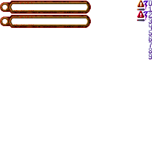

# Hemomancy reference: dated notes and appendices

Moved out of `docs/HEMOMANCY_REFERENCE.md` on 2026-11-16 (FX-21, the cleanup audit's section G): the thirteen dated
notes that sat above the reference's table of contents (2026-09-15 to 2026-10-10) and the seven appendices that sat
after section 38, section 38's old per-system list, and the old Mana and Artifice design tables of sections 3.3 and 37.1. They are history. The live rules are in the reference's numbered sections, the topic docs and the
wiki pages they point to; where this file disagrees with them or with the code, this file is wrong. Relative links were
rewritten for this folder; the text is otherwise as it stood.

## Dated notes

### Manipulation balance pass 2 (2026-10-10)

[§11 of the balance plan](../../archive/audits/MANIPULATION_BALANCE_PLAN.md#11-pass-2) records the second pass, its rulings and what was deferred. In short: one shared boss predicate and validation-before-payment for targeted spells; Blood Shot/Needle projectiles no longer read weapon enchantments; charged casts fizzle below 25% charge, scale their rewards by charge and are clamped to the hold the server observed; Crimson Mastery now covers every hand-computed damage term; Sanguine Surge and Last Wind regenerate 0.25 and 0.5 mL/tick per level; secondary tempers can no longer weaken affinity; Synaptic patterns lock for 10 s after applying; vein strain scales with rank and Clotted/Dead sections raise cost or refuse casting; kills of unprofiled mobs no longer default to Animus. Animus was re-ranked (Mortar, Halo, Lattice, Summon Avatar and Avatar Arms to Mediocritas; Tempest and Avatar Complete to Magister), Sanguine Marionette and Sovereign Instinct moved to Ductilis, and every school gained tuning or a gap fill (Magnetism crush, Iron Choir volley, Eclipse Well bite and collapse, Living Circuit arcs, Thread Ripper general use, among others). Osseous Bloom now displays as **Crystalline Bloom**; its registry ID is unchanged. §8.1, §8.2, §8.5, §9, §10, §11 and the Drudge table below reflect these values. Two figures in this summary changed on 2026-11-13: the charge floor is now 50% (CB-6, `ManipulationCastingRules.MIN_CHARGE_FRACTION`) and Sanguine Surge gives 0.05 mL/tick per level (CB-2). Last Wind is still 0.5.

### Manipulation balance pass (2026-10-09)

The [manipulation balance plan](../../archive/audits/MANIPULATION_BALANCE_PLAN.md) records the audit and what changed (§10). In short: player Blood Shot and Needle damage now uses explicit arrow bases scaled by Crimson Mastery; Sanguine Ward, Endless Hour, Funeral Bell, Prismatic Reproof and Glacial Grasp were rebalanced; the Blood Needle family is Ferric / Animus and Rebuke/Impressment are Ductilis / Animus; and six manipulations fill empty rank slots (Searing Lash, Cruor Javelin, Umbral Rend, Fruiting Contagion, Radiant Wake, Lodestone Collapse), each with bespoke geometry. `SchoolCombatEvents` now consumes Obscured and Lodestone, saved known manipulations adopt current registry metadata on sync, and Lux has a crude starter shard. §8.2 below reflects these values.

### Current source synchronization (2026-10-03)

This refresh compares the October 1 reference update (`a4ab49edb`, current HEAD) with the dirty checkout, and checks intervening commits since the September 19 broad coverage audit (`917aa74aa`). There are no committed changes after October 1. The [synchronization record](../../validation/REFERENCE_SYNC_2026-10-03.md) maps the history, corrections and verification limits; the September 19 index remains dated evidence.

The assignment ledger receives `EnumArchonPath` from the server. It distinguishes Apotheos pending from completed Apotheos, and treats either Apotheos or Silentium completion as finishing Blood Beneath Blood. A Silent player who has beaten Vesper but not yet drawn in his memory sees the absorption step; the bar counts 13 movements. Its overall progress denominator follows the visible assignment sections. This presentation does not award rank or ending proof. Qliphoth pome consumption rejects another player's fruit on both logical sides; degree lifecycle synchronization also sends the canonical communion count to restore the client display after reconnect/reset.

Scar Resonance is implemented in the shared Effigy/Brazier capacity. Each purchased level adds one slot to the D4/D5/D6+ base of 1/2/4, up to seven at D6+; purchasing it cannot bypass D4. Dynamic Scar Patterns and Effigy selection store up to seven scar IDs. The item artwork still renders at most four overlay quadrants; that visual limit does not reduce the saved loadout. The seven compact Effigy sockets leave Prepare unobstructed.

Scar templates and Somatic Loom previews resolve recipes from the current level's recipe manager. Scar and memory-weaving serializers no longer retain static recipe caches. A removed recipe, missing catalyst or incompatible committed recipe clears the Loom preview rather than showing stale output. The two synthetic distillation recipes are now GameTest resources only. Cardinal inscription assistance rejects dead/spectator players, and an empty-main-hand click cannot process a second predicted offhand support action. The Historical Record discovery hook follows the current `sanctified_rite` ID.

Packaged resource fixes cover NeoForge model loaders, complete Engram/Abocipher blockstates, corrected item texture references and generated item sprites, the Hemorath Rib atlas entry, font/animation metadata, and the ray shader's unused uniform. Naeglerophaeon geometry now lives in `assets/hemomancy/entity_geometry/` so the block/item model scanner does not parse it. Authoring archives remain in source but are excluded from runtime resources; the Jacquard license is packaged under `META-INF/licenses/hemomancy/`. `verifyPackagedClientResources` checks asset paths, PNG headers and exact license preservation and participates in `alphaCheck`. Custom machine/rite recipes use the vanilla `UNKNOWN` recipe-book category while retaining their own interfaces. Liber Immaculatus enables the washed search count through shared book presentation.

For pinned local JARs, sibling HutosLib source and minimal packaged installation, use [dependency provisioning](../../DEPENDENCY_PROVISIONING.md). For dated loaded-server, client, multiplayer and recovery evidence, use the [priority repair record](../../validation/PRIORITY_FINDINGS_2026_10_02.md), [shared centrifuge outputs](../../validation/CENTRIFUGE_SHARED_OUTPUTS_2026-10-03.md) and [whale feeding](../../validation/MNEMONIC_WHALE_FEEDING.md). Their passing focused runs do not establish a currently green full suite or complete natural Survival acceptance.

Cardinal Rite floors and Ichorian Sigils share `JsonResourceReloadListener` for JSON scanning, per-file diagnostics, and immutable reload publication. Their schema parsers and registries remain separate; malformed files are skipped, and each applied reload replaces the previous snapshot. The floor loader also keeps each definition's JSON; the `cardinal_rite_floor` channel of `DatapackSyncChannels` sends it to remote clients on login and datapack reload (one `DatapackSyncPacket` per channel, which also carries the blood profiles and blood injection responses), so blueprints, rite hints and formed-floor visuals work on dedicated servers. Integrated clients share the server registry and ignore the packet.

Recipe codec plumbing shares a registry-aware JSON bridge across Incubator, Memory Weaving, Scar, Armature Upgrade, Fungal Scar Cultivation, Blood Structure, and Cardinal Rite serializers. Nested codec errors propagate instead of silently omitting fields; legacy result forms remain supported. Run `./gradlew.bat runRecipeCodecGameTestServer` for the regression suite, also included in `alphaCheck`. See [recipe pipeline details](../../archive/done/consolidation/recipe-pipelines.md).

### GameTest suite registration (2026-09-25)

`gradle/game-tests.gradle` owns focused server launchers and explicit combined-gate membership. `alphaCheck` now includes combat-order, owner-snapshot, distillation, registration, and Unstained-zone suites alongside its prior coverage. `verifyGameTestSuites` checks source namespaces and generators, inclusion decisions, exclusion reasons, and launcher configuration before verification or run preparation. Other focused suites remain explicitly opt-in, including fresh-world validation with its special seed/mixin setup. See `docs/TESTING.md` for the catalog contract and negative integration probes.

### Item inventory persistence (2026-09-25)

Living Syringe and Morphling Jar handlers share `StackBackedItemHandler`. Existing `CUSTOM_DATA.Inventory` contents retain the `Items`, `Slot`, and `Size` format; loading keeps the item's configured capacity, and saving preserves unrelated custom data and item components. NeoForge's mutation callbacks track count changes and leave simulated or rejected transfers clean. `load()` explicitly replaces the cached inventory, including clearing it when the saved inventory is absent; `loadIfNotLoaded()` preserves pending edits after the first load. Transactions still call `save()`, and code changing a contained stack in place calls `setDirty()` before saving. The Syringe menu flushes after clicks and on close, matching the Jar and Binder. The obsolete Staff inventory, menu, screen, capability, and opening packet have been removed; existing Staff custom data is left untouched. All three handlers resolve the current server or connected client level's registries. Run `runItemInventoryGameTestServer` for the focused persistence suite; its namespace is also included in the server run used by `alphaCheck`.

### Working checkout documentation (2026-09-19)

The [working-tree coverage index](../../archive/done/WORKTREE_REFERENCE_AUDIT_2026-09-19.md) accounts for the staged, unstaged, deleted, and visible untracked files in this checkout. It maps implementation, resources, tests, art, and local authoring changes to their reference sections. This is a source audit, not a release declaration or a fresh full-suite test result. The First Incursion brief and fresh prose drafts are editorial inputs; the Java, packaged resources, and generated structure define current behavior.

### Entity blood profiles and syringe requirements (2026-09-17)

Blood traits now come from `data/<entity namespace>/blood_profiles/<entity path>.json`, containing `tempers`, `properties`, and `requires_living_syringe`. The original migration preserved all 87 previously listed entities' memberships. The current resources ship 204 profiles (124 under `data/hemomancy/blood_profiles`, 80 under `data/minecraft/blood_profiles`, counted 2026-11-15 after CR-23), and 118 of them require a Living Syringe; the Ringmaster Pattern requires a Living Syringe like the Mnemonist Puppet it was split from. Chitinite and Chiton require a Living Syringe; Hemomancy Armadillo, Desiccant, Mortarbound and Naeglerophaeon permit ordinary vials. These are entity-profile rules, not a change to the separate nonblood Colloid specimen. `BloodProfileData` loads complete per-entity overrides and synchronizes server-owned definitions on login/reload. Sample displays, injection responses, centrifuges, and temper affinity share this lookup; existing vial components and centrifuge yields are preserved. Loose sampling of restricted mobs and NPCs is rejected before collection. Consent-based professional donations use a held Living Syringe and retain donor provenance. See [format, migration, collection behavior, and validation](../../../wiki/Blood-Profiles.md).

### Clinical Blood Tools knowledge progression (2026-09-17)

The Vicar owns the Degree-1 bloodcraft lessons and grants Degree 2 after all four proofs are reported. The Alchemist offers First Draws as optional Degree-1 sampling work, then teaches Degree-2 microscopy, injection, Cabinet study, First Separation, and the first Ghastly Alembic distillation. First Separation and distillation together unlock Concentrated Blood; injection and completed sleep grant Degree 3. Existing reward IDs remain valid.

Concentrated Blood settles once the player has lain in bed for 100 ticks (`ConcentratedBlood.SETTLE_TICKS`, vanilla's slept-long-enough mark), whether or not the night passes (PT-11, 2026-11-14); one awake player on a server no longer blocks it. Getting up sooner does not settle it. A Chamber dream still needs the server's completed-night wake: the wake handler tells that apart from the Leave Bed packet, since both use the slow wake animation. Waking with the blood pending and the Charm of Vascularium off says the blood cannot settle without the charm (PT-26). Pending injection remains saved until it settles.

`ClinicalBloodProgress` is a copy-on-death attachment accessed through `HemoCapabilityAccess.clinicalBlood`. It persists unique personally examined entity IDs, taught lessons, Cabinet craft/manual-transfer evidence, Hematic Iron acquisition, and NPC meetings. `ClinicalBloodKnowledge` validates teacher, distance, degree, path, and prerequisites before one-time rewards. Real successful microscope sessions record sources; duplicate specimens and traded identification do not substitute for personal examination. Previously identified specimens can be examined again to establish personal evidence, without changing their components.

The Cabinet lesson requires three sources and injection teaching. D2 field conversion requires a crafted Cabinet, a successful manual deposit and withdrawal, Hematic Iron Scraps, an Artificer meeting, and an Alchemist referral. D2 echo referral leads to D3 Mnemonist instruction for the Clairaudiograph and ordinary Wax Cylinder; Ambergris remains a specialty medium. No additional rank certification is imposed. Recipe-book awards, JEI visibility, Materials nodes, NPC quest attention, the assignment ledger, Liber entries, and advancement toasts follow the lessons. Vanilla manual crafting and shared machine operation are preserved; direct injection is gated by Borrowed Physiology (creative bypass).

See [Clinical Blood Tools](../../../wiki/Clinical-Blood-Tools.md) for player instructions and existing-save recovery. Source counting is per entity ID and survives relog/death; existing specimens are never rewritten to manufacture historical proof.

### Casting presentations (2026-09-16)

`CastingAnimationManager` sends transient, sequenced phase snapshots after successful server actions and for charge/channel lifecycle changes. `CastingClips` authors all 40 school/rank tracks; purpose and bespoke style resolve through `CastPresentation` outside saved manipulation data. The existing player model and item renderer apply separate first- and third-person tracks, while the cast outpouring (`client/render/outpouring/`, 2026-10-19) draws the caster's own blood. It leaves the manipulation's vascular section, shader veins spread from that section over skin and armour, the blood transforms by temper, it scales with rank, and it leaves fading client-only marks. Nothing is drawn detached behind the caster. See [casting implementation, preview and validation](../../../wiki/Casting-Animations.md). At the target, every landed DIRECT school hit plays a short cast impact. Its shape follows the delivery (melee, projectile, area or tether) and its look follows the school; see [School combat presentation](../../../wiki/School-Combat.md#presentation-and-verification).

### Specimen machine screen styling (2026-09-15)

The Clairaudiograph and the shared Phlebotomist's Cabinet/Field Case screen reuse `VeinBackgroundRenderer` for their upper panels and `InventoryPanelTextures.BLOODY` for the player inventory, aligned to the menu's first player slot. Their slot borders, labels, selection highlights and Clairaudiograph buttons use the existing blood-red machine palette. Menu geometry and inventory transactions are unchanged.

### Phlebotomist's Field Case (2026-09-15)

`hemomancy:phlebotomists_field_case` is portable specimen storage with nine distinct component-identical specimen identities, at most 16 vials each (144 total). It shares defensive `SpecimenStack` values and `CabinetStorage` accounting with the stationary cabinet, but forbids the same identity occupying a second cell. Cabinet capacity, duplicate-cell routing, version-one save layout and hopper access remain unchanged. The Field Case has no item or block item-handler capability; access is manual through the placed menu only. Empty loose Blood Vials stack to 64; source-bearing samples remain single-item identities.

Carried contents use the persistent/networked `field_case_contents` component. Placement copies that snapshot into the block entity and consumes the source case on success; failed/canceled placement keeps it. Filled creative placement uses the NeoForge placement-event path before vanilla creative count restoration, so it moves rather than copies specimens. Invalid carried data refuses placement without truncation. Creative pick-block always makes an empty template.

Normal use opens the specimen GUI and rear-hinged lid. Empty-hand sneak-use packs only after all viewers leave and the lid finishes its closing interval. The result enters a free player slot or becomes one safely positioned item entity; removal happens only after delivery. If delivery fails, the source remains. If source ownership or removal fails after delivery, that delivery is rolled back. Conventional survival or creative breaking instead closes viewers, returns their cursors through normal server-menu cleanup, completes any in-progress transfer, and drops one filled case. Packing refuses re-entry and blocks stale menu actions. Transactions are serialized on the server thread, not crash-safe across separate world/player save files.

Occupied cases resist ordinary explosions and entity destruction, and pistons cannot move them. Dropped case items retain ordinary item-entity environmental/despawn behavior. No removal path intentionally spills virtual vials. Use six Leather, two Hematic Iron Scraps and one Phlebotomist's Cabinet in the shaped recipe; either glazing state is consumed without refund. The closed 3D item and animated placed model reuse existing materials and have editable Blockbench/exporter sources. See [Field Case guide](../../../wiki/Phlebotomists-Field-Case.md).

### Phlebotomist's Cabinet (2026-09-15)

`hemomancy:phlebotomists_cabinet` is stationary specimen storage with nine pigeonholes, each holding up to 64 component-identical full Blood Vials (576 total). `CabinetStorage` keeps a defensive one-count exemplar and a separate quantity. Equality includes all components, including names, source and the shared timestamp-free identification boolean. `BloodSampleData.isStorableSample` rejects new incomplete/malformed inputs but allows syntactically valid unresolved source IDs; loading preserves decodable old unreadable filled vials. Loose full vials remain unstackable, while empty Blood Vials stack to 64.

The menu uses legal one-vial read-only icon slots with separate count data and server-owned click handling. Either pickup button withdraws one; held compatible vials deposit one. Shift-click prefers matching capacity before empty cells and withdraws incrementally into available player slots. Virtual cells reject swap, throw, clone, drag-splitting and double-click collection. Ordinary player slots keep vanilla behavior. The restricted `IItemHandler` shares this storage on every face and extracts at most one vial per call. Comparator output is zero when empty, otherwise `1 + floor(14 * total / 576)`.

`FACING`, `OPEN` and `GLAZED` produce sixteen blockstates. The static bloodwood body and separate door meshes share one local coordinate frame. The client eases previous/current progress through a 100-degree hinge swing, displaying at most nine real vial exemplars. The opaque door hides them only once fully closed; glazing remains see-through. World snapshots contain display exemplars only; count changes dirty persistence and update menu/comparator state without resending the world model. Viewers are transient and reconciled against the active menu, life, connection and distance; the last viewer gets a five-tick closing delay.

Clear panes in `hemomancy:phlebotomists_cabinet_glazing` install glazing. Sneak-use of HutosLib's existing `KNAPPER_DIG` removes it without tool wear. Survival consumes/returns one pane; a full inventory returns it directly in front of the cabinet. Creative fitting consumes nothing and removal returns nothing. Glazing survives ordinary empty-block drops via vanilla `copy_state`; specimen data never belongs to the carried item. A nonempty cabinet refuses survival breaking and ordinary explosions; pistons cannot move it. Deliberate creative removal discards contents without spilling. Administrative/forced removal is outside that survival guarantee.

Craft with five Bloodwood Planks and four Hematic Iron Scraps. The Alchemist inquiry explains identity, controls, glazing and dismantling. Runtime models reuse authored Bloodwood/Hematic Iron textures, with an editable `.bbmodel` and deterministic exporter under `tools/oneoff/phlebotomists_cabinet.py`. The Cabinet recipe is taught in late D1 through clinical study; no creature rendering is added. See [player guide](../../../wiki/Phlebotomists-Cabinet.md) and [validation checklist](../../../wiki/Phlebotomists-Cabinet-Validation.md).

### Hematic Microscope (2026-09-15)

`hemomancy:hematic_microscope` is a craftable handheld instrument. Main-hand use with one filled offhand Blood Vial begins a 40-tick server examination. A synchronized two-hand animation seats the broad vial head in a recessed side socket and raises the eyepiece, mirrored for left-handed players. The first-person lens fades in over ticks 12-16; third person retains the held pose. A custom focusing loop plays only during first identification of readable samples. Holding longer preserves the slide, while release immediately closes the lens and stops audio, followed by six ticks of cosmetic withdrawal. Normal FOV is retained. Empty hands, empty vials and racks cannot start examination; malformed source data produces an inert murky view without deletion or identification.

`MicroscopeExamination` owns transient server sessions, with actual instrument/specimen references, an offhand component copy, and the current `BloodInjectionData` and `BloodProfileData` snapshots. Replacement by an identical stack still cancels. Release, death, spectator state, logout, invalid hands and definition reload invalidate the session. Successful completion writes the existing timestamp-free `blood_sample_identified` boolean once and synchronizes ordinary inventory state. It neither consumes blood nor changes potency nor invokes bestiary rewards.

The feature reuses `BloodSampleData` and Blood Vial injection predictions. Profiles read explicit property memberships from synchronized entity blood profiles independently of injection definitions; `hemomancy:fungal` remains a supported property. The GUI renders at most three canonical temper layers and two sorted property motifs; all identified traits remain in the paged readout and tooltip. Animation seeds use source and all canonical trait IDs, never identification, player or time. Named 32 x 32 temper/property PNGs reload normally and no visual composition cache survives frames. Client `microscope.reducedMotion` and `microscope.lowDensity` only alter presentation.

The registered item enters the existing creative-tab stream. The crafting recipe uses copper, iron, glass and leather. The Alchemist's Blood Vial and microscope inquiries explain the two-hand interaction and per-vial identification. Editable Blockbench and reproducible texture/model sources accompany the runtime assets. All screen decoration is PNG-backed, including the readout panel/border, dimming, progress track/fill and Ductilis links. Static colors and alpha come directly from those textures; Java retains layout, dynamic text, cell movement and progress clipping. The generator preserves existing GUI artwork unless `--reset-gui-textures` is explicitly supplied; `--model-only` rebuilds the standard, mirrored viewing, and Blockbench models without touching any textures. [Player guide](../../../wiki/Hematic-Microscope.md).

## Appendices

### Cicatrix Anchorite assignments and scar routing

The Vein-Mason arc now continues as optional Degree 5 and Degree 6 assignments. `What the Vein Bears` requires Thelemic Memory strain to produce Varicosity (any section already Varicose counts once, at the next Thelemic cast or when the Mason's fifth-Degree tree opens; a Dead one does not, PT-22. With `vascularDegradationOnManipEnabled` off, the first Thelemic Memory cast after the fourth-Degree reward counts instead, PT-29), an Anchorite diagnosis, successful Salve, Poultice or Rite of Vascular Mending treatment (the diagnosis names which; Mending is its remedy for three or more Varicose sections), and Hematic Fortification. The diagnosis line names the section, flow and remedy in English. `A Current Made Deliberate` requires Mnemonist counsel (a Quest Work card with a notice sigil until the counsel is taken, PT-71, 2026-11-13), a matching Noetic cast through an active cerebral scar, a genuinely changed Effigy loadout, and a second matching cast. Neither assignment gates degree advancement.

Active scars add transient temper alignment; saved base alignment is unchanged. Ordinary non-mechanical Noetic Memories receive the best matching cerebral-scar reduction only: 5% at tier one, 10% at tier two, and 15% at tier three. Hematic Fortification multiplies both Noetic and Thelemic vascular strain by 0.85. The canonical vascular sections are Head, Arms, Heart, Body, and Legs.

---

### Manipulation balance pass — 7 September 2026

Ironhearted now stores up to 4 HP per fully charged cast. Iron Choir intercepts up to three hostile projectiles per paid second, and Absolute Stillness slows hostile projectiles every channel tick with reduced boss slowing. Carrion heals from health actually drained. Furnace grants allied fire resistance and respects pets and summons.

Base costs are now Hemorrhage 75 mL, Coronation 600 mL, Conductive Mark 150 mL and Crimson Tithe 100 mL; channel upkeep is Furnace 150, Drift 75 and Dowsing 75 mL/s. Mark and Hemorrhage last twelve seconds. Full-charge Coronation counterattacks gain stronger piercing needles. Tithe provides a 500 mL advance with its existing repayment and damage risk.

Dowsing reports nearest ore coordinates, Forge preserves multi-output recipe counts and stack limits, and Lignum-family channels automatically harvest permitted blocks when selection completes. Earlier release and forced cancellation retain their separate behaviors. Memory recipes and progression gates are unchanged. Live balance acceptance and authored effects remain open.

See [area 4 comparisons and verification](../../archive/done/manipulation_work_plan/04-balance-results.md).

The [area 5 presentation pass](../../archive/done/manipulation_work_plan/05-visuals-results.md) adds server-driven world meshes, all charged buildup forms, bloody Coronation swords, distinct projectile family bodies, zone/status/debt cues and successful utility-transfer feedback. Avatar upkeep no longer replays activation audio. Existing authored staff/Avatar assets and exact heart HUD remain. The report records all 97 active powers, isolated client captures and outstanding remote/visual acceptance.

#### Ferric and Ductilis second pass (2026-09-09)

Sanguine Magnetism now owns the remembered forms `ferric_rampart` (family level 1) and `ferric_spikes` (level 2). Both share its mastery and existing 450 blood / 140 tick cooldown / 18 block base range / six-second lifetime. Rampart uses a cardinal 5 x 3 x 0.375 body/projectile barrier. Five spike blades share a ten-tick contact interval at 3.5 damage. Placement validates support, loaded space, collision and friendly bodies before the payment path. The existing iron entity registrations carry synchronized shape, orientation, owner and absolute expiry; encounter spikes retain legacy mode.

Offensive Ductilis casts conduct through summoned iron, face-connected water and `hemomancy:ductilis_conductors` (iron/copper construction, including waxed and oxidized copper; no ores). The network cap is 256 loaded nodes within 12 blocks, lasting 40 ticks. Every 10 ticks it revalidates connectivity and discharges into at most three touching eligible targets for 2 base damage. Direct hits, conductive marks and relays share discharge accounting. Conductive Mark, Hemolymphal Pulse and Living Circuit do not independently energize terrain. No block/fluid/redstone/oxidation mutation occurs.

Synaptic Storm selects successive endpoints from its previous victim or energized relay, preferring conductivity, then distance and deterministic ties. It retains the 18-block acquisition envelope and maximum eight victims; ordinary hops are five blocks, conductive hops eight. `paralysis` locks voluntary locomotion, jumping, combat, item use and casting while preserving camera, gravity and damage processing. Ordinary mobs receive the existing charge-scaled 10-60 ticks; players cap at 20; bosses receive movement disruption. Recovery lasts 20 ticks after removal or expiry.

`FerricDuctilisGeometry`, `FerricDuctilisEffects` and the two `manipulation_ferric` / `manipulation_ductilis` world shaders draw rigid iron and thin electrical ribbons. HutosLib bolt rendering and tendril anchors remain in use. New visual forms append to the existing enum; `ConductionPathPacket` and `NerveLinkPacket` are separate payloads, leaving Lux/Umbra flow serialization unchanged. `FerricDuctilisStatusVisuals` replays ongoing states to new trackers and removes expired/lost sources. See [Ferric and Ductilis](../../../wiki/Ferric-Ductilis.md) for player rules and disposable review commands. Numeric limits remain tuning defaults pending live combat and player visual acceptance.

#### Harbinger scar-station access and tracing repair

Personal craft credit remains the default machine access rule; Fane membership alone does not grant it. During the accepted, unfinished first scar lesson, a living Cicatrix Anchorite within eight blocks may supervise use of a Scar Station for that lesson scar only. This does not grant personal craft credit or block loot. Learning the first scar ends the exception. Other scar patterns require personal station access.

Load Pattern supplies a purple stencil. Clicking or dragging marks the actual red trace. Invalid Carve reports the missing requirement and preserves the stencil, trace, ingredients and knapper; successful carving alone clears the work. A partial trace persists with the station across saves. Learning and fitting remain distinct brazier/Effigy steps with their existing costs. Station and Effigy tooltips expose authored modifiers, learned versus active state, and the existing 100 ml learning, 500 ml per-scar motif charge and 50 ml fitting payments. Copied-checkpoint carving, learning, fitting and reload have passed locally; fresh student and dedicated acceptance remain tracked in the repair progress document.

Recruited allies yield ordinary non-crouched Blood Projection interaction to the held tool, so aiming through them can start a repair channel. Empty-hand interaction and crouching retain conversation/assignment behavior. Role stations now resolve around the actual boundary anchors and support-sigil nodes, leaving their central approach lanes clear. The visible marker, assignment target and NPC destination agree. Assignment still requires safe loaded footing and clear body space; blocked destinations do not teleport an ally into solid blocks. Existing approach, hold and distant/falling recall behavior remains in place, with normal NPC AI and collision. Common gameplay code constructs particle payloads through HemoParticleData rather than loading client ParticleProvider classes on dedicated servers; authored effects are unchanged.

Rite Daemon creation waits until the focus chunk has loaded its saved entities, so restarting an active rite reuses its existing manifestation instead of spawning replacements during entity loading. Historical duplicated manifestations are not automatically removed by this guard.

Anchor helpers distribute their repair contributions across the rite's actual four-anchor rings, wrapping additional helpers over those rings rather than using the player degree as a ring count. Their existing shared-pool/private-reserve payment and missing-blood transfer cap remain in effect.

During offering procession and culmination, rite progression waits for the focus chunk's saved entities before advancing the phase timer. Deferred Daemon loading therefore neither collapses the rite nor consumes finale time.

### Clairaudiograph

`hemomancy:clairaudiograph` carves a source-authorized sound event from an ordinary filled Blood Vial onto any blank Wax, Ambergris or Corpse Wax Cylinder in 80 ticks. Recording reuses `BloodSampleData` and the shared empty-vessel helper independently of injection mappings and specimen identification. The two slots lock until completion. Unload and reload cancel the carve without consumption. Recordings use a persistent synchronized component, data-driven source, sound, kind and pitch authorization, a compact menu, private preview, independent block-owned client audio, redstone rising edges, and manual and powered loop modes. See [recipes and playback](../../../wiki/Clairaudiograph.md).

All three media support ordinary Resonant Forge pattern capture and application. A successful ordinary application consumes Wax or Ambergris. Corpse Wax stays in the hammer slot as a blank cylinder with its other components intact. The Masterwork Forge can cut or stabilize a reusable pattern on Ambergris or Corpse Wax. The base Forge Working and True Groove still call for blank ordinary Wax. Existing Ambergris recordings, ancient records and patterns keep their item ID and components. One Corpse Wax Cylinder takes two Adipocere, one Hematic Iron Scrap, one Active Befouling Ash and one paper in a shapeless recipe.

The three inventory models and both machine mounts share the same spindle geometry and individual blank and carved 16×16 textures. Run `python tools/model_export/cylinders.py --preview` to regenerate the baked meshes, textures and editable Blockbench projects and render a comparison sheet.

### Hematic Succession (D5)

Five professional successors inherit service access, not player quest completion. Bequests are independent of ordinary recruitment. Creation and restoration use the Greater Dominion floor, adjacent Vacant Effigy, marked braziers, and a reserved fane workplace. The authoritative implementation lives in `common/entity/npc/harbinger/succession` (records, residents, workplaces) and `common/rite/succession` (the rite); see [the design contract](../../HEMATIC_SUCCESSION_DESIGN_SPEC.md) and [player guide](../../../wiki/Hematic-Succession.md).

### Antecedent Inquiry and audio analysis

The optional Deep Dark inquiry implements two-source Ahaematic Colloid sampling, Incertae microscopy, personal evidence, Alchemist controlled replay, Vicar interpretation, three voiced/captioned ancient cylinders, the Vigil Beneath, and the removable Listening Scar charm socket. No new temper or main-path gate is introduced. The Clairaudiograph now displays a measured source-audio spectrograph and amplitude waveform for ordinary and ancient playback, with a separate unresolved trace for the Severed Record. See [the player guide](../../../wiki/Antecedent-Inquiry.md) and [audio behavior](../../../wiki/Clairaudiograph.md).

At Degree 5, the Alchemist offers an optional Deep Dark commission in the Side ledger. A prior valid Ahaematic microscope analysis, sample response, controlled replay, or Vicar recognition supports a one-time report; simply reading a Vigil record does not. Reporting retains the specimen and leaves the broader Antecedent inquiry and its earlier Degree 3/4 access unchanged.

Before reporting, the Alchemist can give a Deep Dark biome bearing in the Overworld. The search starts below the player's local X/Z at Y -48, covers a 2,048-block horizontal radius and samples at 32-block horizontal/vertical intervals. The reply identifies a candidate region, not safe footing, an entrance or a guaranteed Ancient City/Vigil. Another dimension receives an Overworld reminder; a missing candidate asks the player to try another outpost. The server requires a nearby living Alchemist, D5+, active blood and neither purification nor Clarity. Guidance grants no sample analysis, commission proof or item, and the event is retired after reporting. This follows the existing synchronous biome-search pattern; worst-case runtime cost still needs acceptance.

Worldgen finishes vanilla city assembly first, then searches throughout the city for a self-contained modular Vigil beside an existing open walkway. No city-generation space is reserved and no vanilla piece is removed. Existing explored cities remain unchanged. Only the original fixtures tracked by the loaded archive controller receive altered sculk behavior; replacement blocks use vanilla rules.

#### Specimen identity, defaults, and editable visuals

`hemomancy:ahaematic_colloid` is an independent `Item`, not a `BloodVialItem` subclass. It stacks to one and carries `ahaematic_sample` provenance: `entity/minecraft:warden` or `block/minecraft:sculk_catalyst`. A Living Syringe with an available rack vial collects either source; Catalyst collection does not destroy the block. Its displayed name is Unidentified Dark Sample until a completed 40-tick microscope session identifies it as Ahaematic Colloid. Plain item stacks, including creative/JEI templates and commands, default to Warden provenance. This default is deterministic, not a random selection between the two sources.

The result is Incertae: no hematic content, temper, or enzyme response. It participates in specimen storage and microscope examination but cannot be injected, centrifuged into enzymes, carved into ordinary creature recordings, or counted as a clinical blood source. Legacy Warden blood vials and component-backed samples migrate through the inventory/storage paths in `AhaematicSample`, `BloodVialItem`, `VialRackItem`, and `CabinetStorage`. Unknown provenance remains unreadable; migration is not permission to invent identification or personal evidence.

The item retains the vial silhouette with dark blue contents. Its reaction frames are `assets/hemomancy/textures/item/ahaematic_colloid.png` and `_1` through `_10`, selected through the corresponding item models. Microscope inclusions, signals, and directional marks are editable PNGs: `textures/gui/microscope/colloid_inclusion.png`, `colloid_signal.png`, and `colloid_direction.png`. Their shapes come from textures; the overlay positions, animates, tints, and clips them. Cleansing Hemolymph and the four consecrated saint specimens also have dedicated PNGs under `textures/gui/microscope/special/`, selected by `MicroscopeSpecimenVisual`. See the [texture editing reference](../../../src/main/resources/assets/hemomancy/textures/gui/microscope/README.md).

Creative-tab order places Cleansing Hemolymph and Consecrated Syringe immediately after Bloody Vial, before the dark sample. `ConsecratedSyringeItem.getDefaultInstance()` and the creative/JEI integration choose one of the four saints at random and write `saint_type`. Sarcophagus rewards retain their actual saint. This differs from the Colloid's item-level default component: an arbitrary raw Consecrated Syringe stack without saint data is not automatically authenticated as a saint specimen.

#### Evidence and player progression

`AntecedentResearch` stores twelve independent facts in a persistent player attachment. `AntecedentKnowledge` synchronizes changes and unlocks matching Liber pages. Facts can be discovered out of order. Completion is specifically `ARCHIVE_RESPONSE && VICAR_RECOGNITION`; the other observations teach and explain the route but are not all mandatory completion flags.

| Evidence | Trigger or purpose |
| --- | --- |
| `SAMPLE_ANALYZED` | Personally complete microscopy on a readable dark sample, including reexamining an already identified sample. |
| `ACOUSTIC_RESPONSE` | Hold an analyzed sample within eight blocks of an eligible vibration event. |
| `SEVERED_RECORD_HEARD` | Remain a valid nearby listener through the recorded interval at ticks 860–1099; credit is checked at tick 1100. |
| `SAMPLE_RESPONSE` | Observe an analyzed sample during the full ticks 1120–1300 interval of one Severed playback. |
| `REPLAY_REQUESTED` | Ask the Alchemist about the recording after hearing it, at Degree 3 or later. |
| `CONTROLLED_REPLAY` | Repeat the full observation with the request recorded and a living Alchemist nearby. |
| `VICAR_RECOGNITION` | Present controlled replay evidence to the Vicar at Degree 4 or later. |
| `CROSSED_WOOL_TERMINUS` | Cross the marked passage boundary in the loaded Vigil. |
| `DEGRADED_NETWORK` | Witness the original gallery sensors' delayed response. |
| `VIGIL_RECORD_READ` | Open and close the gallery record lectern interface. |
| `ARCHIVE_RESPONSE` | Stay near both the playing machine and loaded archive vessel for the full observation interval. |
| `EPILOGUE` | Optional Entity encounter after completion at Degree 7 or later. |

`AntecedentObservation` requires 181 consecutive ticks from 56 through 65 seconds. The specimen can be in the machine or that observer's hand; another player's held vial does not supply their evidence. Player, machine, Alchemist, and archive distance conditions are checked by `AntecedentPlayback`, not inferred from a shared party reward. Leaving, interrupting playback, or losing the required specimen requires another complete interval. Playback consumes neither the cylinder nor the sample. Degree 5 adds the Vicar's strategic comparison; the epilogue waits for an active blood user outside a container and avoids recent mob damage.

#### Recordings, measured audio, and the archive vessel

| Cylinder | Duration | Acquisition |
| --- | --- | --- |
| Severed Record | 1,460 ticks / 73 seconds | Guaranteed entrance chest in the generated Vigil. |
| Lower District Survey | 600 ticks / 30 seconds | Guaranteed gallery chest; also supplemental Ancient City chest loot. |
| The Quieting | 600 ticks / 30 seconds | Guaranteed gallery chest; also supplemental Ancient City chest loot. |

`AncientRecordingLootModifier` adds one randomly selected Survey/Quieting cylinder when the configured Ancient City loot conditions pass (12% chance). `ancient_recording` distinguishes these authored programs from ordinary carved-cylinder data. Captions and timing live in `AncientRecordings` and `lang/en_us.json`; sounds are registered under `hemomancy:antecedent.*`.

The Clairaudiograph measures the resolved sound resource through `ClairaudiographAnalysis` and `SpectrogramAnalysis`; `ClairaudiographSpectrograph` displays frequency history and an amplitude waveform. It uses eight seconds of history, logarithmic 50 Hz–12 kHz bands, and a fixed -80–0 dBFS scale. Pitch affects timing and frequency, stereo channels are analyzed separately, resource-pack audio is supported, and decoding runs off the render thread. Reload clears the bounded cache. Missing/undecodable audio or clips beyond the 120-second analysis limit report unavailable analysis rather than fabricated energy. Muting playback does not disable source analysis. Playback resolves one audio variant for both the sound and its graph; session updates let late listeners seek into ongoing playback.

The Severed Record's 55–68-second silence has zero recorded energy. The separate unresolved trace is a fictional instrument response, not a claim that the audio FFT found hidden sound. The specimen tap at 63 seconds and behind-listener click at 72 seconds are world effects outside the recording. `hemomancy:antecedent_vessel` is the archive apparatus and loaded site controller: bring a Clairaudiograph and play the Severed Record nearby to observe its rising geometric response. It is not a general-purpose sample-processing station. Ordinary sound does not substitute for that program and interval.

#### Chamber placement and local sculk rules

`MixinAntecedentCity` supports vanilla `ancient_city/city_center/city_center_1`, `_2`, and `_3` in all rotations. It retains the original generation stub and completed vanilla pieces, then calls `VigilPlacement.find`. The old `MixinVigilReservation` remains removed. Placement examines exposed three-wide floor edges across rigid Ancient City templates, including edges inside sparse template bounds. It checks clear headroom against the completed city, with no portal-distance limit. A position hash gives a deterministic search order without consuming city RNG. Every entrance tries six complete module arrangements before moving on; unsafe sites skip the entire Vigil.

Each site has four independently enclosed modules: a 5×6×5 entrance, a 5×6×9 listening passage, a 15×14×20 balcony gallery, and a 7×7×7 archive. The passage joins the gallery's west, north, or south socket; the archive joins its west or east socket. Each module is rotated and positioned during authoring, producing six arrangements under `data/hemomancy/structure/antecedent/vigil/modular/`. Empty space between modules is omitted. The total envelopes vary (29×14×20, 36×14×20, or 22×14×34); fitting uses the authored pieces, not one reserved rectangle. All arrangements contain 4,744 authored positions, five lecterns, two chests, both inscriptions, and the complete gallery/stair/archive route.

`build_modular_vigil.py` rebuilds the legacy compact assets via `build_vigil.py`, then emits the new modules, one composite per arrangement, and `data/hemomancy/antecedent/vigil_layouts.json`. `VigilModules` reads this bundled manifest for placement offsets, entrance direction, controller fixtures, room bounds, and the passage's coordinate frame. It is an authored layout contract loaded with the mod, not a reloadable structure-pool extension. `check_modular_vigil.py` checks every serialized arrangement for lossless assembly and routes to all interactive content.

Collision checks protect authored vanilla block positions from every palette, including the central portal and its redstone rooms, and preserve headroom over solid surfaces. Sparse template bounding boxes may overlap only where their authored blocks do not. Unknown or non-rigid pieces retain conservative bounding-box protection. Vertical checks keep the annex above the bedrock margin. All four annex pieces remain rigid and are excluded from `Beardifier` by `MixinVigilTerrain`; the terrain-carving/lava fix is retained. This does not remove natural lava or retrofit existing chunks.

The archive controller saves and synchronizes `VigilLayout`: unversioned/version-1 sites keep the original long layout, version 2 keeps the first compact layout, and versions 3–8 select the six modular arrangements. Saved version IDs and their coordinates must remain stable; future geometry changes require new versions. Passage thresholds are evaluated in the passage module's own frame, preserving the wool boundary, phantom clicks, and evidence order regardless of which gallery socket is used. The opt-in review fixture now uses the first modular composite at a separate test location; it does not prove natural attachment or a survival playthrough.

Five lecterns hold Tablet of Quiet Earth, Lower Passage, Lower Vigil: Watch Order, Lower Vigil: Notice, and Lower Vigil: Record 7. The entrance chest also holds The Failed Burning and The Silence Order. Signs mark the lower chamber and archive. These texts are embedded in the NBT by `build_vigil.py`; changing a Markdown draft alone does not update placed books.

`VigilArchiveBlockEntity` and `VigilSites` limit special behavior to loaded, marked original fixtures. Sensors respond after irregular delays, one may omit a response, and the Shrieker produces a failed response without darkness or Warden escalation. The Catalyst consumes death experience into a bounded growth budget and spreads slowly only within its authored bed. Removed fixtures are retired; replacements and sculk elsewhere use vanilla behavior. The wool boundary, ambient fade, phantom clicks, and falling-stone demonstration introduce the experiment through the environment. Sound-only phantom effects do not emit vibration events.

#### Listening Scar lifecycle

After completion, the Vicar exchanges four iron nuggets and one echo shard for a new housing. `ListeningScarItem` stores states 0 (empty), 1 (loaded), and 2 (awake). Use an empty housing with an analyzed Colloid in the opposite hand to consume the sample and return an empty Bloody Vial. Hold the loaded housing through the Severed observation interval to awaken it. At the Scarlet Vanity, `TalismanSocket` accepts the awakened Scar beside the equipped Charm of Vascularium; its component travels with the charm and the Scar can be removed.

An actual Sculk Sensor activation within sixteen blocks gives a directional cyan pulse and tactile sound, limited to one per five ticks. The Scar supplies neither Warden tracking nor protection, stealth, or phantom-click detection. Replacement housings remain available for the same cost.

#### Authoring and editorial status

Local sources are under `tools/oneoff/antecedent/`: `recordings.json`, `render_voices.ps1`, `build_recordings.py`, `build_vigil.py`, `build_resources.py`, and `export_texts.py`. Audio generation uses installed Microsoft David/Zira synthetic voices, authored sound beds, NumPy, and FFmpeg. Cue changes must agree with `AncientRecordings`, captions, and server observation windows. Models/PNGs and OGGs under `src/main/resources` are runtime assets; generators are not invoked during rendering or resource reload.

The seventeen Markdown files in [the fresh prose draft](../../archive/concept/antecedent-fresh-draft/README.md) are **not imported runtime replacements and have not been synthesized into replacement audio**. They include seven ancient documents, three recording transcripts, dialogue, journal, UI/captions, and explanatory prose. Export/rewrite instructions and the original [First Incursion brief](../../HEMOMANCY_FIRST_INCURSION_DEEP_DARK_BRIEF.md) must not be confused with shipped text. The generator still contains the runtime book wording. See [testing status](../../TESTING.md#antecedent-inquiry) for dated automated and fixture-assisted evidence and remaining live checks.

### Other working-checkout integration details (2026-09-19)

Hematic Succession uses server-owned records in `common/entity/npc/harbinger/succession`, authenticated donor/self samples, and five existing professional entity types with successor identity/pose layers. Degree-5 bequests are independent of ordinary recruitment. Creation uses the Greater Dominion floor, Vacant Effigy, Quintessence, donor blood, officiant blood, and Mnemonic Ambergris. Restoration uses the saved remnant, self blood, a new body and Quintessence. The six-phase sequence lasts sixty seconds, spends offerings by phase, and can fail into a profession-specific Misbegotten. Residents inherit service access while each player retains their own teaching/quest gates. Workplaces, displacement, death/remnant recovery, leader dismissal, identity persistence, and helper reserves are covered in [Hematic Succession](../../../wiki/Hematic-Succession.md).

`CardinalRiteNpcTravel` gathers only missing eligible successor helpers into distinct rite stations. Players may replace them during preparation. Completion, cancellation, collapse, caster death, and disconnect expiry return survivors to their workplaces, including across dimensions; blocked returns retry, and pending travel survives entity reload. Unloading is not death and does not justify creating duplicate residents. `succession.per_bloodline_cap` and `succession.global_cap` default to zero; zero means workplace-only capacity and no global safeguard, respectively. `data/hemomancy/succession_profession/<role>.json` supplies the accepted workplace IDs for the five supported roles. The Residents screen, marked brazier labels, Cardinal Rite overlay, JEI categories, and identity rendering expose these rules.

Specimen integrations share `BloodSampleData.isSpecimenVessel` so the separate Colloid can use racks, the Cabinet, and the Field Case. The Cabinet's world inspection column mapping and specimen model positions now agree with the visible cells. Microscope sessions retain blood-profile and injection-definition snapshots, cancel across a reload, and allow personal reexamination of identified specimens. Empty Bloody Vials stack to 64; filled specimens remain single identities. Syringe tooltips expose loaded rack contents with Shift. Clinical source evidence, manual Cabinet transfers, recipe visibility, the assignment ledger, Liber entries, and NPC teaching use the same persistent clinical progress described above.

The resource changes also include the microscope item/view model and GUI panels, Pallid Infusion item art/model, Hearty Compass renderer texture, and eight Harbinger portraits. Treat these as presentation revisions; no new lore or item behavior follows solely from a changed PNG. Registry, network, reload, loot-modifier, mixin, recipe, and localization edits wire the documented subsystems into runtime. Backup `*~` files, Python caches, deleted obsolete authoring copies, and the absent `SpecimenJarData.java` are accounted for in the coverage index rather than presented as features.

Scar Resonance adds one cerebral loadout slot per purchased level to the shared Effigy/Brazier capacity: base D4/D5/D6+ capacity is 1/2/4, with up to three bonus slots and seven stored scar IDs. Purchase does not bypass D4. Recipe decoding retains no static Scar or memory-weaving cache; templates and Loom previews resolve through the current level recipe manager. Removed recipes and missing catalysts cannot retain a preview.

### Shared mob materials (2026-10-06)

See [the mob catalogue](../../archive/audits/MOB_DROP_CATALOGUE.md) for the registered roster, loot conditions, blood profiles and source evidence. New ordinary material pools require player kills, yield 1–2 items, and add 0–1 per Looting level. Peacock Spider husks use a separate 10% one-item player-kill pool without Looting. Existing pools and special organs retain their original conditions.

Chiton and Phlegethontic Bombardier share Chitinous Husks; comb jellies and Luminal Cicadas share Chromatophores with Prism Cuttles. Excoriated, Venous Striders and Vampire Bats (colonies in the nether wastes, crimson forest, basalt deltas and Phlegethontic Basin, fire-immune) join Urchins and Vampire Squids as Barbed Splinter sources. Peacock Spiders and Hemojellies supply Enthralling Filament, the renamed Puppeteering Thread (`enthralling_filament`); its Loom, Spindle and Crossbar uses and progression gates remain unchanged. Choir Keepers join Striders and Osteophages as Venous Pinion sources. Siphonophores supply ordinary `ganglion_cluster`, never the unique boss ganglion. `cuttlefish_chromatophores` remains the Chromatophores ID.

Pelagic Herring drop one raw fish; Crimson Does drop 1–3 Raw Venison alongside existing materials. Looting adds 0–1 per level; burning deaths cook the food. Furnace/smoker cooking yields one food at vanilla times (200/100 ticks), 0.35 XP. Herring nutrition/saturation modifiers are 2/0.1 raw and 5/0.6 cooked; venison is 3/0.3 raw and 8/0.8 cooked.

Hemojellies float at temperate/warm ocean surfaces, including upper Pelagic waters, with weight 4 and groups 1–2. Their Animus blood remains, with aquatic properties. Submerged tendrils capture one small fish for 30 ticks, slow and gently gather it, then inflict 2 damage with a 100-tick cooldown. Players are not prey; dead, removed, dry, obstructed or distant prey is released. Targets are not saved. Siphonophores retain deeper habitat and four-damage feeding with a 100-tick cooldown; their blood temper is Ductilis and successful feeding displays yellow authored lightning.

Shared venom/Bloodworms, ash routes, cold sample-source expansion and Sclerite rebalance are deferred. The Choir Keeper's owl–peacock model is implemented; proposed hunting, flocking and song changes remain deferred. Live-snail harvesting and existing special-organ probabilities remain unchanged.

#### Phlegethosoma implementation status
Phlegethosoma (`hemomancy:phlegethosoma`) is a 120-health, three-phase native Basin miniboss. Its server-owned combat alternates anchored suction, feeding bites, destructible coagulum cover, directional pressure spray from 60% health, and muscular lunges. At 25% health it ruptures, loses its remaining armor, and shortens suction cycles/cooldowns. Phases never regress after feeding or reload. Six direct attack damage during suction interrupts it into a 35-tick stagger; exposed attacks take 25% additional direct damage. Feeding deals seven damage, slows briefly, and heals the animal by two health without taking player blood volume.

Suction uses horizontal-only client impulses identified by boss UUID and attack epoch, preserving vertical movement. Both sides check collision, support and lava; clots explicitly occlude suction and spray. Clots have ten health, expire after 160 ticks, are capped at six per animal, preserve local escape routes, and leave no blocks behind. Owner loss, combat end and reload clear transient hazards. A sixty-tick shared title scene leaves player controls available. The editable model is `assets/hemomancy/models/entity/bbmodel/bosses/PhlegethosomaModel.bbmodel`.

It does not spawn naturally (CR-7). A player with awake blood calls it by holding Blood Projection on a broad, 7 by 7 pool of Basin ichor until 500 mL is counted there; the count fades like chum, and the call is refused in Peaceful, in a narrow pool, while the caller already has one out, or within 64 blocks of another living one. A summons with no target for 60 seconds dives and is gone with no loot. Debug spawning uses its spawn egg or `/summon hemomancy:phlegethosoma`; those have no caller and never dive. Player-attributed kills drop two to four Sanguine Formations and one to two Barbed Splinters (`hemomancy:barbed_splinter`; the materials atlas calls the item Calcified Blood Spine) with normal Looting increases, plus fifteen XP. Samples use the existing Flammeus/Living Syringe convention; the Alchemist commission still accepts only its original species. Network protocol is 14; matching client/server builds are required for the synced swimming pose. New trophy/material items, recipes, precise multipart weak points, climbing, fluid manipulation and ecological predation remain deferred. Runtime/visual/natural spawning acceptance is recorded separately in `docs/TESTING.md`.

**Phlegethosoma body and locomotion correction (2026-10-26):** The broad limpet-like model is replaced by a long, narrow, soft-bodied blood fluke, roughly nine blocks from sucker to ribbon tip. Twelve linked body joints carry a travelling lateral muscle wave, soft membrane frills, small blood vesicles and a tapering tail. There are no dorsal armor plates. The crop swells during Engorged; Ruptured tissue contracts and the frills flutter. `tools/model_export/phlegethosoma.py` authors the Java rig and native atlas; the editable Blockbench export has 111 parts / 100 cubes on the quarter-unit grid.

The animal uses custom-fluid swimming rather than vanilla water-only controls: server steering pursues at .38 blocks/tick (.50 when Ruptured), turns within ichor, avoids solid/unloaded space and patrols its pool slowly while idle. It can dive toward submerged targets and swim along the surface toward shore targets; it wriggles slowly on dry ground. Synced swim amount and pitch drive the articulated render pose. The server head collision footprint is 1.35 by .85 blocks and the render culling bounds include the long tail. Suction still has a stationary readable brace; existing attack, reward and player-impulse safety rules remain. The pool habitat replaces the earlier dry-bank placement contract.

**Phlegethosoma dive and breach (2026-10-26):** In ichor at 6-14 blocks, the animal can commit to a submerged ambush. It requires at least three fluid blocks of depth, a clear launch arc and a reachable underwater landing. A 30-tick dive shows crimson surface ripples, followed by a 20-tick leap at the locked target position and a 24-tick return dive. Contact during the outward leap deals eight damage once per victim; the return does not hit again. Its body pitches into both arcs while the travelling muscle wave continues. The attack cools down for 200 ticks (160 when Ruptured). Target loss still allows the return; a new obstacle triggers one return-route attempt before ordinary movement resumes. Blocked or shallow pools retain the existing attacks. Routes only traverse loaded space and never replace terrain or teleport the animal. Protocol 14 adds the synchronized dive, breach and return action states.

## The old section 38 (as it stood on 2026-11-16)

This section is a maintenance rollup, not a changelog. It uses the status legend from the top of this reference and only calls out systems whose state is easy to misread from older notes.

| Status | Systems |
|--------|---------|
| Implemented | Entity loot JSONs, registered skill effects, visceral organ effects, armor set bonuses, eight-strain morphling maturity powers, morphling mutation visual layer, standard scar effects, eight incubator recipes, fungal scar cultivation, Blood Moon mechanics and Sanguine Eclipse trigger, Chthonian termite mound behavior, deep ocean vent fields and Chalybeate Snail ecology, Erythrocoral Reef biome and Blood Lantern Jelly ecology, Harbinger Voyager Wreck salvage sites and Brined Votary remnants, active Harbinger Voyager Vessel structures with neutral crew placement, major NPC dialogue trees, early crude memory learning, Mnemonic Blueprints/Folio, shared Crafting/Rites map UI, circular Scars UI, Ritual Floors presentation, Mycelial Lantern enzyme fruiting with JEI display/catalyst wiring, Hematic Armature armor upgrades with JEI display/catalyst wiring, Harbinger armor model/texture pass, Sporitic Thurible offhand support tool, direct blood routing, Chamber of Will Degree 6 refuge with tier-radius growth and dynamic sky themes, Flexible Founding Fane heart/stake footprint core, puppeteer spindle container/render pass, Puppetry Cardinal Ordeals, Mnemonic Whispers/Screams potion effects and mob-effect icons, Blood Drunkenness mob-effect icon, endgame Vesper/Mycophant entity-render-sound wiring, HutosLib tendril visuals on selected manipulations, Qliphoth Seed 3D item/drop renderer with HutosLib tendril roots, HutosLib lightning/tendril/generic-particle tester and template tooling, alpha building fixture set (chains, bars, walls, hematic iron door/trapdoor) with recipes and resource coverage test |
| Deleted (2026-11-03) | MnA, Curios and GeckoLib compat source, config and dependencies. A future integration is written fresh |
| Planned | Fully Purified trait suite beyond current Clarity modifiers, direct-routing polish, forced manipulation rank-up rituals, active Harbinger voyager trade/rumor/dialogue expansion, remaining Unstained Church palette/decor polish |

- **Entity Loot Tables** - `Implemented`: 44 entity loot table JSON files exist in `data/hemomancy/loot_table/entities/` (1.21 singular path) and are loaded automatically by vanilla/NeoForge datapack convention. The `HemoEntityLootProvider` data generator remains disabled but is not needed - loot tables work via the JSON files.
- **Manipulation Rank Advancement** — Ritual-based forced rank upgrades described as WIP in lore
- **Skill Effect Wiring** — **Implemented:** Registered skills in `SkillPointHelper` have runtime hooks. The body-refinement branch includes Nerves of Steel, Iron-Handed, Bright-Eyed, and Light-Footed; the puppeteer branch includes toggleable High-Strung alongside the existing cap, sinew, tether, economy, and command skills. Scar Affinity and Scar Mastery remain wired through registry-backed scar handling, while Scar Resonance adds its purchased slots to the shared Effigy/Brazier degree limit.
- **Loot Modifiers** (`AddItemModifier`) — five authored modifier resources and their global registrations are implemented. Natural loot acquisition remains a separate acceptance check.
- **Gourdvine Tap** — `Partial`: Draft living "machine plant" block (`gourdvine_tap`), the one living machine tank (2,000 mL, never clots; core-loop Track 3), that passively generates blood into that reservoir and slowly fills an inserted Blood Gourd; bone meal cultivation advances 4 growth stages that increase its fill rate. Anchors: `GourdvineTapBlock`, `GourdvineTapBlockEntity`, `assets/hemomancy/blockstates/gourdvine_tap.json`.
- **Visceral Organs System** — **Split status:** All 5 equipped-organ effects are implemented in `VisceralOrgansEvents`, but the Iron Brazier organ reagent/Organ Echo upgrade route is disabled. See §20.8.
- **Armor Set Bonuses** — **Implemented:** Current full sets have unique set bonuses implemented in `ArmorSetBonusHandler`, `EdaciousBloodburstArmorAbilityHandler`, `SheolicBastionBloodlustArmorAbilityHandler`, `PhanstmalBloodlustArmorAbilityHandler`, and `SilentArchonArmorAbilityHandler`: Hematic Iron (blood regen), Blood Lust (lifesteal plus minor mask modifiers), Barbed (thorns + Blood Loss), Chitinite (toughness + projectile/non-direct reduction), Prismatic and Phantasmal (Pelagic Motion swim speed), Unstained (Blood Loss/Hemolysis immunity), final Bloodlust lineages (radial armor abilities plus Edacious flight, Sheolic infernal defense and toggleable Searing Contact, and Phantasmal displacement), and Silent Archon Vestments (incorporeal physical defense, mundane physical offense suppression outside blood manipulations and living weapons, radial Silent Severance, double-tap jump Silent Slipping, and blood-spending death refusal gated to Silent Archons and excluding Apotheos). One-off tradeoff pieces such as Marrow Crown, Venous Strider Sabatons, and Covenant Mantle have standalone bonuses that intentionally break full-set bonuses. See §22 for details.
- **Morphling Maturity** — **Implemented:** All eight canonical Morphling strains have named maturity-tier reactive abilities (Developing → Mature → Apex) and secondary tempers defined. See §16.1.
- **Morphling Mutation Visual Layer** — **Implemented:** Equipped Morphlings can render player tint/swirl overlays and animated model attachments through `MorphlingMutationLayer`, `MorphlingVisualMutation`, `MorphlingModelAttachment`, and `MorphlingMutationRegistry`. Attachment state syncs to tracking players through `SyncEquippedMorphlingPacket`; replacement attachments can hide vanilla humanoid parts through `MorphlingPlayerPartVisibility`. All eight house strains grow generated multi-anchor attachments stage by stage, with world effects for their active states. See §16.5.
- **Morphling Jar Screen** - **Implemented:** `MorphlingJarScreen` is now the single storage and selection UI. It keeps the server-backed jar slots available for item dragging while rendering the animated green morphling display in the center; right-click, shift-right-click, and the jar keybind all open this unified container.
- **Scar Gameplay Effects** — **Implemented:** All standard scars now have full triggered effect implementations. Effect durations respect `getScarMasteryDurationMultiplier()`.
- **Vial Centrifuge Rework** — New 3D stand model (`CentrifugeStandModel`) and custom item renderer implemented; UI and menu updated. `VialCentrifugeBlockItem` has custom `BlockEntityWithoutLevelRenderer`.
- **Custom Block Item Render Angles** — **Implemented:** Hematic Armature, Earthen Vein, Puppeteer's Spindle, and Visceral Mirror use custom item rendering/GUI transforms so inventory icons show the 3D models at a readable down-right angle instead of flat face-on block thumbnails.
- **Memory Overlay Textures** — **Implemented for active memory set:** active memories use the layered memory item model system (`memory_blank` + per-memory overlay), including Glacial Circulation and Osseous Bloom. Memory item JSONs and overlays live under `models/item/memory_*.json` and `textures/item/memories/memory_*_overlay.png`.
- **Incubator Recipe System** — Full `IncubatorRecipe` + `IncubatorRecipeSerializer` with 8 JSON recipes for the eight canonical strains. JEI integration via `IncubatorRecipeCategory`. Recipes are stored in `data/hemomancy/recipe/incubator/`.
- **Fungal Scar Cultivation** - **Implemented:** `MycelialCrucibleBlockEntity`, `FungalScarCultivationRecipe`, and `FungalScarCultivationSerializer` now support the two-phase fungal scar flow. Eight recipes live in `data/hemomancy/recipe/fungal_scar/`; all use the consolidated `immature_fungal_scar` culture item with target metadata and aligned-enzyme maturation.
- **Visceral Organs Brazier Route** - **Disabled/WIP:** the Iron Brazier no longer accepts organ reagents or Organ Echo upgrades. Its block entity stores one rite offering item instead.
- **Mycelial Lantern / Enzyme Fruiting** — **Implemented:** `MycelialLanternBlockEntity`, `EnzymeFruitingRecipe`, `EnzymeFruitingRecipeSerializer`, eight spore culture items, eight enzyme-fruiting JSON recipes, Blood Structure recipe, menu/screen, block entity renderer, item renderer, Blockbench source, and JEI category/catalyst/recipe registration are present.
- **Hematic Armature / Armor Upgrade Path** — **Implemented:** `HematicArmatureBlockEntity`, `ArmatureUpgradeRecipe`, generated tier models with a renderer for the wings, banners and fluids, custom item renderer, hidden restraint entity, no-GUI right-click bowl interaction, walk-on mounting, filler-block multiblock bounds, 5-second per-piece processing, bowl/player particle feedback, and JEI category/catalyst wiring are present. Recipes live in `data/hemomancy/recipe/armature_upgrade/`.
- **Harbinger Armor Model and Texture Pass** — **Implemented:** Blood Lust mask variants, Silent Archon Vestments, Barbed, Chitinite, Unstained, Venous Strider Sabatons, Covenant Mantle, Crimson Lacquer, Monolith Imbued Cloth, and the recent memory overlays all have item/model resource coverage. All custom 3D armor sets and one-off armor pieces except Hematic Iron now use model-backed 3D item-stack rendering where applicable.
- **Sporitic Thurible** - **Implemented:** Degree 8 Apotheos offhand support relic (NQ-10-3) with aligned-spore ignition, 6,000-tick catalyst burn time, GUI burn meter computed from `BurnEndGameTime`, blood upkeep, server-derived swing intensity, spore-colored ambient particles, hostile infection aura, Sporitic Resonance manipulation discount/cooldown hooks, Blood Structure recipe, custom first-person renderer, third-person player layer, hidden vanilla held item, active catalyst miniature rendered inside the thurible head, and articulated client-side chain physics. The supplied thurible photo remains visual reference only and is not packaged as an asset.
- **Direct Blood Routing** — **Implemented:** `HematicSutureNeedleItem`, `HematicSutureNodeBlockEntity`, `BloodRoutingSavedData`, `IBloodSourceContract`, and `BloodRoutingHelper` provide pull-based machine feeding without a basin, fluid, or bulk storage block. Current behavior supports nearby personal/gourd links, Degree 5 fane links, optional bloodline-pool draw with leader/opt-in checks, Blood Thrall courier draw/deposit, and Drudge tendering around an SSC.
- **Puppeteering and Trial Unlocks** — **Implemented:** a fresh Crossbar owner-attunes on first right-click, while the Spindle fuels it through a persistent 512-charge buffer at 8 charge per Thread and immediately prepares a learned shape when its row is clicked. Equipped Crossbars handle field calls, recalls, hostile focus, skill-scaled capacity, per-body upkeep, and dimension severance. Six layered Puppetry Cardinal Ordeals share Dominion Lesser, consume puppet-specific lit-brazier offerings after successful manifestation, and preserve the owner-attuned Crossbar medium.
- **Mnemonic Reliquary** — **Implemented functional Degree 3 loadout station:** animated lid, custom renderers, mixed Noetic/Thelemic temper groups, shared-capacity equipment, referral and fallback teaching routes, and existing-world placed-block recovery.
- **Suspended Cleansed Blood Crystal** — Purified variant of the Suspended Blood Crystal with custom block, block entity (random time offset for desynchronized animations), block item with custom renderer, 3D model, and blockstate. Made by White Humor purification of a Suspended Blood Crystal (600 ticks); the Suspended Blood Crystal is four Blood Crystal Shards around Sanguine Glass. Both drop themselves with a stone pickaxe.
- **Cleansed Sanguine Glass & Pane** — New glass/pane variants added to the block system with blockstates, models, textures, and loot tables.
- **Debug Showcase Item** — Creative-mode testing tool (`DebugShowcaseItem`) that generates an organized showcase of all mod content in 4 sections: items in chests, blocks on platforms, mobs in fenced pens, and multiblock structures placed as patterns.
- **Cardinal Rite Boundary Renderer** — Client-side visual renderer (`CardinalRiteBoundaryRenderer`) for cardinal rite boundaries during active rites.
- **Morphling Item Textures** — The eight house strains (Sunburst, Holdfast, Mermaid's Purse, Dead Man's Rope, Ink Cap, Hushbell, Marrowplume, Kinbud) use the 16x16 sprites from `docs/archive/concept/output/brined-strain-icons-16x16/`, which also serve as their passive-effect icons.
- **Morphling Attachment Models/Textures** — All eight canonical Morphling strains have Java attachment models, matching Blockbench `.bbmodel` examples, and per-attachment PNG atlases under `textures/models/morphling/`. The Java-to-Blockbench exporter under `tools/model_export/java_model_to_bbmodel.mjs` supports the `morphling` batch and direct Java model conversion.
- **MnA Compatibility Expansion** — Deleted on 2026-11-03: `compat/mna/**` and `HemoMnAConfig` are gone from the tree, and the brainstorm stays only as a design record. Treat spell components, Blood Tithe, Spell ↔ Manipulation combo, and `HemoMnAConfig` as preserved design/port targets rather than active runtime features until compat is re-enabled.
- **GhastlyAlembic Custom Renderer** — `GhastlyAlembicRenderer` now renders the block as a full 3D entity model (`GhastlyAlembicModel`) with facing-aware rotation. Previously was a static block.
- **Morphling Incubator & Mycelial Crucible models** — Both are scripted baked models (`tools/model_export/morphling_incubator.py`, `mycelial_crucible.py`, shared `station_kit.py`); the retired `MorphlingIncubatorModel` entity model and its item renderer are gone. See `docs/validation/FUNGAL_STATIONS_REDESIGN_2026_10_10.md`.
- **Morphling Incubator Blood Flask Transfer Fix** — Bloody Flask absorption now clamps to available player blood capacity instead of requiring full flask fit. Empty flasks are routed to the dedicated incubator flask output slot.
- **New Monster Mobs** — `Partial`: Crimson Doe, Hemojelly, Venous Strider, and Desiccant remain active creature additions. Desiccant spawns in dry hot biomes, drops Telson for Aculeate Vitriol, and now has a synced sting state that plays a tail/telson swell animation while applying Blood Loss and an immediate 250 ml active-blood drain. Myelin Borer is active in the Cortical Drift; the remaining placeholder temper mobs (Cruor Fiend, Void Drinker, Frozen Clot, Abyssal Siphon, and Synapse Hound) are dormant/commented out.
- **New NPC Entities Dialogue** — `Partial`: full dialogue trees are implemented for the main Harbinger and Unstained NPCs, including Zealot, Acolyte, Guardian item/ambient dialogue, Scout, and Our Lady whisper events. Item inquiry is now merged into normal NPC dialogue through `DialogueItemInquiryNodes` instead of replacing the tree when the player holds an item. Guardian/Scout/Acolyte renderers and church spawning are active. Pale Intercession now supplies the complete player-facing flow for the compatibility-registered `spectral_companion` entity.
- **Fungal Whisper System** — `FungalWhisperDialogueTrees` and `FungalWhisperEvents` deliver degree-gated (4–7, with degree 8 using the Archon-tier whisper set) intrusive fungal consciousness whispers. 12 variants across 4 tiers progressively reveal that hemomancy is a fungal infection masquerading as blood magic. High-degree players receive whispers on random intervals. Additional one-shot event dialogues can add discoveries to the virtual Field Notes pending-memo queue; ordinary high-tier whispers unlock Entity/Hyphae knowledge, while truth, communion, and core-witness moments unlock Truth or Qliphoth pages.
- **Ancestral Communion Dialogue** — `AncestralCommunionDialogueTrees` provides 5 unique lore-revelation dialogues for the Grand Rite of Ancestral Communion (degree 7). Variants: The Origin, The Schism, The Infection, The Harbingers, The True Name.
- **Harbinger Outpost NPCs** — Harbinger Alchemist, Vicar, Mnemonist, and Hematic Artificer / Redwright are implemented with degree-gated dialogue trees. The Alchemist covers machine lore, the Vicar covers faction history/doctrine, the Mnemonist covers crude memories, active manipulation slots, Mnemonic Reliquary loadout management, Somatic Loom memory weaving, and the one-time Degree 2+ starter crude-memory choice, and the Artificer covers living equipment: Hematic Armature use, armor forks, Blood Lust/Cornerstone frame work, and Living Staff graft/brazier teaching. Degree 5+ bloodline recruitment is implemented for Alchemist/Vicar/Mnemonist only, with mutually exclusive pledge/release dialogue, one recruited NPC per entity type, and one recruited NPC per originating Harbinger Outpost. Entities are registered with textures, lang keys, client render hooks, dialogue handlers, and outpost `afterPlace()` spawning.
- **Scar Tier System** - All three standard cerebral tiers are registered through `ScarInit` as `ScarDefinition` entries with active gameplay effects. `ItemScar` instances in `ItemInit` point at those definitions. Current active set is 24 standard cerebral scars (8 tempers x 3 tiers), Blood-Honed as a special cerebral definition, and 8 fungal scar definitions. The old unregistered Ichor scar resource stub has been removed.
- **HemoItemModelProvider Enhancements** — Data generator now handles `BloodMemoryItem` 2-layer models, `ItemScarPattern` 2-layer models, and properly excludes special blocks (sanguine panes, cleansed sanguine panes, ash trails, engram, filler, crimson flames) from automatic block model generation.
- **Saints System** — **Implemented, overhauls pending:** Four canon Saints exist: Hemorath (The Hollow Vessel), Seraphae (The Chain Saint), Putriciel (The Befouled Saint) and Velorum (Saint of the Endless Hour). Their four complexes generate naturally, and the four fights run on the shared Saint combat kit with the tomb-return ending and one reward roll. Each fight's balance and presentation wait on a played session per Saint. See §5.6g and §5.8.
- **Founding Fane** - **Partial:** The core Flexible Founding Fane model is implemented: Consecrated Bloodwell heart binding, one-heart-per-footprint prevention, up-front bloodline validation for the rite, bloodline-gated bloodwell conduit use, dynamic block blood absorption/projection endpoints, heart-break/reconsecration/disband stake cleanup, progenitor-manifested Hematic Stake anchors, stake budget/connection validation, `FaneFootprint` inside/outside and strength scaling, footprint-based routing/bloodwell/Blood Moon checks, full-sphere Soft Envelope rendering, viewer relation colors, bloodwell fountain renderer/particles, and `/hemo fane preview` testing commands. Remaining work is final balance, art polish, and broader gameplay tuning. See §5.7.
- **Blood Moon Mechanics** — **Implemented:** `BloodMoonEvents` handles natural trigger, commands, gameplay effects, mob spawning, fane sealing, organ synergy, ritual trigger, and client sync/rendering. See §28.1.1.
- **Fungal Dimension** — **Partial:** Ninth-pome Fungal Spine access, the persisted two-minute first projection, safe forced return, post-return Archon choice, and dimension mob spawning are implemented. Terrain feature population and broader dimension content remain WIP. See §5.6.
- **Endgame Vesper / Mycophant Bosses** — Both encounter entry paths are implemented. Vesper uses Pruning, the retryable Severed Qliphoth portal, an owner-only Chamber arena, verified victory, one-time Memory delivery, and the sealed trophy state. `MycophantEncounterManager` handles the waking, arena entry, the cast hook, brood cleanup, victory, the heir succession and rematches; its first Tendril uses persistent pending delivery. Natural acquisition, combat balance and connected-client recovery remain acceptance work. See §5.10 and §26.3.
- **Annetta Knowles / Stained Priestess** — **Implemented, balance pass pending (C-7, 2026-11-13):** The two-route encounter is wired through `AnnettaKnowlesEntity`, `StainedPriestessEntity`, `LatentAnnettaInfectionEntity`, and `BrokenChurchStructure`. All three entities use scripted `HierarchicalModel` rigs and 2x painted textures generated by `tools/model_export/annetta_knowles.py`, `stained_priestess.py` and `latent_annetta_infection.py` (shared helpers in `annetta_kit.py`; `--preview` writes a sheet to `build/`). Annetta's one rig covers four looks chosen by `AnnettaLooks` from her encounter state: cowering and Phase 1 (long red hair, gold eyes with an emissive eye layer), Phase 1 adds the neck tick (its sac swells as her health falls); her body uses standard humanoid boxes with thin cloth panels like the Unstained NPCs, rigged root -> hips -> torso -> head and arms so leans and twists bend at the waist, with inset knee and elbow fillers and feet planted by `plantFeet`, and a neck stump shown once she is headless; her animations are Catmull-Rom keyframe timelines in `annetta_knowles_anim.java`, and the purged looks (short white hair, blue eyes, dagger only, a healing pose on `VISUAL_CURED_SUPPORT`). Phase 1 and the cure route equip `annettas_absolution_dagger` (Phase 1 also holds the ordinary `unstained_shield` in her off hand) and she is never left-handed; the Priestess holds `annettas_sanguis_lancea` with its attribute modifiers stripped so it adds no damage; all have a zero equipment drop chance. Annetta, the Stained Priestess and the Latent Infection all opt out of the Peaceful despawn, so the break and the purge finish on Peaceful. Overlapping pools each lie on their own thin layer (`AnnettaPoolLayers`) so they never z-fight. The Priestess renders at 1.2x. Her box rig is only the headless corpse, jointed root -> hips -> waist -> chest with elbows and knees and every segment overlapping past its pivot so bends close over the joint. The lancea is weapon-first: the model places a `spear` bone per move (grip, aim relative to her root, left-hand hold) and two-bone IK solves both arms onto its shaft, so thrusts drive along the spear's axis. `StainedPriestessSpearLayer` draws it (through `LanceaDraw`, shared with the thrown lance), sheathes it in blood as a javelin charges and smears the point's path through each blow; her wings, head and body infestation are procedural writhing tendrils drawn by `StainedPriestessTendrilLayer` from the pure `PriestessTendrilRules` (curvature-wave integrator, folded/spread/shield pose tables blended over six ticks) through `TendrilTube` (parallel-transported, lit, textured eight-sided cores; a `TENDRIL_GLOW` pulse shell; veined translucent webbing between the wing fingers; additive almond eye cards). Each wing is a vessel arm with six finger tendrils and drips; the head is a boiling knot of thorn-tipped tendrils and a whipping crown round three yellow eyes; tendrils spiral her arms, spill from the stump, burst from her back and drag from her hem. Walking folds the wings, standing spreads and beats them, Pressure Bloom snaps them open and surges the glow, Lunge lashes the fingers, Lance flares them, hurt spasms and death goes slack. Her particles are Hemomancy blood cells, not vanilla lava. The culling box is widened 5.5 blocks; the Latent Infection is a gaunt 1.6 x 4.5 entity rendered at 2x with a widened culling box. Its texture is painted in clean material zones (fibrous crimson darkening toward the floor, a few blood-edged ivory rags, bevelled bone, sparse ichor pustules), and `LatentInfectionLayer` adds what the boxes cannot: the `entity/latent_infection_skin` shader (crawling ichor veins locked to the skin's texels, kept to red flesh by sampling the texture, pumping in a double heartbeat and surging during attacks, plus a wet red rim), `TendrilTube` vessel tendrils that burst from its back and rear during Infection Bloom, feelers lolling from the chest maw, a lash off the whip arm that cracks with Whip Lash, roots dragging from its hem that dig in for Root Eruption, `TENDRIL_GLOW` pulses, a heartbeat bloom on the core and an ember in the empty hood. An infected-pool-shader stain spreads under it as it tears free and dries as it dies, and it drips blood and sheds spores client-side. and the cure route searches up to six blocks for room Annetta can see (collision and line of sight) before spawning it or spending the Draught; if none exists the player is told and keeps the Draught. `./gradlew.bat runAnnettaReviewClient` captures every look (create a world through the operator inbox after startup). The full fight choreography is implemented (see the bestiary rows): dialogue starts, Phase 1 combat with lasting pools, the scripted break and rise, Priestess flight combat, the purge, the Latent Infection fight and the ally. `./gradlew.bat runAnnettaReviewClient` now also plays live AI scenes against an invulnerable dummy (Phase 1, the forced break and rise, Priestess flight, the purge and ally fight, and a Latent Infection fight), plus a night close-up of the Latent for its glow. CR-16 set her health to 51 (built 2026-11-15); the owner tunes it in a timed fight. See §26.3 and LORE_REFERENCE §11.
- **Chthonian Termite Mound** — **Implemented:** Savanna structure, guaranteed queen spawn, loot chest, wood-chewing behavior, wooden tool degradation, tuned spawn rate, and spawn placements are present. See §29.
- **Deep Ocean V1: Chalybeate Snail and Vent Fields** - **Implemented:** `deep_ocean_vent` is a code-generated hydrothermal vent feature registered through feature bootstrap/data JSON and now added exclusively to Hydrothermal Depths via `neoforge:add_features` and `deep_ocean_vent_spawnlist`. New fields no longer generate in Erythrocoral Reef or the former vanilla deep-ocean targets. Its existing one-in-96 placement attempts, basalt/smooth basalt/deepslate/blackstone/magma geometry with 1–3-block mineral beds, restrained organic accents and one-time persistent `chalybeate_snail` clusters are retained. Existing chunks and snails are untouched. The snail has defensive retraction, Ferric/specimen-jar tags, a spawn egg, renderer/model/texture, subtitles/sounds, and a nonlethal HutosLib `ItemKnapper` harvest path for `chalybeate_sclerite` with a saved 6000-tick cooldown.
- **Pelagic terrain / Erythrocoral Reef** - **Implemented:** Seven ocean/coast habitats now form a descent from Rockpool Shore through warm reef shelves and open Pelagic water to Twilight, Midnight, Carrion and Hydrothermal depth layers. Ordinary abyssal floors reach approximately Y-54. See §28 for terrain, settings and compatibility. Erythrocoral retains red-violet water/fog, stable-floor coral clusters, shears-first fragments, its existing fauna and Voyager structure tags. New habitats add geology, static fossils and mineral chimneys; six new mobile species and four habitat growths now populate the descent through native spawn tables and chunk-owned habitat placement. Collection uses blood samples, specimen jars, the Living Bestiary and shears; Court/Morphling progression remains outside this pass. Disabling Pelagic worldgen restores the previous deep warm/lukewarm reef-region placement for future chunks. Whales retain squid/cuttle hunting, one ambergris per prey kill, and their existing bottle sampling/shedding behavior.
- **Harbinger Voyager Wrecks V1** - **Implemented:** `harbinger_voyager_wreck` is a rare sunken research-vessel structure targeted at Erythrocoral Reefs through `#hemomancy:has_structure/harbinger_voyager_wreck`. It uses three compact NBT variants, modest salvage loot, discovery inscriptions (`red_current_chart`, `last_covenant_watch`, `vent_survey_fragment`), the lore-only `salt_stained_voyager_log`, and the structure-only `brined_votary` remnant.
- **Active Harbinger Voyager Vessels V1** - **Implemented:** `harbinger_voyager_vessel` is a rarer non-sunken Survey Cog structure targeted at Erythrocoral Reefs through `#hemomancy:has_structure/harbinger_voyager_vessel`, which delegates to `#hemomancy:harbinger_voyager_vessel_candidates`. It places a compact single-template vessel at the ocean waterline and has no loot containers, quests, active sailing, or hostile ship behavior; its NPCs trade through the dialogue Trade box (§5.4a). `afterPlace()` uses `ActiveHarbingerVoyagerNpcSpawner` to place one captain-scholar Voyager and a 1-in-5 Votary Wayfarer companion on validated dry deck/interior floor positions.
- **Ghost Pipes as Unstained Material** — **Implemented:** Ghost Pipe is registered as a plant/potted plant and now has a Pallid Retort distillation recipe into Pale Distillate (`distillation/ghost_pipe.json`, `pallid: true`).
- **Cleansed Stone and Pallid Lantern** — **Implemented:** `cleansed_stone.json` crafts Cleansed Stone from Stone + Hemolytic Solution, and `pallid_lantern.json` crafts Pallid Lantern from Pale Silver Ingot + Pale Humor Flask + Glowstone Dust. Both are registered blocks and used by Unstained recipes/advancements.

**2026-06-18 scar workflow update:** The registry-backed scar system now has a playable Mason's Effigy / Iron Brazier loadout spine. The original direct shortcut has since been replaced by the shared offering lifecycle: place the Scar with ordinary use, light the Iron Brazier with Blood Projection, then hold Blood Absorption to unlock the known cerebral scar. The Mason's Effigy screen reads a server-authored opening snapshot of known/active scars, renders known scars as item stacks, seeds active sockets from the player's current loadout, and prepares selected scar ids on the block. Runic Motif Paper rests visibly above the Effigy, Blood Projection charges it at 500 blood per selected scar, and completion ejects a dynamic 2x2 Scar Pattern item. Burning that prepared pattern in the Brazier commits the active cerebral scar loadout. Harbinger equipment remains a separate non-overlapping system from cerebral and fungal scars. Remaining work is broader balance, final art polish, and any later progression content around Mason's Effigy rituals.

**2026-06-19 Vein-Mason update:** `masons_respite` is implemented as a sparse hermitage structure with a persistent Cicatrix Anchorite. The Vicar's Degree 4 dialogue grants a map to the site. The Anchorite's one-time lesson gives the player one dynamic Scar Pattern stack tagged with the tier-1 template for the player's strongest blood temper, and the ledger now collapses the assignment into four visible parts: find the Anchorite, carve/burn the first Scar item, prepare the first Effigy pattern, and commit the first active scar loadout. Returning after the fourth part claims a continuation kit keyed to the player's second-strongest temper. The old per-scar `scar_pattern_*` items and old `recipe/scar_pattern/` outputs have been removed; template acquisition now uses the single dynamic `scar_pattern` item.

## Old MnA design tables

Section 3.3 and section 37.1 of the reference as they stood on 2026-11-16, before FX-21 took the deleted integration's design out of the reference.

#### 3.3 MnA Cross-Mod Config (`HemoMnAConfig`)

**Deleted on 2026-11-03.** `HemoMnAConfig` is not in the code. The tables below record the old design only. A future MnA integration is written fresh. See §37.1.

**Conversion** (`conversion`):

| Key | Default | Description |
|-----|---------|-------------|
| `manaToBloodRatio` | `5.0` | Blood per 1 mana consumed (Sanguine Transmutation) |
| `bloodToManaRatio` | `0.2` | Mana per 1 blood consumed (Sanguine Offering) |

**Blood Tithe** (`blood_tithe`):

| Key | Default | Description |
|-----|---------|-------------|
| `bloodTitheEnabled` | `true` | Enable Blood Tithe for Harbinger faction |
| `bloodTitheManaReduction` | `0.25` | % of mana cost converted to blood (0.0–1.0) |
| `bloodTitheBloodPerMana` | `5.0` | Blood drained per 1 mana replaced |

**Living Thread Armor** (`living_thread_armor`):

| Key | Default | Description |
|-----|---------|-------------|
| `setBonus3pcMaxMana` | `500.0` | Bonus max mana from 3-piece set |
| `setBonus3pcManaRegen` | `0.5` | Mana regen multiplier (+50%) from 3-piece set |

**Trapezohedron** (`trapezohedron`):

| Key | Default | Description |
|-----|---------|-------------|
| `effectRadius` | `8` | Broken Mana Trapezohedron aura radius (blocks) |

**Spell ↔ Manipulation Combos** (`spell_manip_combos`):

| Key | Default | Description |
|-----|---------|-------------|
| `comboSystemEnabled` | `true` | Enable the alternating combo system |
| `arcaneResonanceDuration` | `100` | Ticks of blood cost reduction after casting MnA blood spell |
| `arcaneResonanceBloodReduction` | `0.25` | % blood cost reduction during Arcane Resonance |
| `sanguineClarityDuration` | `100` | Ticks of mana cost reduction after using manipulation |
| `sanguineClarityManaReduction` | `0.20` | % mana cost reduction during Sanguine Clarity |

**Sanguilith** (`sanguilith`):

| Key | Default | Description |
|-----|---------|-------------|
| `healthPerMagnitude` | `10.0` | Bonus HP per magnitude above 1 |
| `maxSummons` | `2` | Max active Sanguliliths per player |

#### 37.1 Mana and Artifice (MnA)

> **Status: deleted on 2026-11-03.** The MnA compat source, its config and its dependency are gone from the tree (`compat/` holds only `jei`). What follows is the old design, kept as a record; a future integration is written fresh against the current API. The rest of this note describes the state before the deletion.
>
> Before 2026-11-03: MnA compat source was preserved as the design/implementation target, but it was **not compiled or registered**. `build.gradle` excludes `src/main/java/com/vincenthuto/hemomancy/compat/mna/**`, the development classpath contains a local `mna-3.1.11-neoforge.1.21.1.0.jar` but the compat source remains excluded, and the `Hemomancy.java` MnA imports/registration block is commented out. Treat this section as dormant compat until the integration is deliberately ported, enabled and validated; the presence of a development JAR does not enable it.

Designed integration as a faction + spell system:

**Faction: The Harbingers**
- `HarbingersFaction` — custom faction with blood-red manaweave (RGB 160,0,40) 
- Token item:  Mark of Blood
- Grimoire:  Tome of the Impending End
- Faction Horn:  Horn of the Impending End
- Custom mana resource (`HarbingersMana`) 

**Spell Components:**
-  `ComponentBloodBinding` — applies Blood Binding effect via spells
-  `ComponentManaToBlood` — converts MnA mana into Hemomancy blood volume (configurable magnitude, 50–200 mana per cast)
-  `ComponentSanguineFertility` — applies Sanguine Fertility via spells
- `ComponentBloodToMana` — "Sanguine Offering" — drains target's blood and converts to mana for caster (inverse of ManaToBlood). Magnitude 50–500, Blood affinity. Composable with any MnA shape.
-  `ComponentBloodLoss` — applies Blood Loss effect (movement speed debuff) via spells. Duration 60–300t, Magnitude 1–3, HARMFUL
-  `ComponentBloodRush` — applies Blood Rush effect (+move/attack speed) via spells. Duration 100–600t, Magnitude 1–3, FRIENDLY
-  `ComponentHemolysis` — applies Hemolysis effect (blood destruction DoT) via spells. Duration 40–200t, Magnitude 1–4, HARMFUL
-  `ComponentSummonSanguilith` — "Conjure Sanguilith" — summons a Sanguilith at target location. Duration 200–600t (summon lifetime), Magnitude scales damage. Requires Harbinger faction. HARMFUL

**Cross-System Mechanics (dormant until MnA compat is re-enabled):**
- **Blood Tithe** (`BloodTitheHandler`): Harbinger faction members casting blood-affinity spells have a configurable percentage of mana cost converted to blood cost instead (default 25%). Blood drained at 5 blood per 1 mana replaced. Hooks into `CalculatingManaCostEvent`.
- **Spell → Manipulation Combos** (`ManipComboHelper` + `BloodTitheHandler`): Casting blood-affinity MnA spells grants **Arcane Resonance** (reduces next manipulation's blood cost). Using Hemomancy manipulations grants **Sanguine Clarity** (reduces next spell's mana cost). Creates an alternating gameplay loop between both mod systems.

**Cross-Mod Config** (`HemoMnAConfig`):
- Blood ↔ Mana conversion ratios
- Blood Tithe enable/disable, mana reduction %, blood-per-mana ratio
- Living Thread armor set bonus values
- Trapezohedron effect radius
- Spell ↔ Manipulation combo enable/disable, durations, reduction percentages
- Sanguilith summon health scaling and max summon count

**Manipulations:**
- `SanguineTransfusionManip` — MnA-specific manipulation

**Runic Anvil Integration:**
- Living Infused Thread + Mage Armor → Living Thread armor set (Hood, Robes, Leggings, Boots)
- (3) Set Bonus: +500 Max Mana, +50% Mana Regen

**Additional MnA Items:**

| | | | |
|---|---|---|---|
|  Foul Vinteum Ingot |  Befouled Vinteum Dust |  Mana Infused Memory Blank |  Living Infused Thread |
|  Living Thread Hood |  Living Thread Robes |  Living Thread Leggings |  Living Thread Boots |
|  Blood Shot Occulus |  Mote of Blood |  Mana Memory: Sanguine Transfusion | |

> Living Thread Armor model:  

**MnA Ritual:**
- Ritual of The Weeping Wound

**MnA Block/Tile/Entity:**
- Custom blocks, tiles, and entities in `compat/mna/block`, `compat/mna/tile`, `compat/mna/entity`

**Planned / Brainstormed Features** (see `MNA_COMPATIBILITY_BRAINSTORM.md` for full details — each feature includes an "MnA Justification" explaining why it specifically requires Mana and Artifice):
- New spell shapes: Sanguine Pulse (dual mana+blood cost AoE), Hemomantic Tether (channeled tether draining blood per tick)
- New MnA rituals: Sanguine Convergence (permanently links mana regen to blood volume), Arcane Crucible (transmutes MnA materials with blood sacrifice), Mana Wound (zone that adds Hemomancy effects to MnA spells)
- Temper ↔ Affinity mapping: Hemomancy tempers boost corresponding MnA spell affinities
- Harbinger faction: Occulus tasks, fane structure, manaweaving recipes, raid mobs — all use MnA faction infrastructure
- Blood Construct: MnA Construct variant fueled by blood instead of mana, built at MnA's workbench
- Blood-Infused Construct Capabilities: runeforged modules for MnA Constructs
- Hemomantic Wand Core, Arcane Living Staff, Mote of Mana — crafted via MnA systems (manaweaving, runeforging)
- Hemomantic enchantments via MnA runeforging
- Cross-mod advancements, JEI integration for MnA crafting recipes
- Harbinger Mana HUD texture (`textures/mna/harbingers_resource_bars.png`) and resource hook (`HarbingersMana` implementing `ICastingResourceGuiProvider`) are authored in dormant compat source and should be treated as port targets until MnA is re-enabled
