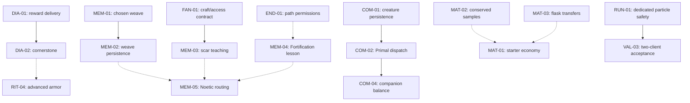

# Harbinger repair plan: grouped work and dependencies

Prepared from the 10 September 2026 [live findings](../HARBINGER_LIVE_GAMEPLAY_FINDINGS.md) and [attempt-by-attempt journal](../HARBINGER_GAMEPLAY_CAMPAIGN.md), with current source/resource entry points checked. These documents recommend changes; no production code or gameplay has been changed as part of writing them.

The goal is to restore a complete playable journey before drawing broad balance conclusions. Preserve the strong physical interactions, authored effects, factions, IDs and existing saves. Do not solve a crash by removing the feature, or solve a progression gate by granting every prerequisite.

## How to use the documents

Each task has a stable ID, observed basis, recommended code change, player-facing outcome, acceptance checks, linked prerequisites and linked downstream consumers. Read the specific task before assuming a whole group must finish first.

- **Requires** means the dependent implementation uses a contract or behavior established by that task. Land that prerequisite first, or integrate both as one ordered change.
- **Acceptance prerequisites** means work and local checks can proceed independently, but the complete gameplay verdict is invalid until those linked tasks are finished.
- **Unblocks** is the reverse link. An implementation dependency and an acceptance dependency are not interchangeable.
- **Confirmed defect** has live evidence. **Proposed tuning/policy** is a recommendation, not a proven fix. **Coverage gap** requires investigation before anyone labels the system broken.
- Every task starts **not implemented / not verified** here. Old campaign passes are evidence for the diagnosis, not acceptance of future patches.

For VAL tasks, **Requires** gates execution of the scored campaign; its scripts, fixtures and checklist can be prepared earlier. A requirement is satisfied by the linked task's acceptance evidence, not merely by a patch existing. The register lists direct dependencies; follow prerequisite links for inherited dependencies.

Prefer narrow fixes in existing systems. Use existing player attachments through HemoCapabilityAccess, existing NPC-owned missions and NeoForge payload registration. Add a small shared rule/context only where multiple failing paths demonstrably need the same contract. Preserve authored particle work through a correct server/client boundary. Follow the existing singular recipe/tag/loot resource conventions and inspect built resources, since several server datagen providers are disabled.

## Documents

- [Runtime stability and controls](01-runtime-and-controls.md) — RUN-01, RUN-02, RUN-03.
- [Dialogue, rewards and continuing lessons](02-dialogue-and-rewards.md) — DIA-01, DIA-02, DIA-03, DIA-04.
- [Materials, extraction and machines](03-materials-and-machines.md) — MAT-01, MAT-02, MAT-03, MAT-04.
- [Construction, Cardinal Rites and armor](04-crafting-rites-and-armor.md) — RIT-01, RIT-02, RIT-03, RIT-04.
- [Somatic weaving, scars and Anchorite teachings](05-weaving-scars-and-teachings.md) — MEM-01, MEM-02, MEM-03, MEM-04, MEM-05.
- [Morphlings and puppeteering](06-morphlings-and-puppets.md) — COM-01, COM-02, COM-03, COM-04.
- [Fanes, recruitment and player persistence](07-fanes-recruitment-and-persistence.md) — FAN-01, FAN-02, FAN-03, FAN-04.
- [Qliphoth, path decisions and ending recovery](08-qliphoth-and-endings.md) — END-01, END-02, END-03, END-04.
- [Validation campaigns and acceptance](09-validation-and-execution.md) — VAL-01, VAL-02, VAL-03, VAL-04.

## Recommended execution order

These are integration milestones, not blanket barriers between document numbers. A group can contain both an early correctness fix and a much later balance task.

1. **Restore safe execution and reliable state transitions.** Start RUN-01/02, DIA-01, MAT-02/03, RIT-01/02, FAN-01, END-01/02 and COM-01 independently where they do not edit the same files. RUN-03 can investigate native input immediately. The dependency register below overrides this broad ordering.
2. **Connect the previously broken handoffs.** DIA-02 follows DIA-01; MEM-02 follows MEM-01; COM-02 follows COM-01; supervised scar access in MEM-03 follows FAN-01. Complete late lesson access, member onboarding, helper positioning and durable death recovery. Test each reproduced failure as it is fixed.
3. **Finish real teaching and ending routes.** Validate the natural weaving/scar lesson, full Anchorite strain/fortification/routing sequence, advanced armor/cornerstone chain, tree/choice/recovery loop and actual Staff reward. Use acceptance prerequisites to identify which other groups still prevent a meaningful run.
4. **Tune only functioning systems.** Measure starter pacing after container/flask fixes; natural rare-material supply after worldgen/source repair; companions after real growth and actives; encounters after readiness and role contracts. Keep proposed values separate from measured results.
5. **Run release-level acceptance.** VAL-01 replays the fresh solo core; VAL-03 replays a real dedicated server with two players; VAL-02 closes natural balance and advanced-branch claims. VAL-04 is the distinct Unstained expansion required for an all-Observances claim, not a prerequisite for every Harbinger fix.

Do not wait for every cosmetic repair to reproduce a corrected container transfer. Equally, do not call multiplayer progression fixed because the same action succeeds on an integrated server.

## Cross-group dependency examples

Solid arrows mean implementation prerequisites. Dashed arrows mean gameplay acceptance prerequisites. This is a selected map; the full register below is authoritative.

## Full dependency register

A dash means no direct dependency of that type. Follow links for the reason and the reverse list of affected tasks. Dependencies include within-group and cross-group edges.

| Task | Recommended work | Requires before implementation | Acceptance prerequisites |
|---|---|---|---|
| [RUN-01](01-runtime-and-controls.md#run-01) | Remove server-side client particle class loading | — | — |
| [RUN-02](01-runtime-and-controls.md#run-02) | Make awakened Staff morph rendering safe | — | — |
| [RUN-03](01-runtime-and-controls.md#run-03) | Resolve control conflicts and validate native held menus | — | — |
| [DIA-01](02-dialogue-and-rewards.md#dia-01) | Preserve dialogue choices and acknowledge real rewards | — | — |
| [DIA-02](02-dialogue-and-rewards.md#dia-02) | Validate block dialogue and deliver the cornerstone | [DIA-01](02-dialogue-and-rewards.md#dia-01) | — |
| [DIA-03](02-dialogue-and-rewards.md#dia-03) | Keep unfinished lessons after degree advancement | — | [DIA-01](02-dialogue-and-rewards.md#dia-01) |
| [DIA-04](02-dialogue-and-rewards.md#dia-04) | Make guidance readable and defer intrusive whispers | — | [END-01](08-qliphoth-and-endings.md#end-01) |
| [MAT-01](03-materials-and-machines.md#mat-01) | Give the starter economy a practical taught blood source | [DIA-01](02-dialogue-and-rewards.md#dia-01) | [MAT-02](03-materials-and-machines.md#mat-02), [MAT-03](03-materials-and-machines.md#mat-03) |
| [MAT-02](03-materials-and-machines.md#mat-02) | Conserve vials and make the syringe reward recoverable | — | — |
| [MAT-03](03-materials-and-machines.md#mat-03) | Unify Alembic storage, flask transfer and crystal guidance | — | — |
| [MAT-04](03-materials-and-machines.md#mat-04) | Restore and measure natural rare-material routes | — | [RIT-01](04-crafting-rites-and-armor.md#rit-01), [DIA-03](02-dialogue-and-rewards.md#dia-03) |
| [RIT-01](04-crafting-rites-and-armor.md#rit-01) | Remove the D6 construction cycle and expose craft targets | — | — |
| [RIT-02](04-crafting-rites-and-armor.md#rit-02) | Make rite requirements and repair readiness agree | — | [RUN-01](01-runtime-and-controls.md#run-01), [FAN-03](07-fanes-recruitment-and-persistence.md#fan-03) |
| [RIT-03](04-crafting-rites-and-armor.md#rit-03) | Clarify timed ordeals and measure support dominance | [RIT-02](04-crafting-rites-and-armor.md#rit-02) | [COM-04](06-morphlings-and-puppets.md#com-04), [END-01](08-qliphoth-and-endings.md#end-01) |
| [RIT-04](04-crafting-rites-and-armor.md#rit-04) | Complete armor guidance and diagnose restraint damage | — | [DIA-02](02-dialogue-and-rewards.md#dia-02), [DIA-03](02-dialogue-and-rewards.md#dia-03), [MAT-04](03-materials-and-machines.md#mat-04) |
| [MEM-01](05-weaving-scars-and-teachings.md#mem-01) | Pin an explicit Loom recipe and protect the first weave | — | [DIA-01](02-dialogue-and-rewards.md#dia-01), [RUN-01](01-runtime-and-controls.md#run-01) |
| [MEM-02](05-weaving-scars-and-teachings.md#mem-02) | Persist and recover an active weave | [MEM-01](05-weaving-scars-and-teachings.md#mem-01) | — |
| [MEM-03](05-weaving-scars-and-teachings.md#mem-03) | Clarify scar carving, learning and fitting | [FAN-01](07-fanes-recruitment-and-persistence.md#fan-01) | [DIA-01](02-dialogue-and-rewards.md#dia-01), [RUN-01](01-runtime-and-controls.md#run-01) |
| [MEM-04](05-weaving-scars-and-teachings.md#mem-04) | Make Thelemic strain training useful rather than repetitive | — | [RUN-03](01-runtime-and-controls.md#run-03), [DIA-03](02-dialogue-and-rewards.md#dia-03), [END-01](08-qliphoth-and-endings.md#end-01), [MAT-03](03-materials-and-machines.md#mat-03) |
| [MEM-05](05-weaving-scars-and-teachings.md#mem-05) | Validate D6 Noetic routing and alternative scar builds | — | [MEM-04](05-weaving-scars-and-teachings.md#mem-04), [MEM-03](05-weaving-scars-and-teachings.md#mem-03), [END-01](08-qliphoth-and-endings.md#end-01), [MEM-02](05-weaving-scars-and-teachings.md#mem-02) |
| [COM-01](06-morphlings-and-puppets.md#com-01) | Persist one morphling identity and earned bond | — | — |
| [COM-02](06-morphlings-and-puppets.md#com-02) | Dispatch Primal abilities with the creature state | [COM-01](06-morphlings-and-puppets.md#com-01) | [RUN-02](01-runtime-and-controls.md#run-02), [RUN-01](01-runtime-and-controls.md#run-01) |
| [COM-03](06-morphlings-and-puppets.md#com-03) | Explain puppet roles, preparation and recall economics | — | [END-01](08-qliphoth-and-endings.md#end-01), [RUN-03](01-runtime-and-controls.md#run-03), [RUN-01](01-runtime-and-controls.md#run-01) |
| [COM-04](06-morphlings-and-puppets.md#com-04) | Measure tier value with matched companion builds | [COM-01](06-morphlings-and-puppets.md#com-01), [COM-02](06-morphlings-and-puppets.md#com-02), [COM-03](06-morphlings-and-puppets.md#com-03) | [MAT-02](03-materials-and-machines.md#mat-02), [MAT-04](03-materials-and-machines.md#mat-04) |
| [FAN-01](07-fanes-recruitment-and-persistence.md#fan-01) | Unify personal craft credit and station access | — | [RUN-01](01-runtime-and-controls.md#run-01) |
| [FAN-02](07-fanes-recruitment-and-persistence.md#fan-02) | Make member onboarding and permissions explicit | [DIA-01](02-dialogue-and-rewards.md#dia-01), [FAN-01](07-fanes-recruitment-and-persistence.md#fan-01) | — |
| [FAN-03](07-fanes-recruitment-and-persistence.md#fan-03) | Keep recruited helpers out of ritual interaction lanes | [FAN-01](07-fanes-recruitment-and-persistence.md#fan-01) | [RUN-01](01-runtime-and-controls.md#run-01) |
| [FAN-04](07-fanes-recruitment-and-persistence.md#fan-04) | Classify durable Chamber state and safe death recovery | — | [RIT-01](04-crafting-rites-and-armor.md#rit-01), [END-01](08-qliphoth-and-endings.md#end-01) |
| [END-01](08-qliphoth-and-endings.md#end-01) | Centralize pending and completed path permissions | — | — |
| [END-02](08-qliphoth-and-endings.md#end-02) | Commit pome consumption to its source tree safely | — | — |
| [END-03](08-qliphoth-and-endings.md#end-03) | Clarify tree care, travel and revelation timing | [END-01](08-qliphoth-and-endings.md#end-01), [END-02](08-qliphoth-and-endings.md#end-02), [DIA-04](02-dialogue-and-rewards.md#dia-04) | [DIA-03](02-dialogue-and-rewards.md#dia-03) |
| [END-04](08-qliphoth-and-endings.md#end-04) | Retest Vesper difficulty and the complete reward loop | — | [END-01](08-qliphoth-and-endings.md#end-01), [END-02](08-qliphoth-and-endings.md#end-02), [RUN-02](01-runtime-and-controls.md#run-02), [RIT-04](04-crafting-rites-and-armor.md#rit-04), [COM-04](06-morphlings-and-puppets.md#com-04) |
| [VAL-01](09-validation-and-execution.md#val-01) | Replay the repaired solo journey from a fresh character | [RUN-03](01-runtime-and-controls.md#run-03), [DIA-01](02-dialogue-and-rewards.md#dia-01), [DIA-03](02-dialogue-and-rewards.md#dia-03), [MAT-01](03-materials-and-machines.md#mat-01), [MAT-02](03-materials-and-machines.md#mat-02), [MAT-03](03-materials-and-machines.md#mat-03), [MAT-04](03-materials-and-machines.md#mat-04), [MEM-02](05-weaving-scars-and-teachings.md#mem-02), [MEM-03](05-weaving-scars-and-teachings.md#mem-03), [RIT-01](04-crafting-rites-and-armor.md#rit-01), [RIT-02](04-crafting-rites-and-armor.md#rit-02), [RIT-04](04-crafting-rites-and-armor.md#rit-04), [FAN-01](07-fanes-recruitment-and-persistence.md#fan-01), [END-03](08-qliphoth-and-endings.md#end-03) | — |
| [VAL-02](09-validation-and-execution.md#val-02) | Run separate natural balance and advanced-branch campaigns | [VAL-01](09-validation-and-execution.md#val-01), [COM-04](06-morphlings-and-puppets.md#com-04), [RIT-03](04-crafting-rites-and-armor.md#rit-03), [MEM-05](05-weaving-scars-and-teachings.md#mem-05), [END-04](08-qliphoth-and-endings.md#end-04) | — |
| [VAL-03](09-validation-and-execution.md#val-03) | Replay the shared dedicated-server progression | [RUN-01](01-runtime-and-controls.md#run-01), [RUN-02](01-runtime-and-controls.md#run-02), [DIA-02](02-dialogue-and-rewards.md#dia-02), [FAN-02](07-fanes-recruitment-and-persistence.md#fan-02), [FAN-03](07-fanes-recruitment-and-persistence.md#fan-03), [FAN-04](07-fanes-recruitment-and-persistence.md#fan-04), [MAT-02](03-materials-and-machines.md#mat-02), [MAT-03](03-materials-and-machines.md#mat-03), [MEM-02](05-weaving-scars-and-teachings.md#mem-02), [COM-02](06-morphlings-and-puppets.md#com-02), [END-01](08-qliphoth-and-endings.md#end-01), [END-02](08-qliphoth-and-endings.md#end-02), [RIT-02](04-crafting-rites-and-armor.md#rit-02) | — |
| [VAL-04](09-validation-and-execution.md#val-04) | Run the separate Unstained Observances campaign | — | [RUN-01](01-runtime-and-controls.md#run-01), [DIA-01](02-dialogue-and-rewards.md#dia-01), [DIA-04](02-dialogue-and-rewards.md#dia-04), [END-01](08-qliphoth-and-endings.md#end-01) |

## Decisions recommended, not silently assumed

| Topic | Recommended direction | Owner |
|---|---|---|
| Completed paths | Restore ordinary allowed spells/crafts/side lessons; retain branch exclusivity and unique-reward rules. Pending-choice restrictions must leave a recovery route. | [END-01](08-qliphoth-and-endings.md#end-01) |
| Monolith progression | D6 infrastructure availability; preserve separately intended D7 shatter/reward gates. Keep initial blood prices while fixing reachability. | [RIT-01](04-crafting-rites-and-armor.md#rit-01) |
| Personal/shared stations | Keep personal mastery by default, award the founder's legitimate Bloodwell credit, clearly scope any supervised first-lesson exception. | [FAN-01](07-fanes-recruitment-and-persistence.md#fan-01) |
| Alembic/flasks | Support at least one existing 2,500-blood flask in the tank; leave flask value unchanged initially. Audit all transfer paths and migration. | [MAT-03](03-materials-and-machines.md#mat-03) |
| Starter economy | Prefer a bounded first-loop supply/allowance and a taught repeatable source over a global yield multiplier. Measure the proposed 5-10 active-minute target. | [MAT-01](03-materials-and-machines.md#mat-01) |
| Crystal drops | Initially prefer keeping the observed mature normal-pick reward; reconcile authored expectations before changing harvest rules. | [MAT-03](03-materials-and-machines.md#mat-03) |
| Timed rites | Keep defensive survival where authored; required objectives cannot silently fail into success, optional objectives need explicit bonus semantics. | [RIT-03](04-crafting-rites-and-armor.md#rit-03) |
| Puppet recall | Document the current thread-funded full-health resummon first; change it only with uptime/economic evidence. | [COM-03](06-morphlings-and-puppets.md#com-03) |
| Anchorite training | Teach bounded existing overexertion/recovery before considering a tutorial-only threshold adjustment; do not inflate global strain. | [MEM-04](05-weaving-scars-and-teachings.md#mem-04) |

## Shared files and integration conflicts

Independent tasks may still touch the same file. That is a coordination requirement, not a fabricated gameplay dependency.

| Shared area | Task owners | Integration rule |
|---|---|---|
| DialogueEventHandler / hub / mission delivery | DIA-01/02/03, MAT-01, FAN-02, MEM-01/04 | Keep one reward claim/acknowledgement convention; preserve original NPC event IDs and task ownership. |
| HarbingerCardinalRiteEvents | RUN-01, RIT-02/03, FAN-01, END-01 | Separate particle transport, eligibility, payment and completion; agree how failure restores Staff/offering escrow before merging edits. |
| LivingStaffItem / related input | RUN-02/03, COM-02, END-01/04 | Renderer owns appearance, creature state owns Primal eligibility, shared path policy owns permission. Avoid several independent permission exceptions. |
| Loom serialization and recipe resolution | MEM-01/02 | Settle selected recipe and committed-input fields before persistence changes. |
| Player death and saved progress | FAN-04, COM-01, END-01/02 | Separate durable earned progress from transient seat/visit/session data; avoid copying inventory into existing drops or creating duplicate creature records. |
| Player-facing books, lang, inquiries and JEI | All relevant groups | Update actual behavior after implementation. Keep proposal text here instead of rewriting current manuals as though the changes already exist. |

## Acceptance and migration rules

For each correction: reproduce the original failure in a copied checkpoint, apply the minimal fix, exercise the same real player action, and run focused rule/serialization/packet checks appropriate to the change. Add negative controls for duplicate claims, rejected costs and cross-player ownership where those mechanisms changed. Broaden to the integration campaign after those focused checks pass.

Use fresh worlds for acquisition/worldgen and no-bypass journey acceptance. Use preserved worlds for recovery compatibility. A source inspection or a test that directly grants the completed milestone does not establish a player journey. Simulated key state does not establish native GLFW radial usability. Unattended deaths and mismatched combat fixtures remain excluded from balance conclusions.

Do not automatically repair old saves by inferring a missing personal event from a global degree or pome count. Recover only from matching authoritative history; otherwise surface the ambiguity and preserve the data. No production save deletion, broad progression reset, or blanket reward replay is part of these recommendations.

Preserved evidence starts in `build/gameplay-campaign/checkpoints/`: D1 blocked reward and later journal context; `solo-d5-fane-bloodwell-gate`; `solo-earned-d6-monolith-frame`; `solo-d7-first-pome-consumed-tree-stuck`; `solo-morphling-earned-bond-lost-in-jar`; `dedicated-cardinal-helix-crash`; `solo-awakened-staff-morph-client-crash`; and `solo-anchorite-treatment-fortification-denied`. Consult the journal for exact scenario and assists; do not assume every intended screenshot filename represents success. Checkpoint folders are local ignored artifacts and may not accompany a copied repository.

After implementation, update affected `docs/HEMOMANCY_REFERENCE.md`, `docs/LORE_REFERENCE.md` and relevant `wiki/` pages. These proposed documents do not require changes to current manuals yet. The repository currently ignores `/docs/`; this pack is available locally but is not automatically included in a commit.
