# Engram Weaving: a player's guide

The Somatic Loom teaches a Harbinger a blood memory by **weaving its engram**. The engram is a star of empty channels that the loom spreads across the ground around itself. You thread each piece of the memory home to the loom with a Living Staff.

Every image below is from the game: the screenshots come from the loom review client, and the glyph sprites are cut from the mod's own `engram_glyphs` textures and coloured the way the renderer colours them.

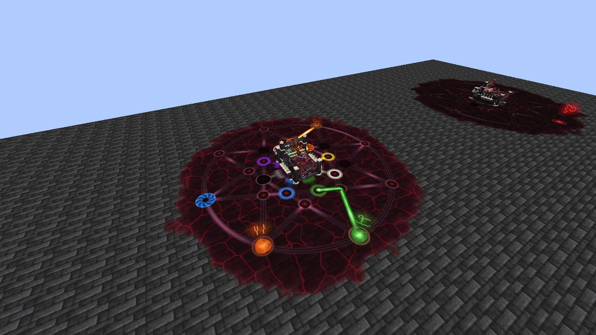

---

## How a weave goes

| | Step | What to do |
|---|---|---|
| 1 | **Choose and load** | Choose the memory at the loom and feed it enzymes. Each enzyme becomes **3 spans** of thread of its tendency, and a vial holds up to 192 spans. Before taking blood, the loom tells you how many spans *your* engram needs of each colour. |
| 2 | **Pay the blood** | The engram unfurls over the ground: living skin with an eight-pointed star sunk into it, and the loom at its heart. One **fragment** rises for every enzyme the recipe lists. |
| 3 | **Listen** | Hold a Living Staff and rest your gaze on a fragment for half a second. The echo floating above the loom replays that memory. A **false** fragment replays the wrong memory. |
| 4 | **Take a lane** | Use the staff on a fragment. Its pool grows a ring of beads: you are holding its lane. |
| 5 | **Draw it home** | Hold use and sweep along the lines, or click node by node. Sweep back onto the last node to undo a step; **sneak-use** on a lane cuts it back to that node. |
| 6 | **Reach the loom** | A lane is home when it runs down a spoke into the loom, or ends on a lane of its own colour that is already home. |
| 7 | **Leave the lies** | Don't thread false fragments home. Each rank punishes it differently (see [By rank](#by-rank)). |
| 8 | **Finish** | Once every real fragment is home, the engram draws back into the loom, the real lanes' spans are spent, and the memory is woven. |

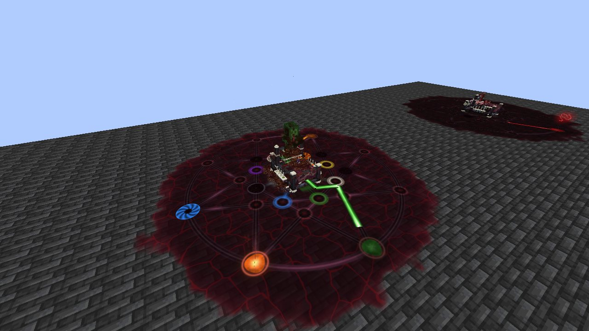

*The climax: every real lane is home and the engram draws up into the loom.*

### Cancelling

Crouch-use the loom with an empty hand to cancel. The spent blood is lost, but the enzymes' thread returns to the vials. The engram comes apart where it lies rather than vanishing:

- glyphs crumble into their pools;
- lanes char and spark;
- the skin rots away from its rim toward the loom behind a thin burning seam;
- the echo tears off its limbs one by one and fades;
- a Cortical dome sinks away.

| | |
|---|---|
| 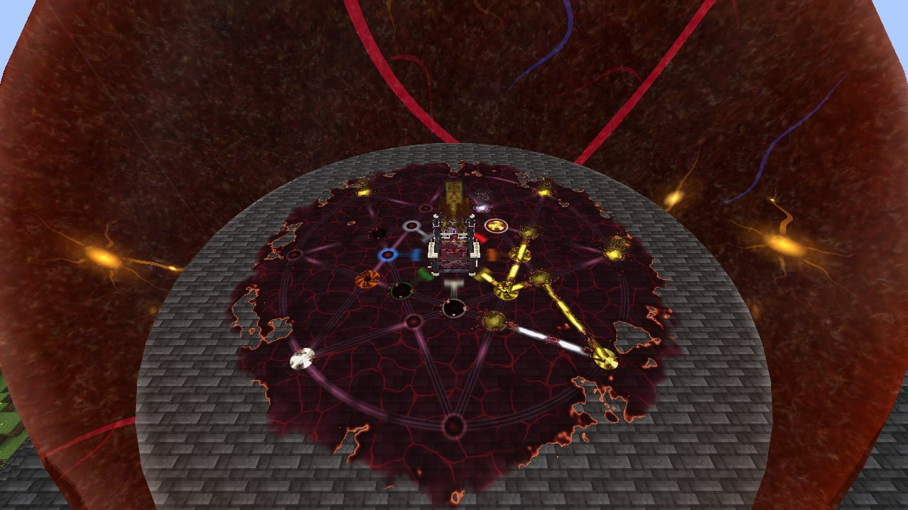 Just cancelled: the rim burns away first | 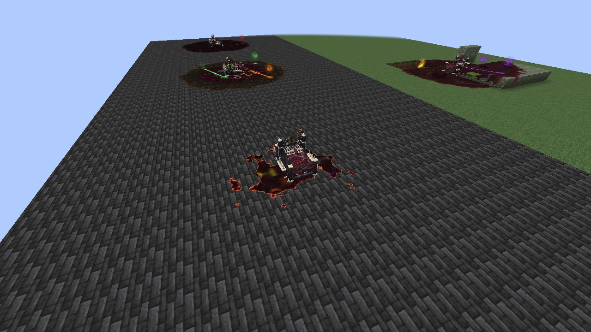 A moment later: charred patches by the loom |

### What it costs

- **Each node a lane steps onto costs 1 span** of that lane's colour.
- Spans are spent **only when the memory finishes**, and only for the real lanes. Cutting or undoing a lane costs nothing.
- If the loom runs out of a colour, the next step is refused. You can top up with enzymes **mid-weave** without cancelling anything.

---

## The engram on the ground

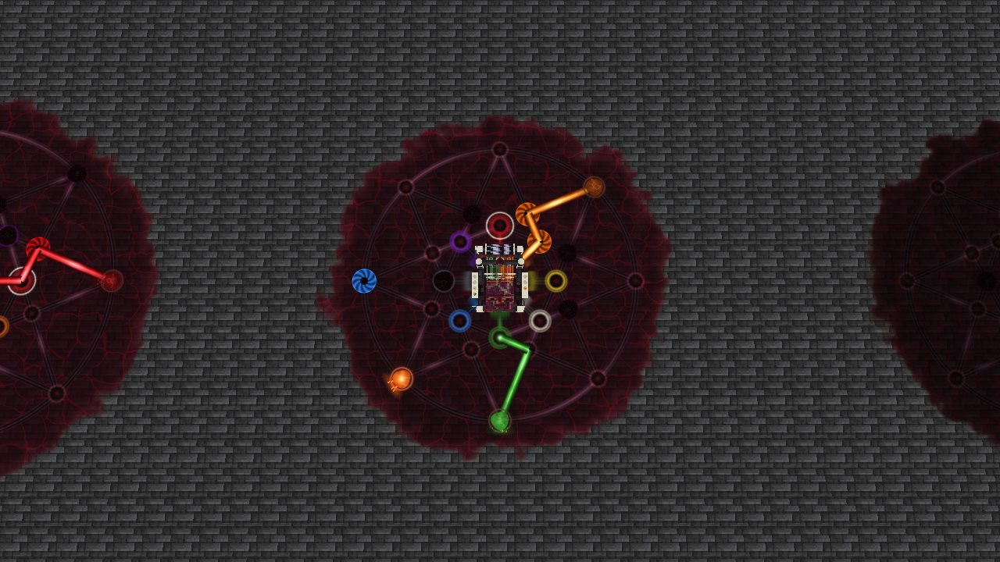

The engram is an eight-pointed star in a ring. Lanes can only travel along its drawn lines:

- **the star's lines**: each runs from one point to the third point along, crossing others on the way;
- **the outer rim**, between neighbouring points;
- **the eight spokes** from the inner octagon into the loom.

There are **24 sockets**: the 8 outer points, the 8 crossings just inside them, and the 8 corners of the inner octagon. The loom itself is the 25th node, the **Vessel**.

Fragments sit on the outer points. Big recipes spill onto the crossings.

### The rules of a lane

1. **Move node to node** along drawn lines only.
2. **A node holds one colour.** Lanes of different colours never cross or share a node.
3. **Same colour may join.** End your lane on a lane of its own colour and that lane carries yours home.
4. **Keyed faces (Summa and up).** Each spoke enters one face of the loom, and a lane must enter the face of its own colour. See [the wheel](#the-wheel).
5. **Scars block, valves filter, prisms dye** (see the markings below).

---

## Markings on the ground

Each close-up below centres on one marking.

| Close-up | Marking | Meaning |
|---|---|---|
| 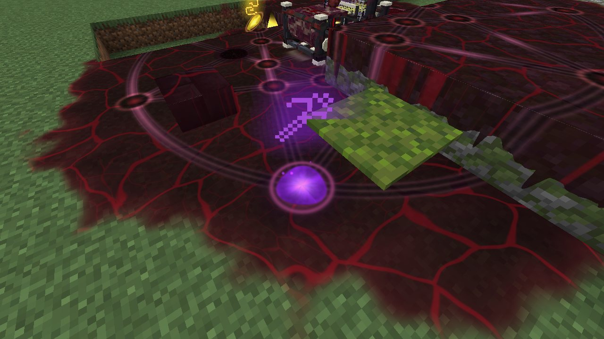 | **Fragment** | A piece of the memory: a glowing pool in its tendency's colour with its glyph floating above. **Thread it home.** |
| 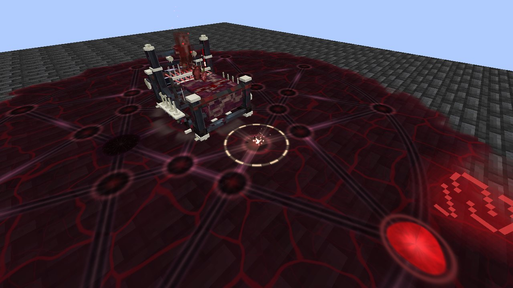 | **Held lane** | The fragment whose lane you hold has **beads circling its pool**. A **hot bead** marks where the lane ends. The **pale ring of ticks** is the node your staff points at: that step will be taken. |
| 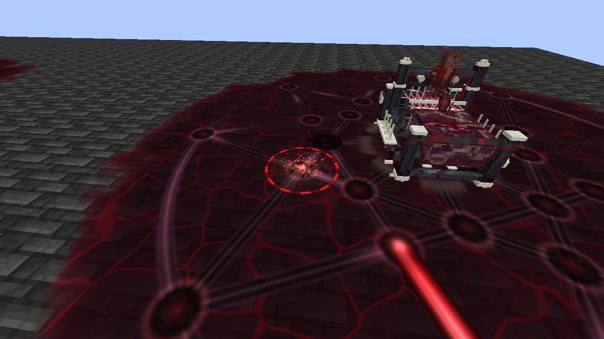 | **Refused step** | The ring turns **red** and the staff's dots scatter red when the step can't be taken: a crossing, a scar, a valve or prism of the wrong colour, the wrong face, a node out of line, or no thread left. |
| 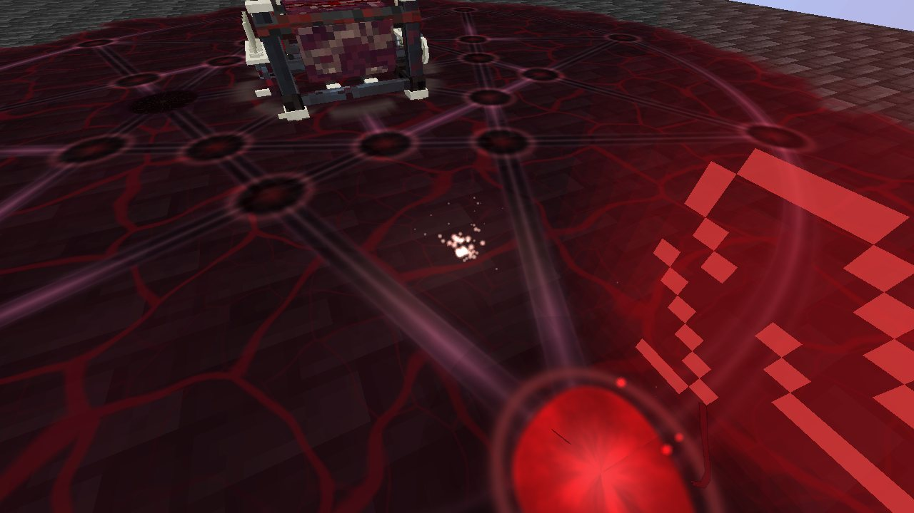 | **Staff point** | Fine dots settle on the exact pixel of the block face your staff touches. They linger, so a sweep leaves a dotted trail. They're pale with nothing held and take the lane's colour while you draw. |
| 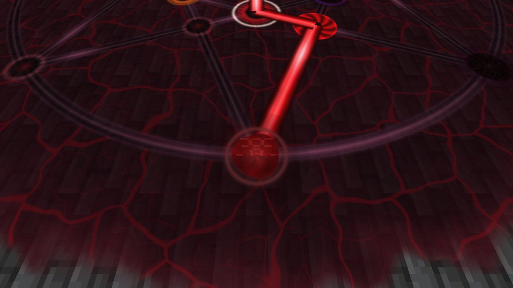 | **Home** | A lane that reaches the loom. The fragment's pool **drains and dims** and its glyph sinks. |
| 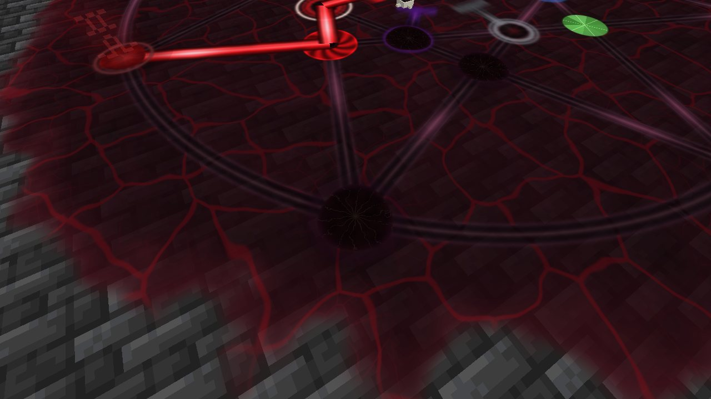 | **Scar** | A crust of dead, black clot over a socket, cracked to its rim, with a bruise around it. **Nothing passes through.** |
| 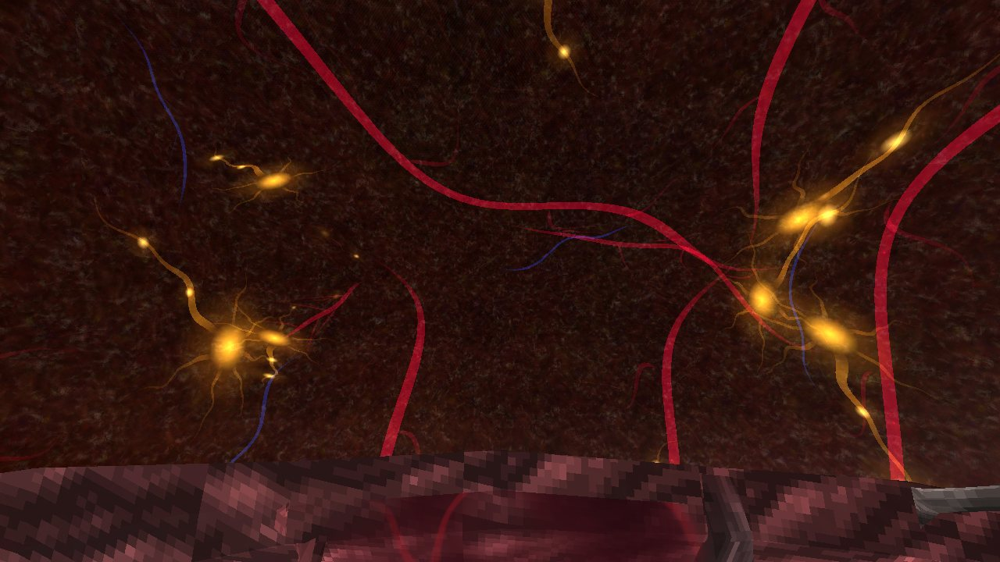 | **Valve** (Summa+) | A ring of folded flesh in one tendency's colour around a dark mouth. **Only that colour's lane may pass.** |
| 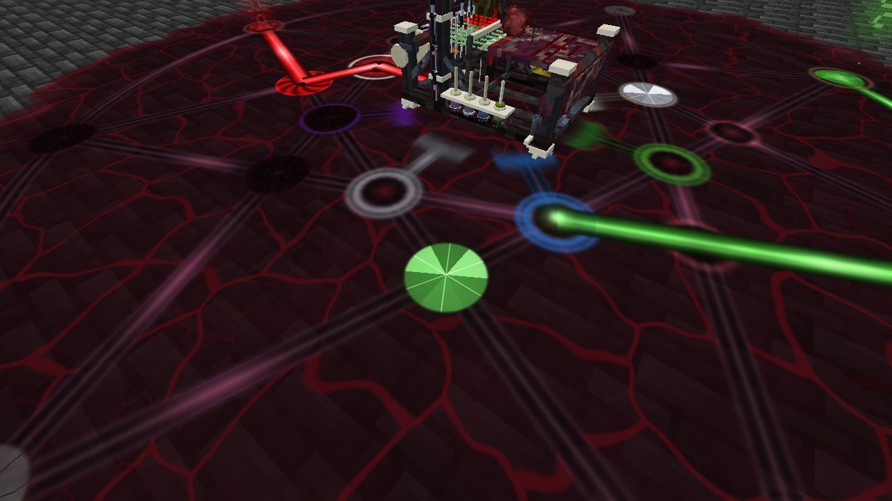 | **Prism** (Magister+) | A faceted, sparkling crystal iris. A **grey lane passing through it is dyed** the prism's colour. |
| 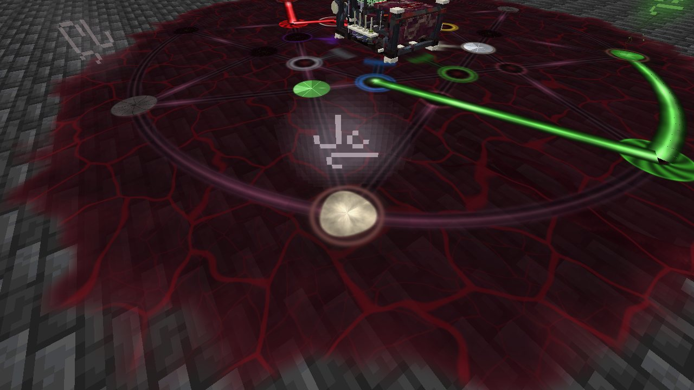 | **Grey fragment** (Magister+) | A pearly, shimmering grey pool: its colour is hidden. Its lane runs grey until it **passes the prism of its true colour**. |
| 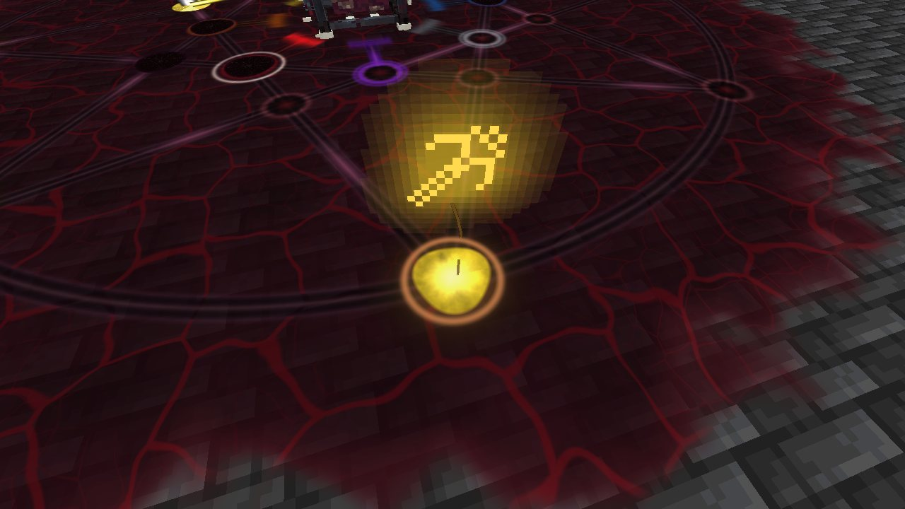 | **False fragment** (Mediocritas+) | An *intrusion*: a failed Harbinger's memory dressed as a real one, in a colour the recipe uses. Its pool and glyph **brighten between the loom's heartbeats**, and listening to it replays the wrong memory. **Leave it alone.** |
| 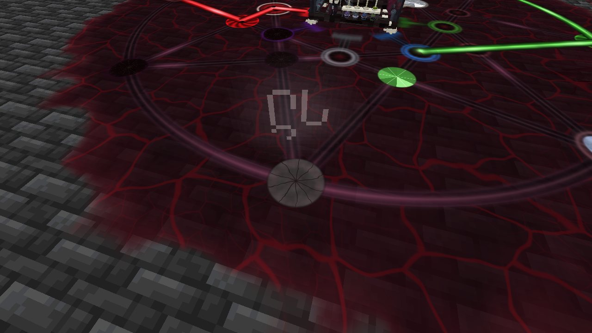 | **Husk** | A false fragment your **bloodline has already woven**: a dry, grey, cracked pod with a faint grey glyph. Harmless. Ignore it. |
| 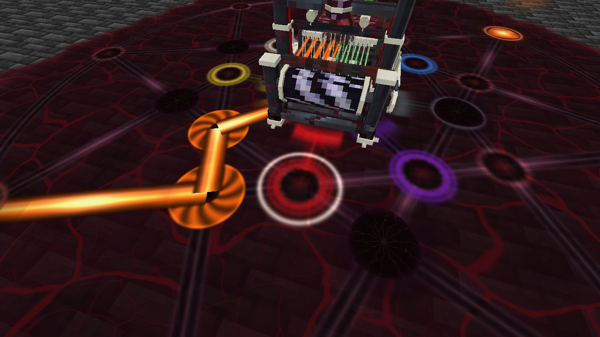 | **Keyed socket** (Summa+) | On a keyed engram, each inner-octagon socket's rim burns in the colour of the loom face its spoke enters. The rim round the loom's foot shows the same eight colours. The **pale double ring** marks the **Animus** face. |
| 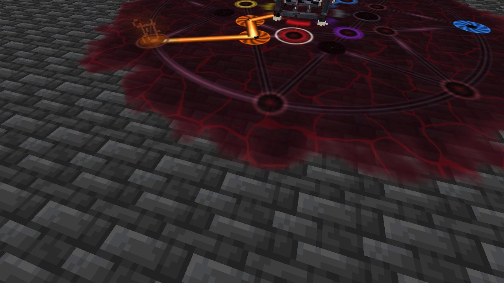 | **Rot** (Summa / Magister) | Grey-green rot creeping in from the rim, sprouting pale spore blooms. It is **fungal pressure** built up by mistakes. |

An **empty socket** is a dark pit with an ember at its bottom and a pale rim; lanes pass through it freely. The empty channels between sockets carry pale pulses toward the loom, and a threaded lane fills its channel with its colour.

---

## Floating glyphs

A glyph hangs over each fragment: one letter of the Engram script, glowing in the fragment's colour.

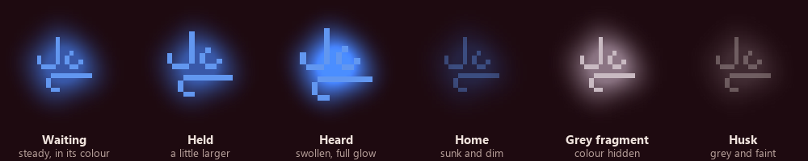

| Glyph | Meaning |
|---|---|
| 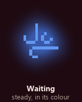 | **Waiting**: steady, in its colour. A real fragment not yet threaded. |
| 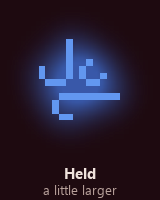 | **Held**: a little larger. Its lane is the one you're drawing. |
| 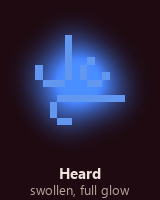 | **Heard**: swollen with a full glow, and a nerve thread runs from it up to the echo above the loom. |
| 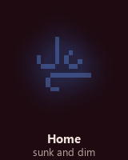 | **Home**: sunk toward its pool and dim. |
| 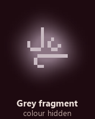 | **Grey fragment**: pearl grey; its colour is hidden. |
| 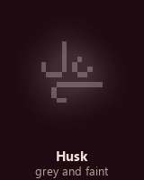 | **Husk**: grey and faint; a lie your bloodline already knows. |

### Telling a false fragment from a real one

Every glyph breathes with the loom's heartbeat, but a false one breathes **against** it: real fragments brighten on the beat, lies brighten between beats. Listening confirms it, because a lie replays the wrong memory in the echo.

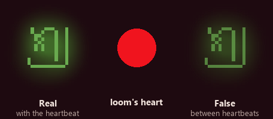

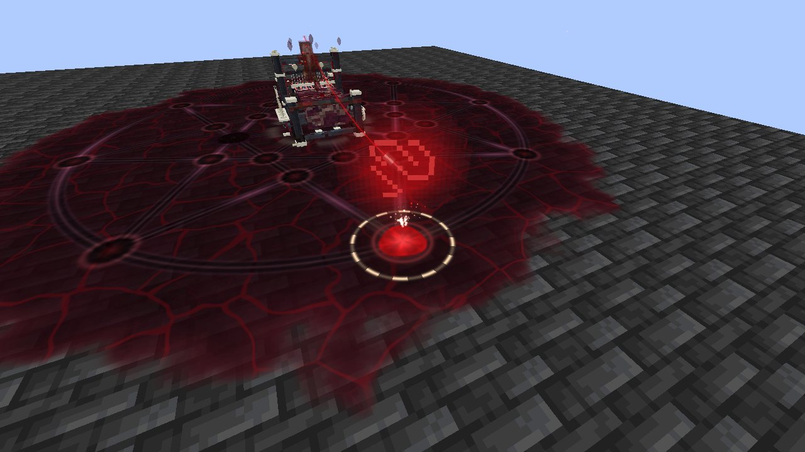

*Listening: the glyph swells and a nerve thread runs up to the echo over the loom.*

### The Engram script

Each fragment shows one of these 36 letters (0–9, a–z). **The letter has no rule meaning**; it's the memory's handwriting. Only the **colour** and the **state** of the glyph matter.

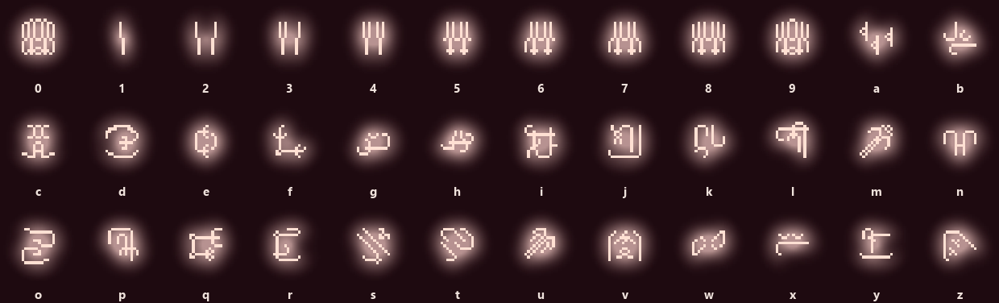

---

## The wheel

Each fragment's colour is its blood tendency:

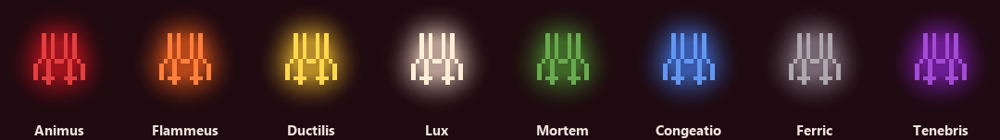

| | Tendency | | Tendency |
|---|---|---|---|
|  | **Animus** |  | **Mortem** |
|  | **Flammeus** |  | **Congeatio** |
|  | **Ductilis** |  | **Ferric** |
| 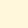 | **Lux** |  | **Tenebris** |

On a **keyed** engram (Summa and up), the eight faces of the loom run **clockwise** in this order, the same order as the Harbinger progress screen: Animus → Flammeus → Ductilis → Lux → Mortem → Congeatio → Ferric → Tenebris. The wheel can start on any face; find the **pale double ring** (Animus) and read clockwise from there. A lane must come down the spoke of the face matching its colour.

---

## By rank

| Rank | What the engram adds | Threading a false fragment home |
|---|---|---|
| **Humilis** | An open star with 1–3 scars. No false fragments. | — |
| **Mediocritas** | 1 false fragment, 2–4 scars. | **Burns** the false lane's spans, taking any shortfall from your blood. |
| **Summa** | **Keyed faces**, 1–2 valves, 1 false fragment. | **Fungal pressure** (see below). |
| **Magister** | Keyed, 2–3 valves, 1–2 false fragments, 3–5 scars, and a **grey fragment** with its **prism**. | **Fungal pressure.** |
| **Perfectus** | Keyed, 2–3 false fragments. | The torn memory **bites** you once, after a visible wind-up. |

**Fungal pressure:** each mistake adds 1. At 3 it boils over: an open socket scars shut, or, once none is left, a free point calls up a new false fragment. Rot spreads in from the rim as pressure builds.

**No weave can kill you.** At worst you black out and the weave pauses until you return.

---

## Bigger looms

| Loom | Engram size | Staff reach | Listening |
|---|---|---|---|
| Somatic Loom | points 5 blocks out | 5.5 blocks | within staff reach |
| Ganglionic | 5.75 blocks | 8 blocks | from anywhere on the engram (16 blocks) |
| Cortical | 6.5 blocks, under your Chamber dome | 8 blocks | from anywhere on the engram (16 blocks) |

The engram drapes over the real ground (steps, slabs, ledges) and its sockets follow the terrain:

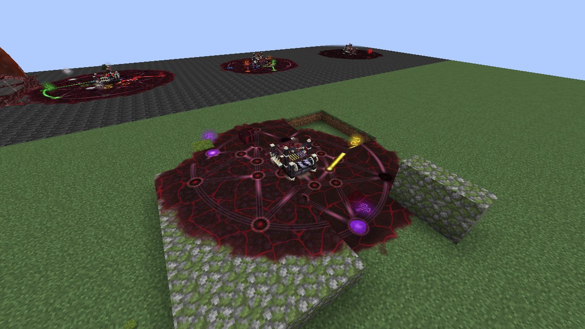

---

## More views

| | |
|---|---|
| 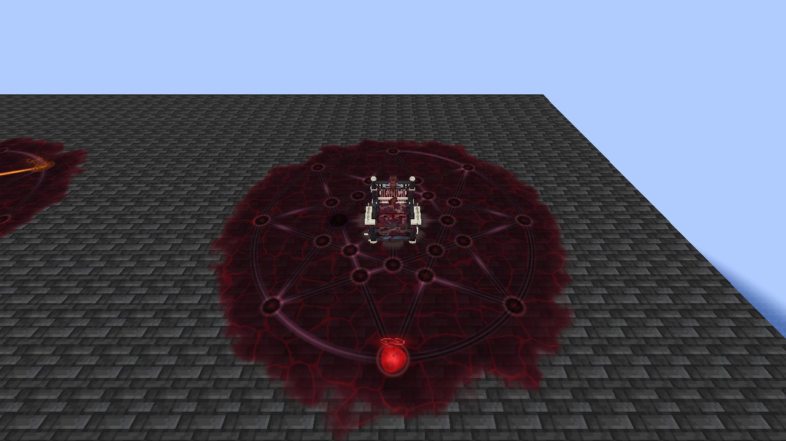 Humilis, just unfurled | 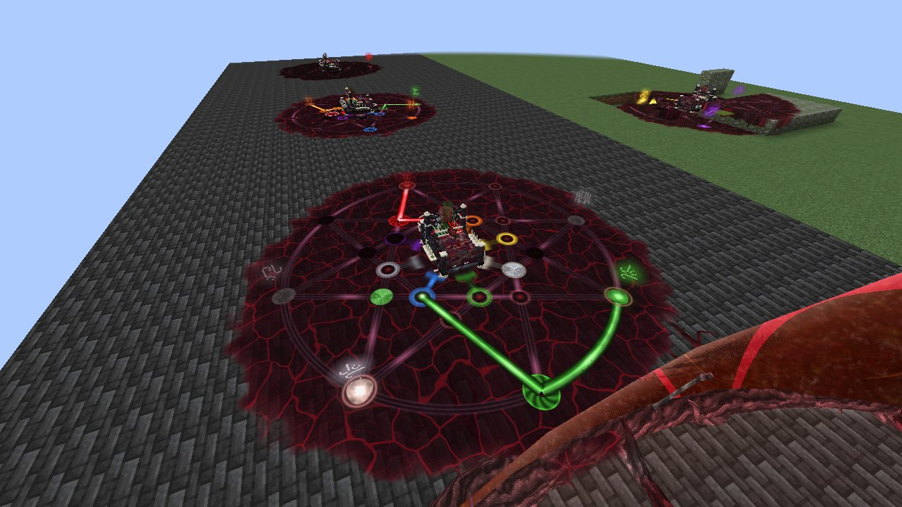 Magister (east-facing loom) |
| 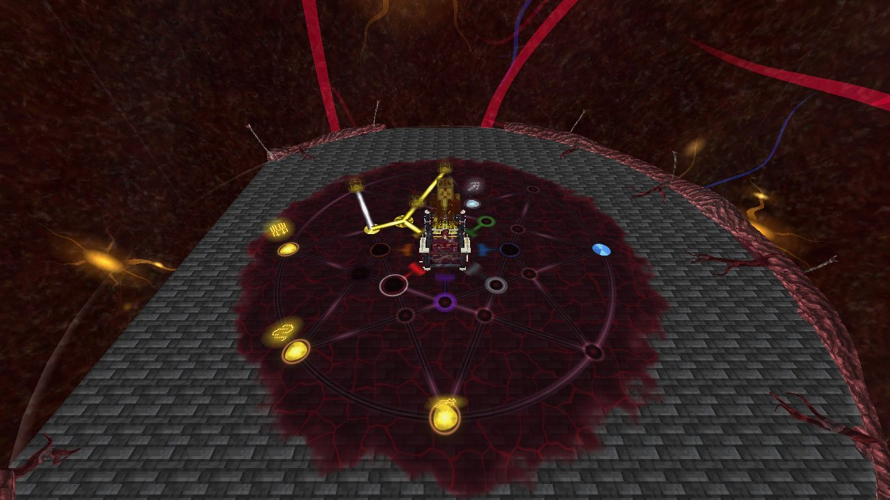 Perfectus under the Cortical dome | 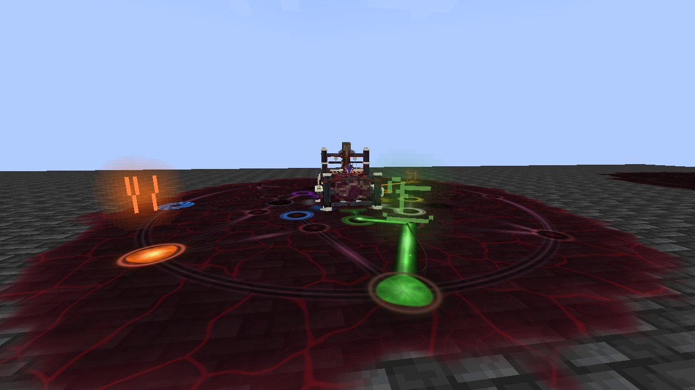 Summa at eye height |
| 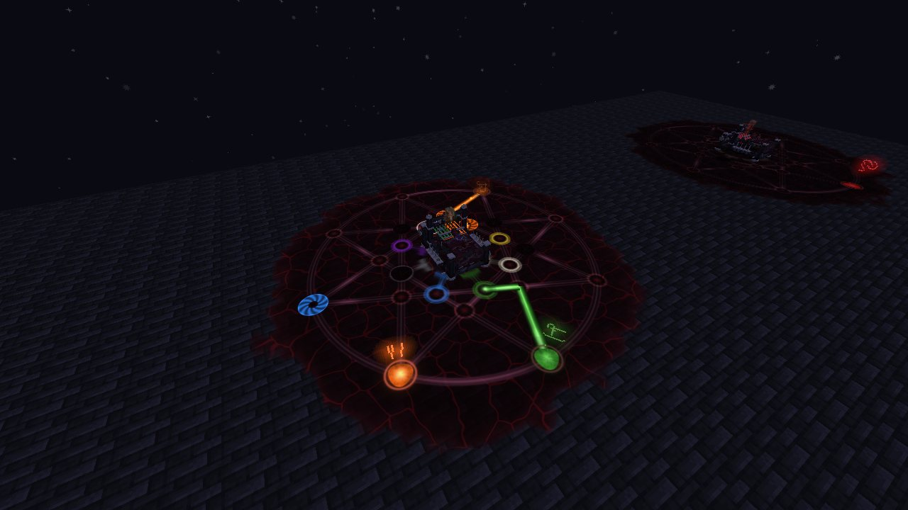 Summa at night | 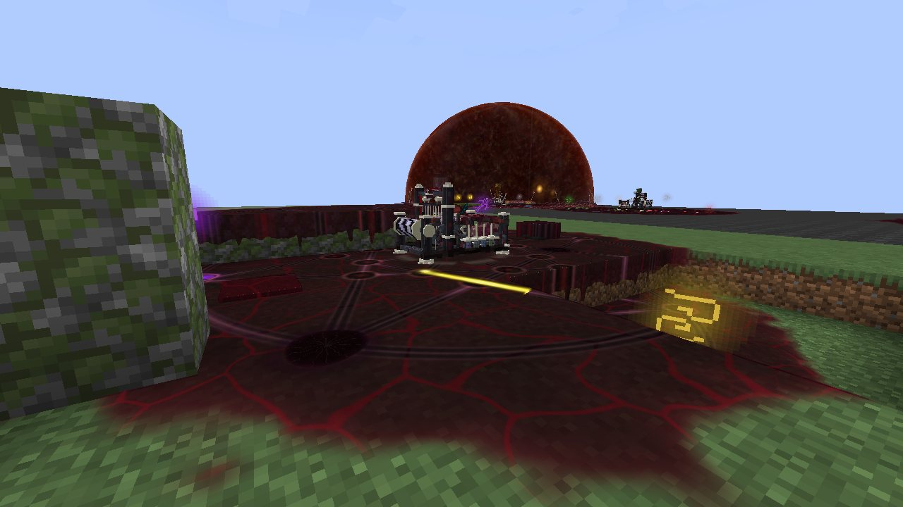 Draped over a step and a pit |

A one-page printable summary is in [`img/field-guide.png`](img/field-guide.png) ([SVG](img/field-guide.svg)).
